# Novel World AI Simulator · Complete Use Guide (Zero to Export)

> Applies to version: **0.3.3**
> For: first-time users who want to know "every click, every field" step-by-step.
> This guide covers: prepare API key -> Python environment with Chinese mirror -> install -> run -> global LLM model + per-Agent setup -> configure NovelService -> Open Volume (ingest) -> Start Brush (start daily play) -> Pick Volume / Book Breakdown -> configure current project -> pause / stop / export -> running screen -> LLM usage.
> All screenshots are from the actual UI (stored at `assets/images/manual/zh/`).

---

## 0. Three Things to Understand First (Glance Now, Won't Be Lost Later)

This program is not "a window with a row of tabs" but **two screens + a stack of dialogs**:

| Screen / dialog | What it does | How to enter |
|---|---|---|
| **Home screen** | 8 entry cards: Open Volume / Pick Volume / Start Brush / Book Breakdown / Tianji (Settings) / Studio (Project Settings) / Resume / Quit | The first thing you see on launch |
| **Run screen** | Live screen: today's chapter, log, top buttons (start brush / pause / stop / export / menu / help / log) | Click "Start Brush" or "Resume" |
| **Tianji** (global settings) | 7 sub-pages: General / AI Model Config / UI Appearance / Run / Director & Compliance / Crew Agents / External Novel Service | Home screen -> "Tianji" |
| **Studio** (project settings) | 5 sub-pages: Genre & Style / Style Control / Director / Images / Crew Agents | Home screen -> "Studio" |
| **Help** | Read the manual (split by `##`) + keyword search + ask a question | "❓ Help" on the home screen or run screen (F11) |


What each of the 8 entries is:

| Entry | What it does |
|---|---|
| **Open Volume (开卷)** | Import a new book (settings bundle / raw material) -> "Open Volume Wizard" |
| **Pick Volume (拾卷)** | Open a previous book (project list) |
| **Start Brush (起笔)** | Start today's run (write today's chapter) -- needs Open Volume first |
| **Book Breakdown (拆书)** | Take a book you wrote well, decompose it into "writing method modules" that become your own skill (see 8.1) |
| **Tianji (天机)** | Global settings (models, Agents, run, services, ...) |
| **Studio (书斋)** | Current project's settings (genre, style, director, images, project-specific Agents) |
| **Resume (回卷)** | Go back to the run screen, continue (for books already opened) |
| **Quit (归去)** | Exit the program (see "Quit" section at the end) |

Four verbs, do not confuse:

* **Open Volume (开卷)** = import a new book (settings bundle / raw material) -> runs the Open Volume Wizard.
* **Start Brush (起笔)** = start today's run (write today's chapter) -> "Start Brush" at the top of the run screen.
* **Pick Volume (拾卷)** = open a previous book (project list) -> "Pick Volume" on the home screen.
* **Resume (回卷)** = return to the run screen to continue (for books already opened).

---

## 1. Prepare the API Key

The program calls models via the **OpenAI-compatible protocol**. You need:

1. A **Base URL** (down to the `/v1` layer, e.g. `https://api.deepseek.com/v1`);
2. An **API Key**;
3. The **model names** available under that account (e.g. `deepseek-v4-pro`, `deepseek-flash`, `hy3`, `mimo`).

Common Chinese aggregators with one Key + one Base URL switching across providers (OpenAI-compatible):

* **SiliconFlow (硅基流动)** -- cheapest, but no closed-source flagships
* **Tencent TokenHub / Qiniu Cloud AI** -- more balanced, includes closed-source flagships
* **Direct**: **DeepSeek**, **Alibaba Cloud Bailian (Qwen)**, **Zhipu (GLM)**, **MiniMax**, **Moonshot (Kimi)**, **Xiaomi (MiMo)**, **Tencent (Hunyuan Hy3)**, etc.

> Whatever models you already have, add corresponding entries to the "Model Registry" (see chapter 5).
> When you have multiple: **use the strong model for key scenes, a medium model for daily loops, a cheap model for compression / scoring** (the three tiers, see 5.3).

### 1.1 Recommended LLM Service Directory (sign-up / Base URL / model / how the program uses them)

Below is a consolidated table of the major services this program can talk to.
**"What it's good for in the program" is divided into three tiers**: **Front** tier = key scenes (sample chapter / script / external writing service); **Daily** tier = routine loops (director / actor / reviewer / ingest); **Cheap** tier = compression / scoring / background. Prices and model names change -- always check each vendor's console "model plaza" for the latest. Base URLs go down to the `/v1` layer.

#### A. Aggregator Gateways (one Key for many vendors, first choice for new users)

| Service | How to register / get a Key | Base URL (OpenAI-compatible) | Recommended Models (put in the `model` field) | What it's good for in the program |
|---|---|---|---|---|
| SiliconFlow (硅基流动) | [cloud.siliconflow.cn](https://cloud.siliconflow.cn), sign up for free trial credits | `https://api.siliconflow.cn/v1` | `deepseek-ai/DeepSeek-V3.1`, `Qwen/Qwen3-235B-A22B-Instruct`, `THUDM/glm-4-9b-chat`, `moonshotai/Kimi-K2-Instruct`, `BAAI/bge-m3` (embedding) | Daily / Cheap (cheap, high-volume); embedding for `EMBEDDING_*` |
| Qiniu AI Inference | Qiniu console -> AI Inference -> API Key | Domestic `https://api.qnaigc.com/v1` (overseas `https://api.modelink.ai/v1`) | `qiniu/deepseek-v4-pro`, `qiniu/qwen3-max`, `qiniu/z-ai/glm-5`, `qiniu/moonshotai/kimi-k2.5`, `qiniu/minimax/m3` | Front / Daily (incl. closed-source flagships; one Key connects all) |
| Tencent TokenHub | Tencent Cloud TokenHub console, activate a plan | Guangzhou `https://tokenhub.tencentcloudmaas.com/v1` (Singapore `https://tokenhub-intl.tencentcloudmaas.com/v1`) | `hy3`, `deepseek-v4-pro`, `glm-5.3`, `kimi-k3`, `minimax-m3`, `mimo-v2.5-pro` | Front / Daily (Hunyuan / DeepSeek / GLM / Kimi / MiniMax unified billing) |
| BlueDoAI | [bluedoai.com](https://www.bluedoai.com), create Key in console | `https://api.bluedoai.com/v1` | `qwen-max`, `qwen-plus`, `glm-5.2`, `deepseek-v4-pro`, `kimi-k2.6`, `doubao-seed-2-0-pro` | Front / Daily / Cheap (one Key connects Chinese mainstream) |

> Aggregator advantage: add only **one** entry to the model registry (base_url + key), and changing the `model` field switches vendors -- no need to add one entry per provider.

#### B. Chinese Vendors Direct Connection (when you want to lock to one)

| Service | How to register / get a Key | Base URL (OpenAI-compatible) | Recommended Models | What it's good for in the program |
|---|---|---|---|---|
| DeepSeek | [platform.deepseek.com](https://platform.deepseek.com) | `https://api.deepseek.com/v1` | `deepseek-v4-pro` (Front), `deepseek-v4-flash` (Cheap / Daily) | Front / Cheap |
| Alibaba Cloud Bailian (Qwen) | Alibaba Cloud Bailian console, create Key | `https://dashscope.aliyuncs.com/compatible-mode/v1` | `qwen-max` (Front), `qwen-plus` / `qwen3-plus` (Daily), `qwen-turbo` (Cheap), `text-embedding-v4` (vector) | Front first choice / Daily / Cheap / embedding |
| Zhipu GLM (BigModel) | [open.bigmodel.cn](https://open.bigmodel.cn) | `https://open.bigmodel.cn/api/paas/v4` | `glm-5` / `glm-5.3` (Front), `glm-4.5-plus` (Daily), `glm-4-flash` (Cheap) | Front / Daily / Cheap |
| Moonshot Kimi | [platform.moonshot.cn](https://platform.moonshot.cn) | `https://api.moonshot.cn/v1` | `kimi-k2` / `kimi-k2.6` (long context) | Researcher (long-doc lookups) / Daily |
| MiniMax | [minimax.chat](https://minimax.chat) | `https://api.minimax.chat/v1` | `minimax-m3` / `MiniMax-M2.7` | Daily / Cheap backup |
| ByteDance Doubao (Volcano Ark) | Volcano Engine Ark console | `https://ark.cn-beijing.volces.com/api/v3` | `doubao-seed-2-1-lite-260915` (chat), **`doubao-seed-character-251128` (role-play specific)**, `doubao-seedream` (image), `doubao-embedding` (vector) | Cheap first choice (cheap, fast) / **`actor` can switch to the role-play model** (see `User_Manual.md` §16.2b) / image `IMAGE_AI_MODEL` |
| StepFun | [platform.stepfun.com](https://platform.stepfun.com) | `https://api.stepfun.com/v1` | `step-3` / `step-3.5` | Cheap backup |
| Xiaomi MiMo | Your existing service (fill in your endpoint) | Your `https://.../v1` | `mimo` | Daily / Cheap (if you already have it) |
| Tencent Hunyuan Hy3 | Tencent Cloud (or via TokenHub) | `https://api.hunyuan.cloud.tencent.com/v1` | `hy3` (strong multimodal, modest plain-text creativity) | Cheap / possible image future |

#### C. Overseas Vendors Direct Connection (needs direct / proxy / OpenRouter)

| Service | How to register / get a Key | Base URL (OpenAI-compatible) | Recommended Models | What it's good for in the program |
|---|---|---|---|---|
| OpenAI | [platform.openai.com](https://platform.openai.com) | `https://api.openai.com/v1` | `gpt-5` / `gpt-5.5` (Front), `gpt-4.1` (Daily), `o4-mini` (reasoning) | Front / Daily |
| Anthropic (Claude) | [console.anthropic.com](https://console.anthropic.com) (this program uses OpenAI-compatible; recommended via OpenRouter) | OpenRouter `https://openrouter.ai/api/v1` | `claude-opus-4` / `claude-sonnet-4` (Front) | Front (English / long-form strong) |
| Google Gemini | [aistudio.google.com](https://aistudio.google.com) | `https://generativelanguage.googleapis.com/v1beta/openai/` | `gemini-2.5-pro` (Front), `gemini-2.5-flash` (Daily) | Front / Daily |
| xAI (Grok) | [x.ai](https://x.ai) | `https://api.x.ai/v1` | `grok-4` | Front / Daily |
| Mistral | [console.mistral.ai](https://console.mistral.ai) | `https://api.mistral.ai/v1` | `mistral-large` | Daily |
| Cohere | [dashboard.cohere.com](https://dashboard.cohere.com) | `https://api.cohere.ai/v2` | `command-r-plus` (incl. rerank) | Cheap / rerank |
| Meta Llama | Via Together / OpenRouter | `https://api.together.xyz/v1` | `llama-4-maverick` | Daily |
| Perplexity | [perplexity.ai](https://perplexity.ai) | `https://api.perplexity.ai` | `sonar` / `pplx` | Researcher (live search) / Cheap |

##### Volcano Ark: activating "Doubao Seed Character" (role-play specific)

**The API key is account-wide, but every model must be activated individually.** Calling an
unactivated model returns:

```
404 ModelNotOpen
Your account xxx has not activated the model doubao-seed-character-251128.
Please activate the model service in the Ark Console.
```

⚠ Two error codes look similar but mean opposite things:

| Error code | Meaning | What to do |
|---|---|---|
| `ModelNotOpen` | **The model name is right and the model exists — your account just has not activated it** | Activate it; effective within seconds |
| `InvalidEndpointOrModel.NotFound` | **The model name does not exist at all** | Stop guessing; read the exact id in the console |

**Activation (about 2 minutes):**

1. Open "Open Management":
   <https://console.volcengine.com/ark/region:ark+cn-beijing/openManagement>
   (replace `cn-beijing` if your region differs)
2. Find **`doubao-seed-character-260628`** (2026-06) or **`doubao-seed-character-251128`**
   (2025-11). Activate whichever id you were given (or both).
3. Click "Activate". Effective immediately, pay-as-you-go, nothing charged while idle.
4. Verify (30 seconds, no config changes needed):

```bash
cd <program dir>
.venv/Scripts/python.exe - <<'EOF'
import json, urllib.request
from pathlib import Path
d = json.loads(Path('llm_models.json').read_text(encoding='utf-8'))
e = [m for m in d['models'] if m['key'] == 'doubao-character'][0]
body = json.dumps({"model": e['model'],
                   "messages": [{"role": "user", "content": "reply with: ok"}],
                   "max_tokens": 64}).encode()
req = urllib.request.Request(e['base_url'].rstrip('/') + '/chat/completions', data=body,
    headers={'Content-Type': 'application/json',
             'Authorization': 'Bearer ' + e['api_key']}, method='POST')
r = json.loads(urllib.request.urlopen(req, timeout=60).read().decode())
print('model  :', r.get('model'))
print('usage  :', r.get('usage'))
print('content:', r['choices'][0]['message'].get('content'))
EOF
```

Seeing `model: doubao-seed-character-...` means it is live.

**Measured facts, so you do not hit the same traps:**

| Item | Value |
|---|---|
| Largest accepted `max_tokens` | **32768** (400 from 65536 up) |
| `response_format: {"type":"json_object"}` | **Not supported**, 400. Disabled via `caps` in the registry entry |
| Thinking by default | **No** (`reasoning_tokens = 0`), unlike hy3 / doubao-lite |
| Output per `agent_decide` | 105–170 tokens (hy3: 2967) |
| Price | input ¥0.8 / output ¥2.0 per 1M tokens |

> Built-in compatibility with auto-correction (recognized by model name): Chinese vendors `qwen / glm / kimi / ernie / hunyuan / doubao / minimax / step / spark / mimo`, foreign vendors `claude / gemini / llama / mistral / command / grok / sonar`, plus OpenAI family -- all plug in directly, no manual capability flag needed.

---

### 1.2 Example Setups: How Many Models Do You Actually Need

> **One-sentence answer: three tiers (Front / Daily / Cheap) 1:1 = 3 models is enough.**
> Anything more just adds bookkeeping; marginal quality gain is small.

Per this program's 22 positions + 1 external creator service, the `tier` distribution is:

| Tier | Positions covered | ~% of call volume | Use |
|---|---|---|---|
| **Front `front`** | 1 (`novelservices` external creator) + recommend manual override on `novelist` / `screenwriter` | ~15% | Sample chapter, script |
| **Daily `daily`** | 7 (`novelist` / `screenwriter` / `director` / `actor` / `reviewer` / `rehearsal` / `ingest`) | ~55% | Dispatch, dialogue, retrospective, ingest |
| **Cheap `cheap`** | 14 (writers' room / stylist / sound / language editor / continuity / script doctor / props / art / publicity / researcher / extras / memory / progress / compliance) | ~30% | Compression / scoring / background / lookup / continuity |

"Three tiers 1:1" = three models, one per tier. The four examples below cover 90% of cases -- **pick one that fits your budget and copy it**.

---

#### Example A: Three-Tier 1:1, the Easiest (Recommended · 30 Seconds to Start)

Use **one aggregator gateway with one Key**, all three tiers go through the same gateway with different models. **TokenHub (Tencent Cloud)** has one Base URL connecting Hunyuan / DeepSeek / GLM / Kimi / MiniMax -- add the three entries below into `llm_models.json`:

```jsonc
// .env
MODEL_FRONT = tencent-hy3        // Front tier
MODEL_DAILY = tencent-dsv4-pro   // Daily tier
MODEL_CHEAP = tencent-dsv4-flash // Cheap tier (fast, saves money)
LLM_DEFAULT_MODEL = tencent-dsv4-pro
```

```jsonc
// llm_models.json (three entries, same base_url / key, only `model` differs)
[
  {"key": "tencent-hy3",       "provider": "openai_compatible",
   "base_url": "https://tokenhub.tencentcloudmaas.com/v1",
   "model": "hy3"},
  {"key": "tencent-dsv4-pro",  "provider": "openai_compatible",
   "base_url": "https://tokenhub.tencentcloudmaas.com/v1",
   "model": "deepseek-v4-pro"},
  {"key": "tencent-dsv4-flash","provider": "openai_compatible",
   "base_url": "https://tokenhub.tencentcloudmaas.com/v1",
   "model": "deepseek-v4-flash"}
]
```

Result: sample chapter / script on hy3, decisions / dialogue on deepseek-v4-pro, background on deepseek-v4-flash.

---

#### Example B: Quality First (Flagship on Front). Where Chinese Creativity Lives at the Top

**Front on a single flagship**, Daily + Cheap on an aggregator to save money (flagship tokens are not cheap; don't spray them on background).

```jsonc
// .env
MODEL_FRONT = qwen-max            // Alibaba Cloud Bailian flagship; top Chinese creativity
MODEL_DAILY = siliconflow-qwen-plus  // SiliconFlow + Qwen3-Plus; stable for daily
MODEL_CHEAP = siliconflow-dsv3    // SiliconFlow + DeepSeek-V3.1; cheap & fast
LLM_DEFAULT_MODEL = siliconflow-qwen-plus
```

Flagship on the front, alone = sample chapter / script chase real-writer quality, and a single-vendor API quota is independent so daily's high volume can't crowd it out.

---

#### Example C: Budget-Sensitive (<= 1/3 of Example A). All Cheap + Domestic

```jsonc
// .env
MODEL_FRONT = siliconflow-qwen3   // SiliconFlow + Qwen3-235B (open-source flagship, sufficient)
MODEL_DAILY = siliconflow-glm4-9b // SiliconFlow + GLM-4-9B (open-source 9B, almost free)
MODEL_CHEAP = ark-doubao          // ByteDance Volcano Ark + Doubao-Seed (even cheaper)
LLM_DEFAULT_MODEL = siliconflow-qwen3
```

Distinguishing feature: all three tiers <= 0.6 CNY per million tokens. Running a 30-chapter book usually costs < 20 CNY total.

---

#### Example D: Fully Local (Ollama, Offline · Zero Token Cost · Slow · optional, most people don't need it)

> **This preset requires installing Ollama and pulling models on your machine — it is an advanced
> setup.** Skipping it and running A/B/C is perfectly fine: the app defaults to a cloud API and
> needs no local model service at all.

```bash
# ollama pull three models (note: needs >= 32GB VRAM)
ollama pull qwen3:32b         # Front
ollama pull qwen3:14b         # Daily
ollama pull smollm2:1.7b      # Cheap
```

```jsonc
// .env
MODEL_FRONT = ollama-qwen3-32b
MODEL_DAILY = ollama-qwen3-14b
MODEL_CHEAP = ollama-smollm2
LLM_DEFAULT_MODEL = ollama-qwen3-14b
```

Features: fully offline · zero API cost. The cost: 5-10x slower speed, and the sample chapter's Chinese creativity is one tier below Qwen-Max.

---

#### Which Example to Pick

| Your situation | Recommended example |
|---|---|
| First time, want to get going immediately | **Example A (Three-Tier 1:1)** |
| Writing something important, want the sample chapter to the top | **Example B (Flagship on Front + Aggregator for the rest)** |
| Writing web fiction, want to compress the budget hard | **Example C (All cheap)** |
| Machine has >= 32GB VRAM and refuses APIs | **Example D (Fully local)** |

> **A further upgrade (optional)**: the above three tiers are all **text models**. If you want **image generation** (`IMAGE_AI_MODEL`) or **vector retrieval** (`EMBEDDING_*`), each has its **own independent slot** -- they don't replace any of the above three tiers.

---

#### Pinning the Front Tier onto `novelist` / `screenwriter` (The Single Most Valuable Cut)

> In the four examples above, `MODEL_FRONT` only serves one position -- `novelservices`. The truly text-quality-sensitive `novelist` / `screenwriter` are still on "Daily."
> **The most worthwhile change**: let `novelist` / `screenwriter` fly solo on the Front model.

```yaml
# agents/novelist.md (add one line to frontmatter)
---
key: novelist
name: Novelist
tier: daily          # stays in Daily tier (decides billing category)
model: qwen-max      # ★ fly solo on Front: sample chapter goes straight to flagship
---
```

```yaml
# agents/screenwriter.md
---
key: screenwriter
name: Screenwriter
tier: daily
model: qwen-max
---
```

Restart after editing, and the sample chapter / script quality jumps -- these are the **two most quality-sensitive positions** out of the 22.

---

## 2. Prepare the Python Environment (Use a Chinese Mirror)

**Prerequisite**: Python 3.10+ installed ([download](https://www.python.org/downloads/)).
On Windows installation, **be sure to check "Add Python to PATH"**.

### 2.1 Configure pip to Use a Chinese Mirror (Avoid Hangs / 403)

This repo's `requirements.txt` already lists Aliyun:

```
pip install -r requirements.txt -i https://mirrors.aliyun.com/pypi/simple
```

But pip's global `pip.ini` may lock to another mirror (Tuna, which sometimes returns 403 for new packages). To be safe, **always pass `-i aliyun` explicitly on the command line**; if it still fails, drop `-i` and use the default.

You can also permanently write to the user-level `pip.ini` (optional):

```
# Windows: %APPDATA%\pip\pip.ini
[global]
index-url = https://mirrors.aliyun.com/pypi/simple
```

> Tuna source `mirrors.tuna.tsinghua.edu.cn` syncs slowly and often lacks the latest releases -> **prefer Aliyun**.
> For huge file downloads (2GB+), pip may silently hang; the program doesn't need those, so don't worry about it.

### 2.2 Build a Standalone Virtual Environment (Recommended)

Install dependencies into the `.venv` under the project directory, don't pollute the system:

```bash
cd NovelWorldSimulator
python -m venv .venv
# Windows activate:
.venv\Scripts\activate
# Linux / macOS:
source .venv/bin/activate
```

---

## 3. Installation (Two Routes)

### Route A: Release Package (No Python Knowledge, Double-Click to Run)

Official release packages are split by platform (windows / macos / macos-intel / linux), each containing only the three launchers for that platform:

| System | Launch | Install to menu (optional) | Uninstall |
|---|---|---|---|
| Windows | Double-click `start.exe` | Double-click `setup.exe` | Double-click `uninstall.exe` |
| macOS · Apple Silicon | Double-click `start` | Double-click `./setup` | `./uninstall` |
| macOS · Intel | Same as above (different binary set) | Same as above | Same as above |
| Linux | `./start` in terminal | `./setup` | `./uninstall` |


The launcher will automatically: find Python -> create `.venv` -> install dependencies -> launch the program.
Common options:

```bash
start.exe --mock        # demo mode (zero cost, no API Key, see the result first)
start.exe --reinstall   # dependencies broken? force reinstall
```

> ⚠ The launchers are compiled per platform; don't give the Windows `start.exe` to a Mac user (no error, just no response).

To install to desktop / start menu (optional): double-click `setup.exe` (Windows) / `./setup` (macOS / Linux).

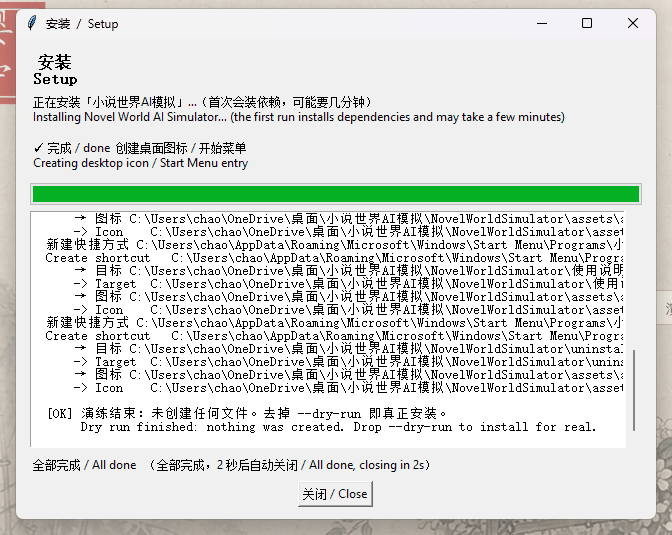

Uninstall removes only shortcuts; **your novel project data is never deleted**: double-click `uninstall.exe` / `./uninstall`.

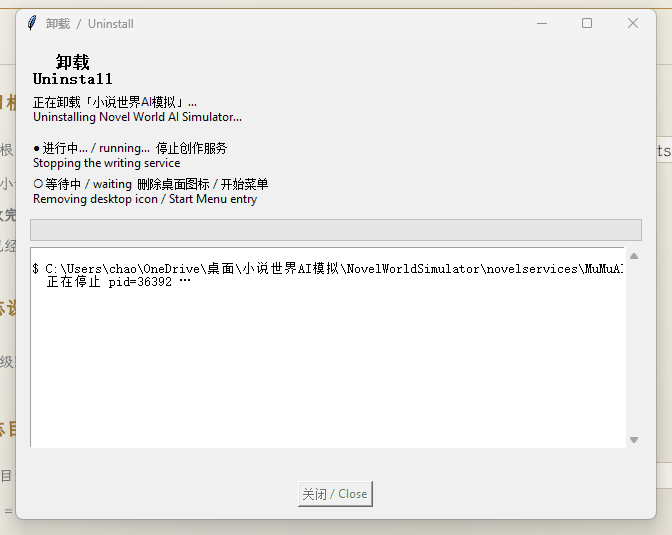

### Route B: Run from Source (Developers)

```bash
cd NovelWorldSimulator
python -m venv .venv
.venv\Scripts\activate                    # Linux/macOS: source .venv/bin/activate
pip install -r requirements.txt -i https://mirrors.aliyun.com/pypi/simple
python main_gui.py                        # start GUI
# or python main_gui.py --mock           # demo mode
```

> On first launch the program will **automatically prepare the Flet UI runtime** (one network download); for offline environments, place the runtime package in `packages/`.

---

## 4. First Run and `.env`

The `.env` lives in the project root. On first run, copy `.env.example` to `.env` and fill in your model + key:

```bash
cp .env.example .env
```

`Favorite Key`.env` keys related to models (**these alone are enough to start with a single model**; see chapter 5 for multi-model registry):

| Key | What it does | See |
|---|---|---|
| `LLM_API_KEY` | API Key (single-model quick start) | -- |
| `LLM_BASE_URL` | Base URL (must include `/v1`) | -- |
| `LLM_DEFAULT_MODEL` | Default model (used when no one specifies) | Chapter 5 |
| `MODEL_FRONT` / `MODEL_DAILY` / `MODEL_CHEAP` | Three-tier quick config (model names) | 5.3 |

> Want zero-cost preview first: `start.exe --mock` or set `MOCK_LLM=true` in `.env` -- no real model call.

---

## 5. Global LLM Config (Tianji -> AI Model Config)

Enter: **Home screen -> "Tianji" -> sub-page "AI Model Config"**.
This page manages four things: **model registry (multi-model)**, **default model**, **three-tier quick config**, **per-Agent recommended models**.

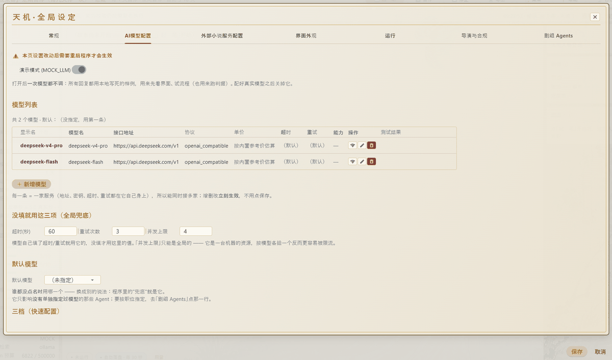

### 5.1 The Model Registry `llm_models.json` (One Program With Many Models)

`llm_models.json` at the project root is the "model registry" -- each entry = **one callable service**
(display name + endpoint + key + model name). You can **add / edit** in "AI Model Config -> Model List".

Fields per entry (managed via the UI form, equivalent to editing the JSON):

| Field | What it means | Example |
|---|---|---|
| `key` | Stable id used inside `.env` and Agent bindings | `qwen-max`, `glm-45-plus`, `doubao-seed` |
| `label` | Display name; free to change | "Qwen flagship" |
| `provider` | API protocol (almost always `openai_compatible`) | `openai_compatible` |
| `base_url` | URL (must include `/v1`) | `https://dashscope.aliyuncs.com/compatible-mode/v1` |
| `api_key` | The key from the vendor's console | sk-xxx... |
| `model` | The actual model name sent to the server (e.g. `hy3` / `deepseek-v4-pro`) | -- |
| `price_in` / `price_out` | Optional: CNY per million tokens, for accurate billing | -- |

> Compatibility includes auto-correction (recognized by model name): Chinese vendors `qwen / glm / kimi / ernie / hunyuan / doubao / minimax / step- / spark / abab / mimo (Xiaomi)`; foreign vendors `openai (gpt / o1 / o3 / o4-mini) / claude / gemini / llama / mistral / cohere (command) / grok / perplexity (sonar)`. At startup, capability flags are auto-corrected by model name -- no manual config.

### 5.2 Default Model

Pick a registry entry's `key` in "AI Model Config -> Default Model" (maps to `.env`'s `LLM_DEFAULT_MODEL`).
Used when nobody specifies a model. Default model dropdown is on this same page (see 5.0 image); the red box in the image below points to it.


### 5.3 The Three Tiers (Front / Daily / Cheap)

| Tier (.env key) | What it does | ~% of call volume | What to assign |
|---|---|---|---|
| `MODEL_FRONT` (Front) | Key scenes: important dialogue, reflections, story documents, run summaries | ~15% | Strongest / most expensive |
| `MODEL_DAILY` (Daily) | Routine loop: character decisions, dialogue, director's dispatch | ~55% | Medium, stable |
| `MODEL_CHEAP` (Cheap) | Compression, scoring, background: memory summarization, progress judgement, proofreading, extraction | ~30% | Cheapest |

In "AI Model Config -> Three-Tier Quick Config" each tier picks one `key` (same page, see image above).


### 5.4 How a Model Is Resolved (Quick Reference for the Resolve Order)

Each request resolves a model in this order:

```
① This Agent has named a model (and the entry still exists) -> use it
② The tier this Agent belongs to has a model                        -> use it
③ Default model                                                     -> use it
④ First registry entry                                              -> use it
⑤ Nothing at all                                                    -> fall back to legacy path (.env globals + CFG.model_of)
```

> To pin a model on a specific Agent: see chapter 6 for how to give the Agent a name (`model:`).

### 5.5 Other Tianji Sub-Pages (Quick Glance)

"Tianji" has 5 other sub-pages besides "AI Model Config", each managing its own settings:

* **General**: project root directory (`DEFAULT_PROJECTS_DIR`), log level, and other installation-level settings.

  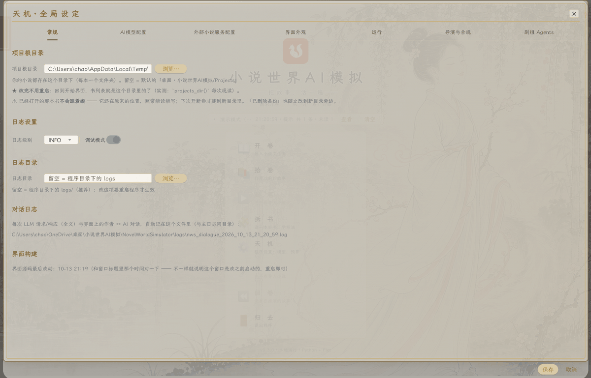
* **UI Appearance**: opacity, UI language (Chinese / English switch).

  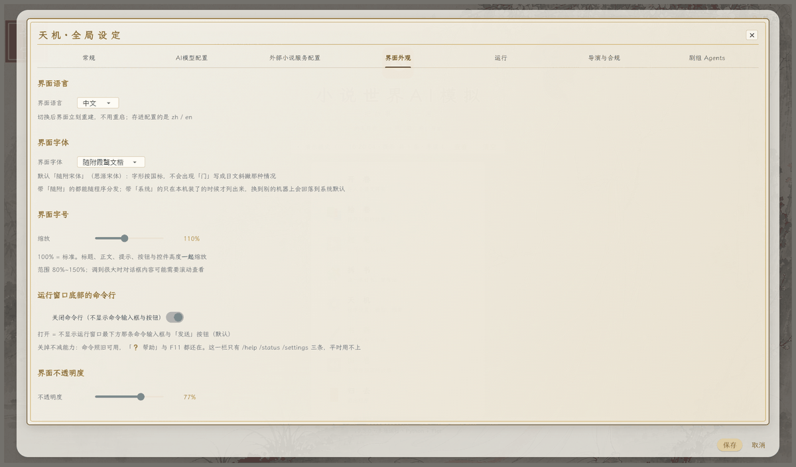
* **Run**: run mode, time system, budget, auto-save, start-brush launch timeout, ingest polish, script review (see 13.1).

  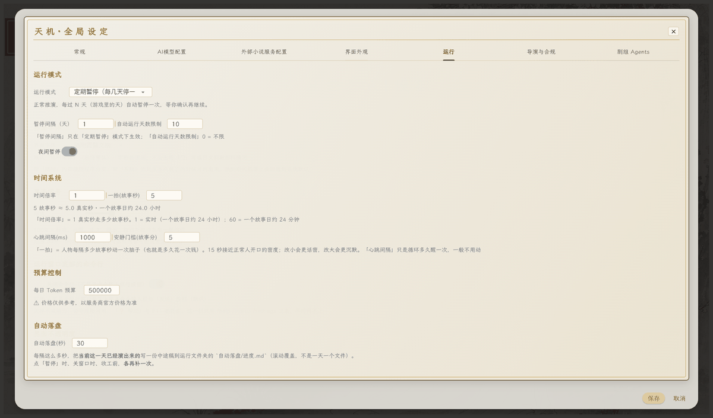
* **Director & Compliance**: director strength (scheduling / dispatch tightness), content compliance toggle.

  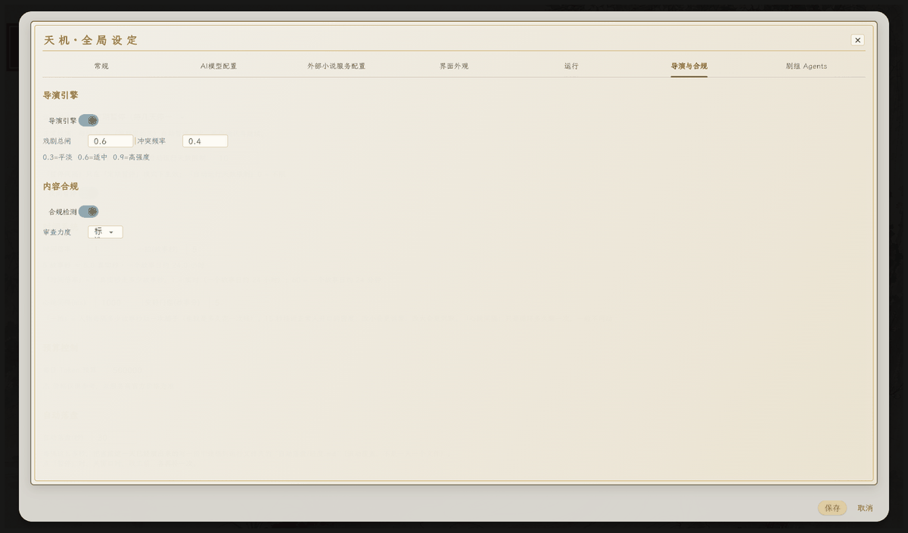
* **Crew Agents**: software-layer position management (see 6.1).

  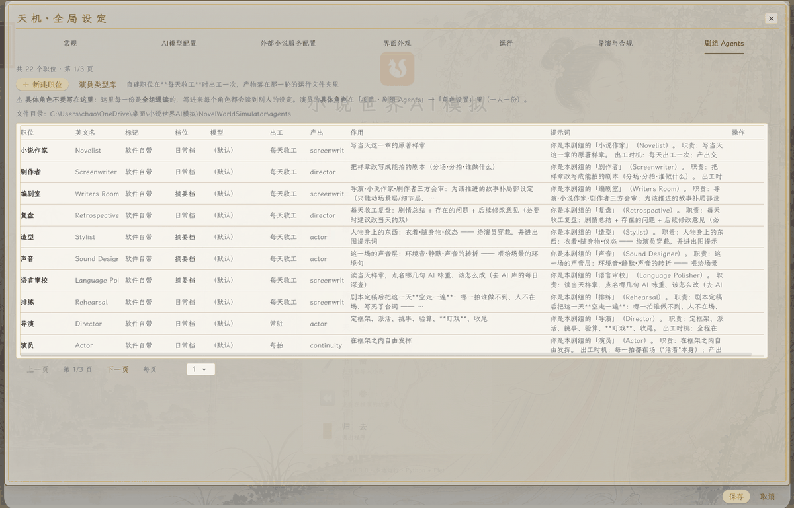
* **External Novel Service Config**: NovelService (see chapter 7).

  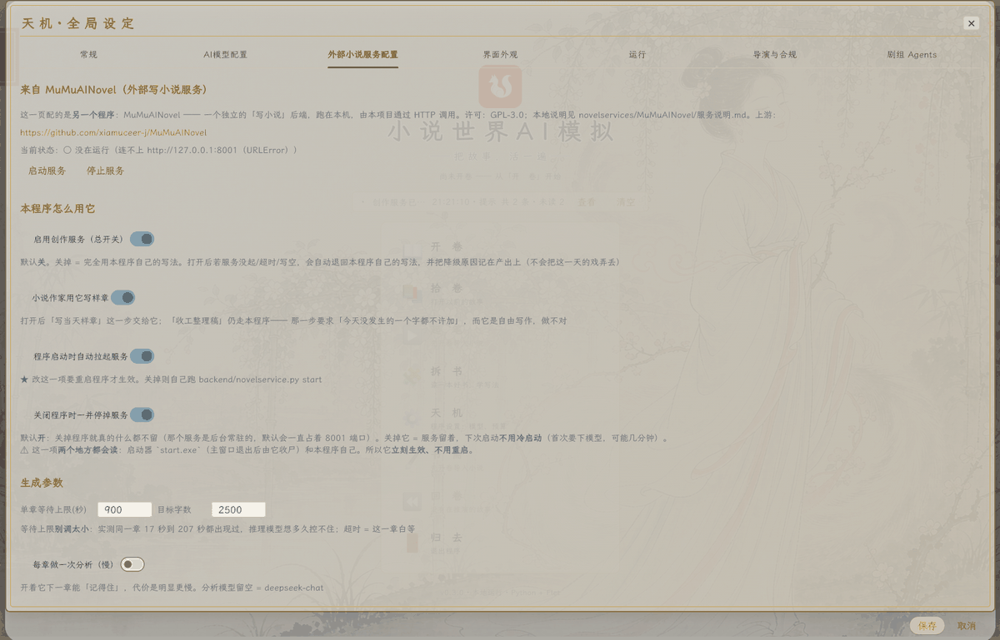

### 5.6 Recommended Provider + Model per Agent and per LLM Config Item

> The following is **recommended, not enforced** -- whichever vendors you have in the registry, just put the entry's `key` in the corresponding config.
> Each config item is given 1-2 candidates (Chinese-first, simpler; foreign flagships at 1.1 table C). Tier meanings in 5.3.
> Provider = vendor (Alibaba Cloud Bailian / Zhipu / ByteDance Doubao, ...); Model = the name to put in the `model` field.

#### 5.6.1 LLM-Related Config Items (Global / `.env`)

| Config | What it does | Recommended Provider + Model (1-2, not enforced) |
|---|---|---|
| `LLM_DEFAULT_MODEL` (default model) | Fallback when nobody specifies | Zhipu `glm-4.5-plus` / Alibaba Bailian `qwen-plus` |
| `MODEL_FRONT` (Front tier) | Key scenes: sample chapter / script / external creator | Alibaba Bailian `qwen-max` / Zhipu `glm-5` |
| `MODEL_DAILY` (Daily tier) | Routine loop: characters / dialogue / director dispatch | Zhipu `glm-4.5-plus` / Alibaba Bailian `qwen-plus` |
| `MODEL_CHEAP` (Cheap tier) | Compression / scoring / background | ByteDance Doubao `doubao-seed` / Zhipu `glm-4-flash` |
| `STORY_DOC_MODEL` | Story document | Same as Front tier (`qwen-max` / `glm-5`) |
| `SUMMARY_MODEL` | Cross-day summary | Same as Cheap tier (`doubao-seed` / `glm-4-flash`) |
| `COMPLIANCE_MODEL` | Compliance review | ByteDance Doubao / Zhipu `glm-4-flash` |
| `EMBEDDING_*` | Vector retrieval | SiliconFlow `BAAI/bge-m3` or `Qwen3-Embedding-8B` / Alibaba `text-embedding-v4` |
| `IMAGE_AI_MODEL` | Image generation (not LLM) | ByteDance Doubao `doubao-seedream` / Hunyuan Image |
| `MUMU_ANALYSIS_MODEL` | MuMu analysis | DeepSeek `deepseek-v4-flash` / Alibaba Bailian `qwen-turbo` |

#### 5.6.2 Per-Agent Recommendations (By Tier)

| Agent (display / key) | Current tier | Recommended Provider + Model (1-2, not enforced) |
|---|---|---|
| Novelist / `novelist` | daily (recommend over to Front) | Alibaba Bailian `qwen-max` / Zhipu `glm-5` |
| Screenwriter / `screenwriter` | daily (recommend over to Front) | Alibaba Bailian `qwen-max` / Zhipu `glm-5` |
| Director / `director` | daily | Zhipu `glm-4.5-plus` / Alibaba Bailian `qwen-plus` |
| Actor / `actor` | daily (can override to Front) | Zhipu `glm-4.5-plus` / Alibaba Bailian `qwen-max` |
| Reviewer / `reviewer` | daily | Zhipu `glm-4.5-plus` |
| Rehearsal / `rehearsal` | daily | Zhipu `glm-4.5-plus` |
| Ingest / `ingest` | daily | Alibaba Bailian `qwen-plus` |
| Writers' room / `settings_room` | cheap | ByteDance Doubao / Zhipu `glm-4-flash` |
| Stylist / `stylist` | cheap | ByteDance Doubao |
| Sound / `sound` | cheap | ByteDance Doubao |
| Language editor / `polisher` | cheap | Zhipu `glm-4-flash` |
| Script doctor / `script_doctor` | cheap | Zhipu `glm-4-flash` |
| Continuity / `continuity` | cheap | ByteDance Doubao |
| Extras / `extra` | cheap | ByteDance Doubao |
| Props / `props` | cheap | ByteDance Doubao |
| Art / `art` | cheap | ByteDance Doubao |
| Publicity / `publicity` | cheap | ByteDance Doubao |
| Researcher / `researcher` | cheap | Moonshot `kimi-k2` (long context) / ByteDance Doubao |
| Memory / `memory` | cheap | ByteDance Doubao |
| Progress / `progress` | cheap | ByteDance Doubao |
| Compliance / `compliance` | cheap | ByteDance Doubao |
| Creator service / `novelservices` | front | Alibaba Bailian `qwen-max` / Zhipu `glm-5` |

> The single most worthwhile change: pin `novelist` / `screenwriter` to a Front model (add `model: qwen-max` to `agents/novelist.md`'s frontmatter, see 6.3); the sample chapter / script quality jumps most visibly.

---

## 6. Configuring Each Agent's Model

In the codebase, "Agent" = crew position (`agents/<slug>.md`). Each position has a `tier` (its tier) and an optional `model` (named override).

### 6.1 Software Layer (Affects All Books) -- Tianji -> Crew Agents

Enter: **Home screen -> "Tianji" -> sub-page "Crew Agents"**.
Click a position (e.g. "Novelist (`novelist`)" / "Screenwriter (`screenwriter`)") to:

* Edit its prompt (the body text);
* Add `model: <key>` in the frontmatter to **pin it** to a registered model (overrides the tier);
* Change `tier: front / daily / cheap` to switch its tier.


Equivalently, edit `agents/<slug>.md`'s frontmatter directly with a text editor:

```markdown
---
key: novelist
name: Novelist
tier: daily          # belongs to Daily tier
model: xiaomi-mimo   # pin: this book / globally uses Xiaomi MiMo (blank = follow tier)
feeds: screenwriter
---
```

> Four priority layers (more specific wins): ① Software-layer position (this file) -> ② Actor type library ->
> ③ The same-named file in the project (this book's extra requirements) -> ④ A specific character (project -> Crew Agents -> Character Settings).

### 6.2 Project Layer (Affects Only This Book) -- Studio -> Crew Agents

Enter: **Home screen -> "Studio" -> sub-page "Crew Agents"**.
Edits here apply only to the current project and don't pollute the software-layer defaults.

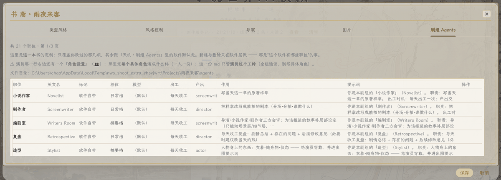

**Tier distribution quick reference** (from `crew/roster.py`):

* `daily` (routine loop, largest volume): `novelist` / `screenwriter` / `director` / `actor` / `reviewer` / `rehearsal` / `ingest` etc.
* `cheap` (compression / scoring / background): about 13 positions (memory, progress, proofreading, extraction, etc.)
* `front` (key scenes, only 1): **`novelservices` (external MuMu writer)**

### 6.3 Character-Level Override (Specific Character)

Open **Studio -> Crew Agents -> Character Settings** (the 👥 button on the right of an actor row), and you can assign a specific model / tier to **one specific character**, without affecting others. This is the finest layer (priority layer ④).

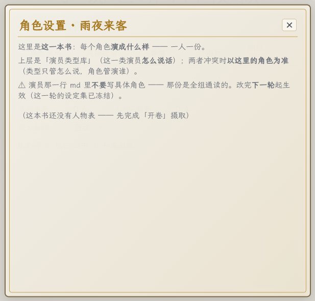

---

## 7. Configuring NovelService (External Writing Backend MuMuAINovel)

NovelService is **optional enhancement**: the main program runs without it; if it's not started you just lose one capability, no error.

It's provided by `novelservices/MuMuAINovel/` (open-source MuMuAINovel + this project's integration layer); after Open Volume, it can write the sample chapter.

### 7.1 Enabling in the UI

Enter: **Home screen -> "Tianji" -> sub-page "External Novel Service Config"**, fill in:

* Service address (default `http://127.0.0.1:8001`)
* Username / Password (see `novelservices/MuMuAINovel/凭据.txt`, default `mumu_service` / `xHEMxsEzy1M4j47ivxMhsNpy`)


### 7.2 Starting the Service

**Method 1: Auto-start with the main program (recommended)**

The release package / launcher auto-starts the service before "Launch Program":

```bash
# Install stage prepares the environment (create venv / install deps / create tables); only once:
setup.bat          # Windows; macOS/Linux: ./setup
# Afterwards every `start` auto-starts the service first then the main program
start.exe
# If you don't want the service: setup.bat --skip-service
```

**Method 2: Manual start (under `novelservices/MuMuAINovel/backend/`)**

```bash
cd novelservices/MuMuAINovel/backend
P=.venv/Scripts/python.exe            # Linux/macOS: .venv/bin/python

$P novelservice.py prepare   # only prepare the environment (venv + deps + tables; ~few minutes first time)
$P novelservice.py start     # background start; waits for the health check before returning
$P novelservice.py status    # see status (port / pid / health)
$P novelservice.py stop      # stop
$P novelservice.py start --fg # foreground (for debugging; Ctrl+C to exit)
```

> First start will **automatically download a ~470MB embedding model from ModelScope** (~5 minutes); subsequent starts are fast.
> Health probe: `curl http://127.0.0.1:8001/health` -> `{"status":"ok"}`
> This service has **no frontend, REST only**.

### 7.3 How Its Models Are Configured

MuMuAINovel's own config is in `novelservices/MuMuAINovel/backend/.env` (DeepSeek pre-filled).
Project experience: **both writing and analysis use `deepseek-chat` (non-reasoning)** -- 5-10x faster than
`deepseek-v4-pro`, won't burn through the output budget and leave the whole chapter empty.

---

## 8. Open Volume (Import a New Book)

Enter: **Home screen -> "Open Volume"** (or click the "Open Volume" card) -> the "Open Volume · Import Wizard" pops up.

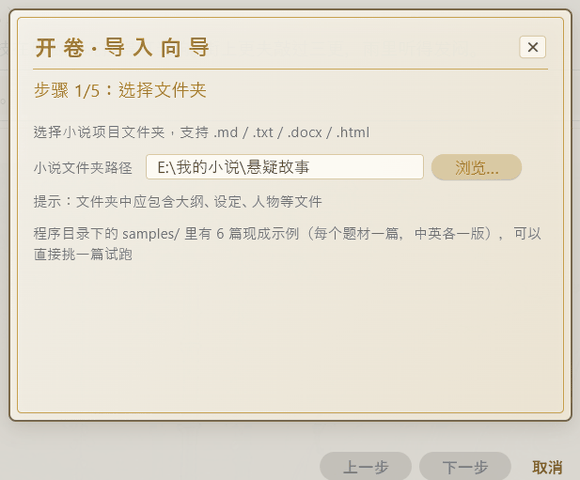

Fill in the wizard:

* **Book title** (cannot be changed in Studio afterwards; renaming requires re-opening the volume)
* **Source folder** (optional originals / references)
* **Settings bundle directory** (novel settings; written in this step; you can adjust genre/style etc. in Studio afterwards)

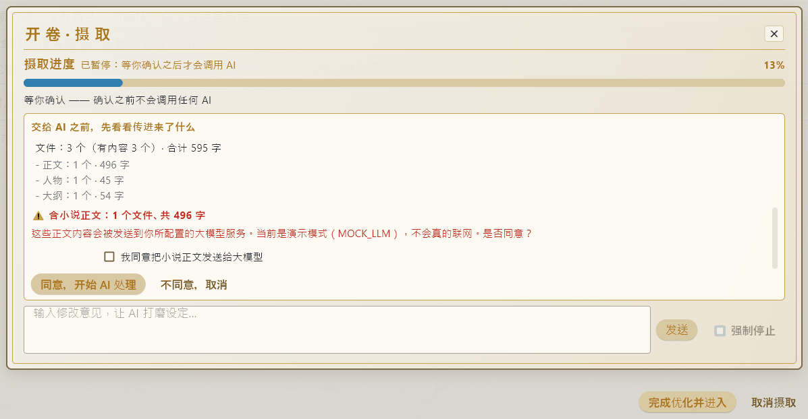

Once confirmed, the program starts **ingest**: decomposing the settings into structures the crew can use. Ingest has two modes:

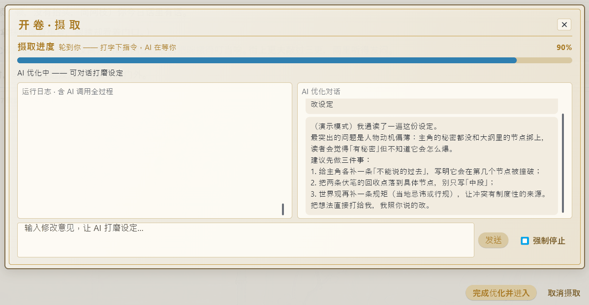


If 7.x has configured NovelService, the sample chapter after Open Volume can be written by the external backend.

### 8.1 Book Breakdown (Turn a Good Book Into Your Method)

The home screen also has a **"Book Breakdown"** entry: it reads **a book you think is well-written** (or part of it), and breaks it into **reusable writing method modules** (character shaping, pacing, suspense, ...), spliced back into your own story. One-line distinction: **Open Volume is "turn this book into my world"; Book Breakdown is "turn this book into my skill".**

The Book Breakdown dialog is similar to Open Volume's (also goes through the ingest pipeline, see images above), but it accepts a "finished book" rather than "your settings". Suitable for: you want to learn some book's technique without it interfering with your own worldview.

**Novels or reference books** (since 2026-10-27). Pick the type yourself ("what kind of book is this"), or leave it on *Auto*: from a novel you get **craft modules** (plot / pacing / character / voice / structure); from a **reference book** (a history of Chinese architecture, a manual, ...) you get **material entries** — term / fact / rule / case / boundary condition — each with **where it came from**, how it can be used, and when it does *not* hold. Reference books are sampled by **information density**, so prefaces, indexes and bibliographies (long on characters, short on substance) are skipped instead of costing an LLM call.

**Formats**: `.txt` `.md` `.docx` `.html` `.pdf`, e-books `.epub` `.mobi` `.azw3` `.azw` `.rtf` `.odt`, legacy `.doc` `.wps` `.et` `.dps` (converted through the Word / WPS installed on this machine, else extracted raw), and **images** `.jpg` `.png` `.webp` `.bmp` `.tif`. **Scanned PDFs go through OCR** automatically — install it once with `pip install rapidocr-onnxruntime pypdfium2` (runs **offline**, nothing is uploaded). OCR reports page by page, and stopping midway still keeps the pages already recognised.

---

## 9. Start Brush (Begin the Daily Simulation)

Enter: **Run screen -> top "📖 Start Brush"** (after the first Open Volume, the home screen's "Start Brush" is also usable).

Flow: click "Start Brush" -> a "Start This Story" confirm dialog pops up -> after confirming, the actual simulation of today's chapter begins.

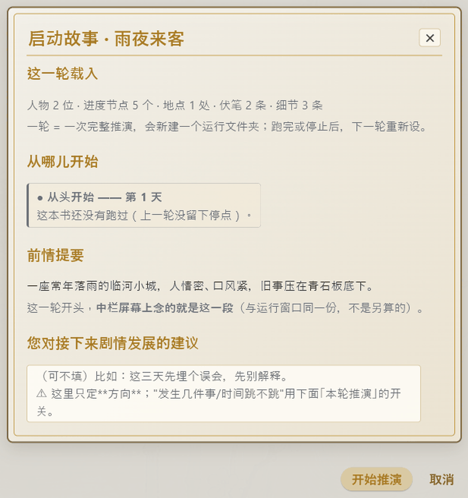

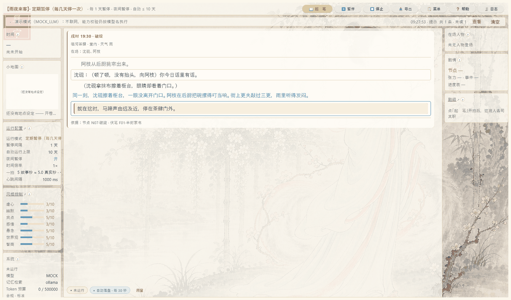

Simulation advances each day along the pipeline: "Novelist -> Screenwriter -> Director -> Actor ...", dropping narrative to disk and generating scripts and summaries.

---

## 10. Pick Volume and Resume (Continue a Previous Story)

* **Pick Volume** (open a previous book): **Home screen -> "Pick Volume"** -> project list (three columns) -> select a project.

  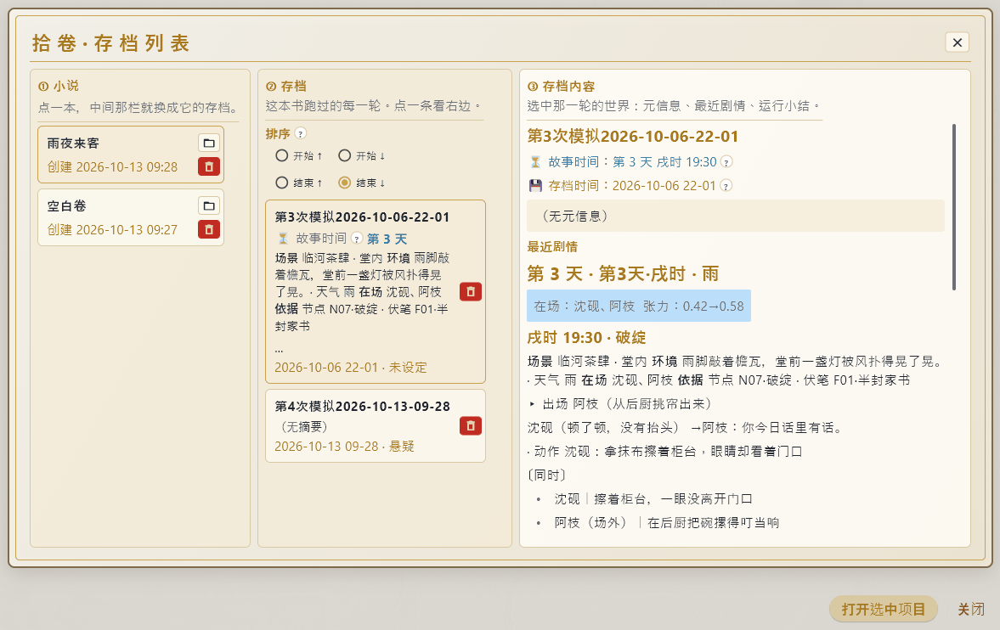

  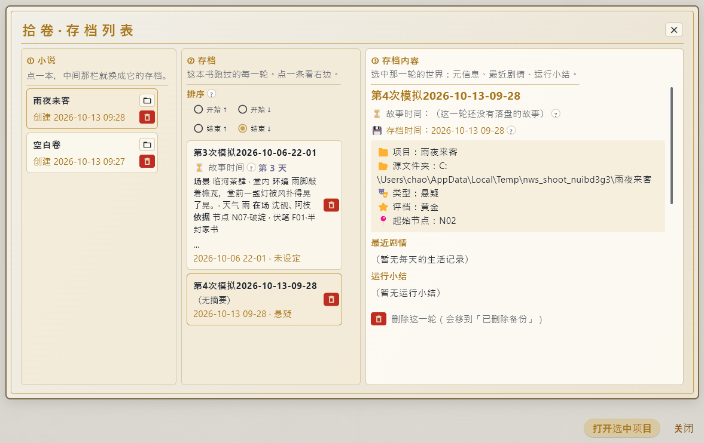
* **Resume** (return to the run screen to continue): **Home screen -> "Resume"** (or the run screen's top "📋 Menu" returning to home screen, **doesn't stop the run**, then click "Resume" again). You return to the real-time simulation screen:

  

> "Pick Volume" = which book; "Resume" = back to the currently-running live screen. Different roles, different jobs.

---

## 11. Configuring the Current Project (Studio)

Enter: **Home screen -> "Studio"** -> "This Book's Settings" dialog pops up with 5 sub-pages:

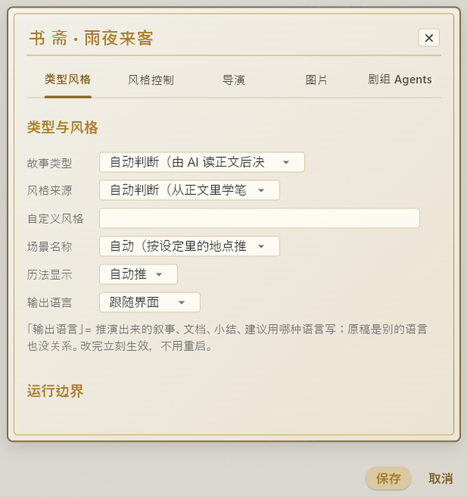

| Sub-page | What it can change |
|---|---|
| Genre & Style | The book's genre and style preset |
| Style Control | Writing style strength, constraints |
| Director | Director strength (scheduling / dispatch tightness) |
| Images | Background / avatar / small-map generation switches |
| Crew Agents | **Project-specific** position overrides (prompt / `model:` / `tier:`), apply only to this book |

> Book title and settings bundle directory are **set during Open Volume**; Studio changes genre / style / director / images / Agents, not the book title.

### 11.1 Where Projects Live (`DEFAULT_PROJECTS_DIR`)

Each Open Volume creates a project folder named after the book under the **project root directory**
(settings, daily narrative, story documents, snapshots all live inside).

* Default root: `<Desktop>/NovelWorldAI模拟/Projects` (existing users with `小说世界虚拟模拟/Projects` non-empty keep using the old one; books aren't lost)
* Change location: Home screen -> "Tianji" -> "General" -> "Project Root Directory" (maps to `.env`'s `DEFAULT_PROJECTS_DIR`)
* Open project folder: each project has an entry in "Pick Volume"; after install-to-menu, the desktop shortcut has "Open Project Folder" too.

---

## 12. Operations During Run: Pause / Stop / Export

All in the **run screen's top button bar** (appears after Start Brush):

| Button | What it does |
|---|---|
| **⏸ Pause / ▶ Resume** | Same button, text toggles between "Pause" and "Resume" |
| **⏹ Stop** | End this round, write run summary and bound draft, **does not continue running** |
| **📤 Export** | Export results |

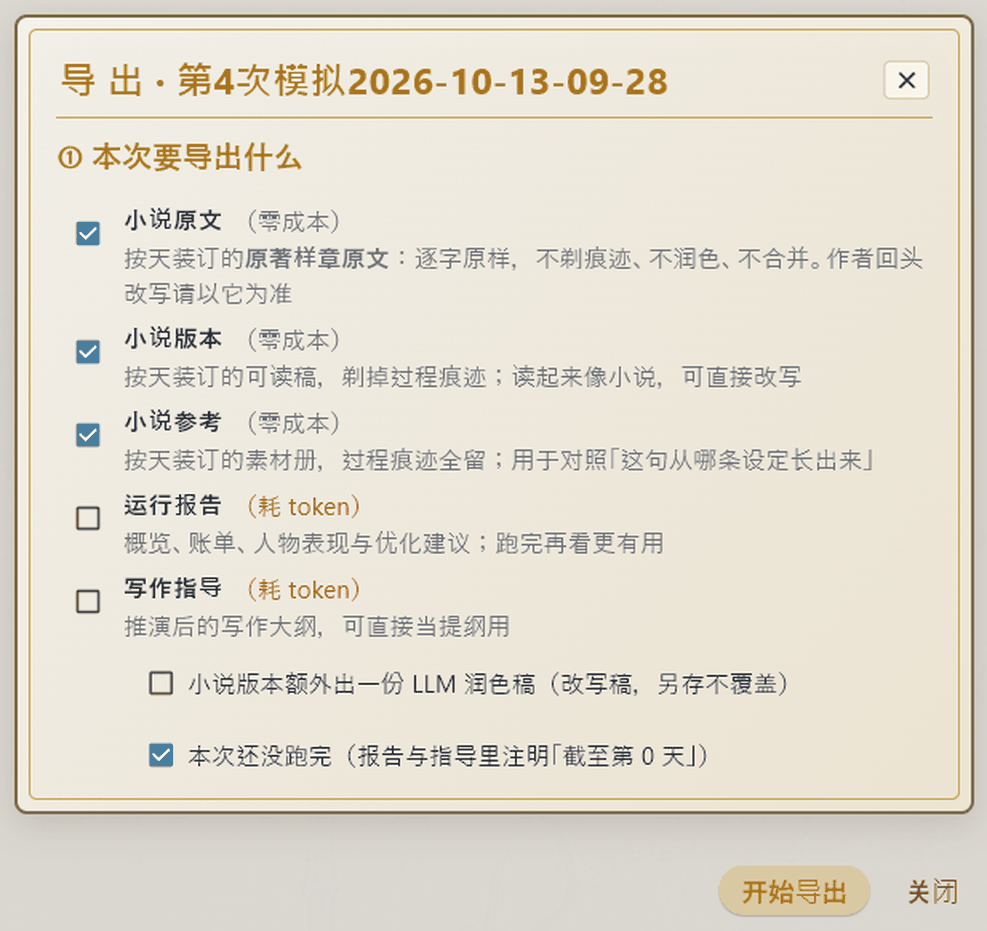

**Export** contents (`KINDS` in `export/bundle.py`):

* Novel chapter text (Markdown bound draft)
* Novel version (readable draft, usually docx)
* Novel reference
* Run report
* Writing guide

Export directory: writes to **this run's export directory** (`run.export_dir`). You can click it mid-run too -- only complete days that have been dropped to disk are included.
There's also an "auto-export on finish" toggle.

---

## 13. Run Screen Guide

Enter: `show_main_screen` (click "Start Brush" / "Resume" to enter; in the run screen click "📋 Menu" to go back to the home screen without stopping the run).


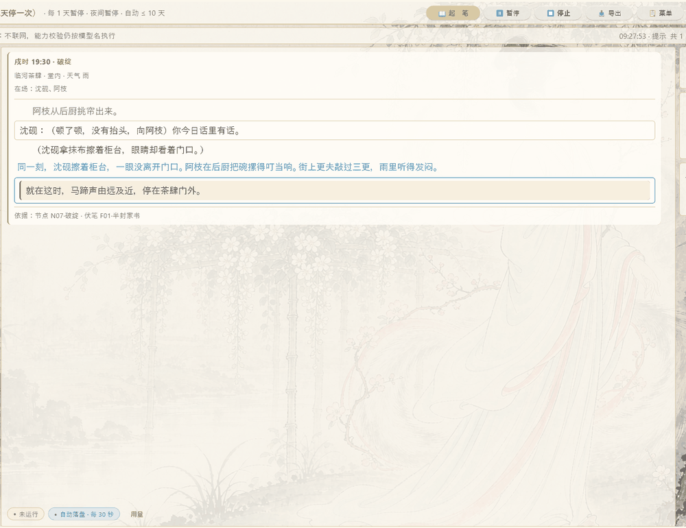

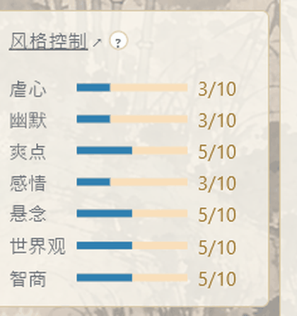

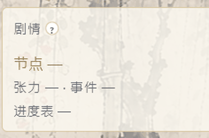

* **Top button bar**: Start Brush / Pause / Stop / Export / Menu / Help / Log
* **Main area**: today's narrative, script, each Agent's output
* **Bottom status bar**: run state + auto-save + golden "Usage" link (see chapter 14) + run mode / actual genre / run boundary toggles
* **🧾 Log** button: pops up the log dialog (see 14.1) for real-time logs

### 13.1 Run Mode / Time System (Tianji -> Run)

Simulation "how fast / how chatty / how many days" is in **Tianji -> Run**:

* **Run mode**: `story` (with progress table and endpoint, finishes automatically) etc.;
* **Time system**: how long a beat is, heartbeat interval, quiet threshold -- a writer mainly adjusts "beat" and "dialogue density";
* **Auto-run day limit**: `0` = unlimited;
* **Pause interval**: only effective in "periodic pause" mode;
* Plus: Start Brush launch timeout, ingest polish, script review toggles.

---

## 14. View LLM Usage

Enter: **Run screen -> bottom status bar's golden "Usage" link** -> usage dialog pops up (four columns: project / breakdown card / Agent / detailed).
The data is computed directly from the database `usage.db`, **no model calls, zero cost**.

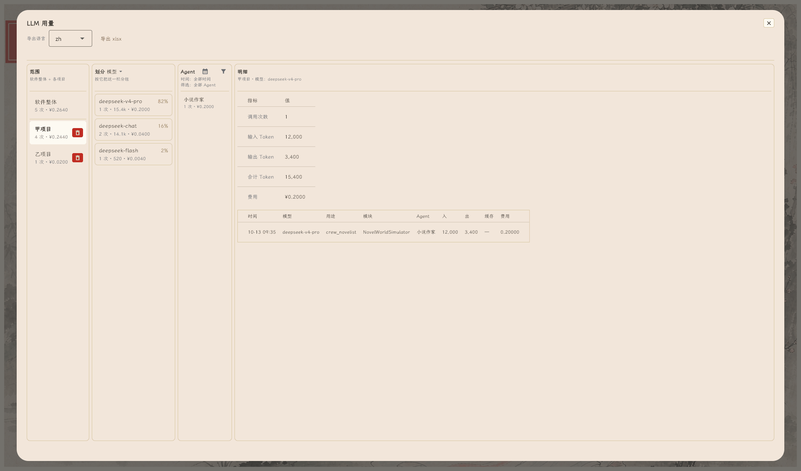

There's also a **call ledger** `logs/llm_calls.jsonl`: one line per call, accumulated across runs (not affected by log cleanup),
suitable for raw-detail reconciliation and diagnostic packaging. Controlled by the `SAVE_RAW_LOGS` switch in `llm/router.py`.

> To make the bill more accurate: fill `price_miss` / `price_out` (CNY / million tokens) in each model registry entry;
> unfilled fields fall back to the built-in price list.

### 14.1 Logs (What the Program Remembers)

Click the run screen top "🧾 Log", or look at the log files in `logs/`, to trace every call and every simulation step in real time.

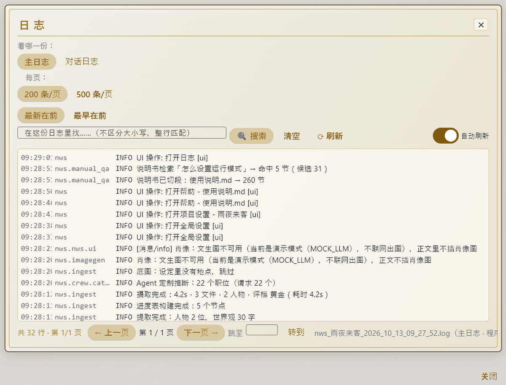

---

## 15. Help and Tianji (Look up Anytime)

* **Help**: Top-right "❓ Help" on home screen, or "❓ Help" on run screen (hotkey **F11**).
  Two sub-pages: "Help Info" (read the manual + keyword search, split by `##`) + "Ask a Question" (chat style).

  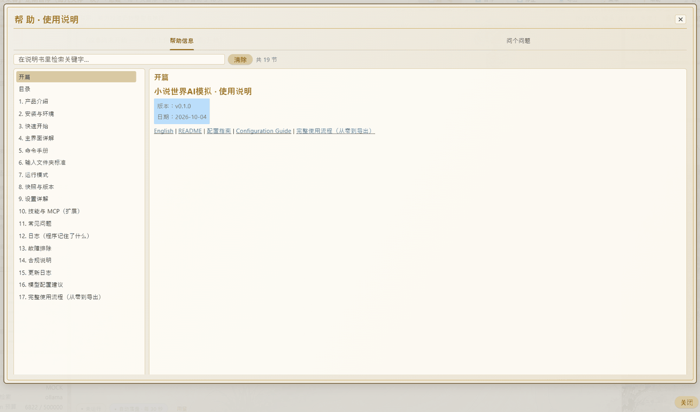

  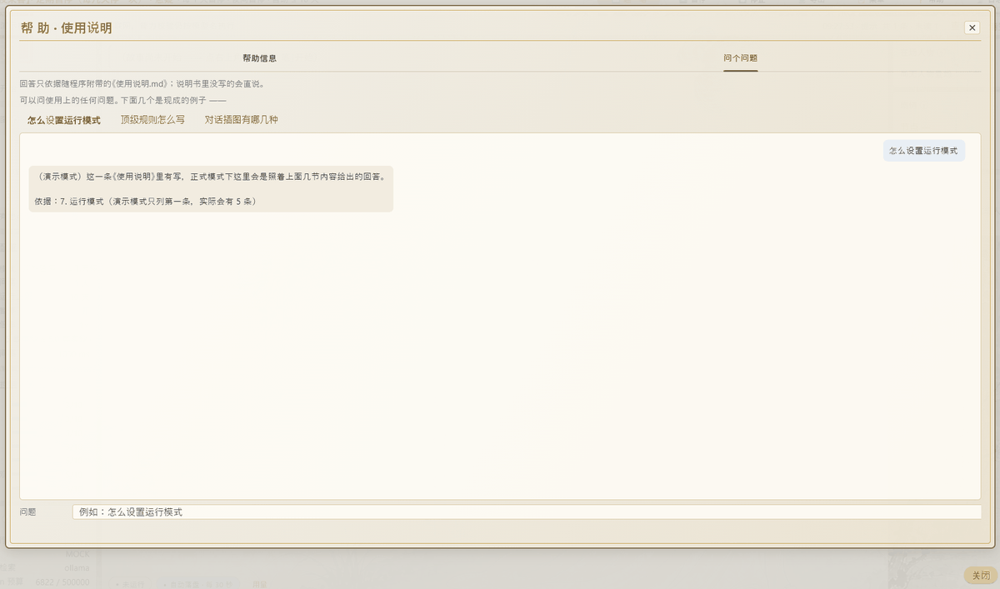
* **Tianji** (global settings): Home screen "Tianji" -> 7 sub-pages (General / AI Model Config / UI Appearance / Run / Director & Compliance / Crew Agents / External Novel Service Config).

For more scenario-specific configuration, see `配置指南.md` (12 typical scenarios) and `配置分类.md` (config item scope) in the codebase.

---

## Quit

Click **"Quit"** on the home screen to exit the program.

> ⚠ When the main window exits, the **external NovelService also exits with it** (same gate), no need to manually stop.
> Uninstall only deletes shortcuts; your novel project data is never deleted.

---

## Appendix: Common Questions & Troubleshooting

1. **API Key in `llm_models.json` / `.env`** is ignored by `.gitignore`; don't commit it.
2. **Don't change `key`**: Agent bindings and `.env` three-tier keys use `key`, you can change `label` freely; changing `key` breaks all bindings.
3. **Chinese source priority is Aliyun**: Tuna often 403s on new packages; explicitly `-i https://mirrors.aliyun.com/pypi/simple` on the command line.
4. **NovelService failure doesn't block the main program**: if it fails to start you just get a notice; the main program launches normally (it's only an enhancement).
5. **MuMuAINovel uses `deepseek-chat`, not a reasoning model**: reasoning models burn output budget on thinking; worst case the whole chapter is blank.
6. **Launchers are compiled per platform**: don't give launchers cross-platform; the release package's `平台说明.md` states which platform applies.
7. **Demo mode**: `start.exe --mock` or `MOCK_LLM=true`, zero cost to see the full flow first.
8. **Auto-correction of model capabilities**: at startup, capabilities are recognized by model name and written to global switches; the four "Model capability" switches on the UI are explicit overrides of it.

**Quick Troubleshooting Table**

| Symptom | First look / first try |
|---|---|
| No response / stuck after Open Volume | Click "🧾 Log" to see if it's waiting on interaction or model 401; verify `llm_models.json`'s `base_url` and `api_key` are correct |
| Model returns 401 / 404 | Check the entry's `api_key`, `base_url` (must include `/v1`), whether `model` matches the service |
| Usage empty | Data appears after the first run; usage reads `usage.db`, only `llm_calls.jsonl` is the raw log |
| Can't connect to NovelService | Service not started: `backend/.venv/Scripts/python.exe novelservice.py status`; verify port 8001 is listening |
| Garbled UI fonts / Chinese | Tianji -> UI Appearance -> switch language; confirm system has a Chinese sans font |
| Dependencies broken | `start.exe --reinstall` (release package) or delete `.venv` and re-run `pip install -r requirements.txt` (from source) |
