# Novel World AI Simulator · User Manual

> Version: v0.1.0
> Date: 2026-10-04

[中文](使用说明.md) | [README](README_EN.md) | [Configuration Guide](Configuration_Guide.md) | [Configuration Classification](Configuration_Classification.md) | [Complete Use Guide](Complete_Use_Guide.md) | [Settings Writing Guide](Settings_Writing_Guide.md) | [Script Output Format](Script_Output_Format.md) | [Cost Saving Guide](Cost_Saving_Guide.md)

---

## Table of Contents

1. [Product Introduction](#1-product-introduction)
2. [Installation & Environment](#2-installation--environment)
3. [Quick Start](#3-quick-start)
4. [Main Interface](#4-main-interface)
5. [Command Manual](#5-command-manual)
6. [Input Folder Standards](#6-input-folder-standards)
7. [Run Modes](#7-run-modes)
8. [Snapshots & Versions](#8-snapshots--versions)
9. [Settings Details](#9-settings-details)
10. [Skills & MCP (Extending)](#10-skills--mcp-extending)
11. [FAQ](#11-faq)
12. [Logs (what the program remembers)](#12-logs-what-the-program-remembers)
13. [Troubleshooting](#13-troubleshooting)
14. [Compliance](#14-compliance)
15. [Changelog](#15-changelog)
16. [Model Configuration Guide](#16-model-configuration-guide)

---

## 1. Product Introduction

### 1.1 What Is It

**Novel World AI Simulator** is a **writing assistant for novelists** — within the settings of your input novel folder, it plays the story forward (continuing from the middle if you like) and produces material you can **rewrite, compare against, and continue from**.

**Core Positioning**:
- Not "automatic novel writing" — it's a **material generator** and a **testing ground for your settings**
- Output is for your reference and rewriting, not direct publication
- Not an infinite sandbox by default — there is a clear progress table and an endpoint

### 1.2 Who Is It For

- **Novel Authors**: Supplement details, verify plot, produce alternative-draft comparisons
- **Screenwriters**: Test plot logic, explore character possibilities
- **Writing Enthusiasts**: Run the same settings through several different paths

### 1.3 What You Get

| Output | How to use it |
|--------|---------------|
| Daily narrative | Split by story day; rewrite usable passages into your manuscript |
| Story document | Timeline / key scenes / character arcs / foreshadowing status |
| Run summary | Review where this run drifted |
| Outline suggestions | Node comparison / new subplots / foreshadowing updates |
| Full settings bundle | Move it elsewhere or archive it as a settings snapshot |
| Key event list | Locate "what happened on which day" |
| Snapshots | Return to any node and play a different path |

### 1.4 Tech Stack

- **Language**: Python 3.10+
- **UI**: Flet 1.0 (desktop GUI, Chinese ink-wash visual style)
- **LLM**: OpenAI-compatible protocol (DeepSeek by default, Ollama supported)
- **Storage**: SQLite + files (Markdown / YAML / JSON)
- **Dependencies**: flet, Pillow, pyyaml, python-docx, chardet, httpx

### 1.4 Core Features

- **Intake**: Auto-read documents, extract settings, determine genre, extract style
- **Complete**: Follow progress table to endpoint, auto-wrap with summary
- **Continue**: Support continuing from middle of story
- **Authentic**: Director engine loads narrative craft library
- **Readable**: Reading rhythm controller, no screen flooding
- **Record**: Daily narrative to disk, generate story documents anytime
- **Manage**: Branch selection, event injection, snapshot rewind
- **Affordable**: Token hard budget + degradation ladder
- **Compliant**: Independent compliance detection Agent

---

## 2. Installation & Environment

### 2.1 Python Installation

1. Download Python 3.10+ (3.13 recommended): https://python.org
2. During installation, check "Add Python to PATH"
3. Verify: `python --version`

> You only need Python itself — **dependencies are handled by the launcher**.

### 2.2 Launch (recommended)

Find the launcher in the project root and double-click it:

| OS | File |
|----|------|
| **Windows** | `start.exe` |
| **macOS** | double-click `start` in Finder (or run `./start`) |
| **Linux** | `./start` |

The launcher will:

1. check that Python is available (and tell you where to get it if not)
2. create an isolated environment `.venv` on first run (your system Python stays untouched)
3. install dependencies (1–3 min on first run, using a China mirror)
4. start the app

**A "book cover" splash appears first** (added 2026-10-17; no console, but everything is visible):

- the whole window **is** the app background (full-bleed, no card/panel), taken from the **palest,
  calmest patch** of it -- not the whole artwork squeezed into 860px, which looked busy; the
  **logo · 小说世界 AI 模拟 · "把故事，活一遍"** sits right on it -- same styling as the start screen;
- middle: a **scrolling message strip** (the backdrop is pale enough that it needs no block and no
  border) reporting which startup step is running; a **chevron** at its right end expands it into the
  command-line output (the command being run, raw stdout/stderr, failing lines in red).
  Collapsed the chevron is **`›`** pointing right; clicking it **turns it 90° to `⌄`** (the same glyph
  rotating, not a swap) and the same click turns it back. Hovering makes it **darker and thicker**
  (no background fill -- this window has no colour blocks at all). It is **collapsed by default** --
  one line is usually enough -- and collapsed the window is only **860x350** (860x620 expanded),
  with **not one glyph above moving** when it opens;
- footer: **`v0.3.3 · 本地运行 · Python + Flet`** (same format as the start screen);
- **✕** at the top right closes it any time (the app keeps starting);
- **if a step fails**: a red "✘ startup failed: reason" line appears above the footer and the strip turns
  red; click the chevron to see that step's full command output -- no log hunting. The launcher **stops**
  instead of continuing with a broken environment;
- it **disappears by itself** once the app window is up.

**Flags**:

| Flag | What it does |
|---|---|
| `--mock` | **Demo mode**: makes no real API requests at all and runs the whole flow on built-in material (zero cost, no API key). Same as `python main_gui.py --mock` |
| `--reinstall` | **Force reinstall of dependencies** (for a broken or half-finished install) |
| anything else | passed straight through to the program — which currently understands only `--mock` |

**Examples** (on macOS / Linux use `./start`):

```bash
start.exe                      # normal launch
start.exe --mock               # demo mode: walk the whole flow for free (try this first)
start.exe --reinstall --mock   # reinstall dependencies, then launch in demo mode
```

> ★ `--reinstall` now works **in any argument position** (since 2026-10-10): the
> launcher pulls it out and handles it, then passes everything else straight
> through. The old `.bat`/`.sh` only honoured the first position, so
> `start.exe --mock --reinstall` would quietly not reinstall — a flaw of the
> scripts, not a design decision.

**Put it on the Desktop and in the Start Menu (optional)**:

If you'd rather not dig through folders for the launcher, install the shortcuts once:

| System | Install | Uninstall |
|--------|---------|-----------|
| **Windows** | double-click **`setup.exe`** | double-click **`uninstall.exe`** |
| **macOS** | double-click **`./setup`** | double-click **`./uninstall`** |
| **Linux** | `./setup` | `./uninstall` |

> ⚠ **The launchers are compiled per platform, and one release package carries all four.**
> The three in the root are for **this machine's platform**; the other sets live in
> `启动器/其他平台/<platform>/` (`windows` / `macos` / `macos-intel` / `linux`) -- copy that
> folder's three files **into the package root** when moving to another OS. Each package ships a
> **`平台说明.md`** stating where each set is.
> Build a release with `python tools/make_release.py` (lands in `发布版本/<config.VERSION>/`;
> `--dry-run` prints the plan, `--force` overwrites the same version).

Double-clicking one opens a **progress window** — not a console: none of the three
launchers has a console. It creates the shortcuts step by step, and **every message
is printed in both Chinese and English**. Below is a real run
(`setup.exe --skip-service --dry-run` — it writes nothing):

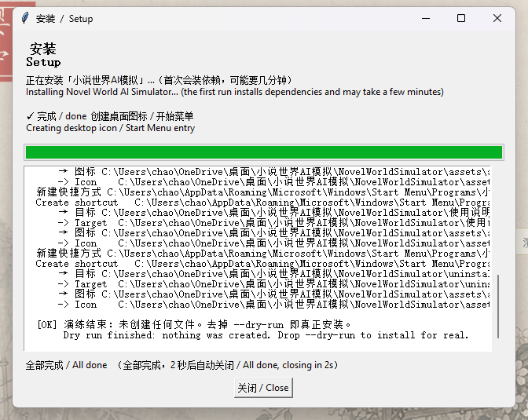

Uninstalling also opens a progress window, and **lists every shortcut it removes**.
Before it does anything it asks for confirmation in a **native dialog** (the default
button is **Cancel**, so hitting Enter never deletes by accident):

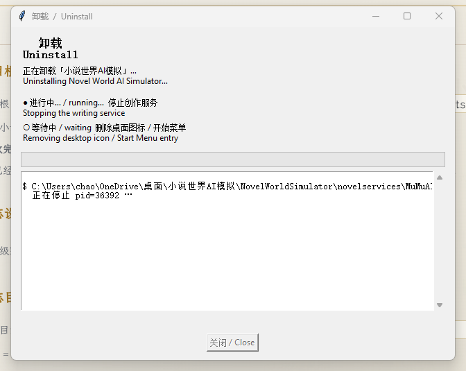

**Flags** (shared by `setup.exe` / `uninstall.exe`; on macOS / Linux use
`./setup` and `./uninstall`):

| Flag | What it does |
|---|---|
| (none) | the script name picks the action: `setup.*` installs, `uninstall.*` removes |
| `--dry-run` | **Preview only**: prints every change it would make and **writes nothing** — run this first (a preview does **not** ask for confirmation) |
| `--purge` | on uninstall, also remove `.venv` / `logs` / verification screenshots (⚠ your novel projects under `Projects/` are never touched) |
| `--yes` / `-y` | skip the **uninstall confirmation dialog** (for scripts and repeated runs) |
| `--dest-root <dir>` | relocate the Desktop / Start Menu / Applications root — **for automated tests**, you do not need this |
| `--quiet` | print less (**also for scripts**) |
| `--skip-service` | **Skip preparing the novel-writing service** (MuMuAINovel). By default setup also readies that service's runtime (virtualenv / dependencies / database schema) so the first launch does not have to wait; use this flag to skip it |

**Examples**:

```bash
setup.exe --dry-run        # see what it would change (safe)
setup.exe                  # actually install (Desktop + Start Menu + service runtime)
setup.exe --skip-service   # shortcuts only - leave the service runtime alone
uninstall.exe --dry-run    # preview the uninstall (no confirmation dialog)
uninstall.exe              # real uninstall: asks first, acts only if you say yes
uninstall.exe --purge      # remove the environment too (novel projects untouched)
uninstall.exe --purge --yes  # same, but skip the dialog (for scripts)
```

To drive the underlying tool directly (same on all platforms — swap in your own `python`):

```bash
.venv\Scripts\python.exe tools/platform_install.py status          # what is installed, and where
.venv\Scripts\python.exe tools/platform_install.py install --dry-run
.venv\Scripts\python.exe tools/platform_install.py uninstall --purge --yes  # no prompt, remove everything
# automated tests: relocate the "Desktop root" and stay quiet (you will not need this)
.venv\Scripts\python.exe tools/platform_install.py install --dest-root D:/nws-dest --quiet
```

What you get on each platform:

- **Windows** — a Desktop shortcut plus a Start Menu folder named
  「小说世界AI模拟」 containing **Launch / Open project folder / User manual / Uninstall**
- **macOS** — `~/Applications/小说世界AI模拟.app` (visible in Launchpad and Spotlight)
  plus a Desktop alias. The `.app` launches through Terminal so you can see first-run
  dependency installation; uninstalling can also be done by dragging the `.app` to the Trash
- **Linux** — a「小说世界AI模拟」entry and a「卸载 小说世界AI模拟」entry in the
  application menu, plus a Desktop icon (marked trusted automatically for GNOME)

A few notes:

- The icons point at **this platform's start script**, so double-clicking the icon is
  identical to running `start.*`; no reinstall is needed after code updates.
- **No administrator rights required** — only your own user directories are written.
- Uninstalling removes **only the shortcuts it created**; your novel project data
  (`Projects/`) is never deleted. `--purge` additionally removes `.venv` / `logs` /
  verification screenshots.
- To preview the changes first, add `--dry-run`: `setup.exe --dry-run`.

### 2.3 Manual install (developers)

```bash
# Enter project directory
cd NovelWorldSimulator

# Create virtual environment
python -m venv .venv

# Activate virtual environment
# Windows:
.venv\Scripts\activate
# Linux/Mac:
source .venv/bin/activate

# Install dependencies
pip install -r requirements.txt

# Launch
python main_gui.py
```

**Flags**:

| Flag | What it does |
|---|---|
| (none) | normal launch |
| `--mock` | **Demo mode**: treat this run as `MOCK_LLM=true` (**this run only**, never written to `.env`) |

**Examples**:

```bash
python main_gui.py           # normal launch
python main_gui.py --mock    # demo mode (free, no real requests)
```

### 2.4 API Key Setup

> This section is only about **where to apply**. For how to plug it into the app,
> see [3.4 How to Plug the Key In](#34-how-to-plug-the-key-in).
>
> The app speaks **the OpenAI-compatible protocol only** — anything exposing
> `https://…/v1/chat/completions` works with **Base URL + API Key + model name**.
> All of the providers below (and many more) are supported.

| Provider | Console (apply here) | Base URL | Notes |
|---|---|---|---|
| **DeepSeek** | https://platform.deepseek.com | `https://api.deepseek.com/v1` | **Recommended to start**: cheap, strong Chinese; models `deepseek-flash` / `deepseek-v4-pro` |
| **OpenAI** | https://platform.openai.com/api-keys | `https://api.openai.com/v1` | Needs a foreign card; often unroutable from mainland China without your own network setup |
| **Anthropic (Claude)** | https://console.anthropic.com | `https://api.anthropic.com/v1` | ⚠ **Not** OpenAI protocol; use a relay, or run a protocol-translation proxy |
| **Google (Gemini)** | https://aistudio.google.com/apikey | `https://generativelanguage.googleapis.com/v1beta/openai` | Use its **OpenAI-compat** endpoint (note the trailing `/openai`) |
| **Microsoft (Azure OpenAI)** | https://portal.azure.com (Azure OpenAI resource) | `https://<resource>.openai.azure.com/openai/v1` | Put the **deployment name** in the "model" field; some regions need `?api-version=` |
| **Zhipu GLM** | https://open.bigmodel.cn | `https://open.bigmodel.cn/api/paas/v4` | e.g. `glm-4-plus` / `glm-4-flash` |
| **Qwen (Alibaba Bailian)** | https://bailian.console.aliyun.com | `https://dashscope.aliyuncs.com/compatible-mode/v1` | The `/compatible-mode` part is **required** |
| **MiniMax** | https://platform.minimaxi.com | `https://api.minimax.chat/v1` | Some models use `/v1/text/chatcompletion_v2`; check their docs |
| **Moonshot (Kimi)** | https://platform.moonshot.cn | `https://api.moonshot.cn/v1` | Strong at long context |
| **SiliconFlow** | https://cloud.siliconflow.cn | `https://api.siliconflow.cn/v1` | One key, many open models |
| **OpenRouter** | https://openrouter.ai/keys | `https://openrouter.ai/api/v1` | Aggregator, one key for many vendors |
| **Local (Ollama / LM Studio / vLLM, optional)** | see below | `http://127.0.0.1:11434/v1` (Ollama) | **Free, offline**; quality depends on your GPU; **entirely optional, not installed by default** |

**The same three steps everywhere**

1. **Sign up / log in** at the console in the table above.
2. **Add credit or claim the free tier** — most vendors give free trial credit,
   enough to run a book through once.
3. **Create an API key** under "API Keys", then **copy it** (usually starts with `sk-`).
   ⚠ It is shown **only once** — store it in a password manager before closing the page.

**Per-provider details**

- **DeepSeek (recommended)** — https://platform.deepseek.com → "API Keys" → create →
  copy. Base URL `https://api.deepseek.com/v1`. Note: its newer models **default to
  thinking mode**, and thinking also consumes tokens; the app automatically disables
  thinking for conclusion-only purposes, so you don't have to care.
- **OpenAI** — https://platform.openai.com/api-keys → "Create new secret key".
  Base URL `https://api.openai.com/v1`; models like `gpt-4o` / `gpt-4o-mini`.
- **Anthropic (Claude)** — https://console.anthropic.com → "API Keys".
  ⚠ Claude uses `/v1/messages` and a different auth header, so it **will not work
  as-is**. Either use a relay that gives you an OpenAI-compatible Base URL, or run
  your own translation proxy and point Base URL at it. This app does no protocol
  translation.
- **Google (Gemini)** — https://aistudio.google.com/apikey → "Create API key".
  Use `https://generativelanguage.googleapis.com/v1beta/openai` (the trailing
  `/openai` matters). Models like `gemini-2.5-pro` / `gemini-2.5-flash`.
- **Microsoft (Azure OpenAI)** — create an **Azure OpenAI** resource in
  https://portal.azure.com, then grab the **endpoint** and **key**. ⚠ You must first
  **deploy** a model and use the **deployment name** as the model name — `gpt-4o`
  alone won't work. Base URL looks like
  `https://<resource>.openai.azure.com/openai/v1`; some regions also need
  `?api-version=2024-10-21`.
- **Zhipu GLM** — https://open.bigmodel.cn → "API Keys".
  Base URL `https://open.bigmodel.cn/api/paas/v4`; models `glm-4-plus` / `glm-4-flash`.
- **Qwen (Alibaba Bailian)** — https://bailian.console.aliyun.com → "API-KEY".
  Base URL **must** be `https://dashscope.aliyuncs.com/compatible-mode/v1`;
  models `qwen-max` / `qwen-plus` / `qwen-turbo`.
- **MiniMax** — https://platform.minimaxi.com → "Interface keys".
  Base URL `https://api.minimax.chat/v1`; check their console docs for per-model paths,
  and always hit the "Test" button before you trust it.
- **Local (optional, not required)** — this is **not** a prerequisite: the app defaults to a cloud
  API and needs no local model service. Install [Ollama](https://ollama.com) only if you want the
  content to stay on your machine and your GPU can carry a local model: `ollama pull qwen2.5:14b`,
  Base URL `http://127.0.0.1:11434/v1`, any API Key (not validated locally),
  model name `qwen2.5:14b`. LM Studio / vLLM and other OpenAI-compatible local
  servers work the same way.

> **Not sure which to pick?** Want to try right now → **DeepSeek**. Already have a key from
> someone else → just use it, as long as it is OpenAI-compatible. Only go local if you
> already run Ollama and have the GPU for it. Either way, **leave the embedding provider at
> the default `none`** — no Ollama needed.

---

## 3. Quick Start

### 3.1 Launch Program

Double-click `start.exe` on Windows; double-click `start` in Finder on macOS
(or run `./start`); run `./start` on Linux.

You can also run `setup.*` once (see 2.2) to place icons on the Desktop and in the
Start Menu, then just double-click the icon from then on.

Equivalent CLI command: `python main_gui.py`

#### Launching shows **no** console window

Since 2026-10-10 the three launchers (`setup` / `start` / `uninstall`) are native
executables **without a console**. After double-clicking you will see **no black
command-line window** — that is normal, and it is the whole point of the change.

- **When something must be installed** (first launch, or with `--reinstall`) a
  **progress window** appears first: what it is doing, which step it is on, and the
  raw output of each step. It closes itself when done.
- **On a normal launch** the runtime is already in place, so the launcher does
  **nothing at all** and shows no window; the app window comes straight up.
- The log is still written to the `logs/` folder. If something goes wrong, send the
  newest `nws_*.log` file. It **starts with your book title**:
  `nws_<Book>_2026_10_07_01_23_11.log` — one book runs many rounds, and the file name
  tells you at a glance which book it belongs to (before a book is opened there is no
  title segment).
- **Closing the main window shuts everything down**: the background writing service
  (MuMuAINovel, which normally holds port 8001) **stops with it** — nothing is left
  behind. To keep it resident instead (so the next launch needs no cold boot), turn
  off "Stop the service when the app closes" under 天机 → 创作服务.

### 3.2 First Run Wizard

1. Click "New Story" on the start screen
2. Four-step wizard: pick a folder → name/genre/style → AI options → confirm
3. Click "Start import"; the **import dialog** opens with a live progress bar and run log
4. (if AI refinement is on) progress pauses at 90% and the AI posts a review;
   **type to chat with it** and reshape characters, hooks and worldbuilding until you are happy
5. Click "Finish & enter story" → 100% → the dialog **closes itself** → you land on the running interface
6. The project is written to disk (settings / run folder / .nwsproj) and shows up under "Open Story"

### 3.3 Demo Mode (Zero Cost)

```bash
# Edit .env
MOCK_LLM=true

# Launch (or double-click start.exe on Windows)
python main_gui.py
```

Demo mode doesn't send any real API requests, uses built-in corpus for full flow.


### 3.4 How to Plug the Key In

> No key yet? See [2.4 API Key Setup](#24-api-key-setup).
>
> **On the very first launch the app pops a dialog** telling you LLM is not
> configured. Click **"Configure now"** to jump straight to
> **Heavenly Secrets → LLM Access**; click **"Later"** to keep using the app as-is —
> **it will remind you again next launch**.

**Recommended: configure in the UI**

1. On the start screen click **"天机 / Heavenly Secrets"** (global settings) — the
   first tab is **LLM Access**.
2. Fill in three things:
   - **API Key** — the string you copied from the vendor console;
   - **Base URL** — see the table in 2.4;
   - **Front / Daily / Cheap model names** — used for key plot beats, routine loops,
     and compression/scoring. **If unsure, put the same model in all three.**
3. Click **"Fetch model list"** — it really asks the endpoint what it offers and
   repopulates the three dropdowns. Then click **"Test"** next to each — it sends one
   minimal request and prints the result or the error right below, within seconds.
4. Click **"Save"**, then **restart the app**.

> ⚠ **Why a restart is required**: the LLM client is built once at startup (connection
> pool, auth headers, concurrency semaphore) and is not rebuilt on the fly. Both the
> dialog banner and the message box will remind you.

**Or just edit `.env`**

```ini
LLM_PROVIDER=openai_compatible
LLM_BASE_URL=https://api.deepseek.com/v1
LLM_API_KEY=sk-your-key
MODEL_FRONT=deepseek-v4-pro      # Front tier: key events, important dialogue
MODEL_DAILY=deepseek-flash       # Daily tier: routine loops
MODEL_CHEAP=deepseek-flash       # Cheap tier: compression, scoring
```

Restart afterwards, as always. See the [Configuration Guide](Configuration_Guide.md)
for every key.

**What happens if you don't**

The app still opens and lets you browse settings and docs, but it will:
- pop that dialog once at startup;
- keep a persistent warning in the message box;
- **turn demo mode on** (in memory only, never written to `.env`) — offline, built-in
  corpus, so you can click around.

**So you won't see a crash — you'll see "characters that feel off".** That is the demo
corpus. Once you save a working configuration, the automatic downgrade is lifted.

**Common errors**

| Message | Usually means |
|---|---|
| `401` / mentions **API Key** | Key copied incompletely, has stray spaces, or expired |
| `400` + mentions **model** | Wrong model name — click "Fetch model list" |
| `404` | Wrong Base URL (most often a missing `/v1`, or Qwen missing `/compatible-mode`) |
| Can't connect / timeout | Bad address, proxy misconfigured, or local server not running |
| Connects, but the text is empty | The model spent its budget on "thinking" — see 9. Settings Details |

---

## 4. Main Interface

### 4.1 Layout


*The run screen (settings imported, no round started yet) — every panel shows only placeholders; no fabricated sample data*

### 4.2 Panel Description

- **Left** (top to bottom): **time → mini-map → run settings → story-tone bars → system**
- **Center**: narrative area — **screenplay style** (see 4.2.2); fills the whole
  block and sits flush against the command bar below it (no dead space)
- **Right**: characters on stage, plot progress, **cast**
- **Bottom**: command input bar

> **The titles of "Run settings", "Story tone" and "Cast" are clickable** (the title is
> **underlined**, followed by a `↗`, and the cursor turns into a hand). One click takes you
> straight to where their values live:
>
> | Click on | Deduction **running** | Deduction **not started** |
> |---|---|---|
> | Run settings | Study · Type & Style (its "run boundaries") | Tianji · Run (time ratio / one beat / budget) |
> | Story tone | Study · Style Control | Tianji · Director & Compliance |
> | Cast | Study · Cast Agents (the list) | Tianji · Cast Agents (the list) |
>
> The rule behind the split: **while a book is running you are changing "this one"**
> (so it goes to the Study, which holds this book's settings); **before a run starts**
> this book has no "running scene" yet, so the only thing adjustable is the
> program-layer default (so it goes to Tianji). Hovering over any of those titles states
> right there which page the click will take you to.
>
> Changes take effect **immediately**: the Study's style parameters, run boundaries and
> director strength all **count as soon as you change them** (dragging a slider or picking a
> dropdown writes straight into the config), and once you close the dialog with Save *or*
> Cancel, **those run-page panels refresh to the new numbers on the spot**. No restart, no
> need to start a new round.
>
> **Every row of the cast panel is clickable too**: click a position's row to open
> **that position's** settings (name / duty / system prompt) directly — the "Cast Agents"
> list is laid out underneath and the editor is stacked on top; closing the editor returns
> you to the list.

> **Empty by default.** Before the story starts, every panel shows only a
> placeholder (`—`, `Not started yet`, `No character on stage yet`, `Stopped`, …).
> **No fabricated sample data is pre-filled.** Only after a real run has produced
> daily output does the centre column show real narrative text and the right
> column show real characters and node progress.

> **To start a round, click "📖 Pen to paper" at the top right** — that is what the
> empty centre column tells you too. **The command bar at the bottom cannot start
> a round**: it only knows `/help`, `/status` and `/settings`; anything else
> replies "not wired up yet". The button is the only way in.

### 4.2.2 Center column: **prose**, one card per scene

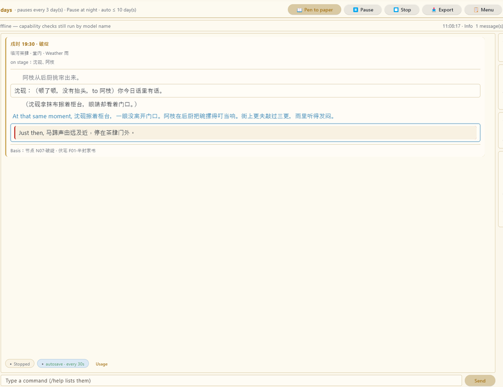

*Centre column enlarged: one card per scene — the head carries this scene's time, place and
who is on stage; the body is prose*

The centre column reads like a **novel**, not a continuity sheet: narration flows into
paragraphs (indented two spaces), dialogue gets its own paragraph, wrapped in quotes,
preceded by a short speech tag.

```text
　　Mo Wen walked in. Water was warming on the stove; the white lantern was still unlit.

Shen Yan lowered his voice and said to A Zhi: "Don't go out tonight."

A Zhi said: "Why?"

　　Shen Yan set the pot down. A Zhi thought: he is not himself today.
```

What changed, from continuity sheet to novel:

| Before | Now |
|---|---|
| `Shen Yan (low voice) to A Zhi: Don't go out tonight.` | `Shen Yan lowered his voice and said to A Zhi: "Don't go out tonight."` |
| `Shen Yan: set the pot down` | `Shen Yan set the pot down.` |
| `[inner voice · A Zhi] He is not himself today.` | `A Zhi thought: he is not himself today.` |
| `[memory · Shen Yan] It rained like this that year too.` | `Shen Yan remembered: it rained like this that year too.` |
| `[enter] Mo Wen (walks in)` | `Mo Wen walked in.` |
| one sentence per line, dozens of fragments per screen | narration merges into paragraphs, at most four sentences each |

**Two things stay exactly as they were** (they are not story, and folding them into the
prose is what actually breaks things):

- **Mechanic notes**: `※ node complete: wakes at the door` — progress information for *you*
- **Structural markers**: `〔cut to · back alley〕` / `〔cut back〕` — signposts for a second
  thread happening elsewhere; illustrations `〔image〕` likewise

**The layering is still there**, it just moved from "labelled on every line" to "colour and
italics inside the paragraph": ambient description faintest · inner voice faint italic ·
memory gold italic · entrances and exits faint · narration and action in body colour.
**Each sentence in a paragraph keeps its own style** — nothing smears together.

**One card per scene**: the card changes when the time slot or the place changes. The card
head carries time, place, weather and who is on stage; the foot carries "Basis" (which
progress node this scene advances, which foreshadowing it pays off) — those are *ledgers*,
not story, so they do not join the paragraphs.

**Simultaneity and cuts**: when someone acts off-stage at the same moment, a single
`At that same moment, ...` sentence covers it. If it happens *somewhere else*, the text
cuts with `〔cut to · east ferry〕 ... 〔cut back〕`. With only one person acting, no
"meanwhile" is written — "meanwhile" for a single actor reads oddly.

**The on-disk screenplay format did not change at all**: the daily files still hold a
machine-readable screenplay (`Shen Yan: Don't go out tonight.`, `◇ inner voice` and so on) —
that format exists for export and consistency checks. The screen shows prose because
**the reader is you, not a parser**. Full spec: [剧本输出格式.md](剧本输出格式.md).

### 4.2.2.1 The writing room sets the frame first: a "story for the day" before the day starts

Before a day begins, the **writing room thinks the day through first**, and the order matters:

1. **Write the story for the day (novelist)** — based on the worldview, the top-level
   rules, the **progress nodes (the main line)**, the recap, and yesterday's digest.
   This is **prose**, not an outline: it reads like a chapter, and it answers
   "by the end of this day, what has changed?"
2. **Fact-check (researcher)** — do the objects, institutions and forms of address hold
   up? The findings are **handed to the screenwriter** (that collaboration is real, not
   just written in the roster).
3. **Turn it into a script (screenwriter)** — split into at most **6 beats**; each beat
   says where it happens, what happens, and which part of the main line it advances.
   The screenwriter also writes a short **scene introduction** (the opening paragraph).
4. **Hand out the parts** — each character on stage gets 1–3 things "to do today".
5. **Verify (director)** — the director **reviews its own work**: does it follow from the
   recap? Can you name the node it advances? Is anything unrelated to the main line?
   Does anyone appear who is not present, or act out of character? If it fails, the script
   is **rewritten with the specific note attached** (up to `DAY_PLAN_FIX_ROUNDS` rounds,
   default 2).
6. **Only then does the day start** — characters follow the script, and are free to
   improvise **within the frame**.

Every character therefore sees a `[今日剧本]` block when deciding: what this day is about,
plus their own assigned tasks, ending with "you may improvise within this frame, but do
not do things unrelated to it".

**Why this step exists**: previously each character planned **on their own** — twelve
people each doing their own thing, which together is not a story, and the screen showed
"everyone busy with small private errands". With a story first, then a script, then
assigned parts, each character knows where they stand in the book.

**Who does these steps**: the crew's **novelist** and **screenwriter** — each reads their
own craft books (see the next section).

**Where it lands**: the story, scene intro, beats, assignments, and the verification
verdict all go to `当日剧本.json` in the run folder (one entry per day). **The project
folder stays read-only** — this rule has no exceptions.

**Turning it off**: disable "day script" in settings and it falls back to the old
behaviour (everyone plans for themselves). It costs three to four cheap-tier calls per day
(prose / fact-check / script / verify), plus one extra round when a rewrite is needed.

**Old run folders still open**: previous free-text daily files are shown as-is,
never force-split into dialogue. To revert: set `OUTPUT_FORMAT=prose` in `.env`.

##### 4.2.2.1a The narrative window: page back to the start · a time on every entry (2026-10-11)

The author reported two things, both settled right here:

> "when I scroll back in the dialog window some information is no longer visible — is something being
> swallowed? I'd like this window to page if its content can't be infinitely long; I need to be able
> to see everything in this round"
>
> "I'd like an option so that every entry in the dialog window has a very small current date and time
> at its top-left (real time - story time), for reference"

**① Paging: you can walk back to the very beginning of this round.** There used to be two places that
**really did swallow content**:

- the middle column only rendered the **last 200 entries** (earlier ones were still held in memory but
  never drawn);
- once the widget count passed 400 it **deleted the first 100** (in two places), and **not in step with
  the content** — so "I can't scroll back to it" became "it's really gone".

That is now **paging**: a pager bar sits **above** the narrative area

> `⏮ earliest` `◀ earlier` ｜ page 3 / 12 · 2340 entries · up to date ｜ `later ▶` `newest ⏭`

- how many entries per page is set by `NARR_PAGE_ENTRIES` (default **200**);
- with only one page the whole bar **hides itself**, taking no room;
- page boundaries fall **between paragraphs** (a paragraph is never split in half, which would leave a
  fragment with no first-line indent);
- ⇒ **not a single entry lost, widget count bounded** (long runs no longer get progressively slower).

⚠ **While you browse history, new content will not yank you back**: it is only recorded, and the pager
accumulates "N new items"; click "newest" to see them (all of them). Going back to a history page
**turns auto-follow off**, and returning to the newest page turns it back on.

**② Timestamps: a small line at each entry's top-left** (`NARR_TIMESTAMP`, **on by default**):

> `20:14:03 · day 3, xu hour`
> He put the pot down without looking up.

- **real time** (the wall clock) + **story time** (which day and hour the story has reached) — story
  time alone cannot tell "an hour ago" from "generated yesterday", so both are needed;
- the font is two sizes below the body (`NARR_FS_STAMP`) so it does **not compete with the text**;
- ⚠ **Only entries produced live in this round**: history read back from disk has no real time, so it
  is **left blank rather than invented**;
- turn it off if it feels crowded (`NARR_TIMESTAMP=false`) and the whole line disappears.

> Why both times: when the author correlates "when was this line said", real time answers "when did I
> see it" and story time answers "where in the story is this moment".

### 4.2.2.2 The crew: one company, one chain

**A run is not "a character walking around a room" — it is a crew turning out work.**
The right-hand column of the run screen has a **Crew** panel: the roster on duty, one row
per role with a status dot, the name, and what they last delivered.

**Whoever is working gets highlighted** (2026-10-08): the moment a role starts, its whole
row turns into **warm-gold background + a vermilion bar down the left + the name in bold gold**,
and the line reads "working · Ns so far". **The moment they finish it goes back to the plain
row** (a finished role keeps only its green dot). The caption underneath follows:
"**N crew members are working** (the highlighted ones)".

> Why it exists: crew work comes in bursts (a few peaks a day) and the screen is static in
> between — and "waiting on a role that has been running for three minutes" and "the program
> is stuck" look exactly the same to a user. "Who is working" plus "for how long" is the bit
> of information that tells the two apart.
>
> The timing is **pushed by events**, not by the 0.5-second UI polling — a short turn-out
> (tens of milliseconds in demo mode) falls entirely between two polls, so polling would
> never show anyone lit up.

**The second line of that row says what they are doing *right now*** (changed 2026-10-08):

| Row state | Second line | Example |
|---|---|---|
| **Working** | **what they are doing at this moment** (the role's duty) | `Doing: which objects this scene has, which one recurs` |
| Not enabled this run | `Not enabled this run` | — |
| Idle / finished | The last thing they delivered (only `Not called yet` if they never have) | `read 6 items: the three things this scene must state` |

> Previously it said "not called yet" whenever the role had not delivered yet, whatever the
> state — so a row lit up as "working · 12 s so far" had "not called yet" underneath it,
> which contradicts itself (verbatim: "the crew on the right are all working, **and yet
> their status still says 'not called yet'** — that is a bit odd").

| Role | What they do | When they work |
|---|---|---|
| **Novelist** | Writes today's chapter as **original prose** | day boundary |
| **Screenwriter** | Turns the prose into a **shootable script**: beats, who does what, assignments | day boundary |
| **Director** | Sets the frame, assigns work, injects events, verifies, wraps up | always |
| **Actors** | Improvise within the frame (these are the character agents) | every beat |
| **Extras** | The people and errands outside (external input) | every beat |
| **Script Review** | Reads every new piece **before it reaches the screen** (is it human speech, does it sound like this person, does it connect, is it one theme) - rewrites or **blocks** what fails; also **records everything that reaches the window** | **every beat** |
| **Script Supervisor** | **Continuity check**: time, props, names, on-stage state, recap conflicts | day end |
| **Props** | Which objects this scene has, which one recurs | before the day |
| **Art Director** | Sets the look and palette (once per book) | before the day |
| **Publicity** | The one-line pitch, the hooks, the teaser | day end / export |
| **Researcher** | Fact-checks names, institutions, forms of address | day boundary |

The shift order cannot be reversed:

```
1 before the day   art director sets the tone -> props picks this scene's objects in that
                   tone - styling decides what is on the people themselves
2 writing room     novelist writes prose -> researcher fact-checks -> screenwriter scripts
                   -> director verifies
                   -> REHEARSAL (the whole company walks the day once, see below)
                   anything unplayable goes back to the screenwriter -> rehearse again
                   (once the script is final, the art director draws *that day's map* from
                    the places the beats happen in, and Sound decides *what can be heard today*)
3 shooting         actors + extras (unchanged, every beat) - every line about to
                   reach the screen first passes **script review** (see below)
4 wrap             script supervisor's continuity check (reports, never edits) -
                   publicity writes the line - the language editor names the AI-ish sentences
                   -> Review writes "today's summary"
                   -> the day is turned into a chapter (novel form)
5 wrap-up          the crew's artefacts land in the run report, section "1.5 Crew archive"
```

#### Script review: the gate before anything reaches the screen (2026-10-08)

**It is an independent role, not the director.** Verbatim: "is there an **independent Agent**
rather than the director watching every line the actors say - **if not, build one**: **before the
actor actually says it**, put the newly generated line next to the lines that have already
appeared and check whether it reads". It runs **before every single thing reaches the screen**
and judges five things:

| Judges | The kind of fault it catches |
|---|---|
| **Is it human speech** | unreadable, invented phrases, half sentences |
| **Does it sound like this person** | is this what his identity / character / catchphrase would say, and is the **form of address** right |
| **Does it connect** | does it pick up what came before; did someone **appear out of nowhere** and then **do nothing** |
| **Is it one theme** | are these lines about one thing, or is everyone off on their own |
| **Does it fit the scene** | would this be said here, at this hour |

Failures are **rewritten** when possible; if not they are **blocked** - a blocked line does not
enter the script (it is really removed from the scene, so screen and file agree) and is recorded
in `剧本审读.md` and the log. **Never silently dropped.**

**It is also a running ledger**: everything that reaches the window is recorded in order -
actions / dialogue / narration / **scene changes** / **foreshadow activations** / director moves /
recap / today's brief / today's tasks / stages / crew status / the wrap-up summary. Two artefacts
land in the run folder:

| File | What it is |
|---|---|
| `剧本审读.md` | **summary** (one per day, overwritten): how much was recorded, how many were blocked and why, who came on stage without anyone talking to him, what each batch was about |
| `审读台账.jsonl` | **stream** (appended): seq / day / beat / kind / who / to whom / source / text / blocked / why |

**"Came on stage and nobody engaged him" is reminded**: a name on stage for more than
`SCRIPT_REVIEW_NEWCOMER_TICKS` beats (8 by default) that has not spoken, has not been spoken to,
and is not mentioned in any action - then **everyone** next beat sees "whoever is on stage, pick
him up".

**Two layers, very different cost:**

| Layer | How often | Catches | Costs |
|---|---|---|---|
| **Rules** | **every single item** | hard formal faults: leftover JSON/URLs, placeholder talk, out-of-play words, mashed punctuation, half sentences | nothing |
| **Model** | every `SCRIPT_REVIEW_EVERY_TICKS` beats (1 = every beat) | the judgement calls above | one cheap call |

> The rule layer **deliberately only catches form**: the sentences the user quoted as "not human
> speech" are all grammatically fine - you have to read them to know. Catching those with rules
> means either a regex that only works for that one sentence, or a rule wide enough to kill good
> sentences too - and **killing a good line is worse than missing one**.

Config (Settings - Run - Script review; no restart needed): `SCRIPT_REVIEW` (master; off =
neither review nor record) - `SCRIPT_REVIEW_MODEL` (off = rules only, free) -
`SCRIPT_REVIEW_EVERY_TICKS` - `SCRIPT_REVIEW_HISTORY` - `SCRIPT_REVIEW_STRICT` (off = record only,
never block) - `SCRIPT_REVIEW_NEWCOMER_TICKS`.

#### Rehearsal: walk it once, off screen

After the script is final and **before shooting starts**, the whole company
**walks the day once** - producing no prose and showing no result in the window,
only a small line: `▸ Crew rehearses · 3.2s`.

It asks, beat by beat (the "read-through + blocking" idea):

| Question | Why finding out during shooting is too late |
|---|---|
| Can this person **actually do** what the beat assigns? | An actor on stage can only force it; it stops being that person |
| Is everyone written into the beat **really there**? | Assigning work to an absent character = in the script but never on stage |
| Are lines/actions **written shut**, so they can only be recited? | That makes puppets (exactly what this project keeps avoiding) |
| Do the beats **connect** to each other? | In a script with a jump, the actor has to invent a bridge |

Problems go **back to the screenwriter with the notes**, then it is
**rehearsed again** (`CREW_REHEARSAL_ROUNDS`, default 1). What comes out of it
lands only in `排练记录.md` and the log.

> Rehearsal and "director verification" are **two different things**: verification
> asks "does the story hold together", rehearsal asks "can it be walked on stage".
> A script can be perfectly sound as a story and impossible to play - one pass
> cannot catch both. Knobs: `CREW_REHEARSAL` · `CREW_REHEARSAL_ROUNDS` ·
> `CREW_REHEARSAL_TOKENS`.

#### After wrap: the day as a chapter

At wrap-up the novelist turns **what actually happened today** (not what was
planned) into **one chapter of novel**, used in two places:

* `当天故事.md` - a readable manuscript that **accumulates day by day**;
* `今日总结.md` - gains a section "today's chapter (transcript)", alongside the review.

> Different from the exported "novel version": that one is a **bound book**, this
> one is a **day-by-day working copy**; the export **prefers this transcript when
> it exists** (it is written as a novel to begin with, which beats "strip the
> stage-manager markings"). Knobs: `CREW_DAY_NOVEL` · `CREW_DAY_NOVEL_TOKENS`.

#### Cognition modes: who thinks before speaking

Drawing on *AI Agents from Zero to Mastery*, chapter 4 (ReAct / Plan-and-Solve /
Reflection) and chapter 7, seven positions **run through a short list of questions
before they speak or write** - inside the **same request**, so it costs nothing extra:

| Who | What they think through first | Where the thinking goes |
|---|---|---|
| **Actors** | What do I want now / what did that last line do to me / would this line work in anyone else's mouth / how long should I speak | `推演` - the log, and the Crew panel's *actor* row |
| **Screenwriter** | What changes today / how many beats / what changes in each beat | `构思` - filed with the script |
| **Novelist** | What changes in this chapter / who collides with what / what is left open | prompt only (the output is prose; no extra field) |
| **Director** | What most needs pushing this beat / who is stuck | the log |
| **Continuity · researcher · language editor** | Check item by item **first**, then conclude | `核查` - filed with the artefact |

Every question is tied to a **craft entry that position already reads**
(`craft/playbooks`) - it is not a new theory, it is that position's own book used in order.

**Line self-review** (a reflection chain): when a line is **clearly not something a
person would say on stage** (written connectives, naming the emotion, essay-length),
the actor re-reads his own line **before it is spoken** - he may change it, keep it,
or drop it. Only the handful the rules pick out is ever re-asked, so **ordinary
dialogue costs no extra call**.

> The pattern table, the thinking scaffolds and the self-review rules all live in
> `crew/cognition.py`; the full assessment is a developer document, kept in the
> source tree at `developers/docs/Agent认知升级方案.md` (**not shipped in releases**).
> Knobs: `COGNITION` (master) · `COT_ACTOR` (the actors' - the expensive one) ·
> `COT_CREW` · `ACTOR_SELF_REVIEW` · `ACTOR_SELF_REVIEW_MAX`.
> **Turning the master switch off reverts to the previous behaviour verbatim.**

**Why "look before script"**: reversed, the prop list is merely assembled from an
already-finished script — no longer a creative decision, just a record. In this order the
objects actually shape how the scene is written.

#### The two collaborations are real, not just written down

Every role has a `feeds` field saying who gets its output, and the program **actually
hands it over**:

- **researcher's findings → screenwriter's prompt**: when the script says "the innkeeper
  pays three taels", the note "that is not how it was counted back then" is in the
  material the screenwriter sees.
- **art director's tone → props**: the prop master picks objects that match the look and
  palette.
- **prop list → script supervisor**: to check whether props are consistent you first have
  to know what this scene is supposed to contain.
- **styling → actors + images**: once it decides "Shen Yan wears a faded indigo jacket",
  that sentence reaches the actor's decision material (the `[你身上]` block) **and** the
  day's image prompt — the same person no longer gets a different face every three days.
- **sound → the scene's ambient lines**: with "the only bed sound is rain off the eaves",
  a quiet moment is written with that, not with a canned sentence.

> **Audit note (2026-10-07)**: the last two used to exist **only in the roster** — styling's
> output stopped at `造型表.md`, and Sound and the language editor **never worked a single
> day** (switches on by default, duties shown in the UI, while the calling line did not
> exist). They now really run, and the test is "run one day and read the ledger", not
> "is the function there in the code".

#### What they are wired into (checkable)

Each role names, in the roster, the real thing it is wired into, and the program
**resolves every one of them at startup** (mismatches are named in the log). For example:

| Role | Wired into |
|---|---|
| Novelist / Screenwriter | the `craft/` library (**different shelves *and* different entries**: the novelist reads narrative structure, the screenwriter reads drama and staging) |
| Director | `director/engine.py`, `director/day_plan.py`, `director/supervisor.py` (watching + **the outline**) |
| Actors | `agent/core.py`, `display/scene_builder.py` |
| Extras | `world/crowd.py` |
| Props / Art / Styling | `image_gen/` (prompt prefix for AI images, and element matching for local art) |
| Sound | `display.scene_builder.SceneBuilder.observe_quiet` (ambient lines) |
| Publicity | run report, section "1.5 Crew archive" |
| Researcher | `research/`, `refs/` |

**"What this should look like" really changes the picture**: the look, palette, the
scene's objects and the styling all become a prefix on the text-to-image prompt; for local
PNG art, prop names mentioning "boat / river / lamp / courtyard" light up the matching
elements.

#### What theory they read

- **Novelist** reads three shelves: *Chinese classical composition* (Jin Shengtan,
  Li Yu), *web-fiction methodology*, *Western screenwriting canon*. Named entries:
  rising-holding-turning-resolving · expectation management · character arc · foreshadowing.
- **Screenwriter** reads *Drama and staging* (Lao She's *Teahouse* practice: a character
  defines themselves in one line, entrances and exits carry the scene, time is shown
  through the setting, crowd scenes are paced, one small prop carries everything, stage
  directions are written for actors) and *Western screenwriting canon* (McKee, Snyder,
  Field: every scene turns a value, the gap between expectation and result, three acts).
  Named entries: **every scene turns a value · is it shootable · entrances and exits carry
  the scene · a character defines themselves in one line**.
- **Script Supervisor** names "every scene turns a value · entrances and exits carry the
  scene · crowd-scene pacing" — exactly what it checks.
- **Sound** names "silence carries the scene · restrain the monologue"; the **language
  editor** names "breath and rhythm · a character defines themselves in one line · restrain
  the monologue"; **Review** names "scene = value change · character arc ·
  rising-holding-turning-resolving".

> **Each role reads the entries of *its own line of work*, not "the first three in the
> shelf"** (changed in the 2026-10-07 audit). It used to be the latter, so the script
> supervisor was handed the screenwriter's writing tips while the entry it actually needs
> ("every scene turns a value") sat at position 16 in the file and never came up.

Both live in `craft/playbooks/` as plain YAML — **to add a technique, just write it into a
file** (or put it in the directory named by `CRAFT_EXTRA_DIR`).

> ★ **Dialogue must sound like a live person** (added 2026-10-12 · named by the user): real people
> **hesitate**, **do not answer every line**, **do not talk fast**, and **their speech habits follow
> their character**; whereas "AI-generated" dialogue is the exact opposite (no stumbles, fast, never
> hesitating, **and it shouts easily**). The requirement became **six** entries on the "characters and
> dialogue" shelf: **speech is not a straight line** · **not every line needs an answer** ·
> **volume is scarce** · **one thing at a time** · **pauses must land on paper** ·
> **change shape by whom you speak to**.
> **All four lines use them together** -- novelist, playwright, actor, script review: the first two
> get a hard constraint block; the actor gets it as **action discipline** ("set your volume before you
> speak", "frayed edges are allowed", written right next to the line); and the review's checklist
> grows from five items to **six** (the sixth watches four kinds of "fake you can spot at a glance":
> every line joining up / someone shouting / three things in one breath / not a single pause).
> There is also a **mechanically auditable half**: the de-AI list gains a "**shouting abuse**"
> category. Switch `CREW_LIVE_SPEECH` (on by default; off = all three lines revert together).

#### The script supervisor reports, never edits

Continuity errors come in two kinds: genuine mistakes, and deliberate exceptions. A
machine cannot tell them apart, so the output is a **list for the author to look at**
(written to `场记报告.md`) and the program **never edits the text on its own**.

#### Where the output goes

In the run folder: `剧组台账.md` (how the company is doing) plus `剧组台账.json` for
programs, `美术指导.md`, `道具单.md`, `造型表.md`, `当天地图.md`, `声音设计.md`,
`考据笔记.md`, `场记报告.md`, `语言审校.md`, `今日总结.md`, `排练记录.md`,
`当天故事.md`, `宣发文案.md`,
`当日剧本.json`, `去AI审计.md`. **The project folder stays read-only** — this rule has no
exceptions.

These working papers **never enter the novel text**, but they do enter the **run report**
under **"1.5 Crew archive"** (which file · who wrote it · first line — zero cost, no text
copied).

#### Tuning

The "剧组" (crew) group in settings:

| Knob | Effect |
|---|---|
| `CREW` | Master switch (off leaves only actors/director/extras, the old paths) |
| `CREW_CONTINUITY` / `CREW_PROPS` / `CREW_ART` / `CREW_RESEARCH` / `CREW_PUBLICITY` / `CREW_REVIEW` / `CREW_STYLIST` / `CREW_SOUND` / `CREW_POLISH` / `CREW_SETTING_TALK` | Per-role switches. A disabled row shows **Disabled** — that is a different thing from "delivered nothing" |
| `CREW_EXTRA_CASTING` | Let Extras cast the new faces from the story (off falls back to a fixed pool: cheaper, but every passer-by looks the same) |
| `CREW_STORY_MIN` / `CREW_STORY_MAX` / `CREW_MAX_BEATS` | Prose length range, maximum beats |
| `CREW_SCREEN` | How much detail the crew reports: `off` stages + summary + failures · **`key` (default) plus work status** · `full` plus a one-line title (the text itself never reaches the pane; **output is still written to disk**) |
| `CREW_REHEARSAL` / `CREW_REHEARSAL_ROUNDS` / `CREW_REHEARSAL_TOKENS` | Rehearsal: walk the day once before shooting, and how many rewrite rounds it may force |
| `CREW_DAY_NOVEL` / `CREW_DAY_NOVEL_TOKENS` | Turn today into a chapter at wrap-up (`当天故事.md` + a section in `今日总结.md`) |

> **Cost**: a full day adds roughly 10–14 calls (art is once per book; props / styling /
> sound / research / continuity / publicity / language editor / review are once a day,
> mostly on the cheap tier). To spend less, disable `CREW_ART` / `CREW_PROPS` /
> `CREW_STYLIST` / `CREW_SOUND` / `CREW_RESEARCH` / `CREW_REVIEW` / `CREW_POLISH` — the
> writing room (novelist + screenwriter) is the trunk; disabling those two steps reverts
> to the old behaviour.

Tuning: `SCRIPT_IMAGES` (turn stills off), `SCRIPT_AMBIENT` (no ambient lines),
`SCRIPT_SCENE_MAX_ENTRIES` (scene length before splitting).

### 4.2.2.3 Layered settings: big background as "climate", small things run the day

A settings folder usually mixes two very different things: **a large background** (what
this world is like, what rules hold) and **very small objects** (the teapot with a chipped
corner; the water clock may be reset only once a night). They used to be one blob, with the
background sitting first and eating the whole budget — leaving no room for the small things,
even though **it is usually those small things that drive any given day's scene**.

So settings are split into five layers, each with its own answer to "when does it show up,
in which situation, and whom does it affect":

| Layer | What it is | When it appears | Who may write it | Source files |
|---|---|---|---|---|
| **World** | The big background: what the world is like, era and rules | **Normally just "climate"**; the full text is shown on day 1, climax days, every 3rd day, and when moving to a new place | Author | `世界观.md`, `顶级规则.md`, `类型卡.yaml`, `风格卡.yaml` |
| **Arc** | Where the book is going: outline, progress nodes, foreshadowing | Every chapter (node change) and at the start | Author | `剧情走向.md`, `故事进度.yaml`, `伏笔与悬线.yaml` |
| **Scene** | This place, and the people it involves | Whenever the scene happens in this place | Author + crew | `地点.yaml`, `关系.yaml` |
| **Detail** | Objects, customs, catchphrases, small rules, local colour | **Whenever today's scene can use it** (filtered by situation / who is on stage) | Author + crew | `细节设定.yaml` |
| **Person** | One person's own settings (identity, personality, catchphrase, secret, goal, red lines) | When that person is on stage | Author | `人物.yaml` |

**Where it lands** (all inside the **run folder**; the project folder stays read-only as always):

| File | What it is |
|---|---|
| `分层设定.md` | **A page for humans**: which items each layer holds, their scope (timing / situation / whom it affects), weight and origin — plus "to change a layer, edit this file" |
| `分层设定.yaml` | The same content, machine-readable |
| `临时设定.md` / `.json` | **Local settings added by the crew's story room** (below); states plainly that they were **not written into your settings folder** |

#### The story room: director · novelist · screenwriter in one room

Before a day starts, these three hold a **story room**, with one agenda: **to keep the next
stretch playable, which small settings need adding?** Whatever they add is **actually fed
into the simulation** (into the characters', the novelist's and the screenwriter's prompts).

Two hard rules, **enforced by the program** (not left to the model's good intentions):

1. **They may only add "Scene" and "Detail" items** — the World and Arc layers are your
   **core canon**; the crew may not add a single line to them.
2. **Every item must have a scope** (at least one of: place / person / time). Something
   limited by neither place, nor person, nor time is core canon wearing a different hat —
   **rejected on the spot**.

Rejected items are reported **with the reason** (into the ledger and the log) rather than
silently dropped. Accepted ones live only in `临时设定`, **structurally isolated** from your
settings: `世界观.md`, `顶级规则.md` and the character sheets are never modified. To promote
one, copy it into your own source folder.

#### Tuning

| Knob | Effect |
|---|---|
| `SETTING_LAYERS` | Master switch. **Off reverts to the old behaviour** (one worldview blob truncated to 500 chars — byte-for-byte what it did before) |
| `CREW_SETTING_TALK` | Story-room switch (off saves one summary-tier call) |
| `CREW_SETTING_EVERY_DAYS` | How often the room meets (`1` = daily; **with nothing to add it returns an empty list**, costing a few hundred tokens) |

> **Cost**: the story room runs on the summary tier, at most once a day, and returns an
> empty list when there is nothing to add. To drop it entirely, turn off
> `CREW_SETTING_TALK` — layering still applies, it just stops adding local settings.

### 4.2.2.4 How dialogue connects

Characters used to decide **without hearing what anyone else had just said** — their
material held only the scene, who was on stage, and their own memories. So all they could
do was talk past each other. Now there is one more block, `[刚才]`, showing what is
happening on the floor right now:

```
[刚才]
- 阿枝对你说：「掌柜的，那笔账你自己说。」      (A Zhi, to you)
- 你刚说：「话就是话，哪来的里外。」            (you, just now)
- （阿福去了柜台后）                          (Chen Wang moved behind the counter)
```

The three labels each do a job: **"X 对你说"** means the line is waiting for an answer;
**"你刚说"** stops a character repeating himself; and bracketed actions are visibly
different from speech.

Two things go with it:

- **The person addressed answers first.** Whoever was just spoken to is picked to decide
  on the next beat — give and take, which is what a conversation is. When nobody was
  addressed, selection stays random (not every scene should become a dialogue).
- **The first speaker goes alone, then the rest.** The second character in the same beat
  already sees what the first one just said — so you no longer get "two people saying two
  unrelated things at the same time".

Both apply **only when someone has been addressed** (i.e. a conversation is actually
running): that is worth going one at a time for. Otherwise the original speed is kept.

**A line may carry a small action**, all at once:

```
（把账本往中间一推）要查就一起查，别背着我。
```

which reads far more like a person speaking on a stage than "make a face now, speak next beat".

**What happens when someone says the same thing twice**

The same character never says the same line twice (one character once repeated
「账差七文」 verbatim four times). But "identical" covers two very different things,
and the program cannot tell them apart:

* **lazy repetition** — should be blocked;
* **it has to be said** — a follow-up question, the other party did not hear,
  or a plain "嗯" — blocking it is simply wrong.

So it is no longer dropped. Instead the character is made to **think the situation
through again and say it once more**:

* he says something else → that is what gets used;
* he **still** says the same line → then it really is necessary, and it goes through.

This happens **entirely inside his head** (an explicit requirement): he runs through
it once, and there is no such thing as "saying it out loud and then taking it back" —
the screen, and the other characters, only ever see the final line.

Short replies (「嗯」「……」, "yes", "fine") skip this step: people repeat those anyway,
and it is not worth an extra call.

> Tuning: `DIALOGUE_RETRY_DUP` (off reverts to the old behaviour: the repeat is
> **dropped outright**, so that beat may end up completely blank) ·
> `DIALOGUE_RETRY_MAX` (how many characters per beat may be asked to redo it;
> default 2 — redoing costs one extra call; `0` = never redo).

> Tuning: `DIALOGUE_CONTEXT` (off reverts to the old behaviour) ·
> `DIALOGUE_CONTEXT_LINES` (how many lines `[刚才]` shows; default 6, `0` = none).

### 4.2.2.5 How a day opens, how it closes, and staying clear of "AI flavour"

**A day opens in this order (day 1 included):**

```
§ 前情提要 (recap):      what has happened so far
▷ 今日剧情简介 (brief):  what this chapter is about (30–60 characters)
▤ 今日任务 (assignments): who is responsible for what today
(scene introduction):   where we are, what light, what is in the air
—— the day proper begins ——
```

> **Why the assignments block exists**: it is the "director's assignments" you listed.
> Until now "what each person is supposed to do today" was written only into **the
> character's own** daily plan — the character could see it, the **reader could not**.
> So "what happens today" was there (the brief) while "who carries which part" was missing.
>
> ⚠ It is **not** the same thing as the `※ (dispatch) …` line that occasionally appears:
> that one is the **per-N-beats ad-hoc dispatch** (the director reassigning as progress
> moves); this block is the **once-a-day assignment** fixed before shooting.
> Knob: `DAY_TASKS` (off = only the character's own plan, nothing on screen).

The **brief** is written by the screenwriter inside the same call that produces the
day's script — no extra cost. If it does not come back, nothing is shown: padding it
with the recap would be worse than leaving it out.

> ⚠ **This whole block (recap → brief → assignments → scene introduction) used to be
> missing entirely on day 1** — a real bug fixed on 2026-10-07: `run()` decided whether
> to open the day with `game_day != _current_day`, and **both start at 1**, so **day 1
> never ran the day-open step at all** (no writers' room, no sample chapter, no script,
> no verification, no rehearsal, no assignments, no brief, no scene introduction,
> no day map, no sound design). The test is now "**has this day been opened**"
> (`_day_opened_for`), so day 1 always runs it.

**A day closes** (at end-of-day, or when you press stop) with a **"today's summary"**.
A crew position called **Review** reads the day as if it were a chapter and gives three
parts — **what happened / what is wrong / what to change**. Problems and suggestions
are required to name a specific character or a specific line; it will not say vague
things like "the characterisation is thin". It only reports, it never edits.

**What happens after you press "⏹ Stop"** (changed 2026-10-07):

```
▸ 收尾（落盘 + 总结）   wrapping up (flush + summary)   <- a small stage line, immediately
※ 正在停止 —— …        stopping - flushing this day, then the summary, then export
■ 今日总结             today's summary                  <- the summary card, once wrapping is done
—— 全篇终 ——
```

It used to look like the button **did nothing**, for two reasons, both fixed:

* **No acknowledgement** — `stop()` only sets a flag; the real exit waits for the current
  step to finish, and then a whole wrap-up runs (script supervisor / publicity / language
  editor / review + transcribing the day + auto-export). With a real model that is
  **several calls**, tens of seconds to minutes, and during all of it the middle column
  **said nothing at all**. Now those two lines appear the moment you press it.
* **Waiting too long** — if you happened to hit it during "the day opening" (writers' room
  + sample chapter + script + verification + rehearsal + art + sound, a dozen requests),
  it used to **run to the end anyway**. It now checks "did anyone ask to stop?" after each
  step and **gives up right there** (the day simply has no framework — the same state as
  "the model failed to write a story", which the rest of the pipeline already handles).
  It also no longer wraps up twice: if the day it stopped on **never played a single beat**
  (typically: you stopped right at a day boundary), it will not flush an empty day and
  write a duplicate summary.
* Pressing it when nothing is running now **tells you** "this round has already stopped"
  instead of staying silent.

> Tuning: `DAY_BRIEF` · `DAY_TASKS` · `DAY_REVIEW` · `CREW_REVIEW` · `DAY_REVIEW_REPLAY`
> (allow the review to rewind and reshoot; off by default — touching your draft is
> your call).

**"AI flavour" is handled in two halves, both free:**

* **Before** — the character's decision prompt carries the list (four families of
  stock phrases plus ten pattern warnings), so it should not write them in the first place.
* **After** — every line an actor speaks and every artefact the fifteen crew positions
  produce is **audited one by one**; hits are written to `去AI审计.md`
  (which line, which word, how many times).

Stock-phrase words that slip into dialogue are **deleted** ("First of all, I am not going"
→ "I am not going"). Sentence patterns are untouched — deleting them breaks the
sentence — and every deletion is logged. `DEAI_STRIP` turns the deletion off so you
only get the audit.

> To add words your own book should never contain, put them in `craft/去AI补充.yaml`;
> no code change needed. Tuning: `DEAI`, `DEAI_PROMPT_ITEMS`.

### 4.2.2.6 The director watching the shoot — repeated beats, and rewinding

The same line said twice by **one** character is blocked by a guard (see 4.2.2.4).
There is a harder case: **several characters independently saying the same thing**.
To each of them it is the first time, so no per-character guard can catch it — it is
only visible when the lines are looked at **together**.

The director now watches for exactly that (plus "several beats in a row going nowhere"):

| What it finds | What the director does |
|---|---|
| Several people saying similar things / several idle beats | ① puts a `[导演提示]` (director's note) into the **next** beat's prompt |
| The same, and serious enough | ② **rewinds**: deletes the lines just produced and reshoots that beat |
| Happening repeatedly | ③ notes it for the review at wrap-up (it will **never** rewrite the script by itself) |

**A rewind does three things together**: returns the script, removes it from the screen,
and rolls back the "what just happened on the floor" buffer — doing only one of them
leaves the file and the screen disagreeing.

> Tuning: `DIRECTOR_WATCH` · `DIRECTOR_WATCH_EVERY` ·
> `DIRECTOR_WATCH_MIN_PEOPLE` (how many distinct people count as "several", default 3) ·
> `DIRECTOR_ROLLBACK_MAX` (`0` = warn only, never rewind).

### 4.2.2.7 The crew: sixteen positions, and where their words show up

There are now **sixteen** positions (eleven, plus four added on 2026-10-07, plus Rehearsal):

| Position | Job | Artefact |
|---|---|---|
| Novelist · Screenwriter · Director · Actor · Extra | the spine (draft → script → performance) | the text itself |
| Story Room | director + novelist + screenwriter adding **local** settings | `临时设定.md` |
| Continuity | timeline / props / forms of address mismatches | `场记报告.md` |
| Props | the concrete objects in this scene | `道具单.md` |
| Art | the look and palette (fixed once for the whole book) | `美术指导.md` |
| Publicity | one-line hook, draw, teaser | `宣发文案.md` |
| Researcher | whether names, institutions and titles hold up | `考据笔记.md` |
| **Review** | end of day: what happened / what is wrong / what to change | `今日总结.md` |
| **Styling** | what each person wears, carries, how they stand | `造型表.md` |
| **Sound** | what this scene sounds like (ambience, silence) | `声音设计.md` |
| **Copy Editor** | which lines sound machine-written, and how to fix them | `语言审校.md`; **also merged into that day's summary** (see below) |
| **Rehearsal** | walks the whole day once, before shooting (see 4.2.2.2) | `排练记录.md` |

#### What actually appears in the story pane (**the whitelist**)

The story pane is where you **read the novel** — so it carries the story and
nothing else. You named the allowed items one by one; **everything else is kept
off the screen** (it still goes to the log and to disk):

| Shows up | What it looks like |
|---|---|
| Scene description · external change | ambient prose, someone entering / leaving |
| Recap · today's brief | `§ …` / `▷ …`, each with its own background block |
| Narration · actions · dialogue | the body text |
| Scene changes | `〔cut to · place〕`, the time line |
| Key variables · conflict cues · director's assignments | `※ …` / `【event】…` / `(dispatch) …` |
| **Crew stage messages** | `▸ Crew rehearses · 3.2s` (name and duration only, no content) |
| **Crew work status** | `· Art Director delivered · 1.2s` (who worked, **with a collapse arrow in front**) |
| **Wrap-up summary** | `■ Today's summary` (the only crew output shown **as content**) |

**The full text of every crew artefact (art direction, prop list, styling, sound
design…) never reaches the story pane** — it goes to `剧组台账.md`, each
position's own `.md`, the log, and section "1.5 Crew archive" of the run report.

#### The expand button in front of crew messages (new 2026-10-23)

Those little crew lines now start with a **small button**:

```
[ > thinking ]  Art Director · working…
[ > result ]    · Art Director delivered · 12.4s
```

**Collapsed by default** (just like a chat app folds away its "thinking" block). Click the
button to open it -- the caret turns from `>` to `v` -- and click again to collapse.
Hovering deepens the button's border and text, which is how it says "this is clickable".

| What the button says | What is inside when you expand |
|---|---|
| **thinking** (still working) | What that role is **thinking right now** -- the LLM's reasoning, **streaming in character by character** (only reasoning models produce it; a plain model gives you the body instead) |
| **result** (has delivered) | **This step's result** (that art-direction paragraph, the prop list, the continuity notes…) |

> On hand-in the words on the button **change by themselves** from "thinking" to "result",
> so you always know what expanding will show.

A few things worth knowing:

- **One event, one line.** The moment work starts you get "Art Director · working…";
  when it hands in, **that same line is rewritten** into "· Art Director delivered ·
  12.4s" -- not one line followed by another.
- **It reads the live state, not a recording.** The panel polls every 0.26 s **only while
  you have it open**; collapsed ones read nothing at all (otherwise dozens of invisible
  widgets would spin and keep shoving the scroll position you are reading).
- **Collapsed by default**, so the story pane stays as clean as before.
- **An obvious button, quiet content**: the button has a border, a fill and words (clearly
  clickable), while the status text beside it stays small and muted -- crew messages must
  not upstage the prose.
- **"This step failed" expands too**, and says why (timed out / produced nothing).
- **Can be turned off**: 天机 → "剧组" → `CREW_EXPAND`. Off restores "one status line,
  not clickable".
- **Thinking needs streaming**: `CREW_STREAM` (on by default) makes it appear character by
  character. A few gateways reject streaming; the program then **falls back to the whole
  response automatically** -- the panel still shows the full text, you just lose the
  character-by-character effect, and the run is unaffected.

> ★ **One exception: the Copy Editor** (since 2026-10-12). The lines it flags as
> machine-sounding, and how to fix them, are **merged into that day's summary** — so you
> see them right there in the story pane instead of digging through the run folder for
> `语言审校.md` (that file **is still written**, not one word less).
> Why this one: it is something **you have to fix by hand**, and leaving it in a file is
> as good as never telling you. ⚠ Both only appear **when the copy editor actually found
> something**; with zero hits the summary gains no empty section.
>
> ★ Its **downstream** is wired up too: the roster says it has
> `feeds="screenwriter"`, yet **nothing in the code ever read it back**. Now, when
> **writing the next day's script**, those "AI-flavoured lines + how to fix" are handed to
> the screenwriter as upstream material — so the same phrasing does not show up two days
> running.

> `CREW_SCREEN` controls **how much detail** is reported:
>
> * `off` — stages + the daily summary + failures only (no work status)
> * **`key` (default)** — plus **work status** (the "who delivered" cards)
> * `full` — plus a one-line title after each status ("2 places today"); **still not the text**
>
> **"Did not deliver" and "today's summary" are reported in every mode**: the first is a
> failure signal, and silencing it removes your only clue that a position is broken;
> the second is the wrap-up summary you asked for by name.

### 4.2.2.8 How an actor is put together: two prompt layers + casting

The roster is about **positions** (novelist, screenwriter, script supervisor…). This
section is about **actors** — who they are and how each one plays. Real productions keep
two things apart: the **casting type** an actor brings (their rhythm, how they sit in a
room) and the **role** the script gives them (who they play, their situation, secrets).

#### Two layers, and who wins when they disagree

| Layer | What it holds | Who supplies it | Changes per book? |
|---|---|---|---|
| **Type preset** | how this *kind* of actor plays: pace, sentence length, physical habits, default bearing | the actor | no |
| **Role customisation** | who they play *in this book*: identity, situation, goal, secret, relationships | the script | yes, every book |

Both go into the prompt, followed by an **arbitration rule**:

> The type governs only **how you play**; the role governs **who you play**.
> **When the two disagree, the role wins** — you are this person, not this type.
> One exception: the point listed under "break type" — play that.
> That point is exactly where this person becomes human.

> Why the rule is spelled out: with two layers and no rule, the model picks whichever
> suits it *this time* — hence a character who is cold one beat and chatty the next,
> which is very hard to debug because both sources look right on their own.

**To change how a character plays**, add a line to the character card (the author's word
overrides the automatic match):

```yaml
- 姓名: Shen Yan
  性格: terse, remembers everything    # without 演员类型, matched from this line
  演员类型: 青年·高冷                    # or name a type outright
  打破类型: only talks a lot around A-Fu  # optional: the one override
```

#### The type library: 24 types, each able to grow several people

It lives in `actors/archetypes.yaml`, sorted on **two axes** (the same way real casting
does a first pass):

* **age band** (child / youth / young adult / middle-aged / elderly) — governs **voice and
  rhythm**, the hardest thing to change;
* **temperament** (aloof · sharp-tongued · sweet · forceful · plain-spoken · commanding ·
  bookish · streetwise · calculating · hot-blooded · brooding · diplomatic · innocent ·
  steady · eccentric · withdrawn) — governs **default bearing**.

**Age beats temperament**: a sharp-tongued seven-year-old uses a child's pace, not an
adult's.

Every type carries three things:

| Field | Purpose |
|---|---|
| frame / speech / body | the **preset layer** in the prompt (~150 chars, a small slice) |
| **variations** (≥3) | how same-type actors are told apart: the 1st takes variation 1, the 2nd takes 2 — **not copy-paste** |
| taboos | what not to make of them (keeps a type from becoming a cliché) |

> **The variation axes are also the anti-cliché guarantee**: a type with exactly one
> reading *is* a stereotype. A check enforces "≥3 variations per type".

#### It happens automatically at ingest

```text
character card (personality/identity) → two-step match (age band, then temperament)
   → instantiate → split variations among same-type actors → write 《选角表.md》
```

**If nothing matches, it falls back to the default type and says so on the sheet**
(`未命中（兜底默认）`) — it never pretends a fallback was a match.

#### The project profile: the crew adjusts per book

Positions are **trades** (a script supervisor always checks continuity), but *what this
book needs watched* differs. So ingest also writes 《本剧组守则.md》, built entirely from
the **genre card and style card already computed** (hook library, payoff patterns, taboo
red lines, style notes) — **not a single extra model call**.

It is appended **after** each position's craft block and carries the line
"where this conflicts with the general craft above, this section wins" — the order and
the sentence are deliberate: **the specific beats the general**, the same principle as
the actor's two layers.

### 4.2.2.9 The fork in the road — it asks you when the story needs to turn

When the story reaches a **node boundary**, a **climax day**, or simply **stalls**,
a "Fork in the road" panel appears. The director proposes a few directions and
**you decide** — or, if you do nothing, it picks one by policy.

Top to bottom it has four blocks:

```
The story has reached a fork: pick a direction, or write your own.

Day 7 · 临河茶肆 · the hour · present: 主角, 阿枝, 柳氏     <- (1) where we are
◈ 旧事浮头: reactions diverge, the clues stop adding up
So far: the account that did not add up kept going deeper…

○ B1｜当面揭穿掌柜           <- (2) options: radio buttons, just labels
    trust collapses on the spot
○ B2｜夜里走一趟东馆
    you get a lead, but owe a favour
● B3｜先看谁先动             <- the one selected
    tension keeps building

Write your own direction      <- (3) none to your liking? write one; it wins
(a two-line input box)
Auto-decides by policy in 4m 32s

Confirm     Skip — let the policy decide     <- (4) Confirm on the left
```

Four things worth knowing:

* **(1) that small block is "where we are"** — day, scene, who is present, the current
  node and a line of recap. Without it, "B1/B2/B3" are not much to choose from.
* **(2) the options are radio buttons, not buttons** — picking one only moves the dot;
  **nothing happens until you press Confirm**. With nothing picked and nothing typed,
  Confirm is greyed out (so a click can never do nothing).
* **(3) the box at the bottom lets you write your own direction** — if you write
  something, **it wins** over any option above. What you write is recorded as a
  director intervention **in the event stream**, so the next beat's characters and
  director both read it (it is not just a log line).
* **(4) the countdown** defaults to **5 minutes** (longer than the old 2, enough to
  think a direction through and type it). **It stops the moment you pick or start
  typing** — it will not throw away the sentence you are writing. Only if you never
  touch it does the policy pick for you (see the knobs below).

> Tuning: `BRANCH_WAIT_SECONDS` (how long to wait; `0` = never auto-close),
> `BRANCH_PROPOSALS` (how many options), `BRANCH_AUTO_POLICY` (what happens if you
> do not answer: `weighted` / `first` / `random` / `pause` — **pause never decides
> for you**).

### 4.2.3 The status line at the bottom (grey capsule)

At the very bottom of the centre column there is **always** a small grey line inside a
pill-shaped box. It answers one question: **what is it doing right now?**

```
● 正在生成 —— 人物在行动 · 已 12 秒
```

| What it may show | What it means |
|---|---|
| `正在生成 —— 人物在行动` | Waiting for the model to give this beat's character actions (**the slowest step**) |
| `导演在看这一拍` | The director engine is deciding whether to step in |
| `正在安排今天要做的事` | Day rolled over; planning what each character does today |
| `正在核对故事进度` | Comparing against the progress table to see which node advanced |
| `运行中 —— 等下一次行动` | This beat is done; waiting for the next one (needs `BEAT_SECONDS` story-seconds) |
| `已暂停 —— 等你点「继续」` | Paused |
| `未运行` / `已停止（…）` / `已结束（…）` | Not running |

**`· 已 N 秒` means "how long the current state has lasted"**; it ticks up twice a second.
Its only purpose is to **prove the program is not frozen**. With a real model a single beat
can take tens of seconds, and during that time the words do not change — without the number,
"running" and "hung" look exactly the same on screen. It resets when the state changes,
because that is when the clock restarts.

**When nothing is running, there is no timer** — `未运行`, `已停止（…）` and `已结束（…）`
are just a clean sentence, with no number after them ("stopped · 1234 s" would mean nothing).

> In one line: **the words say what it is doing; the number says for how long.**

**To its right there is a second pill — blue background, green text: "autosave"**
(added 2026-10-08):

```
● 已暂停 —— 等你点「继续」 · 已 8 秒      ● 自动落盘 · 还有 12 秒（上次 18 秒前）
└─────── status pill (warm paper, grey) ─┘  └─ autosave (light blue, green) ─┘
```

It answers **two** things (both asked for verbatim on 2026-10-08: "autosave has no
countdown **and I cannot see whether it did anything** (if it did, it should give a hint
inside the autosave status pill)"):

| That text | What it says |
|---|---|
| `还有 12 秒` (in 12 s) | **countdown** — how long until the next save (ticking every second) |
| `上次 18 秒前` (last saved 18 s ago) | **it really is working** — how long since the last save. **Saves made by the timer itself count too** (previously only a manual save was recorded, so the screen never showed it doing anything) |
| `✓ 刚落盘（第 3 次）` (just saved, no. 3) | For the **3 seconds** after a save, this replaces the countdown — complete with a running count |
| `还有 12 秒（还没落过）` | Switched on but **not due yet** — said honestly rather than inventing a "last time" |
| `autosave · off` | `0` = really off (not staying silent) |

The interval is `AUTOSAVE_SECONDS` (30 s by default, changed under
**Global settings · Run → Autosave** — no restart needed).

- The two pills sit **side by side on one line** and are deliberately coloured differently:
  the left one is **warm paper + grey** (state), the right one **light blue + green** (saving)
  — so you can never read the wrong one.
- The little dot has three states too: **never saved** (grey) · **saved** (teal) ·
  **just saved** (teal, one size bigger).

### 4.2.3.2 Autosave: survive a pause, a closed window, or a sudden shutdown

**Why it exists**: a day's play is produced **in memory first** and only written out when the
day ends. Until then, pressing Pause, closing the window, or the machine shutting down loses
most of that day.

So a **background autosaver** writes the **resumable state** every `AUTOSAVE_SECONDS` seconds
(30 by default). It writes **three** things with different jobs:

| What | Where | Who reads it |
|---|---|---|
| ① That day's body (marked `⏳ 定时落盘`) | `每天的生活/第NNN天.md` + `.json` | 拾卷's "latest plot" and **the next resume** |
| ② The stop point | `停点.json` | The next "start writing" decides day + moment from it |
| ③ A human-readable snapshot | `自动落盘/进度.md` + `.json` | Humans only |

① and ② are the **entire** source of "resumable after a power cut" — so the most you lose is
**one interval** (30 seconds by default).

**A save exists the instant writing starts** (no waiting 30 seconds): the moment you click
"start", one flush runs immediately whose stop point says "day N, this day has not begun". So
even if you pull the plug 5 seconds in, the next start begins at that same day instead of
replaying it.

**拾卷 shows how fresh the content is**: while a round is unfinished, the card's time gets an
extra `⏳ 15:01:20` — the **last autosave** time (not the start time). Hovering explains that
the next start resumes from there.

**The draft cannot masquerade as the final file**: the copy in `每天的生活/` carries
`> ⏳ **定时落盘 · 15:01:20** — this round is still running; wrap-up / the day boundary will
rewrite this day as the complete version.` After the wrap-up rewrite **that line is gone** —
so "has this day been wrapped up" is visible on the first screen.

> Why the draft may live in `每天的生活/` (not only in its own `自动落盘/` folder): **resuming
> only reads that file**. Writing only the human snapshot would give a correct position with an
> empty body -- more confusing than not saving. One marker line gives both "resumable" and
> "visibly unfinished".

Besides the timer, it saves **once more** at four moments:

| Moment | Why |
|---|---|
| **The instant writing starts** | So a power cut in the first 30 seconds does not leave the round with no trace at all |
| Pressing **Pause** | Pressing Pause usually means you are leaving — exactly when a save matters |
| **Closing the window** | "I might close it at any time". Hooked on window disconnect, saved synchronously |
| **Before wrap-up / stop** | So the last stretch is not lost while the wrap-up calls run |

> A failed save **only logs a line** and never interrupts the run — it is insurance, and
> broken insurance should not stop the car. To turn it off, set "Autosave (s)" to `0`.
> It never touches the project folder — only the run folder (project folders are never
> written back to).

### 4.2.3.3 Minimap (vector, redrawn whenever the scene changes)

**The minimap shows only one thing: where *this scene* is happening** (tightened again
2026-10-08): every place name on it comes from **the story that is being played right now**,
never from the book's settings. Before a day starts the director writes the story and splits
it into beats; the crew's **art director** then draws **that day's map** from the places those
beats **actually mention**. If today's scene never leaves one building, the map has one place.

> Example: today's whole scene is inside 「临河茶肆」 (the beats read "临河茶肆堂内·雨夜·柜台前",
> "次日·茶堂", "茶堂檐下"), so the map shows **only 「临河茶肆」**.
>
> It used to be wrong in two ways at once: ① the art director was handed the **whole
> `地点.yaml`** (in that book 6 of the 7 entries are **world-level** names — realms and
> afterworlds), i.e. it was told to draw the entire world; ② when you entered the run screen
> the app itself laid all 7 out as a **whole-book map**, before the day's scene had even
> started. That is the map you saw.
>
> Now: ① the prompt lists **only today's places** (nothing outside that list may appear);
> ② that whole-book path is **removed entirely** — entering the run screen shows **no
> settings place names at all**.

**How the scope is computed**: the names from `地点.yaml` are **matched against** the day's
script (its "场 / 发生 / 推进" columns) — the settings list is a dictionary, not the picture,
and the beat's location field is not treated as a place name directly. A long line like
「临河茶肆堂内·雨夜·柜台前」 **hits 「临河茶肆」**; a spot inside the building ("侧案旁", "檐下")
**is not a place** and never reaches the map. Where you are right now is always first.

**Where the drawing comes from**: the art director draws today's places; the result lands in
the run folder as `当天地图.json` (a table version, `当天地图.md`, sits next to it). If it
cannot be produced, the canvas shows **only the place you are in**, and the small line says so
— it does **not** fall back to the whole-book map, and it does **not** frame by "linked
neighbours" either (those links are relations the AI invented when laying out, so framing by
them drags the realms back in). **It never draws a wrong map.**

**What it shows**: each place is a small glyph (house, yard, pavilion, gate, bridge,
ferry, tree, hill, tower, platform, market); places that connect are joined by a line;
a river is drawn as a water line. **Where you are now** is a vermilion dot with the full
name; other places show a short label; characters on stage are small dots at their place.

**How the positions are decided**: the art director reads **today's scenes** (each beat says
where it happens) and places today's few spots by their **relative position**. It may be
simplified, but it will not be "a row of squares".

**When it is redrawn**: ① **every new day** · ② **every time the place changes**
(a change of time-of-day counts too) — when the 「幕终」 divider appears in the middle
pane, the vermilion dot has moved · ③ **the moment the art director delivers today's map**
(added 2026-10-08).

> ③ exists because ② never fires on a day that stays in one place: the loop now
> **notifies the UI once** when the map is ready (`_push_scene`, deliberately **not**
> recorded as a "scene change", so no fake row lands in the script-review ledger), and the
> half-second UI ticker compares the map object as a backstop (an identity check, free).
> Without ③ the left column stayed on "today's map is not out yet" — which is exactly what
> was reported: "**the minimap is never drawn - it looks like the art director never took
> part; the story has started and the minimap was still never drawn**". The art director
> *had* worked and the file *was* on disk; nobody had told the UI to redraw.

Redrawing costs **zero model calls**: only today's map is asked of the art director, once a
day, and the result is cached in the run folder as `当天地图.json`
(the project folder stays **read-only**, as always).

**The small line under the map tells you honestly where it came from**:

| That line | Meaning |
|---|---|
| `Today's scene spans 3 places · relative positions placed by the model from today's script (reference only)` | **Today's map** (drawn by the art director from today's scenes). "Reference only" = the bearings may be imprecise |
| `Today's scene is right here · …` | Today's scene happens in **one place**, so the map shows exactly that one |
| `Today's scene spans N places · simple layout (no model call)` | No model was asked (you switched "lay out with AI" off, or it failed). Places follow the script's order along one main road |
| `Today's map is not out yet (…) — for now only your current spot is marked` | **Fallback**: the day has not started, or the art director has not delivered yet — only your current spot is marked (this is *not* "today is only one place") |
| `Your location is not known yet — it appears once the first scene starts` | Not even the scene is set yet |
| `No places yet — import a folder that has a "places" file` | This book's settings have no places, so the map is empty (nothing is broken) |

**To get a different layout**: edit `设定集/地点.yaml` (add notes like "by the river",
"north of town") — that changes how the day's script describes places, and therefore how the
art director places them. To avoid that one AI call entirely, switch off the AI layout in
**Settings → Minimap**; it then uses the simple layout only (free, offline).

### 4.2.3.4 Three-level base map: the book's layout is fixed when you open it (2026-10-08)

The scheme above has one weakness it cannot fix by itself: **the art director has no spatial
facts to work from**, so the same place may sit top-left today and bottom-right tomorrow — the
"map" stops being a map and becomes a daily illustration. And "which room inside the building"
has **nowhere to live** (the smallest unit used to be one point per place).

So now a **base map is drawn once, when you open the book**; after that the daily job becomes
**frame the base map + fill in today's detail**. Verbatim from the user:

> "can the setting documents include a map of a particular house, and can the app, **when
> opening a book**, pre-draw some **overall maps / local maps** (around the house, inside the
> house, and any other maps needed) so that **when needed the art director adds detail on top
> of those maps**"

**Three levels**:

| Level | What it draws | When it goes on screen |
|---|---|---|
| **overall** | bearings and paths **between places** (town/village scale) | today's scenes span **two or more** places |
| **local** | the **surroundings of one place** (river, bridge, street, neighbours) | today's scenes stay **in one place** and it has no indoor map |
| **indoor** | the **rooms and courtyards inside** (hall / back yard / well / counter) | today's scenes stay **in one place** and it has an indoor map |

> In one line: **the finest level today's story needs wins**. The three levels do not share
> coordinates — the canvas is only 196×132, and "a magnified indoor plan nested inside the
> overall map" would just be a smudge.

**Where it lives, when it is generated**: `设定集/小世界地图.yaml`, generated **once at open
time** and reused by every round afterwards (the same pattern as character portraits). The
import log shows it:

```
▶ Freezing the local settings — base map ready: overall yes · local 3 · indoor 3
```

**It never invents**: place names in the overall level can **only come from your
`地点.yaml`**; names in the indoor level can only be **rooms and objects** (no place names
inside a house). Anything the model makes up is dropped.

**It does not waste money**: if the basis is unchanged it **reuses the previous map**
(only editing a description triggers a redraw — the map stores a **fingerprint** of its basis,
so a one-character change to a description counts as changed).

**To make it more accurate**, add two **optional** fields to a place (see the *Setting
writing guide* §3.5):

```yaml
- 名称: 临河茶肆
  说明: 临河的茶楼，两层，后院有口井
  方位: 临着河，在渡口西边        # used by the overall map
  内里: [堂屋, 后院, 井, 柜台]    # used by the indoor map
```

They are optional — the app infers from the description and from what such a building
normally has ("two floors, a well in the back yard" → there is a yard and a well).

**Turning it off / adding a painted layer** (Settings → Minimap):

| Switch | Default | Effect |
|---|---|---|
| **Three-level base map** | on | Off = back to "the art director lays out every day" (the same place drifts around). Costs 1+N text calls |
| **Painted base layer** | off | On = in addition to the vector levels, **actually paint them** (one overall + one per place's local map; each is one image generation, token cost). The vector base map does not depend on it |

> ⚠ **The base map is not life-or-death**: if it cannot be had (model failure, switched off,
> unreadable file) the simulation **keeps running** — the minimap just falls back to daily
> layout. The log says so plainly; it never pretends a base map exists.

#### 4.2.3.4b Map anchoring: one place, always the same spot (2026-10-26)

The user's words:

> "The minimap and the big map feel a bit different every time they are generated — is there a way
> to keep the same scene map consistent across the whole novel simulation?"

**Why it drifted** (three causes, all measured):

| Cause | Symptom |
|---|---|
| The reuse fingerprint carried **today's set of places** | One extra place today => "the situation changed" => the whole map is invalidated and redrawn. A story visiting a few places a day is normal, so it redrew **almost daily** |
| Nothing recorded "this position is settled" | Each redraw put things wherever the model liked. The teahouse was top-left yesterday, bottom-right today |
| The archive tier and the map's own tier came from **two sources** | The filename used the base-map layer while the content derived its own; a real file is named `整体_<main place>.json` while its content says `室内` |

**The rule in one sentence**: under one layer and one main place, **a place name keeps its
coordinates forever**; today's layout only **adds places never seen before**.

| Situation | What happens |
|---|---|
| A place **already has a position** | Coordinates, shape, size, short label, which room it belongs to, the small note — **all taken from the record** (not from what the model offers this time) |
| A place appears for the first time | Its position is used and **recorded** (so it never moves either) |
| A newcomer collides with an old place | **The newcomer moves**; nothing old shifts (the old position *is* what this place looks like) |
| The model **omits** a place it drew yesterday | It is added back, **where it used to be** (things vanishing overnight is just as inconsistent as wandering positions) |

**Where it lives**: `<project>/地图/锚定.json` — per **project**, not per run.

> Why per project: one "whole simulation" usually spans several `第N次模拟…` folders. Living under
> the project means continuing the same book keeps the same map; only a new book starts over.

**Two more things**:

- **The reuse fingerprint was narrowed** to "has this layer at this main place been drawn". A changed
  set of places **still reuses**; the extras are added by the rule above. Only a different layer
  (walking from indoors to the street) or a different main place triggers a redraw.
- **The tier has one source**: whichever layer was framed is the tier written into the map — the
  filename and the content can no longer disagree.

**How to switch it off** (Tianji · Minimap):

| Switch | Default | Effect |
|---|---|---|
| **Map anchoring** | on | Off = lay everything out fresh from the model each time; the same place may change position from day to day (the behaviour before 2026-10-26) |

> ⚠ To **start over** (say the setting bible changed a lot and the old layout no longer makes
> sense): switch anchoring off for a day, or delete `<project>/地图/锚定.json` — the next map becomes
> the new baseline. Delete **only that file**; the `地图/` folder also holds the saved maps.

#### 4.2.3.5 Indoors versus in the yard: the minimap tells them apart (2026-10-12)

The user's own words (this passage is the spec for this section):

> "If the minimap is an **indoor map**, use **a frame to enclose the relevant content as this
>  building's name**. Right now there is **a red dot in the middle** acting as the building's name,
>  which not only **covers the content** but is unreasonable. Also please **strictly distinguish
>  indoors and outdoors** … like that building with its **counter, well, gate** —
>  **a well definitely belongs in the courtyard, it cannot be indoors; this kind of mistake must not
>  happen**. And **if there is a well, that means there is a courtyard, and the courtyard must be
>  drawn too**."

| Before | Now |
|---|---|
| On an indoor map the whole building was **a red dot in the middle** (pressing onto the rooms and their labels) | The whole building **is no longer drawn as a point**; instead **a frame** encloses the layer, with **the building name written on the frame** (top-left, on a paper-coloured patch) |
| The gate was just another dot, like the rooms | **The gate is drawn on the frame's bottom edge** (a gate is the inside/outside divide; it is not in the room). Rooms are the dots inside the frame |
| Inside and outside looked the same | **Outdoor things get a light wash** (open sky), indoor ones do not (a roof) — distinguishable without reading a word |
| A "well" indoors went unnoticed | **Spatial common sense runs over it**: things under open sky (well, tree, spirit wall, water vat) belong in the yard; roofed things (counter, long table, stove) belong indoors. **A well with no courtyard → one is added automatically**, placed beside the well, with the reason written to the log |
| The day's map and the base map used two conventions | The base map and **the day's map** share **one** set of spatial rules (`apply_space_rules`), so you never get "the base map drew a courtyard while the day's map dropped it" |

> ★ **It reaches the prompts too**: every entry of the flattened base map carries an
> `[indoor space]` / `[outdoor object]` / `[boundary]` tag, followed by a "spatial facts" passage
> ("the well is in the courtyard, not indoors; indoors has a roof, the yard has open sky") — so the
> model **need not guess** where the well is.
>
> ★ **Actors and the director read it as well**: every beat's prompt gains a line "**where this beat
> is (indoors / in the yard) + how to walk over from the previous scene**" (the route is computed on
> today's map, e.g. "main hall → courtyard → well") — this is "the director and playwright take the
> map as the basis for character movement".

#### 4.2.3.6 Drawn by **level of detail**: walls indoors · street maps mark buildings only · click to open the large map (2026-10-12, second round)

The user's exact words (this passage is the spec for this section):

> "every minimap now has **a red dot in the middle**; **remove it**, **it hides the other elements**.
>  Also, **if it is an indoor map, then please draw the walls** ...
>  if it is a map **combining indoors and outdoors** ... and needs to go as far as interior layout,
>  **e.g. a teahouse**, putting the interior layout and the courtyard contents into exactly one image,
>  then **draw both the indoor walls and the outdoor walls** ...
>  if it is a **very large map, e.g. a street map**, then indoor drawing is not needed at all,
>  **you only need to mark out the buildings** ... **you judge by the map's level of detail** ...
>  **this minimap can be clicked**; when I click it, a **big map dialog** opens
>  (**a fairly large size, the same size as the conversation-list part**) ...
>  the map carries **basic information in its top-left**, including **location, time, legend, scale
>  bar** (**in a box**) and then **a close button in the top-right** ...
>  **all maps are saved locally, and if a later scene can reuse one, just reuse it**."

**① The red dot is gone — it had two sources, both plugged**

| Source | Before | Now |
|---|---|---|
| The indoor tag was **lost on every read-back** | the base-map file clearly said `kind: 室内`, but reading it back gave an empty string → the renderer treated it as "not an indoor map" → the whole building turned back into a dot in the middle | `normalize()` keeps `kind`/`frame`, and **old base maps** (generated before those keys existed) are backfilled from the **bucket name** — **no need to reopen the book** |
| **A fake large "building"** was appended dead centre when the current scene was a **sub-location** | `临河茶肆·堂屋` didn't match the map's `堂屋` → a `building·large` was appended at `(0.5, 0.62)` and padded with cinnabar = a big red dot right in the middle | **Try to match the name first** (exact → the part after `·` → mutual containment); once matched **nothing needs adding** and the cinnabar ring lands on that very room. Only when it truly cannot be matched is one appended — and it is a **medium "house", lower down**, not a large "building" |

**② Four tiers by level of detail** (the criterion looks only at the data, not the canvas size, so
the small and big maps always agree)

| Tier | When | How it is drawn |
|---|---|---|
| **indoor** | only indoor space on this layer | **rooms get rectangular walls** (two adjacent rooms share an edge = a shared wall) + the building's outer frame + the gate on the frame |
| **indoor+outdoor** | indoors and a courtyard **on one map** (the **teahouse** case) | **both indoor and outdoor walls**: rooms are rectangles, and the courtyard gets its own solid wall line |
| **local** | the surroundings of one place (river, bridge, neighbours) | as before: point + glyph |
| **whole** | a large street / town map | **no indoor drawing**, only building markers |

> ★ Fixtures (counter / long table / stove) are drawn as **small blocks** (they are furniture, not
> rooms); a room's name goes **inside the room**.
> ★ Room walls have a **size floor** (wider than 50, taller than 40) — any smaller and they cannot be
> told apart from "fixtures", nor from the **wash behind courtyard things** (which is the visual
> evidence for "rooms have a roof, the yard has open sky").

**③ Click the minimap → the large map** (`1000×700`, the same tier as the log / conversation pane)

- The cursor turns into a **pointing hand** over the minimap (if it is clickable, that must be visible);
- The large map follows **standard floor-plan / ordinary map** conventions: **double-line walls**,
  doors as **openings + swing arcs**, furniture with **hatched shading**, a **stippled courtyard**,
  **ripples** for water, a **north arrow** in the bottom-right;
- **One box in the top-left** holds four things: **location · time · legend · scale bar**
  (the legend symbols are **actually drawn**, not described in words; the scale bar is a **graduated
  band alternating black and white**, and its graduations read **cell counts**, not metres/feet —
  we have no real dimensions, and writing them would be fabrication, so it says "schematic");
- **An "×" in the top-right** (the dialog's own title-row close button is there too).

**④ Maps are stored locally and reused when possible**

- Stored under the **project**: `<project>/地图/<level of detail>_<place name>.json`
  (the **map spec**, not a bitmap — a bitmap goes stale as soon as a colour changes, a spec never does);
- The reuse criterion is the **inputs** (level of detail + today's set of places + where the person
  is), and it is checked **before asking the model** — what is saved is **a whole model call**;
  on a reuse the middle column truthfully says "reused the local archive (model not called)";
- When the situation changes (different places today) it is **not** reused and gets redrawn
  (otherwise "the same place" sits differently on two maps and reads as two different places).

```text
minimap (left column, 196x132)      click it ↓      large map (dialog 1000x700)
  indoor: frame + room walls + yard wall             double-line walls · door arcs · hatched furniture
  street: building markers only                      streets as double lines · shaded building blocks
  small print: how today's image came to be          info box top-left (place/time/legend/scale) + x top-right
```

**⑤ Locations are marked with small text, not with dots** (2026-10-12, third round -- the user's
third red-dot report)

The user's exact words:

> "the label for [that building] and **the red dot next to it** are still there; **remove it**.
>  **If you want to mark a location, just mark it with small text -- do not use dots**."

The previous two rounds removed "the red dot for the whole building" (indoor maps now draw a frame)
and "the red dot for a fake place" (the large building appended when a sub-location name failed to
match). But the locations' **own graphical marks** had always remained, in two places:

| The two places | Before | Now |
|---|---|---|
| The **glyph** `_glyph()` drew for every location (circle / square / triangle / slope ...) | on a local map every location had a little mark above its name | **the minimap no longer calls it** (the big map still does -- that is a standard floor plan, where symbols are part of the map's language) |
| The **cinnabar filled circle** padded under the current location | a 9px solid red dot | **no longer padded**; the current location is shown by **cinnabar, bold** text |

⇒ The minimap now has **no filled circles at all** apart from the 2.4px dots for the people present
(those mark **people**, not locations). "Where is this" is carried by **text**; "where am I now" by
**colour and weight**.

> ⚠ **Two things are deliberately left alone**, each for a reason: the **walls** (building frame /
> room rectangles / courtyard wall) are **structure**, not location markers, and the user explicitly
> asked for them last round; the **small fixture blocks** (counter / side table / stove) are the
> standard floor-plan way of drawing **furniture**, they mark objects, and they are in ink rather than
> cinnabar.
>
> ★ Also fixes a **pre-existing bug**: the present-character dots used `r`, and `r` was **whatever the
> location loop assigned last** (the loop variable leaked outside) -- so "how far the dots sit from
> the location" depended on the size of the **last** location, not the one the person was in. The dots
> now go on the line above the location's name and no longer use `r`.

**⑥ The big map's geometry + the art dept's Reflection loop** (2026-10-12, fourth round)

The user's exact words (seven items, one per sentence):

> "on this big map **the counter has run outside the wall**"
> "in the top-left legend **some text is outside the box**"
> "and **the scale bar covers the text** -- **put the scale bar in the bottom-left**"
> "and the top-left legend **should not have a box**, but note that **the map part must not overlap
>  the legend**"
> "the house and the courtyard are both squares, that's fine, but **part of the house and part of the
>  courtyard overlap**; **when the art Agent draws the map it should use the Reflection mechanism:
>  after drawing, go and audit it; if there is a problem, fix it, redraw, until there is no problem**"
> "and there are **2 close buttons in the big map's top-right**; **keep just the outer one -- remove
>  the red-background one**"
> "one more: whether it's the big map or the minimap, **put the building's name label beside the
>  wall**, **not on top of other things**"

**1) The root cause: geometry had two definitions**

"the counter outside the wall" and "the house overlapping the courtyard" look like two things but
share **one root cause**: the room rectangles, the courtyard rectangle and the furniture positions
were **each computed separately** (each with its own mapping). So "furniture outside the wall" and
"courtyard pressing on the house" were inevitable.

⇒ New `image_gen/plan_audit.py` extracts the **geometry solving into a single implementation**,
`solve()`:

| Who | What it uses it for |
|---|---|
| the big map (`floorplan`) | draws from `solve()`'s result ⇒ **what is drawn is necessarily self-consistent** |
| the art dept's Reflection | **audit -> repair -> audit again** (the loop the user named) |
| the criteria | assert against the same geometry (**"the audit says fine but the drawing is wrong" cannot happen**) |

> ⚠ A real bug fixed along the way: `solve()` used to **compute the mapping itself** (from canvas
> width) while drawing mapped from **drawing-area width** -- two coordinate systems in one image
> (measured: the room box solved at x=412 while the furniture was drawn at x=380). The mapping is now
> **passed in** (`floorplan.layout_px`), and there is exactly one in the project.

**2) Six geometry errors, one fix each**

| What the user said | The fix |
|---|---|
| the counter outside the wall | a fixture **lands inside the room it belongs to** (ownership prefers the `房间` written in the layout, otherwise the geometrically nearest room); several fixtures lay out in rows inside the room, all inside the walls |
| house and courtyard overlapping | **the courtyard is computed first, the rooms avoid it** (the order was swapped) plus `_shrink_off` as a backstop (shrink first, push only if shrinking fails). ⚠ The order matters: with one room nothing constrains it and the room box fills the whole map |
| legend text outside the box | the legend height is **computed from the number of entries** (`legend_height()`), no longer hardcoded to 148 |
| the scale bar covering text | the scale bar **moved to the bottom-left** (`SCALE_X`/`SCALE_DY`) |
| no box on the legend | the box is **no longer drawn**; it still **reserves space** -- the drawing area starts to its right/below ("no overlap" is **computed**, not eyeballed) |
| two close buttons | the one stacked on the canvas is gone (`mk_icon_btn`'s default background reads as red); the dialog's **own x** and the bottom "close" text button stay |

**3) Names hug the wall** (both maps share `minimap._on_wall`)

- **room name** -> the inside of the room's **top wall** (it used to be dead centre, pressing onto
  whatever was in the room);
- **building name** -> the **top wall of the house frame** (on a paper-coloured patch so the wall
  line does not run through it);
- **courtyard name** -> inside the courtyard wall's top edge; the **minimap's** building name also
  moved from "outside the frame" to "on the frame's top edge".

**4) ★★★ The art dept's Reflection loop** (named by the user)

```
the art dept finishes that day's map
      |
(1) layout-level audit (plan_audit.audit_layout) -- is the data self-consistent?
    fixture with no room / well without a courtyard / house and courtyard bound to collide
      | problems found
(2) deterministic repair (plan_audit.repair) -- add a room / add the courtyard / move the courtyard points
      |
(3) audit again ... until clean (at most 3 rounds)
      |
(4) the render layer then guarantees "the drawing is right" (solve: furniture inside the wall,
    courtyard and house not overlapping)
```

- ⚠ **The repair calls no model**: every step is deterministic (move coordinates, change ownership),
  so **each round is free**. What can be computed should not be guessed by a model.
- ⚠ **Only add, never remove**: the repair only "adds" and "moves" and **deletes no location** --
  deleting would mean "this spot vanishes from the map", far worse than an imperfect position.
- ⚠ **No forcing**: if a round changes nothing, stop (no spinning).
- ⚠ **Errors must not lose the map**: auditing/repairing is an **enhancement**; on exception the map is
  returned as-is (criterion H2 pins this behaviourally).

**5) Why two layers of audit**

| Layer | Governs | Where |
|---|---|---|
| **layout** | data self-consistency: does a fixture have a room, does a well have a courtyard, are the house and courtyard bound to collide | end of `day_layout()` |
| **render** | drawing self-consistency: is the furniture inside the wall, do the courtyard and house rectangles overlap | `plan_audit.solve()` (shared by the big map and the minimap) |

They check **different things**: doing only one leaves the other broken --
**the previous two rounds did only the data layer and not the drawing layer**, which is why the user
saw "the counter ran outside the wall" (a drawing-layer matter).

### 4.2.4 Run opening (this round's title page)

After **Pen to paper → Start story → Begin**, the **first thing in the middle pane is an
"opening" card**, and the round **starts right away** — no dialog, nothing to confirm:

```markdown
# Opening · <Book> · round 1

**Day 1 · 戌时 · rain just stopped · <Book>**

<2-3 sentences: only the mood and situation right now; no mechanics>

*Start node 门口醒来 ｜ story day 1 ｜ story mode*

## On stage

- **主角　Shopkeeper**
  - With 阿福: the one who took him in
  - Now: wiping the pot, waiting for the rain to stop　　Tic: "Tea."
- **阿福　New hand**
  - Now: afraid to ask anything, just wants to do the job well

*Not yet on stage: 柳氏 (day 9)*
```

It sits **in the same narrative stream** as the dialogue and narration that follow —
it is simply the first block. **To read it again**, type `opening`: it pushes another
identical card into the middle pane, read from the **saved file** (never recomputed —
recomputing would show "today's" people and weather, which is no longer that moment).

**What you see on the card and what is in `<run folder>/开场.md` are the same text**,
so there is no second copy to keep in sync.

**It doubles as a check-up on your input tier**: if your character cards are rich
(identity / goal / catchphrase / relations), the opening reads well; if they are thin,
it is just a list of names — you can see what to fix **before** running anything.

**The rules (enforced in code)**:

- **Only those on stage right now**; the absent and the **not-yet-appeared** are listed
  separately, and the latter **get only the day, never who** (no spoilers).
- **Secrets never enter the opening** — the `秘密` field of a character card is left out.
- The prose is 2-3 sentences, 60-150 characters, narrative style, following the style card.

**Switches** (in Settings): turn `SHOW_OPENING` off to skip the card entirely;
`OPENING_DETAIL=brief` keeps one line per person; with `OPENING_PROSE` off the prose
is assembled locally at zero cost (no model call).
- The prose is 2-3 sentences, 60-150 characters, narrative in tone, following the style card.
- To look again mid-round: type **`opening`** in the command box (it reads the **saved copy** —
  recomputing would carry today's cast and weather, which is not what you saw).
- Switches: `SHOW_OPENING` · `OPENING_DETAIL` (full/brief) · `OPENING_PROSE`
  (false = assemble locally, zero cost) · `OPENING_ON_RESUME`.

**Export**: both `最终改写稿_v1.md` and `原始稿加细节_v1.md` **open with this section**;
the final rewritten draft drops the "not yet on stage" line (that is the author's check-up
sheet), while the original-draft-plus-details keeps everything.

#### Meanwhile: there are people outside (extras)

A real run of 《<Book>》 showed something worth recording: the log had "看 627, 擦 565"
while **"买 0, 顾客 0"** — no customers, so the characters could only circle each other.
So this round gives the world a **footfall model**:

- **Footfall** = `weather × hour × venue × tension`, computed locally at zero cost; when it is
  above zero there are **background extras** at the door (one-liners: "two porters resting on the
  doorstep, chewing dry rations"), **no model calls**;
- when it is busy enough, **someone with a purpose** occasionally turns up (a debt collector,
  a messenger, someone sheltering from the rain) carrying **one demand**, shown in the
  character's "current situation"; when the demand is met or it expires they **leave** —
  no zombies;
- who came by this round is written to `<run folder>/群演台账.md`;
- three gates: `EXTRAS_ENABLED` · `EXTRAS_MAX_ALIVE` · `EXTRAS_DAILY_BUDGET`.

> In one line: **extras are not decoration, they are external input** — customers bring events,
> and events give characters choices.

### 4.2.1 The layout follows the switches in Settings

The running interface **adapts to the global switches** set in Settings — no zombie rows:

| Change in Settings | What happens on the running interface |
|---|---|
| Run mode = **Pause every few days** (`story_day`) | Header gains "pauses every N day(s)"; Run settings gains a "Pause every" row |
| Run mode = **Open-ended (keeps going)** / **Run to the end (has an ending)** (`open` / `story`) | No "Pause every" row |
| Auto-run day limit > 0 | Header gains "auto ≤ N day(s)"; Run settings gains an "Auto-run limit" row — both vanish at 0 |
| Pause at night = on | Header and Run settings both gain the flag |
| Director engine = on / off | System **no longer has** a "Director · not started" row (removed 2026-10-12 — it only said "the director is on", which is the default); when off it folds into "Disabled: director" |
| Compliance = off | System **drops** "Compliance · strict/standard/relaxed" and folds it in |
| Embeddings = off (**the Tianji page no longer shows this switch**; off is the default, edit `.env` to change it) | System shows "Memory search · keyword fallback" (greyed) and lists it under "Disabled" |
| Daily token budget = 0 | No "Token budget" row; when > 0 the row reads "**used today / daily cap**" and **updates live** during a run |
| Debug mode = on | System shows "Debug mode · on" |

Key points:
- **Disabled features never vanish silently** — they collapse into one grey line
  ("Disabled: director · compliance · embeddings") so you can tell it is your own
  switch, not a broken layout.
- **The "Token budget" row is alive**: the left number is **the tokens already spent
  today** (the very same figure the "budget exhausted" decision uses, so the two can
  never disagree), and it follows the run — it turns **ochre gold** past 80%
  (`TOKEN_WARN_AT`) and **cinnabar** when used up. Double the cap from the "budget
  used up" dialog and the denominator follows on the spot.
- Both side columns scroll, so changing the number of panels or shrinking the window
  never clips them.
- Time ratio / tick interval come from the time system and always show in Run settings.

### 4.3 Shortcuts

| Shortcut | Function |
|----------|----------|
| `F11` | Toggle full screen |
| `Ctrl+Q` | Quit |

> The `Space` / `Ctrl+D` / `F1` shortcuts listed earlier belonged to the retired
> TUI; the GUI keeps only the two global keys above. Everything else is a button.

### 4.4 Start Screen (ink-and-wash style)

The program starts with a start screen designed in the style of Chinese Paladin (Xianjian Qixia Zhuan).

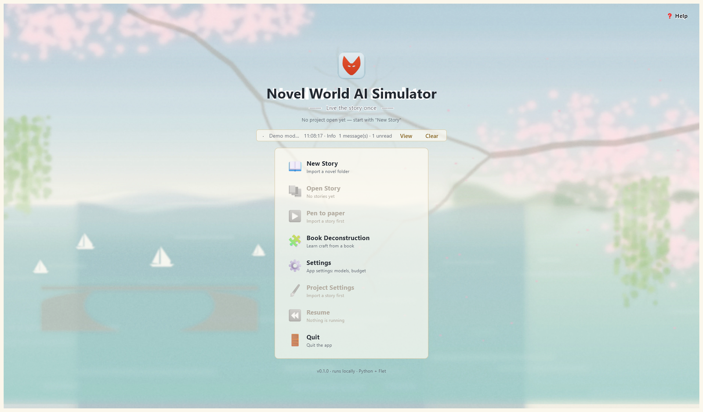

*The start screen: ink-wash backdrop and seven menu entries*

**Current project**: once a project is open, a **gilt-edged name plate**
(`Current project 【name】`) appears under the title, and the **window title
becomes "Novel World AI Simulator — <name>"**. So coming back to the start screen
you can confirm at a glance which project you are in — and with several windows
open the taskbar tells them apart. With no project open, the plate reads
"No project open yet — start with 'New Story'".

**Menu Items**: the label stays elegant; **the short line under it is what a
first-time user actually reads** — kept under 14 characters so it is read at a
glance:

| Menu | Small line under it | What it does |
|------|------|-------------|
| **New Story** | Import a novel folder | Four-step import wizard; you pick a folder holding your novel files |
| **Open Story** | Open a previous story | Opens the project list. **Greyed out when there are none**; the line becomes "No stories yet" |
| **Pen to paper** | Start one round | Opens the "Start story" dialog to set this round's parameters, then runs. **Greyed out with no project**; the line becomes "Import a story first" |
| **Book Deconstruction** | Learn craft from a book | Opens the Book Deconstruction dialog: reads a book **you think is well written** into "craft", which goes into the skill library and is used by the crew when a similar story comes in. **Always clickable** (with no book of your own yet, this is exactly where to start) |
| **Settings** | App settings: models, budget | Global settings — **nothing to do with any single story**; applies to every project |
| **Project** | Story settings: genre, style | Project settings — **applies to the current story only**. **Greyed out with no project open**; the line becomes "Import a story first" (no book, nothing to configure) |
| **Resume** | Back to the running screen | Jumps back to the running screen. Greyed out when nothing is running, with the line "Nothing is running" |
| **Exit** | Quit the app | Closes the app |

> **Why "Settings" and "Project" are the easiest to confuse**: both labels are
> elegant, but one governs the app and the other governs this one book. So the
> small lines spell it out: "App settings" vs "Story settings". Likewise
> "New Story" *brings a new novel in*, "Open Story" *opens a previous one*, and
> only "Pen to paper" *starts a round* — so the order is **find the book first,
> then put pen to paper** (New Story → Open Story → Pen to paper).
>
> **Greying rule**: with no project open, "Open Story / Pen to paper / Project /
> Resume" are all greyed — but **greyed does not mean silent**: the small line
> says why it is unavailable and what to do next. **"Settings" is clickable in
> every state** (it is the app-wide config, unrelated to whether a story is
> open); so are "New Story" and "Exit".

**Navigation**:
- `↑` `↓`: Select menu item
- `Enter`: Confirm selection
- `Esc`: Return to running story (if any)

### 4.5 New Story Dialog (Import Wizard)

Click "New Story" to open a five-step import wizard:

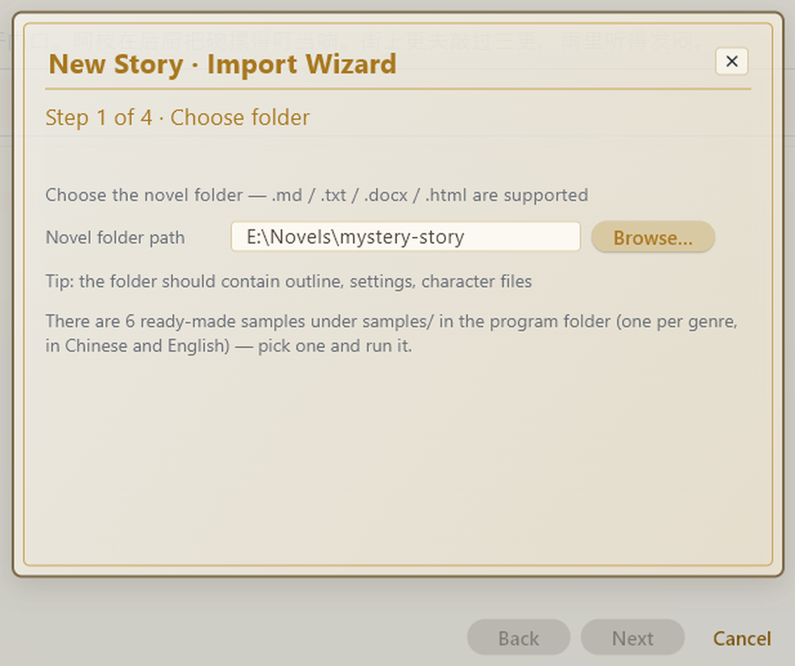

*New story · import wizard (step 1: pick the folder)*

**The five steps are**:
1. **Choose folder** — browse or paste a path ("Next" stays disabled until one is picked)
2. **Project** — name, story genre, style source
3. **AI options** — let AI refine the settings, extract worldbuilding and characters,
   generate the story progress table, generate the style card
4. **Crew agents** (you may skip this step; added 2026-10-11) — one line per post
   saying what **this book** should have it pay more (or less) attention to
5. **Confirm** — review the summary, then click "Start import"

#### Step 4: crew agents (you may skip it)

This step lists every post in the crew (novelist, screenwriter, continuity, art,
script doctor…). For **this book** you may write one line for each. Three ways to go:

| What you do | Result |
|---|---|
| **You wrote it** | It is used as-is (this book only; stored in `<project>/agents/`) |
| **Left blank**, box ticked | After ingestion an **AI infers one line from this book's genre and style** (**recommended**) |
| **Blank and unticked** | The software default from "Setting · Crew Agents" applies |

- It is **optional**: skip the whole step and ingestion runs exactly as before.
- What you write here is "this book's emphasis", not a redefinition of the post — to
  change a post's name, system prompt or when it works, use "Setting · Crew Agents".
- To refine it later, open the book and use "Study · Crew Agents".

**Below the list is one pagination row**: `Previous · page 1/4 · Next`, and on the far
right a «**Per page**» control — the dropdown beside it contains **numbers only**
(5 / 10 / 20 / 50); pick one to change how many rows per page. (Default 5 rows, the same
convention as the pagination in "Setting / Study · Crew Agents".)

> ⚠ This page's content **width is 580** (= the dialog's 600 minus the scrollbar lane, so it
> **just touches** it): the grey self-drawn scrollbar on the right owns a 24px lane, and
> anything wider **slides under the scrollbar** (exactly what the user reported on 2026-10-11:
> "the right-side scrollbar overlaps the text and the right edge of the Agent list below,
> covering part of it"). Pinning it to 520 then made it **too narrow** (the same user later that
> day: "you made it too narrow again, widen it a bit, **just touching the scrollbar**") — it is
> 580 now, measured: the content's right edge stops 8px short of the scrollbar. So every element
> here that can grow on its own is given an explicit width — the criterion
> `tools/verify_wizard_agent_lane.py` pins it down by measuring pixels.
>
> ★ One more thing: the **"Step 4/5" title at the top does not scroll**. It is pinned
> **outside** the scroll area, and the block below it is what scrolls (the user's words:
> "when the scrollbar moves the **title must not move**; what is below the title should").
> Every wizard step works this way: the title bar stays put, only the body scrolls.

**★ A novel you have already opened is stopped and reported.** As soon as you pick
the folder (or type a project name that already exists), the wizard says so on the
spot; clicking "Start import" asks once more — instead of, as it used to, quietly
running the whole import again (a repeated name reuses the same project folder, so
the new book's settings get mixed into the old project and you never see a thing).

Three ways out of that dialog:

| Button | What it does |
|---|---|
| **Open "the one you have"** | Go straight to it (this is what most people want) |
| **Open it again anyway** | Runs again — but **under a new project name** (`Book (2)`), leaving the existing one untouched |
| **Cancel** | Back to the wizard; change the folder or the name and try again |

Two things count as "the same": **the same project name**, or **the same source
folder** (you renamed it last time and renamed it again this time — different name,
same book). Paths are normalised before comparing: trailing slashes, forward vs back
slashes, Windows letter case and the quotes Explorer pastes in are all ignored.

> Starting over on a book you have already opened is fine: "Open it again anyway"
> makes a fresh copy and leaves the old one exactly as it is. If you really mean to
> overwrite, delete the old one from 「拾　卷」 first (deletions go to a
> 「已删除备份」 folder and can be recovered).

#### 4.5.0 Step 2: the project name and the three dropdowns

**Project name** is pre-filled with the **name of the folder you picked in step 1**,
so you do not have to type it again. If it looks wrong (say the folder is called
`New folder`, or you want a nicer book title), **just edit it**.

Two rules worth knowing:
- **A name you have edited is never touched again.** Change the name, then go back to
  step 1 and pick a different folder: the name **stays as you typed it** and is not
  overwritten by the new folder name.
- The folder name only follows along while the current value is still the one the
  program filled in and you have not touched it. **Clearing it** also counts as
  'I do not want the automatic name' — it will not be put back afterwards.

(The name becomes the project folder name; illegal characters are handled for you.)

The three dropdowns below show **plain language** on screen, while the **raw value**
is what gets written into the project file — do not mix the two up:

What you see is plain language; what gets written into the project file is always the
**raw value** — keep the two apart:

| Story genre (displayed) | Stored in `.nwsproj` as `类型=` | Notes |
|---|---|---|
| Auto-detect (the AI decides after reading the text) | `auto` | Let the AI work it out from the text (default) |
| Mystery · Episodic / Xianxia · cultivation / Urban / Alternate history / Romance / Sci-fi | same Chinese key (`悬疑·单元`, `玄幻修仙`, …) | **Manual pick**: skips the AI genre step and uses your choice verbatim |

| Style source (displayed) | Stored as `风格=` | Notes |
|---|---|---|
| Auto-detect (learned from the source text) | `auto` | The style card is derived from a sample of your text (default) |
| Plain and unadorned | `plain` | |
| Terse and cool / Ornate and lush | same Chinese key (`冷笔白描` / `华丽辞藻`) | |
| Custom (tune it below) | `custom` | **Only in "Project settings"** — that screen has the actual sliders |

- The same dropdown in **Project settings uses the very same list and the same labels**;
  changing one changes both.
- Switching the interface language changes the displayed names only
  (`自动判断…` ↔ `Auto-detect…`) — **the stored value never changes**.
  When editing `.nwsproj` by hand, write the raw values.
- The step-4 summary also speaks plain language
  ("Story genre: … / Style source: …") instead of showing `auto`.

**Output language** — the language every piece of text this program produces is written in:

| Output language (displayed) | Stored in `.nwsproj` as `输出语言=` | Notes |
|---|---|---|
| Follow the interface language | `auto` | Chinese UI → Chinese output, English UI → English output (**default**) |
| 中文 / Chinese | `zh` | **Always** Chinese, whatever the interface language is |
| English | `en` | **Always** English, whatever the interface language is |

- It governs **everything the program writes**: each day's narrative, dialogue, stage
  directions, story documents, run summaries, outline suggestions, the opening scenario,
  and the exported novel draft.
- **The source material may be in any language** — run an English novel and get Chinese
  output, or the other way round. It is **per project**, so "English draft → Chinese
  output" and "Chinese draft → English output" coexist happily on one machine.
- **Proper nouns keep their original spelling** (character names, place names, titles are
  neither transliterated nor translated) — otherwise 「王小明」 turns into `Wang Xiaoming`
  and every name in the book drifts with it.
- Set it in **step 2 of Import** or in **Project settings · Genre & style**; changing it
  there takes effect **immediately, no restart**.
- It is **not** the same thing as the *interface language* (Settings · Appearance):
  the interface language governs buttons and messages, the output language governs the
  story and its documents. Both are set independently.

### 4.5.1 Import Dialog (progress bar + live log + AI chat)

After "Start import" the wizard closes and the import dialog opens. **Nothing freezes here** —
all the heavy work runs in the background while the progress bar, log and AI chat update live.

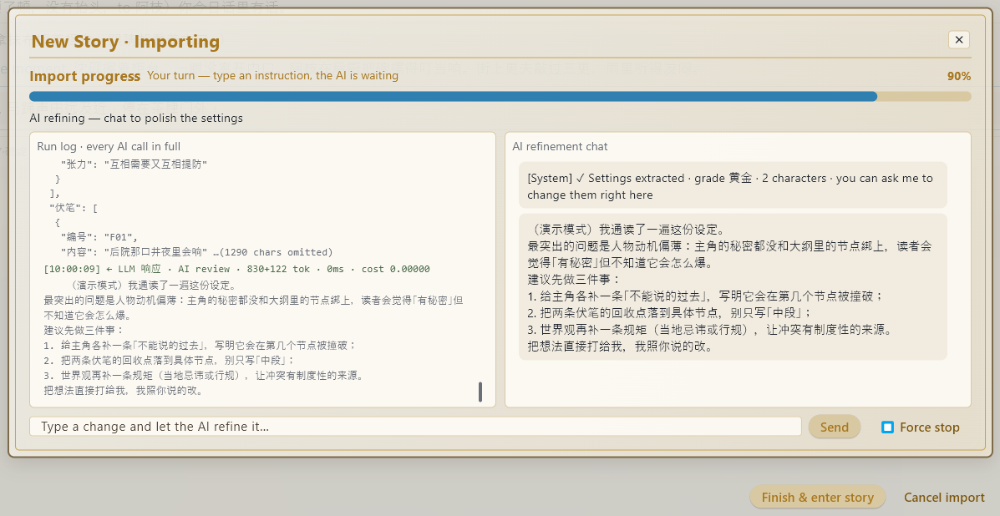


*Import running: the progress bar advances while the log prints every LLM request and response; the AI review then lets you reshape the settings by typing instructions*

**Four phases**:

| Phase | Progress | What you see | What you can do |
| --- | --- | --- | --- |
| ⓪ Confirmation before the AI | 13% | **After the local read, before any AI call**: what was imported + whether to hand it over | Tick to agree, or click "Do not agree — cancel" (see 4.5.2) |
| ① Automatic import | 13% → 90% | Every stage name, the full prompt and response of every LLM call, tokens and cost | Click "Cancel import" to abort |
| ② AI refinement (only if enabled) | pauses at 90% | The AI first posts a **review** (problems + suggestions) | **Type in the box** and chat with the AI to change characters, hooks, worldbuilding; the AI replies with a change note each round; **to interrupt the round that is running, click "⏹ Force stop"** (see 4.5.4) |
| ③ Write to disk | 90% → 100% | Project created, settings frozen, run folder built | — |

- The bottom row has three things: **the input box · "Send" · "⏹ Force stop"**.
  The third is only clickable during AI refinement, and it **interrupts the current round**
  (it does not cancel the whole ingest) — a round may take several tool steps plus a
  self-review, so with a real model a few minutes is normal and this is the only way to
  stop it. There is also a **round limit** (10 by default, see 4.5.4): once it is hit no new
  instructions are accepted, but the "finish" button stays enabled.
  This **input box is three lines tall** (so you can see the whole paragraph you are about to
  send at a glance), and the two buttons on its right **sit on its middle line** (user request
  2026-10-11: "the chat input at the very bottom, I'd like it taller, say 3 lines... and the
  Send / Force-stop buttons on its right moved to the middle line").

- **How to talk to it** (added 2026-10-12, named by the user):

  | You can say | What it does |
  | --- | --- |
  | "**fix all problems**", "change all 4 of them", "handle all of these" | changes **every item it self-checked above** (no need to list them one by one) |
  | "**fix the 4 problems**" | same as above -- it matches the count you gave against the number of items it self-checked, and **treats a match as the whole batch** |
  | "**process 1 2**", "change **item 2** first", "the **first two**", "the **last two**" | changes only the items you named (the numbers are the ones listed above) |
  | "**don't ask me**", "stop asking me" | **stops asking you from that moment on**: for anything uncertain it decides on its own and writes its judgement and reasoning into the reply. (To go back: say "**you can ask me now**") |
  | "**don't ask me for at least 3 rounds**", "don't ask me for the next 5 rounds" | only stays quiet for those rounds, then automatically goes back to asking |

  ⚠ **You can see whether it understood**: when it recognises any of these, the chat pane first
  shows a line like "I read that as items 1 and 2" or "OK, I will not ask you for the next 3
  rounds". If that line does **not** appear, it did not recognise your wording -- just rephrase
  once (far faster than letting it guess).

- The left pane, **Run log**, records the whole process: stage transitions plus the
  request/response text of every LLM call (selectable, so you can copy it).
  **Each time a stage finishes it draws a rule, leaves a blank line, then starts the next one** —
  the request/response bodies in between run a dozen lines each, so without the rule you
  cannot tell where one stage ends and the next begins.
- The right pane, **AI refinement chat**, is the human-readable version of the same work:
  review → your instruction → what the AI changed, for as many rounds as you like.
- ★ **Errors and key milestones now show up in that right pane too** (since 2026-10-07).
  They used to land only in the left **Run log** — a stream that runs to hundreds of lines
  per import and **drops the oldest 100 once it passes 600**, so you would probably never
  see them: it just looked "stuck / unresponsive", and you would retry or kill a run that
  was halfway done. Now they also appear as `[System]` bubbles in **AI refinement chat**:

  | When | What appears on the right |
  | --- | --- |
  | An LLM call fails (even one that will be retried) | `[System] ! LLM call failed (2/3): HTTP 502 …` |
  | Output was cut by the length cap / came back empty | `[System] ⚠ Output hit the length cap (max_tokens=…) …` |
  | Settings extraction finished | `[System] ✓ Settings extracted · grade Gold · 12 characters · you can ask me to change them right here` |
  | Project written to disk | `[System] ✓ Project created: E:\Projects\…` |
  | Import failed / cancelled / declined | `[System] ✗ Import failed: …` |

  Three rules: the **`[System]` prefix** (so it is never mistaken for something the AI
  said), the **timestamp is stripped** (a bubble reading `[23:36:12]` looks like a log
  line, not a message), and **the same sentence only appears once** (three retry rounds
  will not stack up three identical bubbles — but `(1/3)` / `(2/3)` style lines, which
  differ, all come through: "it is retrying" is exactly what you want to see).
  The left log keeps every line it always had; it is still the complete record.
- The **small line to the right of "Import progress"** tells you where the conversation with
  the model stands, and ticks every second while it is waiting:
  "Local step: Read & split chapters (no network call here)" → "Calling the AI: Extract
  characters & world" → "Thinking · waiting for the reply (12s · deepseek-chat · Extract
  characters & world)" → "✓ Replied · 3400 ms · 8120+640 tokens · ¥0.0041" → "✓ All done".
  It **says outright which steps are offline and which ones cost money**, so you never have
  to guess whether it is working or stuck.
- **If the AI writes so much that its output gets cut off by the length cap** (the log shows
  "⚠ The output hit the length cap"), the program will **not** quietly throw the settings
  away: ① it retries once with a doubled cap and an instruction to be brief; ② if that still
  fails it **salvages the longest closable prefix** and says so on the
  "Extract characters & world" line ("salvaged N characters …").
  **Check the settings when you see that** — the salvage keeps the first part, so the last
  fields may be missing. If in doubt, run New Story again (your source folder is untouched).
- **The AI review step carries the same protection.** Some models (especially the ones that
  **think before answering**) spend the whole budget on reasoning and leave nothing for the
  reply — the log then shows "⚠ the reply body is empty (… the budget went to reasoning)".
  The program **retries once with a bigger cap**; if it still gets nothing it posts a short
  fallback telling you to just type your instruction — **it never leaves a blank bubble for
  you to puzzle over.** The same guard covers the progress table, text alignment, opening
  scenarios, style card and genre check, whose outputs are **lists** — a truncated list used
  to turn silently empty with no error at all.
- ★ **"Retrying with thinking off" now tells you honestly whether it is *rescuing* or *failing***
  (fixed 2026-10-07). It used to report this wrongly: the router printed a red line
  "⚠ reply body is empty…" the moment the **first** attempt failed, then **quietly retried with
  thinking off and succeeded** — and said nothing at all about the rescue. You saw a wall of
  red text and assumed the feature was broken (on one machine the log showed the self-heal
  firing **101 times and failing 0 times** — i.e. it recovered every single time). It now
  distinguishes three cases:

  | Case | What it says now |
  | --- | --- |
  | First attempt empty, but **an automatic no-think retry is coming** | A plain note, not an error: `⚠ Nothing came back on the first try (max_tokens=… eaten by thinking) — retrying automatically with thinking off (nothing for you to do)` |
  | The retry **succeeded** | Says so: `✓ Retried with thinking off and got the text` (and remembers the purpose) |
  | Even with thinking off **nothing came back** | *This* is an error (red): `⚠ Empty body … and this time there is **no** automatic retry — raise this purpose's budget` |

  It also **remembers**: once a purpose has been rescued by turning thinking off, that purpose
  is sent with thinking off **from the start** — the wasted call is gone (measured on the same
  purpose: first time 3.4 s / two calls, afterwards 0.9 s / one call). This memory lasts **only
  for the current run** — restarting re-verifies it, so an outdated conclusion is never carried
  across a model change.
  Two related switches, under **Settings → Model & budget**: **`LLM_NO_THINK_RETRY`**
  ("retry with thinking off on empty body") and **`LLM_CAP_THINKING`** (allow such models to
  disable thinking). Turn either off and you are back to "report the error, no auto-rescue".
- Polish as much or as little as you want: click "Finish & enter story" when you are happy,
  or click it right away to skip.
- At 100% the dialog **closes itself** and you land on the running interface.
- If "Let AI refine" was unchecked in step 3, phase ② is skipped entirely.

**How to give instructions** (plain language is fine):
- "Rename the lead — make his surname Li"
- "Sharpen the main suspense and pin each hook's payoff to a specific node"
- "Make the world colder and add a local taboo"
- "Make A Zhi cold outside and warm inside, and give her a catchphrase"


#### 4.5.2 Confirmation before anything is handed to the AI

**Scanning, reading and chapter splitting all happen locally and cost nothing.** Networking
starts at "extract settings", so the pipeline **pauses right before the first AI call** and
lays out what was imported:

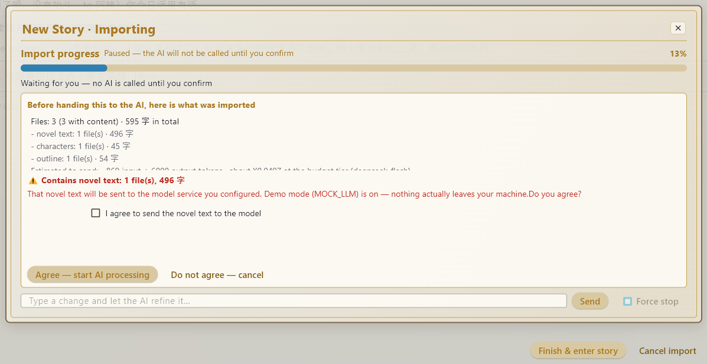

*Before handing anything to the AI: see what was imported and the rough token cost; nothing leaves until you agree*

**The two warnings are conditional and each needs its own tick**; until every required box is
ticked the "Agree" button stays greyed out. Only warnings that actually apply show up — with
no novel text and a small volume, the page is just the summary and one button.

| Warning | When it appears | What it says |
| --- | --- | --- |
| **Contains novel text** | any content was read from the novel-text files | that text will be **sent to the model service you configured** (the host is shown on the panel; in demo mode it says plainly that nothing leaves your machine). This is a privacy matter, so your consent is required |
| **Quite a lot of content** | total readable characters ≥ 60k | the pass will burn more tokens, with the **estimated cost for this run** spelled out |

- "Do not agree — cancel" stops everything immediately: **not a single request is sent**, nothing
  is billed and no project is created.
- The panel shows up at **13%**; the run log keeps a line saying the local files are done and
  nothing is called until you click.
- **Where the numbers come from**: every step has a hard cap on what goes into the prompt
  (setting extraction 20000 chars, genre 3000, style card 4000, progress table 4000,
  text alignment 8000), so the token estimate is computed from those caps rather than by
  multiplying the source size by some factor. Pricing uses the current **budget tier** model,
  honouring your own price overrides.
- **The "middle gets cut" note is literal**: content beyond the cap is not sent. If you want the
  AI to read the whole novel, split it into volumes or put just the relevant part in the folder.

> This gate only covers handing content over. After you agree, the AI refinement chat
> (phase ② above) also costs tokens, priced at the **daily tier**.


#### 4.5.3 AI fills gaps and writes back to the source folder

At import the AI spots small problems **it can fix on its own** (a missing foreshadowing
list, empty fields in a character entry, a wrongly-encoded document…). With "AI fills gaps
and writes back to the source folder" ticked in wizard step 3, it pauses when ingestion is
done and **before the project is created**, and lays those out as a checklist:

```
The AI found 4 issues it can fix on its own
· Missing: foreshadowing list
   → Goes to: foreshadowing.md — the AI finds the setup and payoff points and appends them
· Empty character fields (1 character · 4 fields)
   → Goes to: characters.md — the AI fills these in from the text
· draft.txt is not UTF-8 (UTF-16)
   → Goes to: draft.txt — convert to UTF-8 (content unchanged; old file backed up as draft.txt.bak)
· 1 file cannot be told apart by category
   → Goes to: AI补全设定.md — the AI decides its category (**your file names are not changed**)
☐ I agree to let the AI fix them as listed and write back to the source folder
[Agree, fix and write back]  [Skip, leave the source folder alone]
```

**What it fills in** (only these three kinds — nothing else is touched):

| Kind | Examples |
| --- | --- |
| Tier gaps | missing foreshadowing list / characters with no secret or catchphrase / missing outline / too-short worldview |
| Empty character fields | 身份 · 性格 · 口癖 · 目标 · 红线 left blank in a character entry |
| Format & classification | `.md`/`.txt` that is not UTF-8; material whose file name says nothing about its category |

**What it will not fill in**: "at least 2 named characters" and "novel text". The AI cannot
invent characters or prose — padding those out would be fabrication, which is worse than
leaving the gap.

**How your original files are touched** (three hard rules):

1. **Append only, never rewrite.** The completion goes into a `## AI 补全 (date time)`
   section at the **end** of the target document; your own text is **not changed by a single
   character** (line endings included). When the source folder has no matching document, a
   new `AI补全设定.md` is created to hold it. Files whose names reveal no category are
   **not renamed or moved** — the note simply says what they are, and a machine-readable
   classification table is written so the next import reads them correctly.
2. **Back up first.** Every modified file keeps a sibling `<name>.bak`; an existing `.bak`
   is never overwritten — it holds the **earliest** state, the one that saves you.
   `.bak` files are not read as source material.
3. **Only `.md` and `.txt`.** `.docx` / `.html` are never touched (appending plain text to
   them would corrupt the file).

**Once the project is running, the folder is left alone.** That is a hard boundary: as soon
as the project folder exists, the program only reads it. The refusal lives inside the write
entry point (`ingest/repair.py` checks for `.nwsproj`) rather than in the UI. So if you want
to see what the AI added, do it during import; afterwards you edit the material yourself.

**If you do not want this step**: untick "AI fills gaps and writes back to the source
folder" in wizard step 3, or click "Skip, leave the source folder alone" on the checklist —
either way **not a single byte is written**. When the checklist comes up empty, this step
does not even call the model (no cost); it just logs one line.


#### 4.5.4 The polishing agent: it remembers, it acts, it checks itself

The "AI optimisation" conversation from 4.5.1 is a **real agent** since 2026-10-07, not a
one-question-one-answer dialog. Four things changed:

**1. It remembers the whole conversation.** Everything you said, every file it looked at,
every change it made and the review report from import time all stay in its context. So
these all work now:

> "Change the second item you listed a moment ago."
> "Undo that rename, put the old name back."
> "In the outline you just read, which paragraph was that second-act turn in?"

(It used to be impossible: each turn only sent "your sentence + the current settings", so it
could not see what it had said one message earlier.)

**2. It acts, instead of returning a blob of JSON.** Its tools are listed in the system
prompt and in the log:

| Tool | What it does |
| --- | --- |
| read / patch settings | **patch** is structured (it reports what changed, before → after) instead of rewriting the whole settings object |
| list / read / search source files | it reads the folder you imported |
| append write-back | appends a section to the reference folder (append-only, automatic `.bak`) |
| write note | writes a file into the polishing staging area (`打磨记录.md` and friends) |
| generate tool / run code | **it writes a small Python tool for itself** (see below) |
| finish / ask | wrap up, or ask you a question when information is missing |

**3. When the built-in tools are not enough, it writes one on the spot.** Forty characters
and you want them grouped by surname? It writes a "group by surname" tool, saves it and
**calls it immediately**; it stays available for the rest of the session and is reloaded
from the project's `AI工具/` folder next time.

> **The code it writes runs in a sandbox, and not by convention:**
> - static review before execution (dangerous imports, dunder attributes, `open`/`eval` are
>   all refused — and the refusal **says why and what to use instead**);
> - execution happens in a **child process**, so a timeout can really kill it (a runaway loop
>   cannot be killed inside the same process) and a crash does not take the app down;
> - it can only see two folders: the **reference folder** (read + append only) and the
>   **polishing staging area**. Paths with `..`, drive letters or leading slashes are refused;
>   generated code **cannot even append** — touching your material goes through the built-in
>   "append write-back" tool;
> - the hard timeout is `POLISH_SANDBOX_TIMEOUT` (20s by default).

**4. It checks itself afterwards.** Once it wraps up it **looks again with fresh eyes**,
using your original wording + the full transcript + what those places look like now, and
checks four things: **anything missed / anything broken (does it still match the character's
voice; are names and foreshadowing numbers still consistent) / anything touched that you did
not ask for / anything invented**. If it finds problems it **goes another round with those
notes**; if one round is not enough it tells you what is left (nothing is hidden).

**The result is written to two places** (the same text, not two separate documents):

| Where | What |
| --- | --- |
| in the project: `<project>/打磨记录.md` | what changed · which tools it generated · which tools it called |
| in the reference folder: `AI打磨记录.md` | **exactly the same copy** (append-only, `.bak` kept) |

The project also gains an `AI工具/` folder when it wrote tools.

**Knobs** (Global settings · **Run** → **Ingest refinement**, no restart needed):
`POLISH_MAX_ROUNDS` (round limit, see below) · `POLISH_MAX_STEPS` (steps per round) ·
`POLISH_MAX_TOOL_CALLS` (tool calls per session) · `POLISH_AGENT` (master switch — off
falls back to the old one-shot Q&A) · `POLISH_TOOLS` (allow it to write code) ·
`POLISH_REFLECT` / `POLISH_REFLECT_ROUNDS` · `POLISH_SANDBOX_TIMEOUT` ·
`POLISH_WRITE_BACK`.

> With `POLISH_TOOLS` off, "generate tool" and "run code" are **refused outright** rather
> than quietly still working — this project has zero tolerance for fake switches.

**⑤ There is a round limit, and you can stop it any time.** This screen has two brakes —
do not confuse them:

| | What it is | When to use it |
| --- | --- | --- |
| **Round limit** | **One round = one instruction you send**, at most `POLISH_MAX_ROUNDS` (default 10). When the limit is hit, **no new instructions are accepted**: the input goes grey and you are told to press "Finish and enter" | Stops you from chatting the whole budget away. To keep going, raise the limit (Global settings · Run → Ingest refinement → "Refinement rounds") and open the book again |
| **⏹ Force stop** | The button next to the input. **Always clickable**; it interrupts **the round that is running right now** | It is reading material / changing settings and you can see it went the wrong way — press it and it stops immediately |

Worth knowing:

- A single round may take several tool steps plus a self-review — with a real model
  **a few minutes is normal**. During that time "⏹ Force stop" is the only way to stop it.
- **It stops this round, not the whole ingest**: you stay on this screen and can keep
  giving instructions. **Settings it already changed are kept** (nothing is rolled back),
  and the chat pane gets "⏹ You stopped this round (the settings already changed are kept;
  you can just say the next thing)."
- To abort **everything** (no project is created at all) use the other button,
  "Cancel ingest" — the two buttons do completely different things.
- At the limit the input goes grey, but **"Finish and enter" stays enabled** —
  the limit only closes "one more round", not "wrap up".


### 4.5.5 Book Deconstruction dialog (read a good book into craft)

**What it reads, and how it differs from ingest** — the two are easy to confuse:

| | Ingest (§4.5) | **Book Deconstruction** (this section) |
|---|---|---|
| Which book | the material of the book **you are going to write** | a book **you think is well written** |
| Becomes | a settings set (characters / places / foreshadows / nodes) | **craft** (plot / pace / character / voice / structure) |
| Lives in | the project (for the run) | `skills/book-dismantle/<title>/` (the skill library) |
| How it reads | as much as possible | **it cannot finish** — layered sampling, reads what matters |
| How it is used later | settings go into prompts | matched craft is quoted by the crew when you write a **similar** story |

In one line: **ingest turns a book into your world; Book Deconstruction turns a book into your craft.**

#### It asks you four things

| Question | Why |
|---|---|
| **What is the book called** | only used to name the generated skill pack |
| **What genre is it** | the more accurate, the more likely it is picked up later (matching is by genre) |
| **Which parts do you think are good** | **the most important one** — the analysis looks at those places first |
| **What to focus on** | e.g. "how to make dialogue sound like real people". Empty = all standard dimensions (skeleton / character / emotion / plot / structure / voice / world) |

#### Where it reads from: four buttons, **pick one** (since 2026-10-10)

The dialog shows one row of buttons — **all four fit on that row** (the spacing was tightened so nothing wraps) — and **only one of them is in
effect at a time** (the selected one is filled in; the rest are plain text buttons):

| Button | Notes |
|---|---|
| **Pick a file** | `.txt` / `.md` / `.docx` / `.html` / `.pdf` (PDF needs `pip install pypdf`; if it is missing the program says so plainly) |
| **Pick a folder** | containing several of the above (common when one book is split across files). **Split one file at a time**; the file name becomes the chapter name |
| **URL** | opens **a small dialog** where you type the book's **chapter-index page**. The program crawls each chapter (read-only, nothing on the other site is touched, with a delay between requests). It counts as selected when you press **OK**; **Cancel** keeps your previous choice |
| **Try a sample** | the quickest way in when you have no book at hand: run it on a bundled sample |

> **These four are mutually exclusive**: confirming one cancels the previous one. So there is no
> "does the URL still count?" question — **just look at which button is filled in**. A URL you
> entered is shown on the line under the buttons (the input box itself is folded away).
> Failures are reported as failures: if no chapter links are recognised on the index page it
> treats **that page itself as one chapter**; chapters that could not be fetched are recorded as
> missing — **do not read the conclusions of a partial run as conclusions about the whole
> book**.

#### Dismantle only a slice (there is no need to take the whole book)

The **Range** box accepts any of these:

| Input | Meaning |
|---|---|
| empty | the whole book (sampled by position, as below) |
| `1-10,15-21` | units 1–10 and 15–21 (whatever the source uses: pages if paginated, chapters otherwise) |
| `前10页` / `前3章` | the first N (writing "pages" means pages, "chapters" means chapters) |
| `第5章-第8章` / `第一章` | by chapter; Chinese numerals work too (`第二十三章`) |
| `最后2章` / `5-` | the last two chapters / from unit 5 to the end |
| `井底` | **by title text** (chapters whose title contains those characters) |

A typo is **visible immediately** (the line under the box echoes "Dismantling only: …" or an
error), and **it will not start** if the range cannot be parsed — starting anyway would
dismantle the whole book while you believe it took only 10 pages.

> Out-of-range is **not an error**: `1-9999` on a 30-chapter book means 30 chapters (reported
> honestly). A unit mismatch is explained: asking for "the first 10 pages" of a text with no
> pages takes the first 10 **chapters** and says so. The report also states **which slice was
> taken and how many units the source has** — otherwise a later reader cannot tell "the book
> is just this short" from "only a slice was taken".

> **You do not need the whole novel** — a portion is fine. It samples by position:
> **the opening chapters are always read** (that is where the author spends everything),
> **the tail is kept** (web serials charge per chapter; the tail shows what keeps readers),
> the middle is taken evenly. Sampling is **deterministic**: the same book gives the same
> chapters twice, so the conclusion can be re-checked.

#### How it reads (four passes)

```text
1 split      chapter headings -> a chapter table (local, free)
2 scan       batched reading; one line per chapter + function + emotional intensity
             -> the book's **waveform** (where it presses, where it pays out)
3 close read the chapters picked out, read properly -> only here does "technique" begin
             (picked by: the parts you named + the highest intensity + the opening three)
4 distil     across chapters -> **reusable technique** (get this wrong and it is just notes)
```

All four passes really read, and progress is reported line by line ("2. Scan 3/5").

#### What comes out

Written to `skills/book-dismantle/<title>/` (**two levels**: Book Deconstruction output is grouped
together instead of being mixed with the hand-written lore skills), **one self-contained
pack of three files**:

| File | For whom |
|---|---|
| `SKILL.md` | the program (the crew picks it up by genre; same format as the eight lore skills) |
| `digest.json` | the program (structured; no markdown parsing) |
| `拆书记录.md` | **you** (full report: chapter overview + close-reading notes + notes on the run) |

Each **reusable technique** states four things: **how to do it** (executable) ·
**when to use it** · **why it works** (what happens on the reader's side) ·
**where this book did it** (one line, evidence only — never content).

Plus three sections: **pace** (how long it presses, how hard it pays, unit length — usable as
a template), **how it builds people** (not one character's sheet, but the author's shared
method), and **voice** (specific enough to write by, not "the prose is good").

★ The most important section is **"what you cannot carry over"** — it matters as much as
everything above: **knowing what not to copy is how you avoid learning it wrong.** It may
not be left empty.

#### How it gets used later

At assembly the program matches the skill library **by genre**:

| Tier | Compared | Example |
|---|---|---|
| 1 genre | the current book's `theme/structure` vs the pack's **applicable genre** share a fragment | current "悬疑灵异" ↔ pack's "悬疑·单元剧" |
| 2 keywords | overlap in theme / hook library / payoff patterns / character archetypes | both have "foreshadow" |
| 3 what you asked | a technique name appears in the text **you** wrote (custom style, scene hint) | you write "hook", so the pack about hooks is recalled |

When it matches:

* **every position** gets a **compact** version in its craft block (name + how to do it);
* the **trio (novelist · screenwriter · director) + story room** gets the **full** version
  (plus pace / character-building / voice / **what not to copy**) — those are the ones who
  decide *how the story is told*, which is exactly where craft applies.

**Besides Book Deconstruction experience, each position also pulls the knowledge packs installed in
`skills/` as needed** (the hand-written lore ones: Chinese medicine, weapons and armour,
official ranks, solar terms…):

* the query combines **the genre + what this position is doing right now + the lines you
  wrote in Project Settings** — so the researcher finds medicine, props find objects,
  the stylist finds patterns;
* a matched knowledge card is given **as key points** (an excerpt in the prompt), **at most
  two per position** (more would drown the attention);
* **Book Deconstruction skills are given as an index only** ("these packs relate to this moment") —
  their body was already given by the block above; **the same content is given once**
  (give it twice and the model treats it as two independent pieces of experience).

> **No match means no position quotes anything** (nothing is forced in). Pushing a romance
> technique into a mystery is worse than quoting nothing — the classic way citing experience
> goes wrong.
>
> The run folder gets a **`本书可参考的写法.md`**: which packs were used, **why**, which
> techniques were taken, and what else is in the library that did not match. You should be
> able to check it, not just be told "matched intelligently".

#### Knobs

| Knob | Effect |
|---|---|
| `BOOKLAB_ENABLED` | master switch (when off, the menu item says so) |
| `BOOKLAB_MAX_BATCHES` | how many scan batches at most (default 26 — a long novel samples to ~24) |
| `BOOKLAB_LESSON_PACKS` | how many packs may be quoted at once (default 2) |
| `BOOKLAB_SKIP_WRITERS` | when on, **the trio also gets only the compact version** (saves tokens) |

> **Cost**: digging one book is roughly 20–30 cheap calls (scan) + 1 daily (close read) +
> 1 front (distil). **You pay only when digging**; afterwards assembly just reads files, free.


### 4.6 Old Story Dialog (Project List)

Click "Old Story" to open the project list dialog.

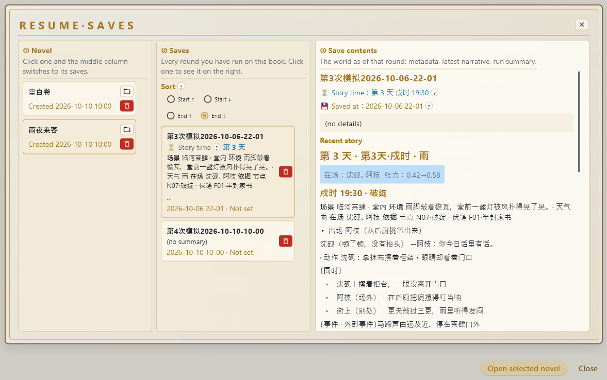

*Old story: pick a project on top, saves on the left, details on the right*

**Features**:
- Display all existing projects
- Show project genre, save count, last run time
- Select project to view save details
- Support project deletion

### 4.7 Settings Dialog (Global Settings)

Click "Settings" to open the global settings dialog.


*Settings · program (tabs: Regular / **AI Model Config** / **External Creative Services** / Appearance / Run / Director &
compliance / Crew Agents)*

**Settings Description**:
- **API Key**: LLM service API key
- **Base URL**: LLM service address
- **Demo Mode**: Enable to avoid real API requests
- **Premium**: High-quality model for key events and important dialogue
- **Daily**: Model for routine loops (recommended: cheaper model)
- **Budget**: Model for compression and scoring (recommended: cheaper model)
- **Daily Budget**: Maximum tokens per day
- **Alert Threshold**: Percentage of budget to trigger warning

> ⚠️ **LLM settings only take effect after restarting the app.** The `LLM` page (and the
> Text-to-image model/size on it) will not apply immediately — a banner at the top of the
> dialog says so, and saving reminds you again in the Messages box. Reason: the LLM client
> (connection pool, auth headers, concurrency semaphore) is built once at startup and is
> not rebuilt while running. Opacity, language and log level do **not** need a restart.

#### 4.7.1 "Crew Agents" tab: which posts this software has

Added 2026-10-11. This page is about the **posts themselves** (each agent's name, role,
system prompt, when it works) — not about one particular book.

**Where the data lives**

| Layer | Location | When it applies |
|---|---|---|
| Software default | `<app folder>/agents/<english-name>.md` | Every book; **created automatically on first run** |
| Per-book override | `<project folder>/agents/<english-name>.md` | **That book only** |
| Effective attributes | the two merged (computed at run time, never stored) | this is what a run actually uses |

- One `.md` per post, **file names in English** (`novelist.md`, `art_director.md`, …);
  the **body is that post's system prompt**, the frontmatter holds its attributes.
  Edit it in Notepad (changes take effect immediately, no restart) or in the UI —
  it is the same file.
- `README.md` in the same folder is the **English ↔ Chinese name table**; it updates
  itself as posts are added or removed.
- **A per-book file only stores the fields you changed**: everything else keeps
  following the software default, so upgrading the app updates the parts you never
  touched. To go back, delete that project-level file (the row's "restore default").

**In the UI**

- One row per post: **name · role · the start of its system prompt**, with small
  "Built-in / Custom" and "Overridden here" tags.
- **Clicking a row** opens the editor: name · English id (= file name) · summary ·
  **when it is used** · when it works · model tier · where its output goes ·
  **system prompt**.
- **Pagination defaults to 5 per page**; the bottom-right dropdown changes it
  (5 / 10 / 20 / 50).
- **Creating and deleting only happen in "Setting" (software level)**:
  - "+ New agent" creates your own post (the English id is its file name);
  - a custom post has a bin icon and **asks for confirmation** before deleting;
  - **built-in posts cannot be deleted**, only edited — they are part of the program.
- **"Study · Crew Agents" is the same screen, minus create and delete**: there you
  write **this book's** overrides.

**The table's column widths are adjustable** (2026-10-13):

- Press the mouse on the **seam between two header columns** and drag left or right;
  releasing the button saves it.
- **Setting (Tianji) and Study each keep their own set**, independent of each other,
  and the next time you open the tab the widths are still how you left them.
  - Tianji's copy lives in `.ui_state/agent_col_width.json` under the **program dir**;
  - Study's lives in that book's `设定集/agent_col_width.json`.
- To go back to the factory widths, click **«Restore default widths»** below the table
  (it changes right away; no reopen needed).

> Out of the box, **Tianji's** "Tier" and "Tag" columns are 10px narrower each, and
> **Study's** "Tier", "Model" and "Output" are 10px narrower each; the pixels they give
> up all go to the "Prompt" column — so the table always **exactly fills the tab, with
> no horizontal scrollbar**. The "Tag" column is **two lines tall**, so a long tag like
> "built-in · customized by this book" doesn't get its tail cut off.

**When a custom post works**: once a day, at wrap-up; its output lands in that run's
folder as `自定义-<name>.md`. Its schedule is fixed to "daily" (per-beat work needs
wiring in the main loop that custom posts do not have — offering an option that does
nothing would be a lie).

##### Actors: what the system level sets, what the project level sets

The actor is the one post that has **no individual character at the system level and
individual characters at the project level**, so its settings live in **four** places,
ordered by "what has to change for it to change" (the lower, the more specific — and it
outranks everything above it):

| Layer | Where | What it sets | Changes when |
|---|---|---|---|
| ① **System · post** | Settings · Crew Agents → `actor.md` | how **the actor as a craft** works (self-discipline, boundaries) | the software version changes |
| ② **System · type library** | Settings · Crew Agents → the «**Actor type library**» button | **pre-written kinds of actors** and how they speak (24 types: sentence length / pace / bodily habits / the tone they meet the world with; each with 3+ **variations**) | the software version changes |
| ③ **Project · crew** | Project Settings · Crew Agents → `actor.md` | the playing tone of **this one production** | the book changes |
| ④ **Project · character** | Project Settings · Crew Agents → **one row per character** («Actor · Shen Yan», …) | how **this one person** is played (actor type / variation / casting note / break the type) | the person changes |

> **In the Study, "actor" is not one cell — it is one cell per person.**
> The user asked for it on 2026-10-13: "the crew Agent 'actor' should no longer be a
> single Agent — one Agent per character on stage, and finally the extras as one separate
> Agent". So in the Study's table:
> - **each character** in `设定集/人物.yaml` gets **its own row**, with the Position column
>   reading «**演员·<name>**» (the tier / model / timing / feeds / role / prompt columns
>   stay the actor **job type**'s properties, unrelated to the person);
> - the **extras remain one separate row**, after the character group;
> - clicking a character row (or its 👥) goes **straight into that person's Character setup**;
> - ⚠ **Tianji (the software layer) does not change**: there is no "this book" there, so the
>   actor stays one row — that is "the actor as a craft", not a person.
> - ⚠ These character rows are only a **view in the UI** and are **never written into any
>   md** (every md there is read by the whole crew; writing a character in causes
>   bleed-through). Their data lives in `设定集/人物.yaml`, one record per person.

**One-line rule**: ①② govern **how to play** (what the actor brings; the same across
books), ③④ govern **whom to play** (what the script gives; changes per book). When the
two clash, **the character wins** — that sentence is written into the prompt
(`actors/casting.py`, the arbitration rules), not left to good behaviour.

> ⚠⚠ **Never write individual characters into any `.md` in ①②③.**
> Every `.md` there is read by the **whole crew**: writing "Zhang is aloof, Li is warm"
> means **every character reads everyone else's setting** (Zhang learns Li's secret) —
> instant bleed-through. Characters therefore have their own **one-per-person** place (④).
> The UI says so too.

**How ④ works, and where it writes**

- Click 👥 on the actor row → you get **every character in this book** (from
  `设定集/人物.yaml`), one row each, showing their current actor type; click one to edit.
- An empty "Actor type" = **auto** (the program picks from the type library by
  personality / identity); picking one yourself wins (this was always a field on the
  character card — the UI just gives it an entrance).
- "This one's variation" follows the chosen type (several actors of one type need
  different variations, or two "Young · Aloof" come out identical).
- "Casting note" and "Break the type" are **optional but worth it**: the first says where
  this character stands in *this* book; the second says the one place where they are
  **not** like their type (usually the most human thing about them).
- It writes back into this book's `设定集/人物.yaml`, and it is a **line-level edit**:
  only this person's lines change — other characters, your own comments and other fields
  stay **byte-for-byte**; a `人物.yaml.bak` is made first.
- ⚠ **It takes effect from the next round** — this round's setting was frozen when it
  started (`本地设定集/`), so editing mid-run does not affect the running round.
- Clearing a field **deletes that line** (no `变奏:` empty shell left).

**② The actor type library: how to look, how to edit**

- Settings · Crew Agents → «**Actor type library**» → every type listed (name + skeleton
  summary + variation count; **fewer than 3 variations is flagged red** — that means the
  type has one single way of playing, i.e. a cliché).
- Click any type to edit: typical casting / skeleton / sentence length / pace /
  catchphrases / speech taboos / body habits / friction / **variations** (one per line) /
  avoid. "+ New type" at the bottom adds your own.
- That file (`actors/archetypes.yaml`) carries a long **design note** at the top (why this
  layer exists, where the two axes come from, the line between type and stereotype).
  Editing from the UI **replaces only the type you changed** — the note and every other
  type stay byte-for-byte.
- ⚠ A type **does not say what to say, only how to say it**: it is "how this kind of
  person speaks", not "what fate this kind of person deserves". Every type must be able
  to grow several different people (the variations).

#### 4.7.1b "Models & LLM" tab: several models + which one each Agent uses (2026-10-12)

**"Models & LLM" is the former "Simulation Service LLM Settings" and "Creation Service LLM
Settings" merged into one page.** The user's words (2026-10-12): "one model is not enough to do
the job well... merge the current two LLM settings into one and let me configure several models."

**① The model list**

One entry = **one callable service**: a display name + a model name + **its own endpoint** +
**its own API key**. Because they are independent you can **use several providers at once**:
Hunyuan Hy3 for prose, DeepSeek for judgments, another one for review.

- Three small icons on each row: **test** (really sends a minimal request) / **edit** / **delete**.
- **Add/edit/delete take effect immediately**; the page's "Save" handles the scalars (default
  model, the three tiers, timeouts).
- The endpoint block above is the **default for new entries** — fill in your usual provider once
  and new entries inherit it.
- Names returned by "Fetch model list" **do not automatically become entries** — pick the ones you
  want and add them yourself (each needs its own key; auto-adding would only create empty shells).

**② Default model and the three tiers**

- **Default model**: what is used when nobody named anything.
- **Three tiers** (flourish / daily / summary): **quick config**; each position follows its own
  tier when it has not named a model.
- Resolution order (a single entry point, `llm/models.py::resolve()`):

  ```
  (1) the Agent named a model -> (2) its tier -> (3) the default model -> (4) first entry
  ```

  So "leave all three tiers empty and set only a default model" is valid too: the whole app uses
  it, except Agents that named one.

**③ Recommendations: which model for which job**

A whole block lists, per Agent: **what this kind of work needs** (prose & long form / rewriting &
arranging / judgment & gating / extraction & structuring / high-frequency performance /
checklists / external service), **why**, and **whether you have configured one**:

- "**Configured: Hunyuan Hy3 (hy3)**" — you already added a matching model; click that Agent under
  "Crew Agents" to select it.
- "**Not configured — suggested: hy3 / claude / ...**" — you have none of this kind yet; the
  default model can cover it, or add one.

**④ Which model one specific Agent uses**

Under "Crew Agents", **click any row** (crew positions, system services and the special Agent are
all in this list) and the editor has a **Model** group: a dropdown (configured models +
"(default)") plus an "**Add by recommendation**" button (prefilled with the suggested model name —
you just fill in endpoint and key), and two small lines showing **which kind it recommends / why**
and **whether you have one**.

**⑤ The special Agent and the system services**

Besides the 17 crew positions, the list has 5 entries that **are not people**: Book Ingest, Memory
Summarizer, Progress Evaluator, Compliance Review and the Creation Service (the external
MuMuAINovel backend). They **are not part of crew scheduling** — they are steps in the program,
not people who show up for work, so they never appear in the run window's crew roster.


#### 4.7.1c Bringing the bill down (2026-10-12)

The user's words: "AI is used in more and more places and the cost is rising fast ... go learn what
ways there are to optimize LLM usage and reduce the cost as much as possible -- it is too
expensive."

**The full version is in the standalone `Cost_Saving_Guide.md`**; only the four levers and their
entry points are kept here:

| Rank | Lever | Rough saving | Where |
|---|---|---|---|
| ① | Give routine work a cheap model | **The most** (flagship vs budget differs 25-50x) | "Crew Agents" -> click any row -> Model |
| ② | Make the prefix cache actually hit | **~90%** of the input side | Nothing to configure -- just don't put variables in the **fixed layer** |
| ③ | Turn on same-question reuse | **5%-20%** is common | "Run" -> Token economy -> `LLM_DEDUP_ENABLED` |
| ④ | Run in the cheap window | **Halves it** for DeepSeek | Move bulk runs to the evening or weekend |

Under the model list, the "Models & LLM" page has a whole **"How to bring the bill down"** block:
each lever says why it helps and where to configure it, plus a **current state** line (whether it is
peak right now, whether reuse is on).

**How to tell whether you actually saved**: open the Usage Report and switch the division method to
**Model**:

- **Cache-hit tokens / Saved by cache (estimated)** -- whether you collected that 90% discount;
- the **cache hit ratio** on each model card -- a long-run 0% means something in the prefix is
  changing.

**To make the ledger accurate**: click **Edit** on a model under "Models & LLM" and fill in
**cache-hit / cache-miss / output** prices (CNY per million tokens). Filling only part is fine;
empty falls back to the built-in reference price. The built-in table is only a **transcribed
reference** and prices keep moving (DeepSeek raised its cache-hit price 11x on 2026-08-17), so
**only your own bill is accurate**.

> ⚠ **Same-question reuse does not appear in the usage report** -- a reused request sends nothing
> and spends nothing, so it counts as neither a call nor a cost. See the "Current state" line at the
> bottom of the "Models & LLM" page for the volume saved.

#### 4.7.1d Tianji UI (2026-10-12, second round rework)

A round of changes the user listed one by one, all inside Tianji:

**(1) Both windows enlarged**
- **Help**: **maximized to the window** (it used to be a fixed 1180x640).
- **Tianji**: at least doubled -- also computed from the window now (measured on this machine:
  684x575 -> 1896x1105).

**(2) The model list is a table** (it used to be one card per entry)
One item per column, easy to compare down a column: **name / model name / endpoint / protocol /
unit price / timeout / retries / capabilities / actions / test result**.

**(3) "Which function uses which model" is a table too**, with a new **recommended model** column
(one or two best fits from the mainstream LLMs; anything you already configured is marked
**✓ configured**).

> ⚠ Since 2026-10-13 this table has **moved below the "Crew Agents" tab** (it is no longer on this
> page). See 4.7.1e for the reason and details.

**(4) "How to bring the bill down" is now just a heading**
Clicking it jumps **to the matching section of the manual** (4.7.1c above). The four paragraphs used
to be spread across the page where you configure models, in the way.

**(5) The "General parameters" section is gone**, its contents distributed:
- **endpoint / API key**: **each model entry carries its own** (filled in when editing a model);
- **fetch model list**: moved into the model editor as "**fetch this provider's model names**" --
  it fetches with that entry's own endpoint and key, and a picked name fills "model name";
- **timeout / retries**: **per entry** (every provider differs); unfilled ones use the three global
  fallbacks below;
- **concurrency**: **can only** stay global -- it is a machine-level resource (one semaphore). One
  per model would mean N models give N times the actual concurrency, making rate limits more likely;
- **demo mode**: moved to the **top** of this page.

**(6) The "model capabilities" part is left-aligned**, and **text-to-image / embeddings** moved
under it.

**(7) Each of the three tiers (flourish/daily/summary) gives a line of explanation before its
dropdown** (flourish = key scenes, ~15% of calls; daily = the routine loop, ~55%; summary =
compression and scoring, ~30%).

**(8) MuMuAINovel got its own page** (it and PlotPilot / PenShot now live together in "External Creative Services", merged 2026-10-16)
It configures **another program** (endpoint / key / port / generation parameters go into that
program's own `backend/.env`), which is not the same as "this program's models" -- crammed on one
page it would be taken for one more model source.

> Also: **"Default model" is now its own item**, spelling out "which one is used when nobody names a
> model".

#### 4.7.1e Tianji UI (2026-10-13, third pass)

**(1) The "Which function uses which model" recommendation table moved below the "Crew Agents" tab**
(It used to sit on the "AI model configuration" page; the whole section moved. The two tables are two
faces of one thing: the upper one is "**who** this post is and which model it has", the lower one is
"**which function** should be configured with what" — side by side they line up at a glance.) The
"AI model configuration" page **no longer has** this table.

**(2) Several input boxes were narrowed** (they used to be half-row full width, mostly blank):
- "Text-to-image model" -> **30%** of its old width;
- In the "External Creative Services" page, MuMuAINovel's **analysis model / skill key** -> **20%** of old,
  **endpoint / API key** -> **50%** of old.
- The **row** width is unchanged; only the **input body** shrinks (this project's standing convention
  for `mk_*`, see 4.7.1d item 6).

**(3) The crew table's "role" column is −30px**: the 30px it gives up goes **straight to "prompt"** —
so the sum of the column widths is unchanged and the table still exactly fills the box (no h-scroll).

**(4) A few widths in the Study were adjusted as named**:
- Type&Style: **story type / style source / scene name / run mode** each **+30px**
  (calendar display is **not** one of them — the user did not name it);
- "**custom style**"'s body width is set to **the same as "style source"**;
- the seven **style parameters** sliders under "Style control" are fixed at **300px** (neither back to
  the natural 240 nor filling the whole row);
- the "**image dialogue**" dropdown on the "Images" tab is expanded to **200px**.

#### 4.7.1f "External Creative Services" tab (2026-10-17)

The third tab of Settings. It used to be "External novel service" (MuMuAINovel only); since
2026-10-16 **PlotPilot (Mòshū)** and **PenShot** live here too -- all three are **separate programs**.

**Since 2026-10-23 the page splits into three sub-tabs on the left**: one row per service; click a
row and its settings appear on the right, instead of one long page you have to scroll.

```
- MuMuAINovel     <- this left column; the little symbol in front of each row is its state
* PlotPilot
* PenShot
```

- **`*` = this service is running** (green), **`-` = not running** (grey).
- The state is **probed live**: once when the page opens, then the page watches it for ~67 seconds
  (the service starts in another process and emits no event we could listen to). It stops early
  once all three are up.
- Every sub-tab carries **Start / Stop / Refresh status**. **"Refresh status" refreshes all three**
  (including the three symbols on the left), not just its own page -- the point of pressing it is
  "I want to know whether the three are up right now".

| Section | Service | Who uses it | Where its port lives |
|---|---|---|---|
| 1 | MuMuAINovel (writes novel prose) | Novelist | its own `backend/.env` (`APP_PORT`) |
| 2 | PlotPilot (narrative engine) | Screenwriter / writer | **app root** `.env` (`PLOTPILOT_PORT`) |
| 3 | PenShot (director / storyboard engine) | Director / storyboard | **app root** `.env` (`PENSHOT_PORT`) |

Each section, top to bottom: **"from XXX" (one line)** → **upstream URL** → **live status** →
**Start / Stop / Refresh status** → **master switch** →
**who uses it** → **start the service automatically at program start** →
**stop it when the program closes** → **connection params** (host / port / "From AI Model Config" dropdown).

- **Clicking Start/Stop opens a small window** showing the **full command-line output** of that
  background operation (the command being run, live stdout/stderr, and a final verdict line).
  If the service fails to start, **the error text is right there** -- no log hunting. The window
  is gone once closed, so screenshot it if you need a record.
- **The status line**: `● running: http://…` is good; `○ not started yet (port N)` is **normal**
  (services are optional enhancements; the simulation works without them). Click "Start" to launch
  it (may take minutes; the UI never freezes).
- **All three master switches are off out of the box**; only MuMu's auto-start switch defaults on.
- **You never type the port**: `setup` checks local ports (Docker on the machine is fine) and, if one is
  taken by another program, scans upward for a usable one and writes it into the `.env` that service reads.
  See chapter 7.3 of the Chinese manual for the command line.
- After changing the port or the model, **restart that service** (the page says so too).

#### 4.7.2 "Appearance" tab: language / font / font size / command bar / opacity

The **Appearance** tab is about "what the interface looks like". It holds five groups
(none of them needs a restart — saving rebuilds the UI immediately):

1. **Language** — Chinese / English (what's stored is `zh` / `en`).
2. **UI font** — three bundled families plus any system font installed locally.
3. **UI font size** — one slider scaling everything by percentage (80%–150%, default 100%).
4. **Command bar at the bottom of the run window** — a switch, **off by default** (hidden).
5. **Panel opacity** — 0–100, default 70. ⚠ This is **transparency**, so a *bigger*
   number means *more* transparent (see "④ Panel opacity" below; the direction was
   reversed on 2026-10-13).

**① UI font**

| Option | What it is |
|--------|------------|
| Bundled Noto Serif SC (recommended) | **Noto Serif SC** (SIL OFL 1.1) — the **default** |
| Bundled Noto Sans SC | **Noto Sans SC** — pick this for a modern sans-serif |
| Bundled LXGW WenKai | **LXGW WenKai** — a handwritten Kai face, see the note below |
| Follow the system | Windows Microsoft YaHei / macOS PingFang SC / Linux Noto Sans CJK SC |
| System · xxx | Listed only if **actually installed** (Microsoft YaHei / SimSun / SimHei / KaiTi / DengXian / PingFang… ) |

> **Why is the default Noto Serif SC rather than the old LXGW WenKai?**
> LXGW WenKai is derived from Klee One, a Japanese schoolbook face, so **some Han
> characters use Japanese glyph forms**. The clearest example is 「门」: LXGW WenKai draws
> its first stroke (the dot) as a **long slanted flick**, while Noto Serif SC, system
> SimSun and Microsoft YaHei all use the standard "dot + vertical" form. Noto Serif SC is
> both **universal** (consistent cross-platform, standard glyphs) and good-looking (a
> serif matches this program's ink-and-paper feel).
> LXGW WenKai still ships with the program — pick it from the dropdown if you like the
> handwritten feel.

> ⚠ The "System · xxx" entries **do not ship with the program** (operating-system font
> licences forbid it); on another machine they fall back to the system default. The three
> bundled families may be redistributed with the program.

**② UI font size**

The slider scales everything **as a whole**: headings, body text, hints, buttons **and
control heights move together** (scaling only the font would press text against the
borders, so the heights must follow). Range 80%–150%. At very large settings (140, 150)
a dialog's contents may need scrolling.

**③ Command bar at the bottom of the run window**

A switch, **on by default = the command box and "Send" button at the very bottom of the
run window are hidden**.

> **Hiding it costs no capability**: that bar only ever wires up `/help`, `/status` and
> `/settings`, which are rarely needed, and it merely eats into the narrative area's
> height. Commands still work — "❓ Help" in the top-right corner and the **F11** shortcut
> are still there. Turn the switch off to bring the bar back.

**④ Panel opacity**

⚠ **The number is *transparency***, not opacity: **the bigger it is, the more the
background shows through**. (It used to be the other way round — 100 meant "fully
opaque" — which read backwards against the word "透明"; reversed on 2026-10-13.)

0–100, default 70.

| Value | Effect |
|-------|--------|
| `0` | **Fully opaque** — the background image doesn't show through at all |
| `40` | Panels are translucent paper; the ink-wash background is visible without hurting readability |
| `70` (default) | The background pattern is clearly visible — **this is as transparent as it gets** |
| `100` | Still the same as 70 — the panel's base colour stops at a **30% floor**, because any lower and the text smears into the background pattern |

**Applies to**: the **start screen** and the **run screen** only — including the
centre narrative / output area.

**Deliberately not affected** (on purpose, not an oversight):

- **Dialogs** — Settings, Project Settings, New Story wizard, Open Story, ingest —
  always keep opaque paper. The transparency setting must not touch them.
- **Text and 1px borders stay opaque** — translucent text destroys readability.
- **Input fields / dropdowns keep an 85% floor** — you need to see what you type.

Saving rebuilds the current screen immediately; no restart needed. It maps to
`UI_OPACITY` in `.env`, so you can also edit the config file directly.

#### 4.7.2 Background image (text-to-image)

The UI background is a **text-to-image** rendering of a real Jiangnan spring scene
(first version: Yuantouzhu, Wuxi — spring mist and rain), not a programmatically
drawn image. The original sits in `assets/images/bg/` and is processed into two
files used by the UI:

| File | Used by |
|---|---|
| `title_bg.webp` | Start screen (16:9 · 3840×2160) |
| `title_bg_soft.webp` | Run screen (same spec, softened + brightened) |

The run-screen version is **deliberately softened**: the panels are translucent, so
high-frequency background detail would sit right behind the text. It is blurred,
blended with paper colour, and brightened so text stays on top of it.

To swap in a different background:

```bash
# Drop the new original into assets/images/bg/ (move the old one away), then
python make_art.py
```

**`make_art.py` flags**:

| Flag | What it does |
|---|---|
| (none) | **Build the background(s) and generate the icon** (the usual one) |
| `--bg` | build the **background only** |
| `--icon` | generate the **icon only** |
| `--start-logo` | **only** round the corners of the start-screen logo (a separate step; touches neither the icon pipeline nor the background) |
| `--from <path>` | which original to use (default: the **largest** file in `assets/images/bg/`) |
| `--res <WxH>` | output resolution, e.g. `--res 2560x1440` (default `3840x2160`) |
| `--watercolor` | **local watercolour**: painted locally, no network (fallback when the image service returns 429) |
| `--reproc` | force the old procedural drawing (last-resort fallback) |

**Examples**:

```bash
python make_art.py                          # backgrounds + icon, full rebuild
python make_art.py --bg                     # background only (run this after swapping the original)
python make_art.py --bg --from new-spring.png   # point at a specific original
python make_art.py --bg --res 2560x1440     # lower resolution (smaller GPU / faster)
python make_art.py --bg --watercolor        # image service acting up? paint it locally
python make_art.py --bg --reproc            # even that fails? fall back to procedural drawing
python make_art.py --icon                   # redraw the app icon only
python make_art.py --start-logo             # round the start-screen logo only

# verify afterwards: size / format / softening / text contrast
python tools/verify_background.py
```

The prompt, size, parameters used are recorded in `assets/images/bg/README.md`.

#### 4.7.2.1 App icon (UI / window / taskbar)

The icon is drawn in `image_gen/icon.py` (currently **`qinghuo`: a fire-red fox face on a
moon-white (faintly cyan) rounded tile**; `zhusha` — ivory-white fox on a vermilion tile —
and two bamboo palettes, `zhuye` / `qingci`, are kept as alternatives).

The fox is a **front-facing face**, recognisable from three things: **a pair of full, tall
pointed ears** (the outer ear edge is the widest point of the whole mark), **an inverted
triangle face** narrowing to a pointed chin, and **a pair of hollowed-out eyes** (the tile
colour shows through; at small sizes they blur into two dots that still read as eyes).
Three properties are guaranteed by the geometry rather than by eyeballing: **left-right
symmetry** (only the right half is written; the left is mirrored), the **hard corners at the
ear tips** (the spline is split into segments, so it does not round them off), and
**roundness everywhere else** (the chin and the dip between the ears are given a horizontal
tangent, because the outline necessarily has a vertex wherever it meets the mirror axis —
whether that vertex is a point or a soft curve depends on the tangent it arrives with).

The **mark occupies 70% of the tile**, leaving about 15% margin: a face should not fill the
whole square.

**"Roundness" is measurable** (`probe_fox_roundness.py`): walk the outline and measure the
turn at every point. The only sharp places should be the **two ear tips** (measured 121.8°,
mirrored), with everything else at most 36.9°. `verify_icon` pins this down as two
assertions — the two sharpest corners must be the ear tips, and nothing but the ear tips may
exceed 90°. That is how "make the curve a bit rounder" becomes something you can check
instead of eyeball.

With a pale tile the **thin slate-cyan rim** matters more: it is what separates the rounded
square from a light desktop or a light taskbar. The current variant was chosen for the
**steadiest rim** (measured: contrast 3.2:1 · hue gap 173° · tile hue 198° ·
**rim vs light background 3.0:1**) — when changing the palette, look at all four numbers
together, not just at what looks nice.

Changing the palette only means editing one entry in `SCHEMES` — the checks read the hue
range each palette declares, so no assertion has to be touched.
> ⚠️ When tuning colours **do not compute contrast from the declared RGB values**: the
> vertical gradient, the inset rim shadow and the paper grain all shift the tile's centroid,
> and the checks measure the **actual k-means centroid** (measuring vs. computing differed by
> 0.8, right across the 3:1 line). Run it and read the number.

After changing the shape or palette you **do not need to
re-run any generator — just restart the app**: on startup the source fingerprint of that
file is checked and all five artifacts are rebuilt automatically when it changed.

| File | Used for |
|---|---|
| `assets/images/icon.png` / `icon_256.png` / `icon.ico` | in-app icon, backup, installer |
| `assets/app_icon.png` | window icon (Flet) |
| `assets/app_icon.ico` | **taskbar** and title bar (set via Win32, sizes 16–256) |

To refresh manually, run `python make_art.py --icon` (equivalent).
There is also `assets/app_icon.<fingerprint>.ico` — the copy used by the **Desktop /
Start Menu shortcuts** (see below).

##### "I changed the icon, but the desktop icon is still the old one"

Two things were stacked on top of each other, and both are fixed (2026-10-07):

1. **The artifacts had not caught up.** Those five files used to be regenerated
   **only when the app started**, while setup only read whatever was there — so
   "change the icon, then run setup" (without starting the app first) installed the old
   ones. Setup now **aligns the artifacts against the source fingerprint before
   installing** (you will see `图标：已按当前设计重做（指纹 xxxxxxxx）`; if it was already
   current it says "already the latest").
2. **The Windows icon cache is keyed by path.** The shortcut's icon path was always
   `app_icon.ico`; the path never changed, so even when the file content did, Explorer
   kept drawing the cached old image. Desktop / Start Menu shortcuts now point at
   **`app_icon.<fingerprint>.ico`** — change the icon and the file name changes, so the
   cache **cannot** hit. Setup also sends the shell a refresh notification right after.

> So the **right way** is: change the icon → just run `setup.exe` (or `./setup`) —
> it fixes both the artifacts and the shortcuts.
> If you still see the old one, press F5 on the desktop or sign out once.
> The **taskbar** icon is a separate path (set by the app at start-up, not via the
> shortcut) — fully close and reopen the app; the log line
> `任务栏图标: 已应用并校验通过` confirms it was applied.

##### "Why did another program's icon change too?" (fixed 2026-10-07)

**In one sentence:** the taskbar icon is set through Win32 onto **this app's own
window**; it does not — and must not — touch any other program. This section records a
bug that did, and how it was fixed. If you see anything like it again, run
`developers/probe_window_icon_target.py` and look.

Setting the icon needs a window handle. The old fallback was "any window whose **title**
contains our name — take the first one". On Windows, a similar title is **not** the same
as a window being ours:

| Window | Window class | Caught by the old logic? |
|---|---|---|
| This app | `FLUTTER_RUNNER_WIN32_WINDOW` | ✓ (what we want) |
| Folder window (**explorer.exe**) | `CabinetWClass` | **Yes**, whenever a `小说世界…` folder is open |
| Windows Terminal | `CASCADIA_HOSTING_WINDOW_CLASS` | **Yes**, its title follows the working directory |
| Another Flet app | `FLUTTER_RUNNER_WIN32_WINDOW` | **Same class name — also yes** |

And the call that sets the icon — `SetClassLongPtrW(hwnd, GCLP_HICON, …)` — sets the
**window *class* icon**, which affects **every window of that class in that process**.
So catching a folder window replaced **Explorer's icon for that whole class**; catching a
terminal replaced the terminal's. (This only changes the class icon **in that process's
memory** — no file and no registry write: restarting that program restores it.)

There are now two locks, both required:

1. **The window class must be Flet's** — folder windows, terminals and notepads cannot
   match by construction;
2. **The process must be ours** (this process, or the `flet.exe` child it started) — so
   even a class-name collision (another Flet app) cannot hurt anyone.

Plus a **refusal guard**: the icon function first asks "is this our window?" and, if not,
changes **nothing at all**. Better to find no window (and fall back to the default
taskbar icon) than to touch someone else's window.

> **If another program's icon was already changed**: just close and reopen that program
> (for explorer.exe: Task Manager → Windows Explorer → Restart). It only lived in process
> memory, so a restart restores it; no file or registry entry was touched.

#### 4.7.3 Model capabilities (`LLM_CAP_*`) and the startup check

**Settings → LLM** has a **Model capabilities** section with four boolean switches:

| Setting | Meaning | When `true` | When `false` |
|---|---|---|---|
| `LLM_CAP_IMAGE` | The model supports **text-to-image** (`/images/generations`) | The "AI full-colour" option works | Falls back to a local **PNG illustration**; portraits use **text** instead |
| `LLM_CAP_REASONING` | The model is a **reasoning model** (deepseek-reasoner / o1 / o3 / R1) | Requests **omit `temperature`** (these models reject or ignore it) | `temperature` is sent normally |
| `LLM_CAP_JSON_MODE` | The model supports **JSON mode** (`response_format={"type":"json_object"}`) | Structured output is guaranteed by the server | Falls back to appending "reply with JSON only" to the prompt |
| `LLM_CAP_SYSTEM_ROLE` | The model accepts **`role=system`** | System prompt is sent as a separate system message | The system prompt is merged into the first user message (some models return 400 for `system`) |

**You do not have to remember these.** Every startup runs a check:

1. **The model name is looked up in a built-in capability table** (`llm/capabilities.py`):
   DeepSeek, OpenAI (including the o1/o3/o4 series), Qwen, Zhipu GLM, Moonshot / Kimi,
   Claude, Gemini, ERNIE, Hunyuan, Doubao, plus image models such as DALL·E / gpt-image /
   FLUX / CogView / Wanx.
2. **A mismatch is corrected back to what the model really supports** (the model wins,
   not the switch), and written back to `.env`.
3. **The "Messages" box on screen explains** what changed and which model it was based on
   (see 4.16).
4. **If anything was corrected, you are told a restart is needed.**

Two important rules:

- **The three tiers are intersected (conservative).** If Premium / Daily / Budget use
  different models and **any one of them does not support a capability, the whole item is
  treated as unsupported** — otherwise a feature would work intermittently. The message
  tells you which tier held it back.
- **Unrecognised models are never guessed.** For self-hosted proxies or niche services the
  app **keeps whatever you entered** and only notes "not recognised — please confirm".
  Silently rewriting a user's config is worse than leaving it alone.

`LLM_CAP_IMAGE` is decided by **`IMAGE_AI_MODEL`** (image serving is usually a different
model from chat). Only when no image model is configured does it fall back to the three
chat models. So the right way to **switch image models** is to fill in `IMAGE_AI_MODEL`
in *Settings → LLM → Text-to-image* (e.g. `gpt-image-1` / `dall-e-3`), save, restart —
the startup check then sets `LLM_CAP_IMAGE=true` automatically.

**What if I type it wrong?** It will not stay wrong — the next startup re-checks and
corrects it. A value only stays fixed if the model name is recognised; to make a custom
name recognised, add a row to `_MODELS` in `llm/capabilities.py`.

#### 4.7.4 Text-to-image model and size

The **Text-to-image** section on the same page has two controls:

- **Image model (`IMAGE_AI_MODEL`)**: e.g. `gpt-image-1` / `dall-e-3`.
  **Empty = the "AI full-colour" option is disabled** (it falls back to a PNG illustration).
- **Image size (`IMAGE_AI_SIZE`)**: `1024x1024` (square, cheapest) / `1024x1536` /
  `1536x1024` (landscape, illustration-like) / `512x512`.

Note: **whether a given story uses images at all is not here** — that is a **project-level**
setting stored in the project file `.nwsproj` (`[项目] 对话图片=`), chosen in
*Project Settings → Images* (see 4.8). What you configure here is the global technical
parameter: which model, what size.

> ⚠️ **Every `LLM_*` / `MODEL_*` / `IMAGE_AI_*` setting requires a restart to take effect.**
> The LLM client (connection pool, auth headers, concurrency semaphore) is built once at
> startup. The dialog shows a banner about this, and saving warns you again in the Messages
> box. Opacity, language and log level do **not** need a restart.

### 4.8 Project Settings Dialog

Click "Project" to open the project settings dialog.

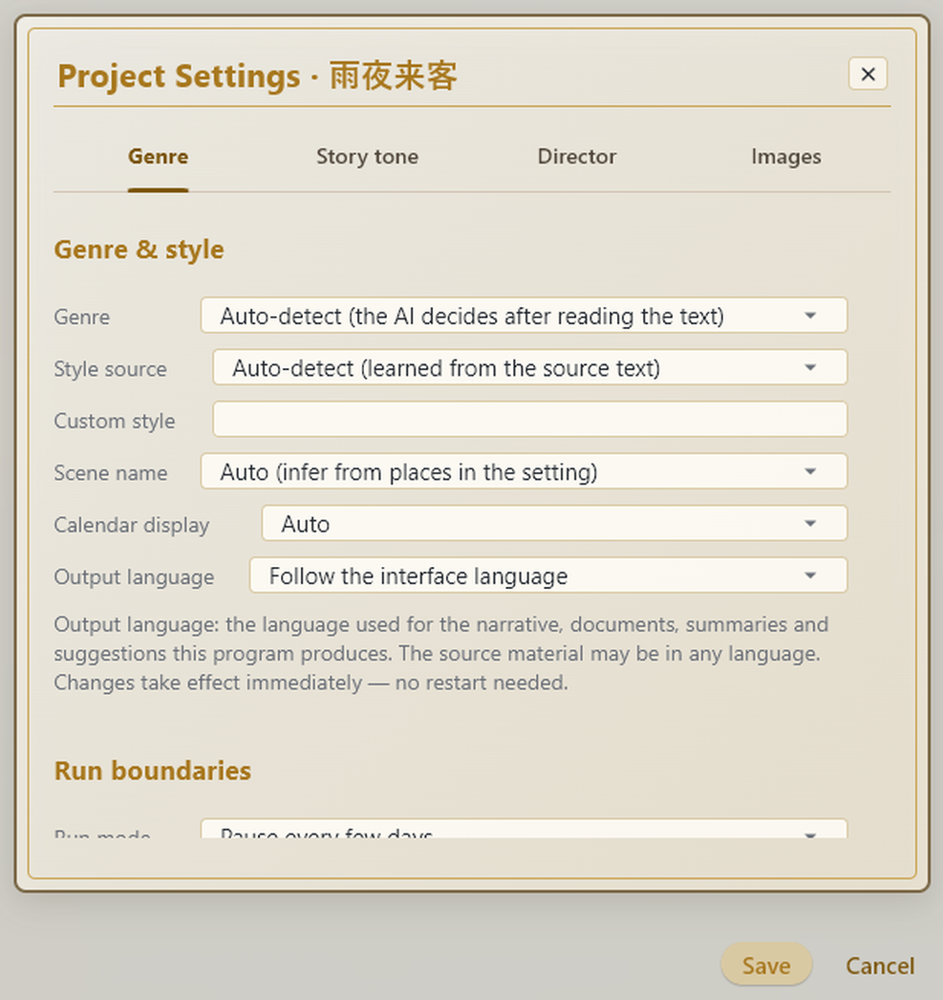

*Project settings · this book (genre & style / images / run bounds …)*

**Settings Description**:
- **Genre**: Mystery·Unit, Xianxia, Urban, Historical, Romance, Sci-fi, etc.
- **Style**: auto (auto-detect), plain (flat)
- **Run Mode**: Run to the end (has an ending) / Open-ended (keeps going) / Pause every few days
  — the parenthetical is deliberate: the name explains itself, and a full sentence under the
  dropdown spells out how the selected mode actually runs. Only the label is shown; the stored
  value stays the variable (`story` / `open` / `story_day`)
- **Pause Interval**: Days between pauses in Pause-periodically mode
- **Start Point**: auto, begin, continue
- **Style Control**: Adjust various style parameters (0-100%)
- **Dialogue images**: which kind of illustration to put in the narrative (see 4.8.1)
- **Crew Agents** (2026-10-11): **this book's** overrides for each agent — the same
  screen as "Setting · Crew Agents", with one difference: **you cannot create or
  delete here** (those answer "which posts this software has", a software-level
  decision). Only the fields you change are stored; the rest follow the default.

#### 4.8.1 Dialogue Images (pick one of four)

> Also called "dialogue illustrations" or "scene images" — one thing, three names; the UI and this manual use **dialogue images**.

**Stored in the project file** (`.nwsproj`, `[项目] 对话图片=`) — whether *this book*
should be illustrated is the project's own business, so it is not carried over from
another project or from global settings. The option names are just the four words,
**without numbers**; each option's note appears on the small line under the
dropdown and changes as you pick.

| Option | Note | **Scenes** drawn with | Cost |
|---|---|---|---|
| **Close** | No images at all (portraits included) — cheapest, text only | nothing | zero |
| **ASCII art** | Scenes as ASCII — smallest footprint, ugliest; portraits still AI-drawn | characters | zero, a few KB |
| **PNG illustration** | Scenes drawn locally in ink-and-wash (no tokens); portraits still AI-drawn | drawn locally | zero, tens of KB |
| **AI full-colour** | Scenes and portraits both AI-drawn — best looking, most tokens | AI | needs an image-capable model |

> **These four options govern *scene* illustrations. Character portraits do not
> follow them** (except "Close") — see 4.8.2 below.

Things worth knowing:

- **Illustrations follow the content** — the PNG option reads the current scene's
  **place / weather / time-of-day / number of people present**: a hall is drawn as an
  interior (window lattice, lantern, desk), a ferry as waterside (boat, bridge,
  houses); night is darkened, rain draws rain, peach blossom only creeps into a
  courtyard scene.
- **Each image is drawn once** — repeated triggers for the same scene or person do
  not regenerate (a simulated day can trigger dozens of times).
- **AI drawing needs an image-capable model**: set the API up under
  *Settings → LLM*, then fill `IMAGE_AI_MODEL` (e.g. `gpt-image-1`) in `.env`.
  When it is missing, **scene images fall back to the PNG illustration** — your
  story never breaks because an image service is down.
- **Scene files land in** `<run folder>/插画/`: `场景_<place>.png`,
  or `场景_<place>.txt` for ASCII art.
- **Old projects need no changes**: with no such key in the project file, the
  global `SCRIPT_IMAGES` still applies (off → off, otherwise PNG illustration).

#### 4.8.2 Character Portraits (always AI-drawn, generated once at import)

**Portraits and scene illustrations are two different things**, with different
lifetimes:

|  | Scene illustration | **Character portrait** |
|---|---|---|
| When needed | during the run, per place / per scene | **once at import**, never again |
| Where stored | `<run folder>/插画/` (one set per run) | **`<project>/肖像/` (shared by the whole book)** |
| Why | the same place may differ between runs | **a person must not change faces between runs** |

So portraits **always go through text-to-image**, generated **once when you import
("New Story")**, and reused by every later round (no repeated token spend). The
prompt is built from the character's own settings (name / role / personality plus
the story genre).

**If the model cannot do text-to-image** (no `IMAGE_AI_MODEL`, an API without an
image endpoint, demo mode, …), WorkBuddy **says so explicitly** and **uses text
instead** of the portrait in the narrative:

```
▸ 出场 主角（已在场）
※ 肖像：主角 · 沈家长子 · 沉稳内敛     ← text stand-in, shown once
主角：你今日话里有话。
```

It will **not** quietly substitute a locally drawn stick-figure portrait — that
thing looked bad and has been retired.

Both the results and the reason are recorded in
**`<project>/肖像/肖像清单.md`** (who succeeded, who did not, and why).

> **To view or replace a portrait**: go to `<project>/肖像/`. Deleting a `.png`
> will not regenerate it mid-round (re-import to regenerate); to supply your own,
> just drop a file with the same name in there.


### 4.9 Old Story — three columns

Click "Old Story": **three columns side by side**, each carrying one sentence that says
what it is:


*Three columns: ① novel (title + created) / ② this book's saves / ③ the selected one*

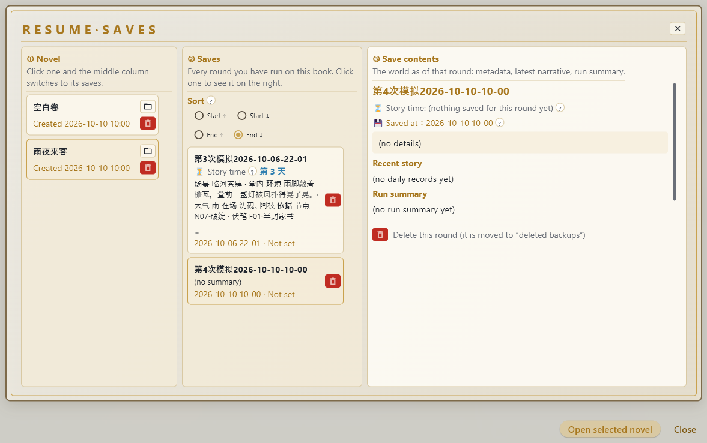

*Click a save: column ③ shows its metadata, latest narrative and run summary (all Markdown)*

**Features**:
- **① Novel**: **just the title and its creation time** — plus a small 🗑 on the right
  that deletes the whole book (it asks you to type the name);
- **② Saves**: every round this book has run, **newest on top**; click one to read it on
  the right, 🗑 deletes that round. **The newest round is selected for you** on open;
- **③ Save contents**: that round's metadata (project / source folder / genre / tier /
  start node), the latest narrative and the run summary, **rendered as Markdown**
  (`**bold**`, headings, lists, tables) instead of raw symbols;
- all three columns scroll on their own, and card summaries are Markdown too
- **Deleting** (**recoverable** — nothing is wiped):
  - the small **🗑** on a save card (column ②) deletes **that round**;
  - the small **🗑** on a novel card (column ①) deletes **the whole book** (settings,
    portraits, every round) — this one also asks you to **type the book name** before
    the red button unlocks;
  - both ask first, showing the **name / path / file count / size / backups folder**;
  - on confirm the folder is **moved into “已删除备份”** (next to the projects folder,
    a sibling of `Projects`) — if you change your mind, move it back under `Projects/`
    and it is an ordinary project/save again;
  - **if it cannot be moved, it is refused outright and nothing is touched**: when the
    round's `state.db` is still held open (usually because the round is still running)
    the program will not force it — it tells you to stop the round first, or to restart
    the app and try again. This is deliberate: a failed delete is fine, a half-deleted
    folder is not;
- **Open selected project** enters the run screen; **Close** exits.

> Delete only — there is **no "import save"**. To bring a round in, just copy a
> `第N次模拟…` folder into the project directory.
>
> **“已删除备份” is an ordinary folder you can clean out yourself** — the program does
> not touch it again.

### 4.10 Help Panel

Three entry points, all opening the same panel:

- **❓ Help** at the top right of the **start screen** (you can read the manual before opening a book)
- **❓ Help** at the top right of the run screen
- `/help` in the command bar on the run screen

(There is **no** F1 / Ctrl+/ shortcut — only F11 is bound, for full screen.)

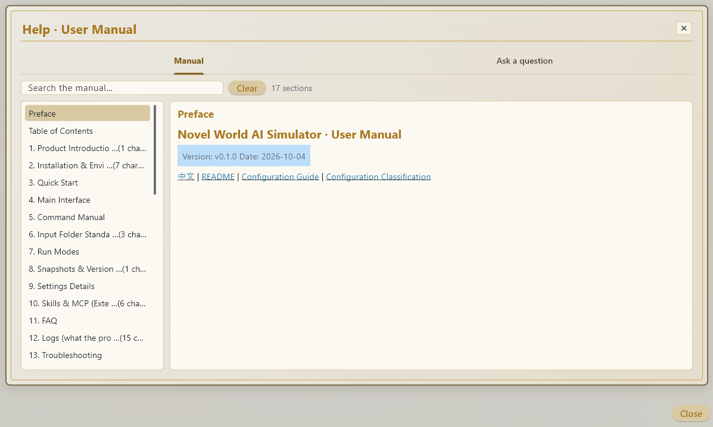

*The help panel: two tabs — one to browse this manual, one to ask about it*

**One window, two tabs**:

| Tab | What is inside | What it is for |
|-----|----------------|----------------|
| **Manual** | **Keyword search** on top, table of contents on the left, body on the right | **Browsing** this manual. The right pane *is* the manual shipped with the program (Chinese reads `使用说明.md`, English reads `User_Manual.md`) — no separate help copy, so the two can never drift apart |
| **Ask a question** | Chat-style (question and answer bubbles) | **Asking** this manual. Type a question; the program first retrieves the relevant chapters locally, then has the model answer from those chapters only (see 4.10.2) |

- Both tabs live in one window — **no closing and reopening** to switch; "Close" sits at the bottom
- **The contents pane and the body pane each have their own scrollbar** (on the right
  edge; it is not drawn when the content fits). It stays visible while you scroll, so you
  can see how much of the chapter is left. The body is rendered **section by section**,
  so even a very long chapter (section 4 is ~26k characters) scrolls all the way down
- Tables and code blocks render for real; images come from `assets/images/manual/`
- The command list lives in the "Command reference" section; **only `help`, `status` and `settings` are actually wired up** — the rest reply "not wired up yet"

#### 4.10.1 Keyword search (calls **no model**)

The Manual tab has a search box at the top: type a keyword and the table of contents
immediately **keeps only the chapters that contain it**, each with a match count, while the
right pane opens the first hit and lists, right under the heading, how many times the word
appears in that chapter and where. Clear it (or press **Clear**) to get the full contents back.

- **Entirely local**: searching is plain text matching in the manual — **no network, no model
  call, no cost** — so it **works with no LLM configured**, which makes it the handiest
  fallback when "Ask a question" is unavailable.
- **Multiple words mean "all of them"**: `run mode archive` keeps only chapters containing
  all of them (that is what makes a search narrow things down).
- When nothing matches all the words, it falls back to "partial matches" and **says plainly
  that these may not be relevant** — it never pretends they are the answer.
- Tip: **one word usually beats a whole sentence** (button labels and setting names work
  best). If you get nothing, try a different wording, or clear the box and browse the contents.

#### 4.10.2 With no LLM configured, "Ask a question" is greyed out

The second tab depends on a model (it answers from the manual). So **while no LLM is
configured that whole page is greyed out**: the input, the Send button and the example
questions cannot be clicked, and the page states three things — why it is unavailable
(what is missing), where to configure it (the **Configure now** button opens
**Heavenly Secrets · LLM Access** directly), and **what to use meanwhile** (the keyword
search from 4.10.1 above; it needs no model). See
[2.4 API Key Setup](#24-api-key-setup) and
[3.4 How to Plug the Key In](#34-how-to-plug-the-key-in).

#### 4.10.3 "Ask a question": ask about using the app

Switch to the second tab, type a question (or click one of the ready-made examples),
and press Enter or **Send**.

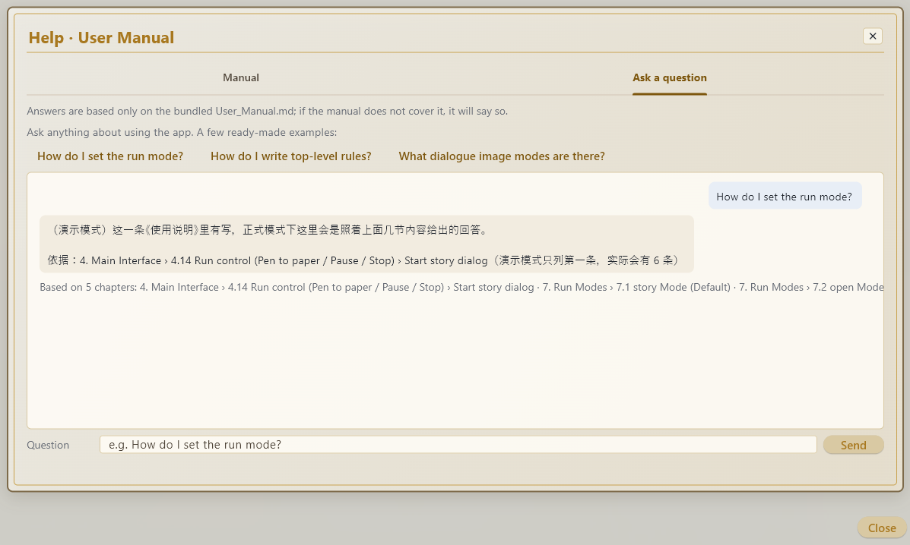

*Ask a question: your question on the right, the answer on the left; the small line under the answer is the "依据" (sources) note*

The conversation **looks like a chat**: your questions on the right (pale indigo bubbles),
answers on the left (old-paper bubbles). Everything stays on screen, so you can follow up —
ask "how do I write top-level rules", then "and which folder does it go in?". **Follow-ups carry
the earlier conversation with them** (only the last few turns, capped per turn, so a long chat
never eats the whole context window).

- **Retrieval costs nothing**: finding the chapters happens entirely on your machine (matches in
  section titles weigh more, since a title is the author's own statement of what that section is
  about). No network, no model call.
- **No chapters, no question**: if the manual simply has no relevant section, the program
  **sends no request at all** and tells you so — handing the model nothing and asking it to answer
  is an invitation to make things up.
- **Each question costs one model call** (cheap tier), so do not use it for small talk.
- Answers are followed by a **"依据" (sources)** line listing the sections used, so you can check the
  original. Chinese UI reads `使用说明.md`, English UI reads `User_Manual.md`; your question follows the UI language.

> It **only knows this app's usage**. Ask it about the weather, ask it for a poem, and it will say
> the manual does not cover it — on purpose: **inventing a feature that does not exist is worse
> than not answering**, because you will go looking for it and not find it.
> A small tip: it recognises the manual's own vocabulary best — button labels, setting names, and
> phrasing that appears in the chapters ("run mode", "top-level rules", "snapshot") make the best questions.

### 4.11 Settings Screen

Typing `settings` or `set` opens **Settings · program** — there is no separate settings window.
Per-book settings live in **Book settings**.


*Typing settings opens exactly this — there is no separate settings window*

- Seven tabs: Regular / **AI Model Config** / **External Creative Services** / Appearance / Run /
  Director & compliance / Crew Agents
  (as of 2026-10-12 the two former LLM tabs are merged into "Models & LLM", and MuMuAINovel was
  merged into the "External Creative Services" tab together with PlotPilot / PenShot)
- Flip switches and drag sliders in place, then hit Save to write `.env`
- LLM-related changes say plainly that they need a program restart
- Changing the UI language rebuilds the interface at once, no restart

### 4.12 Style Control Panel

The style control panel is displayed in the lower left of the main interface.

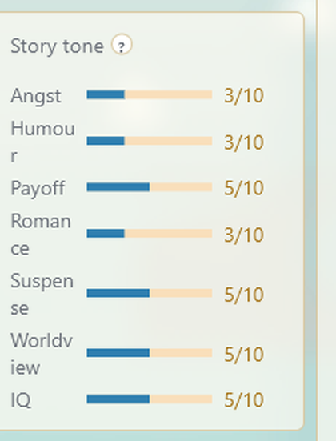

*The Story tone panel in the left column: how this round is told*

**Description**:
- Real-time display of current story style parameters
- Parameters adjusted in project settings
- Affects story direction and style

### 4.13 Plot Panel

The plot panel is displayed in the middle right of the main interface.

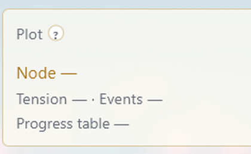

*The Plot panel in the right column: node, tension, event count*

**Description**:
- **Node**: Current story progress node
- **Tension**: Current plot tension level (0-1)
- **Events**: Number of key events occurred
- **Style**: Current story style summary

#### Story overview: two tabs

**Click the "Plot" title, the station name in the middle, or the small icon at the right end of the
carousel** and the "Story overview" window opens. The top line is a **carousel** across earlier runs
(`1 / 2` shows which one), and below it are two tabs:

| Tab | What is inside |
|---|---|
| **Detailed story** (default) | The **detail** of this run: key plot and turning points, plus per-day **playwright beats**, **prose** and **storyboard** (next section) |
| **Flow chart** | A **top-down flowchart** for the whole picture: station + state + evidence (which day, how many scenes) + a few lines of summary |

The line under the title tells you how much there is: `day 1 · 12 scenes · 2/8 stations played ·
6 beats · 2554 characters of prose`.

### Detailed story: down to each segment the playwright wrote

**This page answers "what actually happened in this run", not "what the skeleton looks like".**
From top to bottom:

| Block | What is inside |
|---|---|
| **Key plot and turning points** | **The conclusion first**: how many turns, how many key beats, listed one by one (time · place · that one thing) |
| **Day by day** (collapsible) | One block per day. The header already says `3 scenes · 6 beats · 2554 characters`, click to expand |
| └ Day summary / setting | The two lines the playwright wrote (what this day is about, what the place looks like) |
| └ This day's turns and key beats | Same as above, filtered to this day |
| └ **Playwright beats** (segments) | **This is "the small segments the playwright writes"**: one card per beat — scene · theme · cast · mood / **what happens** / **key points** (the concrete strokes) / push · goal · problem · props |
| └ **Prose** | The novel text the playwright wrote by stringing those beats together, paragraph by paragraph (measured ~2500 characters per day) |
| └ **Storyboard** | The shots the storyboard artist split by beat: framing · image · line · narrative point |

**How turning points and key beats are decided** (all checkable, none of it is a model's opinion):

| Mark | Criterion | Why it counts |
|---|---|---|
| **Turn** | ① an event the director asserted (`secret leaks` / `character clash` / `coincidence` / `outside stimulus` / `foreshadow fires` / `director rescue`) ② a station switch | It is not "something the acting produced" — someone pressed it; and a station switch means the story moved on |
| **Key** | ③ a tension jump of at least 0.15 ④ a change of place within the day | The heat or the stage changed, but not the direction — so it is not a turn |

> ⚠ **"X appears for the first time" is not a key beat**: the opening scene has everyone present, so
> judging newcomers from the cast list drowns the real turns (measured: day one reported seven
> "first appearance" lines). The cast list lives in the "On stage" panel and does not take the
> turning-point slots.

**How folding works**: the **last two days** start expanded (that is "what I just played"); click a
day's header for the rest. One day measures ~100 controls (6 beats + 48 paragraphs + 18 shots), so
thirty expanded days would freeze the window — folding therefore **rebuilds that block** instead of
hiding it.

> ⚠ Days older than 30 keep only the **brief and turning points**; beats and prose are dropped
> (`MAX_DETAIL_DAYS`). The brief and the turning points never lose a single day.

**Choice points** (on the "Flow chart" tab): where the story says something like "three roads: go
home, be offered up, keep the door", the card turns into a row of clickable options.

- Click one → the chart continues with "Following the X line", and **the pick is saved** (still there
  next time you open it);
- Click the same one again → clears it;
- When that line has no plot data yet it says **"nothing after this line has been played yet"** — it
  will never invent an ending for you.

> Where the options come from: add a `choices` field to that station in the setting bible's progress
> table and yours is used. Without it, the program reads phrasing like "...three roads" out of the
> summary and marks the block *"These were read out of the summary"* — seeing that line tells you it
> is time to fill the field in.

**Who generates it and when**

- The data lives in each run's folder as `剧情总览.json` (it moves with the archive);
- **It updates itself while the run goes on**: once per finished day, plus one more time when you hit
  Stop — nothing for you to do;
- Older runs (from before this feature) get filled in by running `tools/build_story_flow.py` once;
- ⚠ It **costs nothing**: it reads `当日剧本.json` (the playwright's beats and prose), the scenes and
  events in each day's script, and the progress table — **zero model calls**. Opening it to look can
  never spend your credit.
- ⚠ **A day the playwright never wrote** (an old run from before this feature) still shows "per day +
  scene count + turning points", just without beats and prose — the block never disappears.


### 4.14 Run control (Pen to paper / Pause / Stop)

Three buttons at the top-right of the running screen control the current round:

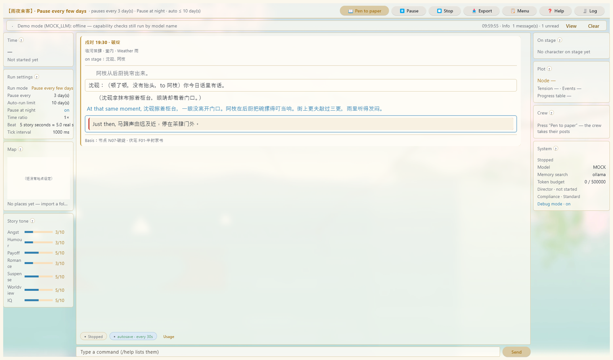

*The run screen mid-round: that button strip sits at the top right, the centre column grows narrative, both side columns keep up*

```text
【沈家旧案】· Run to the end (has an ending)   [📖 Pen to paper] [⏸ Pause] [⏹ Stop] [📤 Export] [📋 Menu] [❓ Help]
```

| Button | What it does |
|--------|--------------|
| **📖 Pen to paper** | Opens the "Start story" dialog to set this round's parameters; confirm to run. **Greyed out while starting / running** (a new round never starts on top of a live one) |
| **⏸ Pause** | Stops the simulation. **The button then turns into "▶ Resume"** — press again to continue |
| **⏹ Stop** | Ends this round: writes out the current day, then exports per your switches. **During the first few seconds of a launch it reads "⏹ Cancel launch"** (see the next subsection) |
| **📋 Menu** | Back to the start screen (New story / Resume / Settings / Book settings) |
| **❓ Help** | Opens this manual (sections on the left, the text on the right) |

> While nothing is running, **Pause** and **Stop** are greyed out — not broken,
> there is simply nothing to stop. They light up after you press "Pen to paper".

#### The few seconds after you click "Start" (changed 2026-10-12)

Once you confirm that dialog, the program has to **assemble the world** (read the settings
collection -> build the world -> freeze this round's snapshot). On a good day that is
ten-odd seconds; on an old machine, or with the project syncing on a cloud drive, it can
drag on longer. It used to show **nothing at all** while it worked, so people assumed the
click had not registered and clicked again -- and **two rounds ended up running at the same
time**. Now:

| What you see | What it means |
|---|---|
| **It switches to the run screen immediately** | On the same frame as the click, no more staring at the start menu |
| One line in the middle column: "assembling this round's world..." | The most direct evidence that "it really has started" |
| Status line: "Starting -- assembling · N s elapsed" | That stopwatch **really ticks**, which is the evidence that "it is not dead" |
| The "⏹ Stop" button becomes "⏹ Cancel launch" | If you would rather not wait, press it -- **the UI stops waiting at once** and you can start again |
| "Pen to paper" greyed out | This round is not finished, so a second one will not be opened |

- ★ **Only one round at a time.** Seeing the "starting" look above means the program is
  already working -- clicking "Pen to paper" again is refused **to your face**, with the
  reason (never silently ignored).
- ★ **Timeout**: "Start timeout (s)" under "Audience · Run -> Starting a round" (default
  **180**). If assembly has not finished by then, the UI **stops waiting**: the status bar
  returns to "Stopped", a note stays in the middle column, and you can click "Pen to paper"
  again right away.
- ★ **A voided launch exits by itself**: even if it later finishes assembling it will
  **not take over the UI** (it re-checks a token before landing and touches nothing on a
  mismatch). That is how "keep one of the two" is delivered. The run folder it left behind
  is moved into "Deleted Backup"; if it cannot be moved (on Windows a file inside may be
  held by an antivirus scan), a **`已作废.md`** note is left inside explaining that it is an
  empty shell -- so it cannot masquerade as a normal save in the resume list.
- ⚠ When a launch fails (settings unreadable / model client cannot be built / assembly
  error), a line is **left in the middle column too** -- not just a toast that flashes by.

#### It also stops on its own (and always says so)

Start with the **default**: **it almost never stops on its own any more.** Only three
places stop it, and all three are genuine "you need to decide" moments — each one pops up
a **dialog** asking what to do:

| When it asks you | Which switch decides it | What it asks |
|---|---|---|
| A fork in the story | `BRANCH_AUTO_POLICY` (`weighted` by default) | Where to go (pick a candidate / write your own) |
| A director intervention held back | `INTERVENTION_POLICY=pause` (default) | The plot stalled too long — go with the director? |
| Token budget exhausted | `BUDGET_EXHAUST_POLICY=pause` | Keep writing (double the budget) / wrap up |
| Nightfall | `PAUSE_AT_NIGHT=1` (off by default) | Just pauses — no dialog |

**Checkpoints no longer block you** (changed 2026-10-11): the day boundary
(`STORY_DAY_EVERY_DAYS`) and open-ended mode (`OPEN_CHECKPOINT_EVERY_DAYS`) still
**save to disk on schedule and drop one line in the middle column**
("已按设置存档…接着往下写") — then carry on. A checkpoint answers "did I save?",
needs no decision from you, and so has no business interrupting. If you *want* the old
"stop and wait for confirmation" behaviour, turn on `CHECKPOINT_PAUSE`; it then asks via
the dialog.

#### The dialog it uses when it does need your call

All three decision points share one window (unified 2026-10-11). Top to bottom:

1. **"Where the story stands"** — day, in-story time, place, who is on stage, current
   progress node plus a recap. So you can see what this choice is actually about;
2. **one line of "why you are being asked"** — e.g. "The plot has stalled for a long
   time and the director wants to change direction — go with it?";
3. **the options, as radio buttons** (a radio button is just a label — picking it
   changes nothing until you confirm);
4. **always a "write your own" box at the bottom** — whatever you type wins over any
   option you picked;
5. two buttons: **"Confirm" on the left, "Cancel (pause the run)" on the right**.
   Confirm stays **greyed out** until you have picked or typed something.

**What Cancel does**: it pauses the run but **keeps the question** — when you press
"▶ Resume", **the dialog comes back** so you can answer.
(Otherwise a closed dialog could never return, and the run would sit there waiting on a
question you can no longer answer.)

Some questions carry a countdown (the fork: 5 minutes by default) — that means "if you
never touch it, the policy picks for you". **The moment you touch it** (pick an option or
start typing) the countdown stops, so it never throws away the sentence you were writing.

> ⚠ (fixed 2026-10-10) These stops used to be **silent**: it stopped, said nothing,
> kept the button reading "Pause", and left the status line on whatever fine-grained
> state was reported last — so the screen read
> "Checking story progress · 2019 s" and the number kept climbing. You would reasonably
> conclude it was stuck grinding on the progress check, while in fact **not a single model
> call** happened during that whole stretch — it was simply waiting for you to press
> "Resume". Now *who stopped it* is reported to the UI (`RunLoop.on_self_pause` → session
> state), and the day-boundary checkpoint **no longer burns a pointless stop on the first
> tick** (a resumed run usually starts mid-day: that is "finish this day first", not
> "entering a new day").

**One round = one complete run**, and it creates a new run folder (`第N次模拟…`).
Once it finishes or is stopped, the next round is configured afresh.

#### Start story dialog

Everything for this round is set in one place before the run begins:

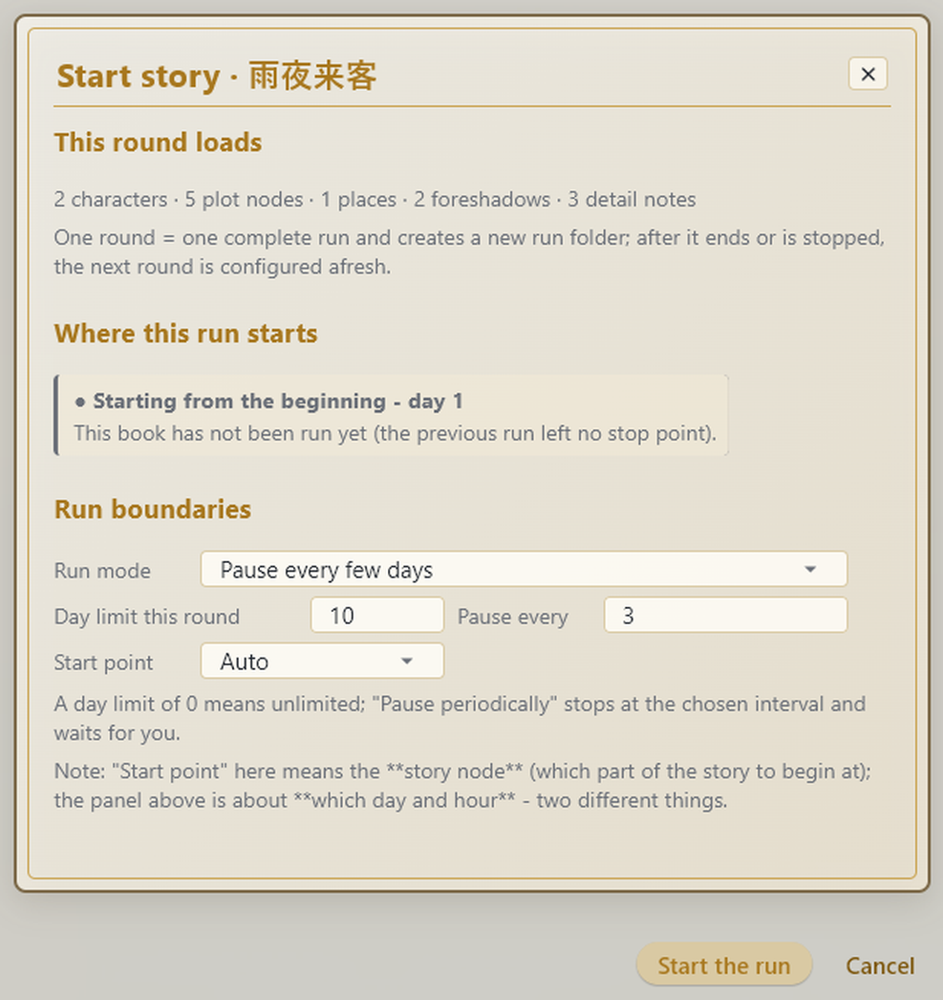

*Start story: how this round runs (mode / day cap / start point / style / budget)*

##### Recap + "Your suggestions for where the story goes next" (added 2026-10-11)

Right under "Where this run starts" are these two panels, **in this very order**:

| Panel | What it is |
|---|---|
| **Recap** | The passage that will be **spoken in the middle column** when this round opens ("Last time it played to Day 3 · 戌时 (临河茶肆), and said: …"), or — if the book has never been run — the setting's [Story arc] / [Worldview] |
| **Your suggestions for where the story goes next** | One message from you about which way this round should go |

- The **recap is text, not an input box** (changed 2026-10-11): it is plain
  **selectable** text — no frame, no fill, and no scrollbar of its own. A long recap
  unfolds in full and scrolls with the dialog. ⚠ Do not turn it into a "box": a box
  has a height ceiling, so a long recap grows **its own scrollbar right on top of the
  text** (that is exactly the flaw of the first version).
- **The recap and the box below it share one width** (520px); the strip on the right
  is the **scrollbar lane**, so the dialog's scrollbar never covers the text.
- The **suggestions** field is a **multi-line input**, the same width as everything
  above it — long sentences or several lines are both fine.

- That recap is **not a second copy**: it calls the very function the run window uses
  (`sim/resume.start_recap`), so **what this dialog shows is what the screen says**.
  Judge `verify_author_note` group A compares the string with a **really assembled
  `RunLoop`** character by character, and the on-screen judge checks once more that the
  passage shown here is inside the recap line of the middle column
  (`verify_author_note_ui`).
- What you write under **suggestions** goes to **everyone in the crew** (director,
  screenwriter, novelist, continuity…). It is appended at the **end** of each person's
  craft block (the later a passage comes, the more specific and the more it outranks the
  general craft above it), and its heading states plainly that it is **intent, not
  setting**: push in that direction, but a character's nature, what has already happened
  and the world's rules **must not be violated**.
- ⚠ **It applies only to this round**: after the round ends or is stopped, the box is
  **empty** again when you press "Pen to paper" (nothing is pre-filled, nothing is
  written to the config). That is deliberate — if last round's sentence carried over,
  it would take effect **even when you typed nothing**, and you would never notice.
- ⚠ It is **never written into your manuscript**, and **never merged into the setting**.
  It lands in exactly three places: ① everyone's prompt for this round; ② one line in
  the middle column right after the opening recap
  (`※ 作者对本轮走向的要求：…`); ③ this round's `开场.md` (only when "opening screen"
  is on).
- That middle-column line **does not depend on the "opening screen" switch** — if you
  turned the opening card off, you still see what you wrote.
- Any length is fine, but since every beat of every agent carries it, it is truncated
  past 600 characters; multiple lines are folded into one paragraph (so that it does not
  push the material after it apart).
- ⚠ **That box cannot control the structure** (note added 2026-10-11, and it is written
  on the box itself): it gives a one-line **direction** (it goes into the prompt, and the
  model may ignore it). To control **how many events happen, whether to push the
  mainline, whether time skips, and who is on stage**, use the switches in the
  **"This round"** section below — those are **real switches**: the program obeys them.

##### "This round" - how this run behaves (added 2026-10-11)

Sits right below "run bounds". It describes **the nature of this round**, which is a
different thing from the suggestions box above: suggestions say *which way to lean*,
this section decides *how the run goes*.

| Item | What it is | Default |
|---|---|---|
| **Nature of this round** | `Normal` = push the mainline and let the director stir things up; `Slice of life` = **no key plot**, just living the days | Normal |
| **At most how many key events** | How many times the director may stir things up **this round**. Once it hits the cap it stops; the characters carry on by themselves | `0` = unlimited |
| **Roughly how many words per day** | How long each story day runs (a soft target: it is **told to the novelist** writing that day's chapter, and shown in the status bar) | `0` = unlimited |
| **Skip time when nothing happens** | After several beats in a row with nobody doing anything, **one line of narration** carries the clock forward instead of idling beat by beat | **on** |
| **Cast this round** | Only these people take the stage (comma-separated; empty = everyone) | empty |
| **Lock to one place** | Keep the whole round in one place; **no scene changes** | not locked |

- **What "Slice of life" actually switches off**: the director **stirring things up on
  its own** — including the forced climax-day event and the stall rescue. Nothing is
  injected, and **not a single model call** is spent on it. ⚠ But if the story genuinely
  reaches a progress node, it **still advances** — this setting means "I will not push
  you down the mainline", not "the mainline is frozen".
- **"At most how many key events"** is the **total for the round** (not per day). After
  the cap, the director stops. Events blocked by a gate **do not count** (they never
  happened).
- **"Skip time when nothing happens"** triggers on "N beats in a row with **nobody doing
  anything**" (no one speaks, no one takes a real action). One word or action **resets
  the count**, so no scene that should play will ever be skipped. A skip advances the
  clock by the configured story minutes and leaves one narration line, e.g.:

  > 小半个时辰就这么过去 —— 临河茶肆里没什么事：雨脚一阵密一阵疏，檐水没断过。

  ⚠ That line describes **time and ambience only — never a character's action**: a skip
  does not mean something happened, and inventing an event would leave nobody able to
  pick it up later. After a skip the "time since the last event" is **reset**, so the
  director will not butt in precisely because of it.
- **"Cast this round"**: people not listed **do not count as on stage** this round (they
  take no decisions). ⚠ Names must match the character cards; **unrecognised ones are
  dropped with a note in the log**. If none match, the list is treated as **unset**
  (everyone is on stage) — so you can never end up with nobody.
  The list is **remembered**: it will usually not match another book, so check it when
  you switch books.
- **"Lock to one place"**: the place must also exist in that book's place table,
  otherwise it is ignored (rather than leaving the scene name dangling).
- ⚠ **Every item in this section is written to the config file**, so **they are still
  there next time you pen to paper** — visible in the dialog and editable at any time
  (unlike the suggestions box, which starts empty every time).
- Quick recipes: **"quieter round"** → set the nature to *Slice of life*;
  **"only three events this round"** → set the cap to `3`;
  **"let this stretch of days go by quickly"** → turn on *Skip time when nothing
  happens*; **"only these two characters' scenes"** → put their names in *Cast this
  round*.

##### "One scene after another" - stage scheduling (added 2026-10-11)

After reading a run log the author reported: "these people are all over the place most of
the time, some small scenes are never explained clearly and then everyone suddenly jumps to
several new scenes" and "scenes switching back and forth with no character entering, no
action, no plot — on TV that is a meaningless scene change".

**The cause turned out not to be the prose but the pipeline**: the playwright **had already
split the beats** (each one naming where, what happens, what it advances), but that sheet
**was never handed down** —

- the "today's script" an actor received was only a synopsis of the day plus the few tasks
  assigned to him; the six beats the playwright split were **not visible at all**;
- act breaks happened **after the fact**, keyed on "the time slot changed / the location
  changed", not on "this beat is finished";
- a scene change waited until **not a single person remained on stage**, and only if the
  target location happened to be in the location table — so it either never changed, or
  random movement dragged it around.

A **stage-scheduling** layer now fills that gap. Four things:

1. **Every scene fully set up**: for each beat the playwright writes **topic** (what this
   scene is about), **cast** (who is in it), **points** (which actions and lead-ins it must
   land), **props**, **mood** and **advance** — miss one and it plays out as "all over the
   place". ⚠ Dialogue is still **not** written: that is the actors' job.
2. **Actually handed down**: those columns for the current beat go into **every actor's**
   decision prompt, plus one line about what the next scene is. The playwright's sheet is no
   longer just a table in the ledger.
3. **Wrap up by beat**: once everyone who should appear **has appeared** and the beat really
   **saw action**, the scene closes and the next beat starts. No more waiting for "the time
   slot changed / the location changed".
4. **Change scene by beat**: after wrapping up, the scene moves to **the place the next beat
   names**, and the people who should appear are **moved over** — no more "scene switched
   but nobody is there".

| Item | What it is | Default |
|---|---|---|
| **Play by the beats** | Master switch. Off = back to before (the sheet stays in the ledger, it just no longer drives anything) | **on** |
| **Minimum beats per scene** | Below this, the scene never wraps (set it too small and "a scene" becomes as short as "a beat", making things *more* fragmented) | `3` |
| **Maximum beats per scene** | Forces a wrap at the cap, so a scene cannot drag on forever | `12` |
| **Minimum real actions per scene** | Counts "things actually done", not "how many beats ran" — the whole cast spacing out does not count | `2` |

- When a scene wraps, the middle column leaves a **scene-end separator** saying **why**
  (e.g. "beat 2 finished (testing him): 3 beats / 4 real actions"), and the next line is
  **〔beat 3 · behind the counter · the ink falls〕** — you can see at a glance "which scene
  we are in and what it is playing".
- ⚠ If someone who should appear never shows up, the scene **waits until the cap** and then
  wraps anyway (it never gets stuck); that case names the missing person in the separator.
- ⚠ **With no beat sheet this layer does nothing** — on a day with the day-script turned off
  or no script produced by the model, the simulation behaves **exactly** as before.
- ⚠ A "real action" is one where something really happens (speaking, moving, engaging):
  empty beats like "didn't move, didn't speak" **do not count**, so a scene cannot be
  considered finished just because a few people are staring into space.

##### "Where this run starts" - Pen to paper looks at where the last run stopped (2026-10-08)

The **topmost panel** of that dialog tells you one of three things:

| How the previous run stopped | The panel says | What this round actually does |
|---|---|---|
| **No previous run** (or it left no stop point) | `Starting from the beginning - day 1` | Starts at day 1, 08:00 |
| **Stopped halfway through a day** (you pressed Stop) | `Picking up where it stopped - from day 3 · 戌时` | **Continues from that time**, and **keeps writing day 3's script** (the first half is not lost) |
| **That day was finished** (it crossed into a new day) | `Starting a new day - day 4` | Starts at day 4, 08:00 |

Underneath it also lays out **the evidence** ("previous run stopped at: day 3 · 戌时 · <place>;
that day had run 27 beats") - so you can check it yourself instead of taking a conclusion
on faith.

> **How does it know whether the day was finished?** The loop records it at wrap-up
> (`<run folder>/停点.json`), **it does not guess**. Guessing is impossible in practice:
> wrap-up **flushes the current day** to disk, so "day 3's file exists" may mean either
> "day 3 was finished" or "day 3 was stopped halfway and flushed" - the file cannot tell
> you which.
>
> The single criterion is **how many beats that day had run** at wrap-up.
> Beats > 0 = stopped halfway (continue); zero = the day had not started yet
> (the previous day already wrapped up, so start a new day).

⚠ **One thing stated plainly**: what is continued is the **story time** and **that day's
script**. World state (tension / foreshadowing / extras / character memory) is still
**freshly assembled for the new round** - reading the world back is what 拾卷 is for.

##### After you press "Pen to paper", the screen continues from last time (fixed 2026-10-11)

It used to **clear the middle column**, and the opening "recap" line was **always the
same setting-book prologue** — together that looked like the run had remembered nothing
(in fact the stop point never lost a field, and the clock really did resume). Now:

| What you see | What it is |
|---|---|
| `—— 以下是上一次演到这儿（第 N 天）——` | The top of the middle column picks up **the previous run's chapter** (the **last few scenes** — enough to recognise where it stopped) |
| `（更早的 M 幕见「每天的生活」里这一天的稿子）` | The trimmed-off opening scenes are in the **run folder**; one line points you there |
| `—— 以上是上一次的记录 ——` | What follows is **this round's** new writing |
| `上一回演到 第 N 天 · 戌时（临河茶肆），说到：…` | The opening "recap" becomes **where the previous run actually stopped** (no longer the setting-book prologue) |

- Those divider lines are **not decoration**: without them the style is identical to the
  live stream, and you would take the older text for this round's output;
- The history shows only **while you are still on the day you started on** — after
  crossing into the next day it is withdrawn (otherwise it reads as a duplicate of the
  new round's day 1);
- To check beforehand what pressing "Pen to paper" will bring up, run
  `developers/probe_resume_view.py` (**read-only**, touches no file).

> To be clear: this panel is about **which day and hour**. The **"Start point"** dropdown
> under "Run bounds" is about the **story node** (which part of the story to begin at) -
> two different things despite the similar names.

- A **day limit** of `0` means unlimited.
- **Style controls** govern how *this round* is told — they are not the same as
  the project-level settings in Project Settings.
- In **Book settings · Style controls**, the little **"?"** next to the
  **Style parameters** heading opens a **parameter guide**: what each slider
  does, the low-vs-high feel, and ready-made presets for common genres
  (xianxia / mystery / urban / historical / romance / sci-fi / ensemble).
- "This round loads" shows what was **actually read** (how many characters,
  how many nodes); if nothing could be read it says so plainly.

**Two entry points**, same effect:

- **Start screen**: **📖 Pen to paper**
  (greyed out when there is no current project);
- **Running screen**: the **📖 Pen to paper** button at the top.

#### Once it is running

- The **centre column** shows **live** narration (it does not wait for a day to
  end) and scrolls along by itself;
- After the round ends or is stopped, the centre column goes back to reading the
  **written-out** day;
- You can **pause** at any time; the screen then freezes (narration stops growing);
- **Export** works at any time (see 4.15) — but mid-run only **complete days
  already written** are included.

### 4.15 Export (running screen · 📤 Export)

There is an **📤 Export** button at the top of the running screen.
**You do not have to wait for the run to finish** — click it any time and it
exports the days that have been written so far.

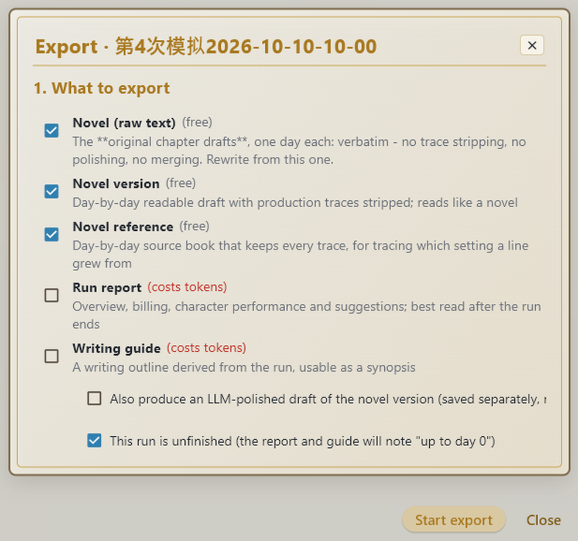

*Export: choose which artefacts to write, or switch on auto-export at the end*

**Four outputs** (written to `<run folder>/导出/`, versioned, never overwritten):

| Output | File | What it is |
|--------|------|------------|
| **Original draft** | `原始稿_v1.md` | A **proof copy** bound day by day. It holds **everything that actually happened that day**, laid out from `每天的生活/第NNN天.json` (the source of truth) — no trace stripping, no polishing, no merging, **never rewritten**. The authority on "what actually ran". Free, reproducible. |
| **Final rewritten draft** | `最终改写稿_v1.md` | The **finished draft** bound day by day. Production details (cast lists, per-scene basis, mechanism notes, image paths) are stripped, leaving time, scene, entrances/exits, narration, dialogue, action, inner voice and simultaneity — **it reads like a novel** and can be rewritten directly. Free; ⚠ but see "the one that changes" below. |
| **Original draft + details** | `原始稿加细节_v1.md` | Literally **the original draft plus details**: the prose is untouched, and the cast lists, per-scene basis, mechanism notes and image paths are kept. Use it to trace which setting a line grew from. Free, reproducible. |
| **Run report** | `运行报告_v1.md` | Overview ＋ billing (**computed, not guessed**) ＋ storyline, key scenes, character performance, suggestions. The analysis part calls the LLM. |
| **Writing guide** | `写作指导_v1.md` | A writing outline derived from the run, usable as a synopsis. Calls the LLM. |

With "polished draft" ticked, the final rewritten draft **also** produces
`最终改写稿_v1_润色.md` — the LLM turns the bound draft into a coherent
manuscript. **Saved separately; the bound draft is never overwritten.**

**⚠ There are two export paths — you have not exported only once just because you clicked once**

| Path | When it runs | Factory default |
|---|---|---|
| **Manual export** | when you click "Start export" | only when you click |
| **Finish-time auto export** | **the moment you click "Stop"** | **off** (all off since 2026-10-26); it runs only if ticked under "③ Auto-export when a run ends" |

So out of the box, clicking "Stop" does **not** produce drafts — exporting is entirely up to you.
⚠ This used to be the reverse (on by default), which caused: Stop → a 10-minute auto export
(MuMu rewrites day by day) → user assumes a freeze → exports manually too → two drafts with
completely different prose.

**The app prevents duplicates** (whether the auto switches are on or off):
- Kinds already produced by the finish-time export are **unticked** in the manual dialog, and the
  dialog lists those files above (clickable). To export another copy anyway, tick
  "Export one more copy anyway (produces v2 etc.)".
- While the auto export is **still running** (MuMu rewrites day by day, minutes long), a manual
  export is blocked with a notice instead of running two at once.

**If it feels slow**: with `MUMU_FOR_EXPORT` on, the final rewritten draft calls the writing
service **once per day** — measured 17–207 s per chapter, two passes by default, so two days can
take ten minutes. The progress row shows `… Final rewritten draft · writing day 1/2`;
**if it moves, it is not stuck**.

**How chapters are cut: one event per chapter, not one day per chapter**

The binder groups by **event** (a "station" in the progress table), so:

| Case | What the draft looks like |
|---|---|
| One event finishes within a day | `## 第 3 天 · 辰时 08:00 → 子时 23:59` — **one chapter per day** (as before) |
| An event is cut off at the day boundary and continues tomorrow | `## 第 3-4 天 · 站名` — **the event becomes one chapter**, and each day inside is marked with a bold line `**第 3 天 · 辰时 → 子时**` |

> Why: an event can genuinely span days (three days on the road is one event, not three). Cutting
> strictly by day makes the reader see "day 3 ends mid-push on the door, day 4 opens on something
> else" — two half chapters.
> ⚠ Spanning is detected from the **station recorded in each act header**
> (`每天的生活/第NNN天.json`). Old runs without that file, or a day that played two or more
> stations, fall back to **one chapter per day** — a chapter title never contradicts its content.
> When any event spans days, the header line says "**bound by event**: N events crossed days".

**Two rules:**

- **The first two only bind, they do not write.** Original draft and original draft + details
  only *bind* —
  not a character of the body text is changed. Free and reproducible.
  Polishing is the only step that rewrites, and it is saved separately.
- **The report has hard data first.** Its overview and billing come from a
  program tally (days, characters, cast, tokens, cost by model and purpose).
  **Even if every LLM call fails, the report still comes out** — never an empty shell.

**Mid-run export**: only **complete days already written** are included.
The loop writes a day when it ends, so a partial manuscript is still a clean
one — an unfinished day is never counted as complete. The report and the guide
will note "up to day N, run unfinished".

**3. Auto-export when a run ends**: these switches only decide whether to
export automatically at that moment. Changes take effect at once
(written to the config file). **Turning one off does not remove the feature** —
manual export is always available.

**All of them are off by default** (since 2026-10-26): exporting happens only when you click.
The reason is measured — clicking Stop used to auto-export, and with `MUMU_FOR_EXPORT` on that
step rewrites day by day and can run ten minutes, so people assumed a freeze, exported again, and
ended up with two drafts of completely different prose. Tick the ones you want to run on finish
(tick once; it sticks).

Opening the dialog, the manual export **pre-ticks the three zero-cost kinds** —
original draft / original draft + details / final rewritten draft — and leaves the run report and
writing guide unticked (they cost tokens). The report is also unticked because it carries billing
and OOC analysis, worth reading **after** the run, whereas a mid-run one is only half a report.

### 4.16 The global Messages box (where every notice goes)

The start screen and the run screen each have a **permanent Messages box**: on the
start screen it sits under the title block; on the run screen it sits directly under
the header (i.e. in that screen's status bar).

```
· LLM capability check: 2 items did not match the model — corrected    14:07:31 · Notice   5 msgs · 2 unread   [View] [Clear]
```

**What it is for.** Notices used to be SnackBars only — a flash in the corner, gone in
seconds, no trace. Something like "LLM settings did not match the model, corrected,
restart required" **must be seen, and may only be dealt with later**, so it cannot depend
on catching a glimpse. Now:

- **Every user-facing notice lands in this box** (settings saved, import finished, export
  results, run status, the startup capability check…);
- **SnackBars still appear**, but only as instant feedback for whoever is watching;
  the box is what persists;
- One line shows the **latest important notice** (truncated if long). **View** opens the
  full list (newest first); **Clear** empties it. The counter on the right always shows
  "N msgs · M unread" so nothing is missed.

Four levels, by icon: `·` Info (ink) / `✓` Done (green) / `⚠` Notice (ochre) /
`✕` Error (vermilion).

**The startup capability check reports here** (see 4.7.3). If you had marked
`deepseek-chat` as "supports text-to-image", on startup you will see a **Notice** saying
which item did not match, what it was corrected to, and which model that was based on,
followed by "restart the app to apply".

### 4.17 LLM usage (running screen · Usage)

The **Usage** button on the running screen's header row opens the report for this
ledger — four columns:

| Left to right | What it is | Its own **filter** (on the column header) |
|---|---|---|
| **Column 1** | "Whole app" plus every **project** (scrolls when there are many). Each line shows "N calls · cost" | — |
| **Column 2** | One card per group, according to the **grouping** | the header's **Model ▾** |
| **Column 3** | The **agents** under the selected card | the header's **🗓** (time range) and **☰** (agent filter) |
| **Column 4** | Details: overall figures, or a table with one row per call | — |

**Each filter lives on that column's own header** — click the little symbol on the
right of the header and a menu drops down (behaves like a context menu); the choice
takes effect immediately. The top row now carries **only the export controls**, instead
of a separate row of filters.

- **Column 2's "grouping" menu**: "Whole app" gives **Model / Date / Module**; picking a
  project adds **Run** (that is a project-level idea). Which one is active is shown by a
  **check mark** in the menu and repeated in the small text under the header.
- **Column 3's "🗓 time range" menu**: all time / today / last 7 days / last 30 days,
  followed by the recent dates that actually have records (picking a day = from that day on).
  ⚠ It is the **time window of the whole report** — all four columns change with it
  (it does not filter column 3 alone).
- **Column 3's "☰ agent filter" menu**: all agents / crew agents only / unlabeled
  purposes only (the ingestion calls that have no notion of an "agent") / only the
  costlier ones (≥ ¥0.10). It only decides **which rows column 3 shows**; clicking a row
  to see its details is unaffected.
- Headers are **pinned to the top**: the content scrolls, the filter menus stay put.
- You can also **export the report as xlsx** (multiple sheets, **the first one is always
  the overview**, Chinese or English).
- **Every number comes straight from the database** — no model calls, and no markdown
  files written to disk.

**Column widths** (adjusted 2026-10-11): columns 1 / 2 / 3 have **fixed widths**
(150 / 200 / 130) and **column 4 eats all the remaining width** — the wider the window,
the wider it gets, so the eight detail columns (time / model / purpose / module / agent /
in / out / cost) are shown in full whenever possible.

> **The dialog fills the window by default** (only 12px on each side), so you don't have
> to drag it bigger.
> ⚠ It is computed from the **client area** (the part excluding the title bar and border),
> so it can never be taller than the usable area — an earlier version used the "window
> height" and got its bottom sliced off, which on screen merely looked like "the content
> is gone".

**When column 4 doesn't fit, a horizontal scrollbar appears** (when the detail table is
wider than the column):

- the bar is **drawn by us** (a 4px thin bar sitting right under the table); it is
  **not drawn when everything fits**, and it is **already there the moment you open the
  dialog** when it doesn't (you don't have to scroll once first for it to show up);
- scroll with the wheel (or Shift + wheel) over the table, or drag the thin bar directly;
- the wheel outside the table still scrolls the whole column **vertically** — the two
  don't fight.

> ⚠ Why not the system's own bar: measured twice — in this UI build the horizontal one
> **isn't drawn at all** (screenshots before/after switching `ADAPTIVE`/`HIDDEN` are
> pixel-identical), so it has to be drawn by us. The vertical scrollbars were already
> self-drawn (the left/right columns of the run screen), so this is consistent.

**There is a "×" in the top-right corner** (top-left on macOS / Linux, matching each
system's habit). Flet dialogs are drawn by the app itself, so there is no system title
bar — this "×" is drawn by us. Esc and clicking outside the dialog also close it.

**Project entries in the first column can be deleted.** Hover a project row and a bin
icon appears on its right:

- it deletes **only the usage records of that one project** — your novel (the project
  folder) is not touched at all;
- it **always asks first**; the confirmation lists the project, how many calls and how
  much money will go, and **the default button is Cancel**;
- the "Whole app" row is a **summary**, not a record, so it cannot be deleted.

⚠ Deletion **cannot be undone**. Its main use: after you delete or rename a project, its
old records stop piling up in the left column.

---

## 4.20 The two freedom knobs (how much this round decides for you)

> Entry: the **Start** dialog → "Freedom (how much this round decides for you)".
> Also stored in `.env` (`TASK_FREEDOM` / `STYLE_FREEDOM`) and **remembered for the next round**.

### 4.20.1 Why two knobs, not one

One knob governing both "how much the characters decide" and "how careful the prose is"
forces one of two bad outcomes:

- wanting **surprise** also loosens the prose ⇒ "more scattered **and** uglier";
- protecting the **prose** prevents loosening the task ⇒ back to "performing a script".

So they are split. **They do not affect each other**: moving task discipline does not change
prose, and vice versa.

| Knob | Controls | Cost of loosening |
|---|---|---|
| **Task discipline** `TASK_FREEDOM` | how detailed the script is, what this beat should play | the plot scatters; may wander or idle |
| **Prose discipline** `STYLE_FREEDOM` | how many banned words, whether distance is enforced, CoT questions, tic quota | ugly sentences may appear; the tic bounces back |

> ⚠ **One thing neither knob can touch**: "you are one person, not a narrator"
> (never speak for others). That is not discipline, it is the world's physical law.
> Loosening it does not create freedom -- it makes characters live other people's lives.

### 4.20.2 Task discipline (0-100, default 50)

| Value | What the actor gets | Effect |
|---|---|---|
| **0-34** | full `[today's script]` + assigned tasks + **this scene's beat sheet** + temperature 0.55 | performs the script. Most stable, least "his own decision" |
| **35-64** | script cut to 160 chars + assignments, **no beat sheet** + temperature 0.75 | knows what to do today, not what this beat should play |
| **65-100** | only "what to advance today" + temperature 0.91 | most surprising, also most likely to wander or idle |

Two things to note:

1. **Temperature belongs to this knob.** At low temperature the model keeps picking the most
   "proper" action -- exactly why every beat becomes a pause. So the knob is not just "how much
   script", it is also "how much room to pick the improper action this person would really take".
2. **The middle and high bands add a permission block** (`[nobody decides this beat for you]`).
   Removing bans alone makes the model **stop** (measured: ten `wait`s, zero actions). So
   unbinding is **paired**: one ban removed, one permission added -- and the permission comes
   **after every constraint**, because it says "the above are facts, not line prompts".

### 4.20.3 Prose discipline (0-100, default 50)

| Value | De-AI list | Psychological distance | CoT | Tic quota |
|---|---|---|---|---|
| **0-34** strict | full (`DEAI_PROMPT_ITEMS`) | enforced | 5 questions | on |
| **35-64** standard | ~3/4 | enforced | 5 questions | on |
| **65-100** loose | ~1/2 (min 2) | **not enforced** (character decides) | **1 question** | **off** |

> ⚠ **What is loosened is the writing, not the auditing.** Fewer words are listed in the prompt,
> but `DEAI_STRIP` and the on-disk de-AI audit still run in full.
> Listing fewer is not "allowing AI prose" -- AI prose is the **least** careful writing.

> ⚠ **Known cost of the loose band**: with the tic quota off, the same catchphrase bounces back
> into every line (measured 2026-10-19: six times in 34 beats). That is the price of the band.

### 4.20.4 Which knob gives "a different story every time"

Want a **different plot** => raise **task discipline** above 65. It is the only knob that changes
*what happens*.

Want **stylistic experiment** (long sentences, white space, stream of consciousness) => raise
**prose discipline**. It does not change the plot, only how the same plot is written.

**How to verify it is really different**:

```bash
./.venv/Scripts/python.exe -m novel_bench.bench.cli run --case ykg-01 --ticks 34 --run-id a1
./.venv/Scripts/python.exe -m novel_bench.bench.cli run --case ykg-01 --ticks 34 --run-id a2
./.venv/Scripts/python.exe tools/probe_divergence.py \
    novel_bench/results/a1 novel_bench/results/a2
```

| Verdict | Skeleton overlap | Meaning |
|---|---|---|
| **fake divergence** | >= 70% | reworded, not re-plotted |
| **half divergence** | 50-70% | different people, same events (measured: text 9.7%, **skeleton 62.5%**) |
| **true divergence** | < 50% | genuinely different |

> ⚠ Do not look at text overlap. It only sees wording -- 9.7% can still be the same play reworded.
> Look at **skeleton overlap** (who did what kind of thing, in order).

## 4.21 World law: how an event gets decided

### 4.21.1 Before: the director was a screenwriter

Every 8 beats it asked the model to "design a dramatic event". That is a screenwriter's job --
he decides "this needs a turn here" and makes one up. Two measurable consequences:

1. **Convergence**: two runs of Snow Country shared 9.7% of text but **62.5% of the skeleton**,
   because the question itself narrows the answer to the safest kind.
2. **No explanation**: a reader cannot say *why this happened now* -- it happened because
   *an event was due*.

### 4.21.2 Now: pressure is computed, and the strongest one breaks itself open

Four pressures, all **pure code, zero model calls**:

| Pressure | How it is computed | What breaks |
|---|---|---|
| **Goal conflict** | max shared-word density between pairs of `current_goal` | "character conflict" -- two people decide oppositely about one thing |
| **Hardship** | `1 - stamina` + negative emotion + bad news today | "coincidence" -- body gives out first |
| **Secret** | holders x days hidden + anyone closing in | "secret leak" -- not a leak dropped in, but *unable to hold it* |
| **Time** | how far into the day + beats left today | "external stimulus" -- deadline forces an unprepared move |

**The code decides the event type; the model only writes it concretely.**
The pressure block (`[the situation has pushed to this point]`) goes into the prompt.

### 4.21.3 When all four are low: nothing happens

This is the slice-of-life switch. All four low => return `None`, **no event this beat**,
and **the model is not even called** (that money is not spent).

**Exception**: climax day / stagnation rescue are forced channels and must fire even then --
blocking them with the pressure threshold would disable them. Their reason then honestly reads
"all four pressures are low; this beat was forced through".

### 4.21.4 Why explainability matters

Every event carries a `reason` taken from the **pressure evidence**
("A has held his secret to 1.00"), not from the model's retelling.

Without it, "simulation" and "picking a random event" look identical in the output.

> Writing is "I want this effect, so I arrange this event";
> simulation is "this situation necessarily produces this event".

## 5. Command Manual

### 5.1 Story Progress

| Command | Alias | Description |
|---------|-------|-------------|
| `progress` | `pg` | View story progress table |
| `storyline` | `sl` | Generate story document |
| `outline` | `ol` | Generate outline suggestions |
| `summary` | | Generate run summary |

### 5.2 Snapshot & Rewind

| Command | Alias | Description |
|---------|-------|-------------|
| `events` | `ev` | Recent key events |
| `snapshot` | `snap` | Manual snapshot |
| `rewind` | `rw` | List snapshots / rewind |

### 5.3 Perspective

| Command | Alias | Description |
|---------|-------|-------------|
| `focus` | `f` | Track perspective |
| `observe` | `ob` | View character thoughts |

### 5.4 Display Rhythm

| Command | Alias | Description |
|---------|-------|-------------|
| `display` | `dp` | Toggle display mode |
| `readspeed` | `rs` | Set reading speed |
| `catchup` | `cu` | Catch up to latest |
| `follow` | | Toggle auto-follow |

### 5.5 Save

| Command | Alias | Description |
|---------|-------|-------------|
| `save` | | Auto-save with timestamp |
| `save <name>` | | Save with specified name |
| `saves` | | List all saves |

### 5.6 Export

> Bound drafts and reports are exported via the **📤 Export** button on the
> running screen (see **4.15**) — usable mid-run. The commands below are the
> corresponding actions and switches from the design doc.

| Command | Alias | Description |
|---------|-------|-------------|
| `export settings` | | Export project settings |
| `storyline` | `sl` | Generate the storyline summary |
| `summary` | | Generate a run report right away |
| `outline` | `ol` | Generate the writing guide right away |
| `film on/off` | | Toggle film shot cards |

The four export outputs (novel version / novel reference / run report /
writing guide) are covered in **4.15**.

> The **📖 Pen to paper / ⏸ Pause / ⏹ Stop** buttons on the running screen are
> covered in **4.14**.

### 5.7 System

| Command | Alias | Description |
|---------|-------|-------------|
| `pause` | `p` | Pause |
| `resume` | `r` | Resume |
| `status` | `st` | Status overview |
| `budget` | `b` | Token bill |
| `settings` | `set` | Settings interface |
| `help` | `?` | Show help |
| `quit` | `q` | Exit (exports per the "auto-export on end" switches) |

### 5.8 Driving It From Scripts (Python SDK & CLI)

> Everything the interface can do, a script can do too — **same implementation**,
> just a different shell. Useful for batch runs, scheduled jobs, unattended
> servers, or wiring the simulation into your own pipeline.
> This section is an **overview**; the full API reference lives in
> `developers/sdk/API.md`（源码树里，不随发布包提供） and eight runnable samples
> sit in `developers/sdk/samples/`（源码树里，不随发布包提供）.

#### 5.8.1 The Python SDK

**No installation** — one path line is all you need (`nws` injects the app
directory itself):

```python
import sys
sys.path.insert(0, r"<app dir>\developers\sdk")
import nws

nws.config.set(MOCK_LLM=True)                    # demo mode: zero cost, offline
book = nws.project.create("Demo", source=r"C:\src\demo")
nws.ingest.run(book)                             # ingest
r = nws.run.start(book, days=1, max_ticks=6)     # run 6 beats
r.wait()
nws.export.run(book, r.run, kinds=["novel", "report"])
print(nws.usage.summary(book.name))
```

| Module | Drives | GUI equivalent |
|--------|--------|----------------|
| `nws.config` | **Global settings** (SPEC groups, reads/writes `.env`) | 天机 |
| `nws.project` | **Projects** + **per-project settings** | New / Recent / Project Settings |
| `nws.ingest` | **Ingest**: `plan()` preview, `run()`, `gate=` consent door | Import wizard |
| `nws.run` | **Run**: start / pause / resume / stop / snapshot / branch | Pen to paper |
| `nws.archive` | **Archives** (a copy of one round) | Archive |
| `nws.export` | **Export** (five kinds) | 📤 Export |
| `nws.usage` | **Usage** (calls / tokens / cost) | Usage |
| `nws.mumu` | **MuMuAINovel** (status / start / stop / write / polish) | 天机 · 创作服务 |
| `nws.aio` | Async facade (Jupyter / FastAPI / Flet) | — |

**Worth knowing up front**:

- **Ingest reads your *source* folder**, not the project folder. When no source
  folder is registered the SDK **fails loudly** instead of silently reading the
  wrong place (which would produce an empty, "0 characters, bronze tier" result).
- **`plan()` sends nothing** — it answers "how much would be sent, and roughly
  what would it cost".
- **The consent door**: `gate(brief) -> bool`. Returning `False` raises
  `IngestDeclined` (**an abort, not an error**) and sends **zero requests**.
- **`max_ticks` is a brake for scripts** — a real-model round can run long.
- **Inside an event loop** (Jupyter / FastAPI) use `nws.aio`; the sync API would
  deadlock and the SDK raises `AlreadyAsync` to tell you so.
- **Call `r.close()` when done** — it releases the round's sqlite connection.
  Without it, deleting that round or book **in the same process** reports
  "file in use".

**Disciplines**: the SDK never writes your `.env` (call `save()` explicitly),
never touches your source folder, and "delete" always **moves** into a
recoverable `已删除备份` folder.

#### 5.8.2 Command line

Run from `developers/sdk/` (or put that folder on `PYTHONPATH`):

```bash
python -m nws version
python -m nws list [--json]
python -m nws info <book>
python -m nws new <name> --source <folder>
python -m nws delete <name> --yes            # moves to the recoverable trash
python -m nws settings --group 运行边界
python -m nws settings-set MOCK_LLM=true --save
python -m nws ingest <book> --plan            # preview only (no requests)
python -m nws ingest <book> --yes             # real ingest (spends tokens)
python -m nws run <book> --days 1 --ticks 6 --follow
python -m nws run <book> --resume             # continue the last round
python -m nws rounds <book> / saves <book> / save <book> --desc "..."
python -m nws export <book> --kinds novel,report
python -m nws usage --scope <book> --by 模型
python -m nws mumu status|start|stop|skills
```

> ⚠ **Costly or destructive actions require `--yes`** (delete, ingest). Without
> it the command only describes what it *would* do — the CLI has no confirm
> dialog, so `--yes` is that confirmation.

#### 5.8.3 How this SDK is verified

| File | What it does |
|------|--------------|
| `tools/verify_sdk.py` | **70 behavioural checks**: really creates a book, ingests, runs 3 beats, exports, archives and deletes — all inside a temp dir under demo mode |
| `developers/mutate_sdk.py` | **12 mutations**: re-introduces each bug to prove every check can actually go red |

Two of those checks prove the SDK keeps its hands off your machine: it compares
the `.env` sha1 and the real `Projects/` entry count before and after.

#### 5.8.4 Run any source folder with one command (unattended, 2026-10-18)

> Source tree only: `developers/run_input_folder.py` (**not shipped in the
> release package**). Inside a release build the same path is the UI flow:
> **Import → Start** (5.8 has the SDK equivalent).

**What it solves**: `novel_bench` only accepts the cases pinned in its dataset —
it answers "is this build better than the last one". What you usually want to
know is "**does this change make my own project (or a `samples/` piece) better**",
which goes through the **import** path. That path used to exist only in the GUI,
so the only way to test it was to click through it by hand.

This script is the headless version of that path. The three steps are identical
to the GUI (same `run_ingest`, same `Project.create_new`, same `assemble()` +
`RunSession`):

```bash
cd /path/to/NovelWorldSimulator        # 换成你解压/克隆的目录

# a piece from samples/ (6 beats)
./.venv/Scripts/python.exe developers/run_input_folder.py \
    --src "samples/en/06_scifi_echo_station" --name "Echo Station" --ticks 6 --run-id test-echo

# your own project (point at the source folder, not at a finished project dir)
./.venv/Scripts/python.exe developers/run_input_folder.py \
    --src "C:/path/to/my_settings" --name "My Book" --ticks 6 --run-id test-mine
```

| Flag | Meaning |
|------|---------|
| `--src` | Source folder: `samples/en/<name>`, or your own root (the one holding `设定/`, `大纲/`, `正文/` — see 6) |
| `--name` | Project name (defaults to the folder name) |
| `--ticks` | How many beats (default 6). One beat ≈ one model round-trip plus review |
| `--run-id` | Output folder name; a timestamp is used when omitted |
| `--out` | Where outputs go (default `novel_bench/results/manual/<run-id>/`) |
| `--cast` | Only these characters take the stage (comma separated) |
| `--scene` | Pin the scene (useful when debugging one location) |
| `--clock` | Start time `HH:MM`; defaults to `.env` |
| `--no-ingest` | Skip import; treat `--src` **as** an already-distilled settings folder |
| `--resummarize` | **Rewrite the digest only** for an existing output folder — no re-run, no cost |

**Outputs** (all inside `--out`):

```
<run-id>/
├── novel.md          the day's story (same extraction the benchmark uses)
├── transcript.md     line-by-line record (who did / said what)
├── summary.md        run digest: beats, scenes, entry mix, word count,
│                     how many entries the script doctor rewrote and why
├── meta.json         beats, duration, import tier, cast size
└── project/          a real project folder you can reopen in the UI
```

**Things worth knowing**:

- ⚠ **`--no-ingest` usually does not work for `samples/` or your own project**:
  their characters are natural-language markdown (`设定/人物/<name>.md`), so the
  import pass is what produces `人物.yaml`. It is only for folders that already
  hold a distilled settings set.
- **Timings** (measured on this machine): import ≈ 200 s for `samples/`, ≈ 280 s
  for a character-heavy project; 6 beats of simulation 520–910 s.
- **It pins a few switches** (same as the benchmark, otherwise the two stop being
  comparable): no auto-finish, no opening animation, no night pause, no
  checkpoint pause, all three external services off, and
  `SCRIPT_REVIEW_EVERY_TICKS=1` (**review every beat**).
- **The output folder is rebuilt**: re-running the same `--run-id` deletes
  `project/` first.

**Also**: `developers/make_test_report.py` merges several runs into one report
(it reads both the manual and the benchmark layouts):

```bash
./.venv/Scripts/python.exe developers/make_test_report.py \
    novel_bench/results/manual/test-mowenlou \
    novel_bench/results/test-bc01 \
    --out novel_bench/results/test_report.md
```

It gives one summary table (beats / words / rewrites / simulation score /
reference score / blind verdict / hygiene) plus each case's digest and prose —
handy when one change should be checked against several different books.

---

## 6. Input Folder Standards

> **There is a separate guide for writing better settings**: `设定写作指导.md`
> in the program folder (Chinese). This section covers *format* — how to lay things
> out, how to name files, which tier you reach. That guide covers *content* —
> which words are carried into the simulation verbatim, which get summarised away,
> how much to write for the big background versus the small details, and three
> before/after rewrites. Read the two together.

### 6.1 Sample folders you can use right away: `samples/`

If you would rather not build a folder yourself, start from the samples that ship with the
app. There is **one story per genre** (mystery / case-of-the-week, xianxia, urban,
alternate history, romance, science fiction), and **every story is written twice — once in
Chinese and once in English**. Same story, two languages, so you can run in whichever you
prefer.

**Where they are**: the `samples/` folder in the program directory, next to
`User_Manual.md` and `main_gui.py`.

```
NovelWorldSimulator/                        ← program directory
├── 使用说明.md · User_Manual.md
├── main_gui.py
└── samples/
    ├── README.md                           ← index for both languages (one line per story)
    ├── zh/                                 ← Chinese edition (6 stories)
    │   ├── 01_悬疑单元_更漏子/
    │   ├── 02_玄幻修仙_借山道人/
    │   ├── 03_都市_夜班书店/
    │   ├── 04_历史架空_河工疏/
    │   ├── 05_言情_灯花记/
    │   └── 06_科幻_回声站/
    └── en/                                 ← English edition (same stories, same order)
        ├── 01_mystery_the_water_clock/
        ├── 02_xianxia_the_mountain_borrower/
        ├── 03_urban_the_all_night_bookshop/
        ├── 04_alternate_history_the_river_memorial/
        ├── 05_romance_the_lamp_flower/
        └── 06_scifi_echo_station/
```

Each story is laid out to the **Gold tier** described in **6.4** below
(settings / characters / outline / foreshadowing / text):

```
samples/zh/01_悬疑单元_更漏子/          samples/en/01_mystery_the_water_clock/
├── 设定/                               ├── setting/
│   ├── 世界观.md                       │   ├── world.md
│   └── 人物/                           │   └── characters/
│       ├── 主角.md                     │       ├── shen-yan.md
│       └── 柳娘.md                     │       └── liu-niang.md
├── 大纲/                               ├── outline/
│   └── 故事大纲.md                     │   └── story-outline.md
├── 伏笔.md                             ├── foreshadowing.md
└── 正文/                               └── chapters/
    └── 第一章 早了一刻.md                  └── chapter-01.md
```

> ⚠ **Point Import at a single story folder** (for example
> `samples/en/01_mystery_the_water_clock/`) — **not** at `samples/` or `samples/en/`,
> or all six stories will be read in as one book.

**The six stories** (all **original**, shipped with the app, modify them freely):

| Folder | Genre | Story | One line |
|--------|-------|-------|----------|
| `en/01_mystery_the_water_clock/` | Mystery · case-of-the-week | The Water Clock | Tang-dynasty Chang'an: a clerk who tends the water clocks solves crimes by asking how fast the water ran |
| `en/02_xianxia_the_mountain_borrower/` | Xianxia / cultivation | The Mountain Borrower | In the cultivation world nothing is taken, everything is borrowed — mountains, rivers, years of life — and what you borrow must be returned |
| `en/03_urban_the_all_night_bookshop/` | Urban / contemporary | The All-Night Bookshop | A 24-hour bookshop; between three and four in the morning, nobody who walks in is just browsing |
| `en/04_alternate_history_the_river_memorial/` | Alternate history | The River Memorial | A river-works clerk finds the sealed flood plan is one chi short — and altering it is a capital crime |
| `en/05_romance_the_lamp_flower/` | Romance | The Lamp Flower | A river town in Jiangnan: a ferryman and an embroiderer meet exactly once a year, on the last crossing of the Lantern Festival |
| `en/06_scifi_echo_station/` | Science fiction | Echo Station | One keeper on a deep-space relay station — and the incoming signals contain things he has not said yet |

The Chinese edition is the same six stories under `zh/`, in the same order:
`01_悬疑单元_更漏子` (mystery), `02_玄幻修仙_借山道人` (xianxia),
`03_都市_夜班书店` (urban), `04_历史架空_河工疏` (alternate history),
`05_言情_灯花记` (romance), `06_科幻_回声站` (science fiction).
The Chinese manual carries a one-line summary of each.

> On copyright: all six were **written for this program**. They quote no copyrighted work
> and are not transcripts of any public-domain edition. Take them, rewrite them, use them as
> templates — no attribution needed.

### 6.2 Bronze Tier (Runnable)

```
my-story/
└── outline.md        # Three-act summary + brief character intros
```

**Output**: Can run. Characters flat, generic style.

### 6.3 Silver Tier (Recommended)

```
my-story/
├── outline/  story-outline.md (phased + key nodes)
├── settings/  world.md  characters/char-a.md char-b.md ...
└── background.md
```

**Output**: Behavior matches settings, director has complete roadmap.

### 6.4 Gold Tier (Optimal)

```
my-story/
├── settings/  world.md
│              rules.md        <- hard constraints you write (copied *verbatim*, see 6.6)
│              places.yaml     <- place names (the map's top layer may ONLY take these)
│              characters/char-a.md char-b.md ...
├── outline/  story-outline.md (phased + key nodes)
├── foreshadowing.md
└── text/  chapter-1.md chapter-2.md chapter-3.md ...
```

**Output**: Style card effective, auto-aligned with existing text, continuing from the middle,
foreshadowing precisely activated, and real place names for the map.

#### Why at least **three** chapters

Not "more is nicer" — it comes down to three hard limits in the code:

| What the program reads | Limit | Where |
|---|---|---|
| **Style card**: learns your voice from the text | first **4,000 chars** of the text | `ingest/style.py` |
| **Alignment**: decides which plot nodes are done | **first 1,500 chars of each chapter**, 8,000 total | `ingest/progress.py` |
| **Start point**: which node the story resumes from | derived from the "completed nodes" above | `ingest/progress.suggest_start_point` |

So with **one chapter of a few hundred characters**: the style card has a
**sample too thin** to learn "chapter rhythm" or "dialogue ratio", the alignment step
has **nothing to align against** (you get an empty recap), and the start point
**always falls back to the first node** — i.e. the story always restarts.

Three chapters of 1,000–2,000 characters is about 4,000 characters and fills both budgets.
The six samples under `samples/` are now **three chapters each, 300–1,300 characters per
chapter** — copy that scale.

> ⚠ **Do not pad to hit a word count.** The style card learns your sentences, not your
> character count. Three good 800-character chapters beat three padded 2,000-character ones.

#### Using `places.yaml`

It is read in exactly **one** place: when drawing the map. The top layer's place names
**may only come from it** — the model is not allowed to invent them. Three to five entries
is plenty:

```yaml
- 名称: Riverside Teahouse
  说明: Two floors by the river, a well out back   # <=20 chars of *usable* info
  方位: East riverbank, a bowshot from the ferry   # optional - for the overall map
  内里: [main room, back yard, well]               # optional - for the interior map
```

> Note: the keys stay in Chinese (`名称` / `说明` / `方位` / `内里`) — the program reads
> the same key set for every language. `方位` and `内里` are optional; without them the
> program infers from `说明` and the building type.

### 6.5 File Naming Guide

Files/folders with these keywords hit default classification:
- **Settings**: world, setting, background
- **Characters**: character, person, role
- **Outline**: outline, plot, story
- **Text**: chapter, text
- **Foreshadowing**: foreshadow, clue, suspense
- **Rules**: rule, constraint — or the Chinese 规则 / 铁律 / 守则 / 法则 / 戒律 /
  准则 / 禁忌 / 契约 / 规范

> **"Rules" behaves differently from the rest**: every other category is read by the AI and
> boiled down into structured fields; a rules document is copied **verbatim** (not one
> character changed) — see 6.6. It is also matched **first**, so `setting/顶级规则.md`
> classifies as Rules rather than Settings.

> **What if a name contains none of them?** It lands in "miscellaneous" — its content is
> still sent to the AI, but it is **not used as text or outline specifically** (the style
> card only reads text, the progress table only reads the outline).
> At import the AI lists this in the checklist (4.5.3) and **does not rename your files** —
> it writes an explanatory note plus a classification fix-up table, and the next import
> reads them under the corrected category. The thorough fix is to rename the file yourself
> (e.g. `volume-one.txt` → `text-volume-one.txt`).

> **Small settings need no dedicated file.** Concrete little things — objects (the teapot
> with a chipped corner), customs (the water clock may be reset only once a night),
> catchphrases, forms of address, local colour — are **pulled out separately** at import into
> the "Detail" layer (saved as `细节设定.yaml`) and are then filtered during simulation by
> "where is this scene, who is on stage" — they are usually what drives any given day.
> See §4.2.2.3.

#### 6.5.1 Optional character-card field: "登场" (first appearance)

Besides name / identity / personality / catchphrase / secret / goal / red line, a character card
(`setting/characters/xxx.md`) may carry one **optional** field:

```markdown
登场：第 3 天
```

- If present, it is obeyed: that character is **not on stage before story day 3** (not in the
  on-stage list, never picked to act).
- Accepted forms: `第3天` / `3` / `三天` / `未登场` (keep them out for now; `后期` / `终局` are
  synonyms).
- **Blank = day 1.** An unrecognised value also means day 1 — guessing late means a character who
  should appear never does, and that costs far more.
- Why it exists: in a real run of 《<Book>》, **even a character who only appears at the very end
  was on stage every single day** (126 decisions, identical cast list) — with no scene boundary,
  nobody is responsible for "who is here right now", and **once "he has not appeared yet" leaks,
  his secret is effectively public**.
- Write the `关系` (relations) field **neutrally** (something true in both directions, like
  "master and apprentice"), since the opening uses it on both people's lines.

> Related: `promote_debuts()` in `world/state.py` brings people on stage **when the day turns**;
> the opening screen's "not yet on stage" line reads exactly this field.

### 6.6 Top-level Rules: hard constraints for this one book

You can give **this particular book** its own set of *top-level rules* — hard constraints
you write down, which the simulation must obey.

The division of labour with "world":
**the world is background** (what the place is like), **rules are constraints**
(what must never happen, how this book must never be written).

**How to make it take effect**: put the file in the source folder (recommended:
`setting/rules.md`) with **`rule` / `constraint`** in its name — or, in Chinese,
any of 规则 / 铁律 / 铁则 / 守则 / 法则 / 戒律 / 准则 / 准绳 / 禁忌 / 契约 / 规范.

```
setting/
├── world.md          ← background: what this city is like
├── rules.md          ← constraints: what never happens, how this book is written
└── characters/
```

**The key point: rules are copied verbatim.** Every other settings document is read by the
AI and condensed into structured fields (the world description usually shrinks to about
120 characters), but a rules document is stored **without a single character changed**
(in `本地设定集/顶级规则.md`) and goes into the prompt **exactly as you wrote it, at the very
top**. Write "Shen Yan solves cases only by reading the water" and that is the sentence the
model sees — not its own paraphrase of it.

**What it can govern** (the more concrete, the better):

| What you want to control | Example |
|---|---|
| World laws | `No ghosts, no gods, no supernatural powers. Every strange thing must end with an explanation a reasonable person could give.` |
| Taboos / red lines | `A clock may be checked; it may not be changed. An unfiled change is itself a clue.` |
| Story direction | `Close one case before opening the next: each chapter settles its own case; the through-line may only be planted, never explained inside a chapter.` |
| Writing / POV | `His inner monologue never runs past three sentences in a chapter; judgement has to come out through action and dialogue.` |

**Three cautions**:

- **More is not better.** Five to ten rules work best; dozens contradict each other and
  dilute the model's attention. If you truly have many, pick the ones where breaking them
  would wreck the book.
- **It governs "what must never happen", not "decide the plot for me".** A rule like
  "the protagonist must die" forces the simulation to work around a fixed ending, and the
  story goes stiff.
- **Written elsewhere it still counts, but gets lossy.** When rules sit inside
  `world.md`, the import step tries to distil a few of them (there is an output field
  called 顶级规则), but that is a **summary** — conditions may be simplified and the
  wording rewritten. For character-exact fidelity, keep a separate rules document.

Ready-made examples: `samples/en/01_mystery_the_water_clock/setting/rules.md`
(world laws + case-writing discipline) and
`samples/en/03_urban_the_all_night_bookshop/setting/rules.md` (bounds of the one
supernatural element + narrative discipline).

### 6.7 Does importing touch my files?

**Import may** — only if you ticked "AI fills gaps and writes back to the source folder"
*and* clicked agree on the checklist. The AI **appends** the completion to the end of the
matching document, keeping a `.bak` copy first, and **your own text is not changed at all**.
`.md`/`.txt` files that are not UTF-8 are converted (also with a `.bak`).

**Once the project is running, it will not.** As soon as the project folder exists, the
program only reads the source folder — the write entry point itself refuses (there is a
detailed note at the end of 4.5.3).

### 6.8 What the station table does (2026-10-27)

> The full guide is `Settings_Authoring_Guide.md` in the program root (Chinese:
> `设定集提供指南.md`), including copy-ready prompts and the field-limit table.

The lines you write for a station are now **used as they are** —
`Span / Length / Chapters / Done when / Beats / Climax / Options`. The model no longer
rewrites them: when it did, criteria picked up coordinating words, the station was split,
and a measured 8 stations / 32 chapters landed as **9 / 35**, with the author's three
ending options gone entirely.

```markdown
### Station 8 · Retrial

- **Span**: one scene
- **Chapters**: 4
- **Done when**: Chen Wang makes the choice in court.      <- one thing, copied verbatim
- **Beats** (4 units):                                     <- the steps (reference, not a checklist)
  1. The seven cold cases are merged
  2. The keeper finally says it all
  3. The hearing; A-Jiu bares her arm
  4. What is left in Chen Wang's hands is a choice
- **Climax**: A-Jiu bares the scar and says nothing.
- **Options**: registered / offered / the door left open   <- offered to you when the run arrives
```

⚠ The heading must read `### Station N · name` (Chinese `第 N 站` works): the program
**slices the station table by that heading**, and if it finds none it falls back to "read the
first 4000 characters only" — with many stations the back half of the book is cut, **silently**.
⚠ A separate `章纲.md` / `chapter-outline.md`, split by station, is attached to the matching
station and the run is fed **only that station's chapters** — as reference, not a schedule.

---

## 7. Run Modes

### 7.1 story Mode (Default)

Follow story progress table to endpoint, auto-wrap with summary.

```ini
RUN_MODE=story
```

**For**: Short stories, testing, following settings once.

### 7.2 open Mode

Indefinite simulation, pause every N virtual days for confirmation.

```ini
RUN_MODE=open
OPEN_CHECKPOINT_EVERY_DAYS=3
```

**For**: Exploratory gameplay, free simulation.

### 7.3 story_day Mode (Recommended for Long Stories)

Follow progress table but pause every N virtual days.

```ini
RUN_MODE=story_day
STORY_DAY_EVERY_DAYS=3
```

**For**: Long serial stories, avoid running through at once.

---

## 8. Snapshots & Versions

You can snapshot at any point during a run. A snapshot records the **complete world state at that moment** — where everyone is, the tension level, which node you have reached — so you can return to a point and play a different path.

> For writers: run the same settings two or three times and treat the versions as **alternative drafts**. The folder is still named `存档/` (legacy compatibility); conceptually it is a version snapshot.

### 8.1 Automatic Snapshots

- **End of each story day**: snapshot taken automatically, named with a timestamp
- **Key events**: high-intensity events (≥0.6) trigger one automatically

### 8.2 Manual Snapshot

```bash
# auto timestamp
save

# with a name
save first-run
save before-the-reveal
```

### 8.3 List & Rewind

```bash
saves      # list snapshots (name, description, time)
rewind     # list snapshots and rewind to one
snapshot   # take a snapshot with an optional note
```

### 8.4 Snapshot Location

```
Projects/<project-name>/存档/
├── auto-save_2026-10-04-20-00/
│   ├── save-info.json
│   ├── local-settings/
│   ├── daily-life/
│   ├── key-events/
│   └── state.db
└── first-run/
    └── ...
```

---

## 9. Settings Details

> **⚠️ Price Notice**: LLM service prices are subject to market adjustments. Prices in this document are estimates only. Please refer to the latest official prices from LLM service providers (e.g., DeepSeek, OpenAI) for actual costs.

### 9.1 Configuration Layers

Settings are organized into three layers:

| Layer | Storage Location | Scope | Description |
|-------|------------------|-------|-------------|
| **Software Settings** | `.env` | Global, all projects | LLM connection, token budget, interface, etc. |
| **Project Settings** | `<project>.nwsproj` | Single project, all saves | Genre, style, run mode, director engine, etc. |
| **Save Settings** | `save-info.json` + `state.db` | Single save | Game state, character state, story progress, etc. |

**Details**: [Configuration Classification](Configuration_Classification.md)

### 9.2 Software Settings (.env)

| Setting | Description |
|---------|-------------|
| `LLM_PROVIDER` | Protocol (openai_compatible / ollama) |
| `LLM_BASE_URL` | API address |
| `LLM_API_KEY` | API Key |
| `MOCK_LLM` | Demo mode (zero cost) |
| `MODEL_FRONT` | Premium tier (key events/dialogue/reflection/story docs/summary) |
| `MODEL_DAILY` | Daily tier (routine loops / daily-log tidy-up) |
| `MODEL_CHEAP` | Budget tier (compression/scoring/background/progress eval) |
| `LLM_CAP_IMAGE` | Model supports **text-to-image** (auto-checked against the model name — see 4.7.3) |
| `LLM_CAP_REASONING` | Model is a **reasoning model** (then `temperature` is not sent) |
| `LLM_CAP_JSON_MODE` | Model supports **JSON mode** (`response_format`) |
| `LLM_CAP_SYSTEM_ROLE` | Model accepts **`role=system`** (otherwise merged into the first user message) |
| `IMAGE_AI_MODEL` | Model used for full-colour text-to-image (e.g. `gpt-image-1`); empty = option disabled |
| `IMAGE_AI_SIZE` | Text-to-image size (`1024x1024` etc.) |
| `LLM_NO_THINK_RETRY` | Some models **think by default**, and thinking shares the same `max_tokens` pool — if it eats the whole budget and the answer comes back empty, the request is retried with thinking **disabled** (see 9.2.2) |
| `TOKEN_BUDGET_PER_DAY` | Daily token budget (prices are estimates only) |
| `LOG_DIR` | Log folder (empty = `logs/` next to the app); **restart required** |
| `LANGUAGE` | Interface language (zh / en); switchable under Settings → Appearance |
| `RUN_MODE` | Run mode (`story` / `open` / `story_day`); the UI shows a plain-language name |

> ⚠️ **All of the `LLM_*` / `MODEL_*` / `IMAGE_AI_*` settings above, plus `LOG_DIR`, require a restart.**
> The LLM client (connection pool, auth headers, concurrency semaphore) is built once at
> startup and is not rebuilt while running. The in-app dialog tells you; if you edit `.env`
> by hand, remember to restart yourself.

### 9.2.2 When "thinking" eats the whole budget

Some models (`deepseek-flash`, `deepseek-v4-*`, …) **think before answering**, and that
thinking **shares the same `max_tokens` budget as the answer**. In the worst case the
budget is spent entirely on thinking and not a single character of output is produced —
which shows up as a feature silently doing nothing.

Two guards, neither of which you need to manage:

1. **"Conclusion-only" purposes disable thinking outright.** For these (progress checks,
   genre detection, minimap layout, script verification, research verdicts, day summaries)
   the output is essentially one conclusion, so thinking only burns budget; the request
   carries `thinking: disabled`. Purposes that **write things** (prose, dialogue,
   settings, sample chapters) keep thinking on — they actually need it.
2. **Self-healing fallback.** If the text is still empty and thinking was on, the request
   is retried with thinking disabled (logged as "关掉思考重试一次"). Turn it off with
   `LLM_NO_THINK_RETRY=false`.

> Measured over a real two-day run (2026-10-07, two sample stories): before the fix a
> single run produced **nine** empty-text calls — the daily map, the day summary,
> script verification, research, continuity, props and publicity were all dead.
> After the fix, the same run has every one of them producing output.

### 9.2.1 Interface Language

The interface supports **Chinese** and **English**.

**How to switch**: in the app, open "Settings · Global → **Appearance** → Interface language".

The dropdown lists each language **in its own name**: under a Chinese interface you see
"中文 / English"; under an English interface you see "Chinese / English". What gets written
to `.env` is always `zh` / `en`.

After switching:
- the interface is rebuilt **immediately**, no restart needed
- the choice is written to `LANGUAGE` in `.env` and reused next launch
- menu names change too (Chinese uses 开卷 / 拾卷 / 起笔 / 天机 / 书斋 / 回卷 / 归去; English uses the plain New Story / Open Story / Pen to paper / Settings / Project Settings / Resume / Quit)

You can also edit `.env` directly:
```ini
LANGUAGE=zh   # Chinese
LANGUAGE=en   # English
```

> Note: generated images such as portraits are cached per language (`map_zh.png` / `map_en.png` style filenames); the matching version is generated automatically after switching.
> **The minimap is no longer an image** (changed 2026-10-06) — it is **drawn as vector shapes**; see the "Minimap" paragraph after 4.2.3.

### 9.3 Project Settings (.nwsproj)

**Project-specific settings** (related to a specific novel):

| Setting | Description | Why Project-level |
|---------|-------------|-------------------|
| `STORY_GENRE` | Story genre | Each novel has different genre (mystery/fantasy/romance) |
| `NOVEL_STYLE` | Style source | Each novel has different style |
| `RUN_MODE` | Run mode | Different projects may need different modes |
| `DRAMA_LEVEL` | Drama level | Different projects need different drama |
| `CONFLICT_FREQUENCY` | Conflict frequency | High for mystery / low for slice-of-life |
| `TENSION_CURVE` | Tension curve | Different genres need different curves. **Tension decays once per story day** according to it (flat = never, medium = gentle, roller = big swings; `auto` follows the pacing setting in Project Settings) - without decay the event-injection path gets permanently shut once tension tops the threshold |
| `CLIMAX_EVERY_DAYS` | Climax period (days) | Every N days is a **climax day**: the director raises tension to the curve target and **forces** one event, ignoring the only-when-tension-is-low rule. Long runs need this, or they flatten out |
| `REPETITION_SIMILARITY` | Event repetition cap | If a new event is too similar to something recent (the same thing said differently) it is regenerated once; if still too similar, nothing is injected this round. 0.85 = 85% similarity counts as a repeat |
| `TIME_RATIO` | Time ratio | **N story seconds per real second**. 1 = real time (a story day takes about 24 hours); 60 = a story day takes about 24 minutes |
| `BEAT_SECONDS` | Beat (story seconds) | How many story seconds pass before a character thinks again. 15 is close to a normal speaking rhythm; it is also the **spending metronome** (one beat = 1–2 LLM calls) |
| `QUIET_MINUTES` | Quiet threshold (story minutes) | When nobody acts, how many story minutes must pass before another “a quiet moment” line is written. 0 = never |

**Details**: [Configuration Classification](Configuration_Classification.md)

### 9.4 Save Settings (save-info.json)

Saves record the complete game state at save time:

| Field | Description |
|-------|-------------|
| `game_day` | Current game day |
| `game_time` | In-game time (hour + minute) |
| `current_node` | Current story progress node |
| `tension` | Current tension value (0~1) |
| `event_count` | Cumulative key event count |
| `weather` | Current weather |
| `scene` | Current scene name |
| `scene_desc` | Current scene description |
| `on_stage` | Foreground present characters |
| `off_stage` | Background characters |
| `active_lines` | Currently active story lines |
| `activated_foreshadows` | Activated foreshadowing list |

**Details**: [Configuration Classification](Configuration_Classification.md)

### 9.5 More Settings

See [Configuration Guide](Configuration_Guide.md) and `.env.example`.

---

## 10. Skills & MCP (Extending)

Sooner or later the story needs something outside your settings: how did money work in this
dynasty? How many days from Lin'an to Jiankang? **Skills** and **MCP** are the two steps
that fill those gaps.

Both belong to the "research channel" (design §8.6), tried in this order:

```
research → ① cache → ② your library → ③ skills → ④ MCP → ⑤ web → ⑥ LLM
             free        your files      built-in     process   off by default  last resort
```

The further left, the cheaper and more reliable. **If step ③ can answer it, never reach ⑥.**

### 10.1 The 8 built-in skills

A skill is an **offline knowledge pack**: a `SKILL.md` plus optional scripts, under `skills/`.

| Skill | When it helps |
|---|---|
| 朝代制度速查 (Dynasty Institutions) | Officialdom, taxation, military systems — avoid anachronism |
| 官职品级对照 (Ranks & Offices) | What rank is this office, who reports to whom |
| 古代律法常识 (Law & Punishment) | Courtroom, prison, wrongful-conviction scenes |
| 中医药方常识 (Traditional Medicine) | Physician, sickbed, imperial-doctor scenes |
| 兵器甲胄 (Weapons & Armour) | Duels, formations, sieges — period and physical limits |
| 节气物候 (Solar Terms & Phenology) | Setting the season: what blooms, what farmers do |
| 路程与交通估算 (Travel Time) | "Can they get there in three days?" |
| 姓名称谓生成 (Names & Address) | Names, courtesy names, honorifics, naming taboos |

**How to use them**: you don't. The program routes by **trigger keywords** automatically
as you type commands, and injects the matching skill into context. Or ask directly:

```
> research "宋代交子兑便"
```

Three of them ship **runnable scripts**. They need no network and cost nothing,
and **you can run them outside the app** (handy while you are drafting).

#### `jieqi.py` — solar terms and phenology

Which solar term a date falls in, which of its three *hou* (pentads) it is, and the
imagery that belongs to those days.

| Flag | What it does |
|---|---|
| `DATE` | one or more `YYYY-MM-DD` dates (several at once is fine) |
| `--month <1-12>` | the two solar terms of **that month** |
| `--list` | the full table of the 24 solar terms (with their pentads) |
| (none) | **today** |

```bash
python skills/节气物候/scripts/jieqi.py 2026-04-05                # one day
python skills/节气物候/scripts/jieqi.py 2026-04-05 2026-04-20     # two days at once
python skills/节气物候/scripts/jieqi.py --month 4                 # April
python skills/节气物候/scripts/jieqi.py --list                    # full table
```

Output looks like this (`2026-04-05`):

```text
2026-04-05（2026年04月05日）
  节气：清明（自 2026-04-05 起第 1 候）
  三候：桐始华 · 田鼠化为鴽 · 虹始见
  本候：桐始华
  意象：桐花、细雨、扫墓、踏青；采明前茶
```

> ⚠ It uses an **approximation formula**: within the 20th–21st centuries the error is
> usually ±1 day (2 days in some years). **Fine for fiction, not for astronomy.**

#### `travel.py` — travel and transport estimates

It gives a **range**, not a single number (a pre-modern journey genuinely varies by
about a factor of two).

| Flag | What it does |
|---|---|
| `DISTANCE` | **required**, in *li* by default |
| `--km` | treat `DISTANCE` as **kilometres** (internally `1 km ≈ 2 li`) |
| `--mode <name>` | transport mode, **repeatable** for comparison; defaults to `步行` (walking). Ten modes: `步行` `急行` `骑驴` `马车` `商队` `快马` `急递` `漕船顺流` `漕船逆流` `海船` |
| `--rain` | muddy roads (speed ×0.7) |
| `--load` | carrying cargo (×0.85) |
| `--mountain` | mountain paths (×0.6) |
| `--escort` | baggage train / family in tow (×0.8) |
| `--table` | print the **cheat sheet for every mode** (also what you get with no distance) |

```bash
python skills/路程与交通估算/scripts/travel.py 1200 --mode 快马
python skills/路程与交通估算/scripts/travel.py 300 --mode 步行 --rain --load
python skills/路程与交通估算/scripts/travel.py 800 --mode 步行 --mode 快马   # compare two modes
python skills/路程与交通估算/scripts/travel.py 500 --km                      # distance in km
python skills/路程与交通估算/scripts/travel.py --table                       # cheat sheet
```

Output looks like this (`300 li · walking · rain · load`):

```text
300 里（≈ 150 公里）  方式：步行  限制：雨天泥泞、负重/载货
  理论：10.1 天（约 10 日） ~ 16.8 天（约 17 日）
  实际：11.1 天（约 11 日） ~ 25.2 天（约 25 日）  ← 已含渡河、关卡、补给的常规损耗
```

#### `gen_names.py` — names and forms of address

| Flag | What it does |
|---|---|
| `--style <name>` | naming style. Five options: `先秦` `汉魏` `魏晋` `唐宋` `明清` (default `唐宋`) |
| `--surname <surname>` | fix the surname; random otherwise |
| `--n <count>` | how many (default 5) |
| `--seed <int>` | fix the random seed → **reproducible** (get the same batch again later) |
| `--titles <name>` | switch to **forms of address** (self / to them / about family) instead of naming |
| `--identity <role>` | with `--titles`: `官员` `文士` `商人` `仆役` `女性（闺秀）` `武人` (default `文士`) |
| `--zi <courtesy name>` | with `--titles`: give the person's **字** (otherwise shown as "(字未定)") |
| `--hao <style name>` | with `--titles`: give the person's **号** |
| `--styles` | list the available styles and identities |

```bash
python skills/姓名称谓生成/scripts/gen_names.py --style 唐宋 --n 5
python skills/姓名称谓生成/scripts/gen_names.py --style 明清 --surname 沈 --n 5
python skills/姓名称谓生成/scripts/gen_names.py --style 魏晋 --n 3 --seed 7    # reproducible
python skills/姓名称谓生成/scripts/gen_names.py --titles 主角 --identity 官员   # forms of address
python skills/姓名称谓生成/scripts/gen_names.py --titles 主角 --identity 官员 --zi 砚之 --hao 西溪   # he already has a 字/号 — pass them in
python skills/姓名称谓生成/scripts/gen_names.py --styles                       # what is available
```

Output looks like this (`--style 唐宋 --surname 沈 --n 3 --seed 7`):

```text
风格：唐宋　姓氏：沈　共 3 个

  沈晦      字 子晦      号 西溪处士
  沈隐      字 文隐      号 柳下居士
  沈澈      字 伯卿

提示：平辈对称用「字」，长辈/自谦用「名」；直呼人「名」是失礼。
```

> These are **style-compliant** names, not historical people. Read each one twice before
> using it — whether it trips off the tongue, or sounds like an unfortunate homophone,
> is not something a machine can judge.

### 10.2 Writing your own skill (5 minutes)

Create a folder under `skills/` with a `SKILL.md` inside:

```markdown
---
名称: 漕运常识
版本: 1.0
分类: 历史考据
触发关键词:
  - 漕运
  - 漕船
  - 粮道
  - 转运使
用途: 写粮食调运、河工、京仓相关情节时查制度与成本。
输入: 一个环节（征粮 / 装船 / 过闸 / 交仓）
输出: 该环节的制度要点、耗时、损耗与贪腐空间
调用工具: []
---

# 漕运常识

Write everything you want the AI to know. Tables and bullets both work.
```

**Three things to note**:

1. The file **must start with `---`** (YAML frontmatter), or the registry skips it
2. `触发关键词` uses **substring matching** — avoid single characters
   (a trigger of `字` would match "名字", "文字", everything)
3. Keep each `SKILL.md` **under ~200 lines** — it is injected as context, so length costs budget

### 10.3 The 3 built-in MCP servers

MCP hands "look something up" to a **separate small process**, so you never have to stuff
the whole settings folder into the prompt. Three ship with the program — all **read-only**,
all **offline**, enabled by default:

| Server | Reads | Provides |
|---|---|---|
| **项目考据** (Project Lore) | project `设定集/` | character cards, foreshadowing, worldview, progress, full-text search |
| **故事线** (Timeline) | run folders | recent daily text, event cards, story-so-far, full-text search |
| **虚拟时钟** (Clock) | nothing (pure computation) | Chinese double-hours, day rollover, "how long for N story days" |

**What they solve**:

- **Context budget** — ask "Shen Yan's secret" and get one card, not the whole cast file
- **Recalling the past** — on day 40, pull up what happened on day 37
- **Things models get wrong** — "7 double-hours after 戌, which day is it?" LLMs botch
  day rollover; this uses `divmod` and cannot be wrong

Config lives in `mcp_servers.yaml` at the project root; the master switch is
`MCP_ENABLED` in `.env`.

### 10.4 Writing your own MCP server

MCP's stdio transport is just **one JSON-RPC 2.0 message per line** — no magic.
The project ships a tiny framework that reduces it to "register tools, start loop":

```python
# mcp/servers/my_server.py
import sys
from pathlib import Path
sys.path.insert(0, str(Path(__file__).resolve().parent))

from _mcpkit import Server, text_result, serve

srv = Server('my-server', '1.0.0', instructions='what this server is for')

@srv.tool('count_words',
          'Count CJK characters in a string',
          {'text': {'type': 'string', 'description': 'text to count'}},
          required=['text'])
def count_words(args):
    n = sum(1 for ch in args['text'] if '\u4e00' <= ch <= '\u9fff')
    return text_result(f'CJK characters: {n}')

if __name__ == '__main__':
    serve(srv)
```

Register it in `mcp_servers.yaml`:

```yaml
mcpServers:
  我的服务器:
    command: "{python}"
    args: ["mcp/servers/my_server.py"]
    enabled: true
    timeout: 20
    用途: "count characters"
```

**Self-test** (no client, and no need to start the app):

| Flag | What it does |
|---|---|
| `--list-tools` | print the **tool list** (JSON: name, description, parameter schema) — run this first after writing a server, to check the protocol comes up |
| `--call <tool> [JSON]` | **call one tool directly** and print the raw result. Omit the JSON for a no-argument tool |
| `--project-dir <path>` | only for the two servers that **read the project folder** (`project_lore_server.py` "项目考据" / `timeline_server.py` "故事线"): which project to read. Falls back to the `NWS_PROJECT_DIR` environment variable, then the current directory |

```bash
# see which tools this server exposes
python mcp/servers/my_server.py --list-tools

# then actually call one (the JSON is that tool's arguments)
python mcp/servers/my_server.py --call count_words '{"text":"雨脚敲着檐瓦"}'

# project-reading servers: tell them which project
python mcp/servers/project_lore_server.py --project-dir "D:\小说\我的小说" --list-tools
python mcp/servers/project_lore_server.py --project-dir "D:\小说\我的小说" --call list_characters
```

**Three hard rules**:

1. **stdout carries protocol only** — debug output goes to `stderr`, or the client's
   parser breaks
2. **Flush every response** — otherwise the client waits forever (the framework does this)
3. **Separate the failure layers** — missing arguments are a JSON-RPC error; a business
   failure (project not created yet) is a normal response with `isError: true`.
   The latter must not crash the client.

### 10.5 Placeholders (the key to portability)

Hard-coded paths break the moment the config moves to another machine.
`mcp_servers.yaml` supports placeholders:

| Placeholder | Expands to |
|---|---|
| `{python}` | the venv interpreter (handles Windows `Scripts` vs Unix `bin` for you) |
| `{app_dir}` | program root |
| `{project_dir}` | **the currently open novel project folder** (synced when you open one) |
| `{env:NAME}` | environment variable `NAME` |

`{project_dir}` is why local servers read the right project — **whichever project you open
is the one they read**.

### 10.6 Safety discipline

1. **Bundled servers are read-only** and never write to disk. Novel data is written only
   by the app itself, after your confirmation ("the program never writes back into the
   project folder").
2. **Networked MCP sends your query off-machine**, so the four templates in
   `mcp_servers.yaml` (`fetch` / `duckduckgo-search` / `wikipedia` / `time`) are
   **disabled by default** — flip `enabled: true` if you want them. Only the query text is
   sent, never the novel text.
3. `MCP_ENABLED=false` is the master switch; with it off, **no process is ever spawned**.

### 10.7 Troubleshooting

```bash
python tools/verify_mcp_skills.py            # end-to-end: spawn, handshake, real tool calls
python tools/verify_mcp_skills.py -v         # same, but print every step (use this when debugging)
python tools/verify_mcp_skills.py --verbose  # same as -v, just spelled out
```

| Flag | What it does |
|---|---|
| (none) | prints conclusions only: which servers came up, which tools answered |
| `-v` / `--verbose` | print **every step** (spawn, handshake, request, response) |

It tests **whether the whole chain works**, not whether your implementation is right —
it spawns real processes, speaks JSON-RPC and really calls the tools. So if it goes red,
it is almost always **configuration** or **dependencies** (no `npx`, a wrong path, …).

| Symptom | Cause |
|---|---|
| No result, no error in the log | that server is `enabled: false`, or `MCP_ENABLED=false` |
| `MCP 调用失败 … 超时` | slow start (e.g. npx first-run download) — raise `timeout` |
| `无法启动 'npx'` | Node.js not installed; these are the web templates, leave them off |
| Servers can't see the project | `{project_dir}` is empty — open a project first |

**An MCP failure never interrupts the simulation**: every exception is logged and degraded
to "this layer had nothing", then the channel moves on to the next provider.

---

## 11. FAQ

### Q: Genre detection wrong?

A: Manually set in `.env`: `STORY_GENRE=悬疑+灵异|单元剧|男频`

### Q: Continuation point wrong?

A: Manually select starting node in wizard, or set `STORY_START_POINT=N03`

### Q: Token consumption too fast?

A: 
1. Set `TOKEN_BUDGET_PER_DAY=50000`
2. Use `MOCK_LLM=true` for testing
3. Use cheaper model: `MODEL_DAILY=deepseek-flash`
4. Note: LLM prices are subject to market adjustments, please refer to official prices from service providers

### Q: Character out of character (OOC)?

A: 
1. Check if character cards are complete (secrets, catchphrases, red lines) - or write a
   "top-level rules" document in the source folder (see 6.6)
2. Verify the two things generated **every day** (they exist specifically for this):
   - **Recap** (前情提要): at day's end that day is condensed into 2-3 sentences and from then on
     stays in front of every character. Without it, a character on day ten knows nothing about
     the first nine - the main cause of "treating settled matters as news"
   - **Today's plan** (今日计划): drawn up at daybreak from the recap plus memories, so characters
     have internal drive instead of waiting to be poked by the director
3. Character "forgot what was just said" -> raise `MEMORY_RETRIEVE_K` (memories per decision)
4. Use `reflect <character>` to force reflection
5. Rewind to snapshot before OOC

### Q: Story can't continue?

A: 
1. Look at **tension** in the Plot panel: it now decays every story day per `TENSION_CURVE`,
   so the "tension went high and the director stopped provoking anything" deadlock is gone.
   If it still feels flat, lower `CLIMAX_EVERY_DAYS` (a forced event every N days, default 5)
   or raise `DRAMA_LEVEL`
2. Lower plot adherence: `PLOT_ADHERENCE=0.3`
3. Switch to open mode: `RUN_MODE=open`
4. `STALL_WINDOW_MINUTES` controls "how long without an event before the director rescues it";
   it is now measured in **story time** (it used to use wall-clock time and practically never fired)

### Q: Output got cut off mid-way — what now?

A: **First check whether it was really cut off.** The log says it plainly, and the two
wordings mean different things:

- `LLM 输出被截断（max_tokens=…)` — it hit the **output cap** and was cut mid-sentence;
- `LLM 输出已到警戒线（… / … token，90%）` — not cut this time, but it is **hugging the
  line**; the next one probably will be.

By default the cap is **no longer something we guess**: `LLM_TOKEN_BUDGET_MODE=model`
looks up **the model's own output limit** (the table in `llm/capabilities.py`), so the
root cause of "the script stops half-way" is gone. To go back to the old behaviour
(per-purpose `*_TOKENS` knobs, times `LLM_TOKEN_SCALE`) set it to `manual`.

⚠ If that table guesses too high (providers differ), the service **rejects** the request
instead of truncating — so when we see a "limit too large" error we **halve the cap and
retry**, so it can never get stuck.

### Q: The context keeps growing — will it blow up?

A: It would, and the system **compacts it by itself**. When one character's context
reaches `CTX_COMPACT_AT` (default **80%**) of the budget:

1. the **most recent part is kept verbatim** (`CTX_COMPACT_KEEP`, default **35%**);
2. the older part is **folded into two or three sentences** (that summary goes into the
   prompt, so the model can see it);
3. it keeps going until it falls back under `CTX_COMPACT_TARGET` (default **50%**), for
   at most `CTX_COMPACT_MAX_ROUNDS` rounds.

**A message in the centre column tells you it happened** — without that, it looks exactly
like "the model got dumber today" (characters forget the setup, dialogue goes shallow)
with no explanation on screen.

Two hard edges:

- **Instruction blocks are not touched** (actor craft / de-AI list / chain-of-thought
  skeleton) — they are the "how to act" rules; summarising them deletes the rules;
- if it cannot compress further it **stops and says so** — it does not fake success and
  does not loop forever.

`MAX_CONTEXT_TOKENS` is the denominator for all of this (default 16000).
⚠ It is a **cost budget**, not the model window — raising it feeds more into every call,
which costs more.

### Q: How to check token consumption?

A: Enter `budget` or `status` in main interface

---

## 12. Logs (what the program remembers)

The program writes two things into `logs/`: **what it did itself** (which step, what it
reported, what went wrong) and **what it sent the model and what the model sent back**
(the full text, nothing truncated).

This chapter covers three things: **what is there** (which file holds what) · **how to read
it** (what each line means) · **how to use it** (replay / troubleshoot / hand it to another
tool). Logging is always on — **there is no switch**.

### 12.1 Three files, one job each

| File | What it holds | Redacted |
|---|---|---|
| `nws_<title>_<time>.log` | **Main log**: program flow — which step ran, what config changed, where it failed (down to internal decision detail) | **yes** |
| `nws_<title>_dialogue_<time>.log` | **Dialogue log**: the **full text** of every LLM exchange (every request message + the complete response) plus every line of the author ↔ AI chat | **no** (deliberate — see §12.5) |
| `llm_calls.jsonl` | **Call ledger**: one line per call (model / purpose / in-out tokens / duration) | no |

How to remember it:

> **Main log** = which step the program is on · **Dialogue log** = what the model received
> and answered · **Ledger** = what it cost.

The two `.log` files are **one pair per run** (matched by timestamp); the ledger **accumulates
across runs**.

### 12.2 How the filenames are built

Both `.log` files share one naming scheme, so a single run's pair is obvious at a glance:

```
nws_<title>_<Y>_<M>_<D>_<H>_<Min>_<S>.log            <- main log
nws_<title>_dialogue_<Y>_<M>_<D>_<H>_<Min>_<S>.log   <- dialogue log (extra "dialogue")
```

- **Before a book is opened** there is no title segment: `nws_2026_10_08_17_04_31.log`;
- **After opening**, the program **renames the current log** to include the title (it does not
  start a new file) — so the title you see in the folder is correct;
- If an identical name already exists (two starts within the same second), a counter is added;
  nothing is overwritten.

> **To find the current file right away**: the **Settings · General** tab shows the paths, and
> every startup writes both full paths into the first lines of the main log.

### 12.3 What is in the main log

A real main log reads roughly like this, in time order:

| Section | Contents |
|---|---|
| Startup | version, log path, **dialogue log path**, Python version, working directory |
| Assembly | characters/places extracted, tier, casting result, craft library load, compliance agent status |
| Simulation | key action per beat, director dispatch, whether the day's script passed, day summary |
| **Internal detail** | **what a character decided to do this beat, memory-retrieval scores, no-op warnings**… |
| Errors | warnings and errors (with stack), e.g. "empty body from thinking — retry with thinking off" |
| Wrap-up | flush, export, cost summary |

⚠ **About 80% of the lines in a real log are DEBUG level** — the "internal detail" row above.
That is the genuinely useful material when troubleshooting ("why did this character suddenly
stop", "why was this step slow"), so it is all recorded by default.

One real line looks like this (`[nws.agent]` is the module, `DEBUG` the level):

```
2026-10-08 06:01:32 [nws.store] DEBUG: [阿福] 记忆检索: 查询 1 条, query=
2026-10-08 06:01:32 [nws.agent] DEBUG:   记忆[0]: 阿福和把账本翻出来互动 (重要性=4.0)
2026-10-08 06:01:32 [nws.agent] DEBUG: [阿福] 决策完成: wait  台词= 内心= 推演=
2026-10-08 06:01:32 [nws.agent] WARNING: 「阿福」三层目标全空，却输出空转动作（wait）
```

### 12.4 What is in the dialogue log (this is the "complete process")

**Each LLM exchange is one section**, framed by a full line of dashes, with a fixed shape
(below, `── 横线 ──` stands for that **full line of dashes**; the real one is 78 `─`):

```
── 横线 ──
[time] LLM 请求 · tier=<tier> · model=<model> · purpose=<purpose> · N 条消息
── 横线 ──
── 第 1/N 条 · system ──
(the full text of this message, nothing truncated)
── 第 2/N 条 · user ──
(full text)
── 横线 ──
[time] LLM 响应 · model=<model> · purpose=<purpose> · A+B token · cost · ms
── 横线 ──
(the model's full output)
```

**Fields on the request line**:

| Field | Meaning |
|---|---|
| `tier` | Call tier (the app tiers calls by "how much this is worth in tokens"; tiers may use different models) |
| `model` | The model actually used |
| `purpose` | **What this call is for** — the key to reading the log, see the table below |
| `N 条消息` | How many messages were sent (each is then listed, with its role) |

**Fields on the response line**:

| Field | Meaning |
|---|---|
| `A+B token` | **A input tokens / B output tokens** |
| `cost` | Estimated cost of this call |
| `ms` | End-to-end milliseconds |

**Failures** get their own section (`LLM 调用失败 · 尝试 2/3 · model=… · purpose=…`) followed
by the raw error — so "why did that call come back empty" is answerable here.

**The `purpose` table** (the one table you actually need):

| Group | Purpose | What it does |
|---|---|---|
| **Character decisions** | `agent_decide` | one present character decides what to do/say **this beat** (by far the most frequent) |
| | `group_chat` | a group talks (who picks up whose line) |
| | `dispatch` | the director assigns work to those present |
| | `director_event` | the director handles an event |
| **The day's script** | `day_story` | the day's storyline |
| | `day_script` | turn the day into the day's script |
| | `day_verify` | verify the day's script (does it connect) |
| | `day_summary` | the day's summary |
| | `progress_eval` | progress evaluation (should this close, should it turn) |
| **Crew output** | `crew_art` | art direction: style and palette |
| | `crew_props` | props and costumes list |
| | `crew_stylist` | styling (character look consistency) |
| | `crew_sound` | sound design |
| | `crew_settings` | shape the setting documents into usable form |
| | `crew_research` | background research |
| | `crew_rehearsal` | rehearsal (walk it once before it goes on screen) |
| | `crew_review` | review |
| | `crew_polish` | polish |
| | `crew_continuity` | continuity check (contradictions with earlier text) |
| | `crew_publicity` | blurb / highlights |
| | `crew_day_novel` | turn the day's script into novel prose |
| | `crew_day_map` | framing and drawing today's minimap |
| | `crew_extra` | other crew output (today's brief, etc.) |
| **Quality gate** | `crew_script_doctor` | **the script-review agent**: checks each line before it goes on screen and blocks what does not pass (§4.2 "Script review: the gate before anything hits the screen") |
| **Opening a book** | `extract` | extract settings from the source |
| | `polish` | import-time AI optimisation |
| | `atlas_overview` / `atlas_place` | the three-level base map (overall / local and indoor) |
| **Map** | `minimap_layout` | minimap layout (absent when you switch AI layout off) |

Besides LLM exchanges, the file also holds **two more kinds of lines**:

- **The author ↔ AI chat** from the interface: `对话 · 作者 → AI` / `对话 · AI → 作者`
  (including replies that only ever appeared as bubbles);
- **A mirror of the on-screen log**: those one-line-at-a-time status lines are copied in too,
  so a line that scrolled past on screen is still findable afterwards.

> The import pipeline's stages (local read → consent gate → extraction → genre → style →
> progress table → AI review → your instructions) are in this file as well, so one file
> replays the whole flow.

### 12.5 What is redacted and what is not

| File | Redacted | Notes |
|---|---|---|
| **Main log** | yes | keys (`sk-…`), assignments like `api_key=` / `password=` / `token=`, e-mails, last IP segment, usernames in paths (`C:\Users\<name>` → `C:\Users\***`) |
| **Dialogue log** | **deliberately no** | it holds **your own novel text and setting documents**. Redacting would mangle an author's work (it might eat a character's name as if it were an e-mail) — a deliberate trade-off |
| **Ledger** | no | it only records model, purpose, tokens and duration; no prose to redact |

Two points worth stating separately:

- **An API key never enters the log because a model was called**: what gets written is the
  **message body** (messages) and the response text; the `Authorization` header is never
  recorded. The only place a key could appear is the **config-change line**, and there both
  the old and the new value go through the mask.
- So "**can the dialogue log be sent to someone?**" has two layers: it **contains no keys**
  (the program guarantees that), but it **does contain your work and settings** (be aware of
  that). §12.9 covers how to send it.

### 12.6 Do the logs clean themselves up

| File | Auto-cleaned | Notes |
|---|---|---|
| `nws*.log` (main + dialogue) | **yes** | at startup, anything older than **30 days** is deleted. **Copy anything you want to keep** |
| `llm_calls.jsonl` | **no** | the name does not match the cleanup rule, so it keeps growing. Delete it by hand if it gets big |
| Oversized single file | rotated | past **16MB** a log rotates to a `.1` companion; it will not fill the disk |

> ⚠ **`logs/` does grow**, and in practice **the vast majority of files are from test runs**,
> not from your real sessions. To clean up, just delete files inside `logs/` — the folder and
> files are recreated automatically, and **deleting them has no side effects**.
> Keeping only the last few real runs usually means just a few MB.

### 12.7 Related settings (Settings · General)

> ★ Since 2026-10-08 these log settings live on the **"General" tab** of Settings
> (the old "Logs" tab was folded into it and moved to the front). The top of that
> tab also holds the **Projects folder** setting.

| Setting | Effect |
|---|---|
| `LOG_DIR` | log folder. **Empty = `logs/` next to the program** (recommended); an absolute path writes there. **Restart required** |
| `LOG_LEVEL` | ⚠ **currently has no effect** (stated plainly): the value is saved but the logger does not read it yet — the main log **always records DEBUG and above**. For now the only way to quieten it is to clean `logs/` by hand |
| `DEBUG_MODE` | troubleshooting switch: also writes the **first 200 characters of each request** into the main log and lets the ledger **store the full response** (200 chars otherwise) |
| `SAVE_RAW_LOGS` | off = the **ledger** (`llm_calls.jsonl`) stops writing. **Does not affect** the main or dialogue logs |

Those settings, plus the **Projects folder**, all live on that one page (**Settings · General**):

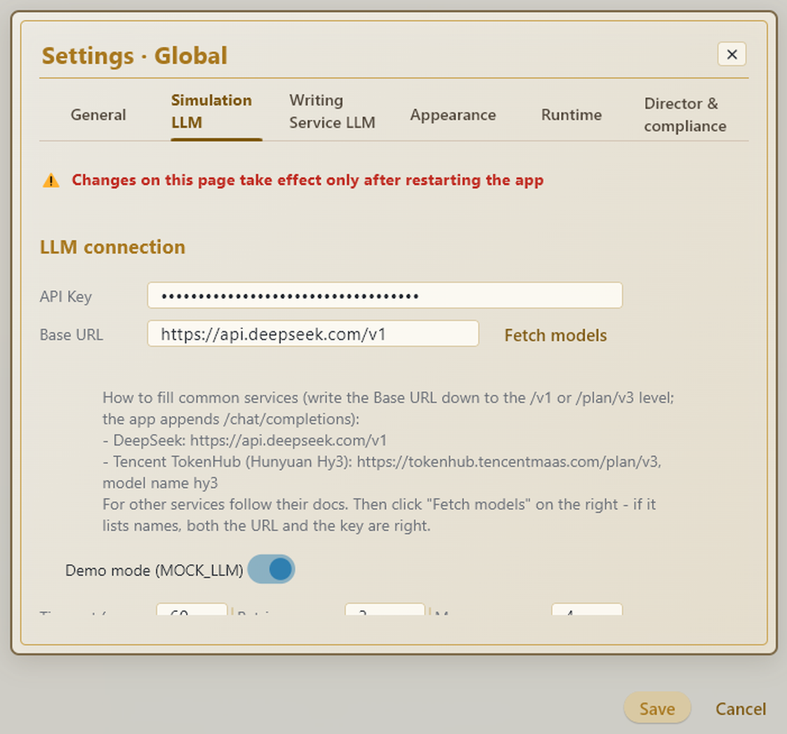

### 12.8 Two common misreadings (they look like faults but are expected)

**① One request followed by two responses**

This is **not** duplicate recording — it is the trace of the **empty-body self-heal**: when the
output budget is eaten entirely by the model's "thinking" and not a single character of body
text comes back, the program **automatically retries once with thinking disabled**. So one
event logs one request and two responses (the first being empty or extremely short). The main
log carries a matching WARNING at the same moment:

```
LLM 一个字都没拿到（max_tokens=4000 全被用光，共 4000 token，含思考内容）：
**正文为空**，额度被思考吃掉了 —— 将**自动关掉思考重试一次**
```

**② More responses than requests** (e.g. 175 versus 163)

That is the same thing. **"responses − requests" is exactly the number of self-heals** (a high
number means `max_tokens` or the model's thinking overhead needs tuning — see the token
settings in §9).

Also, in demo mode (`MOCK_LLM=true`) the request line is explicitly marked
`（MOCK 演示模式，未联网）` — seeing that tells you this call **did not go online and cost
nothing**.

### 12.9 Sending it to another tool (or another person) for help

The coverage is **complete** — what §12.4 lists *is* the whole "what did the software send the
model, and what did the model send back". To hand it to an external tool or engineer,
**the two files from one run are enough**:

```
logs/nws_<title>_<time>.log             - program flow (which step ran, what it reported)
logs/nws_<title>_dialogue_<time>.log    - full exchanges (what an external tool wants most)
```

**The pair with the same timestamp** is one run; send both so the context is complete.

Three things to be clear about first:

- **Do not zip up the whole `logs/` directory.** The logs themselves are enough; the directory
  may also hold other things (older files, temporary environment copies), and zipping ships
  those too.
- **The dialogue log is deliberately not redacted** — it contains **your own novel text and
  setting documents** (the reasoning is in §12.5). So "sending it" means handing that text to
  the other party. If you would rather not, send only the main log, or delete the passages you
  do not want to share.
- **`logs/llm_calls.jsonl` accumulates across runs** (appended forever, not per-book, not
  per-session) — sending it alone drags in other sessions too.

If picking files one by one is a chore: the developer tool `developers/pack_diagnostic.py`
**picks the most recent real run by itself**, copies both logs into
`exports/诊断包_<timestamp>/` along with a generated "what this pack is and how to read the
fields" note, and **scans for secrets before letting it out — a hit refuses the export**.
See `developers/README.md` for how to run it.

### 12.10 Reading the log inside the app (the 🧾 Log button)

The run screen has a **🧾 Log** button at the **top right** (next to ❓ Help). It opens a
larger window so you can watch what the backend is doing **without leaving the app**.

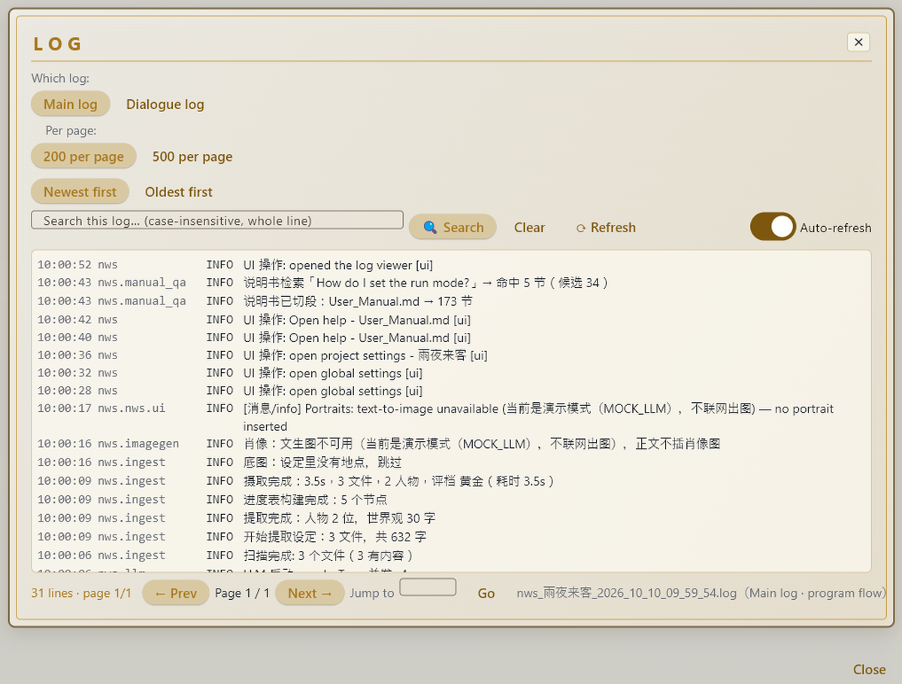

It reads the log file **directly from `logs/`** (not the truncated in-memory copy the UI
shows), therefore:

| Ability | How it works |
|---|---|
| **Which log** | Two choices at the top: **Main log** (program flow) · **Dialogue log** (every LLM exchange in full) |
| **Formatting** | Each line is split into four parts: **time · module · level · message**. Levels are colour-coded (DEBUG faint / INFO body / WARNING gold / ERROR vermilion), so problem lines stand out at a glance |
| **Keyword search** | Type a word and press Enter or click 🔍 Search. **Case-insensitive**, whole-line match; empty = everything. The line to the right reports "N hits · M lines" |
| **Pagination** | **200 per page** or **500 per page** (200 by default). The prev/next buttons genuinely grey out at the first and last page, and "Jump to __" takes you straight there |
| **Order** | **Newest first** by default (when troubleshooting you want what just happened); switch to "Oldest first" to read forward in time |
| **Live refresh** | On by default: lines newly written to the log file appear by themselves (about every 1.2s), and it **does not throw you back to page 1**. Turn the switch off and it only re-reads when you click ⟳ Refresh |

> **Why this is worth having**: previously you had to find the file under `logs/` yourself and
> open it in another editor — and the filename carries a timestamp, one per run, which makes it
> tedious. Now one click shows it, and you **do not have to leave the app** (you can keep
> watching while a round is still running).

> ⚠ It reads the **file on disk**: a line the program has just written shows up once it really
> reaches the file (the log is flushed immediately, usually tens of milliseconds). If the
> newest line is missing, press ⟳ Refresh.

---

## 13. Troubleshooting

> Everything about logs lives in the previous chapter: **where they are, what they hold, how
> to read them, how to hand them to someone else** (§12).

### API Connection Failed

1. Check `LLM_API_KEY` is correct
2. Check network connection
3. Try `MOCK_LLM=true` to test

### Encoding Error

1. Ensure files are UTF-8 encoded
2. Program auto-tries chardet detection

### Interface Display Issues

1. Ensure terminal supports UTF-8
2. Try adjusting terminal window size

### OneDrive Lock Files

1. Program uses temp file replacement to avoid OneDrive sync locks
2. If issues occur, close OneDrive sync or use non-sync directory

---

## 14. Compliance

### 14.1 Compliance Agent

Program has built-in independent compliance detection Agent that reviews input settings and character actions.

### 14.2 Three-Level Classification

- **C0 Legally Prohibited**: Block + alert
- **C1 Restricted Description**: Downscale rewrite (write results, not methods)
- **C2 Fiction Exemption**: Pass

### 14.3 Disclaimer

- Compliance layer is filtering assistance, **not legal advice**
- Final responsibility for published content lies with the author
- User reference library copyright is user's responsibility

---

## 15. Changelog

### 2026-10-12 · The big map's **geometry** fixed + the art dept **audits and repairs its own drawing** (Reflection)

The user's seven items: **the counter ran outside the wall** · the legend **has text outside the
box** · **the scale bar covers the text** (**put it bottom-left**) · the legend **should have no box**
(but **the map must not overlap the legend**) · **part of the house and part of the courtyard
overlap** (**the art dept should use Reflection: after drawing, audit it; if there is a problem, fix
it, redraw, until there is no problem**) · **2 close buttons in the top-right** (**keep the outer
one**, **remove the red-background one**) · **put the building's name label beside the wall, not on
top of other things**.

**There was only one root cause**: the room rectangles, the courtyard rectangle and the furniture
positions were **each computed separately** (each with its own coordinate mapping).
⇒ New `image_gen/plan_audit.py` extracts the geometry solving into a **single implementation**,
`solve()`; the big map draws from it, the art dept's Reflection audits with it, and the criteria
assert against it -- **one definition in all three places**.

⚠ A real bug fixed along the way: `solve()` **computed the mapping itself** (from canvas width) while
drawing mapped from **drawing-area width** -- two coordinate systems in one image (measured: the room
box solved at x=412 while the furniture was drawn at x=380). The mapping is now **passed in**.

**Six geometry errors**, one fix each: a fixture **lands inside the room it belongs to** (ownership
prefers the `房间` field, otherwise the nearest room) · **the courtyard is computed first and the
rooms avoid it** (order swapped, plus a "shrink first, push only if that fails" backstop) · the legend
height is **computed from the entry count** (no longer hardcoded 148) · the scale bar **moved
bottom-left** · the legend **draws no box but still reserves space** ("no overlap" is **computed**) ·
the overlaid close button on the canvas is gone (**the dialog's own x stays**).
**Names hug the wall**: the room name on the inside of its top wall, the building name on the house
frame's top wall (on a paper patch), the courtyard name inside the courtyard wall's top edge; the
minimap's building name also moved from "outside the frame" to "on its top edge" (both maps share
`minimap._on_wall`).

**★★★ The art dept's Reflection loop** (named by the user): draw -> **layout-level audit** (fixture
with no room / well without a courtyard / house and courtyard bound to collide) -> **deterministic
repair** (add a room / add the courtyard / move the points) -> **audit again ... until clean** (at
most 3 rounds) -> the render layer then guarantees "the drawing is right".
⚠ **The repair calls no model** (every round is free) · **only add, never remove** (no location is
deleted) · **stop when nothing can be fixed** (no spinning) · **return the map as-is on error** (an
enhancement must not break the main line; a criterion pins this behaviourally).

**Both audit layers are required**: the layout layer governs "data self-consistency", the render layer
"drawing self-consistency" -- **the previous two rounds did only the data layer**, which is why the
user saw "the counter ran outside the wall" (a drawing-layer matter).

**Acceptance**: `verify_plan_geometry` **37/37** · counterexample `mutate_plan_geometry` **18/18 red**
· `verify_minimap` 119/119 · `verify_space_rules` 45/45 · `verify_map_detail` 36/36 · bilingual 16/16
· i18n missing translations 0.

> ★ The counterexample method caught **four more false greens** this round: one criterion **shared a
> fixture that gets mutated** (an earlier criterion had already modified it, so "before equals after"
> held forever and it was permanently green); one only wrote `overlap <= 1` (removing the courtyard
> entirely makes the overlap 0 and it stays green); one **only checked the source for `except`**
> (replacing it with `raise` stayed green ⇒ changed to behavioural: make the audit actually throw and
> the map must still come back); and two **took only the first line of a multi-line anchor**
> (leaving orphaned continuation lines → `IndentationError`, which looks like "the criteria crashed"
> but is really "the mutation was incomplete").

### 2026-10-12 · On the minimap, locations are **no longer marked with dots** -- only one line of small text (the user's third red-dot report)

The user's exact words:

> "the label for [that building] and **the red dot next to it** are still there; **remove it**.
>  **If you want to mark a location, just mark it with small text -- do not use dots**."

**The previous two rounds removed "the red dot for the whole building" and "the red dot for a fake
place"** (indoor maps now draw a frame; sub-location names are matched), but the locations' **own
graphical marks** had always remained in two places, so a local map still read as "a red dot next to
the name":

| The two places | What was done |
|---|---|
| The **glyph** `_glyph()` drew for every location (circle / square / triangle / slope ...) | the minimap **no longer calls it** (the big map still does -- on a standard floor plan, symbols are part of the map's language) |
| The **cinnabar filled circle** padded under the current location (9px radius) | **no longer padded** -- the current location uses **cinnabar, bold** text instead |

⇒ The minimap now has **no filled circles at all** apart from the 2.4px dots for the people present
(those mark **people**). "Where is this" is carried by **text**; "where am I now" by **colour and
weight**.

⚠ **Two things are deliberately left alone**: the **walls** (frame / room rectangles / courtyard
wall) are **structure**, not location markers, and you asked for them last round; the **small fixture
blocks** (counter / side table / stove) are the floor plan's **furniture** convention -- they mark
objects, in ink rather than cinnabar.

★ Also fixes a **pre-existing bug**: the present-character dots used `r`, and `r` was **whatever the
location loop assigned last** (the loop variable leaked outside) -- "how far the dots sit from the
location" depended on the size of the **last** location, not the one the person was in. The dots now
go on the line above the location's name.

**Three criteria/counterexample problems fixed along the way** (all "looks green, actually does
nothing"):

1. **3 anchors in `mutate_minimap.py` were dead or non-unique** (one because the previous round split
   a line in `sim/loop.py` into two) -- when `check_anchors()` fails, the **whole counterexample
   method runs nothing**, which looks like "all green". Fixed, and `_lines_around()` was added (it can
   take several lines backwards) for sentences that are **repeated verbatim twice**.
2. **`C13` was too weak**: it only required "at least one place hangs today's map", but `sim/loop.py`
   has **two**, so changing only one left it green -- changed to "**not a single hang may be
   `None`**".
3. **`D8` was too weak**: it searched the whole file for `'frame': C['text']`, but the file has
   **two** occurrences (the minimap and the large-map dialog) -- changed to look **only at the
   `_draw_minimap` method body**.

**Acceptance**: `verify_minimap` **119/119** · counterexample `mutate_minimap` **24/24 red** · space
common sense `verify_space_rules` **45/45** · counterexample `mutate_space_rules` **33/33 red** · map
detail `verify_map_detail` 36/36 · counterexample `mutate_map_detail` 20/20.

### 2026-10-12 · Dialogue must **sound like a live person** (hesitates · not every line answered · no easy shouting · pauses written down)

The user's exact words:

> "When normal people talk, there is often **hesitation**, and as for what the other person says,
>  **not every sentence gets a response**, and the **speaking speed is not too fast**, and
>  **everyone decides their own speech habits according to their own character**. But much
>  AI-generated video has characters who speak with **no stumbles at all**, **very fast**, and
>  **never hesitating** -- not like real people at all -- and they **shout easily** instead of
>  speaking normally. So please optimize these aspects in **script generation, novel writing, and
>  actor performance**, to make them feel more like real people and not like AI."

**Six requirements, landed one by one** (new craft entries, all on the "characters and dialogue"
shelf):

| What the user said | The craft entry it became | What it says |
|---|---|---|
| hesitates, has stumbles | **Speech is not a straight line** | Searching for a word, repeating half a syllable, taking it back, stopping mid-sentence -- but **only at the key spot** (stumbling on every line is another kind of fake) |
| not every line answered | **Not every line needs an answer** | Real dialogue **misses connections a lot**; that is exactly why "he seriously caught this one" carries weight |
| shouts easily | **Volume is scarce** | Default to **normal volume**; shouting is an action, not punctuation, and it must cost something; excitement can **lower the voice** or **speak faster** |
| speed is not too fast | **One thing at a time** | Short sentences, with breaks and gaps; finishing a whole paragraph in one breath = reading a script aloud |
| pauses must survive | **Pauses must land on paper** | Where to stop (ellipsis / dash / an action in parentheses), how light or heavy, how fast or slow -- **one word each** |
| habits follow character | **Change shape by whom you speak to** | A "speech habit" is **a set of switches for different people**; the gap must be witnessed on stage |

> ★ Division of labour with the existing entry "pause and not answering are also lines": that one is
> about not answering **when there is a secret** (a dramatic device); these six are about **everyday
> missed connections and stumbles** (real texture, which happens with no secret at all).

**All three lines changed together** (the user named "script generation / novel writing / actor
performance"):

- **Novelist · playwright**: each gets a **hard constraint block** (`CREW_LIVE_SPEECH`, on by default),
  standing alongside "state the scene clearly first" and "make it shootable along the way" -- a line
  does not first appear at the actor layer.
- **Actor**: receives it in the **form of action discipline** (inside the prompt's action protocol,
  right next to the line): "**set your volume before you speak**" and "**frayed edges are allowed**".
  ⚠ It has two texts (the external template `prompts/agent_decide_tail.txt` plus the built-in one) --
  **editing one is not enough**; the external one wins, so editing only the built-in is completely
  overridden (nearly stepped on this round; a criterion now pins it).
- **The actor's last thought before speaking** becomes this too: the thinking chain ends by asking
  "what **voice** should this sentence use? **is normal volume enough?**" -- deliberately placed next
  to the line, which works better than discipline written elsewhere.

**The review checks one more thing**: script review's checklist grows from five items to **six**; the
sixth watches for "does this sound like live people talking": every line joining up perfectly ·
someone shouting · three things in one breath · not a single pause -- four kinds of **fake you can
spot at a glance**.

**The de-AI list gains it too** (the mechanically auditable half): a new "**shouting abuse**" category
(`shouted / said sternly / roared / shrieked …`).
⚠ It goes into the **soft hints**, not the hard word list -- the hard list gets **actually deleted** by
`strip_hard()`, and deleting "he shouted: …" maims it into "he: …". Soft hints only remind; they leave
the text alone.

**New config**: `CREW_LIVE_SPEECH` (crew group · on by default). Off = all three lines revert together.

**Acceptance**: `verify_live_speech` **24/24** · counterexample method `mutate_live_speech` **16/16
red** · craft shelf 53/53 · cognition 60/60 · de-AI 48/48 · genericity 5/5 · bilingual 16/16 · i18n
missing translations 0.

> ★ The counterexample method corrected **two of my own false-green criteria** this round: one used
> "the very constant being mutated" as its expected value (lower `READ_LIMIT` and the criterion lowers
> with it, always green); one checked text **without skipping comment lines** (the template header
> explains the placeholders and contains those three names, so deleting them from the body left the
> criterion green). It also **measured** whether the quota truncates the named list:
> `craft_block` ends with `picked[:max(limit, len(prefer))]`, so **`prefer` can never be cut** -- the
> comment is now corrected to match the measurement.

### 2026-10-12 · The red dot in the middle is gone (both sources) + walls by level of detail + click to open the large map + local storage and reuse

The user's exact words:

> "every minimap now has **a red dot in the middle**; **remove it**, **it hides the other elements**.
>  Also, **if it is an indoor map, then please draw the walls** ... a map **combining indoors and
>  outdoors** ... **e.g. a teahouse** ... then **draw both the indoor walls and the outdoor walls** ...
>  a **very large map, e.g. a street map** ... **you only need to mark out the buildings** ...
>  you judge by the map's **level of detail** ... **this minimap can be clicked**; when I click it,
>  a **big map dialog** opens (**a fairly large size, the same size as the conversation-list part**) ...
>  basic information in its top-left: **location, time, legend, scale bar** (**in a box**) and then
>  **a close button in the top-right** ... **all maps are saved locally, and if a later scene can
>  reuse one, just reuse it**."

**① The red dot is gone — it had two sources, both plugged**

1. **The indoor tag was lost on every read-back** (the real culprit): `Atlas.from_dict()` reads the
   local/indoor layers through `normalize()`, which **never read `kind`/`frame`** — the file said
   `kind: 室内` while the in-memory value was an empty string ⇒ the renderer treated it as "not an
   indoor map" ⇒ the whole building was drawn as a dot in the middle again.
   `normalize()` now keeps those two keys, and **old base maps** (generated before they existed) are
   backfilled from the **bucket name** — **no need to reopen the book**; what the user has reads back
   as "indoor + building name".
2. **A fake large "building" appended dead centre when the current scene was a sub-location**:
   `临河茶肆·堂屋` didn't match the map's `堂屋` ⇒ the old code appended a `building·large` at
   `(0.5, 0.62)` and the renderer padded "the current place" with cinnabar = a big red dot right in
   the middle. Now: **try to match the name first** (exact → the part after `·` → mutual containment);
   once matched **nothing needs adding** and the ring lands on that room; only when it truly cannot be
   matched is one appended, and it is a **medium "house", lower down** (not a large "building").

**② Four tiers by level of detail** (new `minimap.detail_of()`; the small and big maps share one tier)

| Tier | When | How it is drawn |
|---|---|---|
| `室内` indoor | only indoor space | **rooms get rectangular walls** (adjacent rooms share an edge = a shared wall) + the building frame + the gate on the frame |
| `室内外` indoor+outdoor | indoors and a courtyard on one map (teahouse) | **both indoor and outdoor walls** (the courtyard gets its own solid wall line) |
| `局部` local | the surroundings of one place | as before: point + glyph |
| `整体` whole | a large street / town map | **no indoor drawing**, only building markers |

Fixtures (counter, long table) are drawn as small blocks (furniture is not a room); room walls have a
size floor (>50x40) so they cannot be confused with the wash behind courtyard things.

**③ Click the minimap → the large map dialog** (new `image_gen/floorplan.py`)

- `1000x700` (**the same tier as the log / conversation pane** — the user said "the same size as the
  conversation-list part");
- The minimap is wrapped in a `GestureDetector` with a **pointing-hand cursor** (if it can be clicked,
  that must be visible);
- Drawn following **standard floor-plan / ordinary map** conventions: double-line walls, doors as
  **openings + swing arcs**, furniture with **hatched shading**, a **stippled courtyard**, **ripples**
  for water, a **north arrow** in the bottom-right;
- **One box in the top-left**: location · time · legend · scale bar (the legend symbols are **actually
  drawn**; the scale bar is a **graduated band alternating black and white** reading **cell counts**
  rather than metres/feet — there are no real dimensions, so it truthfully says "schematic");
- **An "×" in the top-right** (the dialog's own title-row close button is there too).

**④ Maps are stored locally and reused when possible** (new `image_gen/mapstore.py`)

- Stored under the **project**: `地图/<level of detail>_<place name>.json`, holding the **map spec**
  rather than a bitmap (a bitmap goes stale with any colour change; a spec always draws the same map);
- The reuse criterion is the **inputs** (level of detail + today's places + where the person is), and
  it is checked **before asking the model** — saving **a whole model call**; on a reuse the middle
  column truthfully says "reused the local archive (model not called)";
- When the situation changes (different places today) it is **not** reused and gets redrawn.

Criteria: `tools/verify_map_detail.py` **36/36** (A level of detail · B both red-dot sources + walls
drawn · C the `kind`/`frame` round trip · D the big map's info box / scale bar / close button ·
E local archive and reuse) · counterexample method `developers/mutate_map_detail.py` **20/20 red**.
★ The counterexample method immediately exposed **three real problems**: one criterion was
**self-proving** (comparing against the very constant being mutated), one tested only the function and
not **whether the renderer really used it**, and one had `dir_of()` **call
`getattr(project,'root')` first** — while **`Path` also has a `.root` attribute (the drive root)**, so
archives were written to `C:/地图/` (the **second** time this project has hit that trap; the first was
`crew/catalog` writing to `C:/agents`).

### 2026-10-12 · The token number in the bottom-left comes alive + the "Director · not started" row is gone

The user's exact words:

> "the number to the left of Token budget in the bottom-left system panel must update in real time;
> and the director one can go for now, it has no particular meaning"

1. **The "Token budget" row used to be dead**: it read `f"0 / {budget}"` — that `0` was
   **hardcoded**, motionless from creation to window close, so the screen forever said
   "0 / 500000" **even after half the budget had been burned this round**. The left number is now
   **the tokens already spent today**, riding the 0.5-second stopwatch (the same refresh beat as
   "Time" and "Style control" — a number has to **advance on its own**; refreshing only "when
   something happens" leaves the screen static between beats, and "static" and "broken" look the
   same).
   - **Same source as the "budget exhausted" decision** (it reads the in-memory ledger
     `llm.ledger.today_tokens`, which is exactly what `LLM.budget_exceeded()` uses) — reading from
     two different places produces "the screen says already over while the program keeps running".
     The global usage DB (`usage.db`) also holds **other processes'** usage (criteria, open-book
     ingestion, another run) and must not be used here.
   - **Today only**: earlier days do not count toward this number (it corresponds to a *daily*
     budget).
   - Past `TOKEN_WARN_AT` (80% by default) it turns **ochre gold**, and **cinnabar** when used up —
     the warning line is that one config item, not a second number (otherwise "this number turned
     gold while the log hasn't reached the warning line yet").
   - The cap is **re-read from config each time**: double it in the "budget used up" dialog and the
     denominator follows on the spot.
   - If the ledger is unavailable (stand-in / import failure) it returns 0 and **does not throw** —
     the UI must not crash over bookkeeping.
2. **The "Director · not started" row is removed**: it only appeared when the director was on,
   which is the **default** state; it said nothing about what the director was doing and never
   changed during a run — a wasted row.
   ⚠ The "Disabled: director" row when the director is **off** **stays**: that one tells the user
   "you turned it off yourself", a different thing from the row above (a criterion pins this, so
   the two rows are not deleted together later).

Criteria: `tools/verify_budget_live.py` **19/19** (A data layer · B AST wiring · C real machine ·
D self-check) · counterexample method `developers/mutate_budget_live.py` **12/12 all red**
(including "display string hardcoded to 0", "used amount pinned at 0", "counting earlier days",
"no cinnabar when used up", "warning line inventing its own number", "stopwatch no longer calls the
refresh", "refresh computes but never writes the control", "no handle stored at build time", "the
row quietly comes back", "deleting the Disabled row as well"). The switch-adaptation script
(`tools/verify_main_flags.py`) had its assertions updated too.

### 2026-10-12 · Indoors vs the yard + indoor maps frame the building name + six positions gain "map ability"

The user listed four things at once (the original words are quoted in §4.2.3.5 and below):

1. **The indoor minimap**: the whole building used to be **a red dot in the middle** acting as its
   name, which **covers the content** and is unreasonable → now **a frame** encloses the content,
   **the building name is written on the frame**, and the gate is drawn on the frame's bottom edge.
2. **Strictly distinguish indoors and outdoors**: a building with counter, well and gate —
   **a well may only be in the courtyard**, and that mistake **must not happen**; **a well implies a
   courtyard, so the courtyard must be drawn too**.
3. **Optimise the map ability** of the novelist / playwright / writers' room / director / art /
   props, requiring them to **describe the environmental floor plan clearly while writing**
   (overall / local street / courtyard-garden / indoor, as the scene requires).
4. **The director and playwright must constantly consult the map** when designing character
   movement, using it as the **basis for movement**; some plots advance through **switching
   locations**.

**How (all verifiable)**
- New `world/spatial.py`: **spatial common sense itself** — names are classified as
  `indoor space / outdoor space / semi-outdoor / indoor fixture / outdoor object / boundary / path /
  whole building`; `audit()` reports violations, `repair()` fixes them (**a well adds a courtyard**,
  additive only), `route()/adjacency()` answer "how to walk".
  ⚠ **A courtyard wall is not a courtyard** (it contains the character 院) — otherwise a place with a
  well would never get one added.
- `Layout` gained `kind` / `frame` (which layer / the whole building's name), and **both the base map
  and the day's map** run through `apply_space_rules()` (**one implementation**; the `world.atlas`
  copy is a forwarder).
- The minimap: an indoor map gets **a frame + the building name on the frame + the gate on the frame
  + a light wash behind outdoor things**; the flattened base map carries
  `[indoor space]`/`[outdoor object]` tags plus a "spatial facts" passage.
- New shelf `craft/playbooks/场景与空间.yaml` (nine entries, sourced from open-source projects:
  Azgaar / OSMnx / momepy / Edgar / graph-dungeon-generator / DeepFloorplan / Streetmix /
  depthmapX — see `developers/docs/外部借鉴/07_地图与空间.md`)
  → reaching **seven positions** (the six the user named plus continuity).
  The playwright's `场` must be "place·space", `要点` must carry **blocking**, and `场景介绍` must
  give the **floor plan**; both art prompts require "concrete names, inside/outside distinguished,
  and a well implies a courtyard"; every prop must "have a place it can sit" (with a deterministic
  `属于` tag); the novelist's scene card says "write indoors and the yard separately".
- Every beat's actor/director prompt gains a "**map facts**" line: indoors or in the yard, and **how
  to walk over from the previous scene** (`StagePlan.previous` + `world.spatial.route`, zero LLM).

Criteria: `tools/verify_space_rules.py` **44/44** · counterexamples
`developers/mutate_space_rules.py` **31/31 red** (including "a well no longer counts as outdoors",
"repair stops adding the courtyard", "walking becomes a single hop", "the indoor map draws no frame",
"the whole building becomes a dot again", "actors lose the map facts").

### 2026-10-12 · The launch guard for start-writing: one round at a time · instant feedback · timeout / cancel

The two things the user reported are really two faces of one thing:

> "I clicked start-writing twice in a row and **two simulations ended up running at the same
>   time**; there should only ever be one. Also, after clicking start-writing **nothing
>   happened for a while** before it started, which is why I clicked twice. ... Introduce a
>   **timeout mechanism** so the UI can stop waiting on its own if the background never
>   succeeds. But if another one has already been started and the earlier 'hung' launch then
>   succeeds, one **must be chosen and the other stopped** -- not both."

Two root causes, both fixed:

1. **The gate only looked at the session.** `self.session` is not created until assembly
   finishes, so during that window it is still `None` ⇒ clicking twice within those seconds
   **let both through**. Now "assembling" also counts as occupied (`_launch_phase`), asked in
   **two places** (on click + right before queueing the task).
2. **Nothing moved on screen during assembly.** `assemble()` is synchronous, and calling it
   directly on the event loop freezes the UI along with its stopwatch. Now the click
   **synchronously** switches to the run screen, writes "assembling..." into the middle
   column and lights the status bar as "starting · N s elapsed" (the stopwatch really ticks),
   while assembly itself goes to a background thread.

Four things that come with it:

- **Timeout** (new knob `LAUNCH_TIMEOUT_S`, default 180 s, under "Audience · Run -> Starting
  a round"): when it is reached the UI **stops waiting**, the status bar returns to
  "Stopped", and you can click start-writing again. It does **not hard-kill the background**
  (that is most likely stuck on a wait with no timeout, so a kill would not take) -- it only
  voids its **token**.
- **Keep only one**: each launch takes a token, and `_start_round` re-checks it **before
  taking over the UI**; on a mismatch (voided by timeout / replaced by a later launch) it
  **touches nothing** and moves the run folder it just created into "Deleted Backup" (or
  leaves a `已作废.md` note if it cannot be moved).
- **A manual outlet**: during those few seconds "⏹ Stop" becomes "⏹ Cancel launch", the
  **same outlet** as the timeout.
- **Failures must be visible**: assembly failure / model-client failure / folder-creation
  failure all **leave a line in the middle column** (no longer just a flashed toast).

One real bug was dug out and fixed along the way: `assemble()` can now receive the database
connection from its caller -- a SQLite connection **may not cross threads**, so once assembly
moved to a background thread the connection has to be **created on the main thread** (assembly
only hands it to the Agent / Director; it never opens one itself). Without that, the very first
beat raises `ProgrammingError`, which `decide()` swallows -- on screen this shows up as
**every character "not moving and not speaking", with a single WARNING in the log** (measured:
the whole round was wasted).

Criteria: `tools/verify_start_guard.py` **62/62** (A logic 26 · B instant state 10 ·
C double click yields one round 6 · D timeout/cancel 14 · E failures visible 3, including
real-machine pixel and filesystem evidence) · counterexamples
`developers/mutate_start_guard.py` **22/22 red**.

### 2026-10-12 · The Copy Editor: merged into today's summary + its downstream wired to the screenwriter

The user's question: "why is the day's final language review **always put into an md** instead of
being output". What we found: it works once at wrap-up, its body only lands in `语言审校.md`, and
the story pane shows just one line -- "(crew · Copy Editor) 2 spots today -- details in
语言审校.md" -- while in the whole app **only the retrospective** reaches the screen as content
(that was the rule you set on 2026-10-07: the story pane carries the story, not behind-the-scenes
footage).

You asked for two things, both done:

1. **Merged into today's summary**: those items (original sentence + how to fix) now form a section
   merged into that day's summary -- so they appear in **the story pane's summary entry**, in
   `今日总结.md` on disk, in the ledger and in the log (one merge, four destinations). Its own
   `语言审校.md` **is still written**. Nothing is merged when there were zero hits (no empty section
   in the summary). The middle-column line's pointer changed with it: with the retrospective on it
   reads "the details were merged into today's summary below".
2. **Downstream wired up**: the roster says it has `feeds="screenwriter"` and the docs say its
   downstream is "the screenwriter (next day's script)", yet **nothing in the code ever read it
   back** (grep the repo: that md is only written, never read). Now, when writing the next day's
   script, those items are handed to the screenwriter as upstream material.
   ⚠ It only accepts the **previous day's** copy (`语言审校.md` is overwrite-written daily; the
   `> 第 N 天` header is the evidence), so rewriting the same day reads yesterday's, and a rolled-back
   replay never reads its own fresh output.

Two real bugs fixed along the way: `sim/loop.py` **had always used `t()` without ever importing it**
(so that narrative silently never reached the screen, leaving only a `NameError` in the log -- the
same defect was hiding in the "roll back and replay" path, off by default and thus never exposed);
and a stray `asyncio.get_event_loop()` in the criterion fixture that **blows up on the second call**
under Python 3.13 (group A made the first call, so it never showed).

Criteria: `tools/verify_crew_flow.py` **45/45** (new group F, 7 assertions) ·
counterexamples `developers/mutate_crew_flow.py` **17/17 red** (new ⑫~⑰, plus two stale anchors
②/⑥ repaired) · `verify_studio_v2` 65/65 (A7 moved from a string sentinel to an AST check).

### 2026-10-12 · It understands "fix the 4 problems / all problems, don't ask me" · the crew tab's scrollbar · the start-writing suggestion box

**During ingestion, "fix the 4 problems" is now really understood**

The user's words: "the system listed 4 self-check problems for me, I said **fix the 4 problems** but
it does not understand what I mean **and it keeps making me revise**; I told it to **fix all the
self-check problems and don't ask me**, that doesn't work either -- it insists on **one question per
round**". Both are fixed, and **neither by begging the model to cooperate**:

- **The named numbers and "the whole batch" are computed by code.** Previously the entire question of
  "which items do you mean" was left to the model, which cannot count which four "4" means. The new
  `polish/intent.py` checks against **the list we already hold** (the numbering of the self-checked
  problems / checkup suggestions): "fix the 4 problems" and "change all of them" expand into a
  **per-item numbered work order**; "process 1 2", "item 2", "the first two" change only those.
- **"Don't ask me" is a hard block, not a wish.** Once "don't ask me" is recognised, if the model still
  tries to ask this round, **the code simply does not treat that as the end** (it feeds back "the author
  said don't ask, decide yourself" and keeps going); saying "don't ask me for at least 3 rounds" stays
  quiet for exactly those rounds and then **automatically goes back to asking** -- never asking turns it
  into a mute, which is worse than asking repeatedly. To lift it, say "you can ask me now".
- **You can see whether it understood**: when one of these is recognised, the chat pane first shows a
  line like "I read that as items 1 and 2" or "OK, I will not ask you for the next 3 rounds".

Criteria: `tools/verify_polish_intent.py` **33/33** (A parsing / B stand-in model verifying the hard
block and the hand-down / C **actually running ingestion** and typing the sentence in to check the chat
pane); counterexamples `developers/mutate_polish_intent.py` **12/12 red** (including the real-machine
one).

**Study · Crew Agents: the scrollbar no longer presses the list**

The user reported: "the scrollbar on the right ... overlaps and covers the Agents list". The root cause
is the **same shape** as wizard step 4 last round: `mk_tab_content()`'s column is
`SET_W + TAB_GUTTER` (544) wide, and the column inside a list row is `expand=True` ⇒ **the row eats the
whole 544** and its right end runs under the bar. Probe measurement
(`developers/probe_crew_tab_lane.py`): Study overlapped by **9px**, Tianji by **13px**; the row width is
now hard-coded to `SET_W` (measured 518px) with a margin of **16px** (Study) / **44px** (Tianji) and
**0 overlap**.

**Start-writing "your suggestions for the upcoming plot development": grey placeholder, shorter**

The user asked: "the text box below -- **the text should be greyish, showing it is a system hint**" and
"**do not make it so long, there is too much stuff now**". The placeholder now goes through
`hint_style` (light ink, clearly lighter than the body text -- at a glance it reads as the system
talking, not as content already written in) and was cut from four sentences and 100-odd characters down
to **two**: the direction, plus "the switches are in the 「this round's inference」 section below".

### 2026-10-11 · Wizard step 4 "just touching the scrollbar" · the title no longer scrolls · the ingest input is three lines tall

**Wizard step 4: width raised from 520 to 580 (just touching the scrollbar)**

The previous version pinned every control on this step to **520** so it would not "press the
scrollbar", which left **68px unused** on the right — the user reported it the same day:
"you made it too narrow again, widen it a bit, **just touching the scrollbar**". The real
ceiling is not 520: of those 24px of lane in `DLG_W` (600), **only 4px is the bar**; the rest
is paper-frame padding. The content is now **580** wide (measured: row width 578, content right
edge 612, scrollbar 620 ⇒ **8px of margin**), and that number is **derived** from "the bar's
right offset + bar width + 6px of breathing room" (`WIZ_W`); the 4px bar width is **shared with
`mk_scroll_bar`** through one constant, so changing the bar width later cannot make the two
disagree.

**The title no longer scrolls**

The user reported: "when the scrollbar moves the **title must not move**; what is below the
title should". The title used to lie in the same scrollable `Column` as the body, so it ran off
on the first scroll. It is now split into two layers: a pinned title plus a scroll area that
takes the remaining height (using `expand`, so **the title's height never has to be guessed** —
changing the font size cannot overflow it). **Every** wizard step works this way. The criterion
pins it down three ways: the title is not inside the scrolling layer (structure) + the whole
title strip is above the scrollbar (geometry) + **one real scroll, pixel by pixel** (the title
strip's difference is 0 while the body's is 180k pixels).

**Ingest dialog: the chat input is three lines tall and the buttons land on the middle line**

User request: "the chat input at the very bottom, I'd like it taller, say 3 lines... and the
Send / Force-stop buttons on its right moved to the middle line". The input is now **3 lines**
(`min_lines`/`max_lines`) and the two buttons are centred on its middle line (measured: the
button text centre and the input centre differ by 0.5px).

> ⚠ This turned up two Flet pitfalls, both written into the comments:
> ① **`TextField.height` has no effect at all** in this version of Flet -- `height=72` with three
> lines still paints 62px, and `height=72` alone paints 45px (one line is 24px). So **the line
> count can only come from `min_lines`/`max_lines`**, and leaving a `height` that does nothing is
> a **lie** (criterion A17 forbids it outright).
> ② **`Row.vertical_alignment` already defaults to `CENTER`** in this Flet (opposite of Flutter's
> `START`) -- so the buttons are centred **even without writing it**; writing it explicitly is
> only a guard against that default changing, and the real evidence is the real-machine check
> (measuring the centre distance).

**Also fixed**: two old anchors (⑤/⑦) in `developers/mutate_ingest_rounds.py` **no longer
matched** after bilingualization inserted `# [EN]` lines into the source (the counterexample
harness refused to start, reporting "anchor matched 0 times") — re-anchored, and it is now
15/15 red.

### 2026-10-11 · Wizard step 4's layout · the "per page" dropdown shows numbers only · the fourth `.env` fuse

**Wizard step 4 (Crew Agents): the scrollbar no longer covers the content**

User report (with screenshot): "the right-side scrollbar overlaps the text and the right
edge of the Agent list below, covering part of it". Measured by the probe: row width
**598**, content right edge **632**, scrollbar at **620..623** ⇒ **13 pixels of overlap**.
The root cause is the width arithmetic: `DLG_W` (600) = controls **520** + scrollbar lane
24 + paper-frame padding 56, so the **content cap is 520**; but anything here with
`expand=True` or no width (the input inside a list row, that long explanatory paragraph,
the checkbox) **fills 600** and runs into the lane. Now every element that can grow on its
own gets an explicit `width=520` (row width 518, 68px of clearance).

**"Items per page" no longer shows just a single character**

That dropdown's label used to be an **empty string**, and an empty string **does not** save
the 88px on the left (to keep input fields aligned, `_label_box` still reserves
`LABEL_GUTTER_MIN`) -- leaving only 72px of dropdown body, not enough for a label like
"5 per page", which was ellipsized to one character. Now: **the label says "Per page"**
(using that 88px) and **the options are bare numbers** (5 / 10 / 20 / 50 -- the user's
words: "just write a 4, that's fine, **do not use Chinese characters**"), so the 72px body
comfortably fits two digits plus the arrow. The pagination row was narrowed too
(594 → 432px); it used to exceed 520 by itself, with its right end inside the lane.

**Also added: the fourth `.env` fuse (the most important fix here)**

While fixing the above it turned out that **running one verification script by hand writes
test values into your real `.env`**. Measured: after running `verify_help_book` (it clicks
the Study's "Save" in its real-machine segment), your `.env` had been changed to
`MOCK_LLM=true` + `DEFAULT_PROJECTS_DIR=<some script's temp dir>`. **Both values have been
restored** (`MOCK_LLM=false`, the directory blanked; the original file is backed up
alongside as `.env.bak-before-envfix-*`).

The three older fuses each have a gap: `NWS_ENV_SINK` is only provided by the regression
harness, `redirect_env_writes()` requires each script to remember to call it, and
backup/restore has nobody restoring when a script runs standalone. A **fourth** fuse was
added: in `config.env_sink_path()`, "**the process recognizes it is a verification script
by itself**" (filename prefix `verify_` / `probe_` / `mutate_` / `shoot_` / `measure_` /
`preview_` / `audit_`), so all writes land in a temp file -- pinned down by the criterion
`tools/verify_env_safety.py` (which really spawns a subprocess that saves once and compares
the `.env` checksum).

### 2026-10-11 · Run-page layout reordered · click a title to reach its settings (changes apply at once)

**Layout (all requested by the user)**

- **The "System" panel moved from the bottom of the right column to under "Story tone"
  in the left column** -- the right column now holds only characters on stage / plot / cast,
  while the left column holds five blocks (time / mini-map / run settings / story tone /
  system).
- **The "mini-map" moved above "run settings"** -- first see "where people are", then
  "how this volume runs".

**Click a title to reach its settings**

- The titles of "**Run settings**", "**Story tone**" and "**Cast**" are now **entry points**:
  the text is **underlined**, a `↗` follows it, the cursor turns into a hand, and hovering
  also states which page the click will go to.
- Rule: **deduction running -> the Study (this book's settings); not started -> Tianji
  (program settings).**
- **Every row** of "Cast" is clickable too: click a position -> open **that position's**
  settings directly (the list is laid out underneath, the editor is stacked on top, and
  closing it returns you to the list).

**Changes apply at once (this did not actually hold before)**

Investigating turned up that the Study's "run boundaries", "style control" and "director"
blocks were **not wired up at all**:

- the seven style sliders showed **hardcoded default values**, neither reading the config
  nor updating the percentage on the right as you dragged;
- none of those three blocks ever **wrote to the config**, and "Save" only wrote the few
  project-file items -- so "changing the style parameters in the Study" amounted to
  nothing happening (the left column's "Story tone" panel reads exactly that config).
  Now: the initial value is read from the config, a change writes to it, the percentage
  follows the drag, and closing the dialog refreshes the run-page panels on the spot.

### 2026-10-11 · Narrative window: page back to the start · a time on every entry

The reported problem, verbatim: "when I scroll back in the dialog window some information is no longer
visible — is something being swallowed? I'd like this window to page if its content can't be infinitely
long; I need to be able to see everything in this round" and "I'd like an option so that every entry in
the dialog window has a very small current date and time at its top-left (real time - story time)".

- ★★ **Investigation: yes, content was being swallowed — in two places** (both on the UI side;
  `_live_lines` itself loses nothing):
  - the middle column only rendered the **last 200 entries** (`tail = self._live_lines[-200:]`);
  - once widgets passed 400 it ran `del col.controls[:100]` — **really deleting the first 100**, and
    **not in step with the content** (one in `_on_narrative`, one in `_push_divider`).
- ★★ Replaced with **paging**: a pager bar above the narrative area (earliest / earlier /
  page N/M · K entries / later / newest), with page boundaries falling **between paragraphs**; the bar
  hides itself when there is only one page.
  ⇒ **not a single entry lost (`_live_lines` is the single source of truth and is never trimmed),
  widget count bounded.** Entries per page = `NARR_PAGE_ENTRIES` (default 200).
- ★★ **New content does not yank you back while you browse history**: it is only recorded and the pager
  shows "N new items"; going to a history page **turns auto-follow off** (`auto_scroll=False`), and
  returning to the newest page turns it back on.
- ★★ **A very small time line at each entry's top-left** (`NARR_TIMESTAMP`, **on by default**):
  `real time · story time` (e.g. `20:14:03 · day 3, xu hour`). Both times are given — story time alone
  cannot tell "an hour ago" from "generated yesterday".
  Two sizes below the body text (`NARR_FS_STAMP`). ⚠ Only entries produced live this round; **history
  read back from disk has no real time and is left blank rather than invented**.
- Criteria `tools/verify_narr_window.py` **29/29** · reverse experiments **15/15 red**
  (covering `gui/app_flet.py` and `config.py`).

### 2026-10-11 · Stage scheduling: one scene after another

The reported problem, verbatim: "these people are all over the place most of the time, some
small scenes are never explained clearly and then everyone suddenly jumps to several new
scenes" and "scenes switching back and forth with no character entering, no action, no plot
— on TV that is a meaningless scene change, and it is wrong".

- ★★ **The root cause was not the prose but the pipeline**: the playwright **had already
  split the beats** (each naming where, what happens, what it advances), but that sheet **was
  never handed down**, and the runtime had **no notion of a "scene"** —
  - an actor's prompt held only a 400-character synopsis of the day plus his own tasks:
    `beats` (the beat sheet) has **not a single consumer** in `agent/core.py` — the word
    itself appears only inside comments;
  - act breaks happened **after the fact**, keyed on "the time slot changed / the location
    changed", not on "this beat is finished";
  - a scene change waited until "not a single person remained on stage", and only if the
    target location happened to be in the location table.
- ★★ Added **stage scheduling**: each beat now has to spell out **topic · cast · points ·
  props · mood · advance**, and those columns are **really handed down** into every actor's
  decision prompt (**only the current beat**, plus one line about the next scene — the whole
  sheet would have him stealing someone else's scene).
- ★★ **Wrap up by beat** (everyone who should appear has appeared + enough real actions) and
  **change scene by beat** (move to the place the next beat names, and **move the people
  over** — no more "scene switched but nobody is there"). The separator left at wrap-up says
  **why** the scene closed.
- ★ Four switches (`SCENE_BEATS` / `SCENE_BEAT_MIN_TICKS` / `SCENE_BEAT_MAX_TICKS` /
  `SCENE_BEAT_MIN_ACTS`, defaulting to on / 3 / 12 / 2); turn them off and it is as before.
- ⚠ **With no beat sheet this layer does nothing** — behavior is **byte-for-byte identical**
  to before.
- Criteria `tools/verify_scene_beat.py` **26/26** · reverse experiments **18/18 red**
  (covering all seven changed files).

### 2026-10-11 · Usage window: four column widths · maximized by default · column 4's horizontal bar

- ★★ **The four columns finally really are different widths** (user: "narrow columns 1 2 3,
  widen column 4").
  - **Before the change, "the four columns have different widths" was a lie**: `_pane()`
    passed both `width=170/250/150/430` and `expand=True`, and in Flet `expand` wraps the
    control in an `Expanded` ("forced to fill") ⇒ **`width` is completely ignored and all
    four are equal**. Measured (`developers/probe_usage_widths.py`, 1920 screen): all four
    were **~442px**, with no relation to those four numbers in the source -- meaning
    "widen column 4" was **impossible** before, and that fact is **visible on screen but
    invisible in the source**; only measuring pixels reveals it.
  - Now: columns 1/2/3 are **fixed** at 150 / 200 / 130 and column 4 uses `expand=True`
    to **eat all remaining width** (~1294px at 1920) ⇒ the eight detail columns show at
    once.
- ★ **The dialog is maximized by default** (user: "make the whole LLM window maximized by
  default"): it fills the window, leaving only 12px on each side.
  - ★★ Along the way this fixed a **content-slicing** bug: the height used to be computed
    from `page.window.height`, which **includes the title bar / border** -- measured
    `page.window.height = 1168` while the **client area = 1129** (39px difference). The
    resulting 1144 was taller than the usable area, so the bottom got sliced off, which on
    screen merely looked like "the content is gone". It now computes from the **client
    area** (`page.width/height`). The criterion "height does not exceed the window" in
    `verify_dialog_heights` caught this on the spot.
- ★★ **A horizontal scrollbar appears in column 4 when it doesn't fit** (user: "try to show
  all the information — if that doesn't work, add a horizontal scrollbar to column 4").
  - Show as much as possible first: column 4 eats the remaining width, and `DataTable`
    keeps its own intrinsic width, **columns are not compressed**.
  - Scroll only when it doesn't fit: it is wrapped in a horizontal scroll area. Measured
    (`developers/probe_table_scroll.py`, 380px viewport + 8 columns of content):
    `max_scroll_extent = 206.8`, and at scroll offset 120 `pixels = 120` ⇒ **the overflow is
    real and scrolling really works**.
  - **The bar is drawn by us** (4px thin, right under the table; not drawn when it fits, and
    **already there the moment you open** the dialog when it doesn't).
    ⚠ Why not the system's bar: **measured twice** (`probe_table_scroll.py` and criterion B4
    here) -- in this UI build the horizontal one **isn't drawn at all**: screenshots
    before/after switching `ADAPTIVE`/`HIDDEN` are **pixel-identical**. And "it scrolls but
    you can't see a bar" doesn't count as the user's "add a horizontal scrollbar". So it
    follows the project's old approach: turn the framework bar off with `HIDDEN` and draw
    one ourselves.
- New criteria `tools/verify_usage_layout.py` (**16 checks**: group A measures pixels in a
  wide window, group B shrinks the window and reopens) plus reverse experiments
  `developers/mutate_usage_layout.py` (**8/8 all red**) and three probes:
  `probe_usage_widths.py` (the columns' real widths) · `probe_table_scroll.py` (which
  container yields unconstrained width) · `probe_window_metrics.py` (how far `window.*`
  differs from the client area).
- One existing criterion was reclassified: **C3** in `verify_usage_filters` used to be "the
  three column-header menus' x span is ≥ 15% of the screen width" -- a percentage calibrated
  against the **old equal-width** layout; after columns 2/3 shrank to 200/130 the span became
  285px = 14.8%, **just below** ⇒ a false red, while the thing it guards ("in two columns,
  not crammed together") is entirely true. It now measures **the number of clusters and their
  gaps** (≥ 2 clusters, gap > 100px), and a mutation (cramming all three menus into one
  column) proves **the new convention still catches the real breakage**.

### 2026-10-22 · One folder per version (all four platforms) · scrubbing rules

- ★★★ **No more per-platform packages** (user: "change the release script, **stop splitting by
  platform**; instead create a target-version folder in the release directory and copy the whole
  thing over"). The old flow built four packages per version (4 x ~1GB, differing only in the root
  launchers and which platform's runtime stayed in `packages/`); now
  `python tools/make_release.py` produces `发布版本/<version>/` directly. All four launcher sets
  ship: the root holds the build host's, the other three go to
  `启动器/其他平台/<platform>/` -- because `launchers/` is excluded **by path** (build toolchain),
  so keeping only one set means "unusable on that platform".
- ★★ **`.env.example` has its secrets and LLM config blanked** (values emptied, names and comments
  kept), and keys present in the local `.env` but unregistered in `SPEC` are **synced into it**
  (values carrying a local path or looking like a credential are blanked).
- ★★★ **`.env` does not blank the LLM items** (this came from measurement): `coerce()` does **not**
  fall back to the default for str/path/enum (only bool and int do), so emptying `LLM_BASE_URL` in
  `.env` leaves the release pointing nowhere with no model names -- the user fills in a key and still
  sees "request failed". Split: `.env` = official defaults + empty secret (runs out of the box, only
  a key missing); `.env.example` = every value blanked, a list of knobs. Both must share the same key
  set.
- ★★★ **No env file in the package may hold a non-empty credential**: the scrub scan widened from
  "only under `novelservices/`" to every `.env*` in the package. Location must not be part of a
  criterion -- move a service and the same mistake sails through, and "through" looks like a tick.
- ★★ **`*.bak-<suffix>` / `*.old-<suffix>` are excluded**: the self-check caught
  `llm_models.json.bak-before-...` (**holding a real API key**) while the exclusion table said
  `*.bak` (suffix only) and matched nothing. Shape patterns must be **prefixes**.

### 2026-10-11 · Release packages split by platform (four packages) · launcher platform verification

- ★★ **Official releases are now four platform-specific packages** (the user asked "why don't
  start setup and uninstall have versions for other platforms").
  - The truth is that **all the sets were built** (`launchers/dist/`: Windows / Linux /
    macOS-arm64 / macOS-Intel); they just never made it into a package. Two causes: ① the whole
    `launchers/` directory is excluded (build toolchain); ② 0.2.0 was built with default options,
    and **`--packages all` means "don't swap launchers"** (keep the build host's set) while
    **reading** like "all platforms".
  - The four packages now each cover one platform, with their own `--packages` value pinning one
    artifact set: `0.2.0-windows` / `0.2.0-macos` (Apple Silicon) / `0.2.0-macos-intel` /
    `0.2.0-linux` (Ubuntu 20.04/22.04/24.04, Debian 12, **both amd64 and arm64**).
  - New `--packages macos-intel`: previously macOS had only "pick arm64 by default", so **the Intel
    Mac set could never get into a package** and there was no parameter to ask for it.
- ★★ **Packaging now reads the launchers' magic to verify the platform.** Linux and macOS launchers
  are **identically named** (all `setup`/`start`/`uninstall`), so **the filename proves nothing**:
  Windows checks out as `MZ`, Linux as `ELF`, macOS as Mach-O with the cputype separating `arm64`
  from `x86_64`, and the result goes into the manifest's `launchers_actual`. Errors like "a Windows
  package sent to a Mac user" are **now measurable on the spot** (criterion
  `tools/verify_release_platforms.py`; the reverse experiments include deliberately dropping a
  `.exe` into a macOS package to confirm the self-check reports it).
- ★ **Each package automatically gets a `平台说明.md`** (plus a one-line banner at the top of the
  in-package README). Reason: the in-package README explains launch steps for **all three
  platforms** while the package holds only this platform's set -- send the Windows package to a Mac
  user and they can't find `./start` following the README.
- ★ `PACKAGE_FILES['linux']` gained the **arm64** offline runtimes for all four distros (it listed
  only amd64 before, so Linux ARM users couldn't install from the package and fell back to
  downloading).
- New criteria `tools/verify_release_platforms.py` (**33 checks**, including "really build four
  packages and read each one's magic") plus the reverse experiments
  `developers/mutate_release_platforms.py` (**8/8 all red**) and the probe
  `developers/probe_launcher_magic.py` (reads platform/architecture of all 12 artifacts).

### 2026-10-13 · high-res background + opacity filter in Appearance · version 0.3.0
- ★ **The initial and run screens no longer blur the whole background image; opacity is now a runtime filter layer** (the user reported "changing the blur in Appearance did nothing").
  - Root cause: the background used to be blurred statically, so Appearance edited that static image and nothing changed.
  - The background is now **high-resolution**; dimming/blur is a **runtime filter layer** (`BG_DIM`), whose opacity is set in "Settings → Appearance" and applies only to the initial and run screens, **not the dialogs**.
- Version bumped to **0.3.0**; produced `发布版本\0.3.0` (four platform packages: windows / macos / macos-intel / linux).

### 2026-10-11 · UI font & size · command-bar switch · version 0.2.0
- ★ **The default font changed from LXGW WenKai to Noto Serif SC** (the user reported:
  "the font in the run window isn't great — **some characters like 门 are written
  differently from the normal form**").
  - Root cause: LXGW WenKai is derived from Klee One, a Japanese schoolbook face, so
    **some Han characters use Japanese glyph forms**; 「门」's first stroke (the dot) is
    drawn as a long slanted flick (`developers/probe_glyph_men.py` prints the glyph as
    ASCII art so you can see it), whereas Noto Serif SC, system SimSun and Microsoft
    YaHei all use the standard "dot + vertical" form.
  - The program now bundles **three** families: Noto Serif SC (default) · Noto Sans SC ·
    LXGW WenKai, all under **SIL OFL 1.1** (commercial use and redistribution allowed).
- ★ **"Settings → Appearance" gained font and font-size settings**:
  - **UI font**: the three bundled families plus **locally installed** system fonts
    (Microsoft YaHei / SimSun / SimHei / KaiTi / DengXian / PingFang SC / Songti SC /
    Noto Sans CJK SC). Fonts that are *not* installed are **not listed** (no fake
    options that do nothing when picked).
  - **UI font size**: one slider scaling everything 80%–150% (default 100%). Headings,
    body text, hints, buttons **and control heights scale together** — scaling only the
    font would press text against the borders.
  - Neither **needs a restart**; saving rebuilds the UI immediately.
- ★ **New global switch "hide the command bar", on by default** (the user asked for
  "a global option whether to hide the command bar, default true, i.e. do not show the
  command text box and button — the bottom part of the run window"). Hiding it **costs
  no capability**: that bar only ever had `/help`, `/status` and `/settings`, and
  "❓ Help" in the top-right corner and F11 still work.
- Version bumped to **0.2.0**; the release script `tools/make_release.py` now also
  excludes `usage.db` / `*.bak-bilingual` / `.bilingual_done.json` (local process
  artifacts that used to ride along with the release package), producing
  `发布版本\0.2.0`.
- New criteria `tools/verify_font_settings.py` (37 checks) plus the probes
  `developers/probe_glyph_men.py` (glyph ASCII art) · `developers/fetch_font2.py`
  (downloads Noto Serif/Sans SC) · `developers/probe_font_settings.py`.

### 2026-10-11
- ★★ **Python SDK + CLI: drive the whole pipeline from scripts** (including MuMuAINovel).
  - **`developers/sdk/nws/` (new)** — nine modules: `config` (global settings,
    29 SPEC groups) · `project` (projects + per-project settings) · `ingest`
    (`plan()` preview + `gate=` consent door) · `run` (start / pause / resume /
    stop / snapshot / branch / resume-from-last) · `archive` · `export` (five
    kinds) · `usage` · `mumu` (the MuMuAINovel service) · `aio` (async facade).
    Plus **`python -m nws`** on the command line (same implementation).
  - ★ **The crux is a resident event loop**: `RunSession.start()` calls
    `asyncio.get_running_loop()`, and the LLM client is a process-wide singleton
    whose `httpx.AsyncClient` is bound to the loop that created it — wrapping
    calls in `asyncio.run()` makes the second call fail with
    `Event loop is closed`. So the SDK runs one resident loop on a daemon
    thread: the sync API submits to it, async callers use `nws.aio`. (Using the
    sync API inside a loop raises `AlreadyAsync` with instructions.)
  - **Docs & samples**: `developers/sdk/API.md` + `developers/sdk/samples/`
    (**eight runnable samples**).
  - Verifier `tools/verify_sdk.py` — **70 checks**; mutations
    `developers/mutate_sdk.py` — **12/12 go red**.
  - ★ **Two checks prove it keeps its hands off your machine**: the `.env` sha1
    and the real `Projects/` entry count are compared after the run.
  - **Disciplines**: the SDK never writes your `.env` (call `save()`
    explicitly), never touches your source folder, and "delete" always **moves**
    into a recoverable `已删除备份` folder.
  - See **5.8 Driving It From Scripts (Python SDK & CLI)**.
- ★ **Bilingual source comments across the whole project** (a Chinese line followed by
  a `# [EN]` English line; docstrings get an `English:` marker line plus an English
  paragraph):
  - **Scale**: **491 source files / ~33,000 translated lines** (comment blocks and
    docstrings combined).
  - Tool `tools/bilingualize_comments.py` — touches **only comments and docstring
    bodies** (comment positions via `tokenize`, docstrings via `ast`; **not one
    character of code changes**); backs up to `.bak-bilingual`, writes atomically and
    preserves line endings; resumable, and `--undo` restores from the backup.
  - **Idempotent**: comment blocks are recognised by the `# [EN]` line right after
    the block, docstrings by the `English:` marker — so **re-running never appends
    a second translation** (checks D4/D6 guard exactly this).
  - Verifier `tools/verify_bilingual.py` — **16 checks, all green**: completeness ·
    no Chinese left in `# [EN]` lines · **AST fingerprint** (identical tree once
    docstring bodies are masked, proving "comments only") · docstrings **appended,
    never rewritten** · backslash escaping (`\U` cannot break a file).
  - **Upstream is untouched**: `novelservices/MuMuAINovel/backend/` (the upstream
    GPL checkout) is excluded — editing its comments would dirty its git checkout and
    make `git pull` conflict everywhere.
  - Cost: real model calls (`cheap` tier); the ledger went from ¥62.72 to
    **¥112.24** on this machine (including a few rework passes).
- **"Pen to paper" gained a "This round" section - six switches for how the run behaves**
  (verbatim: "我想在起笔的时候控制 这次推演要不要发生关联事件还是只是一次日常生活型的
  推演不带关键剧情，大概发生几件事情，没事的时候时间要不要跳过（即用旁白描述一下就
  过去这段时间），你再看下还有别的可以定制吗？而且**这些话可以通过现在起笔里的用
  输入框实现吗**？**如果不行，就加单独的配置项**"):
  - ★ **The answer was "no"** - that suggestions box only feeds the **prompt** (one
    direction handed to the crew, which the model may ignore), while all six items are
    **program behaviour**: whether to spend a model call on stirring things up, how many
    times this round, whether the clock jumps forward, who counts as on stage. A prompt
    can neither count nor move a clock. So a separate section sits below "run bounds",
    and the suggestions box now says on its face that it cannot control these.
  - The six: **Nature of this round** (Normal / Slice of life) · **At most how many key
    events** · **Roughly how many words per day** · **Skip time when nothing happens**
    (plus its two thresholds) · **Cast this round** · **Lock to one place**.
  - Three decisions the user made: "Slice of life" **still advances progress nodes**
    (it only stops the director from stirring things up) · time skipping is **on by
    default** · "Cast this round" was added (and the two optional extra items were also
    built: locked place / word target).
  - Where it lives in code: `director/engine.py::may_inject()` (**one** place, catching
    all three injection paths) · `world/state.py`'s `round_cast` + `is_on_stage` ·
    `sim/setup.py`'s validation (the cast list is checked against **this** book's cast:
    unknown names are dropped with a note, and if none match the list is treated as
    unset - otherwise you would end up with nobody on stage) · `sim/loop.py`'s
    `_maybe_skip_idle()` / `_track_idle()` ·
    `display/story_render.time_skip_line()` · `crew/agents.py`'s word target.
  - Judged by `tools/verify_round_controls.py` (**45 checks**) plus
    `developers/mutate_round_controls.py` (14 mutations, each reddening exactly the
    check it guards).
  - ⚠ That skip narration describes **time and ambience only, never a character's
    action** - a skip does not mean something happened, and inventing an event would
    leave nobody able to pick it up later (check C1c catches character names).

### 2026-10-08
- **Settings gained a "General" tab, placed to the left of "LLM Connection"** (verbatim:
  "全局设置里在 **LLM 接入左边加一个常规 Tab**，里面包含一些常规设置项，比如说
  **现在就把日志的设置项移动到这里**，再新增一个**项目根目录**配置项放到这里
  （放到开始，确认必须重启才起作用）"):
  - **① The log block moved into "General"** (the old "Logs" tab is gone rather than
    duplicated — two input boxes for one setting will eventually disagree). The tab order
    is now: ① General ② LLM Connection ③ Appearance ④ Run ⑤ Director & Compliance.
  - **② New "Projects folder"** setting (the `.env` `DEFAULT_PROJECTS_DIR`, which until now
    could **only be edited by hand in `.env`** with no UI entry at all), placed at the
    **top** of that tab: a text field plus a "Browse…" button. It decides where your novels
    live (one folder each).
  - **③ "Does it need a restart?" — measured: no.** `CFG.projects_dir()` is read **fresh
    every time** (`scan_projects` / `Project.create_new` both call it), so going back to the
    start screen already shows the new folder's books. The UI says exactly that, and two
    things were added so it is not just "looks like nothing happened": saving **clears the
    duplicate-scan cache** (built against the old root) and **rebuilds the screen** (the book
    list is computed at build time).
    ⚠ It is deliberately **not** labelled "restart required" — that would **lie**: the user
    would think the change had not taken effect while the root has in fact already switched
    (that kind of "believed ineffective, actually effective" is far more dangerous than a
    restart prompt: they may think their books are gone, or go and change it again).
    This is the "confirm it" part of the request, confirmed by measurement.
  - **④ Fixed a latent "opens the wrong page" trap**: `selected_index` and the
    "no LLM configured → click Configure" jump both work by **tab number**, and both used to
    hard-code `1`. After adding "General", `1` *is* General — so clicking Configure showed the
    projects folder instead of the API key field, with **no error and no crash**. Both now use
    one constant, `TAB_LLM`, and a check verifies that constant against the actual tab table.
  - Also: the restart notice no longer says "LLM configuration changed" (that tab now also
    holds the log folder, so blaming the LLM is simply wrong); it reads "Configuration
    changed (…)".
- **The Story tone bars in the left column now show their values** (verbatim:
  "**左下角的风格控制部分 每个参数的数值不显示出来** 正常应该是**中间线条显示类似
  进度条的样式** 右侧横线是**数值 5/10** 这样的**当值 最大值**的形式" — the middle
  should be a progress-bar-like line, and the right side should read `5/10`,
  current over maximum):
  - **Cause 1: those bars had never been filled in.** They were built as
    `_style_bar(label)` with **no value passed in** → always an empty bar plus "—",
    and **nothing anywhere** ever filled them later; from opening the screen to the
    end of the round they simply stayed blank. That is the **third** instance of the
    same illness in one day: the footer status stopwatch (function written, no call
    site), the top-left time panel (built, never refreshed) and now Story tone.
    So the checks pin one rule hard: **the value must come from `CFG`, and it must
    follow the ticker by itself.**
  - **Cause 2: the right-hand number was a percentage.** It used to read `30%`;
    what was asked for is **current over maximum** — it now reads `3/10`
    (10 = the number of steps for these parameters, matching the sliders in Settings).
  - **A third problem fixed while there: one parameter was missing.** The left column
    listed only six, **without "Worldview pacing"** (`WORLDBUILDING_PACE`), while
    both Settings and the Start-story dialog have seven — so checking the left column
    to see "how this round is told" made that parameter look nonexistent.
    Check A1 now walks the **config table item by item**, so adding a parameter and
    forgetting the left column goes red immediately.
  - All seven now **refresh with the run**: change them in Start story or Settings and
    the left column follows (it used to be read once, when the screen was built).
    Same 0.5s ticker as the time panel and autosave; costs nothing (config reads only).
- **Every command in the manual now has a parameter table and an example** (verbatim:
  "使用说明里的**命令** 把每个命令的**参数也加上** 并且每个命令**加上示例**"):
  - Covers `start.exe` (`--mock` / `--reinstall`, noting that **`--reinstall` only
    works in the first argument position** — `start.exe --mock --reinstall` silently
    does not reinstall) · `setup.*` / `uninstall.*` (`--dry-run` / `--purge` /
    `--yes` / `--dest-root` / `--quiet`) · `main_gui.py` (`--mock`) ·
    `make_art.py` (`--bg` / `--icon` / `--from` / `--res` / `--watercolor` /
    `--reproc`) · the three skill scripts (`jieqi.py` / `travel.py` /
    `gen_names.py`, 20 flags in total, including the dynamically assembled
    `--mountain` / `--escort`) · the MCP self-test (`--list-tools` / `--call` /
    `--project-dir`) · `verify_mcp_skills.py` (`-v` / `--verbose`).
  - **Every flag has an example you can copy**, and the outputs shown in those
    examples are **taken from real runs**, not invented. Two flags that had never been
    documented are now covered as well: `--zi` / `--hao` (give a character a 字/号).
  - New check `tools/verify_manual_commands.py`, which watches **both directions**:
    every flag in the source must have a row of its own in the manual, and every flag
    written in the manual must really exist in the source (no invented flags). It
    caught three real gaps straight away: `--zi`/`--hao` had never been documented,
    `--dest-root`/`--quiet` were missing, and several flags appeared in a table but
    never in an example. The Chinese manual was updated in step.
- **A whole new chapter on logs: "Logs (what the program remembers)" (§12)**: the log
  material used to sit in two short subsections under Troubleshooting, enough only to answer
  "where is it, how do I look". Now it is covered end to end:
  - **three files, one job each**: main log (program flow, redacted) · dialogue log (the full
    text of every LLM exchange plus the interface chat, not redacted) · the call ledger
    `llm_calls.jsonl` (accumulates across runs);
  - **how the filenames are built** (the two `.log` files pair up by timestamp; after opening a
    book the current log is renamed to carry the title);
  - **what is in the main log** (with one real sample line, and the fact that **about 80% of the
    lines are DEBUG-level internal detail**);
  - **what is in the dialogue log**: the section shape + field tables for both request and
    response + a **`purpose` reference table** (what each of the 24 purposes is for — this is
    the key to reading the log) + failure sections + the author ↔ AI chat and the mirrored
    on-screen log;
  - **what is redacted and what is not**, item by item — including the plain fact that
    "an API key never enters the log because a model was called": what is recorded is the
    message body, and the `Authorization` header never is;
  - **do the logs clean themselves up?** (anything older than 30 days under `nws*.log` is
    deleted at startup — **copy what you want to keep first**; `llm_calls.jsonl` is outside the
    cleanup rule and keeps growing; past 16MB a file rotates to `.1`; how to wipe it by hand);
  - **related settings** (`LOG_DIR` / `DEBUG_MODE` / `SAVE_RAW_LOGS`, see the next entry);
  - **two common misreadings** ("one request followed by two responses" = the empty-body
    self-heal; "more responses than requests" = the same thing, and the difference *is* the
    number of self-heals);
  - **how to hand it to another tool** (the matching pair is enough / do not zip the whole
    folder / the dialogue log is deliberately unredacted / the ledger accumulates across runs /
    the diagnostic-pack tool).
- **Stated plainly: `LOG_LEVEL` currently has no effect.** Found while writing that chapter - the
  setting sits on the Settings · General page and is saved into `.env`, but the logger
  **never reads it**: the main log always records DEBUG and above. It was deliberately **not**
  wired up in this pass, because wiring it up *is* a behaviour change: `.env` currently says
  `INFO`, so connecting it would immediately remove about 80% of the main log's lines, and both
  troubleshooting and a number of checks depend on those lines. Doing it deserves its own pass
  (change the default + run the regression), not a ride-along on a documentation task.
  For now **both the manual and the settings page state plainly that it has no effect** - your
  call whether to wire it up.
- **The book's layout is now fixed when you open it: a three-level base map** (verbatim:
  "can the setting documents include a map of a particular house, and can the app, **when
  opening a book**, pre-draw some **overall maps / local maps** (around the house, inside the
  house, and any other maps needed) so that **when needed the art director adds detail on top
  of those maps**"):
  - On import, three levels are generated from `地点.yaml` into `设定集/小世界地图.yaml`:
    **overall** (bearings and paths between places) · **local** (the surroundings of one
    place) · **indoor** (rooms and courtyards inside). Every round reuses them — the same
    pattern as character portraits.
  - **Why**: until now the art director **laid out from nothing** every day (no spatial
    facts), so the same place could sit top-left today and bottom-right tomorrow; and "which
    room inside" had **nowhere to live**. The daily job is now **frame the base map + fill in
    today's detail**, and positions are read from the map, not invented.
  - Framing rule in one line: **the finest level today's story needs wins** (spans two places
    → overall; stays in one → its indoor map if it has one, else its local map).
  - **It never invents**: overall-level names can only come from `地点.yaml`, indoor-level
    names can only be rooms and objects (no place names inside a house). Made-up names are
    dropped.
  - **It does not waste money**: if the basis is unchanged the previous map is **reused**; the
    map stores a **fingerprint** of its basis, so editing one description does trigger a
    redraw (comparing names only would leave an edited description permanently ignored).
  - **Optional to fill in**: the description alone is enough (a description saying "two
    floors, a well in the back yard" makes the app infer a yard and a well). For accuracy, a
    place accepts two optional fields: `方位` (which area, what it is next to) and `内里` (the
    rooms/courtyards/objects inside) — see the *Setting writing guide* §3.5 / §3.5b.
  - Two switches under Settings → Minimap: **three-level base map** (on by default; off falls
    back to daily layout) and **painted base layer** (off by default; on paints them for real
    — one overall plus one per place, at token cost).
  - **It is not life-or-death**: a failure, being switched off, or an unreadable file only
    falls back to daily layout; the log says so and never pretends a base map exists.
  - A **dead link was cleaned up alongside**: `world/map.py`'s `GameMap` and `build_map()`
    existed all along, but read the empty placeholder `{"名称":"待生成","地点":[]}` from the
    settings folder (always `None`), and the `game_map` hung on the run loop was **never read
    by anything**. It is now `world/atlas.py`'s `Atlas`: really generated at open time and
    really read for framing at run time.
  - Checks: `tools/verify_map_atlas.py` **46/46**; counterexample method
    `developers/mutate_map_atlas.py` **23/23 red, zero pollution** (stubbing the model into
    making mistakes is what makes "it actually blocks" provable — it immediately caught a real
    bug: the indoor level's "strip place names" step missed the place's **own** name).
- **Pen to paper now tells you which day and hour this round starts from** (verbatim:
  "in the run window, **Pen to paper** - add logic: when clicked, if it finds that a day
  has **not finished** (the previous stop happened mid-day) then **say it will continue
  from a certain day at a certain time**; if the day has finished, then **start a new
  day**"):
  - The Start story dialog gained a **"Where this run starts"** panel at the top, with
    three clearly separated cases: `Starting from the beginning - day 1` /
    **`Picking up where it stopped - from day 3 · 戌时`** / `Starting a new day - day 4`.
    It also lays out the **evidence** (which day, which hour, which place, how many beats
    that day had run) rather than asking you to trust a conclusion.
  - **It is not just a notice**: on a resume the new round's **story clock really starts
    at that moment**, and **day 3's script keeps being written** (the previous round's
    half-day script is read back and placed before the new scenes, so what is flushed at
    wrap-up is the **complete day** - otherwise `flush_daily_script` would overwrite it
    entirely). Names that appeared and lines that were said in those old scenes are
    **learned back into the de-duplication guard**, so the first beat of the resume does
    not "introduce" everyone again.
  - **How it knows whether the day finished**: the loop records it at wrap-up
    (`<run folder>/停点.json`) - **it does not guess**. Guessing cannot work: wrap-up
    flushes the current day to disk, so "day 3's file exists" may mean either "finished"
    or "stopped halfway and flushed". The single criterion is **how many beats that day
    had run** (> 0 = resume; 0 = start a new day).
- **The autosave pill now has a countdown, and you can see whether it actually did anything**
  (verbatim: "autosave has **no countdown** and I **cannot see whether it did anything**
  (if it did, it should give a hint inside the autosave status pill)"):
  - Normally it reads `autosave · in 12s (last saved 18s ago)`; for the **3 seconds** after a
    save it becomes `autosave · ✓ just saved (no. 3)`; before the first save it says
    `in 12s (nothing saved yet)`. The little dot has three states too
    (grey / teal / teal one size bigger).
  - **A real bug was fixed along the way**: the UI used to record "time of last save"
    **itself**, but **the timer's own save never goes through the UI** — so the "N seconds ago"
    half never appeared and the pill just said "every 30s", making it impossible to tell
    whether it was doing anything. The single source of truth is now the saver
    (`last_at` / `count`) and the UI only reads it.
- **Crew panel: the row that is working no longer says "not called yet" underneath**
  (verbatim: "the crew on the right are all working, and yet their status still says
  'not called yet' - that is a bit odd"): a row lit up as "working · 12s so far" with
  "not called yet" under it contradicts itself. It now says **what that role is doing at
  this moment** (its duty), and "not enabled this run" / a genuine "not called yet" each
  have their own wording.
- **Minimap: the moment the art director delivers today's map, the UI redraws immediately**
  (verbatim: "the minimap is never drawn - it looks like the art director never took part;
  the story has started and the minimap was still never drawn"):
  - In truth the art director **had** worked and the file **was** on disk — but the UI only
    redrew on "place changed", and on a day that stays in one place that notification never
    arrives, so the left column stayed on "today's map is not out yet". The loop now notifies
    the UI once when the map is ready (`_push_scene`, deliberately **not** recorded as a
    "scene change" so no fake row lands in the review ledger), and the half-second ticker
    compares the map object as a backstop.
- **New independent role: "Script Review" — the gate before anything reaches the screen**
  (verbatim: "is there an **independent Agent** rather than the director watching every line the
  actors say - **if not, build one**: **before the actor actually says it**, put the newly
  generated line next to the lines that have already appeared and check whether it reads ... it
  must **keep recording everything generated**, **everything that reaches the window** including
  actions, scene changes, foreshadow activations, director moves, dialogue ... anything new, from
  whichever Agent or source, must be put into the existing history to see whether it is a
  reasonable, correct, good-looking story and script - **if not, do not let it out**"):
  - **Not the same job as the three existing watchers**: the script supervisor and the review
    look at things **at day end**, and the director's watch only spots repetition and **cannot
    block** - what was asked for is **the moment before it appears**, line by line, and
    **nothing that fails gets out**.
  - **Five judgements**: is it human speech / does it sound like this person (including the
    **form of address**) / does it connect (did someone appear and then do nothing) / is it one
    theme / does it fit the scene.
  - **What happens to a failure**: **rewritten** when possible; otherwise **blocked** - it never
    enters the script (it is really removed from the scene, so screen and file agree) and is
    recorded in `剧本审读.md` and the log. **Never silently dropped.**
  - **It is also a running ledger**: everything that reaches the window is recorded in order
    (actions / dialogue / narration / scene changes / foreshadow activations / director moves /
    recap / today's brief / tasks / stages / crew status / wrap-up) into `审读台账.jsonl`
    (stream, appended) and `剧本审读.md` (summary, one per day).
  - **"Came on stage and nobody engaged him" is reminded**: after 8 beats on stage without
    speaking, being spoken to, or being mentioned in any action, everyone next beat gets
    "whoever is on stage, pick him up".
  - **Two layers with very different cost**: the rule layer runs on **every item and is free**
    (leftover JSON / placeholder talk / out-of-play words / mashed punctuation / half sentences);
    the model layer runs once per beat and judges nuance and context.
    The rule layer **deliberately only catches form** - killing a good line is worse than missing one.
  - Six knobs under Settings - Run - Script review, **no restart needed**;
    `SCRIPT_REVIEW=false` = neither review nor record, `SCRIPT_REVIEW_STRICT=false` = record only.
- **Periodic autosave + the small "autosave" pill at the bottom-left** (verbatim:
  "when I press Pause, and I might also close the program at any time, so there needs to be
  a background timer that saves to disk, say once every 30 seconds (I want a status bar to
  the right of the status label at the bottom-left of the conversation window, slightly
  different from the current status bar, with a slightly bluish background and green text,
  same font as the current status bar) — the content is how often it autosaves, and that
  interval should be settable in global settings"):
  - **Background timer**: every `AUTOSAVE_SECONDS` seconds (30 by default) it writes a
    **draft** of the current progress to `<run folder>/自动落盘/进度.md` + `进度.json`
    (**overwritten in place**, not one archive every 30 seconds).
    Why: the final output is only written at a **day boundary / wrap-up**, so pressing Pause
    or closing the window before that loses most of the day, which lived only in memory.
  - **Three extra saves**: on **Pause** / on **closing the window**
    (`page.on_disconnect`, written synchronously) / **before wrap-up or stop**.
  - **Deliberately not in `每天的生活/`**: that folder holds the final output (one file per
    day, written at the day boundary); mixing in a half-day draft would produce "the file for
    this day is there, but only half of it was played" - worse than not saving at all.
  - **The new pill sits to the right of the status pill**: light indigo background + green
    text (same font size and family as the status pill), reading
    "autosave · every 30s (12s ago)"; `0` = off and it says so ("autosave · off").
  - The interval is set under **Global settings · Run → Autosave**, **no restart needed**
    (config is read on every tick).
  - A failed save only logs one line and **never interrupts the run** (it is insurance, and
    broken insurance should not stop the car).
  - ★ Also fixed a real bug that **wrote to the wrong place**: `flush_progress` derived its
    root with `Path(getattr(run_folder, 'root', run_folder))`, and `pathlib.Path` **has its
    own `.root` attribute** - passing a `Path` made `getattr` return pathlib's `.root` (the
    drive root), so it silently wrote under the current drive's root. It was caught by the
    "a failed write must report failure" check (which got a success with the drive root as
    its target).
- **Crew panel: whoever is working lights up** (verbatim: "the crew members on the right -
  highlight whoever is working, and **put them back to the normal style once they stop**,
  so the user can tell who is working"):
  - **Working** → the whole row gets a **warm-gold background + a vermilion bar down the
    left + the name in bold gold**, and reads "working · Ns so far"; the caption underneath
    says "**N crew members are working**" first.
  - **Finished** → back to the **plain row immediately** (a finished role keeps only its
    green dot) - the highlight means "moving right now", not "has done work".
  - Highlighting alone is not enough: **the timing is pushed by events** (redrawn the moment
    work starts and stops), not by the 0.5-second UI polling - a short turn-out (tens of
    milliseconds in demo mode) falls entirely between two polls, so polling would never show
    anyone lit up.
  - Four details: work is announced **before** the `await` (announcing after it finishes
    means announcing nothing at all); the finish notification carries the **real state**
    (a failed turn falls back to "idle" rather than keeping a "just delivered" look); the
    notification **swallows every exception** (a broken announcer must never take down a
    real turn-out); and "Ns so far" keeps "running for three minutes" visually distinct from
    "just started".
- **The minimap now draws only where the current story is happening** (the same complaint,
  raised a second time): "the minimap has a ring of world-level names around the place the protagonist
  is in ... **these are not real place names** - make the art department draw **only from the places the current
  story is in**, not from the **whole book's settings**". Two layers of fault were stacked:
  1. **The art director was handed the entire `地点.yaml`** (in that book 6 of the 7 entries
     are **world-level** names, only 「临河茶肆」 is somewhere the protagonist actually stays) -
     i.e. it was told to draw the whole world. The prompt now lists **only today's places**
     and states that nothing outside the list may appear, not even in the notes or caption.
  2. On entering the run screen the app itself laid **all 7** out as a **whole-book map**,
     before the day's scene had started. **That path is removed entirely** (and it saves one
     model call per run); when today's map is not ready, **only your current spot** is drawn.
  - "Which places are involved today" no longer treats a beat's location field as a place
    name (it reads "临河茶肆堂内·雨夜·柜台前" - long ones were dropped and short ones like
    "侧案旁" are not places at all). It now **matches the settings' names against today's
    script**: the long line hits 「临河茶肆」 while "檐下" / "侧案旁" are not places.
    **One place today means a map with one place.**
  - Also fixed a caption that stated the opposite: the art director's map was shown as
    "simple layout (no model call)" because `source='day'` was not recognised.
- **AI refinement at ingest now has a round limit and a "⏹ Force stop" button**
  (both requested verbatim: "it needs a round limit and a place to configure it,
  and it must be possible to click a button to force stop it"):
  - `POLISH_MAX_ROUNDS` (10 by default; one round = one instruction you send). At the
    limit **no new instructions are accepted** - the input goes grey and you are told to
    press "Finish and enter". **That finish button stays enabled**: the limit only closes
    "one more round", not "wrap up".
  - **There is now a place to configure it**: Global settings · **Run** → **Ingest
    refinement**, holding the three numbers (rounds / steps per round / tool calls).
    They used to be `.env`-only - and the wizard pointed at "Global settings · Project & Run",
    a tab that never existed (the dialog is hand-built and does not follow config groups).
    That wrong pointer is gone. **No restart needed** - the refining agent is built at
    ingest time and reads the config right then.
  - **"⏹ Force stop"** (next to the input): one round may take several tool steps plus a
    self-review, so with a real model a few minutes is normal - during that time this is
    the only way to stop it. It stops **that one round** (settings already changed are
    kept, you can keep giving instructions), **not** the whole ingest (that is
    "Cancel ingest" - two completely different things).
- **Removed a wizard hint that pointed at a non-existent tab**: telling the user to look
  under "Global settings · Project & Run" for something that is not there is worse than
  saying nothing - users follow it and get stuck.

### 2026-10-07
- **Actors get a type library and casting**: a character used to be a handful of strings
  on a card, so the actor had no idea **how that kind of person talks**. Ingest now
  matches an actor type on **age band x temperament** (`actors/archetypes.yaml`, 24 types)
  and writes `选角表.md`. Same-type actors are told apart by **variation axes**
  (at least 3 per type - not copy-paste).
- **The actor prompt is split into two layers, with the conflict rule written down**:
  a preset layer (how this kind of actor **plays**: pace, sentence length, physical
  habits) and a customisation layer (who they **play** here: identity, situation,
  secret). The arbitration rule is one line: **when the two disagree, the role wins** -
  the only exception being a point explicitly listed as "break type".
- **Actors now read craft about how to talk**: `SHELVES` had **no entry for the actor at
  all** - the writing side was told over and over to "make a character land in one line",
  while the one who actually speaks had no craft on dialogue. It now reads six named
  entries from the *People and dialogue* shelf.
- **The crew adjusts per book**: positions are trades (unchanged), but what a given book
  needs watched differs. Ingest writes `本剧组守则.md` from the **already-computed genre
  and style cards**, appended after each position's craft block with the line
  "where this conflicts with the general craft above, this section wins".
- **New craft shelf "People and dialogue"**: twelve entries distilled from a
  **technique analysis** of a serialised web novel (make the contrast collide · speech
  style is identity · one line does four jobs · the weak win by the opponent's own logic ·
  an ensemble splits by obsession · let a bystander unpack instead of the author praising ·
  a change of address marks a change of relationship · a silence is a line). **Method
  only, no source text.**
- **Rehearsal** (new stage): after the script is final and before shooting, the whole
  company **walks the day once** - no prose, nothing on screen except a small
  `▸ Crew rehearses · 3.2s`. It checks beat by beat whether the assigned person can do
  it, is really there, whether lines are written shut, and whether beats connect;
  problems go **back to the screenwriter and are rehearsed again**
  (`CREW_REHEARSAL` · `CREW_REHEARSAL_ROUNDS`). Different from director verification:
  that asks "does the story hold", this asks "can it be walked on stage".
- **The story pane carries the story only**: scene description · recap · today's brief ·
  narration · actions · dialogue · scene changes · external change · key variables ·
  conflict cues · the director's assignments · the end-of-day summary. **Nothing else
  enters it.** The full text of every crew artefact never reaches the pane; it still goes
  to the log and to disk.
- **Crew process becomes small messages**: pre-production / author writes the chapter /
  screenwriter writes the script / rehearsal / rewriting with notes / shooting starts /
  paused / revising settings / end-of-day discussion / wrap-up meeting / turning the day
  into a chapter - name and duration only, details go to the log. Plus **work-status
  cards** (`· Art Director delivered · 1.2s`). `CREW_SCREEN` now controls *how much
  detail* is reported.
- **The day becomes a novel chapter at wrap-up**: the novelist turns what actually
  happened into one chapter, written to `当天故事.md` (**accumulating day by day**) and
  appended to `今日总结.md` as "today's chapter (transcript)" (`CREW_DAY_NOVEL`).
- **The "AI optimisation" step at import is now a real agent** (see 4.5.4). Four things
  are different: ① **it remembers the whole conversation** - what you said, what it read,
  what it changed and the import-time review all stay in context, so "change the second
  item you listed" finally works (it used to send only "this sentence + the current
  settings"); ② **it acts** - settings changes go through a **structured patch** (not a
  full rewrite, which gets truncated the longer it is), and it can read your material,
  write a polishing note and append the result back to the reference folder; ③ **when the
  built-in tools are not enough it writes one** - it can generate a small Python tool in a
  **sandbox** and call it immediately (static review + **child process** + hard timeout,
  and it can only write the polishing staging area; paths with `..` or a drive letter are
  refused, and generated code cannot even append - touching your material goes through the
  built-in append-only write-back with automatic `.bak`); ④ **it checks itself** for
  anything missed, broken, out of bounds or invented, and goes another round if needed.
  **The result is written to two places, the same text**: `<project>/打磨记录.md` and
  `AI打磨记录.md` in the reference folder; generated tools land in `<project>/AI工具/` and
  are reloaded next import. Knobs: `POLISH_AGENT` / `POLISH_MAX_STEPS` / `POLISH_TOOLS` /
  `POLISH_REFLECT` / `POLISH_REFLECT_ROUNDS` / `POLISH_SANDBOX_TIMEOUT` /
  `POLISH_WRITE_BACK`.
- **The exported novel version prefers that transcript** where it exists (it is written
  as a novel to begin with), falling back to stripping the stage-manager markings.
- **A manual stop still produces "today's summary"** (and a check now pins it): pressing
  stop takes the *wrap-up* path - the last day is written immediately, continuity /
  publicity / copy editor / review all work, the wrap-up meeting is held, and the day is
  turned into a chapter. **The "day ended by itself" path is measured too.**
- **Fixed a real message-swallowing bug**: pushing to the story pane used to enqueue the
  message *first* and call the UI *second*; if the queue step raised (most typically when
  pausing outside a coroutine, or when the display queue was never built), the UI call
  **never ran** - the very lines you asked for (shooting starts / paused / wrap-up
  meeting) would vanish, leaving only a warning in the log. It now **calls the UI first
  and enqueues second** (a broken queue swallows only itself).
- **Full crew-workflow audit (second pass)**: the whole chain, from ingest to wrap-up, was
  walked again. Three classes of problem were found and fixed:
  1. **Three positions had no calling line at all** — **Styling**'s output had no
     downstream (it decided what people wear, and neither the actors nor the images ever
     received it), while **Sound** and the **language editor** **never worked a single
     day** (switches on by default, duties shown in the UI, ledger stuck at "idle 0/0").
     They now really run: styling goes into the actor's `[你身上]` block and the image
     prompt; sound goes into the scene's ambient lines; the language editor reads the day's
     prose at wrap-up.
  2. **The wizard's "悬疑 · 单元剧" could not find the craft genre card** (the card is named
     "悬疑灵异"; the two share no substring), so **the entire genre card fell through**:
     tension curve, climax interval, hook bank and playbook mapping all lost, and every
     role's "craft" degraded to **the first three entries in its shelf**. There is now an
     alias table (UI genre name → library name) **and each role names the entries it reads**
     (script supervisor reads "every scene turns a value", screenwriter reads "is it
     shootable", sound reads "silence carries the scene", …).
  3. **"The director's outline in his head" was written but never called**
     (`outline_check` had zero call sites). It is now refreshed every two beats while the
     director watches, and goes into the log, `[导演提示]` and the review's material.
- **Two checks from drama-school curricula that the flow was missing**:
  "**every scene turns a value**" (McKee / Baker) was added to the director's verification
  checklist, and is **also checked by rules**: any beat that never states what it turns is
  named in the log (reported, never deleted — which beat to cut is the author's call).
  The craft library gained two entries: `以声写静` (sound's technique) and `文气`
  (the language editor's sentence rhythm).
- **The run report has a new section "1.5 Crew archive"**: it lists the working papers each
  crew position produced (which file · who wrote it · first line). Previously these had
  **no destination at all** — the roster said `feeds='export'` while nothing on the export
  side read it. Zero cost (file headers only, no model calls).
- **Today's brief**: a "what this chapter is about" line (30–60 characters) now precedes
  the day proper, in the order you asked for: **recap → brief → scene introduction →
  dialogue**. It comes from the same screenwriter call (**no extra cost**); if it is not
  returned, nothing is shown.
- **Today's summary (review)**: a new crew position, **Review**, reads the day as a
  chapter and gives **what happened / what is wrong / what to change**, naming specific
  characters or lines. Written to `今日总结.md` and shown on screen (even in "key only"
  mode). It reports, never edits; whether a "needs a reshoot" flag actually rewinds is
  `DAY_REVIEW_REPLAY` (off by default).
- **Four new crew positions** (fifteen total): **Review** (above) · **Styling** (clothes,
  carried objects, bearing — props covered objects and art covered the picture, but what
  a person *wears* belonged to neither) · **Sound** (ambience, silence, the turn of a
  sound; feeds the scene's ambient line) · **Copy Editor** (reads the day's prose and
  names the lines that sound machine-written).
- **De-AI library + end-to-end audit**: new `style/deai.py` — four families of **banned
  words** plus ten **pattern warnings**. The list goes into the character prompt
  **beforehand**, and every actor line and every crew artefact is **audited afterwards**,
  with hits written to `去AI审计.md`. Stock phrases that slip into dialogue are
  **deleted** (words only, never patterns; every deletion is logged). Add your own words
  in `craft/去AI补充.yaml` — no code change.
- **Director watching the shoot + rewinding**: every two beats the director looks for
  **several characters independently repeating the same thing** (which no per-character
  guard can catch) and for **idle stretches**. It first drops a `[导演提示]` into the
  next beat; if it is serious it **rewinds** — deleting the lines just produced and
  reshooting the beat. A rewind does three things together: script, screen and the
  "what just happened" buffer. The similarity thresholds are **measured**, not guessed.
- **The crew no longer fills the story pane**: `CREW_SCREEN` has three levels
  (`off` / **`key` (default)** / `full`). "Did not deliver" is shown in every level —
  that is a failure signal, not content.
- **Fixed "some features never do anything"** (found by really running two days): real
  models **think by default**, and thinking shares `max_tokens` with the answer — one run
  produced **nine** empty-text calls, killing the **daily map**, the **day summary**
  (hence the next day's recap), script verification, research, continuity, props and
  publicity. Two fixes: ① conclusion-only purposes now **disable thinking** (including
  the daily map — it is the same thing as the older minimap layout, which was renamed
  during a refactor without updating that table); ② a **self-healing retry** when the
  text is empty and thinking was on (`LLM_NO_THINK_RETRY`). Related `CREW_*_TOKENS`
  budgets were raised too. New check: `tools/verify_llm_budget.py`.
- **Fixed "the same day's sample chapter appears twice on screen"**: the crew bulletin
  printed the whole sample chapter, and the "day script" line printed the same text again.
  The latter is now a one-line "final" notice.
- **Fixed "saying the same thing twice"**: the de-duplication guard was purely
  literal — it could not tell "the model is being lazy" from "this line has to be
  said", so it dropped both, and a dropped line could leave a whole beat blank.
  Now the character is first made to **think the situation through again** and say
  something else; if he **still** says the same line, it really is necessary and it
  goes through. This happens **inside his head only**: the first attempt never
  reaches the screen and never enters what others can hear. Short replies
  ("嗯", "……」) skip the step. Switch: `DIALOGUE_RETRY_DUP`.
- **Fixed "everyone is talking to themselves"**: the root cause was that characters
  **could not hear each other** — they decided with only the scene, who was on stage, and
  their own memories, so answering someone else was physically impossible. Now:
  ① the decision material carries a `[刚才]` block (what is happening on the floor, with
  who said it to whom); ② **the person addressed answers first**; ③ **within one beat, the
  first speaker finishes before the others move** — so they no longer say unrelated things
  simultaneously. Lines may also carry a small action in brackets, all at once.
  Switch: `DIALOGUE_CONTEXT`.
- **New: a settings-writing guide** (program folder, `设定写作指导.md`, Chinese).
  Half theory — the four craft shelves the program actually uses (Jin Shengtan on
  foreshadowing, Lao She's *Teahouse* on one small prop carrying everything, McKee on
  setting as a structural element, web-fiction expectation management). Half mechanics —
  how the program actually reads your settings: the five layers (world / arc / scene /
  detail / person), when each one appears and how much room it gets, **which words are
  carried into the simulation verbatim and which get summarised away**, per-field length
  limits, how filenames are classified, the three quality tiers and the gap checklist —
  plus three before/after rewrites and a 12-item self-check. Watched by
  `tools/verify_setting_guide.py` (29 checks) so the guide cannot drift from the code.
- **Layered settings: the big background is "climate", the small things run the day.**
  Imported settings are split by **scope** into five layers: World / Arc / Scene / Detail /
  Person. The big background is **normally just one line of "climate"**; the full text is
  expanded only at **specific moments** — day 1, climax days, every 3rd day, and when moving
  to a new place. The **Detail** layer (objects, customs, small rules, local colour) shows up
  **every day** whenever the situation matches — and it is usually those small things that
  drive a day's scene. Previously they were one blob, with the background eating the whole
  budget first. Import now also pulls the details out separately (`细节设定.yaml`), landing
  in the run folder as `分层设定.md` (for humans) and `分层设定.yaml` (for the program).
  Switch: `SETTING_LAYERS` (off reverts to the old behaviour, byte-for-byte).
  See §4.2.2.3.
- **New "story room"**: director · novelist · screenwriter meet to decide which **local**
  settings are needed to keep the next stretch playable — and what they add is **actually fed
  into the simulation**. Two hard rules are enforced by the program: ① they may only add
  **Scene / Detail** items (the World and Arc layers are your core canon, not even additions
  allowed); ② every item **must have a scope** (place / person / time — at least one),
  otherwise it is core canon in disguise and is **rejected on the spot**, with the reason
  reported. Accepted items live only in `临时设定.md`, **structurally isolated** from your
  settings: `世界观.md`, `顶级规则.md` and the character sheets are never touched.
  Switches: `CREW_SETTING_TALK`, `CREW_SETTING_EVERY_DAYS`.
- **Fixed a crowd path that never actually ran**: `_sync_crowd` referenced a variable that did
  not exist, so every beat raised an exception that a broad `except` swallowed into a single
  warning — meaning the exit-announcement throttling (the fix for the "dialogue loops forever"
  report) **had never been in effect**. Fixed, with a **behavioural** check watching it.

### 2026-10-06
- **Fixed "import reads only one file"**: importing the same novel a second time used to
  skip every file that had not changed since the previous import, so editing a single
  chapter left the generated settings built from that one chapter alone. (The first
  import — or an import where nothing had changed — happened to look fine, which is what
  made it easy to miss.) Import now reads the **whole folder, every time**; reading files
  is local and free, and the steps that do cost money already have hard caps. The
  `.ingest_cache.json` hidden file that older versions left in your source folder is no
  longer used and can be deleted.
- **The minimap is now drawn as vectors and redrawn whenever the scene changes**:
  it is no longer a hard-coded sample picture but a map of *this* book — places get small
  glyphs (house / yard / pavilion / gate / bridge / ferry / tree / hill / tower / platform /
  market), connected places are joined by a line, a river is a water line, **where you are**
  is a vermilion dot, and characters on stage are small dots. The layout is worked out by
  **AI reading your settings** (only the settings can say "the tea shop is by the river and
  the ferry is east"), **computed once per place per run**; it is then redrawn on every
  scene change at **zero model cost**. The line under the map states honestly whether it was
  laid out by the model or is the simple fallback. Switch: Settings → Minimap. See 4.2.3.3.

- **The font is now selectable in the UI** (2026-10-11): the default switched to
  **Noto Serif SC** (SIL OFL 1.1 — free for commercial use and redistribution), whose
  glyphs follow the national standard, so 「门」 is no longer drawn with a Japanese-style
  slanted flick. The program bundles **three** families (Noto Serif SC / Noto Sans SC /
  LXGW WenKai) plus any system font installed locally, all choosable under
  "Settings → Appearance → UI font"; **changes take effect immediately**. The same page
  also has **UI font size** (whole-interface scaling, 80%–150%) and the **hide command
  bar** switch. Monospace spots (run log, code blocks) stay Consolas, or the columns
  would not line up. The fonts live in `assets/fonts/`; **missing files never break
  startup** — the app falls back to a system font.
- **Starts maximized** (fills the work area; the title bar and taskbar stay
  visible). Press **F11** if you want true full screen covering the taskbar, and
  press it again to leave; leaving full screen returns you to maximized, not to a
  small window. If the system will not let the app maximize itself, a note is
  written to the log (just click the □ in the window's top-right corner).
- **Every pane that can grow now has a permanent scrollbar**: the answer area of
  Help - "Ask a question", both panes of Import (run log / AI refine chat), the
  story output in the middle column of the run screen, plus the three columns of
  Resume and the message list. Once the content is taller than one screen, the thin
  scrollbar on the right is **always visible** (not just while dragging), and each
  pane reserves a lane for it so it never covers the rightmost column of text.
  The same bar was added to the **Settings / Project-Settings tabs**, the **Import
  wizard** and the **style-parameter help** — they could scroll before, but gave no
  hint that more content was below.
- **Search results no longer show raw Markdown**: result titles and the
  "hit excerpts" now strip bold asterisks, inline backticks, hash headings and
  image syntax before display (they used to show up as literal asterisks).
- **The program is now fully decoupled from any particular work**: content tied to
  one specific novel was removed from the manual-screenshot script, from
  product-code comments, and from two verification scripts (one of them used to read
  a past run's dialogue log as its fixture - that is the user's own data, and the
  assertions went silently dead once the log was cleaned up).
  New guard `tools/verify_generic_project.py`: **no proper nouns of any particular
  work may appear in code or docs**, and no source file may hard-code the filename
  of a past run's log.
- **The project name in step 2 of the wizard is pre-filled with the folder you
  picked** (edit it if it is off). **A name you have edited is never overwritten** —
  change it, then pick another folder, and your name stays. See 4.5.0.
- **Fixed "AI refine" coming back empty**: models that think before answering can
  spend the whole budget on reasoning, leaving **a blank AI bubble**. The review cap
  went from 800 to 2400, the prompt now pins the three-section structure and a
  300-character limit, an empty reply is **retried once with a bigger cap**, and if
  it still fails you get a fallback note ("just type your instruction").
- **Fixed truncated JSON *arrays* being unsalvageable**: the progress table, text
  alignment, opening scenarios and style card return **lists**, but the salvage
  helper only understood JSON objects - a cut-off list turned **silently empty**
  with no error (the progress table became 0 nodes). Lists are salvageable now,
  every step has an explicit budget, and they all share one
  "parse -> retry -> salvage" entry point (`llm/replies.py`).
- **"Truncated mid-way" and "got nothing at all" are now told apart** in both the
  log and the UI instead of sharing one vague message.
- **New: output language (per project)** — the narrative, documents, summaries and
  suggestions are all written in the language you pick, **whatever language the
  source material is in**. Choose "follow the interface language / Chinese /
  English"; stored in `.nwsproj` as `输出语言=`. Set it in step 2 of Import or in
  Project settings · Genre & style. Proper nouns keep their original spelling.
  See 4.5.0.
- **English interface completed** — capability notes and descriptions, truncation
  hints, load summaries and other strings that still showed Chinese in English mode
  are translated now (guarded by the new `verify_ui_english` judge).
- **Renamed**: "Novel World Simulator" → "**Novel World AI Simulator**" (interface, window
  title, installed shortcuts, all documents). ⚠ The **data folder was not renamed** — your
  books are still under `<Desktop>/小说世界虚拟模拟/Projects/`, so upgrading will not lose them.
- **Sample folders ship with the app**: a new `samples/` folder with one **original** story
  per genre, each in Chinese and English — see 6.1.
- **Every dialog now has a close "×"**: top-right of the title row on Windows, top-left on
  macOS and Linux, following each system's own convention.
- Fixed: the ordered list in the manual's table of contents wrapped its marker from item 10
  onward (it looked like "an extra dot on every line").

### v0.1.0 (2026-10-04)
- M1 Skeleton & Ingestion: .env system, start screen, project folder, run folder, ingestion pipeline, genre detection, style card, story progress table, opening scenario, compliance static scan, MOCK_LLM demo mode
- M2 Reading rhythm controller, settings interface, help panel
- M3 Craft library content (6 genre profiles + playbook)
- M4 Background promotion, reference library, MCP research, review pass
- M5 README + User manual

---

**Related Documents**:
- [README](README_EN.md) - Product introduction and quick start
- [Configuration Guide](Configuration_Guide.md) - Detailed configuration for 12 typical scenarios
- [Configuration Classification](Configuration_Classification.md) - Configuration storage location and scope
- [配置指南](配置指南.md) - 中文版
- [使用说明](使用说明.md) - 中文版
- [配置分类](配置分类.md) - 中文版

**Happy Writing!** 📚✨
## 16. Model Configuration Guide

> This section is about **which model each Agent should use**. For how to obtain an API key, see [2.4 API Key 获取](#24-api-key-获取); for how to enter it in the UI, see [3.4 怎么把 Key 配进来](#34-怎么把-key-配进来程序里怎么填) and [9 设置详解](#9-设置详解).

### 16.1 How the program decides "which model for whom"

Since 2026-10-12 the program has been **multi-model** (no longer locked to a single DeepSeek). Every request picks a model in this order:

1. **The Agent names one** via `model:` (in the frontmatter of `agents/<slug>.md`) → use it (overrides the tier);
2. The Agent's **tier** has a model (one of flourish / daily / summary) → use it;
3. **Default model** `LLM_DEFAULT_MODEL` → use it;
4. **First entry in the registry** → use it;
5. Nothing at all → legacy path (global `LLM_BASE_URL` + the three tier model names).

Four configuration points:

| Concept | Where | Role |
|---|---|---|
| Model registry (each model carries its own endpoint + key) | `llm_models.json` (program root, next to `.env`) | Add as many domestic providers as you like |
| Three quick tiers | `.env`'s `MODEL_FRONT` / `MODEL_DAILY` / `MODEL_CHEAP` | Each holds a **key from the registry** |
| Per-Agent override | `model:` in the frontmatter of `agents/<slug>.md` | Let one position use a different model |
| Default model | `.env`'s `LLM_DEFAULT_MODEL` | Fallback when nobody specified |

> ★ **To use several domestic providers at once, you must use the registry** (`llm_models.json`): Qwen / GLM / Doubao each have their own base_url and key, and a single `LLM_BASE_URL` can only reach one. The program already recognizes mainstream vendors at home and abroad (`llm/capabilities.py`): domestic `qwen / glm / moonshot / kimi / ernie / hunyuan / doubao / minimax / step- / spark / abab / mimo (Xiaomi)`; foreign `openai (gpt / o1 / o3 / o4-mini) / claude / gemini / llama / mistral / cohere (command) / grok / perplexity (sonar)`, and auto-corrects capability flags by model name at startup — no manual toggling needed.

### 16.2 Recommended domestic models (by tier)

| Tier | Use (share of calls) | Recommended domestic model | Why |
|---|---|---|---|
| **Flourish** `MODEL_FRONT` | The most literary steps: "write the sample chapter / rewrite the script / external creation service" | **Qwen-Max** (or GLM-5-Max) | Strongest Chinese literary/creative writing, good instruction following; Qwen is also strong on multimodal (if portraits are used) |
| **Daily** `MODEL_DAILY` | Director / Actor / Retrospective / Rehearsal / Book Ingest | **GLM-4.5 / 5-Plus** (or Qwen3-Plus) | Stable on long-chain Agent work and instruction following, Chinese stays on track |
| **Summary** `MODEL_CHEAP` | Writers' room / Stylist / Sound / Language Polisher / Continuity / Script Doctor / Props / Art / Publicity / Researcher / Memory / Progress / Compliance | **Doubao Seed** (cheapest & fastest) or GLM-4-Flash / Qwen3-Turbo | High volume, mechanical tasks — needs cheap + fast |

> Currently only the external `novelservices` (MuMu creation service) uses `tier='front'` (flourish); the actual chapter-writing `novelist` / `screenwriter` are on `daily`.
> **The most worthwhile change is to override `novelist` / `screenwriter` to a flourish model** (see 16.5) — that lifts sample-chapter quality the most.

#### 16.2b "Role-play specific" models, override the actor only

Some vendors train models purely for character dialogue. They do **not** follow tiers; they
override `actor` alone (write `model: <registry key>` in the frontmatter of `agents/actor.md`).

| Model | Registry key | Context / max output | Price (CNY per 1M tokens) | Measured verdict |
|---|---|---|---|---|
| **Doubao Seed Character** `doubao-seed-character-251128` | `doubao-character` | **256K / 32768** | ¥0.8 / ¥2.0 | **Wired up and verified**, but quality is **worse than hy3** |
| MiniMax-M2-her | `minimax-m2-her` | 66K / **2048** | ¥2.1 / ¥8.4 | ❌ **Not on MiniMax's own platform** — OpenRouter only; 2048 max output and no `response_format` ⇒ unusable here |

**Doubao Seed Character measured (2026-10-18; same case `ltxz-01`, same 2 beats, actor is the only variable):**

| | Doubao character | hy3 |
|---|---|---|
| Overall score | 37 | **51** |
| `character` | 2 | **3** |
| `plot` / `novelty` | 1 / 1 | **2 / 2** |
| Body text | 206 chars | **467 chars** |
| Per-call output | **110 tokens / 2.9s** | 2967 tokens / 20–48s |
| Total time | **551s** | 610s |

⇒ **Cheap and fast (20x cheaper per call), but thinner prose and the scene goes in circles.**
Good for "running locally to save money"; for finished output stay on `hy3` or the flourish tier.

> ⚠ **A model swap must be validated with at least 1 real beat** — a single-call test is not
> proof. This swap hit a trap: `max_tokens` was sent as 819200 (Doubao's ceiling is 32768)
> ⇒ **the whole request 400'd ⇒ the beat came out empty**, while a short request passed fine.
> Setup and activation steps: **§1.1 group B "ByteDance Doubao"**.

**How to switch:**

```yaml
# frontmatter of agents/actor.md (restart the program after changing it)
model: hy3              # before
model: doubao-character # after
```

Change `actor` only. **Do not touch `novelist` / `screenwriter`** — role-play models are trained
for 1-on-1 chat: short output, no long-form assembly.

### 16.3 Domestic models not recommended (avoid)

- **ERNIE (Baidu)**: drops details on very long documents (deadly for novel continuity); needs the Qianfan OpenAI-compatible endpoint, which is extra setup. Fine only as a "polish" garnish, not as the workhorse.
- **iFlytek Spark**: mediocre long-text logic and plain image/text; its strength is speech/dialect, which this text-creation program doesn't need.
- **Kimi K3**: best at long context, but "average general creative" and rate-limited at peak hours. Only fit for `researcher` (long-document research), not for sample chapters / scripts.
- **StepFun / MiniMax**: not in the top tier for Chinese creative writing; usable as summary-tier backups, not preferred.
- **MiniMax-M2-her**: top of the role-play leaderboard, but **MiniMax's own platform does not offer this model** (absent from both the model enum and the release notes at `platform.minimaxi.com`); OpenRouter only, with **2048 max output**, no `response_format`, and ~79% availability ⇒ **unusable here** (each actor beat must emit a JSON decision).
- **Tencent Hunyuan Hy3**: strong on multimodal (image/3D/video) but mid-tier on plain-text creative; consider only if you later generate image settings via LLM.
- **DeepSeek V4 itself**: reviews call its "creative copy atmosphere mediocre" — exactly the pain point reported. Keeping it for summary/daily cost-saving is OK, but not for sample chapters / scripts.

### 16.4 What each Agent should use (reference table)

| Agent (zh / key) | Duty | Current tier | Suggested model |
|---|---|---|---|
| 小说作家 / novelist | Write the sample chapter (most literary) | daily | **Flourish**: Qwen-Max / GLM-5-Max |
| 剧作者 / screenwriter | Rewrite into script | daily | **Flourish**: Qwen-Max / GLM-5-Max |
| 导演 / director | Overall control, assign, watch the scene | daily | Daily: GLM-5-Plus / Qwen3-Plus |
| 演员 / actor | Character performance | daily | Daily; or override to **Doubao Seed Character** (role-play specific, cheap & fast, but measurably thinner — see §16.2b) |
| 复盘 / reviewer | Daily retrospective | daily | Daily |
| 排练 / rehearsal | Dry run | daily | Daily |
| 开卷摄取 / ingest | Turn materials into settings | daily | Daily |
| 编剧室 / settings_room | Fill in local settings | cheap | Doubao / GLM-4-Flash |
| 造型 / stylist | Clothing & carried items | cheap | Doubao |
| 声音 / sound | Sound layer | cheap | Doubao |
| 语言审校 / polisher | De-AI pass | cheap | GLM-4-Flash (better Chinese) |
| 剧本审读 / script_doctor | Read line-by-line before on-screen | cheap | GLM-4-Flash |
| 场记 / continuity | Continuity check | cheap | Doubao |
| 群众演员 / extra | External input | cheap | Doubao |
| 道具 / props | Objects | cheap | Doubao |
| 美术 / art | Art style & palette | cheap | Doubao |
| 宣发 / publicity | Hook / teaser | cheap | Doubao |
| 资料员 / researcher | Research (long docs) | cheap | Kimi-K2 (long context) or Doubao |
| 记忆摘要 / memory | Cross-day compression | cheap | Doubao |
| 进度评估 / progress | Met the criterion? | cheap | Doubao |
| 合规复核 / compliance | Compliance grading | cheap | Doubao |
| 创作服务 / novelservices | External MuMu | front | **Flourish**: Qwen-Max / GLM-5-Max |

A few more are **not tier-based, configured separately in `.env`**: `STORY_DOC_MODEL` (enum `MODEL_FRONT`/`MODEL_DAILY`), `SUMMARY_MODEL` (same), `COMPLIANCE_MODEL` (empty → uses compliance's tier), `IMAGE_AI_MODEL` (image gen, not LLM), `EMBEDDING_*` (vectors), `MUMU_ANALYSIS_MODEL` (MuMu analysis).

### 16.5 How to actually configure

**1. Add models to the registry** (天机 → 模型与LLM → 模型登记表, or edit `llm_models.json`). Each entry: display name + provider=`openai_compatible` + base_url + api_key + model name. Add one entry each for Qwen / GLM / Doubao, with stable keys (e.g. `qwen-max`, `glm-45-plus`, `doubao-seed`). Provider endpoints:

| Vendor | base_url (OpenAI compatible) |
|---|---|
| Qwen (DashScope) | `https://dashscope.aliyuncs.com/compatible-mode/v1` |
| GLM (BigModel) | `https://open.bigmodel.cn/api/paas/v4` |
| Doubao (Volcengine Ark) | `https://ark.cn-beijing.volces.com/api/v3` |
| Kimi / Moonshot | `https://api.moonshot.cn/v1` |
| MiniMax | `https://api.minimax.chat/v1` |
| StepFun | `https://api.stepfun.com/v1` |
| iFlytek Spark | `https://spark-api-open.xf-yun.com/v1` |
| Tencent Hunyuan (TokenHub) | see the TokenHub gateway noted in capabilities |

(The exact model name follows each vendor's current docs, e.g. `qwen-max` / `glm-4.5` / `doubao-seed-2-0-flash`.)

**2. Set the three tiers**: in `.env`, `MODEL_FRONT=qwen-max`, `MODEL_DAILY=glm-45-plus`, `MODEL_CHEAP=doubao-seed`; leave `LLM_DEFAULT_MODEL` empty or set a fallback.

**3. Let one Agent fly solo**: edit `agents/novelist.md`, `agents/screenwriter.md`, add a frontmatter line `model: qwen-max` (overrides the tier, so sample chapters / scripts use the flourish model directly).

**4. Restart**: all these items are marked `restart=True`; 天机 will prompt "restart after changing" — restart to apply.

**5. Refresh candidates**: the 天机 "拉取模型列表" button writes each vendor's `/models` into `MODEL_LIST_CACHE`, so the dropdown gets the new names.
## 16.6 Model Registration Methods (registry fields + per-vendor examples)

> This section is the "hands-on" reference: what each registry field means, how to write one entry
> for each domestic / foreign model, and how the three config points land. Capability switches (caps)
> **do not need manual filling** — at startup the program looks them up from `llm/capabilities.py` by
> `model` name (recognized vendors are listed in 16.1).

### 16.6.1 Full fields of the registry `llm_models.json`

The file is `llm_models.json` in the program root (next to `.env`). Overall shape:

```json
{"version": 1, "models": [ /* one entry per model below */ ]}
```

Fields of each model (ModelEntry):

| Field | Required | Meaning |
|---|---|---|
| `key` | Yes | **Stable identifier**, written into the `.env` tiers and `agents/*.md`'s `model:`. Display names change ("Hy3" -> "Hy3 release"); if the key changes, every binding pointing at it breaks. So don't use the display name as the key — use a stable word (e.g. `qwen-max` / `mimo-v2-pro`). If omitted, a slug is auto-generated from `label`/`model`. |
| `label` | Recommended | The display name shown in the UI (e.g. "Qwen Max"). |
| `model` | Yes | The model name sent to the server (e.g. `hy3` / `deepseek-v4-pro` / `claude-opus-4`). |
| `base_url` | Yes | Write to the `/v1` level; the program appends `/chat/completions` itself (e.g. `https://dashscope.aliyuncs.com/compatible-mode/v1`). |
| `api_key` | Yes | The key this vendor gave you. |
| `provider` | No | Default `openai_compatible` (OpenAI-compatible protocol). |
| `note` | No | A human-readable note (who gave it, when it expires). |
| `caps` | No | Capability switches (JSON / system / image / reasoning). **Leave empty** — recognized models auto-correct at startup; only fill manually for unrecognized ones. |
| `price_hit` / `price_miss` / `price_out` | No | Unit prices (CNY per million tokens). `-1` = unfilled (looked up in `llm/tokens.py` built-in table). |
| `timeout` / `retries` | No | This vendor's own request timeout (seconds) / max retries. `-1` = use global fallback (`LLM_TIMEOUT_SECONDS` / `LLM_MAX_RETRIES`). |

### 16.6.2 Domestic model registration examples (copy-paste)

Each is one item in the `models` array of `llm_models.json`; remember the `key` — the tiers
and per-Agent overrides all reference it.

```json
{ "key": "qwen-max",    "label": "Qwen Max",          "model": "qwen-max",
  "base_url": "https://dashscope.aliyuncs.com/compatible-mode/v1", "api_key": "sk-your-key" }
{ "key": "glm-45-plus", "label": "GLM-4.5 Plus",      "model": "glm-4.5-plus",
  "base_url": "https://open.bigmodel.cn/api/paas/v4", "api_key": "sk-your-key" }
{ "key": "doubao-seed", "label": "Doubao Seed",       "model": "doubao-seed-2-0-flash",
  "base_url": "https://ark.cn-beijing.volces.com/api/v3", "api_key": "your-ark-key" }
{ "key": "kimi-k2",     "label": "Kimi K2",           "model": "kimi-k2",
  "base_url": "https://api.moonshot.cn/v1", "api_key": "sk-your-key" }
{ "key": "minimax",     "label": "MiniMax",           "model": "MiniMax-M2.5",
  "base_url": "https://api.minimax.chat/v1", "api_key": "your-key" }
{ "key": "mimo-v2-pro", "label": "Xiaomi MiMo V2 Pro", "model": "mimo-v2-pro",
  "base_url": "(Xiaomi's compatible endpoint)", "api_key": "your-key" }
{ "key": "deepseek",    "label": "DeepSeek",          "model": "deepseek-v4-pro",
  "base_url": "https://api.deepseek.com/v1", "api_key": "sk-your-key" }
{ "key": "hy3",         "label": "Tencent Hunyuan Hy3", "model": "hy3",
  "base_url": "(TokenHub gateway)", "api_key": "your-key" }
{ "key": "ernie",       "label": "Baidu ERNIE",       "model": "ernie-4.5",
  "base_url": "(Qianfan OpenAI-compatible endpoint)", "api_key": "your-key" }
{ "key": "step",        "label": "StepFun",           "model": "step-3",
  "base_url": "https://api.stepfun.com/v1", "api_key": "your-key" }
{ "key": "spark",       "label": "iFlytek Spark",     "model": "generalv4",
  "base_url": "https://spark-api-open.xf-yun.com/v1", "api_key": "your-key" }
```

> The exact `model` string follows each vendor's current docs; Hunyuan / Xiaomi use their own
> compatible gateways (the program recognizes `hy3` / `mimo` and auto-enables JSON / system).

### 16.6.3 Foreign mainstream model registration examples (copy-paste)

Foreign models also use the `openai_compatible` protocol, so they are just one more registry
entry; `base_url` is each vendor's OpenAI-compatible gateway (follow official docs; Anthropic /
Gemini direct-connect need their respective compatible endpoints).

```json
{ "key": "gpt-4.1",       "label": "OpenAI GPT-4.1",   "model": "gpt-4.1",
  "base_url": "https://api.openai.com/v1", "api_key": "sk-your-key" }
{ "key": "claude-opus-4", "label": "Claude Opus 4",    "model": "claude-opus-4-...",
  "base_url": "(Anthropic OpenAI-compatible gateway)", "api_key": "your-key" }
{ "key": "gemini-2.5",    "label": "Gemini 2.5 Pro",   "model": "gemini-2.5-pro",
  "base_url": "https://generativelanguage.googleapis.com/v1beta/openai/", "api_key": "your-key" }
{ "key": "llama-4",       "label": "Llama 4 Scout",    "model": "llama-4-scout",
  "base_url": "(Meta / host compatible endpoint)", "api_key": "your-key" }
{ "key": "mistral-large", "label": "Mistral Large",    "model": "mistral-large-latest",
  "base_url": "https://api.mistral.ai/v1", "api_key": "your-key" }
{ "key": "command-r",     "label": "Cohere Command R+", "model": "command-r-plus",
  "base_url": "https://api.cohere.com/compatible/v1", "api_key": "your-key" }
{ "key": "grok-3",        "label": "xAI Grok 3",       "model": "grok-3",
  "base_url": "https://api.x.ai/v1", "api_key": "your-key" }
{ "key": "sonar",         "label": "Perplexity Sonar", "model": "sonar",
  "base_url": "https://api.perplexity.ai", "api_key": "your-key" }
```

> The program already recognizes: `openai` / `claude` / `gemini` / `llama` / `mistral` /
> `command` (Cohere) / `grok` / `sonar` (Perplexity), and auto-enables JSON / system at startup,
> so caps can also be left empty.

### 16.6.4 How the three config points land

| Point | File | What to fill |
|---|---|---|
| Registry (add model) | `llm_models.json` | the `key` entries from 16.6.2 / 16.6.3 |
| Three tiers (quick slots) | `.env`'s `MODEL_FRONT` / `MODEL_DAILY` / `MODEL_CHEAP` | each holds a **registry key** (e.g. `MODEL_FRONT=qwen-max`) |
| Per-Agent override | `model:` in the frontmatter of `agents/<slug>.md` | a key, letting that position use a different model (overrides its tier) |
| Default fallback | `.env`'s `LLM_DEFAULT_MODEL` | the key used when nobody specified; can be empty |

Example (`.env`):

```
MODEL_FRONT=qwen-max
MODEL_DAILY=glm-45-plus
MODEL_CHEAP=doubao-seed
LLM_DEFAULT_MODEL=
```

Example (top frontmatter of `agents/novelist.md`):

```yaml
---
slug: novelist
model: qwen-max      # override the daily tier; sample chapters use the flourish model
---
```

### 16.6.5 One-platform shortcut (aggregation gateway)

Don't want one entry per vendor? Use a domestic aggregation platform (Qiniu Cloud AI / BlueDo AI /
SiliconFlow / Tencent TokenHub, etc.) — **add only one registry entry**, set all three tiers to the
same key, and switch models via the `model:` field instead of swapping keys:

```json
{ "key": "qiniu", "label": "Qiniu Cloud AI (aggregated)", "model": "qwen-max",
  "base_url": "https://api.qiniu.com/v1", "api_key": "your-aggregate-key" }
```

Then have `novelist`/`screenwriter` write `model: qwen-max` (flourish), `director` write
`model: glm-5` (daily), and the summary tier write `model: doubao-seed` (cheap) in `agents/*.md` —
same key, same base_url, the platform routes to the right vendor internally. This way the
"22-Agent reference table" in 16.4 is used as-is, with the bottom changing from "three direct
connections" to "one aggregated outlet".

---

## 17. Complete Workflow (from zero to export)

The Chinese manual (`使用说明.md`) inlines this walkthrough as its chapter 17. Here it is kept as
**one standalone document** — **[Complete Use Guide](Complete_Use_Guide.md)** — which covers:

> API key → Python environment (domestic mirrors) → install → launch → global LLM / per-agent model
> config → NovelService setup → open a book → start writing → resume / ingest → project settings →
> pause / stop / export → the run screen → checking LLM usage.

Why it is not duplicated here: the same 28k-character walkthrough living in two places drifts apart
the first time either side is edited. The Chinese copy exists because that file doubles as the
single-file manual people hand around; the English reader loses nothing by following the link.

The screenshots referred to there live under `assets/images/manual/en/` (Chinese: `manual/zh/`).
