# 小说世界AI模拟 · 使用说明

> 版本：v0.1.0
>   
> 日期：2026-10-04

[English](User_Manual.md) | [README](README.md) | [配置指南](配置指南.md) | [Configuration Guide](Configuration_Guide.md) | [完整使用流程（从零到导出）](完整使用流程指南.md)

---

## 目录

1. [产品介绍](#1-产品介绍)
2. [安装与环境](#2-安装与环境)
3. [快速开始](#3-快速开始)
4. [主界面详解](#4-主界面详解)
5. [命令手册](#5-命令手册)
6. [输入文件夹标准](#6-输入文件夹标准)
7. [运行模式](#7-运行模式)
8. [快照与版本](#8-快照与版本)
9. [设置详解](#9-设置详解)
10. [技能与 MCP（扩展）](#10-技能与-mcp扩展)
11. [常见问题](#11-常见问题)
12. [日志（程序记住了什么）](#12-日志程序记住了什么)
13. [故障排除](#13-故障排除)
14. [合规说明](#14-合规说明)
15. [更新日志](#15-更新日志)
16. [模型配置建议](#16-模型配置建议)
17. [完整使用流程（从零到导出）](#17-完整使用流程从零到导出)

---

## 1. 产品介绍

### 1.1 是什么

**小说世界AI模拟**是一个**小说写作辅助工具**——在输入的小说文件夹的设定范围内，把故事往下推演一遍（可从中间接续），产出**可改写、可对照、可续写**的素材。

**核心定位**：

- 不是"全自动写小说"——它是**素材发生器**和**设定试炼场**
- 产出供你参考改写，不是直接发布
- 默认不做无限沙盒——有清晰的故事进度表和终点判定

### 1.2 适合谁

- **小说作者**：补充细节、验证情节、提供废案对照
- **编剧**：测试剧情逻辑、探索人物可能性
- **写作爱好者**：用来自动推演同一段设定的多种走法

### 1.3 你能拿到什么

| 产出     | 用途                       |
| ------ | ------------------------ |
| 每天的叙事  | 按故事日切分，可挑段落改写进正文         |
| 故事文档   | 时间轴 / 关键场景 / 人物弧线 / 伏笔状态 |
| 运行小结   | 复盘这一版推演哪里走偏了             |
| 大纲建议   | 节点对照表 / 新增支线 / 伏笔更新      |
| 完整设定集  | 打包带走或作为设定存档              |
| 关键事件清单 | 快速定位"哪一天出了什么事"           |
| 快照     | 回到任意节点换一种走法              |

### 1.4 技术栈

- **语言**：Python 3.10+
- **界面**：Flet 1.0（桌面 GUI，水墨丹青画风）
- **LLM**：OpenAI 兼容协议（默认 DeepSeek，支持 Ollama 本地模型）
- **存储**：SQLite + 文件（Markdown / YAML / JSON）
- **依赖**：flet, Pillow, pyyaml, python-docx, chardet, httpx

### 1.5 核心特性

- **读得进**：自动读文档、提设定、判类型、提取风格
- **走得完**：按进度表推演到终点，自动收尾出小结
- **接得上**：支持从故事中间接续
- **贴得住**：导演引擎装载叙事工艺库
- **控得住**：风格控制面板实时可调
- **录得全**：每天叙事落盘，随时生成故事文档
- **退得回**：快照回溯，回到任意节点换一种走法
- **省得起**：Token 硬预算 + 降级阶梯
- **守得严**：独立合规检测

---

## 2. 安装与环境

### 2.1 Python 安装

1. 下载 Python 3.10+（推荐 3.13）：<https://python.org>
2. 安装时勾选 "Add Python to PATH"
3. 验证安装：`python --version`

> 只需要装 Python 本身，**依赖不用自己装** —— 启动器会处理。

### 2.2 启动（推荐方式）

在项目根目录找到启动器，双击即可：

| 系统          | 文件                              |
| ----------- | ------------------------------- |
| **Windows** | `start.exe`                     |
| **macOS**   | 在访达里双击 `start`（或终端执行 `./start`） |
| **Linux**   | `./start`                       |

启动器会自动完成：

1. 检查 Python 是否可用（没有则给出下载提示）
2. 首次运行时创建独立环境 `.venv`（不污染系统 Python）
3. 安装依赖（首次约 1-3 分钟，走国内镜像）
4. 启动程序

**启动时会先出现一块「书封」窗口**（2026-10-17 加，没有控制台但什么都看得见）：

- 整块窗口就是**当前那张背景图**（铺满，没有色块卡片），取自背景图里**颜色最淡、最干净
  的那一块**（不是把整张图缩进来 —— 那样全图的笔墨挤在一起，看着发花）；上面压着
  **Logo · 小说世界 AI 模拟 · 「把故事，活一遍」** —— 与开始界面同一个样式；
- 中间是**滚动的消息条**（底图够淡 ⇒ 不用色块也不用边框垫底），一行一行报启动到哪一步了；
  右边一个**折线箭头**可以**展开**成
  一小块**浅纸底**的命令行输出区（执行的命令、stdout/stderr 原文、报错行标红）；
  **默认是收起的** —— 平时只看一行消息就够；
  收起时箭头 **`›`** 指向右，点开时**转 90° 变成 `⌄`**（同一个图形转过去，不是换一个），
  再点一次转回来收起。鼠标移上去会**变深、变粗**（不铺底色 —— 这块窗口从头到尾没有色块）；
  收起时窗口只有 **860×350**，展开才长到 860×620，**上面那一块一个字都不动**；
- 底栏写着 **`v0.3.3 · 本地运行 · Python + Flet`**（与开始界面同一格式）；
- 右上角 **✕** 可以随时关掉它（关掉不影响程序继续启动）；
- **某一步失败**：底栏上方出现红字「✘ 启动失败：原因」，消息条也变红；这时点那个折线箭头
  就能看到那一步的完整命令行输出 —— 不用去翻日志。失败时启动器**会停下来**，不会带着毛病继续。
- 程序窗口出来之后它会**自己消失**。

**参数**：

| 参数            | 作用                                                                                 |
| ------------- | ---------------------------------------------------------------------------------- |
| `--mock`      | **演示模式**：不发任何真实 API 请求，用内置语料把全流程走一遍（零成本、不用 API Key）。等同 `python main_gui.py --mock` |
| `--reinstall` | **强制重装依赖**：把依赖重装一遍（装坏了、装到一半时用）                                                     |
| 其它参数          | `start.exe` 自己不认的，**原样透传**给程序（现在程序只认得 `--mock`）                                    |

**示例**（macOS / Linux 把 `start.exe` 换成 `./start`）：

```bash
start.exe                      # 正常启动
start.exe --mock               # 演示模式：零成本跑一遍全流程（第一次试用就选这个）
start.exe --reinstall --mock   # 先重装依赖，再用演示模式启动
```

> ★ `--reinstall` **放在哪个位置都行**（2026-10-10 起）：启动器会先把它摘出来
>   
> 自己处理，其余参数再原样透传给程序。旧版 `.bat`/`.sh` 只认第一个位置 ——
>   
> 写成 `start.exe --mock --reinstall` 会一声不吭地不重装，那是脚本的毛病，
>   
> 不是设计。

**装到桌面和开始菜单（可选）**：

不想每次翻文件夹找启动脚本，就装一次：

| 系统          | 安装                 | 卸载                     |
| ----------- | ------------------ | ---------------------- |
| **Windows** | 双击 **`setup.exe`** | 双击 **`uninstall.exe`** |
| **macOS**   | 双击 **`./setup`**   | 双击 **`./uninstall`**   |
| **Linux**   | `./setup`          | `./uninstall`          |

> ⚠ **启动器是按平台分别编译的；一个发布包里四个平台全带。**
>   
> 根目录那三个是**本机平台**的；其余三套在 `启动器/其他平台/<平台>/` 里
>   
> （`windows` / `macos` / `macos-intel` / `linux`）—— 换系统时把对应目录那三个文件
>   
> **拷到包根目录**即可。每包自带一份 **`平台说明.md`** 写明各套落在哪。
>   
> 自己打一个发布包：`python tools/make_release.py`
>   
> （落点是 `发布版本/<config.VERSION>/`；`--dry-run` 只看计划，`--force` 覆盖同版本旧包）。

双击后会开一个**进度窗** —— 不是命令行窗口，三个启动器都不带控制台。
  
它会逐项建好快捷方式，**每条提示都是中英双语**。下图是真跑的一次
  
（`setup.exe --skip-service --dry-run`，一个文件都没写）：

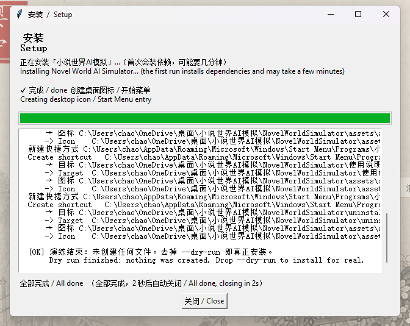

卸载同样会开一个进度窗，**删了什么都会逐条列出来**。卸载前会先弹一个**确认框**
  
（默认按钮是「取消」，敲回车不会误删）：

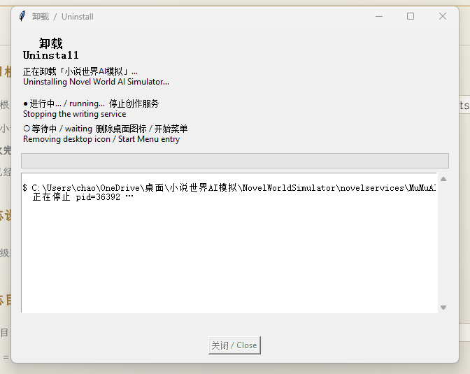

**参数**（`setup.exe` / `uninstall.exe` 通用；macOS / Linux 换成
  
`./setup`、`./uninstall`）：

| 参数                 | 作用                                                                                                      |
| ------------------ | ------------------------------------------------------------------------------------------------------- |
| （不带参数）             | 按**文件名**决定动作：`setup` = 装、`uninstall` = 卸（三个启动器是同一份源码编出来的，靠名字分工）                                         |
| `--dry-run`        | **只预览**：把"将要做什么"逐条打出来，**一个文件都不写** —— 先跑这个再决定（卸载的预览**不会**弹确认框）                                           |
| `--purge`          | 卸载时**连 `.venv` / `logs` / 验证截图一起删**（⚠ 你的小说项目 `Projects/` 永远不动）                                          |
| `--yes` / `-y`     | 跳过**卸载时那个确认框**（连着跑、写脚本时用）                                                                               |
| `--dest-root <目录>` | 把"桌面 / 开始菜单 / Applications"的根换到别处 —— **给自动化测试用的**，平时不用                                                  |
| `--quiet`          | 少打印些东西（**同上，给脚本用的**）                                                                                    |
| `--skip-service`   | **跳过「写小说服务」的环境准备**。默认安装时会顺手把写小说服务（MuMuAINovel）的运行环境备好（建虚拟环境 / 装依赖 / 建数据库表），这样第一次启动就不用现等几分钟；不想要这一步就加这个开关 |

**示例**：

```bash
setup.exe --dry-run        # 先看看它打算改什么（安全）
setup.exe                  # 真装（桌面 + 开始菜单 + 写小说服务的运行环境）
setup.exe --skip-service   # 只装快捷方式，不碰写小说服务的环境
uninstall.exe --dry-run    # 预览卸载（预览不弹确认框）
uninstall.exe              # 真卸载：先弹确认框，点了「是」才动手
uninstall.exe --purge      # 连环境一起清掉（小说项目不受影响）
uninstall.exe --purge --yes  # 同上，但不弹确认框（写脚本时用）
```

想直接调底层（三个平台一样，把路径换成你环境里的 `python`）：

```bash
.venv\Scripts\python.exe tools/platform_install.py status          # 现在装了什么、装在哪
.venv\Scripts\python.exe tools/platform_install.py install --dry-run
.venv\Scripts\python.exe tools/platform_install.py uninstall --purge --yes   # 不问了，直接卸干净
# 自动化测试：换个"桌面根"、少说话（平时用不到）
.venv\Scripts\python.exe tools/platform_install.py install --dest-root D:/nws-dest --quiet
```

装完各个平台会得到：

- **Windows** —— 桌面快捷方式，以及开始菜单文件夹「小说世界AI模拟」，
    
  里面是 **启动 / 打开项目文件夹 / 使用说明 / 卸载** 四项
- **macOS** —— `~/Applications/小说世界AI模拟.app`（Launchpad 与 Spotlight 都能搜到）
  - 桌面替身。`.app` 会借 Terminal 启动，所以首次装依赖的进度看得见；
      
    卸载也可以直接把 `.app` 拖进废纸篓
- **Linux** —— 应用菜单里的「小说世界AI模拟」和「卸载 小说世界AI模拟」，
    
  外加桌面图标（会自动标记 trusted，GNOME 下可双击）

几点说明：

- 图标指向的是**本平台的启动脚本**，所以双击图标 = 双击 `start.*`；
    
  代码更新后不需要重新安装。
- **不需要管理员权限**，只写当前用户目录。
- 卸载**只删自己创建的快捷方式**；你的小说项目数据（`Projects/`）永远不会被删除。
    
  加 `--purge` 才会连 `.venv` / `logs` / 验证截图一起清掉。
- 想先看看会改什么，加 `--dry-run`：`setup.exe --dry-run`。

### 2.3 手动安装（开发者）

如果你想自己控制环境：

```bash
# 进入项目目录
cd NovelWorldSimulator

# 创建虚拟环境
python -m venv .venv

# 激活虚拟环境
# Windows:
.venv\Scripts\activate
# Linux/Mac:
source .venv/bin/activate

# 安装依赖
pip install -r requirements.txt

# 启动
python main_gui.py
```

**参数**：

| 参数       | 作用                                                       |
| -------- | -------------------------------------------------------- |
| （不带参数）   | 正常启动                                                     |
| `--mock` | **演示模式**：这一次运行里当成 `MOCK_LLM=true`（**只影响这一次**，不写进 `.env`） |

**示例**：

```bash
python main_gui.py           # 正常启动
python main_gui.py --mock    # 演示模式（零成本，不发真实请求）
```

### 2.4 API Key 获取

> 本节只讲**去哪申请**。申请完怎么填进程序里，看 [3.4 怎么把 Key 配进来](#34-怎么把-key-配进来程序里怎么填)。
>
> **这个程序只认「OpenAI 兼容」协议** —— 只要对方给的是
>   
> `https://…/v1/chat/completions` 这种接口，填上 **Base URL + API Key + 模型名**
>   
> 就能用。所以下面这些厂商**全都能接**，不限于此。

#### 先看这张对照表

| 厂商                                | 控制台（申请 Key 的地方）                             | Base URL                                                  | 说明                                                       |
| --------------------------------- | ------------------------------------------- | --------------------------------------------------------- | -------------------------------------------------------- |
| **DeepSeek**                      | <https://platform.deepseek.com>             | `https://api.deepseek.com/v1`                             | **推荐入门**：便宜、中文好；模型名 `deepseek-flash` / `deepseek-v4-pro` |
| **OpenAI**                        | <https://platform.openai.com/api-keys>      | `https://api.openai.com/v1`                               | 需要外币支付；国内直连常不通，多半要自备网络                                   |
| **Anthropic（Claude）**             | <https://console.anthropic.com>             | `https://api.anthropic.com/v1`                            | ⚠ 它**不是** OpenAI 协议；要么走中转站，要么配一个协议转换代理                   |
| **Google（Gemini）**                | <https://aistudio.google.com/apikey>        | `https://generativelanguage.googleapis.com/v1beta/openai` | 用它的 **OpenAI 兼容**端点（注意结尾是 `/openai`）                     |
| **微软（Azure OpenAI）**              | <https://portal.azure.com（Azure> OpenAI 资源） | `https://<你的资源名>.openai.azure.com/openai/v1`              | 部署名要填进「模型名」那一栏；有的区域要加 `?api-version=`                    |
| **智谱 GLM**                        | <https://open.bigmodel.cn>                  | `https://open.bigmodel.cn/api/paas/v4`                    | 模型名如 `glm-4-plus` / `glm-4-flash`                        |
| **通义千问 Qwen（阿里百炼）**               | <https://bailian.console.aliyun.com>        | `https://dashscope.aliyuncs.com/compatible-mode/v1`       | **必须带 `/compatible-mode`**，那才是 OpenAI 兼容口                |
| **MiniMax**                       | <https://platform.minimaxi.com>             | `https://api.minimax.chat/v1`                             | 部分模型走 `/v1/text/chatcompletion_v2`，以控制台文档为准              |
| **月之暗面 Kimi**                     | <https://platform.moonshot.cn>              | `https://api.moonshot.cn/v1`                              | 长文本见长                                                    |
| **硅基流动 SiliconFlow**              | <https://cloud.siliconflow.cn>              | `https://api.siliconflow.cn/v1`                           | 一个 Key 通很多开源模型，适合比价                                      |
| **OpenRouter**                    | <https://openrouter.ai/keys>                | `https://openrouter.ai/api/v1`                            | 聚合站，一个 Key 转发多家                                          |
| **本地（Ollama / LM Studio / vLLM，可选）** | 见下                                          | `http://127.0.0.1:11434/v1`（Ollama）                       | **不花钱、不联网**，质量取决于你的显卡；**不装也能用，默认不用它**                                    |

#### 通用三步（所有厂商都一样）

1. **注册登录** → 进上面那张表里的控制台；
2. **充一点钱 / 领免费额度** → 多数厂商有免费试用额度，够把一本书跑起来；
3. **建 API Key** → 通常在「API Keys / 密钥管理」里点「创建」，**复制那串 Key**
     
   （`sk-` 开头居多）。⚠ **只显示一次**，关掉页面就再也看不到，先存进密码管理器。

#### 各家细节

**DeepSeek（推荐）**

1. 注册：<https://platform.deepseek.com>
2. 左侧「API Keys」→ 创建 → 复制
3. Base URL `https://api.deepseek.com/v1`；模型名 `deepseek-flash`（便宜）/
     
   `deepseek-v4-pro`（强）
4. ⚠ 它的新模型**默认开着思考模式**，而思考也吃 token —— 本程序会自动对
     
   「只要结论」的用途关掉思考，不用你操心（见 9. 设置详解）

**OpenAI**

1. 注册：<https://platform.openai.com/api-keys>
2. 「Create new secret key」→ 复制
3. Base URL `https://api.openai.com/v1`；模型名如 `gpt-4o` / `gpt-4o-mini`
4. 需要绑定外币卡；国内直连多半不通，通常要自备网络环境或用中转站

**Anthropic（Claude）**

1. 注册：<https://console.anthropic.com>
2. 「API Keys」→ 创建 → 复制
3. ⚠ **它不是 OpenAI 协议**：Claude 的接口是 `/v1/messages`、认证头也不是
     
   `Authorization: Bearer`。直接填进去是接不通的 —— 两条路：
     
   **① 用中转站**（对方通常会给你一个 OpenAI 兼容的 Base URL，直接当 OpenAI 用）；
     
   **② 自建一个协议转换代理**（如 `claude-code-proxy` 一类），把它当本地服务填。
     
   本程序**不做协议转换**，这不是它该管的事

**Google（Gemini）**

1. 注册：<https://aistudio.google.com/apikey> → 「Create API key」→ 复制
2. 用它**专门给 OpenAI 兼容留的那个端点**：
     
   `https://generativelanguage.googleapis.com/v1beta/openai`
     
   （注意结尾那个 `/openai`，漏了就 404）
3. 模型名如 `gemini-2.5-pro` / `gemini-2.5-flash`

**微软（Azure OpenAI）**

1. 在 <https://portal.azure.com> 建一个 **Azure OpenAI** 资源 → 拿到
     
   **终结点**与**密钥**（Key 1 或 Key 2）
2. ⚠ Azure 要先**部署**模型（「模型部署」里建一个部署），然后用
     
   **部署名**当模型名填进来 —— 直接填 `gpt-4o` 是不行的
3. Base URL 形如 `https://<资源名>.openai.azure.com/openai/v1`；
     
   有的区域还要在 URL 后面加 `?api-version=2024-10-21`

**智谱 GLM**

1. 注册：<https://open.bigmodel.cn> → 「API Keys」→ 复制
2. Base URL `https://open.bigmodel.cn/api/paas/v4`
3. 模型名如 `glm-4-plus`（强）/ `glm-4-flash`（便宜）

**通义千问 Qwen（阿里云百炼）**

1. 注册：<https://bailian.console.aliyun.com> → 「API-KEY」→ 创建 → 复制
2. Base URL **必须**用
     
   `https://dashscope.aliyuncs.com/compatible-mode/v1`
     
   —— 少了 `/compatible-mode` 就是另一套协议，接不上
3. 模型名如 `qwen-max` / `qwen-plus` / `qwen-turbo`

**MiniMax**

1. 注册：<https://platform.minimaxi.com> → 「接口密钥」→ 复制
2. Base URL `https://api.minimax.chat/v1`
3. ⚠ 它家不同模型走的路径不完全一样（有的在
     
   `/v1/text/chatcompletion_v2`）。**以控制台文档为准**；
     
   配完先点「测试」按钮，通了再说

**本地模型（可选，不装也能用）**

> **这不是必需项。** 程序默认走云端 API，本机不需要装任何模型服务。
> 只有你想让内容完全不出本机、而且显卡够跑本地大模型时，才需要看这一节。

1. 装 [Ollama](https://ollama.com)：`ollama pull qwen2.5:14b`
2. Base URL `http://127.0.0.1:11434/v1`；API Key **随便填**（本地不校验）；
     
   模型名 `qwen2.5:14b`
3. 也支持 LM Studio / vLLM 等一切提供 OpenAI 兼容口的本地服务


> **不知道自己该选哪家？** 先按最省事的来：**想立刻试 → DeepSeek**（注册简单、
>   
> 价格低、中文好）；**已经有别家的 Key → 直接填**，只要它是 OpenAI 兼容口；
>   
> **本机已经装了 Ollama / 显卡够强 → 再用本地模型**（没有就别折腾它）。
>   
> 不管选哪个，**向量检索都保持默认的 `none` 就行**，不需要装 Ollama。

---

## 3. 快速开始

### 3.1 启动程序

Windows 双击 `start.exe`；macOS 在访达里双击 `start`（或终端执行 `./start`）；
  
Linux 执行 `./start`。

也可以先跑一次 2.2 里的 `setup.exe` / `./setup`，把图标装到桌面和开始菜单，以后双击图标即可。

命令行等价写法：`python main_gui.py`

#### 启动时**不会**出现命令行窗口

2026-10-10 起，三个启动器（`setup` / `start` / `uninstall`）都是**不带控制台**的
  
原生可执行文件。双击之后**看不到任何黑色的命令行窗口**，那是正常的 ——
  
而且这正是当初改它的原因。

- **要装东西的时候**（第一次启动、或者加 `--reinstall`）会先弹一个**进度窗**：
    
  显示正在做什么、走到哪一步、以及每一步的原始输出；装完它自己关掉。
- **平时启动**：环境已经装好了，启动器**一步都不做**、不弹任何窗口，
    
  界面窗口直接出来。
- 日志照旧写在 `logs/` 目录，出问题时把最新的 `nws_*.log` 发出来就行。
    
  它**以书名开头**：`nws_<书名>_2026_10_07_01_23_11.log` —— 一本小说跑很多轮，
    
  光看文件名就知道哪份是哪本书的（还没开卷时没有书名那一段）。
- **关掉主窗口 = 全退**：后台那个「创作服务」（MuMuAINovel，平时占着 8001 端口）
    
  会**跟着一起停**，不会留在后台。想让它常驻（下次启动不用冷启动），
    
  去「天机 → 创作服务」把「关闭程序时一并停掉服务」关掉。

### 3.2 首次运行向导

1. 开始界面点「开卷」
2. 四步向导：选文件夹 → 填项目名/类型/风格 → 勾 AI 优化选项 → 确认
3. 点「开始摄取」，弹出**摄取对话框**：进度条推进 + 运行日志实时滚动
4. （勾了 AI 优化）进度停在 90%，AI 给出体检报告；**你可以打字和它对话**，
     
   让它按你的意思改人物、伏笔、世界观，改到满意为止
5. 点「完成优化并进入」→ 进度到 100% → **对话框自动关闭** → 进入运行界面
6. 项目已落盘（设定集 / 运行文件夹 / .nwsproj），之后可在「拾卷」里找到它

### 3.3 演示模式（零成本体验）

```bash
# 编辑 .env
MOCK_LLM=true

# 启动（Windows 双击 start.exe 亦可）
python main_gui.py
```

演示模式不发任何真实 API 请求，使用内置语料跑全流程。

---

### 3.4 怎么把 Key 配进来（程序里怎么填）

> 还没申请 Key？先看 [2.4 API Key 获取](#24-api-key-获取)。
>
> **第一次跑程序时会弹一个对话框**提醒你「还没有配置 LLM」：
>   
> 点「**去配置**」直接跳到「天机 · 推演服务LLM设定」这一页；
>   
> 点「以后再说」就先这样用着，**下次启动还会提醒**。

#### 推荐：在界面里配（三步）

1. 开始界面点「**天机**」（全局设置）→ 切到「**模型与LLM**」那一页（第 2 个选项卡）。
2. 填三样东西：
   - **API Key**：从厂商控制台复制来的那串（`sk-…` 这种）
   - **Base URL**：见 2.4 那张表（DeepSeek 是 `https://api.deepseek.com/v1`）
   - **华彩档 / 日常档 / 摘要档**三个模型名：分别是「关键剧情 / 日常循环 /
       
     压缩打分」用的。**不确定就三档填同一个**，跑起来再按预算拆。
3. 点「**拉取模型列表**」→ 它会真的去问对方有哪些模型，并把三个下拉填好；
     
   再挨个点「**测试**」→ 真发一条最小请求，**几秒内**把结果或错误写在下面
     
   （模型名写错、Key 不对、地址不对，都能当场看出来）。
4. 点「**保存**」→ 然后**重启程序**。

> ⚠ **为什么一定要重启**：LLM 客户端在启动那一刻一次性建好（连接池、认证头、
>   
> 并发信号量都定死了），运行中改了不会自动重建。对话框顶部和消息框都会提醒。

> 「测试」的结果**同时会进「消息」框**（界面右下角那个）——
>   
> 因为「推演服务LLM设定」这一页是要滚动才看得到下面几项的，
>   
> 而"哪一步错了"必须让你一眼看见。

#### 也可以直接改 `.env`

不想开界面，就编辑程序目录下的 `.env`：

```ini
LLM_PROVIDER=openai_compatible
LLM_BASE_URL=https://api.deepseek.com/v1
LLM_API_KEY=sk-你的key
MODEL_FRONT=deepseek-v4-pro      # 华彩档：关键事件、重要对话
MODEL_DAILY=deepseek-flash       # 日常档：常规循环
MODEL_CHEAP=deepseek-flash       # 摘要档：压缩、打分
```

改完同样要**重启程序**。`.env` 的每一项说明见 [配置指南](配置指南.md)。

#### 没配好会发生什么

程序**照样能开**，也能翻看设定和文档 —— 但它会：

- 在启动时弹一次对话框提醒你（就是 3.4 开头那个）；
- 在「消息」框里留一条常驻的警告；
- **把演示模式打开**（只在内存里，不写进 `.env`）：不联网、用内置语料跑全流程，
    
  好让你先把界面点一遍。

**所以你不会看到"程序崩了"，但你会看到"人物不太对劲"** —— 那就是演示语料。
  
配好并保存之后，这个自动降级会自己收回。

#### 常见错误对照

| 界面上的话                  | 多半是什么                                                      |
| ---------------------- | ---------------------------------------------------------- |
| `401` / 提到 **API Key** | Key 复制漏了字符、被空格污染，或者过期了                                     |
| `400` + 提到 **model**   | 模型名不对 —— 点「拉取模型列表」看对方到底有哪些                                 |
| `404`                  | Base URL 写错了（最常见：漏了结尾的 `/v1`，或 Qwen 漏了 `/compatible-mode`） |
| 连不上 / 超时               | 地址不通、代理没配对，或本地服务没启动                                        |
| 通是通了，但正文是空的            | 多半是这个模型把额度花在"思考"上了 —— 见 9. 设置详解                            |

---

## 4. 主界面详解

### 4.1 界面布局


*运行界面（设定读完了、还没开跑）—— 各面板只显示占位符，不预填任何编造数据*

### 4.2 面板说明

- **左栏**（从上到下）：**时间 → 小地图 → 运行配置 → 风格控制 → 系统**
- **中栏**：叙事区（**剧本式**，见 4.2.2；占满整块，与下方命令栏紧贴，中间不留空档）
- **右栏**：在场人物、剧情进度、**剧组**
- **底部**：命令输入栏

> **「运行配置」「风格控制」「剧组」这三块的标题可以点**（标题带**下划线**、
>   
> 右边跟一个 `↗`、鼠标移上去变手型）。点一下直接去改它们背后的值：
>
> | 点哪里  | 推演**正在跑**            | 推演**还没起笔**              |
> | ---- | -------------------- | ----------------------- |
> | 运行配置 | 书斋 · 类型风格（里面的「运行边界」） | 天问 · 运行（时间倍率 / 一拍 / 预算） |
> | 风格控制 | 书斋 · 风格控制            | 天问 · 导演与合规              |
> | 剧组   | 书斋 · 剧组 Agents（列表）   | 天问 · 剧组 Agents（列表）      |
>
> 分组口径：**正跑着一本书时改的是"这一本"**（所以去「书斋」，那是本书设置）；
>   
> **还没开跑时**这本书还没有"正在跑的现场"，能调的只有程序层默认值（所以去「天问」）。
>   
> 悬停在那几个标题上时，提示里会当场写明这一次会去哪一页。
>
> 改完**立刻生效**：书斋里的风格参数、运行边界、导演力度都是**改了就算数**
>   
> （滑杆拖动、下拉选中即写进配置），点「保存」或「取消」关掉之后，
>   
> **运行页那几块面板会当场刷新成新的数**。不用重启，也不用重新起笔。
>
> **剧组面板的每一行也能点**：点某一行的职位，直接打开**那个职位**的
>   
> 设置（名字 / 作用 / 系统提示词）—— 先铺好「剧组 Agents」列表，再把编辑框叠在上面，
>   
> 关掉编辑框就回到列表。

> **默认全部留空。** 故事还没开始时，各面板只显示占位符（`—`、`尚未开始`、
>   
> `尚无人物登场`、`未运行`……），**不会预填任何编造的示例数据**。
>   
> 只有真实跑过之后（产生了「每天的生活」落盘），中栏才会显示真实叙事文本，
>   
> 右栏才会出现真实登场人物与节点进度。

> **怎么开始推演：点右上角「📖 起　笔」。** 中栏空着时写的也是这句。
>   
> **底部那个命令输入栏不能开跑** —— 它只认 `/help`、`/status`、`/settings` 三条；
>   
> 其余命令会回一句「尚未接入」。开跑的唯一入口是按钮。

### 4.2.2 中栏：正文是**剧本体**（参考老舍《茶馆》），各类型用方块分开


*中栏放大：一幕一张卡；台词单独成块（浅底 + 描边），叙述仍并成段落*

中栏读起来像**剧本**，不是场记单、也不是"转述"：叙述并成段落、段首缩进两格；
  
**台词单独成块**，写法是「人物名：台词」，语气与对象写在括号里 —— 这就是话剧剧本
  
的写法，也正是老舍《茶馆》的样子（`王利发：（向李三）李三！你歇歇去…`）。

```text
　　主角走了进来。灶上温着水，白灯笼还没点。雨脚敲着檐瓦。

主角：（压低声音，向阿枝）今夜别出门。

阿枝：为什么？

　　（主角把壶放下。）阿枝心想：他今天不对劲。主角想起，那年也是这样的雨。
```

**为什么改成剧本体**：以前是小说体 `主角压低声音，对阿枝说：「今夜别出门。」`，
  
一条条读下来像"**转述**谁说了什么"。剧本体是"**人就站在场上说话**"，
  
谁开口、说了什么，一眼分清。

| 原来的写法                  | 现在的写法                  |
| ---------------------- | ---------------------- |
| `主角压低声音，对阿枝说：「今夜别出门。」` | `主角：（压低声音，向阿枝）今夜别出门。`  |
| `主角把壶放下。`              | `（主角把壶放下。）` ← 舞台提示，用括号 |
| `〔心声·阿枝〕他今天不对劲。`       | `阿枝心想：他今天不对劲。`         |
| `〔回想·主角〕那年也是这样的雨。`     | `主角想起，那年也是这样的雨。`       |
| `〔出场〕主角（入画）`           | `主角走了进来。`              |
| `〔外部刺激〕后巷传来一声闷响。`      | `就在这时，后巷传来一声闷响。`       |
| 一句一行，一屏碎成几十行           | 叙述并成段落，一段最多四句          |

**各类型用「底色 + 描边」分开**，一眼分得清什么是什么：

| 内容                  | 长相                                      |
| ------------------- | --------------------------------------- |
| **台词**              | 浅底 + 淡金描边，整块包起来                         |
| **导演事件**（转折点）       | 浅底 + 靛青描边                               |
| **机制标注** `※`        | 浅底 + 淡墨描边                               |
| 叙述 / 环境 / 舞台提示 / 心声 | 段落流里靠**颜色与斜体**区分（不给每句都套方块，否则又把正文切碎成场记单） |

**两类东西保持原样**（它们本来就不是故事，混进正文才是坏）：

- **机制标注** `※ 节点完成：门口醒来` —— 那是给你看的进度提示，不是剧情
- **结构标记** `〔切至 · 后巷〕` / `〔切回〕` —— 版面上的路标（同时发生在另一处）
- 插图 `〔图〕` 同理

**层次还在**：环境白描最淡 · 心声淡色斜体 · 回想赭金斜体 · 出场退场淡色 ·
  
旁白与舞台提示是正常正文色。**同一段里的句子各保留自己的样式**，不会糊成一片。

**一幕一张卡**：换时段或换地方就换一张卡。卡头是这一场的时间、地点、天气、在场名单；
  
卡脚是「依据」（这段戏推进了哪个节点、回收了哪条伏笔）—— 那是**台账**，不是故事正文。

**「同时」只在「异地」才出现**：以前只要同一拍有两个人各做一件事，就并列成
  
`〔同时〕`——一天几百拍下来满屏都是"同时"，读起来像**所有人同时在乱动**。
  
现在同场一律**按先后一件件写**；只有**别处正在发生事情**时，才
  
`〔切至 · 城东渡口〕……〔切回〕` 切过去看一眼再切回来。

**同一句话不会重复刷**：人物当天的目标是一定的，所以模型很容易把同一件事再讲一遍
  
（实测出现过丁那句「账差七文」**一字不差重复 4 次**）。现在同一句台词只说一次；
  
连着两拍都只是"转向某人"这种不推进任何事的动作，第二拍不再写。

**落盘的剧本格式一个字没改**：`每天的生活` 里存的仍是可反解的剧本
  
（`主角：今夜别出门。`、`◇ 心声` 那一套）—— 它是给导出和一致性检查用的**机器格式**。
  
屏幕上显示成剧本体，是因为**读的人是你，不是解析器**。

### 4.2.2.1 编剧组先定框架：每天开演前先写「当天要演的故事」

一天开始之前，**编剧组先把这一天想清楚**，顺序不能反：

1. **写当天要演的故事（小说作家）** —— 依据是世界观、顶级规则、**进度节点（主线）**、
     
   前情提要、昨天的小结。写的是**原著样章**：一段读起来像小说的文字，
     
   说清"这一天结束时，哪件事变了"。
2. **考据（资料员）** —— 样章里的名物、制度、称谓站不站得住。
     
   他给的结论会**进剧作者的提示词**（这条"合作"是真的，不是写在名册上）。
3. **改写成剧本（剧作者）** —— 拆成**不超过 6 拍**，每拍写清在哪、发生什么、
     
   推进了主线的什么；再写一小段**场景介绍**（开演前那几十字）。
4. **分配给角色** —— 每个在场的人分到 1~3 件"今天该做的事"。
5. **验算（导演）** —— 导演**审自己一遍**：接得上前情吗？说不说得出今天动的是哪个节点？
     
   有没有跟主线无关的事？有没有让不在场的人出现、或不像设定里那个人？
     
   不过关就**带上具体意见重写**（最多 `DAY_PLAN_FIX_ROUNDS` 轮，默认 2）。
6. **然后才开演** —— 人物按剧本走，**允许自由发挥，但框架不超过导演写的**。

于是每个人物在决策时都能看到一段〔今日剧本〕：今天这一场在演什么 + 他自己分到的事，
  
末尾还写着「框架之内你可以自由发挥，但别做跟这件事无关的事」。

**为什么要有这一步**：以前跨天只让**每个人各自**排计划 —— 十二个人各排各的、
  
谁也不管谁，合起来不构成一个故事，屏幕上就变成"大家都在做自己的小事"
  
（看得见的那种"跟主线没关系"）。现在先有一个整体（当天故事），再拆成剧本、
  
再分到人头上，人物才知道自己在整本书里的位置。

**这两步是谁在干**：见下一节 —— 是剧组里的**小说作家**与**剧作者**，
  
他们各自读各自的工艺书（作家读叙事章法，剧作者读剧作与舞台）。

**它是怎么落地的**：当天故事、场景介绍、分拍、分派、验算结论都记进运行文件夹的
  
`当日剧本.json`（按天一条）。**项目文件夹一如既往只读** —— 这条铁律没有例外。

**关掉它**：天机里关掉「当日剧本」，就退回老行为（各人自己排计划）。
  
每天会多 3~4 次便宜档调用（写样章 / 考据 / 写剧本 / 验算），重写时才多一轮。
  
完整格式规范见 [剧本输出格式.md](剧本输出格式.md)。

**旧运行文件夹照常打开**：以前的自由文本「每天的生活」会按原样显示，不会被硬拆。
  
想退回旧格式：`.env` 里设 `OUTPUT_FORMAT=prose`。

##### 4.2.2.1a 叙事窗口：能翻回最开头 · 每条带时间（2026-10-11）

作者报了两件事，都在这一块解决：

> 「我感觉对话窗口我往前拉 有些信息在窗口看不见了 是不是会被吞掉一些东西？
>   
> 我希望要么这个窗口虽然每个窗口显示的内容如果不能够无限长，则进行分页，
>   
> 我需要查看到此次推演所有的内容」
>
> 「我希望有选项可以让对话窗口的每一个条目左上角都带一个很小的当前日期和
>   
> 时间（真实时间-剧情时间）这样的，以便我进行参考」

**① 分页：能翻到本次推演的**最开头\*\*\*\*。以前有两处**真的在吞内容**：

- 中栏只渲染**最近 200 条**（更早的虽然在内存里记着，但屏幕上不画）；
- 控件数一超过 400 就**把最前面 100 个删掉**（两处都这么干），而且**不与内容对齐**
    
  —— 于是"往上拉看不到"变成了"真的没了"。

现在改成**分页**：叙事区**上方**多一条翻页条

> `⏮ 最早` `◀ 更早` ｜ 第 3 / 12 页 · 共 2340 条 · 已是最新 ｜ `更晚 ▶` `最新 ⏭`

- 一页多少条由 `NARR_PAGE_ENTRIES` 定（默认 **200**）；
- 只有一页时整条**自动隐藏**，不占地方；
- 页边界切在**段落之间**（不会把一段话劈成两半，出现没有段首缩进的半段）；
- ⇒ **内容一条不丢，控件数有界**（长跑不会越跑越卡）。

⚠ **你在翻历史时，新内容不会把你拽回去**：这时新条目只记进账、
  
在翻页条上累加成「有 N 条新内容」；点「最新」就能看到它们（一条都不少）。
  
翻到历史页会**关掉自动跟随**，回到最新页再打开。

**② 时间戳：每条左上角一行小字**（`NARR_TIMESTAMP`，**默认开**）：

> `20:14:03 · 第3天·戌时`
>   
> 他把壶放下，没抬头。

- **真实时间**（墙上的钟）+ **剧情时间**（故事里第几天什么时辰）——
    
  只看剧情时间分不出"这是一小时前还是昨天生成的"，两个都要；
- 字号比正文小两号（`NARR_FS_STAMP`），**不跟正文抢眼**；
- ⚠ **只对本轮实时产生的条目有效**：从落盘文件读回来的历史没有真实时间，
    
  就**留空、不编**；
- 嫌挤就关掉（`NARR_TIMESTAMP=false`），整条小字消失。

> 为什么两个时间都要：作者要对照"这句话是什么时候说的"时，
>   
> 真实时间回答"我什么时候看到的"，剧情时间回答"故事里这是哪一刻"。


### 4.2.2.2 剧组：一班人，一条链

**推演不是"一个人物在房间里走来走去"，是一个剧组在出活。**
  
运行界面右栏有一块「**剧组**」面板，就是这班人的**在岗表** ——
  
每个职位一行：状态点 + 名字 + 最近一次产出。

**谁在干活，那一行会亮起来**（2026-10-08）：那位一开工，整行立刻变成
  
**暖金底 + 左侧一道朱砂竖条 + 名字赭金加粗**，状态写成
  
「出工中 · 已跑 N 秒」；**干完活立刻恢复普通样式**（交活的那一行只剩一个绿点）。
  
底下那句也会跟着变：「**n 位正在出工**（高亮的那几位）」。

> 为什么要有它：剧组出活是**一阵一阵**的（一天里几个高峰），中间大部分时间
>   
> 屏幕上是不动的 —— 而"在等一位跑了三分钟的职位"和"程序卡住了"在用户眼里
>   
> 长得一模一样。「谁在干活」+「已经跑了多久」就是把这两件事分开的那点信息。
>
> 计时是**事件推的**，不是等界面那 0.5 秒一轮的定时刷新 —— 短出工（演示模式下
>   
> 几十毫秒）整个落在两次刷新之间，靠轮询根本看不到有人亮过。

**那一行下面的第二句，照实说"此刻在做什么"**（2026-10-08 改）：

| 那一行的状态   | 第二句                      | 例子                      |
| -------- | ------------------------ | ----------------------- |
| **正在出工** | **它此刻在做的那件事**（该职位的职责）    | `正在做：这一场该有什么物件、哪件要反复出现` |
| 这一轮没启用   | `这一轮没启用`                 | ——                      |
| 待命 / 干完了 | 最近一次产出那句话（没交过活才是 `还没轮到`） | `已读 6 条：这一场要交代的三件事`     |

> 以前不管什么状态、只要还没交过活就写「还没轮到」—— 于是上面亮着
>   
> 「出工中 · 已跑 12 秒」、下面写着「还没轮到」，**自相矛盾**
>   
> （用户原话：「右边人员都在干活了 跟着他们的状态还是 还没轮到 这个有点奇怪」）。

| 职位       | 干什么                                                                     | 什么时候出工  |
| -------- | ----------------------------------------------------------------------- | ------- |
| **小说作家** | 写当天这一章的**原著样章**（一段小说，不是提纲）                                              | 日界      |
| **剧作者**  | 把样章改成**能拍的剧本**：分几拍、每拍谁做什么、分派到人                                          | 日界      |
| **导演**   | 定框架、派活、挑事、验算、收尾                                                         | 全程      |
| **演员**   | 在框架之内自由发挥（就是各个人物 Agent）                                                 | 每一拍     |
| **群众演员** | 门外的人与事（外部输入）                                                            | 每一拍     |
| **剧本审读** | **上屏之前**逐条读一遍（是不是人话·像不像这个人·接不接上文·是不是一个主题），不通过就**改写或拦下**；同时**记录一切上屏的东西** | **每一拍** |
| **场记**   | **连戏检查**：时间·物件·称呼·在场状态·与前情矛盾                                            | 日末      |
| **道具**   | 这一场有哪些具体物件、哪件要反复出现                                                      | 开拍前     |
| **美术**   | 定这一部的画风与主色（一次定、全剧用）                                                     | 开拍前     |
| **宣发**   | 一句话卖点、看点、预告                                                             | 日末 / 导出 |
| **资料员**  | 考据：名物·制度·称谓站不站得住                                                        | 日界      |

一天的班次（顺序不能反）：

```
① 开拍前  美术定调子 → 道具按这个调子出这一场的道具单 · 造型定人身上的东西
② 编剧组  小说作家写样章 → 资料员考据 → 剧作者改成能拍的剧本 → 导演验算
          → **排练**（所有人先空走一遍，见下）
          走不下去就带意见退回剧作者重写 → **再排一遍**（最多几轮）
          （剧本一定稿，美术再按**今天这几场的地点**画当天地图、
            声音定**今天听得见什么**）
③ 开演    演员 + 群众演员（照旧，每一拍）
          **每一条要上屏的东西，先过「剧本审读」那道闸**（见下）
④ 收工    场记连戏检查（只报不改）· 宣发写那句话 ·
          语言审校点名 AI 味重的那几句
          → 复盘写「今日总结」（**语言审校那几条并进这一份**，
            所以你在剧情窗口里就看得见，不必去翻文件）
          → **整理当天这一章**（把今天实际演的写成小说形式）
⑤ 收尾    剧组各职位的产出进运行报告的「1.5 剧组档案」一节
```

#### 排练：先空走一遍，不上屏

**剧本定稿之后、正式开演之前**，整班人先把这一天**空走一遍** ——
  
但不产生任何正文、也不往窗口里出结果，只有一条小小的「▸ 剧组排练 · 3.2s」。

它逐拍自问四件事（就是"读本会 + 走位"那个意思）：

| 问什么                   | 为什么正式开演时才发现就晚了         |
| --------------------- | ---------------------- |
| 这一拍派给他的事，他**做得到**吗    | 演员上了场只能硬演，演出来就未必是那个人了  |
| 写进这一拍的人，那时那地**真的在场**吗 | 不在场的人被派了活 = 剧本里有、场上看不见 |
| 有没有把台词/动作**写死**到只能照念  | 那就成了提线木偶（本项目一直在防的）     |
| 拍与拍之间**接不接得上**        | 跳步的戏，演员只能在中间自己编一段来圆    |

排出问题就**带着意见退回剧作者改**，改完**再排一遍**（`CREW_REHEARSAL_ROUNDS`，
  
默认 1 轮）。排完的东西只落 `排练记录.md` 与日志。

> 它和"导演验算"是**两件事**：验算问"故事顺不顺"，排练问"上了场迈不迈得出去"。
>   
> 一个剧本可以故事上完全成立、而场上根本演不出来 —— 一次判断挑不干净。
>   
> 想调：`CREW_REHEARSAL`（总开关）· `CREW_REHEARSAL_ROUNDS`（最多改几轮）·
>   
> `CREW_REHEARSAL_TOKENS`。

#### 剧本审读：上屏之前那一道闸（2026-10-08）

**它是独立的一个职位，不归导演。** 用户点名的原话：「你看是否有独立的Agent
  
而不是导演在盯着演员说的每一句话 没有就做一个 —— **在演员真的说出来之前**，
  
把新生成的话放到已经出现的话里过一遍，看是否通顺」。

它在**每一条东西上屏之前**读一遍，判五件事：

| 判什么         | 抓的是这类毛病                                             |
| ----------- | --------------------------------------------------- |
| **是不是人话**   | 读不通、生造的短语、半截话（用户举的例：「卷了」「目光顺着小臂滑到底 才收回 压在壶盖上」）      |
| **像不像这个人**  | 这话是他的身份/性格/口癖该说的吗？**称呼**用得对吗（例：跑堂把「客官慢用」说给**自家伙计**） |
| **接不接上文**   | 跟已经出现过的话接得上吗？有人**突然冒出来**又**什么都没做**吗                 |
| **是不是一个主题** | 这几句合起来在说同一件事，还是各说各的（"散"）                            |
| **跟场景搭不搭**  | 此刻这个地点、这个时辰会这么说吗                                    |

不通过的处理：**能改就改写**（照原意改，不改成另一个人说的话）；改不动就**拦下** ——
  
拦下的**不进正文**（剧本里也真的撤掉，屏幕与落盘的稿子一致），
  
只记在运行文件夹的 `剧本审读.md` 与日志里。**绝不静默丢弃**。

**它同时是一个"一直记录"的台账**：一切上屏的东西都按顺序记下来 ——
  
动作 / 对话 / 旁白 / **场景切换** / **伏笔激活（导演事件）** / 导演动作 /
  
前情提要 / 今日简介 / 今日任务 / 阶段 / 剧组状态 / 收工总结。
  
两份产物在运行文件夹里：

| 文件           | 是什么                                                 |
| ------------ | --------------------------------------------------- |
| `剧本审读.md`    | **小结**（一天一份，覆盖写）：记了多少、拦了几条、拦的是什么、谁进了场却没人搭上话、每一批在说什么 |
| `审读台账.jsonl` | **流水**（追加写）：每一条的序号/天/拍/类型/谁/对谁/来源/文本/有没有被拦/为什么      |

**「进了场却没人接话」会被提醒**：某个名字上场超过 `SCRIPT_REVIEW_NEWCOMER_TICKS`
  
拍（默认 8）还是既没开口、也没人对他说话、动作里也没提到他 ——
  
下一拍的**每个人**都会在提示里看到一句「谁在场谁接住他」。

**两层把关，成本差得很远**（所以分成两档）：

| 层       | 跑多勤                                          | 抓什么                                                 | 花钱吗     |
| ------- | -------------------------------------------- | --------------------------------------------------- | ------- |
| **规则层** | **每一条都过**                                    | 形式上的硬错：残留的 JSON/网址、占位话（"此处省略"）、出戏词（"作为AI"）、标点乱敲、半截话 | 不花      |
| **模型层** | 每 `SCRIPT_REVIEW_EVERY_TICKS` 拍一次（默认 1 = 每拍） | 语感与上下文那四条                                           | 一次便宜档调用 |

> ⚠ 规则层**故意只抓形式**：用户举的那几句"不是人话"每一句都语法通顺，
>   
> 只有读了才知道 —— 拿规则去抓它们，要么写一条只对那一个句子生效的正则，
>   
> 要么放宽到"动作句里不许写视线"（把好句子也砍了）。
>   
> **规则判错的代价是把好句子删掉，比漏一句更糟**，所以语感整个交给模型。

**关掉与调法**（天机 ·「运行」→「剧本审读」，改完不用重启）：
  
`SCRIPT_REVIEW`（总闸，关掉 = **既不审也不记**）· `SCRIPT_REVIEW_MODEL`（关掉只跑规则层，零成本）·
  
`SCRIPT_REVIEW_EVERY_TICKS` · `SCRIPT_REVIEW_HISTORY`（带多少条上文）·
  
`SCRIPT_REVIEW_STRICT`（关掉 = **只记不拦**）· `SCRIPT_REVIEW_NEWCOMER_TICKS`。

#### 收工之后：当天这一章

收工时小说作家会把**今天实际演的**（不是当初计划的）整理成**一章小说**，
  
两处用得起：

- `当天故事.md` —— **按天累积**的一份可读稿（第二天早上还在，能连着读）；
- 「今日总结.md」—— 追加一节「今天这一章（整理稿）」，与复盘并存。

> 它与导出的「最终改写稿」是两件事：那份是**装订成书**的（见 §导出），
>   
> 这份是**按天累积**的工作本；导出时**有整理稿就用整理稿**
>   
> （它本来就是按小说写的，比"把场记体剃干净"更近小说）。
>   
> 想调：`CREW_DAY_NOVEL` · `CREW_DAY_NOVEL_TOKENS`。

#### 认知模式：谁在"先想后答"

参考《AI Agent 从入门到精通》第四章（ReAct / Plan-and-Solve / Reflection）与第七章，
  
剧组里有七个职位**开口 / 动笔之前先在心里按顺序过一遍** ——
  
而且是**同一次调用里先想后答**，不额外花钱：

| 谁                   | 先想什么                                | 想出来的东西去哪                 |
| ------------------- | ----------------------------------- | ------------------------ |
| **演员**              | 我要什么 / 刚才那句对我做了什么 / 换个说法成不成立 / 该说多长 | `推演` —— 进日志、进剧组台账「演员」那一行 |
| **剧作者**             | 这一天变什么 / 分几拍 / 每拍各自变什么              | `构思` —— 随剧本一起留档          |
| **小说作家**            | 这一章变什么 / 谁撞上什么 / 结尾留什么未了            | 只进提示词（正文是散文，不往里塞字段）      |
| **导演**              | 这一拍最该推什么 / 谁卡在哪儿                    | 进日志                      |
| **场记 · 资料员 · 语言审校** | 先逐条核，再下结论                           | `核查` —— 随产出留档            |

每一问都挂着**这个职位正在读的那几条手艺**（`craft/playbooks`）——
  
不是新编一套理论，而是把"他手上那本书"按顺序用一遍。

**台词自省**（反思链）：某句台词**明显不像人在场上说的**（书面连接词、情绪直说、
  
长得像作文）时，让演员在**说出口之前**再审一遍自己这句 —— 可以改、可以坚持原话、
  
也可以干脆不说。它只处理规则挑出来的那一小撮，**正常对白一次额外调用都不花**。

> 模式表、思考骨架、自省判据都在 `crew/cognition.py` 一处；完整判定书是开发向文档，
>   
> 在源码树的 `developers/docs/Agent认知升级方案.md`（**不随发布包提供**）。
>   
> 想调：`COGNITION`（总闸）· `COT_ACTOR`（演员那条，最贵）· `COT_CREW`（剧组那条）·
>   
> `ACTOR_SELF_REVIEW` · `ACTOR_SELF_REVIEW_MAX`。**关掉总闸 = 逐字退回**从前的行为。

**为什么"先定画面再写本子"**：反了的话，道具单只是照着已成稿的戏凑出来的，
  
它就不再是创作决定、而只是事后记录。顺序对了，物件才会真的影响戏怎么写。

#### 两条"合作"是真的，不是写在名册上而已

剧组里每个职位都写着"产出交给谁"（`feeds`），而且**程序里真的递过去**：

- **资料员的考据 → 剧作者的提示词**：他写"掌柜拿三两银子去兑"时，
    
  考据说的"那时不这么称"会出现在写剧本那一步的材料里。
- **美术定的调子 → 道具师**：道具师选东西要合画风与主色，不是各选各的。
- **道具单 → 场记**：查道具对不对，总得先知道"这一场该有什么"。
- **造型 → 演员 + 出图**：定了"主角穿洗得发白的靛布短褂"，这句话会进
    
  演员的决策材料（`[你身上]` 那一段）**和**当天的出图提示词 ——
    
  同一个人不会三天换三张脸。
- **声音 → 场景的环境句**：定了"底噪是檐水"，全场无话的那些片刻写的就是它，
    
  而不是罐头句子里随手抽一句。

> **2026-10-07 审计补记**：上面最后两条以前**只写在名册上** ——
>   
> 造型的产出只落了一份 `造型表.md`、声音和语言审校**一天都没出工过**
>   
> （开关默认开着、界面上写着职责，而调用那一行不存在）。现在它们真的在跑，
>   
> 判据是"跑一天看台账里有没有出工"，不是"代码里有没有那个函数"。

#### 接在哪些功能上（可查）

每个职位在名册里都写着它接到软件的哪个东西，程序启动时会**真的把它们解析一遍**
  
（对不上就在日志里点名）。比如：

| 职位           | 接到                                                                                |
| ------------ | --------------------------------------------------------------------------------- |
| 小说作家 / 剧作者   | `craft/` 工艺库（**各读各的架、各读各的几条**：作家读章法，剧作者读剧作与舞台）                                    |
| 导演           | `director/engine.py`、`director/day_plan.py`、`director/supervisor.py`（盯戏 + **大纲**） |
| 演员           | `agent/core.py`、`display/scene_builder.py`                                        |
| 群众演员         | `world/crowd.py`                                                                  |
| 道具 / 美术 / 造型 | `image_gen/`（**出图提示词前缀**与本地画的要素匹配）                                                |
| 声音           | `display/scene_builder.SceneBuilder.observe_quiet`（环境句）                           |
| 宣发           | 运行报告「1.5 剧组档案」一节                                                                  |
| 资料员          | `research/`、`refs/`                                                               |

**"想画成什么样"这件事真的会影响到画面**：美术定的画风与主色、
  
道具列的这一场的物件、造型定的人物穿着，会作为前缀进文生图提示词；
  
本地画（PNG 档）那边，道具名里的"船/河/灯/院"也会点亮对应的画面要素。

#### 他们参考什么理论

- **小说作家**读三架：`中国古典章法`（金圣叹、李渔）、`网络文学方法论`、`西方编剧正典`。
    
  他点名的几条：起承转合 · 期待感管理 · 人物弧光 · 草蛇灰线。
- **剧作者**读 `剧作与舞台`（老舍《茶馆》的剧本实践：人物一句话立起来、上场下场都带戏、
    
  以景写时、群像调度、一件小道具承住一切、舞台提示写给演员）与 `西方编剧正典`
    
  （麦基、斯奈德、菲尔德：一场一转变、期望鸿沟、三幕结构）。
    
  他点名的几条：**一场一转变 · 可拍性检查 · 上场下场都带戏 · 人物一句话立起来**。
- **场记**点名「一场一转变 · 上场下场都带戏 · 群像调度」——
    
  它查的就是"这一场有没有落点、谁在场上"。
- **声音**点名「以声写静（该响而没响）· 独白节制」；
    
  **语言审校**点名「文气（句式松紧）· 人物一句话立起来 · 独白节制」；
    
  **复盘**点名「场景=价值转变 · 人物弧光 · 起承转合」。

> **每个职位读的是"它这一行的那几条"，不是"那一架里的前三条"**（2026-10-07 审计改的）。
>   
> 以前是后者，于是场记读到的是剧作者的写作提示，而它真正要用的
>   
> 「一场一转变」排在文件第 16 位、**永远轮不到**。书架上摆着，人拿到的却总是随手抽的三本。

两本工艺书都住在 `craft/playbooks/`，是普通的 YAML —— **想加一条手艺，写进文件就行**
  
（也可以放进 `CRAFT_EXTRA_DIR` 指的外部目录）。

> ★ **台词要像活人说的**（2026-10-12 加 · 用户点名）：真人说话会**犹豫**、
>   
> **不是每句都回应**、**速度不快**、**说话习惯随性格变**；而"AI 生成的"对白恰恰相反
>   
> （没有卡顿、很快、从不犹豫、**还容易吼**）。这条要求落成《人物与对话》架上的**六条**：
>   
> **话不是一条直线** · **不是每句都得接** · **音量是稀缺的** · **一次说一件事** ·
>   
> **停顿要落在纸上** · **对谁说话就换个样子**。
>   
> **小说作家、剧作者、演员、审读四条线一起用**：前两位拿到一段硬约束；
>   
> 演员拿的是**行动纪律**（「开口前先定音量」「允许带毛边」，就写在台词旁边）；
>   
> 审读的清单从五件加到**六件**（第⑥件专查四条"一眼能看出来的假"：
>   
> 句句都接上 / 有人在吼 / 一口气说三件事 / 一处停顿都没有）。
>   
> 另外还有**可机械审计的一半**：去 AI 清单里多了一类「**喊叫滥用**」。
>   
> 开关 `CREW_LIVE_SPEECH`（默认开；关掉 = 这三条线一起回到从前）。

#### 场记只报不改（这条很重要）

连戏的错误分两种：真错，和有意的破例。机器分不出这两种，
  
所以场记的产出是一份**提请作者注意的清单**（落进 `场记报告.md`），
  
**程序绝不自动改正文**。

#### 产出落在哪

运行文件夹里：`剧组台账.md`（这班人的近况）+ `剧组台账.json`（给程序读）、
  
`美术指导.md`、`道具单.md`、`造型表.md`、`当天地图.md`、`声音设计.md`、
  
`考据笔记.md`、`场记报告.md`、`语言审校.md`、`今日总结.md`、`排练记录.md`、
  
`当天故事.md`、`宣发文案.md`、`当日剧本.json`、`去AI审计.md`。
  
**项目文件夹一如既往只读** —— 这条铁律没有例外。

这一批过程稿**不会进小说正文**，但会进**运行报告**的「**1.5 剧组档案**」一节
  
（只列"哪个文件 · 谁写的 · 头一句"，零成本，不复制正文）。

#### 想调

天机里「剧组」一组：

| 旋钮                                                                                                                                                                       | 作用                                                                                        |
| ------------------------------------------------------------------------------------------------------------------------------------------------------------------------ | ----------------------------------------------------------------------------------------- |
| `CREW`                                                                                                                                                                   | 剧组总开关（关掉则只剩演员/导演/群众演员那三条老路）                                                               |
| `CREW_CONTINUITY` / `CREW_PROPS` / `CREW_ART` / `CREW_RESEARCH` / `CREW_PUBLICITY` / `CREW_REVIEW` / `CREW_STYLIST` / `CREW_SOUND` / `CREW_POLISH` / `CREW_SETTING_TALK` | 逐个职位开关。关掉的那一行显示「**未启用**」——和"没出活"是两件事                                                      |
| `CREW_EXTRA_CASTING`                                                                                                                                                     | 门外的人由「群众演员」按剧情投（关掉则从固定池抽：省 token，但每次来的路人都长一个样）                                            |
| `CREW_STORY_MIN` / `CREW_STORY_MAX` / `CREW_MAX_BEATS`                                                                                                                   | 样章长度区间、最多分几拍                                                                              |
| `CREW_SCREEN`                                                                                                                                                            | 剧组往中栏报多细：`off` 只报阶段 + 今日总结 + 故障 · **`key`（默认）再报工作状态** · `full` 再补一句标题（**产出正文永不进中栏**，照旧落盘） |
| `CREW_REHEARSAL` / `CREW_REHEARSAL_ROUNDS` / `CREW_REHEARSAL_TOKENS`                                                                                                     | 排练：开演前把这一天空走一遍，以及它最多能逼出几轮重写                                                               |
| `CREW_DAY_NOVEL` / `CREW_DAY_NOVEL_TOKENS`                                                                                                                               | 收工时把今天整理成小说（`当天故事.md` + 「今日总结」里那一节）                                                       |

> **成本**：走完一天大约多 10~14 次调用（美术只算一天一次、道具/造型/声音/考据/场记/
>   
> 宣发/语言审校/复盘各一次，多为便宜档）。
>   
> 想更省：关掉 `CREW_ART` / `CREW_PROPS` / `CREW_STYLIST` / `CREW_SOUND` /
>   
> `CREW_RESEARCH` / `CREW_REVIEW` / `CREW_POLISH`
>   
> —— 编剧组（作家 + 剧作者）是主干，那两步关掉就退回老行为。

想调：`SCRIPT_IMAGES`（关掉插图）、`SCRIPT_AMBIENT`（不自动补环境句）、
  
`SCRIPT_SCENE_MAX_ENTRIES`（一幕多长就分幕）。

### 4.2.2.3 设定的分层：大的当「气候」，小的管每天

导进来的设定文件夹里，两种东西混在一起：**很大的背景**（这世道是什么样、有什么规矩）
  
和**很细的小东西**（柜上那把壶缺了个角、更漏只许校一次）。以前它们是一坨，
  
大背景排在前面把额度吃光，小细节根本轮不上 —— 而**具体每一天的戏，往往正是那些
  
小东西在推动**。

所以设定按**作用范围**分成五层，各自决定「什么时候出现、在哪个场合出现、影响谁」：

| 层       | 是什么                                   | 什么时候出现                                         | 谁有权写    | 来自哪个文件                                   |
| ------- | ------------------------------------- | ---------------------------------------------- | ------- | ---------------------------------------- |
| **世界层** | 大背景：世界是什么样子、时代与规矩                     | **平时只当"气候"**；开篇第 1 天 / 高潮日 / 每 3 天 / 换新地方才展开全文 | 作者      | `世界观.md`、`顶级规则.md`、`类型卡.yaml`、`风格卡.yaml` |
| **主线层** | 这本书要往哪走：大纲、进度节点、伏笔                    | 每章（节点切换）与开篇                                    | 作者      | `剧情走向.md`、`故事进度.yaml`、`伏笔与悬线.yaml`       |
| **场景层** | 眼前这个地方、以及它牵到的人                        | 只要这场戏发生在这个地点                                   | 作者 + 剧组 | `地点.yaml`、`关系.yaml`                      |
| **细节层** | 器物、习俗、口头禅、小规矩、本地风物                    | **当天这场戏用得上时就出现**（按场合 / 在场的人筛）                  | 作者 + 剧组 | `细节设定.yaml`                              |
| **人物层** | 一个人自己的设定（身份 / 性格 / 口癖 / **说话指纹** / 秘密 / 目标 / 红线） | 这个人出场时                                         | 作者      | `人物.yaml`                                |

**它落在哪**（都在**运行文件夹**里，项目文件夹一如既往只读）：

| 文件                    | 是什么                                         |
| --------------------- | ------------------------------------------- |
| `分层设定.md`             | **给人翻的一页**：每一层有哪些条目、各自的作用范围（时机 / 场合 / 影响谁）、 |
| 权重、来源，以及"想改哪一层去动哪个文件" |                                             |
| `分层设定.yaml`           | 同一份内容的机器版（给程序读）                             |
| `临时设定.md` / `.json`   | **剧组会审新增的局部设定**（见下），并写明"**没有写进你的设定集**"      |

#### 编剧室：导演 · 小说作家 · 剧作者 三方会审

一天开演之前，这三位会开一次**编剧室**，议题只有一个：**为了让接下来这一段戏演得下去，
  
需要补哪些小设定？**&#x8865;出来的东西**真的会拿去推演**（进人物、作家、剧作者的提示词）。

两条硬规矩，**程序强制执行**（不是靠模型自觉）：

1. **只能新增「场景层」和「细节层」** —— 世界层与主线层是你的**总体设定**，剧组连
     
   "新增一条"都不行；
2. **每条必须有作用范围**（限地点 / 限人 / 限时间三项至少一样）。既不限地点、也不限人、
     
   也不限时的"设定"，实质上就是总体设定，只是换了个说法 —— **当场拒收**。

被拒的条目会**带上原因**（写进台账与日志），而不是悄悄丢掉。收下的那些只活在
  
`临时设定` 里，与你的设定集**物理隔离**：`世界观.md` / `顶级规则.md` / 人物卡
  
一个字都不会被改动。想让某一条转正，照着它改自己的引用文件夹即可。

#### 想调

天机里：

| 旋钮                        | 作用                                                |
| ------------------------- | ------------------------------------------------- |
| `SETTING_LAYERS`          | 设定分层总开关。**关掉则退回老做法**（一整段世界观取前 500 字，行为与从前一字不差）    |
| `CREW_SETTING_TALK`       | 编剧室会审开关（关掉省一次摘要档调用）                               |
| `CREW_SETTING_EVERY_DAYS` | 每几天会审一次（`1` = 每天；**没有需要时它会返回空**，只花一次几百 token 的调用） |

> **成本**：编剧室是**摘要档**、一天最多一次，且没需要时只回一个空数组。
>   
> 想完全不要它：关 `CREW_SETTING_TALK`（分层照旧生效，只是不再新增局部设定）。

### 4.2.2.4 对话是怎么接上的

以前人物决策时**看不到别人刚说了什么**（他手上只有场景、在场名单、自己的记忆），所以只能各说各的 —— 现在多了一段。

每一拍，人物决策时看到的材料里有一段 **`[刚才]`**，写的是
  
**这个场面此刻正在发生的事**：

```
[刚才]
- 阿枝对你说：「掌柜的，那笔账你自己说。」
- 你刚说：「话就是话，哪来的里外。」
- （阿福去了柜台后）
```

三种标法各有用处：**「X 对你说」**&#x544A;诉他"这句是在等你回话"；
  
**「你刚说」**&#x8BA9;他知道自己已经说过什么（不会重复自己）；
  
括号里的动作与台词分得开。

配套还有两件事：

- **被点名的人优先答话**。谁刚被冲着他说话，下一拍就优先让他决策 ——
    
  有来有回，才叫对话。没被点名的场合照旧随机（不是所有场景都该变成对话）。
- **领说者先开口，其余人再动**。同一拍里的第二个人，看到的材料里**已经有**
    
  第一个人刚说的话 —— 所以不会出现"两个人各说一句不相干的话"。

这两条只在**有人被点名**时才生效（也就是对话正在发生时）：那种场合本来就要
  
一句接一句，慢一点值得；没人被点名的场合保持原速。

**台词可以带一个小动作**，一次成型：

```
（把账本往中间一推）要查就一起查，别背着我。
```

比"先做一个表情、下一拍再说话"更像人在场上说话。

**说了一样的话怎么办**

同一个人的同一句话不会说第二遍（丁那句「账差七文」曾经一字不差出现了 4 次）。
  
但"一模一样"里其实混着两种东西，程序分不出来：

- **偷懒复读** —— 该拦；
- **非说不可** —— 追问、对方没听见、「嗯」这种应答，拦了反而是错的。

所以现在不直接丢，而是**让他重新想清楚当前情况、再说一次**：

- 他换了一句 → 用新话；
- 他**仍然**说这一句 → 那就是非说不可，放行。

这一步是**内部盘算**（用户明确要求）：他只在自己脑子里过一遍，
  
没有"当众说一遍再改口"这回事 —— 屏幕上、以及别的角色听到的，**都只有最后那一句**。

口语应答（「嗯」「……」「好」）不走这一步：人本来就会重复这些，不值得多问一次。

> 想调：`DIALOGUE_RETRY_DUP`（关掉则退回旧行为：重复的那句**直接丢掉**，
>   
> 于是那一拍可能整拍空白）· `DIALOGUE_RETRY_MAX`（一拍最多让几个人重说，
>   
> 默认 2 —— 重说要多花一次调用；`0` = 不重说）。

> 想调：`DIALOGUE_CONTEXT`（关掉则退回老做法：人物只知道自己做过什么，
>   
> 各说各的）· `DIALOGUE_CONTEXT_LINES`（`[刚才]` 最多给几条，默认 6，`0` = 不给）。

### 4.2.2.5 一天的开头、一天的收尾，和「去 AI 味」

**一天的开头**按这个顺序（**第一天也一样**）：

```
§ 前情提要：……        ← 前面发生过什么（最近几天）
▷ 今日剧情简介：……    ← 今天这一章要讲什么（30~60 字）
▤ 今日任务            ← 今天分到谁头上是哪几件事（开演前定下来的框架）
（场景介绍）           ← 这是什么地方、此刻什么光景
—— 第一天正式开演 ——
```

> **为什么要有「今日任务」这一块**：它是你点名的「导演工作分配」。
>   
> 在此之前，"今天各人该干什么"只写进了**人物自己的**「今日计划」——
>   
> 人物看得见、**读者一个字都看不到**。于是"今天要演什么"有了（今日简介）、
>   
> "谁负责哪一件"缺着。
>
> ⚠ 它和运行中间偶尔出现的 `※（导演派活）…` **不是同一件事**：
>   
> 那条是**每 N 拍的临时派活**（导演盯着进度现派的，随时会变）；
>   
> 这一块是**一天一次的任务分配**（开演前定下来的框架）。
>   
> 想调：`DAY_TASKS`（关掉则只写进「今日计划」，不上屏）。

「今日剧情简介」由**剧作者**在同一次调用里写出来（不额外花钱）。
  
拿不到就不显示 —— 不拿前情凑数（那比没有更糟）。

> ⚠ **这一整块（前情提要 → 简介 → 任务 → 场景介绍）在第一天曾经全部不出现** ——
>   
> 2026-10-07 修的一个真 bug：`run()` 里判断"要不要开场"用的是
>   
> `game_day != _current_day`，而两者的初值**都是 1**，于是**每一轮的第一天
>   
> 从来不执行开场那一步**（编剧室 / 写样章 / 改剧本 / 验算 / 排练 / 派活 /
>   
> 今日简介 / 场景介绍 / 当天地图 / 声音 —— 整块都没有）。
>   
> 现在的判据是"**这一天开过场没有**"（`_day_opened_for`），第一天必然走到。

**一天的收尾**（一天落盘、或你点了停止）会出「**今日总结**」：
  
**复盘**这个职位把这一天当作一章来读，给三段 —— **剧情总结 / 存在的问题 /
  
后续修改意见**。问题与意见都要求**指到具体的人名或具体的句子**，
  
"人物刻画不够"这种空话它不说。它**只报不改**。

> 想调：`DAY_BRIEF`（今日简介）· `DAY_TASKS`（今日任务）· `DAY_REVIEW`（今日总结）·
>   
> `CREW_REVIEW`（复盘这个职位）· `DAY_REVIEW_REPLAY`（允许复盘回档重演，
>   
> 默认关：动你的稿子这事得你点头）。

**点「⏹ 停止」之后会发生什么**（2026-10-07 改）：

```
▸ 收尾（落盘 + 总结）        ← 一条阶段小字，立刻出现
※ 正在停止 —— 先补落这一天，再写「今日总结」，然后按设置自动导出……
■ 今日总结                  ← 收尾跑完，总结卡出来
—— 全篇终 ——
```

以前点停止像"**没反应**"，两个原因，现在都治了：

- **点了没有回音** —— `stop()` 只是置一个标志，真正的退出要等当前这一步做完，
    
  而退出时还要跑一整套收工（场记 / 宣发 / 语言审校 / 复盘 + 整理当天这一章 +
    
  按设置自动导出）。真机下那是**好几次模型调用**，几十秒到几分钟，
    
  而这段时间里中栏**一条消息都没有**。现在点了**立刻**出上面那两行。
- **等得太久** —— 如果正赶上"一天的开场"（编剧室 + 写样章 + 改剧本 + 验算 +
    
  排练 + 美术 + 声音，十来次请求），以前会**从头跑到尾**。现在每做完一步
    
  就查一次"有人请求停止吗"，是就**就地收手**（这一天没有框架而已，
    
  与"模型没写出故事"是同一种状态，下游本来就处理得好）。
    
  另外：停止时不再重复收工 —— 如果停下来的时候这一天**一拍都没跑过**
    
  （典型：跨天那一刻点的停止），不会再落一份空稿、再写一份重复的总结。
- 没在跑的时候点它，现在会**告诉你**"这一轮已经停了"，不再一声不吭。

**「去 AI 味」有两半，都不花钱：**

- **事前** —— 演员决策的提示词里带一份清单（"论述腔/连接腔/情绪直说/空转修饰"
    
  四类套话词 + 十条句式提醒），让它别写出来；
- **事后** —— 演员的台词、剧组 15 个职位的产出，**逐条过一遍审计**，
    
  命中就落盘一份 `去AI审计.md`（写清"谁、哪个词、几次"）。

台词里偶发写进的**套话词**会被直接删掉（"首先，我不去" → "我不去"），
  
**句式一个字都不动**（删了会把句子弄坏），而且删了什么会记进日志。
  
按 `DEAI_STRIP` 可以只审计、不改写。

> 想加你自己这本书不许出现的词：写进 `craft/去AI补充.yaml`，不用改代码。
>   
> 想调：`DEAI`（总开关）· `DEAI_PROMPT_ITEMS`（提示词里每类列几个）。

### 4.2.2.6 导演盯戏：多人重复同一件事，与「回档」

同一句话**一个人**说两遍，有护栏挡着（见上面 4.2.2.4 那节）。
  
但还有一种更难发现的：**好几个人各自独立地说同一件事** ——
  
对每个人来说那句都是"第一次说"，所以任何单人的护栏都抓不到，
  
只有把几句**放在一起看**才看得出来。

导演现在**一直盯着**这件事（还有"连着几拍都在原地打转"）：

| 查到什么                    | 导演怎么做                                      |
| ----------------------- | ------------------------------------------ |
| 几个不同的人说了类似的话 / 连着几拍原地打转 | ① 在**下一拍**的提示词里给一句 `[导演提示]`（"换一件事做、换一个说法"） |
| 同上，而且够严重                | ② **回档**：删掉刚生成的那几条戏，重演这一拍                  |
| 反复出现                    | ③ 记下来，收工时交给复盘仔细看（**不会自动改剧本**）              |

**回档是三件事一起做**：剧本里删掉、屏幕上撤掉、「场上刚发生」的缓冲也退回去
  
—— 少一件就会出现"文件里删了、屏幕上还在"。

> 想调：`DIRECTOR_WATCH`（总开关）· `DIRECTOR_WATCH_EVERY`（每几拍盯一次）·
>   
> `DIRECTOR_WATCH_MIN_PEOPLE`（几个不同的人说类似的话才算，默认 3）·
>   
> `DIRECTOR_ROLLBACK_MAX`（一次最多删几条，`0` = 只提醒不回档）。

### 4.2.2.7 剧组：十六位，以及他们的话在哪儿出现

剧组现在有**十六位**（原十一位，2026-10-07 补了四位，又加了**排练**）：

| 职位                          | 干什么                           | 产出落在                             |
| --------------------------- | ----------------------------- | -------------------------------- |
| 小说作家 · 剧作者 · 导演 · 演员 · 群众演员 | 主干（写样章→改剧本→演戏）                | 正文                               |
| 编剧室                         | 导演·作家·剧作者三方会审，补**局部**设定       | `临时设定.md`                        |
| 场记                          | 连戏检查（时间/物件/称呼对不上）             | `场记报告.md`                        |
| 道具                          | 这一场有哪些具体物件                    | `道具单.md`                         |
| 美术                          | 画风与主色（一次定、全剧用）                | `美术指导.md`                        |
| 宣发                          | 一句话卖点、看点、预告                   | `宣发文案.md`                        |
| 资料员                         | 名物/制度/称谓站不站得住                 | `考据笔记.md`                        |
| **复盘**                      | 每天收工：剧情总结 + 问题 + 修改意见         | `今日总结.md`                        |
| **造型**                      | 人物身上的东西（衣着·随身物·仪态）            | `造型表.md`                         |
| **声音**                      | 这一场听得见什么（环境音·静默）              | `声音设计.md`                        |
| **语言审校**                    | 哪几句 AI 味重、该怎么改                | `语言审校.md`；**同时也并进当天的「今日总结」**（见下） |
| **排练**                      | 剧本定稿后把这一天**空走一遍**（见 §4.2.2.2） | `排练记录.md`                        |

#### 剧情窗口里到底会出现什么（**白名单**）

剧情窗口是给你**读故事**的地方 —— 所以它只放故事，不放拍摄现场的花絮。
  
用户逐条点名了允许出现的，**其余一律不上屏**（内容照旧进日志与落盘文件）：

| 会出现                  | 长什么样                                 |
| -------------------- | ------------------------------------ |
| 人物场景介绍 · 外部环境变化      | 环境白描、有人进来/走了                         |
| 前情提要 · 今日故事简介        | `§ 前情提要：…` / `▷ 今日剧情简介：…`（各套一块自己的底色） |
| 旁白 · 人物动作 · 人物台词对话   | 正文本体                                 |
| 场景切换                 | `〔切至 · 某处〕`、时间行                      |
| 关键变量 · 冲突提示 · 导演工作分配 | `※ …` / `【事件】…` / `（导演派活）…`          |
| **剧组阶段小消息**          | `▸ 剧组排练 · 3.2s`（只有名字与用时，没有内容）        |
| **剧组工作状态**           | `· 美术 已交活 · 1.2s`（谁出工了，**前面带一个折叠箭头**） |
| **收工总结**             | `■ 今日总结`（唯一以**内容**上屏的剧组产出）           |

**剧组各职位的产出正文（美术指导、道具单、造型表、声音设计…）一个字都不会进剧情窗口**
  
—— 它们进 `剧组台账.md`、各自的 `.md` 文件、日志，以及运行报告的「1.5 剧组档案」一节。

#### 剧组消息前面那个展开按钮（2026-10-23 新加）

剧组那几行小字**前面多了一个小按钮**，长这样：

```
[ › 思考过程 ]  美术 · 出工中…
[ › 执行结果 ]  · 美术 已交活 · 12.4s
```

**默认是收起的**（跟你用聊天软件时"思考过程"默认折起来一样），点一下按钮才展开，
箭头从 `›` 转成向下 `⌄`，再点收起。鼠标移上去按钮的边框和字会变深 ——
告诉你"这个能点"。

| 按钮上写的是 | 点开里面是什么 |
|---|---|
| **思考过程**（还在出工） | 这一位**此刻在想什么** —— LLM 的思考过程，**逐字流出来**（推理型模型才有；不是推理模型就只有正文） |
| **执行结果**（已经交活） | 这一趟**这一步的执行结果**（美术指导那一段、道具单、场记意见…） |

> 交活的时候按钮上的字会**自己从「思考过程」变成「执行结果」**，
> 所以任何时候你都知道点开能看到什么。

几件值得知道的事：

- **同一件事只有一行字**。出工那一刻先出现「美术 · 出工中…」，
  交活时**这一行原地改成**「· 美术 已交活 · 12.4s」——
  而不是先来一条、再来一条。
- **收集起来是"照着现场"的**：展开框只在**你开着它**的时候每 0.26 秒读一次；
  收着的那些一个字都不读（不然几十个空控件白转，还会把你正在读的位置顶来顶去）。
- **不点开就不占地方**：默认全是收起的，剧情窗口还是原来那么干净。
- **按钮明显、内容不抢戏**：按钮有边框、有底色、写着字（一眼看得出能点）；
  但它旁边的状态文字仍然是小字淡色 —— 剧组消息不该盖过正文。
- **"这一步没干成"也点得开**：里面写着原因（超时跳过 / 没出活）。
- **可以关掉**：天机 →「剧组」→ `CREW_EXPAND` 关掉，就回到"只有一行状态、点不开"。
- **思考过程要流式才有**：`CREW_STREAM` 开着（默认）才会逐字出现。
  个别网关不接受流式，程序会**自动退回整段返回** —— 展开框里仍然有全文，
  只是少了"一个字一个字出来"的过程，推演不受影响。

> ★ **一个例外：语言审校**（2026-10-12 起）。它点出的"哪几句 AI 味重、该怎么改"
>   
> **并进了当天的「今日总结」**，所以你在剧情窗口里直接就能看见 ——
>   
> 不必再去运行文件夹里翻 `语言审校.md`（那份文件**照旧在写**，一个字都没少）。
>   
> 之所以是它：它是**要你动手改**的东西，光躺在文件里等于没告诉过你。
>   
> ⚠ 这两条**只在语言审校真查出问题时**才出现；零命中时总结里不会多一节空的。
>
> ★ 顺带把它的**下游**接上了：名册里写着它 `feeds="screenwriter"`（产出交给剧作者），
>   
> 而此前**代码里没人读回它**。现在**下一天写剧本**时，这些"AI 味重的原句 + 怎么改"
>   
> 会作为上游材料递给剧作者 —— 同一种写法不会连着两天出现。

> `CREW_SCREEN` 三档管的是**报多细**：
>
> - `off` —— 只报阶段 + 今日总结 + 故障（不报工作状态）
> - **`key`（默认）** —— 再报**工作状态**（就是上面那张"谁出工了"的卡片）
> - `full` —— 再在工作状态后面补一句标题（"今天 2 处"），**仍然不是产出全文**
>
> **「没出活」与「今日总结」在任何档位都报**：前者是故障信号，
>   
> 静音掉它就等于把"某个职位坏了"的唯一线索也一起静音了；
>   
> 后者是你点名要的"一天结束之后的总结"。

### 4.2.2.8 演员是怎么组起来的：两层提示词 + 选角

剧组名册管"有哪些**职位**"（作家、剧作者、场记…），这一节管"有哪些**演员**、各自怎么演"。
  
两类东西在现实里也是分开的：**演员自带的戏路**（他说话的节奏、站那儿给人的感觉）
  
和**剧本给的角色**（演谁、处境、秘密）。

#### 两层，以及冲突时听谁的

| 层        | 是什么                             | 谁给的  | 随书变吗 |
| -------- | ------------------------------- | ---- | ---- |
| **类型预设** | 这一类演员**怎么演**：语速、句长、身体习惯、待人接物的底色 | 演员自带 | 不随书变 |
| **角色定制** | 在这个本子里**演谁**：身份、处境、目标、秘密、关系     | 剧本给的 | 一本一换 |

提示词里两层都写，并附一条**仲裁规则**：

> 类型只管你**怎么演**；角色只管你**演谁**。
>   
> **两个不一致时，以角色为准** —— 你是这个人，不是这个类型。
>   
> 例外只有一处：定制里写了「打破类型」的那一点，照它演 ——
>   
> 那一点正是这个人最像人的地方。

> 为什么要写死这条规则：两层都写、却不写冲突怎么办，模型会自己在两套说法里
>   
> 挑一套（每次挑的还可能不一样）。表现就是"这个人忽冷忽热"，
>   
> 而查起来极难 —— 两个来源单看都对。

**想让某个角色换个演法**，在人物卡里加一行就行（作者的话压过机器配的）：

```yaml
- 姓名: 主角
  性格: 沉默寡言，记性极好      # 不写「演员类型」时，按这一行自动配
  演员类型: 青年·高冷            # 也可以直接点一型
  打破类型: 只有在阿福面前，他话很多   # 可选：唯一能压过"以角色为准"的口子
```

#### 类型库：24 型，每型都能长出好几种人

库在 `actors/archetypes.yaml`，按**两条轴**分（现实里选角也是这么粗筛的）：

- **年龄层**（孩 / 少年 / 青年 / 中年 / 老年）—— 管**嗓子与节奏**，最难改；
- **气质戏路**（高冷 · 毒舌 · 甜美 · 泼辣 · 憨厚 · 威严 · 书卷 · 痞气 · 精算 ·
    
  热血 · 阴郁 · 圆滑 · 天真 · 沉稳 · 疯癫 · 孤僻）—— 管**待人接物的底色**。

**年龄优先于气质**：一个"七岁的毒舌"该是小孩的语速，不是成年毒舌的语速。

每一型都带三样东西：

| 字段           | 作用                                              |
| ------------ | ----------------------------------------------- |
| 骨架 / 说话 / 身体 | 进提示词的**预设层**（约 150 字，只占一小段）                     |
| **变奏**（≥3 条） | 同型多人时**用来区分**：第 1 个用第 1 条，第 2 个用第 2 条 —— 不是复制粘贴 |
| 忌讳           | 别写成什么（防止整型变成套路）                                 |

> **变奏轴同时是反刻板的保证**：一个类型只有一种演法，那它就是套路。
>   
> 判据专门查"每一型的变奏 ≥3 条"。

#### 开卷时自动做一次

```text
人物卡（性格/身份）→ 两步匹配（先年龄层、再气质）→ 实例化 → 同型分流变奏
                                                        ↓
                                              落《选角表.md》
```

**配不到就落默认型，并在表上照实写「未命中（兜底默认）」** ——
  
不假装配上了。想改就按上面那样在人物卡里点一型。

#### 项目档：剧组按这本书调整

职位是**行当**（场记永远查连戏），但"这本要多注意什么"每本都不同 ——
  
所以开卷时另外生成一份《本剧组守则.md》，料全部来自**已有的类型卡与风格卡**
  
（钩子库 / 爽点模式 / 毒点红线 / 风格建议…），**一个字都不额外问模型**。

它接在每个职位的"手艺"那一段**之后**，并自带一句
  
「与上面的通用手艺冲突时，以这一段为准」—— 顺序与那句话都是刻意的：
  
**常识让位于具体**（与演员那两层是同一条道理）。

比如选了「悬疑灵异」，剧作者会多拿到一句
  
"这本书的冲突主引擎是「未知 vs 秩序」—— 每一拍都要能指回它"，
  
语言审校会多拿到"判'像不像这本书'时按这几条：中短句为主…"。

### 4.2.2.9 岔路口：故事走到该转向的地方，它会来问你

故事走到**节点刚走完**、**高潮日**、或**卡住不动**的时候，会弹出一个
  
「岔路口 · 往哪走」面板 —— 导演先提几个走向，**由你定**（或者你什么都不做，
  
它按策略自己挑）。

面板从上到下是四块：

```
故事走到一个分岔口：挑一个走向，导演会顺着它安排后面的戏；都不合意就自己写一句。

第 7 天 · 临河茶肆 · 戌时三刻 · 在场：主角、阿枝、柳氏      ← ① 现在演到哪儿
◈ 旧事浮头：当事人各自反应，线索开始对不上
前情：前几日那笔对不上的账越查越深…

○ B1｜当面揭穿掌柜          ← ② 候选：单选框，**只是标签**
    信任当场崩掉
○ B2｜夜里走一趟东馆
    拿到线索，但要欠人情
● B3｜先看谁先动            ← 选中的那个
    张力继续积

自己定一个走向              ← ③ 不合意就自己写一句，写了**以它为准**
（一个两行的输入框）
还剩 4 分 32 秒，之后按策略自动决定

确 定     不挑了，按策略自动决定        ← ④ 确定在左，自动在右
```

四件事值得说明：

- **① 那一小块是「现在演到哪儿」** —— 第几天、什么场景、谁在场、当前进度节点、
    
  一句前情。没有它，"B1/B2/B3" 三个标题是没法选的。
- **② 候选是单选框，不是按钮** —— 选它只改那个圈，**点了「确定」才算数**。
    
  没选也没写的时候，「确定」是灰的（免得点了什么都不发生）。
- **③ 最下面那个框可以自己写一句走向** —— 写了就**以它为准**，
    
  上面选哪条都不算。你写的这句会当作一次导演介入**写进事件流**，
    
  下一拍的人物与导演都读得到它（不是只记一句日志）。
- **④ 倒计时**默认 **5 分钟**（比原来的 2 分钟长，够把一句走向想清楚并打完）。
    
  **你一开始选、或一开始打字，它就停表** —— 不会把你正在写的那句丢掉。
    
  到点还没动手，才由策略自己挑（挑法见下面那几个旋钮）。

> 想调：`BRANCH_WAIT_SECONDS`（等多久，`0` = 不自动收，一直等你）、
>   
> `BRANCH_PROPOSALS`（一次提几条候选）、`BRANCH_AUTO_POLICY`（等不到怎么办：
>   
> `weighted` 按权重掷骰 / `first` 第一条 / `random` 随机 / `pause` **宁可停住也不替你决定**）。


### 4.2.3 底部那条状态小字（灰色胶囊）

想调：`SCRIPT_IMAGES`（关掉插图）、`SCRIPT_AMBIENT`（不自动补环境句）、
  
`SCRIPT_SCENE_MAX_ENTRIES`（一幕多长就分幕）。

中栏最下面**一直**挂着一条很小的灰字，用椭圆框圈着 —— 它回答的是「**现在在干什么**」：

```
● 正在生成 —— 人物在行动 · 已 12 秒
```

| 它可能显示                       | 意思是                                      |
| --------------------------- | ---------------------------------------- |
| `正在生成 —— 人物在行动`             | 在等模型给这一拍的人物动作（**最慢的一步**）                 |
| `导演在看这一拍`                   | 导演引擎在判断要不要插手                             |
| `正在安排今天要做的事`                | 跨天了，在给每个人排今天要做的事                         |
| `正在核对故事进度`                  | 在比对进度表，看这一拍推进了哪个节点                       |
| `运行中 —— 等下一次行动`             | 这一拍干完了，在等下一拍（攒够 `BEAT_SECONDS` 故事秒才有下一拍） |
| `已暂停 —— 等你点「继续」`            | 暂停中                                      |
| `未运行` / `已停止（…）` / `已结束（…）` | 没在跑                                      |

**`· 已 N 秒` 是「现在这个状态已经持续了多久」**，每半秒自己往上走。
  
它存在的意义只有一个：**证明程序没卡死**。真实模型下一拍可能要几十秒，
  
这段时间那句话是不动的 —— 要是没有这个数字，"在跑"和"卡住了"在屏幕上一模一样。
  
换状态时它会归零，那是重新计时。

**没在跑的时候不挂秒表** —— `未运行`、`已停止（…）`、`已结束（…）` 就是干净的一句话，
  
后面不跟数字（"已停止 · 已 1234 秒"没有意义）。

> 一句话看懂：**文字说"在干什么"，数字说"这样多久了"。**

**它右边还有一个蓝底绿字的小胶囊：「自动落盘」**（2026-10-08 加的）：

```
● 已暂停 —— 等你点「继续」 · 已 8 秒      ● 自动落盘 · 还有 12 秒（上次 18 秒前）
└─────── 状态条（暖纸色底、灰字）───────┘  └─ 自动落盘（浅蓝底、绿字）─┘
```

它回答的是**两件事**（2026-10-08 用户点名要的两条：「自动落盘没有倒计时
  
也没看到它干没干（如果干了应该给一个提示）」）：

| 那句话             | 在说什么                                                             |
| --------------- | ---------------------------------------------------------------- |
| `还有 12 秒`       | **倒计时** —— 离下一次落盘还有多久（每秒都在走）                                     |
| `上次 18 秒前`      | **它真的在干** —— 距上次落盘过了多久。**定时器自己落的那次也记**（以前只有你手动触发才记，屏幕上永远看不出它干没干） |
| `✓ 刚落盘（第 3 次）`  | 刚存完的那 **3 秒**里弹这一句（连第几次都有），之后自己变回倒计时                             |
| `还有 12 秒（还没落过）` | 开了但**一次都还没到点** —— 照实说，不编一个"上次 N 秒前"                              |
| `自动落盘 · 已关闭`    | `0` = 真关掉（不是留着不吭声）                                               |

间隔数字就是 `AUTOSAVE_SECONDS`（默认 30 秒，在**天机 ·「运行」→「自动落盘」**
  
里改，改完不用重启）。

- 两颗胶囊**并排在同一行**，颜色刻意不同：左边那条是**暖纸色底 + 灰字**（说状态），
    
  右边那条是**浅蓝底 + 绿字**（说存盘）—— 一眼分得开，不会看串。
- 那颗小圆点也分三档：**还没落过**（灰）· **落过**（青绿）· **刚落盘**（青绿 + 大一号）。

#### 4.2.3.2 定时落盘：断电、关窗口、突然关机都不白跑

**为什么要有它**：一天里那些戏先**只在内存里**演出来，攒到跨天才写文件。
在那之前你点了个暂停、或者直接把窗口关了、甚至电脑突然关机 —— 那大半天的戏就没了。

所以后台有个**定时的落盘器**，每 `AUTOSAVE_SECONDS` 秒（默认 30）把**能续跑的状态**
写下来。它落的是**三样**，分工不同：

| 写什么 | 落在哪 | 谁读它 |
|---|---|---|
| ① 当天正文（带 `⏳ 定时落盘` 标记） | `每天的生活/第NNN天.md` + `.json` | 拾卷的「最近剧情」、**下次续跑** |
| ② 停点 | `停点.json` | 下次点「起笔」时决定从哪天哪一刻继续 |
| ③ 给人看的中途快照 | `自动落盘/进度.md` + `.json` | 只有人 |

① ② 就是"断电也能接上"的全部来源 —— 所以**最多损失一个落盘间隔**（默认 30 秒）。

**起笔那一刻就有一份**（不用等 30 秒）：点「开始推演」后立刻落一次，
那一刻停点里写着"第 N 天、这一天还没开演"，所以你就算开跑 5 秒后拔电源，
下次起笔也是从这一天开始，不会重复演一遍。

**拾卷里看得见"新到哪一刻"**：那一轮还没收工时，卡片上的时间后面会多一个
`⏳ 15:01:20` —— 那是**最近一次自动落盘**的时刻（不是起笔时刻）。
鼠标停上去会说明"断电后下次起笔会从这里接着演"。

**中途稿不会冒充正式稿**：`每天的生活/` 里那份，第 4 行就写着
`> ⏳ **定时落盘 · 15:01:20** —— 这一轮还在跑，收工 / 换天时会把这一天重写成完整版。`
收工 / 跨天重写之后，**这一行会消失** —— 所以"这一天到底收工了没有"，看第一屏就知道。

> 为什么中途稿可以写进 `每天的生活/`（而不只是那个单独的 `自动落盘/` 目录）：
> 因为**续跑只认它**。只写"给人看的快照"的话，位置接上了、正文却是空的 ——
> 那比不落盘更让人误会。留一行标记，就同时满足了"能接上"和"看得出没演完"。

除了按秒定时，**另外四个时刻各再补一次**：

| 时刻 | 为什么 |
|---|---|
| **起笔那一刻** | 头 30 秒里断电也不至于"这一轮完全没有痕迹" |
| 点**暂停** | 你点暂停，往往就是准备去干别的、甚至要关窗口 —— 正是最该存一下的时候 |
| **关窗口** | 用户原话「随时关闭软件」。挂在窗口断开那一刻，同步写盘 |
| **收工 / 停止前** | 收尾那几分钟的调用跑完，最后一段别丢 |

> 落盘失败**只是记一条日志**，绝不会打断推演 —— 它是保险，保险坏了不该把车弄停。
> 想关掉：天机里把「自动落盘(秒)」设成 `0`。
> 不碰项目文件夹：只写运行文件夹（这个项目的老规矩：项目文件夹永不反写）。

#### 4.2.3.3 小地图（矢量绘制，切场景就重画）

左栏那块小地图**不是一张图片**，是**按形状即时画出来**的（矢量）——
  
所以它可以是"这本书的地图"，而不是一张人人都一样的样图。

**它画的只有一件事：这场戏现在发生在哪儿**（2026-10-08 又收紧了一次）：

图上出现的地名，**全部来自"当前发生的故事"**，跟"整本小说的设定"没有关系。
  
一天开演之前，**导演先写好当天要演的故事、拆成分拍**；**剧组的美术**再按这些分拍里
  
**真的出现过**的地点，画出**当天这一张图**。今天只走一个地方，图上就只有一个。

> 例：今天的戏全在「临河茶肆」这一座楼里（分拍写的是"临河茶肆堂内·雨夜·柜台前"
>   
> "次日·茶堂""茶堂檐下"），图上就**只有「临河茶肆」**。
>
> 以前不是这样，两层错都在：
>   
> ① **美术拿到的是一整份 `地点.yaml`**（那本书里 7 条有 6 条是**世界层级**的名字：
>   
> 雾泽 / 云洲 / 东馆 / 北荒 / 南沼 / 西陵）—— 等于**告诉它"画整个世界"**；
>   
> ② 进运行界面时，程序自己还会把**这 7 条一次全摆上屏**（"全书总图"），
>   
> 那时候当天的戏还没开演。你看到的那张图（主角旁边围着一圈各界各域的大名字）就是它。
>
> 现在：① 提示词**只给今天这几处**（清单以外一个都不许出现）；
>   
> ② 那条"全书总图"的链路**整段拆掉**了 —— 进界面时图上**一个设定地名都没有**。

**一张图的范围是怎么算出来的**：拿 `地点.yaml` 里的地名，去**当天剧本的
  
「场 / 发生 / 推进」**&#x4E09;栏里**匹配**（不是把设定表端出来，也不是直接把分拍的「场」当地名）：
  
「临河茶肆堂内·雨夜·柜台前」这种长串能**命中「临河茶肆」**，而「侧案旁」「檐下」这种
  
**楼内的位置不算地点**（它们本来就不在地图上）。当前所在的那一处**永远排在第一个**。

**图纸从哪来**：美术根据当天这几处画，产出落在运行文件夹的 `当天地图.json`
  
（表格式的 `当天地图.md` 也在那儿）。**画不出来时**只画**你现在所在的这一处**，
  
并在小字里说明 —— **既不退回全书总图，也不按设定里的"通路邻居"取景**
  
（那份通路是 AI 摆位时自己编的关系，按它取景又会把「界」拉出来）。
  
**绝不画一张错的图**。

**它长什么样**：地点画成小字形（屋、院、亭、门、桥、渡、树、山、塔、台、市），
  
地点之间连一条线表示"走得通"，有河就画一条水线；
  
**你现在在哪**画成一个朱砂色的点（名字写全），其余地点写简称；
  
在场人物画成小圆点，落在各自所在的位置。

**它是怎么定位置的**：美术读**今天这几场戏**（每拍都标了「在哪」），
  
把今天这几处的**相对位置**摆出来 —— "茶堂在东头、檐下在门外"这类关系
  
只有读了当天的戏才写得对。可以稍微简略，但不会是"几个方块排成一行"。

**什么时候重画**：① **开新的一天**（当天地图换了）· ② **每换一个地点**
  
（时段变了也算换场景）—— 中栏出现「幕终」分隔符的时候，朱砂点就挪到新地方了。
  
③ **美术把当天的图画好那一刻**（2026-10-08 补）—— 这一天里始终是同一处时，
  
第 ② 条永远不会触发，所以图画好之后主循环会**主动通知界面重画一次**；
  
界面那半秒一轮的秒表还会**再比一次"图变了没有"**&#x515C;底（只比对象身份，零成本）。
  
② 本身**不花任何模型调用**；① 要问一次美术（一天一次），
  
结果存在**运行文件夹**的 `当天地图.json`（项目文件夹一如既往**只读**）。

> ⚠ 少了第 ③ 条会怎样（用户 2026-10-08 报的就是这个）：「**小地图一直没画
>   
> 好像美术一直没参与进来 故事都开始了 美术也没被调用绘制小地图**」——
>   
> 其实美术出工了、图也落盘了，只是**没人叫界面重画**，左栏一直停在
>   
> 「今天这张图还没出来」。

**图下面那行小字是照实说的**，几种情况分得很清：

| 那行字                                        | 意思                                                |
| ------------------------------------------ | ------------------------------------------------- |
| `今天这场戏在 3 处 · 相对位置由模型按当天剧情摆放（仅供参考）`        | **当天这张图**（美术按今天的戏画的）。"仅供参考"指相对位置可能不精确             |
| `今天这场戏就在这一处 · …`                           | 当天这场戏只发生在**一个地方**（图上就画它一处）                        |
| `今天这场戏在 N 处 · 简化排布（没调用模型）`                 | 没问模型（你在「天机」关了「小地图 · 用 AI 摆位」，或这次没拿到）。按剧情顺序沿一条主路铺开 |
| `今天这张图还没出来（导演写完当天剧本、美术出工才有）—— 先只标出你所在的这一处` | **兜底**：今天还没开演 / 美术还没给出 → 只画你现在这一处（不是"今天就这一处"）     |
| `还不知道你在哪儿 —— 等第一场戏开演就有了`                   | 连场景都还没定                                           |
| `还没有地点设定 —— 开卷时导入「地点」就有了`                  | 这本书的设定里没有地点，图是空的（不是坏了）                            |

**想换一种摆法**：改 `设定集/地点.yaml`（补几条说明，比如"靠着河""在城北"），
  
它会影响**当天剧本里对地点的描写**（从而影响美术怎么摆）。
  
不想花这一次 AI 调用，就在「天机 · 小地图」里把「用 AI 摆位」关掉，
  
它就只做简化排布（零成本、不联网）。

#### 4.2.3.4 三级底图：开卷时先定下"这本书长什么样"（2026-10-08）

上面那套（美术按当天的戏摆位）有个绕不过去的毛病：**美术手上没有任何空间事实**，
  
所以同一处地方今天被排在左上、明天可能排在右下 —— "地图"于是不是地图，是每天的插图。
  
而且"人在楼里哪一间"这件事**根本没有地方安放**（最小粒度只有"一处地点"这个点）。

所以现在**开卷时先画一张底图**，之后每天美术的活变成
  
**从底图里取景 + 按今天的戏补细节**。用户原话：

> 「设定集里是否可以包含某个房屋的地图，另外 是否可以在**开卷的时候**把一些
>   
> **整体地图 局部地图**（房屋附近 房屋内部 以及别的需要的地图）**提前画好**
>   
> 需要的时候**基于这些地图让美术加细节**」

**三层，各画什么**：

| 层      | 画什么                              | 什么时候上屏               |
| ------ | -------------------------------- | -------------------- |
| **整体** | 地点之间的**方位与通路**（城/镇/村一级）          | 今天的戏**跨了两处以上**       |
| **局部** | **某一处地点周边**（河、桥、街、邻舍）            | 今天戏在**同一处**，而那处没有室内图 |
| **室内** | **房屋内部的房间与院落**（堂屋 / 后院 / 井 / 柜台） | 今天戏在**同一处**，且那处有室内图  |

> 一句话：**今天最细的那一层说了算**。三层各画各的（不共享坐标）——
>   
> 小画布只有 196×132 那么点大，"整体图上再套一个放大的室内"只会糊成一团。

**存在哪、什么时候生成**：`设定集/小世界地图.yaml`，**开卷时一次**生成，
  
之后各轮复用（跟「人物肖像」是同一套模式）。摄取日志里能看到这几行：

```
▶ 冻结本地设定集 — 底图就绪：整体 有 · 局部 3 处 · 室内 3 处
```

**它不会凭空编**：整体层的地名**只能来自你的 `地点.yaml`**；
  
室内层的名字只能是**房间与器物**（屋里不许出现地名）。模型编出来的名字会被丢掉。

**它不会白花钱**：依据没变就**沿用上次**（改一句说明才会重画 ——
  
底图里存了依据的**指纹**，说明改一个字也算变）。

**你想让它更准**：在设定里给地点补两个**可选**字段（见《设定写作指导》§3.5）：

```yaml
- 名称: 临河茶肆
  说明: 临河的茶楼，两层，后院有口井
  方位: 临着河，在渡口西边        # 给整体图用
  内里: [堂屋, 后院, 井, 柜台]    # 给室内图用
```

不写也能跑 —— 程序会按"说明"和这类建筑的常识推（"两层，后院有口井" → 有院有井）。

**怎么关 / 怎么加一层画面**（天机 · 小地图）：

| 开关         | 默认 | 作用                                                             |
| ---------- | -- | -------------------------------------------------------------- |
| **三级底图**   | 开  | 关掉 = 退回"美术每天现摆位"（同一处地方的位置会飘）。多花 1+N 次文本调用                      |
| **位图氛围底画** | 关  | 打开 = 在三层矢量底图之外**真的画成画**（整体一张 + 每处局部一张，每张一次出图、花 token）。矢量底图不依赖它 |

> ⚠ **底图不是生死线**：拿不到（模型失败 / 关掉了 / 读坏了）时推演**照跑**，
>   
> 只是小地图退回每天现摆位。程序会在日志里明说，不会假装有底图。

#### 4.2.3.4b 地图锚定：同一处地方，永远是同一块位置（2026-10-26）

用户原话：

> 「小地图和大地图 每次生成的感觉都有一些区别 有办法在整个小说推演过程中
>   
> 维持相同场景地图的一致性吗」

**为什么会飘**（三条，都量过）：

| 病根 | 表现 |
|---|---|
| 复用判据里带着**今天的地点集合** | 今天多演一处灶房 ⇒ 判据就认为"局面变了" ⇒ 整张图作废重画。而"一天演几处地方"是常态 ⇒ **几乎天天重画** |
| 没有任何东西约束"位置已定" | 重画时模型想放哪就放哪。茶肆昨天在左上，今天在右下 |
| 存档的档位与图里写的档位**不同源** | 存档名取"底图那一层"，图里按内容自己推 ⇒ 真数据里有份 `整体_<主地点>.json` 而内容是 `室内` |

**现在的规矩一句话**：同一层、同一处主地点下，**每个地点名一旦有了坐标，此后每天都用它**；
今天的布局只负责**补进没见过的地点**。

具体四条：

| 情形 | 怎么办 |
|---|---|
| 这一处**定过位置** | 坐标、形状、大小、图上简称、归哪间房、小注 —— **一律用定下来的**（模型这次给的不算） |
| 今天新出现一处 | 用它的位置，并**记下来**（从此以后它也不动了） |
| 新来的撞到老的 | **挪新来的**，老的一处都不动（老位置才是"这处地方长什么样"） |
| 模型**漏画**了昨天有的一处 | 补回来，落在**它原来的位置**（东西今天有明天没，和位置乱跑一样是不一致） |

**存在哪**：`<项目>/地图/锚定.json`（跟着**项目**走，不是跟着某一次推演）。

> 为什么跟着项目：同一个"整个推演"往往跨好几个 `第N次模拟…` 文件夹。
> 存在项目下，直接续着写就还是同一张地图；换一本书才重新开始。

**另外两点**：

- **复用判据收窄了**：只看「这一层 · 这处主地点」画过没有。地点集合变了**照样复用**，
  多出来的由上面那条补进去。换层（从楼里走到街上）或换主地点才重画。
- **档位只有一个来源**：取景是哪一层，图里就写哪一层 —— 存档名与内容不会再打架。

**怎么关**（天机 · 小地图）：

| 开关 | 默认 | 作用 |
|---|---|---|
| **地图锚定** | 开 | 关掉 = 每次都按模型给的重新排，同一处地方在不同天里可能换位置（这就是 2026-10-26 之前的行为） |

> ⚠ 想**重新排一次**（比如设定集大改过、旧布局已经不合理）：关掉锚定跑一天，
> 或者删掉 `<项目>/地图/锚定.json` —— 下一张图就是全新的基准。
> **只删这一个文件**，别删 `地图/` 目录（那里还有存好的图）。

#### 4.2.3.5 屋里还是院里：小地图现在**分得清**（2026-10-12）

用户原话（这一段就是这一节的规格）：

> 「小地图如果是**室内地图** 就用**一个框把相关内容括起来 作为这个建筑的名字**
>   
> 现在是**中间一个红点**作为建筑名字 不但**挡住了内容** 还不合理
>   
> 而且请**严格区分室内室外** …… 像现在那座楼 有**柜台 井 门**等
>   
> **井肯定是要在院子里的 不能够在屋里 这种错误不能够出现**
>   
> 还有**如果有井 则说明有院子 需要把院子也画出来**」

| 以前                          | 现在                                                                                        |
| --------------------------- | ----------------------------------------------------------------------------------------- |
| 室内图上，整座楼是**中间一个红点**（压住房间与字） | 整座楼**不再画成一个点**；改成**一圈框**把这一层括起来，**建筑名写在框上**（左上角，垫一块纸色）                                    |
| 门和房间一样是图上的一个点               | **门画在框的下沿**（门是内外之分，它不在屋里）；房间才是框里的点                                                        |
| 屋里屋外看不出来                    | **院里的东西垫一层浅底**（见天），屋里的不垫（有顶）—— 不用读字就看得出                                                   |
| 屋里冒出"井"没人管                  | **空间常识过一遍**：见天的东西（井、树、影壁、水缸）归院里，有顶的东西（柜台、条案、灶台）归屋里。**有井却没有院子 → 自动补一个院子**，摆在井旁边，并在日志里写明为什么 |
| 当天的图与底图两套口径                 | 底图与**当天的图**走**同一份**空间规则（`apply_space_rules`），不会"底图画了院子、当天的图又没了"                           |

> ★ **它还进提示词**：摊给美术的那份底图上，每一条都带 `[室内空间]` / `[室外器物]` /
>   
> `[边界]` 标注，后面再加一段「空间事实」（"井在院子里，不在屋里；屋里的有顶、
>   
> 院里的见天"）—— 模型因此**不必猜**"井在哪儿"。
>
> ★ **演员与导演也读它**：每一拍的提示词里会多一行"\*\*这一拍在什么地方（屋里/院里）
>
> - 从上一场怎么走过来\*\*"（走法是在当天的图上算出来的，比如「堂屋 → 院子 → 井」）——
>     
>   这就是"导演和剧作家把地图当作人物移动的依据"。

#### 4.2.3.6 按**细致程度**画：室内画墙 · 街道只标建筑 · 点开大地图（2026-10-12 第二轮）

用户原话（这一段就是这一节的规格）：

> 「现在的小地图**中间都有一个红点** 这个**去掉** **看不见其他元素了**
>   
> 另外 **如果是室内地图 则请把墙画出来**
>   
> 如果是**室内和室外结合**的地图 且需要画到室内布置的程度 **比如一个茶馆**
>   
> 把室内布置和院子内容刚好画到一张图里 则**把室内墙和室外墙都画出来**
>   
> 如果是**很大的地图 比如街道图** 那其实是不需要画室内的 **只需要把建筑标记出来就行**
>   
> **你根据地图的细致程度来判断**
>   
> 还一个 我希望**画 2 个地图** 1 个是显示在运行界面的**小地图** 在左边 **不需要那么精细**
>   
> 还一个是**这个小地图可以点** 我点了之后打开一个**大地图对话框**（比较大的大小，
>   
> **跟对话列表的部分一样大**）……**地图左上角带基本信息** 包括**地点 时间 图例 比例尺**
>   
> （按照地图的方法在**一个方框里**）然后**右上角有关闭按钮**
>   
> **所有的地图保存在本地如果后续场景能够复用的话则直接复用**」

**① 那个红点：两个来源都堵住了**

| 来源                                     | 以前                                                                    | 现在                                                                                                       |
| -------------------------------------- | --------------------------------------------------------------------- | -------------------------------------------------------------------------------------------------------- |
| 室内标签**每次读回来都丢**                        | 底图文件里明明写着 `kind: 室内`，读回内存成了空串 → 渲染按"不是室内图"处理 → 整座楼又变回中间一个红点           | `normalize()` 保留 `kind`/`frame`；**老底图**（生成时还没有这两个键）按**桶名**自动补回来 —— **不用重新开卷**                            |
| 当前场景是**子地点**时**补一个假的大"楼"**&#x653E;在正中间 | `临河茶肆·堂屋` 对不上图上的 `堂屋` → 补一个 `楼·大` 摆在 `(0.5, 0.62)`，再垫朱砂 = 正中间一个又大又红的点 | **先想办法把名字对上**（完全相等 → 取 `·` 后半截 → 互相包含）；对上了就**什么都不用补**，朱砂圈落在那一间上。真对不上（模型漏了这一处）才补，而且补的是**中号"屋"、靠下**，不是大"楼" |

**② 按细致程度分四档画**（判据只看数据，不看画布大小 —— 小图大图同一个档位）

| 档位      | 什么时候                         | 怎么画                                        |
| ------- | ---------------------------- | ------------------------------------------ |
| **室内**  | 这一层只有屋里空间（没有院子）              | **房间画矩形墙**（相邻两间共边 = 共用一堵墙）+ 整座建筑外框 + 门在框下沿 |
| **室内外** | 屋里 + 院子**同时**在一张图上（**茶馆**那种） | **室内墙与室外墙都画**：房间是矩形墙，院子另画一圈院墙（实线，标个"院"字）   |
| **局部**  | 一处地方周边（河、桥、邻舍）               | 照旧：点 + 字形，不画室内墙                            |
| **整体**  | 街道 / 城镇那种大图                  | **不画室内**，只把建筑标记出来（逐个地名）                    |

> ★ 陈设（柜台 / 条案 / 灶）画成**小方块**（它是家具，不是房间）；房间名写在**房间里**。
>   
> ★ 房间墙的尺寸有**下限**（宽 > 50、高 > 40）—— 太小就跟"陈设"分不出来，
>   
> 也会跟"院里那层浅底"混在一起（那是"屋里见顶、院里见天"的图上凭据）。

**③ 点小地图 → 大地图**（`1000×700`，与「日志 / 对话栏」那一档同尺寸）

- 鼠标移到小地图上是**手型**（能点就得让人看出来）；
- 大地图按**标准平面图 / 普通地图**的画法：**墙是双线**（有厚度）、**门是缺口 + 开合弧**、
    
  **家具带阴影斜线**、**院里铺细点**、**水系画波纹**、右下角**指北针**；
- **左上角一个方框**里四样：**地点 · 时间 · 图例 · 比例尺**
    
  （图例的记号是**照实画一遍**的，不是写一句"虚线表示路"；比例尺是**一段黑白相间的带刻度的尺**，
    
  刻度上写的是**格子数**不是米/尺 —— 我们没有真实尺寸，写上去就是编，所以标「示意」）；
- **右上角一个「×」**（对话框标题行那个也在）。

**④ 地图存本地、能复用就复用**

- 存在**项目**下的 `地图/` 里（`<项目>/地图/<细致程度>_<地点名>.json`），存的是**地图规格**
    
  （不是位图 —— 位图改个配色就过期，规格不会）；
- 复用判据是**输入**（细致程度 + 今天涉及的地点 + 人在哪儿）：**一模一样**才复用，
    
  且这一步卡在**问模型之前** —— 省下的是**整次模型调用**，不是"省一次画"；
- 复用成功时中栏写「本地存档复用（没调模型）」，**照实说**；
- 换了一天、涉及的地点变了 → **不复用**，该重画（不然"同一处地方"在两张图上位置不同，
    
  看着像两个地方）。

```text
小地图（左栏，196×132）        点它 ↓        大地图（对话框 1000×700）
  室内图：框 + 房间墙 + 院墙                  双线墙 · 门弧 · 家具斜线 · 院铺点
  街道图：只标建筑                            街道画双线 · 建筑带阴影块
  小字：今天这幅是怎么来的                    左上信息框（地点/时间/图例/比例尺）+ 右上 ×
```

**④ 地点不用点标记 —— 只有一行小字**（2026-10-12 第三轮，用户第三次报红点）

用户原话：

> 「小地图里标记〔那座楼〕和**旁边的红点**还是存在 **去掉它**
>   
> **如果想要标记地点 用小字标记就行了 不要用点**」

前两轮去掉的是"整座楼那个红点"（室内图改画框）与"假地点那个红点"
  
（子地点名字对不上时补出来的大楼）。但**地点自己的图形记号**一直还在两处：

| 那两处                                 | 以前                | 现在                                        |
| ----------------------------------- | ----------------- | ----------------------------------------- |
| `_glyph()` 给每个地点画的**字形**（圆/方/三角/坡…） | 局部图上每个地点头上都有一个小记号 | **小地图不再调它**（大地图照旧 —— 那是标准平面图，符号是地图语言的一部分） |
| 当前地点垫的那层**朱砂实心圆**                   | 一个 9px 的实心红点      | **不垫了**，改用**朱砂色 + 加粗**的字                  |

⇒ 小地图上**一个实心圆都没有**了（除了在场人物那几个 2.4px 的小点 —— 那标的是**人**，不是地点）。
  
"这是哪儿"由**文字**承担，"我现在在哪一处"由**字色与字重**承担。

> ⚠ **不动的两样**，各有理由：**墙**（建筑外框 / 房间矩形 / 院墙）是**结构**不是地点标记，
>   
> 而且是用户上一轮明确要求画的；**陈设的小方块**（柜台 / 条案 / 灶）是室内平面图的**家具**画法，
>   
> 标的是物件、颜色也是墨色不是朱砂。
>
> ★ 顺带修掉一个**既有 bug**：在场人物点原来用的是 `r`，而 `r` 是**上面那个地点循环里
>   
> 最后一次赋的值**（循环变量泄漏到外面）—— 于是"人物点离地点多远"取决于**最后一个地点**
>   
> 的大小，与本人所在的地点无关。现在人物点排在**地点名字的上一行**，不再用 `r`。

**⑤ 大地图的几何 + 美术的 Reflection 环**（2026-10-12 第四轮）

用户原话（七件事，一句一件）：

> 「这个大地图**柜台跑到墙外面了**」
>   
> 「左上角的图例 **有些字在方框外面**」
>   
> 「还有**比例尺把字盖住了** **比例尺你放到左下角吧**」
>   
> 「还有左上角的图例 **不要带方框了** 但是要注意**地图部分不要跟图例重合**」
>   
> 「房子和院子都是正方形 这没问题 但是**房子的一部分和院子的一部分重合里**
>   
> **美术Agent绘制地图的时候要用Reflection的机制 绘制之后去审核
>   
> 如果有问题则修复问题重新绘制 直到没问题**」
>   
> 「还有大地图右上角**2 个关闭按钮** **留外面的一个就行 红底的关闭按钮去掉**」
>   
> 「还一个 不管是大地图还是小地图 **建筑的名字标记都放到墙的旁边**
>   
> **不要放到别的东西的上面**」

**① 那个"根因"" —— 几何有两套口径**

"柜台跑到墙外""房子压住院子"看着是两件事，其实是**同一个根因**：
  
房间矩形、院子矩形、家具位置，**三样各自算各自的**（各有一段自己的换算）。
  
于是必然出现"家具落在墙外""院子压住房子"。

⇒ 新增 `image_gen/plan_audit.py`，把**几何解算抽成唯一实现** `solve()`：

| 谁               | 用它做什么                              |
| --------------- | ---------------------------------- |
| 大地图 `floorplan` | 照 `solve()` 的结果画 ⇒ **画出来的必然自洽**    |
| 美术的 Reflection  | **审核 → 修复 → 再审**（用户点名要的那个环）        |
| 判据              | 拿同一份几何去断言（**不会出现"判据说没问题、画出来有问题"**） |

> ⚠ 顺带修掉一处真错：`solve()` 原来**自己算换算**（按画布宽），而绘制按
>   
> **绘图区宽**换算 —— 同一张图两套坐标（实测：房间框算在 x=412、家具画在 x=380）。
>   
> 现在换算**由调用方传入**（`floorplan.layout_px`），全项目只有一份。

**② 六件几何错，逐条修法**

| 用户说的      | 修法                                                                                        |
| --------- | ----------------------------------------------------------------------------------------- |
| 柜台跑到墙外面   | 陈设**落进它所属的房间**（归属优先用布局里写的 `房间`，没写就按几何最近的一间兜底）；多个陈设在房间里横排，保证都在墙内                           |
| 房子与院子重叠   | **院子先算、房间再避开它**（顺序调过来了）+ `_shrink_off` 兜底（先收缩、缩不动才整体推开）。⚠ 顺序很要紧：一间房时没有别的房间约束它，房间框会长得铺满整张图 |
| 图例字在方框外   | 图例高度**按条目数算**（`legend_height()`），不再写死 148                                                 |
| 比例尺压住字    | 比例尺**挪到左下角**（`SCALE_X/SCALE_DY`）                                                          |
| 图例不要方框    | 方框**不画了**；但仍然**占位** —— 绘图区从它右边/下边开始（"不重合"是**算出来的**，不是靠眼睛看）                                |
| 右上角两个关闭按钮 | 去掉画布上叠的那个（`mk_icon_btn` 默认底色看着是红底）；**保留对话框自带的 ×** 与底部那个「关闭」文字按钮                           |

**③ 名字贴墙**（两图共用 `minimap._on_wall`）

- **房间名** → 贴房间**上墙内侧**（原来写房间正中，会压住房间里的东西）；
- **建筑名** → 贴**房子外框的上墙**（垫一块纸色，免得墙线穿过字）；
- **院子名** → 贴院墙上沿内侧；**小地图**的建筑名也从"框外面"改到"框上沿"。

**④ ★★★ 美术的 Reflection 环**（用户点名）

```
美术画完当天这张图
      ↓
① 布局层审核（plan_audit.audit_layout）—— 数据自洽吗？
   陈设没房间 / 有井没院 / 房子与院子必然相撞
      ↓ 有问题
② 确定性修复（plan_audit.repair）—— 补一间房 / 补院子 / 把院里的点挪开
      ↓
③ 再审核……直到没问题（上限 3 轮）
      ↓
④ 渲染层再保证"画出来对"（solve：家具在墙内、院子与房子不重叠）
```

- ⚠ **修复不调模型**：全是确定性操作（挪坐标、换归属），所以**每一轮零成本**。
    
  能算出来的事不该让模型猜（又慢又贵还不一定对）。
- ⚠ **只加不减**：修复只"补"和"挪"，**不删任何地点** ——
    
  删了就等于"这一处从图上消失了"，那比"位置不理想"严重得多。
- ⚠ **修不动不硬修**：一轮下来什么都没改就停（不空转）。
- ⚠ **出错不许把地图弄没**：审核/修复是**增强项**，抛异常就照原样返回（判据 H2 行为级钉住）。

**⑤ 为什么要"两层"审核**

| 层       | 管什么                                 | 在哪                              |
| ------- | ----------------------------------- | ------------------------------- |
| **布局层** | 数据自洽：陈设有没有归属的房间、有井有没有院、房子与院子会不会必然相撞 | `day_layout()` 末尾               |
| **渲染层** | 画得自洽：家具在不在墙内、院子框与房子框重不重叠            | `plan_audit.solve()`（大地图/小地图共用） |

两层查的**不是同一件事**：只做一层，另一层照样会出错 ——
  
**前两轮就是只做了数据层、没做绘制层**，用户才会看到"柜台跑到墙外面"（那是绘制层的事）。

### 4.2.4 每轮开场（这一轮的扉页）

点「起　笔」→「启动故事」→「开始推演」之后，**中栏最先出现的就是这张「开场」卡**，
  
然后**直接就开演了** —— 不弹对话框、不用你点确认：

```markdown
# 开场 · 临河茶肆 · 第 1 次模拟

**第1天·戌时 · 雨初歇 · 临河茶肆**

<引子 2~3 句：只写此刻的氛围与局势，不解释机制>

*起始节点 门口醒来 ｜ 第 1 故事日 ｜ 走完故事（有终点）*

## 登场人物

- **主角　掌柜**
  - 与阿福：收留他的人
  - 当下：擦壶，等这一场雨落完　　标志：「喝茶。」
- **阿福　新伙计**
  - 当下：什么都不敢问，只想把活干好

*未登场：柳氏（第 9 天）*
```

它就在叙事流里，跟后面那些台词、旁白是**同一条流**，只是它是第一块。
  
**想再看一遍**：输入命令 `opening`，它会再推一张同样的卡到中栏（读的是**落盘的那份**，
  
不重算 —— 重算会带上"现在"的人和天气，那就不是当时那一张了）。

**这张卡上看到的内容，与 `<运行文件夹>/开场.md` 里的**是**同一份文本**，
  
所以复制、转发、对照都用不上"另存一份"。

**它同时是「输入档位的体检表」**：人物卡写得细（身份 / 目标 / 口癖 / 关系），
  
开场就好看；写得空，开场就是几个名字 —— 一眼看出该补什么，**不用开跑就知道**。

**几条规矩（都写进代码了）**：

- **只列本场在场的人**；不在场的与**未登场**的分开写，未登场**只给"哪天会来"，不给是谁**（不剧透）。
- **秘密一律不进开场** —— 人物卡里的「秘密」字段不会出现在这张卡上。
- 引子 2~~3 句、60~~150 字，**叙事体**，风格跟着风格卡走。

**开关**（「天机」里改）：`SHOW_OPENING` 关掉就完全不出这张卡；
  
`OPENING_DETAIL` 选 `brief` 则每人只留一行；`OPENING_PROSE` 关掉则引子不调模型（零成本拼装）。

- 中途想重看：命令框输入 **`opening`**（读的是**当时落盘的那一份**，不重算 ——
    
  重算会带上"现在"的在场人物与天气，那就不是当时那一屏了）。
- 开关：`SHOW_OPENING`（false = 不出这一屏）· `OPENING_DETAIL`（full / brief）·
    
  `OPENING_PROSE`（false = 引子不调模型、零成本拼装）· `OPENING_ON_RESUME`（续跑形态）。

**导出贯通**：`导出/` 里的 `最终改写稿_v1.md` 与 `原始稿加细节_v1.md` **开头都冠这一节**；
  
最终改写稿里剃掉「未登场」那行（那是写给作者的体检表），原始稿加细节里全留。

#### 顺带：门外有人（群演）

真机跑《临河茶肆》时有个现象值得记下来：日志里「看 627 次、擦 565 次」而
  
「**买 0、顾客 0**」—— 茶楼没客人，人物只能互相内循环。所以这一轮给世界补了**客流**：

- **客流**按 `天气 × 时辰 × 场所 × 局势`算（纯本地、零成本），客流 > 0 时门口就有**背景群演**
    
  （一行式："两个脚夫在门口歇脚，就着粗茶啃干粮"），**不跑模型**；
- 人够多时**偶尔来一个"有事的"**（讨债的 / 报信的 / 来避雨的），带**一个诉求**，
    
  进人物的"当前情况"；诉求了结或到期就**退场**，不留僵尸；
- 本轮来过谁，落一份 `<运行文件夹>/群演台账.md`；
- 三个闸门：`EXTRAS_ENABLED` · `EXTRAS_MAX_ALIVE`（同场最多几个）·
    
  `EXTRAS_DAILY_BUDGET`（每天最多新造几个）。

> 一句话：**群演不是装饰，是"外部输入"** —— 有客人才有事，有事人物才有得选。

### 4.2.1 布局随「天机」里的开关自适应

运行界面**会跟着天机（全局设置）里的开关变**，不会留僵尸占位：

| 天机里改什么                                          | 运行界面怎么变                                                                   |
| ----------------------------------------------- | ------------------------------------------------------------------------- |
| 运行模式 = **定期暂停**（变量 `story_day`）                 | 顶栏出现「每 N 天暂停」；「运行配置」出现「暂停间隔」行                                             |
| 运行模式 = **不限期限** / **走完故事**（变量 `open` / `story`） | 不出现「暂停间隔」行                                                                |
| 自动运行天数限制 > 0                                    | 顶栏出现「自动 ≤ N 天」；「运行配置」出现「自动运行上限」行；= 0 则两处都不出现                              |
| 夜间暂停 = 开                                        | 顶栏出现「夜间暂停」；「运行配置」出现该行                                                     |
| 导演引擎 = 开 / 关                                    | 「系统」里**没有**「导演 · 未启动」这一行了（2026-10-12 去掉，它只说明"导演开着"= 默认状态）；关掉时折进一行「已关闭：导演」 |
| 合规检测 = 关                                        | 「系统」里**不再出现**「合规 · 标准/严格/宽松」，折进「已关闭：…」                                    |
| 向量检索 = 关闭（**天机页已不显示这个开关**，默认即关闭；要改只能手改 `.env`）              | 「系统」的「记忆检索」显示「关闭（关键词退化）」（灰字）；**不再**折进「已关闭」那行（2026-10-28：上面那一行已经说了同一件事） |
| 每日 Token 预算 = 0                                 | 「系统」不显示「Token 预算」行；> 0 时这一行写的是「**今天已用 / 每日上限**」，**推演中实时更新**               |
| 调试模式 = 开                                        | 「系统」出现「调试模式 · 已开」                                                         |
| **MOCK 模式**开 / 关                                | 「系统」里有一行「MOCK 模式」写着「开 / 关」（2026-10-28 换掉了原来那行「模型」—— 一次推演现在**混着用好几个模型**，写哪一个都是半真） |
| 三座**外部创作服务**在不在跑                          | 「系统」里三行各一个名字，**在跑显示 `*`、没跑显示 `-`**（2026-10-28；探活在后台线程里做，不卡界面） |

要点：

- **关掉的功能不静默消失** —— 会折成一行灰字「已关闭：导演 · 合规」，
    
  这样你一眼就知道是"我自己关的"，而不是以为布局坏了。
- **「Token 预算」那行是活的**：左边那个数是**今天已经花掉的 token**
    
  （口径就是"预算耗尽"判定用的那一份，两边不会打架），跟着推演走 ——
    
  过 80%（`TOKEN_WARN_AT`）转**赭金**、用满转**朱砂**；你在「预算用完了」
    
  对话框里把上限翻倍，分母当场跟着变。
- 左右两栏都带滚动条；面板数量变了、窗口压小了也不会把面板裁掉。
- 时间倍率 / 一拍 / 心跳间隔来自「时间系统」，始终显示在「运行配置」里。
    
  **「一拍」那行是人话**：直接告诉你「一拍约 3.8 真实秒 · 一个故事日约 25 分钟」，
    
  不用自己去算时间倍率到底意味着多快。
    
  ⚠ 2026-10-26 起口径变了：**一个故事日 = 这一站的拍数那么多拍**（15~60 拍），
    
  不是固定的 24 小时。故事时间由「跨度」决定（一场 2 小时 / 数月 90 天），
    
  时间倍率只管"拍来得快不快"。
- **最上面那块「时间」** 显示**故事里的现在**：第一行 `第 3 天 · 戌时`，
    
  第二行 `阴 · 已 27 拍`（天气 + 今天已经演了几拍）。它是**跟着推演走的** ——
    
  排练、开演、换时辰都会刷新（不是"开局填一次就不动"）。

### 4.3 快捷键

| 快捷键      | 功能   |
| -------- | ---- |
| `F11`    | 切换全屏 |
| `Ctrl+Q` | 退出   |

> 上半部分列出的 `Space`/`Ctrl+D`/`F1` 等 TUI 时代快捷键已废弃，
>   
> GUI 版目前只保留上面两个全局键；其余操作走界面按钮。

### 4.4 开始界面（水墨丹青）

程序启动后首先进入开始界面，采用中国水墨丹青画风设计。屏上是：

- **Logo** `assets/images/start_logo.png`
- 标题「**小 说 世 界 A I 模 拟**」、副标题「**── 把 故 事 ， 活 一 遍 ──**」
- 底栏 `v0.3.3 · 本地运行 · Python + Flet`


*开始界面：水墨丹青底 + 八项菜单*

**当前项目**：打开项目之后，标题下面会出现一块**描金的项目名条**
  
（`当前项目 【项目名】`），**窗口标题也同步成「小说世界AI模拟 — 项目名」**。
  
回到开始界面第一眼就能确认自己在哪个项目里；开多个窗口时看任务栏也能分辨。
  
没有打开项目时，这个位置显示「尚未开卷 —— 从「开　卷」开始」。

**菜单说明**：标题雅致，下面那行小字**又短又直白**（≤14 字，一眼扫完）——
  
它才是给第一次打开的人看的：

| 菜单     | 下面那行小字     | 点下去做什么                                                                             |
| ------ | ---------- | ---------------------------------------------------------------------------------- |
| **开卷** | 导入小说文件夹    | 弹出四步导入向导，选一个装着小说文件的文件夹                                                             |
| **拾卷** | 打开以前的故事    | 弹出项目列表，选一个继续。**一个都没有时灰掉**，小字变「还没有做过的故事」                                            |
| **起笔** | 开始推演一轮     | 弹出「启动故事」对话框定本轮参数，确认后开跑。**无项目时灰掉**，小字变「先开卷导入小说」                                     |
| **拆书** | 读一本好书，学写法  | 弹出拆书对话框：把你**觉得写得好**的一本书读成"写法"，存进技能库，以后写同类故事时被剧组取用。**永远可点**（手上还没自己的书时，正好先拆一本别人的学一学） |
| **天机** | 程序设置：模型、预算 | 全局设置——**跟哪个故事无关**，改一次对所有项目生效                                                       |
| **书斋** | 本书设置：类型、风格 | 项目设置——**只对当前这个故事生效**。**没打开项目时灰掉**，小字变「先开卷导入小说」（没有书，就没什么可设的）                        |
| **回卷** | 回到推演界面     | 跳回运行界面。没有在跑的故事时灰掉，小字是「没有在推演的故事」                                                    |
| **归去** | 退出程序       | 关掉软件                                                                               |

> **为什么「天机」和「书斋」最容易搞混**：名字都很雅，但一个管程序、一个管本书。
>   
> 所以小字直接点破：「程序设置」vs「本书设置」。
>   
> 同理「开卷」是**把新小说读进来**、「拾卷」是**打开以前的书**、
>   
> 「起笔」才是**开始推演** —— 所以顺序是**先找书、再动笔**（开卷 → 拾卷 → 起笔）。
>
> **灰化规则**：没项目 →「拾卷 / 起笔 / 书斋 / 回卷」都灰掉，但**灰掉不等于哑掉**——
>   
> 小字会告诉你为什么点不了、下一步该做什么。
>   
> **「天机」任何状态都能点**（它是程序设置，跟有没有故事无关），
>   
> 「开卷」「归去」同理。

**导航**：

- `↑` `↓`：选择菜单项
- `Enter`：确认选择
- `Esc`：回到运行中的故事（如有）

#### 启动时消息框里那几个字是什么意思

程序每次启动会做一次**能力校验**：把 `.env` / 登记表里声明的模型能力和「按模型名识别出来的事实」对一遍。
不一致、或需要你做点什么时，就在开始界面的消息框里逐条说。

| 你看到的 | 意思 | 要做什么 |
|---|---|---|
| 「**已改回**」+ 模型名 | 你声明的能力和模型实际不符，它按模型为准改回来了 | 不用动；若你确实要那个能力，去「天机 → 模型能力」手动勾 |
| 「**需要重启**」 | 改的是重启才生效的那类配置（模型、能力位） | 真的重启一次，否则不生效 |
| 「**演示模式**」 | `MOCK_LLM=true`，不调真模型 | 零成本试跑；要看真效果就关掉它 |
| 「**未识别**」+ 模型名 | 能力表里没这个模型，一律走全局开关 | 一般不影响；介意就去「天机 → 模型能力」手动设 |

> 这些**都不是错误**。它是程序在告诉你「我把你的配置理解成了什么」——
> 出问题时先看这几行，比翻日志快。

### 4.5 开卷对话框（导入向导）

点击「开卷」后弹出四步导入向导：

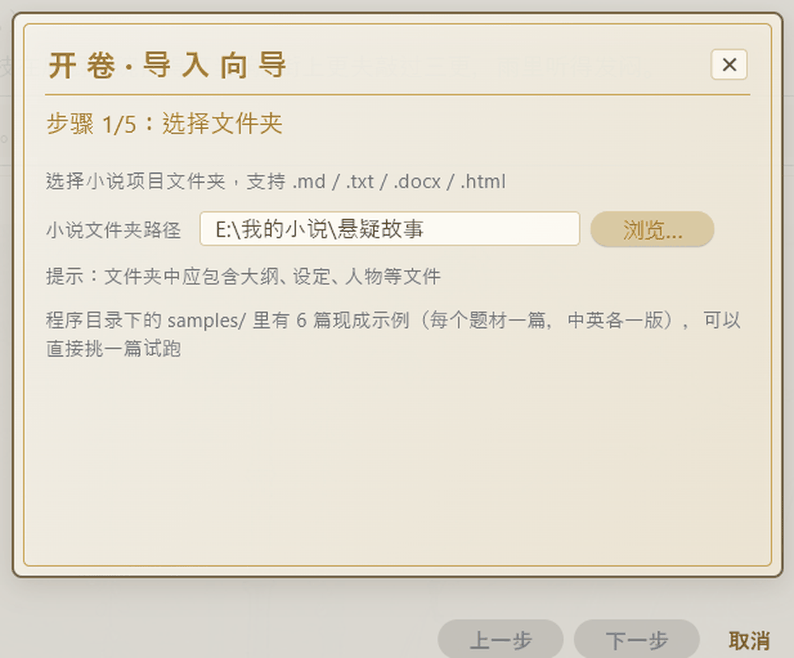

*开卷 · 导入向导（第一步：选小说文件夹）*

**五步分别是**：

1. **选择文件夹**：浏览或直接粘贴路径（未选文件夹时「下一步」不可点）
2. **项目设置**：项目名称、故事类型、风格来源
3. **AI 优化设置**：是否用 AI 优化设定、自动提取世界观与人物、生成故事进度表、生成风格卡
4. **剧组 Agents**（可以整步跳过，2026-10-11 新加）：给各个 Agent 写"这一本要它
     
   多做什么、少做什么"
5. **确认并开始**：核对摘要，点「开始摄取」

#### 第 4 步：剧组 Agents（可以整步跳过）

这一步列出剧组里的每一个职位（写小说的、改剧本的、场记、美术、审读…），
  
你可以给**这一本书**各写一句话。三条路，随便走哪条：

| 你怎么做            | 结果                                     |
| --------------- | -------------------------------------- |
| **填了**          | 就按你填的（只影响这一本，落在 `<项目文件夹>/agents/`）     |
| **没填**，且勾着下面那个勾 | 摄取完成后由 **AI 依据这本书的类型与风格**替你推一句（**推荐**） |
| **什么都不填、也不勾**   | 照「天机 · 剧组 Agents」里的软件默认跑               |

- 这是**可选的**：整步跳过，程序照常开卷。
- 写进去的是"这本书的侧重"，不是改职位定义 —— 想改职位定义（名字、系统提示词、
    
  出工时机）请去「天机 · 剧组 Agents」。
- 开完卷以后想接着改，去「书斋 · 剧组 Agents」（那里也能把你在这写的改成完整的
    
  系统提示词）。

**列表底下那一行是分页**：`上一页 · 第 1/4 页 · 下一页`，最右边是「**每页**」——
  
它旁边的下拉里**只有数字**（5 / 10 / 20 / 50），选一下就换每页几条。
  
（默认 5 条一页，和「天机 / 书斋 · 剧组 Agents」里的分页口径一致。）

> ⚠ 这一页的内容**宽度是 580**（= 对话框 600 减去滚动条那条车道后**刚好贴着**它）：
>   
> 右边那条灰色的自绘滚动条占着 24px 的车道，内容一旦超过它就会**钻到滚动条底下**
>   
> （2026-10-11 用户报的就是这个：「右侧滚动条把文字和下面的 Agent 列表的最右边
>   
> 重合了，盖住一部分」）。先钉成 520 又**太窄**（用户当天第二次：
>   
> 「你又调整的太窄了 稍微加宽一些 **刚好贴着滚动条**就好了」）—— 现在是 580，
>   
> 实测内容右边界距滚动条 8px。所以这一页每个会自己长宽的元素都显式给了宽度 ——
>   
> 判据 `tools/verify_wizard_agent_lane.py` 用像素量着钉住它。
>
> ★ 还有一条：**顶部那句「步骤 4/5」的标题不跟着滚**。它被钉在滚动区**外面**，
>   
> 滚的是它下面那块（用户原话：「滚动条动的时候 **标题不能动** 标题下面的动才对」）。
>   
> 向导的每一步都这样 —— 标题栏固定，正文才滚。

> **AI 推的那一句长什么样**：它会拿到这本书的类型、风格与设定摘要，然后逐个职位说
>   
> "悬疑就多盯线索物与误导，言情就多盯关系推进"这种**贴着这本书**的话；
>   
> 想不出这一本有什么特别的，它会**留空**（宁可空，不凑 ——
>   
> 给每个职位都写一句套话，等于把软件默认冻进项目里，以后改不动了）。

**★ 已经开过卷的书会被拦下。** 选完文件夹（或项目名撞上已有的）之后，向导
  
**当场**就提示「这本已经开过卷了」；点「开始摄取」还会再拦一次，弹一个框问清楚 ——
  
而不是像以前那样一声不吭地又开一遍（同名会复用同一个项目目录，新书的设定集
  
混进旧项目里，而你什么都看不到）。

框里给三条路：

| 按钮            | 做什么                                         |
| ------------- | ------------------------------------------- |
| **打开「已有的那本」** | 直接去看它（大多数人要的就是这个）                           |
| **仍然重新开卷**    | 重开一遍 —— 但**另存成一个新的项目名**（`书 (2)`），不覆盖已经开过的那本 |
| **取消**        | 回到向导，可以改路径或改名字再试                            |

判定认两件事：**项目名相同**，或**素材文件夹相同**（上次换过名字、这次又换一个，
  
名字不同但书还是那本 —— 也认得出）。路径比较是归一过的：尾随斜杠、正反斜杠、
  
Windows 大小写、从资源管理器复制来的引号，都不算两本。

> 想重开一本已经开过的书也没问题：点「仍然重新开卷」，它会开成新的一份，
>   
> 旧的那本一个字都不动。真正想覆盖，请先到「拾　卷」把旧的那本删掉
>   
> （删掉的会进「已删除备份」，可以找回来）。

#### 4.5.0 第 2 步的项目名称与三个下拉框

**项目名称**默认就填成**你在第 1 步选的那个文件夹的名字**，不用自己再打一遍；
  
觉得不对（比如文件夹叫「新建文件夹」、或者你想要个更好看的书名）**直接改就是了**。

两条要知道的规矩：

- **你自己改过的名字，程序不会再动它**。改完名字回头去第 1 步换一个文件夹，
    
  名字**还是你改的那个**，不会被新文件夹名冲掉。
- 只有「这个名字还是程序替你填的、你没碰过」的时候，换文件夹才会跟着更新；
    
  把名字**清空**也表示「我不要自动填的」，之后换文件夹也不会再塞回来。

（名字最终会变成项目文件夹名，其中的非法字符由程序自动处理，不用你操心。）

下面三个下拉框，界面上显示的是**人话**，写进项目文件的始终是**原始值** —— 两者别混：

界面上显示的是**人话**，写进项目文件的始终是**原始值** —— 两者别混：

| 故事类型（显示）                              | 存进 `.nwsproj` 的 `类型=` | 说明                                 |
| ------------------------------------- | --------------------- | ---------------------------------- |
| 自动判断（由 AI 读正文后决定）                     | `auto`                | 交给 AI 从正文里判定（默认）                   |
| 悬疑 · 单元剧 / 玄幻修仙 / 都市 / 历史架空 / 言情 / 科幻 | 同名（`悬疑·单元`、`玄幻修仙`…）   | **手动指定**：会**跳过 AI 的类型判定**，直接用你选的那个 |

| 风格来源（显示）                     | 存进 `.nwsproj` 的 `风格=` | 说明                                  |
| ---------------------------- | --------------------- | ----------------------------------- |
| 自动判断（从正文里学笔法）                | `auto`                | 由风格卡从正文样本里归纳（默认）                    |
| 朴素白描（不加修饰）                   | `plain`               |                                     |
| 冷笔白描（短句、少形容词） / 华丽辞藻（长句、意象密） | 同名                    |                                     |
| 自定义（在下方自己调）                  | `custom`              | **只有「书斋 · 项目设置」里有这一项**（那里才有调参数的输入框） |

**输出语言** —— 程序产出的**所有文字**用哪种语言写：

| 输出语言（显示） | 存进 `.nwsproj` 的 `输出语言=` | 说明                            |
| -------- | ----------------------- | ----------------------------- |
| 跟随界面语言   | `auto`                  | 界面是中文就输出中文，界面是英文就输出英文（**默认**） |
| 中文       | `zh`                    | **固定**输出中文，不管界面是什么语言          |
| English  | `en`                    | **固定**输出英文，不管界面是什么语言          |

- 管的是**推演产出**：每天的叙事、台词、旁白、故事文档、运行小结、大纲建议、
    
  开局方案、导出的小说稿 —— 都按它写。
- **原稿是别的语言也没关系**：可以拿一本英文小说让它推成中文，也可以反过来。
    
  它是**项目级**的，所以"英文稿推中文"和"中文稿推英文"在同一台机器上互不干扰。
- **专有名词保留原文写法**（人名、地名、书名不音译也不意译）—— 不然「王小明」会被写成
    
  `Wang Xiaoming`，全书人名跟着一起漂。
- 在**开卷向导第 2 步**或**书斋 · 类型风格**里改；书斋里改完**立刻生效，不用重启**。
- 它和「界面语言」（天机 · 界面外观）是**两件事**：界面语言管按钮和提示怎么说，
    
  输出语言管故事和文档怎么写。两个都可以单独定。
- 「书斋 · 项目设置」里的同名下拉和这里是**同一份清单、同一套名字**，改一处两处一起变。
- 切换界面语言时，显示名跟着变成英文（`Auto-detect` / `Plain and unadorned` / `Xiaoxia / cultivation`…），
    
  **存盘的值不变**（永远是上面那张表里的原始值）。手改 `.nwsproj` 时请写原始值。
- 第 4 步的摘要也按显示名念（「故事类型：玄幻修仙 / 风格来源：朴素白描（不加修饰）」），
    
  不会再把 `auto` 这种变量名摆到你面前。


### 4.5.1 摄取进度对话框（进度条 + 实时日志 + AI 对话）

点「开始摄取」后，向导关闭，弹出摄取对话框。**这里不会再卡死**——所有耗时工作都在后台跑，
进度条、日志、AI 对话实时刷新。

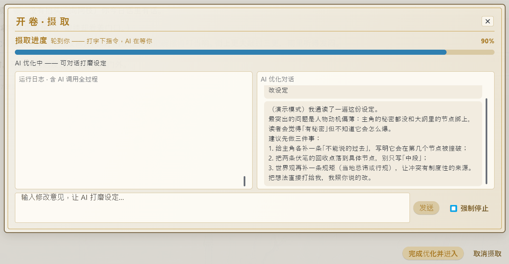


*摄取进行中：进度条推进，日志把每一次 LLM 的请求与响应都打出来；结束时弹出 AI 体检报告，可以直接打字让它改设定*

**四个阶段**：

| 阶段 | 进度 | 你能看到什么 | 你能做什么 |
| --- | --- | --- | --- |
| ⓪ 交付前确认 | 13% | **本地读完之后、调用 AI 之前**停下来：传进来了什么 + 要不要交给 AI | 勾选同意，或点「不同意，取消」（见 4.5.2） |
| ① 自动摄取 | 13% → 90% | 每个阶段名、每次 LLM 请求的 prompt 与响应全文、token 数与花费 | 点「取消摄取」中止 |
| ② AI 优化（勾选了才进入） | 停在 90% | AI 先给一份**体检报告**（问题 + 改进建议） | **在输入框打字**，像聊天一样让 AI 改设定；每轮 AI 回一条修改说明；**中途想打断正在跑的那一轮 → 点「⏹ 强制停止」**（见 4.5.4） |
| ③ 落盘 | 90% → 100% | 创建项目、冻结设定集、建运行文件夹 | —— |

- 输入框那一排有三个东西：**输入框 · 「发送」· 「⏹ 强制停止」**。
  第三个只在 AI 优化阶段可点，它是**打断当前这一轮**用的（不是取消整趟摄取）——
  一轮内部可能要走好几步工具 + 一次自查，真模型下几分钟很正常，这期间它是唯一的"停一下"。
  另外**轮数有上限**（默认 10 轮，见 4.5.4）：到上限就不收新指令了，但收工那个按钮一直亮着。
  这个**输入框是三行高的**（能一眼看见自己要发的一整段话），右边的两个按钮
  **居中落在它中间那一行**上（2026-10-11 用户要求：「最下面那个聊天输入的框
  我希望可以高度高一些 比如 3 行…右侧的发送/强制停止的按钮 移动到中间行」）。

- **跟它说话的方式**（2026-10-12 补上，用户点名的）：

  | 你可以说 | 它会怎么做 |
  | --- | --- |
  | 「**修复所有问题**」「把这 4 条都改掉」「这些都给处理了」 | 把**上面自查出来那几条**全部改掉（不必一条一条说） |
  | 「**修复4个问题**」 | 同上 —— 它会拿你报的个数对上它自查出来的条数，**对上就按整批办** |
  | 「**处理 1 2**」「先改**第 2 条**」「**前两个**」「**后两条**」 | 只改你点名的那几条（编号就是上面列出来的号） |
  | 「**不要问我**」「别问我」 | **从这一刻起不再问你**：拿不准的它自己按最合理的做法定，并把它的判断与理由写在回话里。（想恢复：说一句「**可以问我了**」） |
  | 「**至少3轮不要问我**」「接下来5轮别问我」 | 只在说的那几轮不问你，到点自动恢复会问 |

  ⚠ **它懂不懂，你看得见**：识别到这些说法时，对话栏里会先出现一句
  「我理解你要的是第 1、2 条」「好，接下来 3 轮我不会问你」——
  如果**没有**那句话，就是它没认出来，换个说法再说一遍即可（比闷着头猜要快）。

- 左边「运行日志」记录**全过程**：阶段推进 + 每一次 LLM 调用的请求/响应全文（文字可选中复制），
  想复盘 AI 到底收到什么、回了什么，看这里。
  **每完成一个阶段会画一条横线、空一行，再开下一个阶段** —— 中间那些请求/响应正文动辄十几行，
  不划线根本看不出阶段之间的分界。
- 右边「AI 优化对话」是**人话版**的优化过程：AI 体检报告 → 你下指令 → AI 说改了什么，可多轮来回。
  ★ **回车是换行，`Ctrl+Enter` 才发送**（2026-10-28）。
  一句话里经常要打两行（「这一条改：… / 另外还有…」），回车一按就发出去等于逼人不能换行。
  这行提示就写在**「发送」和「⏹ 强制停止」两个按钮的下面**，输入框一空提示也还在。
- ★ **报错与关键信息也会出现在右边这一栏**（2026-10-07 起）。以前它们只落在左边
  「运行日志」里 —— 而那条流水一轮开卷几百行、**超过 600 行还会把最前面的 100 行裁掉**，
  作者多半没看见，只会觉得"卡住了 / 没反应"，于是反复重试，或者把已经跑了一半的流程关掉。
  现在这些会**同时**以带 `【系统】` 前缀的气泡出现在「AI 优化对话」里：

  | 什么时候 | 右边多一条什么 |
  | --- | --- |
  | 某次 LLM 调用失败（会重试的也算） | `【系统】! LLM 调用失败（2/3）: HTTP 502 …` |
  | 输出被长度上限截断 / 一个字都没拿到 | `【系统】⚠ 输出被截断（撞到 max_tokens=…）…` |
  | 设定提取完成 | `【系统】✓ 设定提取完成 · 评档 黄金 · 人物 12 位 · 接下来可以在这里让我改设定` |
  | 项目落盘 | `【系统】✓ 项目已创建：E:\Projects\雨夜来客` |
  | 摄取失败 / 已取消 / 已中止 | `【系统】✗ 摄取失败：…` |

  三条规矩：**带 `【系统】` 前缀**（一眼区别于"AI 说的话"，不冒充对话）、
  **剥掉时间戳**（气泡里带 `[23:36:12]` 像日志行，不像一条消息）、
  **同一句话只进一次**（LLM 重试三轮不会刷成三条一模一样的；但带 `（1/3）`/`（2/3）`
  那种**各不相同的会都进** —— 你要看的正是"它在重试"）。
  左边日志当然一条都没少，它仍然是**全过程**的完整记录。
- 「摄取进度」**右边那行小字**是**跟大模型沟通到哪一步了**，等回复时会一直跳秒：
  「本地处理：读取与分章（这一步不联网）」→「准备调用 AI：提取人物与世界观」→
  「正在思考 · 等待回复（已等 12 秒 · deepseek-chat · 提取人物与世界观）」→
  「✓ 已回复 · 用时 3400 ms · 8120+640 token · 花费 ¥0.0041」→ 最后「✓ 全部完成」。
  **它会明说哪一步不联网、哪一步要花钱**，所以等的时候不必瞎猜是卡住了还是在跑。
- **万一 AI 的输出写太长、被长度上限砍断**（日志里会出现
  「⚠ 输出被截断（撞到 max_tokens=…）」），程序不会默默把设定集丢空：
  ① 它会**自动重试一次**（上限加倍 + 要求写短）；
  ② 还不行就**按能闭合的前半段抢救**，并在「提取人物与世界观」那一行写明
  「已按最长可闭合前缀抢救：救回 N 位人物」。
  **看到这行提示就去核对一下设定集** —— 抢救回来的是前半段，末尾的字段可能没写上。
  确认没问题再往下走；不放心就重开一次卷（源文件夹里的东西一个字都没动）。
- **「AI 体检」这一步也带同样的保护**。有些模型（尤其是**会先思考再回答**的那类）
  会把额度花在思考上，正文一个字都没剩下 —— 日志里会写成
  「⚠ 正文为空（撞到 max_tokens=…，N token 全用光，含思考内容）」。
  这时程序会**自动关掉思考、重发一次**（思考才是吃额度的那一半）；万一还是空，
  就会在对话里留一段兜底说明
  （告诉你"可以直接下指令"），**绝不会留一个空白的气泡让你猜**。
  这一类保护对**进度表、正文对齐、开局方案、风格卡、类型判定**同样生效 ——
  它们产出的是"列表"，而被砍断的列表以前会在不报错的情况下变成空的。
- ★ **「关掉思考重试」这件事，现在会如实告诉你是"正在救"还是"没救回来"**
  （2026-10-07 修）。以前这里报得不对：`router` 在**第一发失败**的当下就写一条
  红字「⚠ 正文为空…」，然后**自己悄悄关掉思考重试并成功** ——
  而"救回来了"这件事一个字都不说。作者于是看到一屏红字，以为功能坏了
  （实测某台机器的日志里：自愈触发 **101 次**、失败 **0 次**，即每一次都救回来了）。
  现在分两种写法：

  | 情况 | 现在怎么写 |
  | --- | --- |
  | 第一次没拿到、但**马上会自动关思考重试** | 普通提示（不是错误）：`⚠ 首次没拿到正文（max_tokens=… 被思考吃光）—— 正在自动关掉思考重试（不用你管）` |
  | 重试**成功**了 | 明说：`✓ 关掉思考重试成功，拿到正文了`（并且会记住这个用途） |
  | 连关掉思考**也没拿到** | 这才是错误（红字）：`⚠ 正文为空…而且这次**不会**自动重试 —— 请把这个用途的额度调大` |

  另外它会**记住**：某个用途一旦靠"关掉思考"救回来过，以后**直接关着思考发** ——
  不再白烧那一发（实测同一个用途：第一次 3.4 秒 / 两次调用，之后 0.9 秒 / 一次调用）。
  这个记忆**只在本次运行内有效**，重开程序会重新验证一遍 —— 免得换模型之后
  还带着一个过时的结论。
  两个相关开关：「天机 · 模型与额度」里的 **`LLM_NO_THINK_RETRY`**（空正文自动关思考重试）
  与 **`LLM_CAP_THINKING`**（允许这类模型关思考）。任一个关掉，就退回"只报错、不自动救"。
- 改到什么程度自己定：满意就点「完成优化并进入」；不想改就直接点它。
- 100% 后对话框**自动关闭**，直接进入运行界面（主界面）。
- 若第 3 步没勾「使用 AI 优化」，则跳过阶段 ②，自动摄取完直接落盘进入。

**指令怎么写**（自然语言即可）：
- 「把主角改个名字，姓氏换成李」
- 「加强主线悬念，把伏笔的回收点落到具体节点」
- 「世界观再冷一点，加一条当地禁忌」
- 「阿枝的性格改成外冷内热，补一个口癖」


#### 4.5.2 交给 AI 之前的确认（同意门）

**扫描、读取、分章都在本机做，一分钱不花**；从「提取设定」开始才联网调 AI。
所以管线在**第一次调用 AI 之前会停一下**，把「到底传进来了什么」摊给你看：

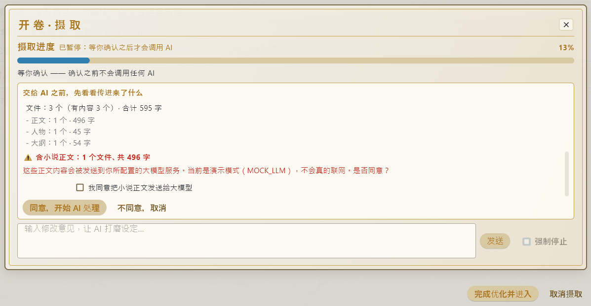

*交给 AI 之前：先看清传进来了什么、大概花多少 token，同意了才会发出去*

**两条警告是有条件出现的，各自要单独勾选**；没勾完「同意」是灰的。
只有**确实有内容**的警告才会出现 —— 没读到正文、内容也不多时，这一页只列概览、
直接点「同意」即可（会写一句「没有需要特别确认的事项」）。

| 警告 | 什么时候出现 | 说的是什么 |
| --- | --- | --- |
| **含小说正文** | 有 `正文/` 里读到的内容 | 这些正文会被**发送到你配置的大模型服务**（面版上会写明发到哪个域名；演示模式则明说不会联网）。这是隐私相关，必须你点头 |
| **内容比较多** | 源文件总字数 ≥ 6 万字 | 这一趟会消耗较多 token，并把**本次预计花费**列出来 |

- 点「不同意，取消」= **立刻中止，一个 LLM 请求都不发**，不会有任何花费，也不会建项目。
- 面板出现的时机是进度 **13%**，日志里会留一条「本地文件已读完…下一次点击才会开始调用 AI」。
- **数字怎么来的**：各步送进提示词的内容都有硬上限（**提取设定最多 20000 字**（2026-10-27
  从 12000 提上来）、类型判定 3000 字、风格卡 4000 字、进度表 4000 字、正文对齐 8000 字），
  所以"预计 token"是按这些上限算的，不是拿源文件大小瞎乘一个系数。单价取当前**摘要档**模型，
  自己配的价目覆盖也照用。
- **「中间会被截断」是实话**：源内容超过上限时，超出部分不会送出去。
  不过**提取那一步不是掐头留尾**了（2026-10-27 改）：它按
  `规则 → 人物 → 伏笔 → 设定 → 杂项` 的重要性**整份取舍**，砍谁都写在开卷日志里。
  ⚠ 另外 `06_地图`、`写作参考` 两个目录和 `正文` / `大纲` 类的文件**各有专门通道**，
  根本不占这份预算 —— 想让 AI 读到完整正文，仍是先把正文分卷、或把要用的那部分单独放。

> 这条闸门只挡"把内容交出去"这件事。**确认之后**才进 AI 优化对话（4.5.1 的阶段②），
> 那里每轮对话同样会消耗 token，按**日常档**计价。


#### 4.5.3 AI 补全缺口并回写引用文件夹

开卷时 AI 会发现一些**它自己就能修好**的小毛病（缺的伏笔清单、人物条目里空着的字段、
编码不对的文档……）。勾了向导第 3 步的「AI 补全缺口，并回写引用文件夹」之后，
它会在摄取结束、**创建项目之前**停下来，把这些列成一份清单让你过目：

```
AI 发现 4 处它可以自己修好的问题
· 缺 伏笔清单
   → 落点：伏笔.md —— AI 读正文找出埋设点与预计回收点，追加到 伏笔.md 末尾
· 人物空缺字段（1 位 · 共 4 处）
   → 落点：人物.md —— AI 从正文补齐这些字段，写入 人物.md
· 草稿.txt 不是 UTF-8（UTF-16）
   → 落点：草稿.txt —— 转成 UTF-8（正文一字不改，旧文件先备份为 草稿.txt.bak）
· 1 个文件看不出属于哪一类
   → 落点：AI补全设定.md —— AI 判断它们其实是哪一类，写进 AI补全设定.md（不改你的文件名）
☐ 我同意让 AI 按上面的做法修复，并写回引用文件夹
[同意修复并回写]  [跳过，不改引用文件夹]
```

**它会补什么**（只有这三类，其余一概不碰）：

| 类别 | 例子 |
| --- | --- |
| 评档缺口 | 缺伏笔清单 / 人物没有秘密与口癖 / 缺大纲 / 世界观太短 |
| 人物空缺字段 | 人物条目里空着的 身份 · 性格 · 口癖 · 目标 · 红线 |
| 格式与归类 | 不是 UTF-8 的 `.md`/`.txt`；文件名里看不出类别的素材 |

**它不会补**「至少 2 个有姓名的人物」和「正文」这两类缺口 —— AI 造不出人物和正文，
硬凑就是编，那比缺着更坏。

**你的原文件会被怎么动**（三条铁律）：

1. **只追加，不改写。** 补全内容写在目标文件**末尾**的一个
   `## AI 补全（日期 时间）` 小节里，你原有的文字**一个字符都不动**（连换行都保持原样）。
   引用文件夹里没有对应文档时，新建一份 `AI补全设定.md` 装这些内容。
   文件名里看不出类别的那些，不改名、不搬家 —— 只在 `AI补全设定.md` 里写清
   「它是哪一类」，并记进一份程序读的归类表（下次开卷就按修正后的类别读）。
2. **改之前先备份。** 每个被改动的文件旁边留一份同名 `<文件名>.bak`；
   已经有一份 `.bak` 时不覆盖它 —— 保留的是**最早那次**的样子，那个版本最能救命。
   `.bak` 不在读取范围内，不会被当成素材。
3. **只改 `.md` 和 `.txt`。** `.docx` / `.html` 一概不碰（往里追加纯文本会把文件搞坏）。

**项目开始之后就不再动它了。** 这是硬边界：这份清单确认完、项目文件夹一建立，
程序对引用文件夹就**只剩读**了 —— 拒绝的动作在写入口内部
（`ingest/repair.py` 会检查项目里有没有 `.nwsproj`），不是靠界面拦一下。
所以想看 AI 补了什么，趁开卷这一步；跑起来之后再想改素材，得自己动手。

**不想要这一步**：向导第 3 步取消勾选「AI 补全缺口，并回写引用文件夹」，
或者在这份清单上点「跳过，不改引用文件夹」—— 两种做法都是**一个字节都不写**。
清单里没有可修的问题时，这一步连模型都不会调（不花钱），只在日志里记一行。


#### 4.5.4 打磨 Agent：它记得住、会动手、还会自查

第 4.5.1 节那个「AI 优化对话」从 2026-10-07 起是**一个真的 Agent**，
不是一个"问一句答一句"的对话框。四件事跟以前不一样：

**① 它记得整场对话。** 你说过的每一句、它查过的每一份文件、它改过的每一处、
开卷时那份体检报告 —— 全都留在它的上下文里。所以下面这种话它接得住：

> 「就按你刚才说的第 2 条改。」
> 「刚才那个改名先撤了，换回原来的。」
> 「刚才你查的那份大纲里，第二幕那个转折是写在哪一段？」

（以前不行：每次只把"你这一句 + 当前设定"发出去，它看不到自己上一条说过什么。）

**② 它会自己动手，不只是回一段 JSON。** 它手上有这些工具（**在一份可见的清单里**，
系统提示与日志里都写着）：

| 工具 | 干什么 |
| --- | --- |
| 读设定 / 改设定 | 「改设定」是**结构化打补丁**（改哪一处、改前改后都报出来），不是把整份设定抄一遍回来 |
| 列引用文件 / 读引用文件 / 检索引用 | 直接翻你导入的那个文件夹 |
| 追加回写 | 往引用文件夹**追加**一段（只追加、自动留 `.bak`） |
| 写记录 | 在打磨暂存区写文件（`打磨记录.md` 这类） |
| 生成工具 / 跑代码 | **现场写一个 Python 小工具给自己用**（见下） |
| 收尾 / 提出疑问 | 做完了收口，或者信息不够时反问你 |

**③ 内置工具不够用时，它会当场写一个。** 比如这本书有四十个人物，你想按姓氏归并 ——
它可以直接写一个「按姓氏归并」的工具、落盘、**立刻调用**，
之后每一步都能用（换一次开卷也还在：下次会从项目的 `AI工具/` 里装回来）。

> **它写的代码在沙盒里跑**，而且**不是靠自觉**：
> · 代码执行前过一遍静态审查（危险导入、双下划线属性、`open`/`eval` 这类一律拒，
>   拒的时候会**说清为什么、该用什么**）；
> · 执行在**子进程**里 —— 超时能真的杀掉（同进程里杀不掉死循环的线程）、
>   崩了不连累主程序；
> · 它只能看到两个目录：**引用文件夹**（读 + 只能追加）和**打磨暂存区**（可写）。
>   路径带 `..`、盘符、绝对路径一律拒绝；生成的代码**连追加都不许做** ——
>   想动你的素材，只能走内置的「追加回写」。
> · 单次跑的硬超时是 `POLISH_SANDBOX_TIMEOUT`（默认 20 秒）。

**④ 做完会自查一遍。** 收尾之后它**换一双眼睛**，拿"你的原话 + 全过程 + 改完之后那几处长什么样"
回头查四件事：**漏没漏 / 改坏没有（跟人物原本的口吻对不对得上、人名伏笔编号有没有写乱）/
有没有动你没让动的 / 有没有编造**。查出问题就**带着意见再走一轮**把它改掉；
一轮没解决完，它会把剩下的问题原样告诉你（不藏）。

**结果写到两个地方**（同一份文本，不是各写各的）：

| 落在哪 | 是什么 |
| --- | --- |
| **项目里** `<项目>/打磨记录.md` | 改了什么 · 生成了哪些工具 · 过程里调过哪些工具 |
| **引用文件夹** `AI打磨记录.md` | **一模一样的一份**（只追加、留 `.bak`） |

项目里还会多一个 `AI工具/` 目录（如果它现场写过工具）。

**想调**（天机 ·「运行」→「开卷打磨」那三个数，改完不用重启）：`POLISH_MAX_ROUNDS`
（最多来回几轮，见下）· `POLISH_MAX_STEPS`（一轮最多几步）· `POLISH_MAX_TOOL_CALLS`
（一场最多调多少次工具）· `POLISH_AGENT`（总开关，关掉退回老的"一问一答"）·
`POLISH_TOOLS`（要不要让它写代码）· `POLISH_REFLECT` / `POLISH_REFLECT_ROUNDS`
（自查与返工轮数）· `POLISH_SANDBOX_TIMEOUT` · `POLISH_WRITE_BACK`（要不要把结论写回引用文件夹）。

> **关掉 `POLISH_TOOLS` 之后**，「生成工具」和「跑代码」会明确拒绝，
> 而不是"偷偷还能跑" —— 这个项目对"假开关"是零容忍的。

**⑤ 轮数有上限，跑偏了随时能叫停。** 这一屏有两个"刹车"，别搞混：

| | 是什么 | 什么时候用 |
| --- | --- | --- |
| **轮数上限** | 你**每发一条指令算一轮**，最多 `POLISH_MAX_ROUNDS` 轮（默认 10）。到上限就**不再收新指令**：输入框变灰，并提示你点「完成优化并进入」 | 防着一路聊下去把钱烧光。想接着聊，把上限调大（天机 ·「运行」→「开卷打磨」→「优化轮数」）再重新开卷 |
| **⏹ 强制停止** | 右边那个按钮。**随时可点**，把**正在跑的那一轮**打断 | 它正在查资料 / 改设定，你发现方向不对 —— 按一下它立刻停手 |

几条要留意的：

- 一轮 AI 优化**内部**可能要走好几步工具 + 一次自查，真模型下**几分钟很正常**。
  这段时间里「⏹ 强制停止」就是唯一的"停一下"。
- **它停的是这一轮，不是整趟摄取**：停完你还留在这一屏，可以接着下指令；
  它**已经改好的设定会保留**（不会回滚），对话栏里会有一句
  「⏹ 这一轮被你停掉了（已经改好的设定保留，可以继续说下一句）」。
- 要**整趟中止**（连项目都不建）用另一个按钮「取消摄取」—— 两个按钮干的是完全不同的两件事。
- 到上限之后输入框会灰，但**「完成优化并进入」一直是亮的** ——
  上限只关"再聊一轮"，不关"收工"。


### 4.5.5 拆书对话框（把一本好书读成写法）

**读的是什么，和开卷有什么不一样** —— 这两个功能最容易混：

| | 开卷（§4.5） | **拆书**（本节） |
|---|---|---|
| 读的书 | 你**自己要写**的那本书的素材 | 你**觉得写得好**的那本书 |
| 读成什么 | 设定集（人物/地点/伏笔/进度节点） | **写法**（情节 / 节奏 / 人设 / 文风 / 结构） |
| 放在哪 | 项目里（开始推演用） | `skills/book-dismantle/<书名>/`（技能库） |
| 怎么读 | 尽量读全 | **读不完** —— 分层取样，只读该读的 |
| 以后怎么用 | 设定进提示词 | 写**同类**故事时，匹配上的写法被剧组引用 |

一句话：**开卷是"把这本书变成我的世界"，拆书是"把这本书变成我的本事"。**

#### 打开之后问你五件事

| 问 | 为什么要问 |
|---|---|
| **这本书叫什么** | 只用来给拆出来的技能包命名 |
| **它是什么类型** | 写得越准，以后越容易在同类书上被用起来（匹配就是按类型） |
| **这是本什么书**（2026-10-27 新增） | **小说** 拆成"写法"；**专业书 / 资料书**（如《中国古代建筑史》）拆成"**素材条目 + 出处**"。留「自动」让程序判 —— 判错了代价是一整本废条目，所以给你这条人工兜回来的路 |
| **你觉得它哪些地方好** | **这一条最要紧** —— 拆解会**优先看这些地方**：它们好在哪儿、用的什么办法 |
| **想重点拆什么** | 比如"对话怎么写得像真人"。不填就按标准维度全拆一遍（骨架/人物/情绪/情节/结构/语言/设定） |

#### 从哪儿读：四个按钮，**选一个**（2026-10-10 起）

对话框里有一排按钮，**四个排在同一行**（距离收紧了，不会折行），而且**同一时刻只有一个生效**
（选中的那个是实心的，其余是文字的）：

| 按钮 | 说明 |
|---|---|
| **选一个文件** | 见下面「支持哪些格式」。**认不出的格式会明说**（不会读出乱码当正文） |
| **选一个文件夹** | 里面装着一堆上面那些文件（一本书被拆成多份时最常见）。**一个文件一篇地切**，文件名就是章名 |
| **网址** | 点它会**弹出一个对话框**，在里面填书的**章节目录页**地址。程序去爬每一章（只读，不改对方任何东西，两次请求之间留间隔）。点「确定」才算选中；点「取消」则维持原来的选择 |
| **用 sample 测试** | 手上还没有书时最快的上手路径：拿随附的样例试一遍 |

> **这四个是"四选一"**：确定了一个，先前选的那个就自动取消。
> 所以不存在"填了网址到底还算不算数"这种问题 —— **只看哪个是实心的**。
> 填过的网址会显示在按钮下面那一行（对话框里看不到输入框，它收起来了）。
> 抓不到就说抓不到：索引页上挑不到章节链接时，**把这一页本身当成一章**；
> 有几章没抓到，会照实记账 —— **别把残缺的这一轮的结论当成全书的结论**。

#### 支持哪些格式（2026-10-27 起：电子书 / 老式文档 / 扫描件都能读）

| 格式 | 怎么读 |
|---|---|
| `.txt` `.md` | 直接读（非 UTF-8 会自动探测编码） |
| `.docx` | 现代 Word |
| `.html` `.htm` | 只取正文（标签、脚本、样式都不算字） |
| `.pdf` | **文字版**直接抽字；**扫描版**（整页抽不出字）自动转去 OCR |
| `.epub` | 按书自己的 **spine 顺序**读（不是按文件名排） |
| `.mobi` `.azw3` `.azw` | Kindle（要 `pip install mobi`） |
| `.rtf` / `.odt` | 富文本 / OpenDocument |
| `.doc` `.wps` `.et` `.dps` | 老式 Office 与 **WPS**：先请本机装着的 Word / WPS 转出正文；没装就用 `olefile` 硬抽回退 |
| `.jpg` `.png` `.webp` `.bmp` `.tif` | **图片**（一页一张，或一堆图拼成一本书）走 OCR |

> **扫描件 / 图片要装 OCR**：`pip install rapidocr-onnxruntime pypdfium2`
> —— **离线跑**，不接云端、不上传你的书。没装时不会假装读过，会明说"要装什么、装完再来"。
> OCR **一页一页**跑，进度照实报（「① OCR 识别（扫描件） 3/20」）；中途点停止，
> **已经认出来的那些页照常交出来**（不是全部作废）。
> 一页要几秒 ⇒ 几百页的扫描书建议先用下面的「选择范围」只拆一段。

> ⚠ 读出来**不像人话**（比如净是 `%\x11?` 这种噪点）时，程序会**照实说读不出来**，
> 而不是把噪点当正文往下拆 —— 拆一堆乱码等于白花一次额度。

#### 只拆一段（拆书本来就不用全拆）

「选择范围」那一栏，写什么都行：

| 写法 | 意思 |
|---|---|
| 留空 | 整本（按下面的分层取样读） |
| `1-10,15-21` | 第 1~10 与第 15~21 段（按源自己的单位：有页按页、有章按章） |
| `前10页` / `前3章` | 最前面那一段（写「页」就按页、写「章」就按章） |
| `第5章-第8章` / `第一章` | 按章；中文数字也认（`第二十三章`） |
| `最后2章` / `5-` | 尾部两章 / 从第 5 段到结尾 |
| `井底` | **按章节名里的字**挑（章节名含「井底」的那几章） |

写错了**当场看得见**（输入框下面那一行会立刻回显"只拆：…"或者报错），
而且**看不懂就不让开跑** —— 跑了就等于按"整本"拆，而你以为只拆了 10 页。

> 范围**越界不算错**：写 `1-9999` 而这本书只有 30 章，就是 30 章（照实报）。
> 单位对不上会说明：对一份没有"页"的 txt 写"前 10 页"，它会按**章**取前 10 并说清。
> 报告里也会写明**只拆了哪一段、源里一共多少**（不然以后回头看，分不清
> "这本书就这么点"还是"只拆了一截"）。

> **不用传全书** —— 传一部分也行。程序自己分层取样：**开头几章必读**
> （作者的全部本事在那儿用过一遍）、**尾部也留**（网文按章收钱，
> 尾部最能看出靠什么留人）、中间均匀取。取样是**确定的**：同一本书拆两次
> 得到同一批章，结论可以复核。

#### 它怎么读（四道工序）

```text
① 分章     第X章 → 章节表（本地，零成本）
①b 判类型   这是小说还是专业书（本地，零成本；你在对话框里选了就不判）
② 粗扫     分批读，每章一句话 + 功能（推进/立人/伏笔/钩子）+ 情绪强度
           → 得到这本书的**波浪线**（哪里在压、哪里在爆）
③ 精读     挑出来的重点章逐段读 → 这一层才谈得上"手法"
           · 小说：你说好的地方 + 情绪最高的几章 + 开头三章
           · 专业书：按**信息密度**挑 —— 前言 / 序 / 索引 / 参考文献
             这些"字不少但拆不出东西"的章节**直接跳过**（不浪费一次 LLM）
④ 归纳     跨章提炼 → **可复用的写法**（这一步做不好，拆书就只是读书笔记）
```

**四道工序都是真读**，进度一行行报出来（"② 粗扫 3/5"这样），能看出它读到哪儿了。

#### 拆小说和拆专业书，拿出来的是两种东西

| | 小说 | 专业书 / 资料书 |
|---|---|---|
| 拿出来 | **写法**（情节/节奏/人设/文风/结构） | **素材条目**：术语 / 事实 / 规矩 / 案例 / 边界条件 |
| 每一条都带 | 能不能换个题材照样用 | **出处**（哪章哪一节）+ **能怎么用** + **什么情况下不成立** |
| 挑章依据 | 情绪强度 | 信息密度（空章跳过） |
| 以后怎么用 | 写**同类**故事时被剧组引用 | 写的时候被当成**可查的料**（不是拿来抄 —— 素材必须改写，不许成段照搬） |

> 判类型**判不准**时（既像叙事又像考据）会报「混合」，并按**素材线**拆，
> 同时告诉你"想要写法线就把类型填成「小说」再拆一次"。

#### 拆出来的东西长什么样

落在 `skills/book-dismantle/<书名>/`（**两级**：拆书产出的技能归在一处，
不跟手写的考据技能混在同一层），**一个包自包含三份**：

| 文件 | 给谁看 |
|---|---|
| `SKILL.md` | 给程序（Agent 按类型取用；格式与 `skills/` 里那八个考据技能一样） |
| `digest.json` | 给程序（结构化，不用去解析 markdown） |
| `拆书记录.md` | **给人**（完整报告：逐章概览 + 精读笔记 + 这一轮的说明） |

每条**可复用的写法**都写四样：

* **怎么做** —— 具体到能照着执行
* **什么时候用** —— 什么处境下该想起它
* **为什么管用** —— 读者/观众那边发生了什么
* **这本书的例子** —— 一句话说它出在哪儿（**只作证，不作内容**）

还有三节：**节奏**（压多长、爆多大、单元多长，可以当模板）、
**立人的套路**（不是某个人物的设定，是作者立人的共同手法）、
**文风**（具体到能照着写，不是"文笔好"这类评价）。

★ 最要紧的一节是 **「换本书就不能用的」** —— 这一节和上面同样重要：
**知道什么不能照搬，才不会学坏。** 它不许空着（说不出不适合什么，说明还没看清）。

#### 以后怎么被用上

开卷时（以及每次装配时）程序按**类型**去技能库里找：

| 档 | 比什么 | 例子 |
|---|---|---|
| ① 类型相符 | 当前书的 `主题材/结构` 与拆的那本的**适用类型**有公共片段 | 当前"悬疑灵异" ↔ 拆的"悬疑·单元剧" |
| ② 关键词重叠 | 题材 / 钩子库 / 爽点模式 / 人物原型库 里的词重叠 | 两边都有"伏笔" |
| ③ 你问到的 | 当前书里作者手写的那几句（书斋·自定义风格、本幕提示）里出现模块名 | 你写着"钩子"，它就把那本拆过钩子的想起来 |

命中的话：

* **每个职位**都会在"手艺"那一段里多拿到一段**压缩版**（模块名 + 怎么做）；
* **三人小组（小说作家 · 剧作家 · 导演）+ 编剧室**拿到的是**完整版**
  （再加节奏 / 立人 / 文风 / **不要照搬什么**）—— 因为这几位决定"这个故事怎么讲"，
  而写法经验正是用在这一层上。

**除了拆书经验，各职位还会按需取用 `skills/` 里装着的知识包**
（手写的考据类：中医药方常识 / 兵器甲胄 / 官职品级对照 / 节气物候…）：

* 检索用**题材 + 这个职位这一刻的活儿 + 你在书斋手写的那几句**一起查 ——
  资料员查得到药方，道具查得到器物，造型查得到纹样；
* 挑到的知识卡**给要点**（摘要进提示词），**每个职位最多两份**（多了会把注意力淹掉）；
* **拆书技能只给索引**（"库里还有哪几份跟这一刻沾边"）—— 它的正文上面那一段
  已经给过了，**同一份内容只给一次**（给两遍，模型会当成两条独立经验）。

> **匹配不上就一个职位都不引用**（不硬塞）。把一本言情的写法塞进悬疑，
> 比不引用更坏 —— 这是"引用经验"最常见的翻车方式。
>
> 运行文件夹里会落两份**可以核对**的档：**`本书可参考的写法.md`**
> （这一本用上了哪几份拆书经验、**凭什么**、拿过来了哪几条；库里还有哪些没匹配上）
> 与 **`本书可用的技能.md`**（**逐职位**列它这一刻挑到了哪几份知识包）。
> 作者要能核对，不能只有一句"智能匹配"。

#### 想调

| 旋钮 | 作用 |
|---|---|
| `BOOKLAB_ENABLED` | 拆书总开关（关掉后菜单那项会说明它被关了） |
| `BOOKLAB_MAX_BATCHES` | 粗扫最多跑几批（默认 26 —— 一本长篇分层取样后约 24 批） |
| `BOOKLAB_LESSON_PACKS` | 一次最多引用几本拆书经验（默认 2；多了会挤掉别的上下文） |
| `BOOKLAB_SKIP_WRITERS` | 关掉后**三人小组也只拿压缩版**（省 token） |
| `CREW_SKILL_ROUTE` | 各职位**按自己这一刻的活儿**从 `skills/` 里挑知识包；关掉则完全不查技能 |
| `CREW_SKILL_LIMIT` | 每个职位最多带几份知识包进提示词（默认 2；一张卡 5 K，全塞进去会把注意力淹掉） |

> **成本**：拆一本书大致 20~30 次便宜档调用（粗扫）+ 1 次日常档（精读）
> + 1 次高档（归纳）。**只有拆的时候花**；存下来之后，每次开卷只是读文件、零调用。


### 4.6 拾卷对话框（项目列表）

点击「拾卷」后弹出项目列表对话框。


*拾卷：上面选项目，左边存档列表，右边详情*

**功能**：
- 显示所有已有项目
- 显示项目类型、存档数量、最后运行时间
- 选择项目后可查看存档详情
- 支持删除项目


### 4.7 天机对话框（全局设置）

点击「天机」后弹出全局设置对话框。

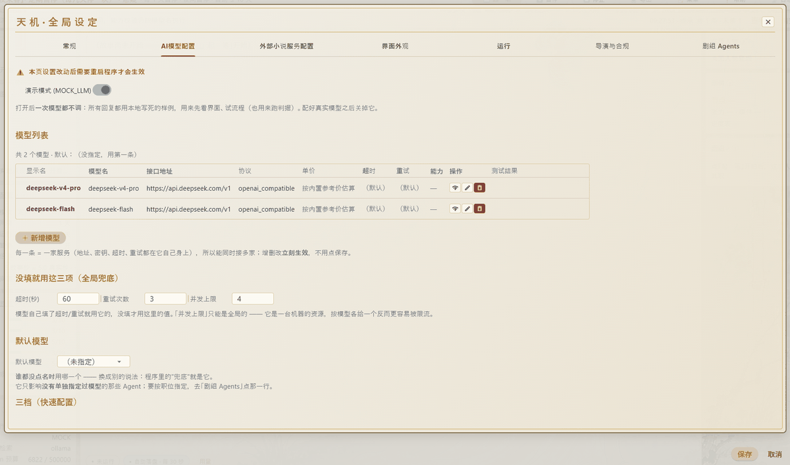

*天机 · 程序设置（选项卡：常规 / **AI模型配置** / **外部创作服务** / 界面外观 / 运行 / 导演与合规 / 剧组 Agents）*

**配置项说明**：
- **API Key**：LLM 服务的 API 密钥
- **Base URL**：LLM 服务地址
- **演示模式**：开启后不发真实 API 请求
- **华彩档**：用于关键事件、重要对话的高质量模型
- **日常档**：用于常规循环的模型（推荐便宜模型）
- **摘要档**：用于压缩、打分的模型（推荐便宜模型）
- **每日预算**：每天最多使用的 token 数量
- **告警阈值**：达到预算的百分比时发出警告

> ⚠️ **改完 LLM 相关设置要重启程序。** `推演服务LLM设定` 这一页（以及
> `对话插图` 那两项）改动之后**不会立即生效** —— 对话框顶部有一条醒目的提示，
> 点保存后也会在「消息」框里再提醒一次。原因是 LLM 客户端在启动时一次性建好
> （连接池、认证头、并发信号量都在那一刻定死），运行中改了也不会自动重建。
> 界面不透明度、语言、日志级别这些**不需要**重启，保存后立即生效。

#### 4.7.1 「剧组 Agents」选项卡：这个软件有哪些职位

这是 2026-10-11 新加的一页。它管的是**职位本身**（每一个 Agent 的名字、作用、
系统提示词、什么时候出工），不是某一本书。

**数据落在哪**

| 层 | 位置 | 什么时候用 |
|---|---|---|
| 软件默认 | `<程序目录>/agents/<英文名>.md` | 跨所有小说生效，**首次运行时自动生成** |
| 项目定制 | `<项目文件夹>/agents/<英文名>.md` | **只对那一本生效** |
| 有效属性 | 上面两层合并（运行时算，不落盘） | 每次推演用到的就是它 |

- 一个职位一个 `.md`，**文件名是英文**（`novelist.md` / `art_director.md`…）；
  **正文本身就是那个职位的系统提示词**，frontmatter 里是它的属性。
  可以直接用记事本改（改完**当场生效**，不用重启），也可以在界面里改 ——
  两边是同一份文件。
- 同目录下的 `README.md` 是**英语名 ↔ 中文名对照表**，会随职位增删自动更新。
- **项目层只写你改过的那几项**：没改的仍然跟软件默认走 ——
  这样以后升级软件、内置提示词改好了，你没碰过的部分会跟着更新。
  想退回软件默认，把项目层那个文件删掉（界面上是那一行右边的「恢复默认」）。

**界面怎么用**

- 列表上一行一个职位：**名字 · 作用 · 系统提示词的开头**，右边有「软件自带/自建」
  和「本项目已定制」两个小标。
- **点那一行**打开编辑对话框：名字 · 英文标识（＝文件名）· 简介 ·
  **什么情况下使用** · 出工时机 · 模型档 · 产出交给 · **系统提示词**。
- **分页默认每页 10 个**，右下角可以改（5 / 10 / 20 / 50）。
- **新建与删除只在「天机」（软件层）做**：
  - 「＋ 新建职位」建一个自己的职位（英文标识就是它的文件名）；
  - 自建职位那一行有垃圾桶，**确认后才会删**（会列清删的是哪个文件）；
  - **软件自带的职位不能删**，只能改 —— 它们是程序的一部分。
- **「书斋 · 剧组 Agents」是同一套界面，只是不能新建和删除**：
  那里写的是"这一本书"的定制。
  ⚠ 而且**书斋里「演员」会按出场人物摊开**（一人一行，见 4.7.1 下面那张
  四层表）：`设定集/人物.yaml` 里几个人就几行「演员·<人名>」，群众演员
  仍是单独一行；**天机里不变**（那里没有"这本书"，演员就是一行）。

**表格的列宽可以自己调**（2026-10-13）：

- 把鼠标压在**表头两列之间那条缝**上左右拖，松手就存下来了。
- **天机与书斋各存一套**，互不干扰；下次打开还是你调好的宽度。
  - 天机那一份在**程序目录**的 `.ui_state/agent_col_width.json`；
  - 书斋那一份在这本书的 `设定集/agent_col_width.json`。
- 想回到出厂宽度，点表格下面那个「**恢复默认列宽**」（当场就变，不用重开）。

> 出厂时**天机**的「档位 / 标记」各窄 10px、**书斋**的「档位 / 模型 / 产出」
> 各窄 10px，让出来的像素都给了「提示词」那一列 —— 所以表格总是**刚好占满
> 页签、没有横向滚动条**。「标记」那一列是**两行高**，「软件自带 · 本项目
> 已定制」这种长标记才不会被截掉尾巴。

**自建职位怎么出工**：每天**收工时**出工一次，产物落在那一轮运行文件夹里的
`自定义-<名字>.md`。出工时机固定为"每天"（逐拍出工那一档要主循环里接线，
自建职位没有那条线 —— 给一个选了不生效的选项就是骗人）。

> 想改得更细（比如让某个职位**每一拍都看一眼**），改的是**软件自带的职位**
> 那一行的「出工时机」。

##### 演员：系统层设什么、项目层设什么

演员是唯一一个**"系统层没有具体角色、项目层才有"**的职位 —— 所以它的设置
分成**四处**，按"换什么它才变"排（越靠下越具体、越该压过上面的）：

| 层 | 在哪里设 | 设的是什么 | 换什么它才变 |
|---|---|---|---|
| ① **系统 · 职位** | 天机 · 剧组 Agents → `actor.md` | 演员**这个工种**怎么干活（自我要求、边界） | 换软件版本 |
| ② **系统 · 类型库** | 天机 · 剧组 Agents →「**演员类型库**」按钮 | **预写好的各种演员**怎么说话（24 型：句长 / 语速 / 身体习惯 / 待人接物的底色，每型还有 3 条以上**变奏轴**） | 换软件版本 |
| ③ **项目 · 剧组** | 书斋 · 剧组 Agents → `actor.md` | 这**一部戏**的演法基调（"这本对白要收着"） | 换书 |
| ④ **项目 · 角色** | 书斋 · 剧组 Agents → **每个出场人物一行**（「演员·主角」…） | **张三这个人**演成什么样（演员类型 / 变奏 / 选角细读 / 打破类型） | 换人 |

> **书斋里的「演员」不是一个格子，是"一人一个格子"。**
> 2026-10-13 用户点名：「演员不再是一个单独的Agent 还是按照出场人物
> 每人一个Agent 最后群众演员单独一个Agent」。所以书斋那一张表里：
> - `设定集/人物.yaml` 里**每个出场人物各占一行**，职位列写「**演员·<人名>**」
>   （档位 / 模型 / 出工 / 产出 / 作用 / 提示词这些列仍然是"演员这个工种"
>   的属性，跟人物无关）；
> - **群众演员仍然是单独一行**，排在角色那一组之后；
> - 点某个角色那一行（或它右边的 👥）**直接进那个人的「角色设置」**；
> - ⚠ **天机（软件层）不动**：那里没有"这本书"，演员仍然是一行 ——
>   那是"演员这个工种"，不是某个人。
> - ⚠ 这些角色行只是**界面上的视图**，**绝不写进任何 md**
>   （一份 md 是全组通读的，写进去就串台）—— 它们的数据都在
>   `设定集/人物.yaml` 里，一人一份。

**一句话记法**：①②管"**怎么演**"（演员自带的，一本书换不到），
③④管"**演谁**"（剧本给的，一部一换）。两层冲突时**以角色为准** ——
这句话是写进提示词的（`actors/casting.py` 的仲裁规则），不是靠自觉。

> ⚠⚠ **具体角色绝对不能写进 ①②③ 任何一份 `.md`。**
> 一份 `.md` 是**全剧组通读**的：把"张三高冷、李四热情"写进去，
> 等于让**每个角色都读到别人的设定**（张三会知道李四的秘密）——当场串台。
> 所以角色有自己**一人一份**的地方（④）。界面上也写着这句提醒。

**④ 怎么写、写到哪**

- 点演员那一行右边的 👥 → 列出**这本书的全部角色**（来自 `设定集/人物.yaml`），
  每个角色一行，显示他现在的演员类型；点开就能改那四项。
- 「演员类型」留空 = **自动配**（程序按性格/身份从类型库里挑）；自己选一型 =
  以你为准（这一条本来就写在人物卡上，界面只是给它一个入口）。
- 「这一份的变奏」跟着所选类型走（同型多人靠它分流，不然两个"青年·高冷"
  写出来一模一样）。
- 「选角细读」和「打破类型」是**可选但很值**的两栏：前者写"他在这一本里的处境"，
  后者写"他**不像**他那一型的那一点"（那一点通常是最像人的地方）。
- **写回的是这本书的 `设定集/人物.yaml`**，而且是**行级编辑**：
  只动这个人的那几行，其它角色、你手写的注释、别的字段**一个字都不动**；
  写之前自动备份一份 `人物.yaml.bak`。
- ⚠ **下一轮起生效** —— 这一轮的设定集在开跑时就冻结了一份
  （`本地设定集/`），所以跑到一半改它不会影响正在跑的这轮。
- 清空某一项 = **删掉那一行**（不留 `变奏:` 这样的空壳）。

**② 演员类型库：怎么看、怎么改**

- 天机 · 剧组 Agents →「**演员类型库**」→ 列出全部类型（名字 + 骨架摘要 +
  变奏条数，**变奏少于 3 条会标红** —— 那说明这一型只有一种演法，就是套路）。
- 点任意一型打开编辑：常演 / 骨架 / 句子长短 / 语速 / 惯用语 / 说话忌讳 /
  身体习惯 / 张力 / **变奏轴**（一行一条）/ 忌讳。底部「＋ 新建一型」加自己的。
- 这个文件（`actors/archetypes.yaml`）顶上有一大段**设计说明**（为什么要有这一层、
  两条轴怎么来的、与刻板印象的界线）——界面改它时**只替换你改的那一型**，
  那段说明和别的类型一个字节都不会动。
- ⚠ 类型**不规定"说什么"，只规定"怎么说"**：类型是"这一类人怎么说话"，
  不是"这一类人是什么命、该被怎么对待"。每型都必须能长出好几种人（变奏轴）。

#### 4.7.1b 「模型与LLM」选项卡：配多个模型 + 每个 Agent 用哪个（2026-10-12）

**【模型与LLM】是原来的「推演服务LLM设定」与「创作服务LLM设定」两页合并来的。**
用户 2026-10-12 的原话：「只用一种模型是不足以较好的完成任务…… 把现在的两个LLM设置
合并到一起，改成可以配置多个模型。」

**① 模型列表**

一条模型 = **一家可以调用的服务**：显示名 + 模型名 + **自己的接口地址** +
**自己的 API Key**。因为是各自独立的，所以你能**同时接多家**：写小说用混元 Hy3、
判定用 DeepSeek、审校再换一家 —— 都可以。

- 每一条右边三颗小图标：**测**（真发一条最小请求）/ **改** / **删**。
- **增删改立刻生效**，不用点「保存」（那个「保存」管的是默认模型、三档、
  超时这些标量）。
- 「接口地址」下面那行是**新增条目时的默认值**：先填常用那家的地址与 Key，
  再加模型时就自动带上，省得每次重填。
- 「拉取模型列表」拉到的名字**不会自动变成条目** —— 你自己挑要哪几个填进去
  （每条都要自己的密钥，自动塞进去只会得到一堆不能用的空壳）。

**② 默认模型与三档**

- **默认模型**：谁都没指定时用哪一个。
- **三档**（华彩 / 日常 / 摘要）：**快速配置**，各个职位没点名时按它自己的档走。
- 解析顺序（代码里只有一个入口 `llm/models.py::resolve()`）：

  ```
  ① Agent 点名了模型 → ② 它所属的档位 → ③ 默认模型 → ④ 登记表第一条
  ```

  ⇒ 所以「三档都留空、只指定一个默认模型」也是合法配法：全程序都用它，
  只有点名了的 Agent 例外。

> ⚠ 想按"某一位 Agent 用什么模型"来配，**不在这里配** —— 去
> 「剧组 Agents」点那一位（见下面 ④）。用户 2026-10-12：「后续LLM不再针对
> 特定功能进行模型配置」。

**③ 推荐：哪个功能用什么模型**

> ⚠ 2026-10-13 起：这张表**搬到了「剧组 Agents」页签内容的下面**（不在本页了），
> 理由与细节见 4.7.1e。

页面上有一整块表，逐个 Agent 写着：**这类活要什么**（文笔与长文 / 改写与编排 /
判断与把关 / 抽取与结构化 / 高频演出 / 事务清单 / 外挂服务）、**为什么**、
以及**你配了没有**：

- 「**已配：混元 Hy3（hy3）**」= 你已经在上面配好了对应的模型，
  去「剧组 Agents」点那一位就能选它；
- 「**还没配 —— 建议加一个：hy3 / claude / …**」= 你还没有这类模型，
  可以用默认模型顶着，也可以按提示加一条。

几个关键判断（不想全读就记这四条）：

| 功能 | 要什么 | 为什么 |
|---|---|---|
| **小说作家**（写样章） | 文笔与长文 | 全剧组唯一写正文的人，文笔不行整条链都白搭 |
| **演员 / 群众演员**（每拍台词） | 高频演出 | 每一拍每人一次，**全程序花钱最多的两位**；要"像人说话"，不是"辞藻漂亮" |
| **进度评估 / 剧本审读** | 判断与把关（**支持关掉思考**） | 每一拍都跑，而且只要一个结论；思考会把输出额度整份吃掉 |
| **开卷摄取** | 抽取与结构化（**输出上限要大**） | 一次要吐几百上千行 JSON，最容易"被长度截断" |

**④ 某一位 Agent 用哪个模型**

在「剧组 Agents」里**点任意一行**（剧组职位 / 系统服务 / 特殊 Agent 都在这一份名单里），
编辑框里就有一组「模型」：

- 上面一行是下拉（登记表里配好的那些 + 「（默认）」）+ 一颗「**按推荐新增**」按钮
  （点了会预填推荐的模型名，直接填地址与 Key 就行）；
- 下面两行小字：**推荐哪一类 / 为什么**，以及**你配了没有**。
- 选「（默认）」= 跟它的档位与默认模型走。
- 在「书斋」（项目设置）里改的是**这一本书**的例外；选了「（默认）」就是
  "跟软件层"，不会往这一本的 md 里写东西。

**⑤ 特殊 Agent 与系统服务**

名单里除了 17 个剧组职位，还有 5 条**不是人**的：

| 名字 | 是什么 | 它什么时候用模型 |
|---|---|---|
| **开卷摄取** | 开卷时把资料读成设定 | 提取人物与世界观、判类型、定风格、排进度、拟开局 |
| **记忆摘要** | 前情提要的来源 | 跨天压当天、给后台人物补经历 |
| **进度评估** | 推进故事进度节点 | 每一拍判一次「这一站的判据满足了没有」 |
| **合规复核** | 独立于创作的把关 | 落盘前那一道复核 |
| **创作服务** | **外挂的整个写作后端**（MuMuAINovel） | 打开后由它写样章；这里选的模型会推给**它自己的**配置 |

它们**不进剧组排班**（不会出现在运行界面左栏的「剧组」在岗表里）——
它们不是"今天出工的人"，而是"程序里的某一步"。


#### 4.7.1c 怎么把账单降下来（2026-10-12）

用户原话：「现在用AI的地方越来越多 话费太快…… 你去学一下 看有什么办法优化AI LLM使用
尽量降低费用 不然太贵了」。

**完整版见单独的《省钱指南.md》**，这里只留四招与入口：

| 排序 | 那一招 | 大概能省 | 在哪配 |
|---|---|---|---|
| ① | 给粗活配便宜模型 | **最多**（旗舰与廉价档差 25~50 倍） | 「剧组 Agents」点任意一行 →「模型」 |
| ② | 让前缀缓存真的命中 | 输入部分 **~90%** | 不用配 —— 别往**固定层**塞会变的东西 |
| ③ | 打开同题复用 | 常见 **5%~20%** | 「运行」→ Token 经济 → `LLM_DEDUP_ENABLED` |
| ④ | 挑空闲时段跑 | DeepSeek 场景 **砍一半** | 把大批量推演放到晚上／周末 |

「模型与LLM」页在模型列表下面有一整块**「怎么把账单降下来」**，
四招都写着"为什么有用、去哪配"，并带一行**当前状态**（现在是不是高峰、复用开了没有）。

**怎么知道自己有没有省到**：打开「用量报表」，把划分方式切成**模型**：

- **缓存命中 Token / 缓存省下（估算）** —— 有没有吃到那 90% 的折扣；
- 每个模型卡片上的**缓存命中率** —— 长期 0% 说明前缀里有东西在变。

**想让账算准**：在「模型与LLM」里点某条模型的「改」，填上
**缓存命中价 / 未命中价 / 输出价**（元/百万 token）。可以只填一部分；
留空就按内置参考价估。内置价目表只是**抄录的参考值**，价格一直在动
（DeepSeek 2026-08-17 刚把缓存命中价调高 11 倍），**照你自己的账单填才准**。

> ⚠ **同题复用不计入用量报表** —— 复用的那一发没有发请求、没有花钱，
> 所以既不算调用次数也不算费用。省下的量看「模型与LLM」页底部那一行「当前状态」。

#### 4.7.1d 天机界面（2026-10-12 第二轮重构）

用户逐条点名的一轮改动，都在「天机」里：

**① 两个窗口都放大了**
- **帮助**：按窗口**最大化**（原来是固定的 1180×640）。
- **天机**：至少放大一倍 —— 现在也是按窗口算（本机实测 684×575 → 1896×1105）。

**② 模型列表变成表格**（原来是"一条一张卡片"）
一列一项，好竖着比较：**显示名 / 模型名 / 接口地址 / 协议 / 单价 / 超时 / 重试 /
能力 / 操作 / 测试结果**。

**③ 「哪个功能用什么模型」也是表格**，并多了一列 **推荐模型**
（从主流 LLM 里挑 1~2 个最合适的；你已经配好的会标 **✓已配**）。

**④ 「怎么把账单降下来」只剩一个标题**
点它直接跳到**说明书里对应的那一节**（就是本节上面的 4.7.1c）。原来那四段说明
摊在配模型的那一页上，挡路。

**⑤ 「通用参数」那一节去掉了**，内容分到各处：
- **接口地址 / API Key**：**每一条模型自己带**（编辑模型时填）；
- **拉取模型列表**：进「编辑模型」，变成「**拉取这家的模型名**」——
  用它自己的地址与密钥去拉，拉回来直接选一个填进「模型名」；
- **超时 / 重试**：**按条**配（各家的脾气不一样）；没填就用下面那三项全局兜底；
- **并发上限**：**只能**留在全局 —— 它是一台机器的资源（一个信号量）。
  按模型各给一个 = N 个模型就有 N 倍并发，反而更容易被服务商限流。
- **演示模式**：挪到了这一页**最前面**。

**⑥ 「模型能力」部分改成左对齐**，并把**文生图 / 向量检索**并到这一节下面。

**⑦ 三档（华彩/日常/摘要）每一档先给一句解释，再给下拉**
（华彩 = 关键场面约 15% 调用；日常 = 常规循环约 55%；摘要 = 压缩打分约 30%）。

**⑧ MuMuAINovel 拆成独立的一页「外部小说服务配置」**（2026-10-16 起与 PlotPilot / PenShot 合并为「外部创作服务」）
它配的是**另一个程序**（地址/密钥/端口/生成参数写进对方自己的 `backend/.env`），
和"本程序的模型"不是一回事 —— 挤在一页里会被当成又一个模型来源。

> 顺带一条：**「默认模型」现在是单独一项**，写清"谁都没点名时用哪一个"。

#### 4.7.1e 天机界面（2026-10-13 第三轮）

**① 「哪个功能用什么模型」那张推荐表，搬到了「剧组 Agents」页签的下面**
（原来在「AI模型配置」页上，现在整节移走 —— 两张表本来就是一件事的两面：
上面那张是"这个职位**是谁**、配了哪个模型"，下面那张是"**哪个功能**该配什么样"，
挨着放一眼能对上）。「AI模型配置」页里**不再有**这张表。

**② 几个输入框收窄了**（原来都是半行满宽，里面大半是空白）：
- 「文生图模型」→ 原宽的 **30%**；
- 「外部创作服务」页里 MuMuAINovel 那段的 **分析模型 / 技能名** → 原宽的 **20%**，
  **接口地址 / API Key** → 原宽的 **50%**。
- 行宽不变、只收**输入框本体**（本项目对 `mk_*` 的一贯约定，见 4.7.1d 第 ⑥ 条）。

**③ 剧组表「作用」列 −30px**：减下来的 30px **原数让给「提示词」列** ——
这样各列宽之和不变，表还是刚刚占满盒子、不会横滚。

**④ 书斋里几处宽度按点名调**：
- 「类型风格」的 **故事类型 / 风格来源 / 场景名称 / 运行模式** 各 **+30px**
  （历法显示**不在内**，用户没点名）；
- 「**自定义风格**」的本体宽调成**跟「风格来源」一样**；
- 「风格控制」的七根**风格参数**滑杆定成 **300px**（既不再退回 240 的自然尺寸，
  也不再铺满整行）；
- 「图片」页签的「**对话图片**」下拉框扩到 **200px**。

#### 4.7.1f 「外部创作服务」选项卡（2026-10-17）

天机的第 3 个页签。原来叫「外部小说服务配置」（只有 MuMuAINovel 一家），
2026-10-16 起把 **PlotPilot（墨枢）** 与 **PenShot** 也并进来 —— 三座都是**另一个程序**。

**2026-10-23 起，页内变成左侧三个子页签**：左边一列三个服务，点哪个右边就显示哪个的配置，
不再是一条往下翻的长页面。

```
- MuMuAINovel     ← 左边这一列，每行前面那个小符号就是状态
* PlotPilot
* PenShot
```

- **`*` = 这个服务正在运行**（绿色），**`-` = 没在运行**（灰色）。
- 状态是**实时探的**：打开天机那一刻探一次，之后页面自己盯着看约 67 秒
  （服务是另一个进程起的，产品这边没有事件可听，只能问）。三座都起来了就提前收工。
- 每个子页里都有 **「启动服务 / 停止服务 / 刷新状态」** 三颗按钮。
  **「刷新状态」一次刷三座**（连同左边三个小符号），不是只刷自己那一页 ——
  你点它的目的就是"我现在想知道三座到底起没起"。

| 段落 | 服务 | 谁来用 | 端口写在哪 |
|---|---|---|---|
| 一 | MuMuAINovel（写小说正文） | 小说作家 | 它自己的 `backend/.env`（`APP_PORT`） |
| 二 | PlotPilot（叙事引擎） | 剧作者 / 编剧 | **主程序根** `.env`（`PLOTPILOT_PORT`） |
| 三 | PenShot（导演 / 分镜引擎） | 导演 / 分镜师 | **主程序根** `.env`（`PENSHOT_PORT`） |

每段从上到下是：**来自 XXX（一句话说明）** → **上游地址** → **实时状态** →
「启动服务 / 停止服务 / 刷新状态」→ **总开关** →
**谁来用** → **程序启动时自动拉起服务** → **关闭程序时一并停掉服务** →
**连接参数**（地址 / 端口 / 「来自 AI模型配置」下拉）。

- **点「启动服务 / 停止服务」会弹一个小窗**，里面是这次后台操作的**完整命令行输出**
  （执行的命令行、stdout/stderr 实时刷、最后一行动结论）。起服务失败时**报错原文就在
  这个窗里**，不用去翻日志 —— 窗关掉就没了，需要留证就趁现在截图。
- **状态那一行**：`● 正在运行：http://…` 是好的；`○ 还没启动（端口 N）` 是**正常的**
  （服务是可选增强，没起不影响推演），点「启动服务」就会起（可能要几分钟，界面不会冻）。
- **三个总开关出厂都是关**；自启开关里只有 MuMu 默认开。
- **端口不用手填**：`setup` 会检查本机端口（机器上跑着 Docker 也没关系），
  被别的程序占着就自动往上找一个能用的，写进该服务读的那份 `.env`。
  详见「完整使用流程 → 七、外部创作服务 → 7.3 端口」。
- 改完端口 / 模型**要重启那个服务**才生效（页面上的提示也写着这句）。

#### 4.7.2 「界面外观」选项卡：界面语言 / 界面字体 / 界面字号 / 命令行 / 不透明度

**【界面外观】** 选项卡装的是"界面长什么样"，一共五组（全部**不用重启**，保存后
界面立刻重建）：

1. **界面语言** —— 中文 / English（存进配置的是 `zh` / `en`）。
2. **界面字体** —— 随附字体三套 + 本机装了的系统字体。
3. **界面字号** —— 滑杆按百分比整体缩放（80%~150%，默认 100%）。
4. **运行窗口底部的命令行** —— 一个开关，**默认关掉**（不显示）。
5. **界面透明度** —— 0~100，默认 70（**数字越大越透**）。

**① 界面字体**

| 选项 | 是什么 |
|------|--------|
| 随附宋体（推荐） | **思源宋体**（Noto Serif SC，SIL OFL 1.1）—— **默认** |
| 随附思源宋体 | 同上，显式选它 |
| 随附思源黑体 | **思源黑体**（Noto Sans SC）—— 想要现代无衬线时选它 |
| 随附霞鹜文楷 | **霞鹜文楷**（LXGW WenKai）—— 手写楷体，见下面的说明 |
| 跟随系统 | Windows 微软雅黑 / macOS 苹方 / Linux 思源黑体 CJK |
| 系统 · xxx | 本机**真的装了**才列出来（微软雅黑 / 宋体 / 黑体 / 楷体 / 等线 / 苹方…） |

> **为什么默认是思源宋体，而不是原来的霞鹜文楷？**
> 霞鹜文楷的底子是日文教科书体 Klee One，**部分汉字用的是日文字形**。
> 最典型的是「门」：霞鹜文楷把第一笔的「点」写成一条**斜长的撇**，而思源宋体、
> 系统宋体、微软雅黑都是「一点 + 竖」的国标写法。思源宋体同时满足
> **通用**（跨平台一致、字形合规）与**好看**（与这个程序的水墨纸感一路）。
> 霞鹜文楷仍随程序提供，喜欢手写感可以在下拉里选回去。

> ⚠ 「系统 · xxx」那几种**不随程序分发**（操作系统的字体许可不允许），
> 换到别的机器上会回落到系统默认；随附的三套则可以随程序发给别人。

**② 界面字号**

滑杆按百分比**整体**缩放：标题、正文、提示、按钮**与控件高度一起**变
（只放大字号会把字顶到边框上，所以高度必须跟着走）。范围 80%~150%。
调到很大（如 140、150）时，对话框里的内容可能需要滚动才能看全。

**③ 运行窗口底部的命令行**

一个开关，**默认打开 = 不显示**运行窗口最下方那条命令输入框与「发送」按钮。

> **关掉不减能力**：那一栏本来只接了 `/help`、`/status`、`/settings` 三条命令，
> 平时用不上，留着只是占掉中间叙事区的高度。命令本身照旧可用 ——
> 右上角「❓ 帮助」与快捷键 **F11** 都还在。想让它回来，把这个开关关掉即可。

**④ 界面透明度**

0~100，默认 70。**数值越大越透**（2026-10-13 起改的方向 —— 以前是"越大越实"，
跟「透明度」三个字正好拧着）。

| 数值 | 效果 |
|------|------|
| `0` | 完全不透明，看不到背景图 |
| `70`（默认） | 最透那一档：面板只剩 30% 底色，背景的水墨画清楚透出来但仍能读字 |
| `40` | 面板保留 60% 底色，背景花纹淡淡可见 |
| `100` | 与 70 一样 —— 面板底色最低保留 30%，再透文字就糊在背景花纹上了 |

**作用范围**：**只有**开始界面与运行界面——包括运行界面中间那块叙事 / 输出区。
**对话框不受影响**，始终是不透明的纸（这也是 2026-10-13 点名要的：
「这个不应该影响对话框，只影响初始界面和运行界面就行了」）。
（天机 / 书斋 / 开卷向导 / 拾卷 / 开卷摄取，全都不受影响。）

**有意不生效的地方**（这两条是刻意的，不是漏了）：

- **文字与 1px 描边保持不透明**——半透明的字会直接伤可读性；
- **输入框 / 下拉框保留 85% 的下限**——得先看清自己打的字。

改完点「保存」会立即重建当前界面，不用重启。这项对应 `.env` 里的 `UI_OPACITY`，
所以也可以直接改配置文件。

#### 4.7.2 背景图（文生图）

界面背景是**文生图**生成的实景江南春景（第一版：无锡鼋头渚 · 春季烟雨），
不是程序画的图。原图存在 `assets/images/bg/`，由它处理出两张界面用图：

| 文件 | 用途 |
|---|---|
| `title_bg.webp` | 开始界面（16:9 · 3840×2160） |
| `title_bg_soft.webp` | 运行界面（同规格，柔化 + 提亮） |

运行界面那张**特意做了柔化**：面板是半透明的，背景的高频细节会直接跑到文字后面去，
所以先模糊、再混一点纸色、整体提亮，让文字压得住。

想换一张背景：

```bash
# 把新的原图放进 assets/images/bg/（旧图移走），然后
python make_art.py
```

**`make_art.py` 的参数**：

| 参数 | 作用 |
|---|---|
| （不带参数） | **构建背景 + 生成图标**（最常用） |
| `--bg` | **只**构建背景 |
| `--icon` | **只**生成图标 |
| `--start-logo` | **只**给「开始界面 Logo」加圆角（独立一步，不碰图标管线、不碰背景） |
| `--from <原图路径>` | 指定用哪张原图（默认取 `assets/images/bg/` 里**最大的那张**） |
| `--res <宽x高>` | 输出分辨率，如 `--res 2560x1440`（默认 `3840x2160`） |
| `--watercolor` | **本地淡彩水彩**：不联网、本地画一张（出图服务返回 429 时的兜底） |
| `--reproc` | 强制重跑旧的程序化绘制（最后的兜底） |

**示例**：

```bash
python make_art.py                          # 背景 + 图标，全量重建
python make_art.py --bg                     # 只重建背景（换完原图跑这个）
python make_art.py --bg --from 新的春景.png  # 指定原图
python make_art.py --bg --res 2560x1440     # 目标机器显存小 / 想快点，降分辨率
python make_art.py --bg --watercolor        # 出图服务抽风？本地画一张顶上
python make_art.py --bg --reproc            # 连本地水彩都不行？退回旧的程序化绘制
python make_art.py --icon                   # 只重画应用图标
python make_art.py --start-logo             # 只给开始界面 Logo 加圆角

# 跑完验一下：尺寸 / 格式 / 柔化程度 / 文字对比度
python tools/verify_background.py
```

生成时用的提示词、尺寸和参数都记在 `assets/images/bg/README.md` 里，方便下次微调。

#### 4.7.2.1 应用图标（界面 / 窗口 / 任务栏）

图标画在 `image_gen/icon.py` 里（当前是 **`qinghuo`：月白（带一点青）圆角方底 + 火红狐狸正脸**；
另有 `zhusha`（朱砂橙底 + 象牙白狐）、`zhuye` / `qingci`（两套竹子）作备选）。

狐狸是**正脸**，靠三样东西认出来：**一对饱满的大尖耳**（耳外缘是全图最宽处）、
**上宽下尖的倒三角脸**（收成一个尖下巴）、**一对挖空的眼睛**（透出底色，
小尺寸下糊成两点还是眼睛）。三件事是几何保证的，不是靠眼睛比对：
**左右对称**（只写右半边、左半边镜像）· **耳尖的硬角**（分段样条，段间断开）·
**别处都圆**（下巴与头顶的凹都用"切线水平"收成小圆头 —— 轮廓在镜像轴上必然
有个顶点，那个顶点尖不尖，取决于到达时切线平不平）。

**记号占画布 70%**，四周留白约 15%：正脸不要占满，留一点边才不显得挤。

**"圆润"是可以量的**（`probe_fox_roundness.py`）：沿轮廓逐点算转角，
**该尖的只有两只耳尖**（实测 121.8°，左右对称），其余最大 36.9°。
`verify_icon` 把这条固化成了两条断言 —— 最尖的两处必须是耳尖、
除耳尖外不许有 >90° 的硬角。所以"曲线再圆润一点"这种要求，
改完能当场量出改对没有，不靠肉眼。

底色浅了，**外圈那圈青灰描边就更要紧**：它得把圆角方块从浅色桌面/浅色任务栏里勾出来。
当前这档是照着**勾边最稳**选的（实测：亮度对比 3.2:1 · 色相差 173° · 底色 198° ·
**描边 vs 浅背景 3.0:1**）—— 换配色时这四个数要一起看，别只看"好不好看"。
换配色只改 `SCHEMES` 里那一条数据 —— 判据按配色**自己声明的色相区间**走，不用动断言。
> ⚠️ 调色时**别按色值手算对比度**：竖向渐变、边圈内阴影、纸纹都会把底色质心挪走，
> 而判据量的是 k-means 聚出的**实际质心**（实测差过 0.8，正好卡在 3:1 两边）。**跑一遍看数。**

**改完图形或配色后不用手工重跑任何脚本** —— 「重启程序」和「重跑 setup」都会
按该文件的**源码指纹**核对，指纹变了就自动重做全套五份产物：

| 文件 | 用在哪 |
|---|---|
| `assets/images/icon.png` / `icon_256.png` / `icon.ico` | 界面内的图标、备份、安装程序 |
| `assets/app_icon.png` | 窗口图标（Flet） |
| `assets/app_icon.ico` | **任务栏**与标题栏（Win32 设置，多尺寸 16~256） |
| `assets/app_icon.<指纹>.ico` | **桌面/开始菜单快捷方式**用的副本（见下） |

想手动刷新就跑 `python make_art.py --icon`（等价）。

##### 「我换了图标，桌面图标怎么还是老的？」

这是两件事叠在一起，都被修掉了（2026-10-07）：

1. **产物没跟上**。那五份图以前**只在启动程序时**刷新，而 setup 只读现成的 ——
   于是"改完图标 → 直接跑 setup"（没先启动程序）装的就是旧图。
   现在 **setup 装之前会先按指纹对齐产物**（安装时能看到一行
   `图标：已按当前设计重做（指纹 xxxxxxxx）`；已经是最新则写「已是最新一版」）。
2. **Windows 的图标缓存按路径认**。快捷方式里写的图标路径一直叫 `app_icon.ico`，
   路径没变 → 哪怕文件内容换了，资源管理器照样画缓存里那张旧图。
   现在桌面/开始菜单的快捷方式改指 **`app_icon.<指纹>.ico`** —— 换一次图标换一个
   文件名，**缓存必然失效**，这不是靠清缓存的运气。装完还会主动发一次
   系统通知让桌面立刻刷新。

> 所以**正确的姿势是**：改完图标 → 直接跑 `setup.exe`（或 `./setup`）
> —— 它自己会把产物和快捷方式一起弄对。
> 万一还看到旧的：按 F5 刷新桌面，或注销一次。
> 任务栏图标是**另一路**（由程序启动时设置，不走快捷方式），
> 换了之后要把程序完整关掉再开；日志里会写明
> `任务栏图标: 已应用并校验通过`。

##### 「别的程序图标怎么也被换了？」（2026-10-07 修）

**一句话**：任务栏图标是通过 Win32 直接设到**本程序自己的窗口**上的，
不会、也不该影响任何别的程序。这一节记的是曾经的一个 bug 和它的修法，
以后如果又看到类似现象，先跑 `developers/probe_window_icon_target.py` 看一眼。

设图标这一步要拿窗口句柄。以前找句柄的兜底是「**标题里含本程序的字样**就收，
取第一个」—— 而 Windows 上"标题像"完全不等于"窗口是我们的"：

| 窗口 | 窗口类 | 会不会被老逻辑命中 |
|---|---|---|
| 本程序 | `FLUTTER_RUNNER_WIN32_WINDOW` | ✓（正是我们要的） |
| 文件夹窗口（**explorer.exe**） | `CabinetWClass` | 打开 `小说世界…` 文件夹时**会** |
| Windows 终端 | `CASCADIA_HOSTING_WINDOW_CLASS` | 标题跟着工作目录走时**会** |
| 别的 Flet 程序 | `FLUTTER_RUNNER_WIN32_WINDOW` | **同名类，也会** |

而设图标那句 `SetClassLongPtrW(hwnd, GCLP_HICON, …)` 改的是**窗口【类】**图标 ——
会波及**那个进程里所有同类窗口**。于是命中文件夹窗口时，
**资源管理器的图标会整类被换掉**；命中终端时，终端一整类被换掉。
（这只改**进程内存里的窗口类**，不写文件、不写注册表：把那个程序重开就恢复。）

现在有两道锁，缺一不可：

1. **窗口类必须是 Flet 的** —— 文件夹窗口 / 终端 / 记事本结构上就命中不了；
2. **进程必须是我们自己的**（本进程，或本进程起的 `flet.exe` 子进程）——
   就算类名撞了（别的 Flet 程序）也伤不到别人。

再加一道**拒绝护栏**：设图标那个函数进来先问一句"这是不是我们的窗口"，
不是就**一个字都不改**。宁可找不到窗口（退回"不设图标"、任务栏用默认图），
也绝不碰别人的窗口。

> **如果已经看到别的程序图标被换过**：把那个程序关掉重开就好
> （explorer.exe 是"任务管理器 → Windows 资源管理器 → 重新启动"）。
> 它只存在进程内存里，重启即恢复；文件与注册表都没被动过。

#### 4.7.3 模型能力（LLM_CAP_*）与启动校验

「天机 · 推演服务LLM设定」里有一组 **【模型能力】**，四项，全部是布尔开关：

| 配置项 | 含义 | 为 true 时 | 为 false 时 |
|---|---|---|---|
| `LLM_CAP_IMAGE` | 模型支持**文生图**（能调 `/images/generations`） | 「全彩文生图」这一档可用 | 自动降级为本地 **PNG 矢量图**；人物肖像改用**文字**代替 |
| `LLM_CAP_REASONING` | 模型是**推理模型**（deepseek-reasoner / o1 / o3 / R1 这类） | 请求里**不发 `temperature`**（这类模型会拒绝或忽略它） | 正常发送 `temperature` |
| `LLM_CAP_JSON_MODE` | 模型支持 **JSON 模式**（`response_format={"type":"json_object"}`） | 结构化输出交给服务端保证 | 退回「在提示词末尾追加『请仅以 JSON 回答』」 |
| `LLM_CAP_SYSTEM_ROLE` | 模型接受 **`role=system`** 的消息 | 系统提示作为独立的 system 消息发送 | 系统提示并入首条 user 消息（部分模型收到 system 会直接 400） |

**这四项不用你自己记。** 每次启动程序都会做一次校验：

1. **按模型名查内置能力表**（`llm/capabilities.py`）：DeepSeek、OpenAI（含 o1/o3/o4 系列）、
   通义千问、智谱 GLM、Moonshot / Kimi、Claude、Gemini、文心、混元、豆包，
   以及 DALL·E / gpt-image / FLUX / CogView / 通义万相 这些出图模型；
2. **不符就按模型特性改回**（以模型为准，不以开关为准），并写回 `.env`；
3. **在界面「消息」框里说清**改了什么、依据是哪个模型（见 4.16 全局消息框）；
4. **改过就提示需要重启**。

两条重要规则：

- **三档模型取交集**：华彩 / 日常 / 摘要分别配了不同模型时，**只要有一档不支持，
  整项就判为不支持**（否则「华彩档能出图、摘要档不能」会让同一功能时灵时不灵）。
  这种情况消息里会说明是哪一档拖了后腿。
- **认不出来的模型不猜**：自建代理、小众推理服务的模型名不在表里时，
  程序**保留你填的值**，只在消息里提示一句「未能识别，请自行确认」。
  瞎改用户配置比不改更糟。

`LLM_CAP_IMAGE` 的判据是 **`IMAGE_AI_MODEL`**（不是聊天模型）—— 出图服务通常和聊天
模型不是同一个型号。没配 `IMAGE_AI_MODEL` 时，才退回看三档聊天模型有没有出图能力。
所以**换出图模型**的正确做法是：在「天机 · 推演服务LLM设定 → 文生图」里填 `IMAGE_AI_MODEL`
（如 `gpt-image-1` / `dall-e-3`），保存后重启，启动校验会把 `LLM_CAP_IMAGE` 自动置为 true。

**手填错了会怎样？** 不会一直错下去 —— 下一次启动会再校验一遍并改回来。
只有「模型名能被认出来」才能固定住取值；想让某个自定义模型名被认出来，
在 `llm/capabilities.py` 的 `_MODELS` 表里加一行即可。

#### 4.7.4 文生图模型与尺寸

同一页的 **【文生图】** 两项：

- **文生图模型（`IMAGE_AI_MODEL`）**：如 `gpt-image-1` / `dall-e-3`；
  **留空 = 不启用「全彩文生图」这一档**（选了会自动降级为 PNG 矢量图）。
- **文生图尺寸（`IMAGE_AI_SIZE`）**：`1024x1024`（方图，最便宜）/
  `1024x1536` / `1536x1024`（横向，更像插画）/ `512x512`。

注意：**「这本书要不要配图、配哪种」不在这里** —— 那是**项目级**设置，存在项目文件
`.nwsproj` 的 `[项目] 对话图片=`，在「书斋 · 图片」里选（见 4.8）。这里配的是
「这一档用哪个模型、多大尺寸」，是全局的技术参数。

### 4.8 书斋对话框（项目设置）

点击「书斋」后弹出项目设置对话框。

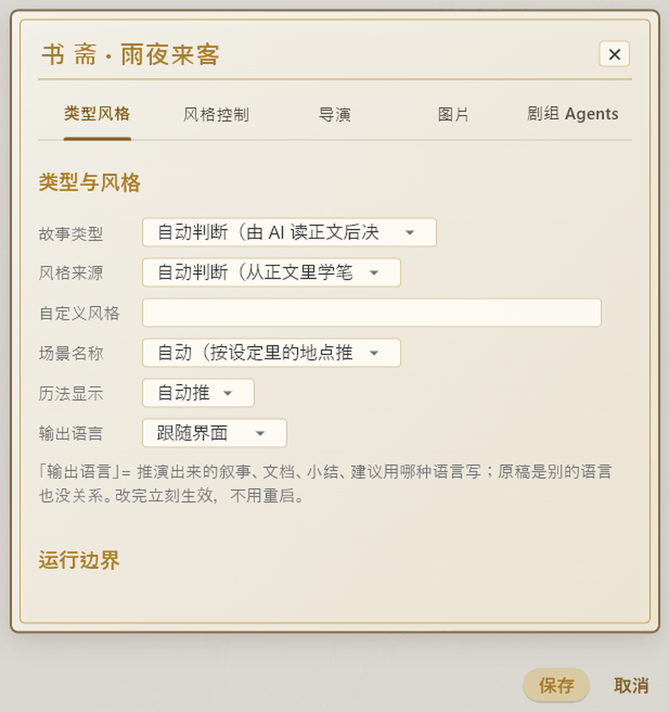

*书斋 · 本书设置（类型与风格 / 图片 / 运行边界…）*

**配置项说明**：
- **故事类型**：悬疑·单元、玄幻修仙、都市、历史架空、言情、科幻等
- **风格来源**：auto（自动检测）、plain（平淡）
- **运行模式**：走完故事 / 不限期限 / 定期暂停（界面只显示名字，存的还是变量值）
- **暂停间隔**：选「定期暂停」后每隔几天暂停
- **起始点**：auto（自动）、begin（从头）、continue（接续）
- **风格控制**：调整故事的各种风格参数（0-100%）。「风格参数」标题旁边那个小 **「?」** 点开是**参数说明**：
  每个滑杆管什么、低值和高值的手感差别、常见类型（玄幻 / 悬疑 / 都市 / 历史 /
  言情 / 科幻 / 群像）整套的建议档，照着抄一串数字就能开跑
- **对话图片**：这一轮推演时，中栏里那些插图用哪种方式出（见下一节）
- **剧组 Agents**（2026-10-11）：**这一本书**对各个 Agent 的定制 —— 与
  「天机 · 剧组 Agents」**同一套界面**，唯一区别是**这里不能新建和删除**
  （新建/删除回答的是"这个软件有哪些职位"，那是软件层的事）。
  这里只写你改过的那几项，其余跟软件默认走。

#### 4.8.1 对话图片（四种方式选一种）

> 也叫「对话插图」「配图」—— 一个东西三种叫法，界面和说明书里用的是「对话图片」。

**设置存在项目文件里**（`.nwsproj` 的 `[项目] 对话图片=`）——「这本书要不要配图」
是项目自己的事，不该被别的项目或全局设置带跑。选项名就是四个词，**不带序号**；
每个选项的说明显示在下拉框下面那行小字里（会随你选的变）：

| 选项 | 说明 | **场景**插图用什么 | 代价 |
|---|---|---|---|
| **关闭** | 不生成任何图片（含人物肖像）—— 最省，只有文字 | 不出图 | 零 |
| **ASCII 画** | 场景用字符画拼，占用最少也最难看；人物肖像仍走文生图 | 字符画 | 零，几 KB |
| **PNG 矢量图** | 场景用本地彩墨插画（不花 token）；人物肖像仍走文生图 | 本地画 | 零，几十 KB |
| **全彩文生图** | 场景与人物肖像都交给模型画 —— 最好看，耗 token 最多 | 文生图 | 要能出图的模型 |

> **这四档管的是「场景插图」。人物肖像不走这四档**（除了「关闭」）——
> 见下面 4.8.2。

几件要知道的事：

- **场景插图按内容画，不是一张万能图**：PNG 那一档会读当前这一幕的
  **地点 / 天气 / 时段 / 在场人数**，画成不同的画面 ——
  「堂内」是室内（窗棂、灯笼、桌案），「渡口」是水边（船、桥、屋群），
  夜里会压暗、雨天会画雨丝、桃花只在院景里探进来。
- **一张图只画一次**：同一幕、同一个人重复触发不会重复生成（推演一天会触发几十次）。
- **文生图要用能出图的模型**：在「天机 → 推演服务LLM设定」里配好 API 之后，
  还要在 `.env` 里填 `IMAGE_AI_MODEL`（如 `gpt-image-1`）。**没填时这一档的
  场景图会自动降级为 PNG 矢量图**——不会因为图片服务不通用不了。
- **场景插图落在** `<运行文件夹>/插画/` 下：`场景_<地点>.png`，
  字符画则是 `场景_<地点>.txt`。
- **旧项目不用改**：项目文件里没这一项时，沿用 `.env` 的 `SCRIPT_IMAGES`
  （它是"关"就关，否则按 PNG 矢量图出）。

#### 4.8.2 人物肖像（一律文生图，开卷时生成一次）

**肖像和场景插图是两件事**，取值逻辑不一样：

|  | 场景插图 | **人物肖像** |
|---|---|---|
| 什么时候要 | 推演途中，换地点 / 换幕 | **开卷时一次**，之后不再生成 |
| 存在哪 | `<运行文件夹>/插画/`（每轮一份） | **`<项目>/肖像/`（整本书共用）** |
| 为什么 | 同一地点每轮都可能不同 | **同一个人不能两轮换一张脸** |

所以肖像**一律走文生图**，在**「开卷」导入时一次性生成**，之后每一轮直接复用
（不会重复消耗 token）。生成用的提示词取自人物自己的设定
（姓名 / 身份 / 性格 + 故事题材）。

**如果模型不支持文生图**（没配 `IMAGE_AI_MODEL`、API 不支持出图、演示模式等），
WorkBuddy 会**明说原因**，并在对话里**改用文字代替**肖像：

```
▸ 出场 主角（已在场）
※ 肖像：主角 · 沈家长子 · 沉稳内敛     ← 文字代替，只交代一次
主角：你今日话里有话。
```

不会用本地画的简易头像凑数 —— 那种图不好看，已经彻底不用了。

生成结果和原因都写在 **`<项目>/肖像/肖像清单.md`** 里（谁成了、谁没成、为什么）。

> **想看/改肖像**：直接去 `<项目>/肖像/`。删掉某个人的 `.png`，
> 下一轮他不会立刻重画（要重新生成请重新开卷）；想手动补一张，
> 把同名 `.png` 放进去即可。

### 4.9 拾卷（旧的故事）—— 三栏

点「拾卷」打开，**三栏并排**，每栏上面都有一句话说明它是什么：


*三栏：① 小说（标题 + 创建时间）/ ② 这本书的存档 / ③ 选中那条的内容*

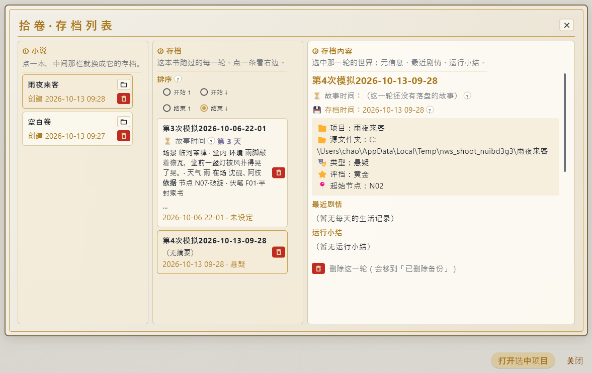

*点一条存档：③ 栏换成它的元信息、最近剧情与运行小结（都按 Markdown 渲染）*

**功能**：
- **① 小说**：只有**标题和创建时间**两行，右边一个小 🗑 删掉整本（**移到回收站**，不用手打书名）；
- **② 存档**：这本书跑过的每一轮，**最新的在最上面**；点一条看右边，
  右上角 🗑 删掉这一轮。**打开就默认选中最新那一轮**；
- 三栏各自带滚动条；卡上的摘要是**按 Markdown 渲染**的（不是一堆符号）；
- **③ 存档内容**：那一轮的元信息（项目 / 源文件夹 / 类型 / 评档 / 起始节点）、
  最近剧情与运行小结，**按 Markdown 渲染**（`**粗体**`、标题、列表、表格都画出来）；
- **删除**（**可恢复**，不是抹掉）：
  - **② 栏**每张存档卡右边一个小 **🗑** → 删掉**这一轮**；
  - **① 栏**每本小说右边一个小 **🗑** → 删掉**这一整本书**（设定集、肖像、全部轮次）；
  - ★ **删书会连它名下的存档一起**（2026-10-27，用户："前者是包含后者的"）：
    回收站里属于这本书的存档会**归到这本书下面** —— 不再单独列出，你不用再手工删一遍；
    **恢复这本书时它们跟着一起回来**（以前那种"书删了、存档永远恢复不回去"的死条目没有了）。
    反过来，**只删某一轮**不会动那本书本身；
  - 两个都会先弹确认框，把**名字 / 路径 / 文件数 / 体积 / 备份目录**摆出来再问你；
  - 点确认后，东西被**移到回收站**（对话框最左边那个 Tab）—— 在那边可以整本恢复，
    也可以永久删除（**永久删除一本书要手打书名**，它在回收站里的存档会一起删掉：
    书都没了，那几轮本来也恢复不回去）；
  - **搬不动时会明确拒绝，并且一个字都不动**：这一轮的 `state.db` 正被程序占用
    （最常见的是这一轮还在跑）时，程序不会硬删，而是告诉你「先点停止，或关掉程序
    重开再删」。这条是刻意设计的 —— 宁可这次删不掉，也不许删掉一半。
- 底部「打开选中项目」进入运行界面，「关闭」退出。

> 只有删除，**没有"导入存档"** —— 想把某一轮搬进来，直接把 `第N次模拟…`
> 文件夹拷进项目目录即可。
>
> 回收站里攒多了，就在**回收站那个 Tab** 里永久删除（删一本书会连它的存档一起）；
> 它本身也是个普通文件夹（`已删除备份/`，在项目目录**旁边**），想手工搬也行。

### 4.10 帮助面板

三个入口，打开的是同一个面板：

- **开始界面**右上角的「❓ 帮助」（还没开卷的时候也能翻说明书）
- **运行界面**右上角的「❓ 帮助」
- 运行界面下方命令框输入 `/help`

（**没有** F1 / Ctrl+/ 快捷键 —— 全局只绑了 F11 全屏。）

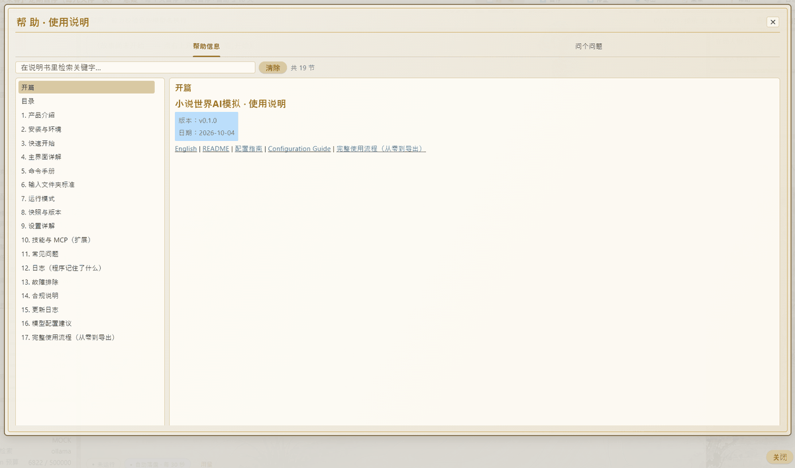

*帮助面板：两个选项卡 —— 一页翻说明书，一页可以直接问*

**一个窗口，两个选项卡**：

| 选项卡 | 里面是什么 | 干什么 |
|--------|-----------|--------|
| **帮助信息** | 顶部**关键字检索** + 左栏章节目录 + 右栏正文 | **翻**说明书。右栏就是随程序附带的这份说明书（中文读 `使用说明.md`，英文读 `User_Manual.md`）—— 不另写一份帮助文案，免得两处不同步 |
| **问个问题** | 聊天式（一问一答的气泡） | **问**说明书。写下问题，程序先在说明书里检索相关章节，再让模型照着这些章节答（见 4.10.3）。**没配 LLM 时这一页是灰的**（见 4.10.2） |

- 两个选项卡在同一个窗口里，**不用来回关掉再打开**；窗口底部就是「关闭」
- **目录与正文各自带一根滚动条**（在右边缘；内容放得下时不画）。
  它**常驻显示**、跟着你滚 —— 一眼就知道"这一章还有多少没看完"。
  正文按**小节逐块渲染**，所以再长的章（比如 §4 两万多字）也能顺畅滚到底
- 正文里的表格与代码块都是真渲染的；插图取自 `assets/images/manual/`
- 说明书里的命令清单在「命令手册」一节；**目前只有 `help` / `status` / `settings` 三条真的接上了**，其余会回一句"还没接上"

#### 4.10.1 关键字检索（**不用模型**）

「帮助信息」页顶部有个检索框：输入关键字，左栏目录立刻**只留下包含它的章节**，
每条后面跟着命中次数，右栏自动打开第一条命中，并在正文顶部列出"这个词在这一节
出现了几处、分别在哪儿"。清空（或点「清除」）就回到完整目录。

- **纯本地**：检索就是在说明书文本里找字，**不联网、不调模型、不花钱** ——
  所以**没配 LLM 也能用**，这也是「问个问题」用不了时最顺手的退路。
- **多个词是"都要有"**：`运行模式 存档` 只会留下两样都出现的章节（这样才收得拢）。
- 一个都没全命中时，它会退回"只沾到一部分"的结果，并且**明说这些不一定相关** ——
  不是假装它们就是答案。
- 用法建议：**一个词往往比一整句话准**（界面上的按钮名、设置项名字最好使）；
  找不到就换个说法，或者清空检索框直接翻目录。

#### 4.10.2 没配 LLM 时，「问个问题」是灰的

第二个选项卡依赖大模型（它要照着说明书答题）。所以**还没配 LLM 的时候，
那一页整块变灰**：输入框、发送按钮、示例问题都点不动，上面写清三件事 ——
为什么不能用（缺什么）、去哪配（「去配置」按钮直接打开**天机 · 推演服务LLM设定**）、
以及**暂时用什么代替**（上面 4.10.1 的关键字检索，它不需要模型）。
申请与填写步骤见 [2.4 API Key 获取](#24-api-key-获取) 与
[3.4 怎么把 Key 配进来](#34-怎么把-key-配进来程序里怎么填)。

#### 4.10.3 「问个问题」：直接问使用上的问题

切到第二个选项卡，写下问题（也可以直接点下面现成的例子），回车或点 **「发送」**。

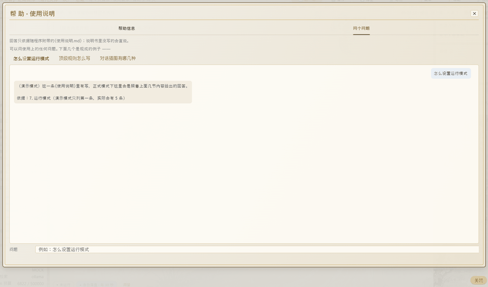

*问个问题：你问的在右、回答在左；回答下面那行小字是「依据」*

对话就是**聊天的样子**：你问的在右边（浅靛青气泡）、回答在左边（旧纸色气泡），
一问一答都留在屏幕上 —— 可以接着追问。比如先问"顶级规则怎么写"，
再问"那放在哪个文件夹？"，**追问会带上前面聊过的内容**（程序只把最近几轮、
每轮有限的字数发给模型，聊久了也不会把上下文吃光）。

- **检索不花钱**：找章节完全在本地做（标题命中权重更高，因为标题是作者亲手写的
  "这一节讲什么"），不联网、不调模型。
- **检索不到就不问**：说明书里压根没有相关章节时，程序**一次请求都不发**，
  直接回你"没找到"——什么都不给模型还让它回答，等于让它编。
- **每次提问调用一次大模型**（便宜档），所以别拿它闲聊。
- 回答下面会给一行 **「依据」**，列出用到了哪几节，方便你翻回原文核对。
  中文界面读 `使用说明.md`、英文界面读 `User_Manual.md`，提问也跟着界面语言走。

> 它**只懂这个软件的使用**。问它天气、让它写诗、问它别的事，它会说说明书里没有 ——
> 这是故意的：**编一个不存在的功能出来，你照着点、点不到，比不回答更糟**。
> 问法上也有个小技巧：说明书的词它认得最准 —— 界面上的按钮名、设置项的名字、
> 章节里出现过的说法（比如"运行模式""顶级规则""存档"），拿来当问题最容易命中。

### 4.11 设置界面

输入 `settings` 或 `set` 打开的**就是「天机 · 程序设置」**——没有单独的"设置"窗口。
本书级别的设置在「书斋」里。


*输入 settings 打开的也是这里 —— 没有单独的「设置」窗口*

**功能**：
- 分七个选项卡：常规 / **AI模型配置** / **外部创作服务** / 界面外观 / 运行 /
  导演与合规 / 剧组 Agents
- 开关与滑杆就地改，点「保存」写进 `.env`
- 改了 LLM 相关项会明说「需要重启程序才生效」（客户端是启动时建好的）
- 「界面语言」改完立刻重建界面，不用重启

### 4.12 风格控制面板

主界面左栏下方显示风格控制面板。

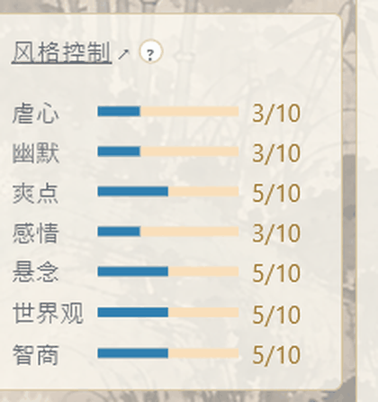

*左栏的「风格控制」面板：这一轮怎么讲，滑杆说了算*

**说明**：
- 显示当前故事的风格参数
- 参数在「书斋」里调整
- 影响故事的走向和风格
- **故事未开始时这些条是空的（显示 `—`），不会预填数值**；
  上图是跑起来之后的样子

### 4.13 剧情面板

主界面右栏中部显示剧情面板。


*右栏的「剧情」面板：节点、张力、事件数*

**说明**：
- **节点**：当前故事进度节点
- **张力**：当前剧情紧张程度（0-1）
- **事件**：已发生的关键事件数量
- **风格**：当前故事的风格摘要
- **未开始时全部显示 `—`**（如 `节点 —`、`张力 — · 事件 —`），上图是跑起来之后的样子

#### 剧情总览：从开头到结尾的那张流程图

**点「剧情」这个标题、点中间那个站名、或者点跑马灯最右边那个小图标**，都会打开「剧情总览」。
窗口里上面一行是**跑马灯**（切到以前那些推演，`1 / 2` 告诉你现在看的是第几次），
下面有两个页签：

| 页签 | 里面是什么 |
|---|---|
| **详细剧情**（默认） | **细节剧情**：这次推演的**关键剧情与转折点** + 按天摊开的**剧作家的分拍**、**正文**、**分镜**（见下一小节） |
| **流程图** | 一张**从上往下**的流程图，一眼看全局：站名 + 状态 + 实据（第几天 · 几幕）+ 三两行概要 |

**页面顶部那行字**告诉你这次推演有多少内容：`第 1 天 · 12 幕 · 演过 2/8 站 · 6 拍 · 正文 2554 字`。

### 详细剧情：细到剧作家写的每一小段

**这一页回答"这次推演到底发生了什么"，不是"故事骨架长什么样"。**
内容从上往下：

| 这一块 | 里面是什么 |
|---|---|
| **关键剧情与转折点** | **全推演的结论先行**：多少个转折、多少个关键，逐条列出来（时间 · 地点 · 那一句事） |
| **按天详细**（可折叠） | 一天一块。标题行就写着 `3 幕 · 6 拍 · 正文 2554 字`，点一下展开 |
| └ 当天梗概 / 场景介绍 | 剧作家写的那两句（这一天讲什么、这地方长什么样） |
| └ 这一天的转折与关键 | 同上，只挑这一天里的 |
| └ **剧作家的分拍**（小段） | **这就是"剧作家写的小段剧情"**：每拍一张卡 —— 场 · 主题 · 出场 · 情绪 / **发生**（这一拍到底怎么了）/ **要点**（具体几笔）/ 推进·目标·难题·道具 |
| └ **正文** | 剧作家把这些拍连起来写的**小说正文**，按段排列（实测一天 2500 字上下） |
| └ **分镜** | 分镜师按拍拆的镜头：景别 · 画面 · 台词 · 叙事点 |

**转折点和关键剧情是怎么判出来的**（都能核对，不是模型说的）：

| 记号 | 判据 | 为什么算 |
|---|---|---|
| **转折** | ① 导演按下的事件（`秘密泄露` / `人物冲突` / `巧合` / `外部刺激` / `伏笔激活` / `导演自救`）② 情节站切换 | 那不是"演出来的"，是**有人按下去的**；站换了就是故事走到下一站了 |
| **关键** | ③ 张力一步跳 ≥ 0.15 ④ 换场（同一天里地点变了） | 火候变了 / 舞台换了——但方向没变，所以不算转折 |

> ⚠ **"某某第一次登场"不算关键剧情**：开场那一幕全员都在，按在场名单判"新人"会把
> 真正的转折全淹掉（实测第一天会报出 7 条"某某第一次登场"）。人物表在看板上的
> 「在场人物」那一栏，不占转折点的位置。

**折叠怎么用**：默认展开**最近两天**（那正是"我刚演的"），更早的点标题行即可展开。
一天实测约 100 个组件（6 拍 + 48 段正文 + 18 镜），三十天全展开会让窗口卡住 ——
所以折叠是**重建那一块**，不是把它藏起来。

> ⚠ 更早的天（超过 30 天）只保留**梗概与转折点**，不再存分拍与正文
> （`MAX_DETAIL_DAYS`）。梗概与转折点一天都不少。

**选择点怎么用**（在「流程图」页签里）：故事里写着"面对归籍、祭献、留门三条路"这种地方，
会变成一排可以点的选项。

- 点一条 ⇒ 图的下面接着显示"沿「留门」这条线往下看"，**选择会存下来**（下次打开还是它）；
- 再点一次同一条 ⇒ 取消；
- 这条线后面还没有情节数据时，它会**明说「这条线后面的事还没演到」**——不会替你编一个结局。

> 选项从哪来：设定集「故事进度」里给那一站写 `选项:` 就按你写的（见《设定写作指导》）；
> 没写的话，程序会从**概要里**读"…三条路"这种写法，并在下面标明
> 「这几条是从概要里读出来的」——看到这行就知道该去补 `选项:` 了。

**这些数据是谁生成的、什么时候更新**

- 数据存在每一次推演的文件夹里：`剧情总览.json`（跟着存档一起搬，不会丢）；
- **推演过程中自动更新**：每演完一天更新一次，点「停止」时再补一次 ⇒ 你不用管；
- 老的推演（这个功能之前跑的）跑一次 `tools/build_story_flow.py` 就补齐了；
- ⚠ 它**不花钱**：读的是 `当日剧本.json`（剧作家的分拍与正文）、每天剧本里的幕与事件、
  以及设定集的进度表 —— **一个模型都不调**。所以"打开看一眼"永远不会扣你的额度。
- ⚠ **剧作家没写过的那一天**（比如这个功能之前的老运行）：仍然有"按天 + 幕数 + 转折点"，
  只是没有分拍与正文 —— 不会整块消失。


### 4.14 运行控制（起　笔 / 暂停 / 停止）

运行界面顶部右侧有三个按钮，管着「这一轮」的起停：


*推演中的运行界面：顶部右侧就是这一排按钮，中栏在长叙事，左右两栏跟着刷新*

```text
【沈家旧案】· 走完故事   [📖 起　笔] [⏸ 暂停] [⏹ 停止] [📤 导出] [📋 菜单] [❓ 帮助] [🧾 日志]
```

| 按钮 | 作用 |
|------|------|
| **📖 起　笔** | 弹出「启动故事」对话框设定这一轮的参数，确认后开跑。**启动中/在跑时它是灰的**（一轮没跑完不会再开第二轮） |
| **⏸ 暂停** | 停下推演。**按下后这个按钮会变成「▶ 继续」**，再按一下就接着跑 |
| **⏹ 停止** | 结束这一轮：补落当天的叙事，然后按导出开关出产物。**正在启动的那几秒里它写着「⏹ 取消启动」**（见下一小节） |
| **📋 菜单** | 回到开始界面（开卷 / 拾卷 / 天机 / 书斋） |
| **❓ 帮助** | 打开本说明书（左边是章节，右边是正文），选中哪一节看哪一节 |
| **🧾 日志** | 打开**日志查看器**：直接读 `logs/` 里那份日志文件，分页看、能搜关键字、会自己刷新（见 §12.10） |

> 没在跑的时候，「暂停」和「停止」是**灰的** —— 不是坏了，是没有可停的东西。
> 按了「起　笔」它们才会亮起来。

#### 点了「开始推演」之后那几秒（2026-10-12 修）

那个对话框点下去之后，程序要**装配世界**（读设定集 → 建世界 → 冻结这一轮的
快照）—— 快的时候十几秒，慢的时候（项目在云盘上同步 / 老机器）能拖更久。
以前这一段时间**屏幕上什么都不动**，会以为"点了没生效"，于是再点一次 ——
结果**两轮推演同时在跑**。现在：

| 你会看到 | 说明 |
|---|---|
| **立刻切到运行界面** | 点完这一帧就切过去，不再让你对着开始菜单发呆 |
| 中栏一行「正在装配这一轮的世界……」 | "确实开始了"最直接的证据 |
| 状态行「正在启动 —— 装配中 · 已 N 秒」 | 那个秒表**自己会走**，就是"没死"的证据 |
| 右上角那颗「⏹ 停止」变成「⏹ 取消启动」 | 不想等了就按它 —— **界面立刻不再等**，可以重新起笔 |
| 「起　笔」变灰 | 这一轮没跑完，不会开出第二轮 |

- ★ **同时只会有一轮**。看见上面那张"正在启动"的样子就说明程序已经在干活了
  —— 再点「起笔」会被当面拦下来，并告诉你原因（不会静默忽略）。
- ★ **超时**：「天机 · 运行 → 起笔启动」里的「起笔超时(秒)」（默认 **180**）。
  等满这个时间还没装完，界面就**停止等待**：状态条回到「未运行」，中栏留一条
  说明，你可以直接再点一次「起笔」。
- ★ **作废掉的那一趟会自己退场**：就算它后来装完了也**不会接管界面**（它落地前
  会对一次令牌，对不上就一个字都不碰）。用户要的"两个里只留一个"就是靠这个。
  它留下的那个运行文件夹会被搬进「已删除备份」；万一搬不动（Windows 上目录里
  有文件正被杀软扫描），会在这个文件夹里留一张 **`已作废.md`** 说明它是个空壳
  —— 免得它在「回卷」里冒充一次正常的存档。
- ⚠ 启动失败（设定集读不了 / 模型客户端建不起来 / 装配报错）时，**中栏也会留一条**
  —— 不是只在屏幕上闪一下提示条。

#### 它自己也会停一下（而且一定会告诉你）

先讲**默认**：**它几乎不会自己停**。会自己停的地方只剩这四处，而且全都是
"确实需要你拍板"的事 —— 停下来时弹一个**对话框**问你要怎么做：

| 什么时候弹窗问你 | 由哪个开关决定 | 问你什么 |
|---|---|---|
| 岔路口 | `BRANCH_AUTO_POLICY`（默认 `weighted`） | 往哪走（挑候选 / 自己写一句） |
| 导演挂起一条"待确认"的介入 | `INTERVENTION_POLICY=pause`（默认） | 剧情停滞太久，要不要听导演的 |
| token 预算耗尽 | `BUDGET_EXHAUST_POLICY=pause` | 接着写（翻倍）/ 收工 |
| 入夜 | `PAUSE_AT_NIGHT=1`（默认关） | 只停一下，不弹窗 |

**存档点不再拦你**（2026-10-11 起）：日界（`STORY_DAY_EVERY_DAYS`）和
不限期限模式（`OPEN_CHECKPOINT_EVERY_DAYS`）到点**照常落盘、中栏写一句
「已按设置存档…接着往下写」，然后继续演** —— 它回答的是"存了没有"，
不需要你做任何决定，所以不该打断。
真想要"停下等确认"的老行为，把 `CHECKPOINT_PAUSE` 打开，那时它会弹对话框。

> ⚠（2026-10-10 修）以前这些停法**只停、不说** —— 按钮还是「暂停」，
> 状态条还停在最后一次细粒度状态上，屏幕上是
> 「正在核对故事进度 · 已 2019 秒」一直往上涨。作者当然以为它在死磕进度，
> 而那一整段时间里**一次模型调用都没有**，它只是在等人点「继续」。
> 现在"谁停的"会被报给界面（`RunLoop.on_self_pause` → 会话状态）；
> 日界检查点**开跑那一拍也不再白停一次**（续跑通常从某天当中开始，
> 那是"这一天先跑完"，不是"进入新的一天"）。

#### 需要你拍板时的那个对话框

上面三处需要你决定的，弹出来的都是同一个窗（2026-10-11 统一），长这样：

1. **最上面是「当前故事发展」** —— 第几天、什么时辰、在哪儿、谁在场、
   当前进度节点 + 前情提要。先让你看清"现在演到哪儿、这一选在选什么"；
2. **然后一行「为什么要问你」** —— 例如「剧情停滞太久，导演想插手改变方向
   —— 要不要听它的？」；
3. **几个选项，单选钮**（选项只是标签，选它不会立刻发生什么）；
4. **最后一定有一个「自己定一个」的输入框** —— 写了就以你写的为准，
   上面选哪条都不算；
5. 底下两个按钮：**「确 定」在左、「取 消（暂停推演）」在右**。
   「确定」没选也没写时是**灰的**（免得点了什么都不发生）。

**点「取消」会发生什么**：推演变成**暂停**，但**这道题留着** ——
你点「▶ 继续」的时候，**对话框会重新弹出来**，接着答就行。
（不这么做的话，关掉的对话框就再也回不来，而推演正停在那儿等一个
你答不了的题。）

有的题带倒计时（岔路口，默认 5 分钟）——那是"你一直没动手就按策略自动挑"。
**你一动它（选一条或开始打字）倒计时就停**，不会把你正在写的那句丢掉。

**「一轮」= 一次完整推演**，会新建一个运行文件夹（`第N次模拟…`）。
跑完或者停止之后，下一轮重新设参数。

#### 启动故事对话框

开跑之前，这个对话框把这一轮的参数一次定完：


*启动故事：这一轮怎么跑（运行模式 / 上限天数 / 起始点 / 风格 / 预算）*

##### 前情提要 + 「您对接下来剧情发展的建议」（2026-10-11 加）

「从哪儿开始」下面就是这两块，**顺序就是这么排的**：

| 那一块 | 是什么 |
|---|---|
| **前情提要** | 这一轮开头，**中栏屏幕上会念的那一段**（"上一回演到 第 3 天 · 戌时（临河茶肆），说到：…"，或者这本书没跑过时，设定集里的【剧情参考线】/【世界观】） |
| **您对接下来剧情发展的建议** | 你写一句话，说这一轮想往哪儿走 |

- **前情提要是"文字"，不是输入框**（2026-10-11 改）：它就是一段可以**选中复制**的
  普通文字，没有边框、没有底色、也没有自己的滚动条 —— 长前情**整段铺开**，
  跟着对话框一起往下滚。⚠ 别把它做成"框"：框有高度上限，前情一长它就会
  **自己长出一条滚动条压在正文右缘上**（这正是最初那一版的毛病）。
- **这一段和下面是同一行宽**（520px）：右边留出来的是**滚动条车道**，
  所以对话框滚动条不会压到文字上。
- **建议**那一栏是**多行输入框**，写长句、写几条都行（一行宽，跟上面同宽）。

- 前情提要那一块**不是另算一份**：它调的就是运行窗口用的那个函数
  （`sim/resume.start_recap`），所以**这里显示什么，屏幕上念的就是什么** ——
  判据 `verify_author_note` 的 A 组是**装配一个真的 `RunLoop` 去逐字比**的，
  真机那支还会比一次"对话框里这段字在不在中栏那句里"（`verify_author_note_ui`）。
- **建议**这一栏里的话，会交给剧组**每一个人**（导演、剧作者、小说作家、场记…）——
  它接在每个人的手艺块**最后**（越靠后越具体、越该压过前面的通用手艺），
  而且抬头写明了**它是"意图"不是"设定"**：往这个方向使劲，但人物性格、
  已经发生过的事、世界规则**一条都不能违背**。
- ⚠ **只对这一轮有效**：跑完或停止后重新起笔，这一栏是**空的**（不预填、
  也不写进配置）。这是刻意的 —— 上一轮那句要是自动留到下一轮，你**没填也照样生效**，
  而且永远不会发现。
- ⚠ 它**不会写进你的稿子**，也**不会并进设定集**。落点只有三个：
  ① 每个人这一轮的提示词；② 起笔后中栏紧跟在那句前情提要后面的一行
  （`※ 作者对本轮走向的要求：…`）；③ 这一轮的 `开场.md`（开了「每轮开场」时才有）。
- 中栏那一行**不受「每轮开场」开关影响** —— 关掉开场卡片的人，照样看得见自己填过的话。
- 填了多长都行，但提示词里每拍每人都会带上它，所以超过 600 字会截断；
  多行会被折成一段（免得把后面的材料挤散）。
- ⚠ **这一栏管不了"结构"**（2026-10-11 补的说明，框上也写着）：它给的是一句话的
  **方向**（进提示词，模型可以不理）。要控制"**发生几件事、要不要推主线、
  时间跳不跳、谁上场**"，用下面那一节 **「本轮推演」** 的开关 —— 那些是**真开关**，
  程序按它办事，不是"建议"。

##### 「本轮推演」——这一轮怎么跑（2026-10-11 加）

在「运行边界」下面。这一节回答的是**这一轮的性质**，跟上面那个"建议"是两码事：
建议说"往哪走"，这一节定"怎么跑"。

| 那一项 | 是什么 | 默认 |
|---|---|---|
| **这一轮的性质** | `正常` = 照常推主线、导演照常挑事；`日常生活型` = **不带关键剧情**，只过日子 | 正常 |
| **最多几件关键事** | 这一轮导演**最多挑几件事**。挑够就停手，剩下的靠人物自己走 | `0` = 不限 |
| **每天大概写多少字** | 每个故事日写多长（软目标：**告诉写当天样章的编剧**，也显示在状态条上） | `0` = 不限 |
| **没事就把时间跳过去** | 连着几拍谁都没做事，就用**一句旁白**带过一段时间，不再一拍拍空转 | **开** |
| **本轮出场人物** | 只让这几个人上场（逗号分隔；空 = 全体） | 空 |
| **锁定在一个地点** | 整轮锁在一个地点，**不发生换场** | 不锁 |

- **「日常生活型」到底关掉了什么**：关掉的是**导演主动挑事** ——
  包括"高潮日强制挑事"和"停滞自救"那两条，一件都不注入，而且**一次模型都不花在
  挑事上**。⚠ 但**剧情真走到进度节点该满足时照样推进** —— 这一档是"不催你走主线"，
  不是"主线冻结"。
- **「最多几件关键事」**是**这一轮的总数**（不是每天）。挑够之后导演不再主动挑事；
  被它拦下的那件事**不算数**（没发生就不计数）。
- **「没事就把时间跳过去」**的判据是"连着 `连着几拍没事才跳` 拍，**谁都没做事**"
  （没人说话、没人有实质动作）。只要有人动了一下，**计数就归零** ——
  所以该演的戏一秒都不会被跳掉。跳的时候会推进 `每次跳多少故事分钟` 那段时间，
  并在中栏留一句旁白，例如：

  > 小半个时辰就这么过去 —— 临河茶肆里没什么事：雨脚一阵密一阵疏，檐水没断过。

  ⚠ 这句旁白里**只写时间与声气，不写任何人物动作** —— 跳过不等于"这段时间发生了事"，
  凭空编一件后面谁也接不上。跳过之后"距上次事件"会**重新计时**，
  所以导演不会因为它反而跳出来介入。
- **「本轮出场人物」**：没被点名的人这一轮**不算在场**（不参与决策）。
  ⚠ 名字要跟人物卡里一致；**对不上的会被丢掉并在日志里说一句**。
  如果一个都没对上，就**当没设**（照常全体上场）—— 不会出现"没人上场"。
  这个名单**会记住**：换一本书之后多半对不上，所以换书时回来看一眼。
- **「锁定在一个地点」**：地点名同样要跟这本书的地点表对得上，对不上就忽略
  （不会把场景名字挂在半空）。
- ⚠ **这一节的每一项都存进配置文件**，所以**下次起笔它们还在** —— 对话框里看得见、
  随时能改（不像上面那个"建议"框，每次都是空的）。
- 一图流：**要"这一轮安静点"** → 性质选「日常生活型」；
  **要"这一轮就发生三件事"** → 最多几件关键事填 `3`；
  **要"这段日子快点过去"** → 打开「没事就把时间跳过去」；
  **要"只看这两人的戏"** → 本轮出场人物填两个人的名字。

##### 「一场戏接一场戏」——场次编排（2026-10-11 加）

作者看了运行记录之后报了一个现象：「这些人很多时候会东一句西一句，有些小的场景
没交代清楚，突然大家就跳到几个新场景了」「场景反复切换却没有任何人物出场、动作、
情节 —— 放到电视剧里就是无意义的场景切换」。

**查出来的原因不在文笔，在流程**：剧作家其实**已经分好了拍**（每一拍写着在哪儿、
发生什么、推进什么），但那张表**没有下发** ——

- 演员收到的「今日剧本」只有一段当天梗概 + 自己分到的那几件事，
  剧作家分的六拍**一个字都看不到**；
- 分幕是**事后**按「时段变了 / 地点变了」切的，而不是「这一拍演完了」；
- 换场要等**场上一个人都不剩**，还得目标地点恰好命中地点表 ——
  于是要么一直不换，要么被随机位移带着乱换。

现在补上了一层**场次编排**，四件事：

1. **每场戏写完整**：剧作家写每一拍时要交代 **主题**（这场戏在讲什么）·
   **出场**（有谁）· **要点**（必须落到哪些动作与话头）· **道具** · **情绪** ·
   **推进** —— 缺一样，上了场就会演成「东一句西一句」。
   ⚠ 仍然**不写台词**：台词是演员的活。
2. **真的下发**：当前这一拍的那几样会进**每个演员**的决策提示词，
   还附一句「下一场是什么」。剧作家分的拍，从此不再只是台账里的一张表。
3. **按拍收场**：该出场的**都露过面**、这一拍也**真发生了事**，这一场就收，换下一拍。
   不再等「时段变 / 地点变」。
4. **按拍换场**：收场后**按下一拍写的那个地方**换，并且把这一拍该出场的人**调过去** ——
   不会出现「场景切了却没人」。

| 那一项 | 是什么 | 默认 |
|---|---|---|
| **按分拍表演** | 总开关。关掉 = 回到从前（表还在台账里，只是不按它推进） | **开** |
| **一场戏最少演几拍** | 低于这个数一律不收场（设太小会让「一场戏」和「一拍」一样长，反而更碎） | `3` |
| **一场戏最多演几拍** | 到点强制收场，防止一场戏无限拖 | `12` |
| **这一场至少要几条实动作** | 用「真做了事」的条数算，不是「跑了几拍」—— 全场发呆不算演过 | `2` |

- 收场时中栏会留一条**幕终分隔符**，上面写着**为什么收**（例如
  「第 2 拍演完（试鞋底）：3 拍 / 4 条实动作」），紧接着出现
  **〔第 3 拍 · 柜台后 · 落笔〕** 这样一行 —— 一眼看得见「现在是第几场、在演什么」。
- ⚠ 该出场的人一直不露面，会**等到上限**才硬收（不会永远卡住）；
  那一档在分隔符里会点名「没露面：某某」。
- ⚠ **没有分拍表时这一层什么都不做** —— 关掉当天剧本、或模型没写出剧本的日子，
  推演行为与加它之前**一模一样**。
- ⚠ 「实动作」指的是**真做了事**的那些条（说话、走动、交手）：
  「没动，也没出声」这类空拍**不计**，所以一场戏不会因为几个人发呆就算演完。

##### 「从哪儿开始」——起笔会先看一眼上次停在哪儿（2026-10-08）

点「起　笔」之后、**最上面那一块**就是它。三种情况，说得清清楚楚：

| 上一轮是怎么停的 | 那块提示 | 这一轮实际会 |
|---|---|---|
| **没有上一轮**（或没留下停点） | `● 从头开始 —— 第 1 天` | 从第 1 天 08:00 起 |
| **一天演到一半就停**（你点了「停止」） | `● 接着上次演 —— 从 第 3 天 · 戌时 起` | **从那个时间接着演**，而且**第 3 天的稿子接着写**（前半段不会丢） |
| **那一天已经演完了**（跨天收工） | `● 开新的一天 —— 第 4 天` | 从第 4 天 08:00 起 |

下面还会摊出**依据**（"上一轮停在：第 3 天 · 戌时 · 临河茶肆；那天已经跑了 27 拍"）——
不是让你信一句结论，而是让你能自己核。

> **它怎么知道"一天演完没有"？** 收尾那一刻由程序自己记下（`<运行文件夹>/停点.json`），
> **不靠猜**。猜不出来的原因很实在：停止时收尾会**补落**当天那份稿子，
> 所以"第 3 天的文件在"既可能是演完了、也可能是演了一半被停 —— 从文件反推是推不出的。
>
> 判据就一条：收尾那一刻**这一天跑过几拍**。跑过＝演了一半（接着演）；
> 零拍＝这一天还没开演（上一次跨天已经收工了，那就开新的一天）。

⚠ **一件事要说清**：接上的是**故事时间**与**当天的正文**。
世界状态（张力 / 伏笔 / 群演 / 人物记忆）仍然是**新一轮重新装配**的 ——
要连世界一起读回来，那是「拾卷」那条路的事。

##### 点完起笔，屏幕上会**接着上次的往下写**（2026-10-11 修）

以前点「起笔」中栏会**清空**，而且开头那句「前情提要」**永远是同一句设定集
开场白** —— 两件事叠起来看着就像"进度根本没记住"（其实停点一条都没丢，
时间也是从上次那一刻接着走的）。现在：

| 你会看到 | 是什么 |
|---|---|
| `—— 以下是上一次演到这儿（第 N 天）——` | 中栏顶部先接上**上一轮那一章**的记录（取**末尾几幕**，够你认出"刚刚演到哪儿"） |
| `（更早的 M 幕见「每天的生活」里这一天的稿子）` | 被裁掉的开头几幕在**运行文件夹**里，一句话指给你 |
| `—— 以上是上一次的记录 ——` | 下面开始才是**这一轮**新写的 |
| `上一回演到 第 N 天 · 戌时（临河茶肆），说到：…` | 开头那句「前情提要」换成**上一轮实际演到哪儿**（不再是设定集开场白） |

- 那几条分界横线**不是装饰**：不划线，样式跟实时流一模一样，你会以为
  上面那些字是这一轮写的；
- 历史只在**起笔那一天之内**显示 —— 跨到第二天之后它就撤了（否则会和本轮
  第一天看着像两份）；
- 想先自查一遍"点上起笔会带出什么"，跑
  `developers/probe_resume_view.py`（**只读**，不动任何文件）。

> 顺带一句：这一块说的是**第几天哪个时辰**；
> 下面「运行边界」里的那个**「起始点」**说的是**剧情节点**（从哪一段故事开始）——
> 两件事，别被名字混了。

- **本轮上限天数**填 `0` 就是不限；
- **风格控制**是「这一轮怎么讲」，跟书斋里的项目设定是两回事；
- 「这一轮载入」显示**真的读到了什么**（人物几位、节点几个），读不到会直说。

**两个入口**，作用一样：

- **开始界面**：菜单里的 **📖 起　笔**（没有当前项目时是灰的）；
- **运行界面**：顶部那个 **📖 起　笔** 按钮。

#### 跑起来之后

- **中栏**显示**实时**叙事（不等到一天结束才出），跑起来会自动往下滚；
- 停止或结束之后再回到运行界面，中栏改读**已落盘**的那一天；
- 运行中随时可以**暂停**，暂停时界面是冻结的（叙事不再增长）；
- **导出**随时能用（见 4.15），不过跑的时候一天还没结束，
  导出的是**已经落盘的完整天**。

### 4.15 导出（运行界面 · 📤 导出）

运行界面顶部有一个 **📤 导出** 按钮。**不必等跑完**——任何时候都能点，
导出的是「已经落盘的完整天」。

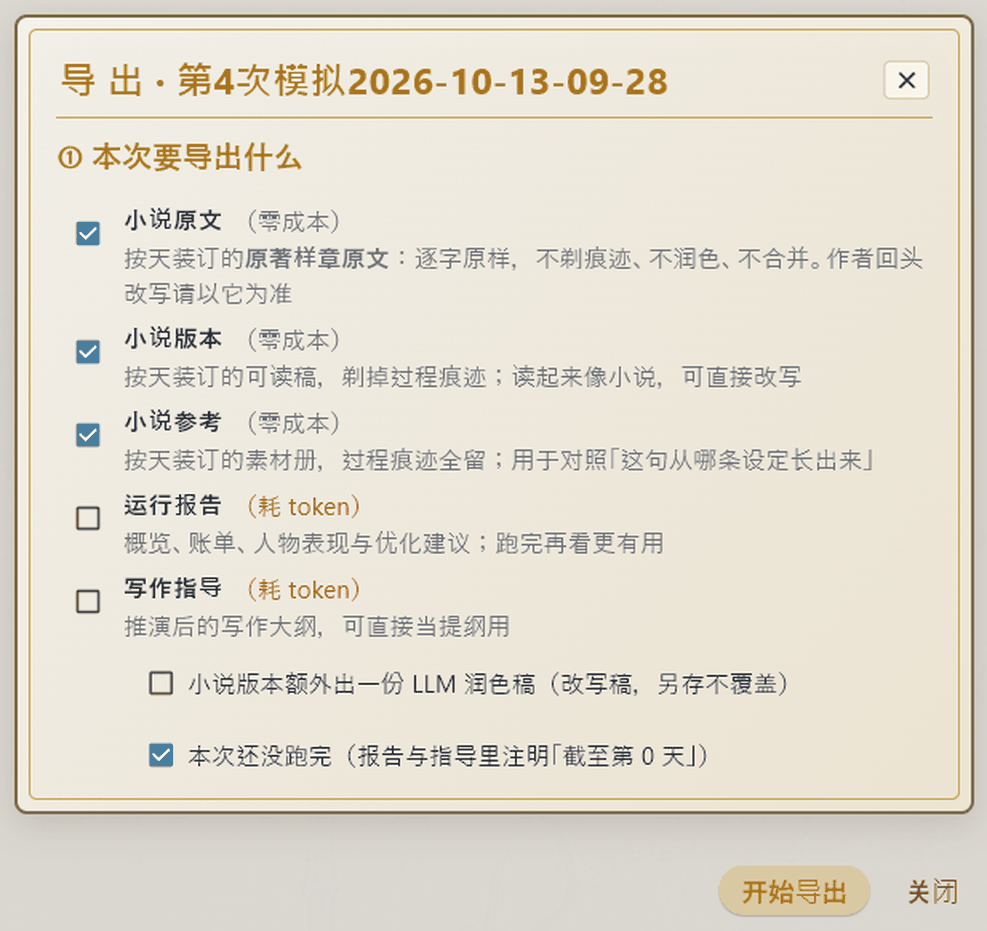

*导出：挑这一轮要哪些产物，也可以打开「结束时自动导出」*

**四类产物**（落在 `<运行文件夹>/导出/`，版本自增不覆盖）：

| 产物 | 文件 | 是什么 |
|------|------|--------|
| **原始稿** | `原始稿_v1.md` | 按天装订的**凭据稿**。写的是**那一天真实演出的全部正文**——从 `每天的生活/第NNN天.json`（推演的事实来源）铺成文字，**不剃痕迹、不润色、不合并、不被重写**。「当初到底演了什么」以它为准。零成本、可复现。 |
| **最终改写稿** | `最终改写稿_v1.md` | 按天装订的**成品稿**。剃掉过程细节（在场名单、本幕依据、机制备注、图片路径），留下时间说明、场景说明、出场退场、旁白、对白、动作、心声与同时性——**读起来像小说**，拿去改写直接用。零成本；⚠ 但见下面「会变的那一档」。 |
| **原始稿加细节** | `原始稿加细节_v1.md` | 就是**原始稿 + 细节**：正文一字不改，另外留着在场名单、本幕依据、机制备注、图片路径。用来对照「这句是从哪条设定长出来的」。零成本、可复现。 |
| **运行报告** | `运行报告_v1.md` | 概览 ＋ 账单（**程序统计**）＋ 故事线 / 关键情节 / 人物表现 / 优化建议。分析部分要调 LLM。 |
| **写作指导** | `写作指导_v1.md` | 推演后的写作大纲，可直接当提纲用。要调 LLM。 |

勾了「润色稿」时，最终改写稿会**再出一份** `最终改写稿_v1_润色.md`——
把它交给 LLM 整理成连贯小说。**另存，不覆盖合订本。**

**⚠ 导出有两条路径，别以为只导了一次**

| 路径 | 什么时候发生 | 出厂默认 |
|---|---|---|
| **手动导出** | 点「开始导出」 | 你点了才跑 |
| **收工自动导出** | **点「停止」的那一刻** | **关**（2026-10-26 起全关）；到「③ 结束时自动导出」勾了才会跑 |

⇒ 出厂状态下点完「停止」**不会**自动出稿，导出完全由你决定。
⚠ 这一条以前是**反过来的**（默认开），曾导致：点停止 → 自动导出开始跑（MuMu 逐天重写十分钟）
→ 以为卡死 → 又手动点一次 ⇒ 同时产出两份内容不同的稿子。

**程序会拦住重复**（无论自动开关是开是关都生效）：
- 收工时自动导过的档，手动导出**默认不勾**；对话框上方会列出那几个文件（可点开）。
  真要再导一份，勾「仍然再导一份（会多出 v2 等新版本）」。
- 自动导出**还在跑**时（MuMu 逐天重写可能好几分钟），手动导出会被拦下并提示，不会两份同时跑。

**慢的时候看这里**：开着 `MUMU_FOR_EXPORT` 时，最终改写稿要**每天**调一次写小说服务，
实测一章 17~207 秒、默认还写两遍 ⇒ 两天可能十分钟。进度行会显示
`… 最终改写稿 · 正在写第 1/2 天`，**在动就说明没卡死**。

**章是怎么分的：一个事件一章，不是一天一章**

装订时按**事件**（进度表里的"站"）分章，所以：

| 情况 | 稿子里长这样 |
|---|---|
| 一天演完了一个事件 | `## 第 3 天 · 辰时 08:00 → 子时 23:59` —— **一天一章**（和以前一样） |
| 一个事件演到一半到点了，第二天接着演 | `## 第 3-4 天 · 入楼收留` —— **这件事合成一章**，章内每天用一行粗体 `**第 3 天 · 辰时 → 子时**` 标出 |

> 为什么这样分：一个事件本来就可能跨天（走了三天的路是一个事件，不是三个）。
> 按天硬切，读者会看到"第 3 天章末在推门、第 4 天章首又是另一场"——两章各半截。
> ⚠ 判断跨天的依据是**幕头里记的站名**（`每天的生活/第NNN天.json` 里每一幕都带着）。
> 没有那份 json 的老运行、或者某天演了两站以上，就**照旧一天一章** ——
> 章名与内容对不上的情况永远不会出现。
> 有跨天事件时，稿子开头那句话会写成「**按事件装订**：N 件事跨了天」。

**两条规矩：**

- **前两档只装订、不创作。** 原始稿与原始稿加细节都是"把每天拼起来"，
  正文一字不改，零成本、**同一份素材重导多少次都得到同一个结果**（可复现）。
  想更连贯才走润色，而润色稿单独存，"事实来源"和"改写稿"永远分得清。
- ⚠ **会变的那一档：最终改写稿。** 打开 `MUMU_FOR_EXPORT` 后，导出时会**每天调
  MuMuAINovel 把这一天的正文重写一遍** ⇒ **同一份素材导两次，正文可以完全不同**
  （实测：两次导出完全相同的句子只占 6%）。这不是故障，是那个开关的效果；
  要"一字不改、可复现"请用**原始稿**，要"一字不改但留着细节"看**原始稿加细节**。
  开关默认**关**（关着时这一档只剃细节、正文不动）。
- **报告先有硬数据。** 运行报告的「运行概览」与「账单」由程序统计
  （天数、字数、人物、token 用量、分模型/分用途费用）。**哪怕 LLM 调用失败，
  报告照样出得来**，不会变成空壳。

**中途导出**：只纳入**已落盘的完整天**。循环只在一天结束时落盘，
所以半截稿也是干净的半截稿，不会把没走完的一天当成完整的一天写进去。
报告与写作指导里会注明「截至第 N 天，尚未跑完」。

**③ 结束时自动导出**：这几个开关只管「跑完那一刻要不要自动出」，
改一下立即生效（写进配置文件）。**关掉不等于没功能**——手动导出随时可用。

**默认全部关闭**（2026-10-26 起）：导出只在**你点了才发生**。
原因是实测过一件事 —— 点「停止」会顺带自动导出，而那一步开着
`MUMU_FOR_EXPORT` 时要逐天重写、能跑十分钟，很容易让人以为卡死、又去点一次，
于是同时产出两份内容不同的稿子。想收工自动出一份就在这里勾上（勾一次、之后一直生效）。

打开导出对话框时，**手动导出的默认勾选**是这三个零成本档：
原始稿 / 原始稿加细节 / 最终改写稿；运行报告与写作指导不默认勾（要花 token）。
运行报告默认不勾，还因为它含账单与 OOC 分析，**跑完再看**才有意义，
而中途那份是半截的。

### 4.16 全局消息框（所有提示都在这里）

开始界面和运行界面上各有一块**常驻的消息框**：开始界面在标题块下方，
运行界面紧贴页头（也就是这块界面的「状态栏」）下方。

```
· LLM 能力校验：2 项与模型特性不符，已自动改回      14:07:31 · 注意   共 5 条 · 未读 2   [查看] [清空]
```

**它是干什么的。** 以前所有提示都走 SnackBar —— 右下角冒一下、几秒后消失、不留痕。
像「LLM 配置与模型不符，已自动改回，需要重启才生效」这种**必须让人看见、
而且可能过一会儿才回来处理**的消息，靠看一眼是留不住的。所以现在：

- **所有面向用户的提示都收进这块框**（保存配置、导入完成、导出结果、
  运行状态、启动时的能力校验……）；
- **SnackBar 照旧弹**，只是它现在只负责「正在看屏幕的人」的即时反馈，
  真正留痕的是这块消息框；
- 一行显示**最新一条**（长了自动截断），点 **查看** 打开完整列表（倒序，最新的在最上面），
  点 **清空** 清掉；右边一直标着「共 N 条 · 未读 M」，不会漏。

图标按严重程度分四档：`·` 提示（淡墨）/ `✓` 完成（青绿）/ `⚠` 注意（赭金）/
`✕` 错误（朱砂）。

**启动时的能力校验结果就走这里**（见 4.7.3）：如果你把 `deepseek-chat` 标成了
「支持文生图」，开机会看到一条「注意」，写明「哪一项与模型不符、已改回什么、
依据是哪个模型」，最后一条是「需要重启程序才会生效」。

### 4.17 LLM 用量（运行界面 · 用量）

运行界面页头那一行的 **用量** 按钮 —— 点开是这本账的**报表**（四栏）：

| 左到右 | 是什么 | 它自己的**筛选**（挂在栏头上） |
|---|---|---|
| **第 1 栏** | 「软件整体」＋各个**项目**（多了可滚动）。每条后面是「N 次 · 费用」 | — |
| **第 2 栏** | 按**划分方式**列出统计卡片（次数 · token · 费用 · 占比） | 栏头的 **模型 ▾** |
| **第 3 栏** | 当前那张卡片下的各个 **Agent** | 栏头的 **🗓**（时间范围）与 **☰**（Agent 筛选） |
| **第 4 栏** | 明细：总体指标，或者逐次调用一行的表格 | — |

**筛选就长在每一栏自己的栏头上** —— 点栏头右边那个符号会弹出一个菜单
（跟右键菜单一个用法），选完立刻生效。顶上那一行**只剩导出**了，
不再单独堆一排筛选。

- **第 2 栏的「划分」菜单**：选「软件整体」是 **模型 / 日期 / 模块**；
  选某个项目会**多一个「推演任务」**（那是项目级的概念）。
  现在用的是哪一种，**菜单里那一项前面带勾**，栏头下面的小字也写着。
- **第 3 栏的「🗓 时间范围」菜单**：全部时间 / 今天 / 最近 7 天 / 最近 30 天，
  再往下列着最近有记录的那些日期（点一天 = 从那天看起）。
  ⚠ 它是**整份报表的时间窗**，四栏会一起跟着变（不是只筛第 3 栏）。
- **第 3 栏的「☰ Agent 筛选」菜单**：全部 Agent / 只看剧组 Agent /
  只看未标用途（开卷抽取那类没有「Agent」概念的调用）/ 只看花费较大的（≥ ¥0.10）。
  它只管**第 3 栏显示哪几行**，点某一行看明细不受影响。
- 栏头**钉在顶上**：内容滚起来，筛选菜单还留在原处。
- 顶上还能把报表**导出成 xlsx**（多张 Sheet、**第一张一定是总体信息**，
  中英两版可选）。
- **所有数字都是数据库直接算出来的**，不调模型、也不在本地存 md。

**四栏的宽度**（2026-10-11 调整）：第 1 / 2 / 3 栏**固定宽**（150 / 200 / 130），
**第 4 栏吃掉剩下的全部宽度** —— 窗口越大它越宽，明细那八列（时间 / 模型 / 用途 /
模块 / Agent / 入 / 出 / 费用）就尽量一次全显示。

> **对话框默认铺满窗口**（每边只留 12px），不用自己去拖大。
> ⚠ 它按**客户区**（去掉标题栏与边框的那块）算，所以不会比可视区还高 ——
> 早年按"窗口高"算过一版，底部会被切掉一截，而屏幕上看起来只是"内容没了"。

**第 4 栏放不下时会自己出现一根横向滚动条**（明细表宽过栏宽时）：

- 条是**自己画的**（4px 细条，压在表的下方），**放得下就不画**、
  放不下**一打开就在**（不用先滚一下才出现）；
- 用鼠标滚轮（或 Shift + 滚轮）在表上滚，也能直接拖那根细条；
- 滚轮在表外面时仍是**纵向**滚动整栏内容，两者不打架。

> ⚠ 为什么不用系统那根：实测过两次，这个界面构建里横向的那根**画不出来**
> （`ADAPTIVE` 与 `HIDDEN` 切换前后截图零差异）—— 所以只能自己画。
> 竖向的滚动条本来就是自绘的（见运行界面左右两栏），口径一致。

**右上角有一个「×」**（macOS / Linux 在左上角，跟系统习惯一致）——
Flet 的对话框是程序自己画的浮层，没有系统标题栏，所以这个「×」是画上去的。
它也配合系统的 Esc / 点框外一起用。

**左栏的项目条目可以删。** 鼠标移到项目那一行，右边会出现一个垃圾桶：

- **只删统计台账里那一个项目的记录** —— 你写的小说（项目文件夹）一个字都不会动；
- **删之前一定先问**，确认框里会写清「哪个项目、要删多少次调用、合计多少钱」，
  而且**默认按钮是取消**；
- 「软件整体」那一条是**汇总**，不给删（它不是一条记录）。

⚠ 删掉之后**无法恢复**。作用主要是：项目删了 / 改名之后，它的旧账不会一直
留在左栏里越攒越多。

---

## 4.20 两个自由度旋钮（这一轮让谁替你决定）

> 入口：**起　笔** 对话框 →「自由度（这一轮让别人替你做多少决定）」。
> 也写进 `.env`（`TASK_FREEDOM` / `STYLE_FREEDOM`），**下次起笔还在这里**。

### 4.20.1 为什么是两个，不是一个

一个旋钮同时管"人物自己决定多少"和"字写得多讲究"，会逼出两种坏结果之一：

- 想要**意外** ⇒ 顺手把文笔也松了 ⇒ 得到"更散**而且**更难看"；
- 想保住**文笔** ⇒ 连任务也不敢松 ⇒ 回到"照剧本演"。

所以拆开。**它们互不影响**：拖任务规训不会动文笔，拖文笔也不会动剧本。

| 旋钮 | 管什么 | 放开之后的代价 |
|---|---|---|
| **任务规训** `TASK_FREEDOM` | 剧本给到多细、这一拍该演什么 | 剧情会散，可能跑题、可能空转 |
| **文笔规训** `STYLE_FREEDOM` | 禁词列多少、距离强不强制、思维链几问、口癖管不管 | 可能出现难看的句子；口癖会回弹 |

> ⚠ **两个旋钮都碰不到的那一条**：「不许替别人说话」。
> 它不是"规训"，是**世界的物理法则** —— 松了不是自由度，是人物开始替别人活。
> 所以无论两个旋钮拉到哪一端，这条规则都原样存在。

### 4.20.2 任务规训（0–100，默认 50）

| 值 | 给演员什么 | 效果 |
|---|---|---|
| **0–34** | `[今日剧本]` 全文 + 分到的事 + **本场分拍表** + 温度 0.55 | 照剧本演。最稳，也最不像"他自己决定" |
| **35–64** | 剧本压到 160 字 + 分到的事，**不给分拍表** + 温度 0.75 | 他知道今天要办什么，不知道这一拍该演什么 |
| **65–100** | 只给"今天该推进哪件事" + 温度 0.91 | 最意外，也最容易跑题或空转 |

两点要说清：

1. **温度也归它管**。同样的提示词，温度低时模型反复挑"最得体"的动作——
   那正是"每一拍都等一等、不出声"的来源。所以这个旋钮不只是"给多少剧本"，
   也是"给他多大的余地挑那个不太得体、但这个人真会做的动作"。
2. **中档和高档都会额外给一段"许可"**（`[没人替你决定这一拍]`）：
   只删禁令，模型会停在原地不动（本项目实测过：十次 `wait`、零动作）。
   所以松绑是**成对**的 —— 少一条禁令，补一句"这一拍由你定"。
   这段话排在**所有约束之后**，因为它说的是"上面那些不是台词提示"。

### 4.20.3 文笔规训（0–100，默认 50）

| 值 | 去 AI 清单 | 心理距离 | 思维链 | 口癖配额 |
|---|---|---|---|---|
| **0–34** 很讲究 | 全列（跟 `DEAI_PROMPT_ITEMS` 一致） | 强制 | 五问 | 开 |
| **35–64** 标准 | 约 3/4 | 强制 | 五问 | 开 |
| **65–100** 松 | 约 1/2（至少 2 条） | **不强制**（由人物自己选） | **只留一问** | **关** |

> ⚠ **松的是"当场怎么写"，不是"写完不查"。**
> 去 AI 清单少列几个词，但落盘的「去AI审计」与 `DEAI_STRIP` **仍然全量跑**。
> 少列 ≠ 允许 AI 腔 —— AI 腔恰恰是**最不讲究**的写法（套话、整齐、面面俱到）。

> ⚠ **松档的已知代价**：口癖配额关掉之后，同一句口头禅会回弹到每句都带
> （2026-10-19 实测：34 拍里用了 6 次）。这是这个档位的价钱，不是 bug。

### 4.20.4 想要"每次不一样"，该调哪个

想要**剧情不同** ⇒ 调**任务规训**（往 65 以上）。这是唯一能改变"发生什么"的旋钮。

想要**文体实验**（长句、留白、意识流）⇒ 调**文笔规训**（往 65 以上）。
它不会让剧情变，只会让同样的剧情写得更野。

**怎么验证真的不一样了**：

```bash
# 同一个 case 跑三次（换个 run-id）
./.venv/Scripts/python.exe -m novel_bench.bench.cli run --case ykg-01 --ticks 34 --run-id a1
./.venv/Scripts/python.exe -m novel_bench.bench.cli run --case ykg-01 --ticks 34 --run-id a2
./.venv/Scripts/python.exe -m novel_bench.bench.cli run --case ykg-01 --ticks 34 --run-id a3

# 量"剧情到底有多不一样"
./.venv/Scripts/python.exe tools/probe_divergence.py \
    novel_bench/results/a1 novel_bench/results/a2 novel_bench/results/a3
```

它给三档判定：

| 判定 | 骨架重合 | 含义 |
|---|---|---|
| **假发散** | ≥ 70% | 换词不换戏 —— 读者读出来是"又来一遍" |
| **半发散** | 50–70% | 人换了、事没换（2026-10-19 实测《雪国》跑两次：文字 9.7%，**骨架 62.5%**） |
| **真发散** | < 50% | 真的不一样了 |

> ⚠ 别看"文字重合"。它只看措辞 —— 9.7% 的重合度可以对应同一部戏换了个说法。
> 要看**骨架重合**（谁·做了什么类型的事，按顺序）。

## 4.21 世界法则：事件是怎么定下来的

> 这一节讲"为什么这一拍会发生这件事"。它决定了推演像不像"推演"。

### 4.21.1 改之前：导演是个编剧

以前每 8 拍问模型一次「**请设计一个戏剧事件**」。

那是编剧在做的事——他想"这里该有个转折"，然后编一个。两个后果都能量到：

1. **收敛**：同一部《雪国》跑两次，文字只重合 9.7%，但**骨架重合 62.5%**。
   因为"设计一个事件"这个问法本身就把答案收窄了 —— 模型会挑最安全、最不难看的那一类。
2. **不可解释**：读者说不出"这件事为什么现在发生"。因为它不是因为什么发生的，
   是因为**该有个事件了**。

### 4.21.2 现在：压力算出来，那条自己破

四条压力，全部**纯代码算、零模型调用**（每拍都算得起，也可复现）：

| 压力 | 怎么算 | 破了会怎样 |
|---|---|---|
| **目标冲突** | 在场人物 `current_goal` 两两的**共同词密度**取最大 | 「人物冲突」—— 两人在同一件事上做相反的决定 |
| **处境恶化** | `1-体力` + 负向情绪 + 今天已发生的坏事 | 「巧合」—— 病了、醉了、钱没了，身体先撑不住 |
| **秘密压力** | 有秘密的人 ×（藏了几天）+ 有人逼近 | 「秘密泄露」—— 不是投放一个泄密，是**藏不住了** |
| **时间压力** | 今天过了多少 + 离今天结束还剩几拍 | 「外部刺激」—— 期限到了，被迫准备不足地动手 |

**事件类型由代码定，模型只负责把它写成一件具体的事。**
压力段会进提示词（`[局面推到了这一步]`），所以模型知道"为什么是这一类"。

判据里有一条专门钉这件事：**模型答"巧合"，最终类型仍然是压力定的那个**。
（只"提示它照抄"是不够的 —— 提示是软的，而挑类型正是退化成"写作"的那一步。）

### 4.21.3 四条压力都低时：不出事

这是"日常生活型"的开关。四条压力都低时**返回 None，这一拍不安排任何事件**，
而且**连模型都不调**（不花那次钱）。

> 没有这一条，世界法则就退化成"每 8 拍必须出点事"，跟改之前没区别。

**例外**：高潮日 / 停滞自救这两条强制通道**压力全低也要出事**——
它们本来就是"不能再等"的路，让压力门槛拦掉等于把它们废掉。
这时事件理由会诚实地写成"四股压力都低，这一拍是被强制推的"。

### 4.21.4 为什么要"可解释"

`导演事件表` 里每条事件都有 `理由` 字段，它来自**压力的证据**
（"甲 藏的事已经压到 1.00"），不是模型的自述（"因为猫"）。

这条不是锦上添花：没有它，"推演"与"随机挑一件事"在结果上看不出区别 ——
而"每次都能解释为什么发生"正是推演与写作的分界线：

> **写作是"我要这个效果，所以安排这个事件"；
> 推演是"这个局面必然导致这个事件"。**

## 5. 命令手册

> 运行界面上的 **📖 起　笔 / ⏸ 暂停 / ⏹ 停止** 三个按钮见 **4.14**。

### 5.1 故事进度

| 命令 | 别名 | 说明 |
|------|------|------|
| `progress` | `pg` | 查看故事进度表：各节点完成状态、当前节点、偏离记录 |
| `storyline` | `sl` | 生成故事文档：时间轴、关键场景、精彩情节、人物弧线、伏笔状态 |
| `outline` | `ol` | 生成大纲建议：节点对照表、新增支线、伏笔更新、后续建议 |
| `summary` | | 生成运行小结：运行概览、故事线、关键情节、人物表现、优化建议 |

### 5.2 快照回溯

| 命令 | 别名 | 说明 |
|------|------|------|
| `events` | `ev` | 最近关键事件 |
| `snapshot` | `snap` | 手动快照（可指定备注） |
| `rewind` | `rw` | 列快照/回溯到指定快照 |

### 5.3 视角观察

| 命令 | 别名 | 说明 |
|------|------|------|
| `focus` | `f` | 跟踪视角 |
| `observe` | `ob` | 查看人物内心 |

### 5.4 显示节奏

| 命令 | 别名 | 说明 |
|------|------|------|
| `display` | `dp` | 显示档切换（reading/fast） |
| `readspeed` | `rs` | 调阅读速度（字/秒） |
| `catchup` | `cu` | 追上最新（跳过未呈现内容） |
| `follow` | | 跟随开关 |

### 5.5 存档

| 命令 | 别名 | 说明 |
|------|------|------|
| `save` | | 自动用时间戳保存存档 |
| `save <名称>` | | 指定名称保存存档 |
| `saves` | | 列出所有存档 |

### 5.6 导出

> 装订稿与报告的导出走**运行界面的「📤 导出」按钮**（详见 **4.15**）——
> 运行中途也能用。下表里的命令是设计稿中对应的动作与开关。

| 命令 | 别名 | 说明 |
|------|------|------|
| `export settings` | | 导出项目级完整设定集 |
| `storyline` | `sl` | 生成故事线汇总 |
| `summary` | | 立即生成一次运行报告 |
| `outline` | `ol` | 立即生成写作指导（大纲建议） |
| `film on/off` | | 影视镜头卡开关 |

四类导出产物（最终改写稿 / 原始稿加细节 / 运行报告 / 写作指导）见 **4.15**。

### 5.7 系统

| 命令 | 别名 | 说明 |
|------|------|------|
| `pause` | `p` | 暂停 |
| `resume` | `r` | 继续 |
| `status` | `st` | 状态总览 |
| `budget` | `b` | token 账单 |
| `settings` | `set` | 设置界面 |
| `help` | `?` | 显示帮助 |
| `quit` | `q` | 退出（按「结束时自动导出」的开关导出） |

### 5.8 用脚本驱动（Python SDK 与命令行）

> 界面能做的事，脚本都能做 —— **同一份实现**，只是换了个壳。
> 适合：批量跑、定时任务、服务器上无人值守、把推演接进你自己的流程。
> 这一节是**用法概览**；完整的 API 参考在
> `developers/sdk/API.md`（源码树里，不随发布包提供），
> 八个可直接跑的示例在 `developers/sdk/samples/`（源码树里，不随发布包提供）。

#### 5.8.1 Python SDK

**不用安装**，加一行路径就能用（`nws` 会自己把程序目录接上）：

```python
import sys
sys.path.insert(0, r"<程序目录>\developers\sdk")
import nws

nws.config.set(MOCK_LLM=True)                    # 演示模式：零成本、零网络
book = nws.project.create("演示书", source=r"C:\素材\演示")
nws.ingest.run(book)                             # 开卷
r = nws.run.start(book, days=1, max_ticks=6)     # 起笔（跑 6 拍）
r.wait()
nws.export.run(book, r.run, kinds=["novel", "report"])
print(nws.usage.summary(book.name))
```

九个模块：

| 模块 | 管什么 | 对应界面 |
|------|--------|----------|
| `nws.config` | **全局设置**（按 SPEC 分组读写 `.env`） | 天机 |
| `nws.project` | **项目**：建/找/打开/列出/删；**项目设置** | 开卷 / 拾卷 / 书斋 |
| `nws.ingest` | **开卷**：`plan()` 预览、`run()` 真跑、`gate=` 同意门 | 开卷向导 |
| `nws.run` | **推演**：起/暂停/继续/停/快照/选岔路/续跑 | 起　笔 |
| `nws.archive` | **存档**（某一轮的副本） | 存档 |
| `nws.export` | **报告导出**（五种产物） | 📤 导出 |
| `nws.usage` | **用量报表**（次数/token/费用） | 用量 |
| `nws.mumu` | **MuMuAINovel**（状态/启停/生成/润色） | 天机 · 创作服务 |
| `nws.aio` | 异步外观（Jupyter / FastAPI / Flet 里用） | — |

**几个值得先知道的**：

- **开卷读的是「引用文件夹」**（你自己的素材），不是项目文件夹。没登记引用
  文件夹时 SDK **明确报错**，不会默默读错地方。
- **`plan()` 不发任何请求**：它是"我这一按下去要发出去多少字、大概多少钱"。
- **同意门**：`nws.ingest.run(book, gate=lambda brief: 同意吗?)` —— 返回 `False`
  就抛 `IngestDeclined`（**中止，不是错误**），并且**一次请求都不发**。
- **`max_ticks` 是给脚本用的刹车**：真调模型时一轮可能跑很久，调试先给个小值。
- **要在事件循环里**（Jupyter / FastAPI）→ 用 `nws.aio`，别用同步那套
  （会死锁；SDK 会抛 `AlreadyAsync` 提醒你）。
- **收尾调 `r.close()`**：它放开这一轮占着的 sqlite 连接。不放开的话，
  **同一个进程里**删这一轮 / 这本书会报"文件正被程序占用"。

**规则**：SDK **不写你的 `.env`**（要落盘得显式 `save()`），
**不碰引用文件夹**，「删除」一律是**搬到「已删除备份」**（可恢复）。

#### 5.8.2 命令行

在 `developers/sdk/` 目录下（或把该目录加进 `PYTHONPATH`）：

```bash
python -m nws version                       # 版本 + 挂在哪
python -m nws list [--json]                 # 有哪些书
python -m nws info 示例书                    # 这本书什么状态
python -m nws new 书名 --source <素材文件夹>
python -m nws delete 书名 --yes              # 删书（搬到「已删除备份」）
python -m nws settings --group 运行边界
python -m nws settings-set MOCK_LLM=true --save
python -m nws ingest 示例书 --plan           # 只看要发出去多少（不发请求）
python -m nws ingest 示例书 --yes            # 真开卷（会花 token）
python -m nws run 示例书 --days 1 --ticks 6 --follow
python -m nws run 示例书 --resume            # 接着上一轮
python -m nws rounds 示例书                  # 跑过哪几轮
python -m nws saves 示例书                   # 有哪些存档
python -m nws save 示例书 --desc "第一轮跑完"
python -m nws export 示例书 --kinds novel,report
python -m nws usage --scope 示例书 --by 模型
python -m nws mumu status|start|stop|skills
```

> ⚠ **危险 / 花钱的动作要 `--yes`**（删书、开卷）。没有它只打印"将要做什么" ——
> 这是有意的：命令行下没有确认框，`--yes` 就是那个确认。

#### 5.8.3 这个 SDK 是被验过的

| 文件 | 干什么 |
|------|--------|
| `tools/verify_sdk.py` | **70 项行为判据**：真建书 → 真开卷 → 真推演 3 拍 → 真导出 → 真存档 → 真删（全部在临时目录 + 演示模式里做） |
| `developers/mutate_sdk.py` | **12 条反例法**：逐条把 SDK 种回 bug，证明每条判据真的会红 |

其中两条判据是**自证清白**的：跑完比对 `.env` 的 sha1（证明没动你的配置）、
比对真实 `Projects/` 的条目数（证明没往里塞测试书）。

#### 5.8.4 一条命令跑「任意素材文件夹」（无人值守 · 2026-10-18）

> 源码树里的 `developers/run_input_folder.py`（**不随发布包提供**）。
> 发布包的用户想跑自己的素材，走界面同一条路：**开卷 → 起笔**（§4.5、§4.14）。

**它解决什么**：`novel_bench`（见 `novel_bench/USAGE.md`）只吃数据集里写死的用例，
判的是"这一版比上一版好没有"。而你想知道的是"**这次改动放到我自己的项目 / `samples/`
里，出来的东西是不是变好了**" —— 那要走**开卷**那条路。以前这条路只有界面，
没法批量跑，只能手点一遍。

它就是开卷那条路的 headless 版，三步和界面**完全一致**（同一个 `run_ingest`、
同一个 `Project.create_new`、同一个 `assemble()` + `RunSession`）：

```bash
cd /path/to/NovelWorldSimulator        # 换成你解压/克隆的目录

# 跑 samples 里的一篇（6 拍）
./.venv/Scripts/python.exe developers/run_input_folder.py \
    --src "samples/zh/06_科幻_回声站" --name "回声站" --ticks 6 --run-id test-echo

# 跑你自己的项目（素材文件夹 = 设定/正文那一层，不是成品项目目录）
./.venv/Scripts/python.exe developers/run_input_folder.py \
    --src "D:/我的项目/设定集" \
    --name "我的项目" --ticks 6 --run-id test-mine
```

| 参数 | 说明 |
|------|------|
| `--src` | 输入文件夹。`samples/zh/<篇名>`，或你自己的素材根（里面是 `设定/`、`大纲/`、`正文/` 那一套，见 §6） |
| `--name` | 项目名（默认取文件夹名） |
| `--ticks` | 跑多少拍（默认 6）。一拍 ≈ 一次模型往返 + 审读 |
| `--run-id` | 产物目录名；不给我就按时间戳起一个 |
| `--out` | 产物落点（默认 `novel_bench/results/manual/<run-id>/`） |
| `--cast` | 只让这些人上场（逗号分隔）。默认按设定集全员 |
| `--scene` | 锁住场景（调试某个场面时用） |
| `--clock` | 起始时间 `HH:MM`；不给就按 `.env` |
| `--no-ingest` | 跳过开卷，把 `--src` **直接当**已经提炼好的设定集目录 |
| `--resummarize` | **只重写小结**：给一个已有产物目录，重算 `summary.md`，**不重跑推演、不花钱** |

**产物**（都在 `--out` 那个目录里）：

```
<run-id>/
├── novel.md          当天故事（和基准用的同一套抽取逻辑，可直接比字数/重复率）
├── transcript.md     逐条实录（谁做了什么、说了什么）
├── summary.md        推演小结：拍数 / 幕数 / 条目构成 / 正文字数 / 审读改写了几条、为什么
├── meta.json         拍数、耗时、开卷档位、人物数
└── project/          项目目录（设定集 + 第1次模拟），可以拷回去用界面接着跑
```

**几件要知道的**：

- ⚠ **`--no-ingest` 对 `samples/` 和你自己的项目通常不行**：那些素材的人物是
  **自然语言的 md**（`设定/人物/<名>.md`），必须过一遍开卷才产出 `人物.yaml`。
  它只适合"设定集已经提炼好"的目录。
- **耗时**（本机实测）：开卷 `samples` 约 200 秒、人物多的项目约 280 秒；
  6 拍推演 520–910 秒。跑之前先估一下，别在急着要结果的时候开。
- **它替你锁了几个开关**（和基准一致，否则两边结果不可比）：关自动收工、
  关开场动画、关夜间停顿、关存档暂停、关三座外部服务，
  并把 `SCRIPT_REVIEW_EVERY_TICKS=1`（**审读每拍都过**）。
- **产物目录会被重建**：同一个 `--run-id` 再跑一次，`project/` 会先删掉。

**顺带**：`developers/make_test_report.py` 把几份产物合并成一份报告
（manual 与 bench 两种格式都能读）：

```bash
./.venv/Scripts/python.exe developers/make_test_report.py \
    novel_bench/results/manual/test-mowenlou \
    novel_bench/results/test-bc01 \
    novel_bench/results/test-zx01 \
    --out novel_bench/results/测试报告.md
```

它给一张总表（拍数 / 字数 / 审读改写数 / 推演分 / 原著分 / 盲评 / 卫生）
加每一例的小结与正文，适合"一次改完，拿几本不同的书一起看"。

---

## 6. 输入文件夹标准

> **想写得更好，另有一份专门的指导**：程序根目录的 `设定写作指导.md`。
> 这一节讲的是"格式要求"（怎么摆、命名怎么起、什么档位）；
> 那一份讲的是"**内容怎么写才有用**" —— 哪些字会被原样带进推演、
> 哪些会被压缩掉、大背景和小细节各该写多少、四类设定分别怎么下笔，
> 以及三个"从坏到好"的改写例子。两份配合着看。
>
> **还不知道"设定集从哪儿来"的话，先看 6.8** —— 那一节讲怎么用别的 AI 工具
> 代写（提示词可直接复制）、怎么手写，以及**每个地点几章 / 全书多少字**怎么定。
> 完整版在 `设定集提供指南.md`（英文 `Settings_Authoring_Guide.md`）。

### 6.1 现成的示例：`samples/`

不想自己攒文件夹的话，**先拿随程序附带的示例试**。六个题材（悬疑 · 单元剧、玄幻修仙、
都市、历史架空、言情、科幻）**各一篇**，而且**每一篇都写了中文和英文两个版本** ——
同一个故事，两种语言各写一遍，你想用哪种语言推演都行。

**位置**：程序目录下的 `samples/`（和 `使用说明.md`、`main_gui.py` 在同一层）。

```
NovelWorldSimulator/                        ← 程序目录
├── 使用说明.md · User_Manual.md
├── main_gui.py
└── samples/
    ├── README.md                           ← 两个语言的索引（含每篇一句话简介）
    ├── zh/                                 ← 中文版（6 篇）
    │   ├── 01_悬疑单元_更漏子/
    │   ├── 02_玄幻修仙_借山道人/
    │   ├── 03_都市_夜班书店/
    │   ├── 04_历史架空_河工疏/
    │   ├── 05_言情_灯花记/
    │   └── 06_科幻_回声站/
    └── en/                                 ← 同一批故事的英文版（顺序一一对应）
        ├── 01_mystery_the_water_clock/
        ├── 02_xianxia_the_mountain_borrower/
        ├── 03_urban_the_all_night_bookshop/
        ├── 04_alternate_history_the_river_memorial/
        ├── 05_romance_the_lamp_flower/
        └── 06_scifi_echo_station/
```

每一篇里面都是下面 **6.4 黄金档**那一套（设定 / 人物 / 大纲 / 伏笔 / 正文）：

> **想先看一篇跑出来是什么样**：`使用说明.md` 的 **5.8.4** 里有一条命令，
> 直接拿 `samples/zh/<篇名>` 跑 6 拍，产物是 `novel.md`（正文）+ `summary.md`（小结）。

```
samples/zh/01_悬疑单元_更漏子/          samples/en/01_mystery_the_water_clock/
├── 设定/                               ├── setting/
│   ├── 世界观.md                       │   ├── world.md
│   ├── 顶级规则.md                     │   ├── rules.md
│   ├── 地点.yaml                       │   ├── places.yaml
│   └── 人物/                           │   └── characters/
│       ├── 主角.md                     │       ├── shen-yan.md
│       └── 柳娘.md                     │       └── liu-niang.md
├── 大纲/                               ├── outline/
│   └── 故事大纲.md                     │   └── story-outline.md
├── 伏笔.md                             ├── foreshadowing.md
└── 正文/                               └── chapters/
    ├── 第一章 早了一刻.md              │   ├── chapter-01.md
    ├── 第二章 早关的门.md              │   ├── chapter-02.md
    └── 第三章 空着的一页.md            │   └── chapter-03.md
```

> 六篇示例**每篇都是三章正文**（理由见 6.4「正文为什么建议至少三章」）。

> **大纲也按"厚"的写法做了**：中文六篇 **3489 – 4103 字**、英文六篇 **1905 – 2304 词**，
> **中英逐站对齐**，98 个站每一站都写了「完成判据 / 高潮 / 情节线」三样（零缺项），
> 另加一节「悬念的次序（读者什么时候知道什么）」。
> ⚠ 别只把字数堆上去 —— 开卷时程序只读大纲里的**站表**，站表只渲染
> 跨度 / 篇幅 / 章数 / 完成判据 / 高潮 / 选项 / 概要 / 情节线这**八个字段**，
> 大纲里别的章节**根本进不了模型**。想厚，就厚在站表这几栏里。
> 「高潮」尤其不能写成「完成判据」的复述（判据说"演到哪算完"，高潮说"那一瞬发生了什么"）。

> ⚠ **开卷时请选中「某一个小故事」那一层**（例如 `samples/zh/01_悬疑单元_更漏子/`），
> **不要**选 `samples/` 或 `samples/zh/` —— 那样六个故事会被当成**一本书**读进来。

**这六个故事**（**全部原创**，随程序一起分发，随便改）：

| 文件夹 | 题材 | 故事 | 一句话 |
|--------|------|------|--------|
| `zh/01_悬疑单元_更漏子/` | 悬疑 · 单元剧 | 《更漏子》 | 唐代长安，一个管更漏的小吏，靠"水走得快不快"查案；每坊一桩、各自独立，暗里连成一条线 |
| `zh/02_玄幻修仙_借山道人/` | 玄幻修仙 | 《借山道人》 | 修真界替人**借**东西的行当：借山、借水、借寿；借了必须还，还不上的欠痕会自己记账 |
| `zh/03_都市_夜班书店/` | 都市 | 《夜班书店》 | 一家 24 小时书店；凌晨三点到四点之间进来的客人，都不是"随便逛逛" |
| `zh/04_历史架空_河工疏/` | 历史架空 | 《河工疏》 | 河工小吏发现盖了印的治河方案里堤高算错一尺，而"改"本身是死罪 |
| `zh/05_言情_灯花记/` | 言情 | 《灯花记》 | 江南水乡，摆渡人和绣娘一年只见一次 —— 灯节那晚的最后一趟船 |
| `zh/06_科幻_回声站/` | 科幻 | 《回声站》 | 深空中继站里的一个守站员；最近收到的信号里，出现了他自己**还没说过**的话 |

英文版是同六个故事，文件夹在 `en/` 下、顺序一一对应：
`01_mystery_the_water_clock`（悬疑）、`02_xianxia_the_mountain_borrower`（玄幻修仙）、
`03_urban_the_all_night_bookshop`（都市）、`04_alternate_history_the_river_memorial`（历史架空）、
`05_romance_the_lamp_flower`（言情）、`06_scifi_echo_station`（科幻）。
英文说明书的这一节有每个英文文件夹的一句话简介。

> 关于版权：这六篇**都是为本程序写的原创短篇**，没有引用任何受版权保护的作品，
> 也不属于"古代公版作品的整理本"。你可以随便拿去改、拿去当模板，不用署名。

### 6.2 青铜档（能跑）

```
我的故事/
└── 大纲.md        # 三幕梗概 + 主要人物两三句介绍
```

**效果**：能跑。人物偏扁平、戏路偏泛，导演只有粗参考线。

### 6.3 白银档（推荐）

```
我的故事/
├── 大纲/  故事大纲.md（分阶段+关键节点）
├── 设定/  世界观.md  人物/甲.md 乙.md …
└── 背景说明.md
```

**效果**：行为贴设定，导演有完整路线图，冲突贴类型。

### 6.4 黄金档（最佳）

```
我的故事/
├── 设定/  世界观.md
│          顶级规则.md          ← 你写死的硬约束（会被**原文照录**，见 6.6）
│          地点.yaml            ← 地名清单（画地图时整体层**只能取它**）
│          人物/甲.md 乙.md …
├── 大纲/  故事大纲.md（分阶段+关键节点）
├── 伏笔.md
└── 正文/  第一章.md  第二章.md  第三章.md …
```

**效果**：风格卡生效、前情自动对齐、可从中间接续、伏笔可被精确激活、地图有地名可用。

#### 正文为什么建议**至少三章**

不是"多写点更好"，是三个**代码里的硬上限**决定的：

| 程序读什么 | 上限 | 在哪 |
|---|---|---|
| **风格卡**：从正文里学你的文风 | 取正文**前 4000 字** | `ingest/style.py` |
| **前情对齐**：判"哪些剧情节点已经完成" | **每章取前 1500 字**，总上限 8000 | `ingest/progress.py` |
| **起始点**：故事从哪个节点接着演 | 由上面"已完成节点"决定 | `ingest/progress.suggest_start_point` |

所以**只给一章、几百字**的时候：风格卡**样本太薄**（学不出"章法偏好""对话占比"，
只留下一句"中短句为主"），前情对齐**没有可对齐的东西**、只能给你一个空的前情提要，
起始点**永远退回第一个节点**（等于"从头演"）。

三章 × 一两千字 ≈ 4000 字，正好吃满前两个预算。`samples/` 里那六篇示例现在都是
**每章 300~1300 字、三章**，可以直接照那个量写。

> ⚠ **别为了凑字数注水**：风格卡学的是你的句子，不是你的字数。
> 三章各 800 字的好文字，胜过三章各 2000 字的车轱辘话。

#### `地点.yaml` 怎么用

它只在**一个地方**被读：画地图的时候。整体层的地名**只能来自它** ——
不许模型自己编（详见 §4 的小地图那一节）。写 3~5 处就够：

```yaml
- 名称: 临河茶肆
  说明: 临河的茶楼，两层，后院有口井      # ≤20 字，写"能用的信息"
  方位: 城东河沿，离渡口一箭地            # 可省 —— 给整体地图用
  内里: [堂屋, 后院, 井]                  # 可省 —— 给室内地图用
```

> `方位` / `内里` 属于**可选**字段：不写，程序就按"说明"和这类建筑的常识推。

### 6.5 文件命名指引

文件/文件名含以下关键词即命中默认分类规则：
- **设定**：世界观、背景、设定
- **人物**：人物、角色、character
- **大纲**：大纲、outline、剧情
- **正文**：正文、章节、第X章
- **伏笔**：伏笔、悬念、线索
- **规则**：规则、铁律、铁则、守则、法则、戒律、准则、准绳、禁忌、契约、规范、rule、constraint

> **「规则」和别的类不一样**：其他类的内容会交给 AI 读一遍、归纳成结构化字段；
> 而「规则」类的文档**原文照录**（一个字都不改），详见 6.6。
> 判断顺序上它排在最前 —— 所以 `设定/顶级规则.md` 会被判成「规则」而不是「设定」。

> **名字里一个关键词都没有会怎样**：它会被归进「杂项」—— 内容仍然会送给 AI 读，
> 但**不会被当成正文或大纲专门用**（风格卡只看正文、进度表只看大纲）。
> 开卷时 AI 会把这个情况列进清单（4.5.3），**不改你的文件名**，
> 只写一份说明 + 一张归类修正表，下次开卷就按修正后的类别读。
> 想彻底解决，自己把文件改个名（比如 `第一卷.txt` → `正文-第一卷.txt`）就行。

> **细小的设定不用单独建文件**：器物（那把缺角的紫砂壶）、习俗（更漏只许校一次）、
> 口头禅、称呼、本地风物这些**具体的小东西**，开卷时会被**单独提出来**进
> 「细节层」（存成 `细节设定.yaml`），推演时按"这一场在哪儿、谁在场"筛着用 ——
> 具体每一天的戏多半是它们在推动。详见 §4.2.2.3。

#### 6.5.1 人物卡的可选字段：「登场」

人物卡（`设定/人物/某某.md`）除了姓名/身份/性格/口癖/秘密/目标/红线，还可以写一个
**可选**字段：

```markdown
登场：第 3 天
```

- 写了就按它来：这个人**第 3 个故事日之前不在场**（不在"在场人物"里，也不会被抽去决策）。
- 认这几种写法：`第3天` / `3` / `三天` / `未登场`（= 先不放出来；`后期` / `终局` 同义）。
- **留空 = 第 1 天**。认不出的写法也当第 1 天 —— 猜晚会让该出场的人不出场，那个代价大得多。
- 为什么要它：真机跑《临河茶肆》时，**连终局才登场的角色都天天出现在"在场人物"里**
  （126 次决策的名单一模一样）—— 场景没有边界，谁也不必对"此刻谁在这儿"负责，
  而**"他还没登场"这件事一旦泄漏，秘密就形同公开**。
- 关系表的「关系」字段请写**中性的**（双方都成立的说法，如「师徒」「夫妻」），
  开场会把它用在双方那一行上。

> 相关：`world/state.py` 的 `promote_debuts()` 在**跨天时**放人登场；
> 开场屏的「未登场」那一行读的就是这个字段。

#### 6.5.2 人物卡的可选字段：「说话指纹」（2026-10-28 加）

```markdown
说话指纹：一句不超过十字；爱反问「哪一笔」；虚了先摸炭条；叫她「六丫头」
```

**四件事，用「；」隔开，每条都要能照着做**：

| # | 写什么 | 反例（写了等于没写） |
|---|---|---|
| ① | **句子多长**（"一句不超过十字"／"一急就连着三十个字"） | "说话简短" |
| ② | **嘴上的抓手**（爱反问／爱让人先坐／爱把话说一半） | "说话有分寸" |
| ③ | **心虚时手上干什么**（摸烟袋／擦桌子／把碗推远） | "心里发虚" |
| ④ | **对谁换称呼**（叫她"阿六"、叫他"东家"、陌生人只喊"客官"） | "待人有礼" |

**为什么要有这一栏**：一位编辑判"这是机器写的"用的办法很土，也很准 ——
**把人名遮住**：如果所有人都一个味（一样客气、一样完整、一样有礼貌），
那就是机器写的。病根不在句子（每句都通顺），在**没人定过这个人怎么说话**。
所以动笔之前先把指纹定下来，从源头避免所有角色一个腔调。

⚠ 三条纪律：

- **不许写形容词**（"冷淡""温和"）—— 形容词没法执行，模型只会把它翻译回
  "客气、完整、有礼貌"，正是要治的那个病；
- **没写就是空**，程序**不替你编**（编出来的指纹会跟别人撞成一个味）；
- 同一本书里，两个人物的四条**至少要有一条不同** —— 这是"遮名分得出谁"的最低线。

**它怎么走到演员嘴里**（这条链每一环都有判据守着，见 `tools/verify_speech_fp.py`）：

```
设定集/人物卡  说话指纹
   ↓  ingest/extractor.py      提取时保留（不是静默丢掉）
   ↓  sim/setup.py             → PersonState.speech_fp
   ↓  actors/casting.py        进"选角层"（〔在这个本子里，你演的是〕）
   ↓  agent/core.py            人格卡一行 + `_voice_rules()` 在**开口前**再压一次
```

**顺带进提示词的三条**（不属于某个人物，属于整本书怎么说）：

| 纪律 | 一句话 |
|---|---|
| **能不说就不说** | 用动作、表情、环境、手里的东西能说清的，**别从嘴里出来**；信息不必用台词交代 |
| **遮名测试** | 把台词里的人名遮掉，还认得出是谁说的；认不出就换说法 |
| **别答完整** | 问了不必逐条答：答一半、答错方向、先问回去 |

> 另有一条**纯代码**的闸：「他严肃地说道」「她冷冷地说」这种**副词盖章**，
> 一章最多两处，超出部分由 `crew/prose_flow.dialogue_tag_spans` 数出来、
> `_fix_dialogue_tags` 删掉副词并把动词归一到「说／问／答」。
> 它**只动叙述、不碰引号里的台词**（这条单元测试写死在判据 B3c 里）。

### 6.6 顶级规则：给这一本小说写死几条硬约束

可以在设定文档里，给**当前这本小说**单独立一份「顶级规则」——
你写死的硬约束，推演时必须遵守。

它和「世界观」的分工是：
**世界观是背景**（世界是什么样），**规则是约束**（什么绝不许发生、这本书绝不许怎么写）。

**怎么让它生效**：把文件放进引用文件夹（推荐 `设定/顶级规则.md`），
**文件名里带「规则 / 铁律 / 铁则 / 守则 / 法则 / 戒律 / 准则 / 准绳 / 禁忌 /
契约 / 规范」任意一个**，或者英文名带 `rule` / `constraint`，就会被识别成规则文档。

```
设定/
├── 世界观.md          ← 背景：这座城是什么样
├── 顶级规则.md        ← 约束：什么绝不会发生、这本书怎么写
└── 人物/
```

**关键一点：规则是原文照录的。** 别的设定文档会被 AI 读一遍、归纳成结构化字段
（世界观通常被压到 120 字左右），而规则文档**一个字都不改**地存进设定集
（`本地设定集/顶级规则.md`），推演时**原样放在提示词最前面**。
你写「主角断案只许靠看水」，模型看到的就是这句原话，不是它自己的转述。

**它能管什么**（写得越具体越管用）：

| 想管的事 | 写法举例 |
|---|---|
| 世界铁律 | `没有鬼神，也没有超自然力量。所有"怪事"最后都必须有一个说得通的人为解释。` |
| 禁忌 / 红线 | `漏刻只许校、不许改；没留档的改动本身就是一条线索。` |
| 故事走向 | `一案收干净再起一案：章末必须了结本案；贯穿线只许埋，不许在章内解释。` |
| 写法 / 视角 | `主角的内心独白一章不超过三句；判断要从动作和台词里露出来。` |

**三个提醒**：

- **不是越多越好。** 一次写 5~10 条最管用；几十条会互相打架，模型的注意力也被摊薄。
  真有很多条，先挑「违反了这本书就崩了」的那几条。
- **它管的是「不许怎么做」，不是「替我指定情节」。** 写「主角必须死」这种直接指定
  结局的规则，推演只能绕着走，故事反而僵。
- **写在别处也认，但会失真。** 规则混在 `世界观.md` 里时，开卷的提取步骤会尝试
  归纳出几条（输出里有一项就叫「顶级规则」），但那是**概括** —— 条件可能被简化、
  语气会被改写。要一字不差，就单独建一份规则文档。

现成的写法参考：`samples/zh/01_悬疑单元_更漏子/设定/顶级规则.md`（世界铁律 + 查案写法）
和 `samples/zh/03_都市_夜班书店/设定/顶级规则.md`（超常设定的边界 + 叙述纪律）。

### 6.7 开卷会动我的文件吗

**开卷这一步可能会**（只在你勾了「AI 补全缺口，并回写引用文件夹」、并在清单上点了同意时）：
AI 会把补全内容**追加**到对应文档末尾，改动前留 `.bak` 备份，**原有文字一字不改**。
不是 UTF-8 的 `.md`/`.txt` 会被转成 UTF-8（也先备份）。

**跑起来之后就不会了。** 项目一建立，程序对引用文件夹只剩读 ——
写入口内部会直接拒绝（4.5.3 末尾有详细说明）。

---

### 6.8 设定集怎么来（AI 代写 / 自己手写）

> **完整版另有一份**：程序根目录的 **`设定集提供指南.md`**（英文版 `Settings_Authoring_Guide.md`）。
> 那一份里有**可以直接复制的提示词**（让别的 AI 工具帮你写世界观 / 人物 / 地点 / 大纲 / 样章），
> 也有手写的**字段上限表**与自检清单。这一节只讲**三件最要紧的事**。

三份文档的分工：`设定集提供指南.md`（**怎么产出**一份设定集）· `设定写作指导.md`
（**内容怎么写才有用**）· 本节（格式与档位）。

#### ① 篇幅规划：**每个地点几章、全书多少字，现在可以自己定**

写在大纲里，单独成行就行：

```markdown
## 篇幅规划
- 总章数: 32
- 总字数: 7.5万字
- 每章字数: 2400
```

再给**每一站**加一行 `章数`：

```markdown
### 第 2 站 · 兰若寺外

- **跨度**：数日
- **篇幅**：详
- **章数**：5          ← 这一站的事就算提前办成了，也要写够 5 章才许过站
```

⚠ 两件事别混：`篇幅` 是**一天写多厚**（拍预算），`章数` 是**这一站占几天**。
⚠ **一章 = 一天 = 程序产出的一份稿**，所以"总章数"就是打算跑多少天。

没写 `章数` 时按篇幅档兜底：`详` 4 / `中` 3 / `略` **2** / `带过` 1
（`略` 兜底是 2 不是 1 —— 「略」是"别细写"，不是"跳过去"）。

#### ② 推荐数值（讲得清又不冗余）

| 项 | 推荐 | 依据 |
|---|---|---|
| 全书章数 | **28~34 章**（八站的话） | 每站 3~4 章；<24 每个地点只剩起承，>40 开始注水 |
| 全书字数 | **6~9 万字** | 32 章 × 2400 字 ≈ 7.7 万。志怪单元剧取 7~8 万最紧 |
| 每章字数 | **2000~2800 字** | 实测中档一天约 1900 字；既有样章 1500~2400 字 |
| 每站情节数 | `略` 1~2 / `中` 3 / `详` 4~5 | 一站**只做一件事**，一件事内部拆这么多单元 |
| 全书故事时间 | **3~4 个月** | 八站跨度相加约 100 天 + 站间赶路 |

⚠ 字数是**软目标**（每天发给编剧的目标），硬闸是**拍预算**与**章数下限**。
⚠ 「起笔」里那个「每天大概写多少字」是**手填优先**：填了用你的；留 0 就用
「总字数 ÷ 总章数」算出来的那个（日志里会记一行，可在「天机 · 日志」里核对）。

#### ②b 站表里这几行现在**原样用你的**（2026-10-27）

大纲里每一站的 `跨度 / 篇幅 / 章数 / 完成判据 / 高潮 / 情节线 / 选项`
现在**直接采用你写的**，不再让模型重写一遍。以前让它重写，判据会冒出并列词、
接着被拆成两站 —— 实测作者写 8 站 32 章、落盘成了 9 站 35 章，最后一站的
**结局三选一整个没了**。

```markdown
### 第 8 站 · 重审

- **跨度**：一场
- **章数**：4
- **完成判据**：主角在庭上做出了选择。     ← 一件事，照抄
- **情节线**（4 个单元）：                 ← 这一站要走的那几步（**参考**，不是清单）
  1. 七桩悬案并卷
  2. 掌柜把话讲全
  3. 开庭，证人褪下袖子作证
  4. 留在主角手上的是个选择
- **高潮**：证人褪下袖子露出后颈的疤，一个字不说。
- **选项**：归籍 / 祭献 / 留门             ← 推演走到这一站时会弹出来给你选
```

⚠ 站标题必须写成 `### 第 N 站 · 站名`：程序**按这个标题切站表**，
认不出来就退回"只读大纲开头 4000 字"（站多的话后半本会被截掉，且不报错）。
⚠ 另写一份 `章纲.md`（按站分段）会被挂到对应站上，推演时**只喂当前站那几章**；
它只是参考，判据没成立就还在这一站。

#### ③ 用别的 AI 工具写时，先给它这一句

```text
你在帮我写一份"小说设定集"，交给一个推演程序用。三条硬规矩：
1. 只写设定，不写正文（除非我单独要样章）。
2. 每个字段都有字数上限，超了会被截断 —— 宁可短，不要长。
3. ⚠ 举例子时不许写具体台词：你写的例子会被当成素材抄进正文，
   于是全书都在重复你那句话。
```

⚠ 别一次把六段提示词全丢进去 —— 一段一段来，每段产出先看一眼再往下走。
完整的六段提示词（世界观 / 规则 / 人物 / 地点 / 大纲 / 样章）在
**`设定集提供指南.md`** 第 3 节，可直接整段复制。

---

## 7. 运行模式

三种模式。**界面上只显示修饰后的名字，不显示变量名** ——
`.env` / `.nwsproj` 里存的始终是变量值（`story` / `open` / `story_day`），
界面显示的是下面这张表里的中文（英文界面显示英文）：

| 界面显示（中） | 界面显示（en） | 后台变量值 | 含义 |
|---|---|---|---|
| 走完故事（有终点） | Run to the end (has an ending) | `story` | 按故事进度表走到终点自动收尾 + 小结 |
| 不限期限（一直续写） | Open-ended (keeps going) | `open` | 不设终点，一直续写 |
| 定期暂停（每几天停一次） | Pause every few days | `story_day` | 每 N 虚拟日自动暂停等你确认 |

> 名字后面那个括号是**刻意加的**：光写「走完故事」「不限期限」还得猜它到底怎么跑，
> 所以名字自带解释；下拉框下面还会跟一整句说明当前模式会怎么走。
>
> 天机 / 书斋里的「运行模式」下拉，选项文字是修饰名、真正保存的是变量值；
> 运行界面左上角显示「【项目名】· 定期暂停（每几天停一次）」这种形式，
> **不会出现 `story_day` 这类变量名**。手改 `.env` 时写变量值（`story` / `open` /
> `story_day`），别把界面上那句中文写进去。

### 7.1 走完故事（`story`，默认）

按故事进度表走到终点自动收尾 + 小结。

```ini
RUN_MODE=story
```

**适用**：短篇、测试、按设定走一遍。

### 7.2 不限期限（`open`）

不限期推演，每 N 虚拟日暂停等确认。

```ini
RUN_MODE=open
OPEN_CHECKPOINT_EVERY_DAYS=3
```

**适用**：开放式续写、自由推演。

### 7.3 定期暂停（`story_day`，推荐长篇）

按进度表推演，但每隔 N 虚拟日暂停。

```ini
RUN_MODE=story_day
STORY_DAY_EVERY_DAYS=3
```

**适用**：长篇连载，避免一口气跑完。

---

## 8. 快照与版本

推演过程中可以随时打快照。快照记录**那一刻的完整世界状态**——人物在哪、张力多少、走到了哪个节点——方便你回到某个点，换一种走法再推一遍。

> 对写作者的用法：同一段设定推演两三遍，把不同版本当作**废案对照**。目录名沿用 `存档/`（历史兼容），本质是版本快照。

### 8.1 自动快照

- **每天结束**：自动打一次，名称用时间戳
- **关键事件**：高强度事件（≥0.6）自动打一次

### 8.2 手动快照

```bash
# 自动用时间戳
save

# 指定名称
save 第一版推演
save 摊牌之前
```

### 8.3 查看与回溯

```bash
saves      # 列出快照（名称、描述、时间）
rewind     # 列出快照并回到指定快照
snapshot   # 手动打快照（可附备注）
```

### 8.4 快照位置

```
Projects/<项目名>/存档/
├── 自动保存_2026-10-04-20-00/
│   ├── 存档信息.json
│   ├── 本地设定集/
│   ├── 每天的生活/
│   ├── 关键事件/
│   └── state.db
└── 第一版推演/
    └── ...
```

---

## 9. 设置详解

> **⚠️ 价格说明**：LLM 服务价格会随市场调整，本文档中的价格仅为参考预估。实际费用请以 LLM 服务商（如 DeepSeek、OpenAI 等）官方公布的最新价格为准。

### 9.1 配置层级

配置分为三个层级：

| 层级 | 存储位置 | 作用范围 | 说明 |
|------|----------|----------|------|
| **软件设置** | `.env` | 全局，所有项目共享 | 推演服务LLM设定、Token 预算、界面设置等 |
| **项目设置** | `<项目名>.nwsproj` | 单个项目，所有存档共享 | 类型、风格、运行模式、导演引擎等 |
| **存档设置** | `存档信息.json` + `state.db` | 单个快照 | 世界状态、人物状态、故事进度等 |

**详细说明**：[配置分类](配置分类.md)

### 9.2 软件设置（.env）

| 配置项 | 说明 |
|--------|------|
| `LLM_PROVIDER` | 接入协议（openai_compatible / ollama） |
| `LLM_BASE_URL` | API 地址 |
| `LLM_API_KEY` | API Key |
| `MOCK_LLM` | 演示模式（零成本） |
| `MODEL_FRONT` | 华彩档（关键事件/重要对话/反思/故事文档/运行小结） |
| `MODEL_DAILY` | 日常档（常规循环/日志整理） |
| `MODEL_CHEAP` | 摘要档（压缩/打分/后台/进度评估） |
| `LLM_CAP_IMAGE` | 模型支持**文生图**（启动时按模型名自动校验，见 4.7.3） |
| `LLM_CAP_REASONING` | 模型是**推理模型**（开启则请求里不发 `temperature`） |
| `LLM_CAP_JSON_MODE` | 模型支持 **JSON 模式**（`response_format`） |
| `LLM_CAP_SYSTEM_ROLE` | 模型接受 **`role=system`**（不支持则并入首条 user） |
| `IMAGE_AI_MODEL` | 全彩文生图用的模型名（如 `gpt-image-1`），留空 = 不启用这一档 |
| `IMAGE_AI_SIZE` | 文生图尺寸（`1024x1024` 等） |
| `LLM_NO_THINK_RETRY` | 某些模型**默认思考**，而思考连 `max_tokens` 一起吃 —— 万一把额度吃光、正文一个字没剩下，自动**关掉思考重发一次**（详见 9.2.2） |
| `TOKEN_BUDGET_PER_DAY` | 每日 token 预算（价格仅供参考） |
| `LOG_DIR` | 日志文件夹（留空 = 程序目录下的 `logs/`）；**改完要重启**。日志体系（三个文件各记什么、怎么发给别人）见 **§12** |
| `LANGUAGE` | 界面语言（zh / en），也可在「天机 → 界面外观」里切换 |
| `RUN_MODE` | 运行模式（`story` / `open` / `story_day`），界面上显示的是中文说明名 |

> ⚠️ **上面这些 `LLM_*` / `MODEL_*` / `IMAGE_AI_*` 与 `LOG_DIR` 项改完都要重启程序才生效。**
> 这不是偷懒：LLM 客户端（连接池、认证头、并发信号量）在启动时一次性建好，
> 运行中改了不会自动重建。程序内改会提示，手改 `.env` 请自己记得重启。

### 9.2.2 「思考」把额度吃光怎么办

有些模型（`deepseek-flash` / `deepseek-v4-*` 等）**默认先思考再回答**，而思考
**和正文共用同一个 `max_tokens` 额度**。极端情况下额度整份花在思考上，
正文一个字符都没写出来 —— 表现为某项功能**静默不出活**。

程序有两道防线，都不需要你操心：

1. **「只要结论」的用途直接关掉思考**。这类用途（判断进度、判类型、算小地图布局、
   剧本验算、考据结论、每日摘要）的输出主体是"一个结论"，思考帮不上忙却会把额度吃光，
   所以发请求时就带 `thinking: disabled`。**要写东西的**（叙事、台词、设定、样章）
   照旧开着思考 —— 那些正需要它。
2. **兜底自愈**：万一副本还是空的、而这次确实带着思考，程序会**关掉思考重发一次**
   （日志里写「关掉思考重试一次」）。关掉这个兜底就是 `LLM_NO_THINK_RETRY=false`。

> 真跑两天实测（2026-10-07，两个样例各两天）：修之前一轮里有**九处**正文为空 ——
> 当天地图、每日摘要、导演验算、资料员/场记/道具/宣发**整块不出活**。
> 修完之后同一套跑法两项功能全部恢复出活。

### 9.2.1 界面语言

界面支持**中文**和**English** 两种语言。

**切换方式**：程序内「天机 · 全局设置 → **界面外观** → 界面语言」

下拉框里显示的是**语言自己的名字**：中文界面下是「中文 / English」，
英文界面下是「Chinese / English」。但写进 `.env` 的一律是 `zh` / `en`。

切换后：
- 界面**立即刷新**为新语言，无需重启
- 选择会写入 `.env` 的 `LANGUAGE`，下次启动自动沿用
- 菜单命名会跟着变（中文是「开卷 / 拾卷 / 天机 / 书斋 / 回卷 / 归去」，英文是直白的 New Story / Open Story / Settings / Project Settings / Resume / Quit）

也可以直接改 `.env`：
```ini
LANGUAGE=zh   # 中文
LANGUAGE=en   # English
```

> 说明：人物头像等生成的图片会按语言分别缓存（`map_zh.png` / `map_en.png` 这类文件名），切换语言后会自动生成对应版本。
> **小地图不是图片**了（2026-10-06 改的）—— 它是**矢量绘制**，见 §4.2.3 后面「小地图」那一段。

### 9.3 项目设置（.nwsproj）

**项目专属配置**（与特定小说相关）：

| 配置项 | 说明 | 为何是项目级别 |
|--------|------|----------------|
| `STORY_GENRE` | 故事类型 | 每个小说类型不同（悬疑/玄幻/言情等） |
| `NOVEL_STYLE` | 风格来源 | 每个小说风格不同 |
| `RUN_MODE` | 运行模式 | 不同项目可能需要不同模式 |
| `DRAMA_LEVEL` | 戏剧总闸 | 不同项目需要不同戏剧性 |
| `CONFLICT_FREQUENCY` | 冲突频率 | 悬疑高/日常低 |
| `TENSION_CURVE` | 张力曲线 | 不同类型不同曲线。**张力每个故事日会按它回落**（flat 不落 / medium 缓落 / roller 大落大起；`auto` 跟随书斋里的「节奏感」）—— 不回落的话，「事件注入」那条路一旦被顶过阈值就**永久关闭** |
| `CLIMAX_EVERY_DAYS` | 高潮周期（天） | 每 N 天算一个**高潮日**：导演把张力抬到曲线目标，并**强制**挑一次事（不受「张力低才介入」的限制）。长篇尤其需要它，否则越跑越平 |
| `REPETITION_SIMILARITY` | 事件重复度上限 | 新事件和最近发生过的事太像（换个说法的同一件事）就重生成一次；仍然像就**这次不注入**。0.85 = 相似度八成五以上算重复 |
| `TIME_RATIO` | 时间倍率（演出速度） | **拍与拍之间等多少真实秒**：一拍等 `BEAT_SECONDS ÷ 倍率` 秒。**它不再决定故事时间**（2026-10-26 解耦）—— 故事时间由进度表里那一站的「跨度」决定（一场 2 小时 / 当日 12 小时 / 数月 90 天） |
| `BEAT_SECONDS` | 一拍（节拍单位） | 演出节拍：一拍等 `BEAT_SECONDS ÷ 时间倍率` 真实秒。它同时是**花钱的节拍器**（一拍 = 1~2 次 LLM 调用）。⚠ **不再决定一拍走多少故事时间** |
| `DAY_ENDS_ON_BEAT_BUDGET` | 日界按拍预算 | **开（默认）**：这一站的拍演完就收一天的稿 —— 小说的"一天"是这一天写出来的那些事，不再要求填满 24 小时。**关**：逐字回到旧行为（一拍恒定故事秒、跨 24 点换天；实测一天演 133 幕 / 21.3 万字）。⚠ 留着只为可回退与对照 |
| `BEAT_MAX_MINUTES` | 一拍最多几分钟 | 一拍是**场景内的一个节拍**（一个人做一件事、说一两句），一次换场/一段等待最多半小时。更长的时间流逝由**站末跳**承担（"此后三个月无事"那一句）。调大它会让一场戏里冒出"过了两小时"，读者会觉得戏被剪了 |
| `QUIET_MINUTES` | 安静门槛（故事分） | 全场都没人动时，隔多少故事分钟才写一次「片刻无话」。
  0 = 不写 |

**详细说明**：[配置分类](配置分类.md)

### 9.4 存档设置（存档信息.json）

快照记录保存时的完整世界状态：

| 字段 | 说明 |
|------|------|
| `故事天数` | 当前故事进行到第几天 |
| `故事时间` | 故事内时间（时辰+时刻） |
| `当前节点` | 故事进度表当前节点 |
| `张力` | 当前张力值（0~1） |
| `事件数` | 累计关键事件数 |
| `天气` | 当前天气 |
| `场景` | 当前场景名称 |
| `场景描述` | 当前场景描述 |
| `在场人物` | 前台在场人物列表 |
| `后台人物` | 后台人物列表 |
| `活跃故事线` | 当前活跃的故事线 |
| `激活伏笔` | 已激活的伏笔列表 |

**详细说明**：[配置分类](配置分类.md)

### 9.5 更多设置

详见 [配置指南](配置指南.md) 和 `.env.example`。

---

## 10. 技能与 MCP（扩展）

运行中难免碰到设定外的知识缺口：这个朝代的货币怎么算？从临安到建康要走几天？
**技能**和 **MCP** 就是用来补这些洞的两级台阶。

它们同属「考据通道」（设计稿 §8.6），优先级如下：

```
考据请求 → ① 缓存 → ② 资料库 → ③ 技能 → ④ MCP → ⑤ 联网兜底 → ⑥ LLM 兜底
            零成本      你的资料     内置知识包   独立进程    默认关      最后防线
```

越靠前越便宜、越可靠。**能把问题在 ③ 解决，就不要走到 ⑥。**

### 10.1 内置的 8 个技能

技能是**离线的知识包**：一个 `SKILL.md` + 可选脚本，装在 `skills/` 下。

| 技能 | 什么时候用 |
|---|---|
| 朝代制度速查 | 写某朝代的官制/赋税/兵制，怕制度穿越 |
| 官职品级对照 | 查某个官几品、管什么，排上下级关系 |
| 古代律法常识 | 公堂、牢狱、冤案戏：罪名、刑罚、审案程序 |
| 中医药方常识 | 郎中、病榻、太医戏：辨证用语与常用方剂 |
| 兵器甲胄 | 打斗、军阵、攻城：兵器年代与物理限制 |
| 节气物候 | 定时节感：某日该有什么物候、什么花、什么农活 |
| 路程与交通估算 | 「三天能不能赶到」：日行里程与行程天数 |
| 姓名称谓生成 | 起名、字号、称谓（尊称/谦称/避讳） |

**怎么用**：不用手动选。你在运行界面输入命令时，程序会按**触发关键词**自动路由，
命中就把该技能的内容注入上下文。也可以直接问：

```
> research "宋代交子兑便"
```

其中三个技能附带了**可直接运行的脚本**。它们不联网、不花钱，
**在程序外面单独跑也行**（写稿时随手查一下很方便）。

#### `jieqi.py` —— 节气物候

查到某天属于哪个节气、处在第几候，以及**那几天该有什么意象**。

| 参数 | 作用 |
|---|---|
| `日期` | 一个或多个 `YYYY-MM-DD`（可以一次查好几天） |
| `--month <1-12>` | 查**某个月**的两个节气 |
| `--list` | 二十四节气全表（含各自的"三候"） |
| （不带参数） | 查**今天** |

```bash
python skills/节气物候/scripts/jieqi.py 2026-04-05        # 查一天
python skills/节气物候/scripts/jieqi.py 2026-04-05 2026-04-20   # 一次查两天
python skills/节气物候/scripts/jieqi.py --month 4        # 查 4 月
python skills/节气物候/scripts/jieqi.py --list           # 全表
```

输出长这样（`2026-04-05`）：

```text
2026-04-05（2026年04月05日）
  节气：清明（自 2026-04-05 起第 1 候）
  三候：桐始华 · 田鼠化为鴽 · 虹始见
  本候：桐始华
  意象：桐花、细雨、扫墓、踏青；采明前茶
```

> ⚠ 用的是**近似公式**，在 20~21 世纪误差通常 ±1 天（个别年份 2 天）。
> **写小说够用，做天文历算不够用。**

#### `travel.py` —— 路程与交通估算

给的是**区间**而不是一个精确数字（古代行程本来就有一倍上下的浮动）。

| 参数 | 作用 |
|---|---|
| `距离` | **必填**，默认按「里」算 |
| `--km` | 让 `距离` 按**公里**算（内部换算 `1 公里 ≈ 2 里`） |
| `--mode <方式>` | 交通方式，**可以给多个**做对比；不给按「步行」。共 10 种：`步行` `急行` `骑驴` `马车` `商队` `快马` `急递` `漕船顺流` `漕船逆流` `海船` |
| `--rain` | 雨天泥泞（速度 ×0.7） |
| `--load` | 负重 / 载货（×0.85） |
| `--mountain` | 山路（×0.6） |
| `--escort` | 随行辎重 / 家眷（×0.8） |
| `--table` | 打印**全部方式的速查表**（不带距离时也走这条） |

```bash
python skills/路程与交通估算/scripts/travel.py 1200 --mode 快马
python skills/路程与交通估算/scripts/travel.py 300 --mode 步行 --rain --load
python skills/路程与交通估算/scripts/travel.py 800 --mode 步行 --mode 快马   # 两种方式对比
python skills/路程与交通估算/scripts/travel.py 500 --km                      # 输入按公里
python skills/路程与交通估算/scripts/travel.py --table                       # 速查表
```

输出长这样（`300 里 · 步行 · 雨天 · 负重`）：

```text
300 里（≈ 150 公里）  方式：步行  限制：雨天泥泞、负重/载货
  理论：10.1 天（约 10 日） ~ 16.8 天（约 17 日）
  实际：11.1 天（约 11 日） ~ 25.2 天（约 25 日）  ← 已含渡河、关卡、补给的常规损耗
```

#### `gen_names.py` —— 姓名与称谓

| 参数 | 作用 |
|---|---|
| `--style <风格>` | 名字的风格。共 5 种：`先秦` `汉魏` `魏晋` `唐宋` `明清`（默认 `唐宋`） |
| `--surname <姓>` | 指定姓氏；不给就随机 |
| `--n <个数>` | 生成几个（默认 5） |
| `--seed <整数>` | 固定随机种子 → **结果可复现**（想回头再抽同一批名字） |
| `--titles <姓名>` | 改查**称谓**（自称 / 对称 / 提及家人），不生成名字 |
| `--identity <身份>` | 配合 `--titles`：`官员` `文士` `商人` `仆役` `女性（闺秀）` `武人`（默认 `文士`） |
| `--zi <字>` | 配合 `--titles`：**指定人物的「字」**（不写就用「（未定字）」占位） |
| `--hao <号>` | 配合 `--titles`：**指定人物的「号」** |
| `--styles` | 列出可用的风格与身份 |

```bash
python skills/姓名称谓生成/scripts/gen_names.py --style 唐宋 --n 5
python skills/姓名称谓生成/scripts/gen_names.py --style 明清 --surname 沈 --n 5
python skills/姓名称谓生成/scripts/gen_names.py --style 魏晋 --n 3 --seed 7   # 同一批名字可复现
python skills/姓名称谓生成/scripts/gen_names.py --titles 主角 --identity 官员  # 查称谓
python skills/姓名称谓生成/scripts/gen_names.py --titles 主角 --identity 官员 --zi 砚之 --hao 西溪   # 他已有字/号，一并填进去
python skills/姓名称谓生成/scripts/gen_names.py --styles                     # 看有哪些可选项
```

输出长这样（`--style 唐宋 --surname 沈 --n 3 --seed 7`）：

```text
风格：唐宋　姓氏：沈　共 3 个

  沈晦      字 子晦      号 西溪处士
  沈隐      字 文隐      号 柳下居士
  沈澈      字 伯卿

提示：平辈对称用「字」，长辈/自谦用「名」；直呼人「名」是失礼。
```

> 生成的是**风格合规**的名字，不是历史真人。用之前自己念两遍 ——
> 读起来顺不顺、有没有谐音不雅，机器判断不了。

### 10.2 写一个自己的技能（5 分钟）

在 `skills/` 下建一个目录，里面放 `SKILL.md`：

```markdown
---
名称: 漕运常识
版本: 1.0
分类: 历史考据
触发关键词:
  - 漕运
  - 漕船
  - 粮道
  - 转运使
用途: 写粮食调运、河工、京仓相关情节时查制度与成本。
输入: 一个环节（征粮 / 装船 / 过闸 / 交仓）
输出: 该环节的制度要点、耗时、损耗与贪腐空间
调用工具: []
---

# 漕运常识

正文写你想让 AI 知道的全部内容。表格、条目都行。
```

**三条注意**：

1. 文件**必须以 `---` 开头**，否则注册表会跳过它
2. `触发关键词` 是**子串匹配**，所以别用单字（写 `字` 会让「名字」「文字」全都命中）
3. 单个 `SKILL.md` 建议 **200 行以内**——它会作为上下文注入，太长会挤占预算

### 10.3 内置的 3 个 MCP 服务器

MCP 把「查资料」交给**独立的小进程**，这样不必把整本设定集塞进上下文。
随程序发行三个（都是**只读**、**零网络**，默认启用）：

| 服务 | 读什么 | 提供什么 |
|---|---|---|
| **项目考据** | 项目 `设定集/` | 查人物卡、伏笔、世界观、故事进度、设定集全文检索 |
| **故事线** | 运行文件夹 | 最近几天的正文、关键事件卡、前情提要、全文检索 |
| **虚拟时钟** | 无（纯计算） | 十二时辰换算、跨日进位、「跑 3 天要多久」 |

**它们解决什么**：

- **上下文不够用**：问「主角的秘密」，只取回那一张卡，而不是整本人物志
- **前情回忆**：写第 40 天时想知道第 37 天发生了什么，直接取最近几天正文
- **算不对的东西交给机器**：「戌时再过 7 个时辰是哪天」——LLM 常算错跨日进位，
  这个用 `divmod` 硬算，不会错

配置文件在项目根目录 `mcp_servers.yaml`；总开关是 `.env` 里的 `MCP_ENABLED`。

### 10.4 写一个自己的 MCP 服务器

MCP 的 stdio 传输就是**一行一个 JSON-RPC 2.0 消息**，没有魔法。
项目自带一个迷你框架，把它包成了「注册工具 + 起循环」两步：

```python
# mcp/servers/my_server.py
import sys
from pathlib import Path
sys.path.insert(0, str(Path(__file__).resolve().parent))

from _mcpkit import Server, text_result, serve

srv = Server('my-server', '1.0.0', instructions='这个服务器是干什么的')

@srv.tool('count_words',
          '统计一段文字的汉字数',
          {'text': {'type': 'string', 'description': '要统计的文字'}},
          required=['text'])
def count_words(args):
    n = sum(1 for ch in args['text'] if '\u4e00' <= ch <= '\u9fff')
    return text_result(f'汉字数：{n}')

if __name__ == '__main__':
    serve(srv)
```

在 `mcp_servers.yaml` 里登记：

```yaml
mcpServers:
  我的服务器:
    command: "{python}"
    args: ["mcp/servers/my_server.py"]
    enabled: true
    timeout: 20
    用途: "统计字数"
```

**自检**（不用接客户端，也不用起程序）：

| 参数 | 作用 |
|---|---|
| `--list-tools` | 打印**工具清单**（JSON：名字、说明、参数表）—— 写完先跑这个，看协议能不能起来 |
| `--call <工具名> [JSON]` | **直接调一个工具**，把返回原样打印出来。JSON 省略时按"无参数"调 |
| `--project-dir <路径>` | 只给**读项目文件夹的那两个服务器**（`project_lore_server.py`「项目考据」/ `timeline_server.py`「故事线」）：指定要读哪个项目。不写就取环境变量 `NWS_PROJECT_DIR`，再不行取当前目录 |

```bash
# 先看这个服务器对外提供哪些工具
python mcp/servers/my_server.py --list-tools

# 再真调一个（JSON 就是那个工具的参数）
python mcp/servers/my_server.py --call count_words '{"text":"雨脚敲着檐瓦"}'

# 读项目的服务器：得告诉它读哪个项目
python mcp/servers/project_lore_server.py --project-dir "D:\小说\我的小说" --list-tools
python mcp/servers/project_lore_server.py --project-dir "D:\小说\我的小说" --call list_characters
```

**三条硬规矩**：

1. **stdout 只能出现协议消息** —— 调试输出走 `stderr`，否则客户端解析会失败
2. **每条响应都要 flush** —— 忘了会让客户端一直等（框架已处理）
3. **失败分清层次** —— 参数缺失用 JSON-RPC 错误码；业务失败（如项目还没建）
   用正常响应 + `isError`，后者不该让客户端崩掉

### 10.5 配置里的占位符（跨平台的关键）

写死路径会让配置换台机器就失效。`mcp_servers.yaml` 支持占位符：

| 占位符 | 替换成 |
|---|---|
| `{python}` | 当前虚拟环境的 python（自动区分 Windows 的 `Scripts` 与 Unix 的 `bin`） |
| `{app_dir}` | 程序根目录 |
| `{project_dir}` | **当前打开的小说项目文件夹**（打开项目时自动同步） |
| `{env:NAME}` | 环境变量 `NAME` |

`{project_dir}` 是本地服务器能读到正确项目的原因——**打开哪个项目，就读哪个**。

### 10.6 安全纪律

1. **随程序发行的服务器一律只读**，不写盘。小说数据只能由程序本体在
   你确认后写入（「程序永不反写项目文件夹」）。
2. **走联网 MCP 时查询内容会出机**，所以 `mcp_servers.yaml` 里预置的四个联网模板
   （`fetch` / `duckduckgo-search` / `wikipedia` / `time`）**默认全部关闭**，
   要用得自己把 `enabled` 改成 `true`。且**只发查询词，绝不发小说全文**。
3. `MCP_ENABLED=false` 是总闸，关掉后**不会拉起任何进程**。

### 10.7 排查

```bash
python tools/verify_mcp_skills.py            # 端到端验证：起进程、握手、真调每个工具
python tools/verify_mcp_skills.py -v         # 同上，但把每一步都打出来（排查时看这个）
python tools/verify_mcp_skills.py --verbose  # 与 -v 等价，只是写全
```

| 参数 | 作用 |
|---|---|
| （不带参数） | 只报结论：哪几个服务器起来了、哪几个工具调通了 |
| `-v` / `--verbose` | 把**每一步**（起进程、握手、请求、响应）都打出来 |

它验的是"**整条链路能不能用**"，不是"我的实现对不对" ——
起真进程、走 JSON-RPC、真调工具，所以它红了一般就是**配置**或**依赖**的问题
（比如 `npx` 没装、路径写错）。

| 现象 | 原因 |
|---|---|
| 调用无结果，日志也没报错 |该服务 `enabled: false`，或 `MCP_ENABLED=false` |
| `MCP 调用失败 … 超时` | 服务器启动慢（如 npx 首次下载），把 `timeout` 调大 |
| `无法启动 'npx'` | 没装 Node.js；这几个是联网模板，不用就保持关闭 |
| 读不到项目数据 | `{project_dir}` 为空——先在程序里打开一个项目 |

**MCP 的失败永远不会中断模拟**：所有异常都被记进日志并降级为
「这一层没结果」，继续走下一层提供者。

---

## 11. 常见问题

### Q: 类型判错了怎么办？

A: 在 `.env` 中手填 `STORY_GENRE=悬疑+灵异|单元剧|男频`

### Q: 接续点不对怎么办？

A: 在向导中手动选择起始节点，或设置 `STORY_START_POINT=N03`

### Q: token 烧太快怎么办？

A: 
1. 设置 `TOKEN_BUDGET_PER_DAY=50000`
2. 使用 `MOCK_LLM=true` 测试
3. 使用便宜模型：`MODEL_DAILY=deepseek-flash`
4. 注意：LLM 价格会随市场调整，实际费用请以服务商官方价格为准

### Q: 人物 OOC 怎么办？

A: 
1. 检查人物卡是否完整（秘密、口癖、红线）—— 也可以在引用文件夹里立一份「顶级规则」（§6.6）
2. 确认**两样每天自动生成的东西**在起作用（它们专门治「人物前后不一」）：
   - **前情提要**：每天结束时把这一天压成 2~3 句，之后一直带在人物眼前。
     没有它，推到第十天的人物对前九天一无所知 —— 这是「把早已了结的事当新闻」的主因
   - **今日计划**：跨天时按前情 + 记忆排出来的，让人物的行动有内在动力，
     而不是全靠导演随机戳
3. 人物「忘了刚说过的话」→ `MEMORY_RETRIEVE_K`（每条决策带几条记忆）调大些
4. 使用 `reflect <人物>` 强制反思
5. 回溯到 OOC 发生前的快照

### Q: 故事跑不下去怎么办？

A: 
1. 先看右栏「剧情」的**张力**。⚠ 这里要说实话：张力**只在跨天那一刻回落**，
   而一个故事日有**几百拍**（实测 391 拍），所以"张力一高、导演就再也不挑事"
   这个死结**光靠张力是解不开的** —— 2026-10-10 就是它让那一天的最后 49 分钟
   一个事件都没有，五个人只能把同一段话来回说。
   现在的兜底是 `DIRECTOR_QUIET_MINUTES`（默认 5 故事分钟）：
   **距上次事件超过这么久，即使张力还高，导演也照常挑事**。
   仍觉得平，还可以调小 `CLIMAX_EVERY_DAYS`（高潮周期，默认 5 天一次强制挑事）
   或调大 `DRAMA_LEVEL`（它和 `CONFLICT_FREQUENCY` 一起决定事件的**密度**）
2. 降低主线吸附力：`PLOT_ADHERENCE=0.3`
3. 切换到 open 模式：`RUN_MODE=open`
4. `STALL_WINDOW_MINUTES` 管「多久没事件就**自救**」—— 那一条会**挂住等你确认**
   （`INTERVENTION_POLICY=pause`）；它和上面那个 `DIRECTOR_QUIET_MINUTES`
   不是一回事：一个是"自己往下走"，一个是"停下来问你"。它按**故事时间**算
   （以前按真实时间，几乎永远不触发）

### Q: 输出被截断了 / 写一半就断了怎么办？

A: **先看它是不是真的被截断**。日志里会明说，两种说法不一样：

- `LLM 输出被截断（max_tokens=…)` —— 撞到**输出上限**，写一半被砍断；
- `LLM 输出已到警戒线（… / … token，90%）` —— 这次没断，但**已经贴着了**，
  下一次多半会断。

现在**上限默认不由我们猜**：`LLM_TOKEN_BUDGET_MODE=model` 会去查
**这个模型自己的输出上限**（`llm/capabilities.py` 里那张表），
所以「剧本写到一半」这种事的根子已经拔掉了。想退回老口径
（按各用途的 `*_TOKENS` 旋钮，再乘 `LLM_TOKEN_SCALE`）就把这一项设成 `manual`。

⚠ 万一那张表猜大了（各家 API 的值不一样），服务会**直接拒收**而不是截断 ——
所以收到"上限太大"这类报错时会**自动把上限减半再试**，不会卡住。

### Q: 上下文越来越长，会不会撑爆？

A: 会，而且系统**自己会压**。当一个人物的上下文用到预算的
`CTX_COMPACT_AT`（默认 **80%**）时：

1. **保留最近那一段原文不动**（`CTX_COMPACT_KEEP`，默认保留 **35%**）；
2. 更早的那一段**折成两三句摘要**（这一句会写进提示词，模型看得见）；
3. 一直压到落回 `CTX_COMPACT_TARGET`（默认 **50%**）以下为止，
   最多压 `CTX_COMPACT_MAX_ROUNDS` 轮。

**中栏会有一条消息告诉你压过了** —— 不告诉的话，它和"模型今天忽然变笨了"
长得一模一样（人物忘掉前因、说话变浅），而屏幕上什么解释都没有。

两条边界：

- **指令块一个字不动**（演员手艺 / 去 AI 清单 / 思维链骨架）——
  它们是"该怎么演"的规矩，折成摘要等于把规矩删掉；
- 压不动就**如实停下**，不假装成功、也不无限重试。

`MAX_CONTEXT_TOKENS` 是这一切的**分母**（默认 16000）。
⚠ 它是**成本预算**，不是模型窗口 —— 调大它，每次调用喂进去的就更多、更贵。

### Q: 如何查看 token 消耗？

A: 在主界面输入 `budget` 或 `status`

---

## 12. 日志（程序记住了什么）

程序把两件事都写进 `logs/`：**它自己做了什么**（哪一步、报了什么、哪里不对），
以及**它给模型发了什么、模型回了什么**（一字不截的全文）。

这一章讲清三件事：**有什么**（哪个文件记什么）· **怎么读**（每一行是什么意思）·
**怎么用**（复盘 / 排障 / 发给外部工具）。日志**没有任何开关**，开箱就在写。

### 12.1 三个文件，各管一件事

| 文件 | 记什么 | 打码 |
|---|---|---|
| `nws_<书名>_<时间>.log` | **主日志**：程序流水 —— 走到哪一步、配置改了什么、哪一步报错（连内部决策细节都记） | **会** |
| `nws_<书名>_dialogue_<时间>.log` | **对话日志**：每一次 LLM 交换的**全文**（请求的每条消息 + 响应的完整文本）+ 界面里「作者 ↔ AI」的每一句 | **不会**（刻意，理由见 §12.5） |
| `llm_calls.jsonl` | **调用账本**：一行一次调用（模型 / 用途 / 进出 token / 耗时） | 不会 |

一句话记法：

> **主日志**看"程序走到哪一步" · **对话日志**看"模型收到了什么、回了什么" ·
> **账本**看"花了多少"。

前两个是**一次运行一份**（同时间戳配对）；账本是**一路追加**的（跨运行累积）。

### 12.2 文件名是怎么来的

两个 `.log` 用**同一套命名**，所以同一次运行的那两份一眼就能配起来：

```
nws_<书名>_<年>_<月>_<日>_<时>_<分>_<秒>.log            ← 主日志
nws_<书名>_dialogue_<年>_<月>_<日>_<时>_<分>_<秒>.log   ← 对话日志（多一个 dialogue）
```

- **还没开卷**时没有书名那一段：`nws_2026_10_08_17_04_31.log`；
- **开卷之后**程序会把当前这份日志**改名**带上书名（不是另起一个新文件）——
  所以你在同一个文件夹里看到的书名是对的；
- 如果同名文件已经存在（同一秒开了两次），会自动加序号，不覆盖。

> **想立刻知道当前是哪个文件**：**天机 · 常规**页里直接写着路径；
> 主日志每次启动也会把两个文件的完整路径各写一行（就在开头几行）。

### 12.3 主日志里有什么

一份真实的主日志按时间顺序大致是这样：

| 段 | 内容 |
|---|---|
| 启动 | 版本、日志文件路径、**对话日志路径**、Python 版本、工作目录 |
| 装配 | 抽取到的人物数、地点数、评档、选角结果、工艺库装载、合规 Agent 状态 |
| 推演 | 每一拍的关键动作、导演派活、当天剧本通过与否、当天小结 |
| **内部细节** | **人物"这一拍决定做什么"、记忆检索打分、目标全空的反空转告警**…… |
| 异常 | 警告与报错（带堆栈），例如"正文被思考吃光 → 关掉思考重试一次" |
| 收尾 | 落盘、导出、成本小结 |

⚠ **一份真实日志里约八成行是 DEBUG 级**——就是上面"内部细节"那一档。它们是排障时
真正有用的东西（"人物为什么突然不动了""这一步为什么慢"都在这儿），所以默认全记。

实测一行长这样（`[nws.agent]` 是模块名，`DEBUG` 是级别）：

```
2026-10-08 06:01:32 [nws.store] DEBUG: [阿福] 记忆检索: 查询 1 条, query=
2026-10-08 06:01:32 [nws.agent] DEBUG:   记忆[0]: 阿福和把账本翻出来互动 (重要性=4.0)
2026-10-08 06:01:32 [nws.agent] DEBUG: [阿福] 决策完成: wait  台词= 内心= 推演=
2026-10-08 06:01:32 [nws.agent] WARNING: 「阿福」三层目标全空，却输出空转动作（wait）
```

### 12.4 对话日志里有什么（「完整过程」就是这一份）

**每一次 LLM 交换 = 一个小节**，用一整行横线框住，结构是固定的
（下面用 `── 横线 ──` 代表那**一整行横线**，实际是 78 个 `─`）：

```
── 横线 ──
[时间] LLM 请求 · tier=<档位> · model=<模型> · purpose=<用途> · N 条消息
── 横线 ──
── 第 1/N 条 · system ──
（这条消息的全文，一字不截）
── 第 2/N 条 · user ──
（全文）
── 横线 ──
[时间] LLM 响应 · model=<模型> · purpose=<用途> · A+B token · 成本 · 耗时ms
── 横线 ──
（模型输出的全文）
```

**请求行上的字段**：

| 字段 | 含义 |
|---|---|
| `tier` | 调用档位（软件按"这件事值多少 token"分档，不同档可用不同模型） |
| `model` | 实际用的模型名 |
| `purpose` | **这次调用是干什么的** —— 读日志全靠它，见下表 |
| `N 条消息` | 这次一共发了几条消息（下面逐条列出，含 role） |

**响应行上的字段**：

| 字段 | 含义 |
|---|---|
| `A+B token` | **输入 A token / 输出 B token** |
| `成本` | 这一次调用的估算花费 |
| `耗时ms` | 端到端毫秒数 |

**调用失败**会单独记一小节（`LLM 调用失败 · 尝试 2/3 · model=… · purpose=…`，
后面跟错误原文）——所以"某一发怎么没回"在这儿查得到。

**`purpose` 对照表**（读日志最需要的一张表）：

| 分组 | 用途 | 干什么 |
|---|---|---|
| **人物决策** | `agent_decide` | 某个在场人物决定**这一拍**做什么、说什么（数量最多的一类） |
| | `group_chat` | 一群人聊起来（谁接谁的话） |
| | `dispatch` | 导演给在场的人派活 |
| | `director_event` | 导演对某个事件的处置 |
| **当天剧本** | `day_story` | 当天故事线 |
| | `day_script` | 把这一天拍成当日剧本 |
| | `day_verify` | 验算当天剧本（前后是否接得上） |
| | `day_summary` | 当天小结 |
| | `progress_eval` | 进度评估（这一段该不该收、要不要转） |
| **剧组产出** | `crew_art` | 美术指导定画风与配色 |
| | `crew_props` | 道具服装清单 |
| | `crew_stylist` | 造型（人物外观一致性） |
| | `crew_sound` | 声音设计 |
| | `crew_settings` | 把设定集整理成可用的形状 |
| | `crew_research` | 背景资料（考据） |
| | `crew_rehearsal` | 排练（先走一遍再上屏） |
| | `crew_review` | 审读 |
| | `crew_polish` | 润色 |
| | `crew_continuity` | 连贯性检查（与前文是否矛盾） |
| | `crew_publicity` | 宣传语 / 看点提炼 |
| | `crew_day_novel` | 把当天剧本改写成小说正文 |
| | `crew_day_map` | 当天小地图的取景与画法 |
| | `crew_extra` | 剧组其他产出（今日简介等） |
| **质检** | `crew_script_doctor` | **剧本审读 Agent**：上屏前逐条审，不合理就不放出来（§4.2「剧本审读：上屏之前那一道闸」） |
| **开卷** | `extract` | 从原著里提取设定 |
| | `polish` | 开卷 AI 优化 |
| | `atlas_overview` / `atlas_place` | 三级底图（整体 / 局部与室内） |
| **地图** | `minimap_layout` | 小地图布局（不用 AI 摆位时不出现） |

除 LLM 交换之外，这个文件里还有**两类**行：

- **界面里「作者 ↔ AI」的对话**：`对话 · 作者 → AI` / `对话 · AI → 作者`
  （包括那些只在气泡里出现过的回复）；
- **界面日志的镜像**：中栏/左栏那些一行一件的流水，也顺手抄一份进来 ——
  所以"屏幕上刷过去看不清的那行"事后还找得回来。

> 摄取过程的阶段推进（本地读完 → 问你要不要交给 AI → 提取 → 类型 → 风格 →
> 进度表 → AI 体检 → 你下达指令）也在这个文件里，一份就能还原全过程。

### 12.5 什么打码、什么不打码

| 文件 | 打码 | 说明 |
|---|---|---|
| **主日志** | ✅ | 密钥（`sk-…`）、`api_key=` / `password=` / `token=` 这类赋值、邮箱、IP 末段、路径里的用户名（`C:\Users\<用户名>` → `C:\Users\***`） |
| **对话日志** | ❌ **刻意不打** | 里面是**你自己的小说正文与设定集**。打码会把作者的作品改花（比如把某个人名当成邮箱打掉）—— 这个取舍是明确的 |
| **账本** | ❌ | 只记模型名、用途、token 数与耗时，本来就不含正文 |

两条值得单独说：

- **API Key 不会因为"调了一次模型"而进日志**：写进日志的是**消息体**（messages）
  与响应文本，请求头里的 `Authorization` 从来不记。
  唯一会出现密钥的地方是**配置变更那行**，而它新旧值都过一遍打码。
- 所以"**对话日志可以发给别人吗**"要分两层看：**不含密钥**（这点程序保证了），
  但**含你的作品与设定**（这点你心里要有数）。§12.9 讲怎么发。

### 12.6 日志会自己清理吗

| 文件 | 会不会被自动清 | 说明 |
|---|---|---|
| `nws*.log`（主日志 + 对话日志） | **会** | 程序启动时会把**30 天前**的那一批删掉。**要留档的，先复制走** |
| `llm_calls.jsonl` | **不会** | 名字不匹配清理规则，会一直涨。嫌它大就手动删 |
| 单个文件过大 | 轮转 | 一份日志超过 **16MB** 会轮转出一个 `.1`，不会把磁盘写满 |

> ⚠ **`logs/` 会越攒越大**，而且**实测里绝大多数文件是测试跑出来的**，不是你的真实运行。
> 想清理：直接删 `logs/` 里的文件就行 —— 目录和文件程序都会自动重建，**删了没有任何副作用**。
> 只留最近几次真实运行的话，体积通常只有几 MB。

### 12.7 相关设置（天机 · 常规）

> ★ 2026-10-08 起，日志那几项在**「天机 · 常规」**页里（以前叫「日志」页，已并入「常规」并排到第一个）。「常规」页最上面还有**项目根目录**这一项。

| 配置项 | 作用 |
|---|---|
| `LOG_DIR` | 日志文件夹。**留空 = 程序目录下的 `logs/`**（推荐）；填绝对路径则写到那里。**改完要重启** |
| `LOG_LEVEL` | ⚠ **目前不生效**（如实说明）：这一项会被保存，但日志器还没读它 —— 主日志**固定记录 DEBUG 及以上**。想安静一点，目前只能手动清理 `logs/` |
| `DEBUG_MODE` | 排障开关：把**每次请求的前 200 字**也写进主日志，并让账本**存完整响应**（默认只存前 200 字） |
| `SAVE_RAW_LOGS` | 关掉 = **账本**（`llm_calls.jsonl`）不再写。**不影响**主日志与对话日志 |

上面这几项、以及**项目根目录**，都在同一页（**天机 · 常规**）：


### 12.8 两个常见误读（看着像故障，其实是预期）

**① 一次请求、后面跟了两条响应**

这**不是重复记录**，是「**空正文自愈**」留下的痕迹：输出额度被模型"思考"吃光、
正文一个字没写出来时，程序会**自动关掉思考重试一次**。所以同一件事会记
一条请求、两条响应（第一条是空的或极短）。主日志在同一时刻有对应的 WARNING：

```
LLM 一个字都没拿到（max_tokens=4000 全被用光，共 4000 token，含思考内容）：
**正文为空**，额度被思考吃掉了 —— 将**自动关掉思考重试一次**
```

**② 响应条数比请求条数多**（例如 175 对 163）

就是上面那件事。**"响应数 − 请求数"正好是自愈次数**（这个数字大，说明
`max_tokens` 或模型的思考开销需要调，见 §9 的 token 相关项）。

另外，演示模式（`MOCK_LLM=true`）的请求行会明确标着
`（MOCK 演示模式，未联网）`——看到这行就知道**这一发没有真的联网、没花钱**。

### 12.9 想把它发给别的工具（或别人）帮我看问题

覆盖面**够完整** —— §12.4 列的那些就是「软件给模型发了什么、模型回了什么」的全过程。
要发给外部工具或工程师看，**发同一次运行的那两个文件就够**：

```
logs/nws_<书名>_<时间>.log              ← 程序流水（哪一步发生了什么、报了什么错）
logs/nws_<书名>_dialogue_<时间>.log     ← 对话全文（外部工具最需要看的）
```

**时间戳一样的那一对**就是一次运行，两个一起发，上下文才是完整的。

⚠ 三件事先说清：

- **别把整个 `logs/` 目录打包发出去。** 日志本身已经够了；目录里还可能有别的东西
  （历史版本、临时环境副本），打包等于把它们一起送走。
- **对话日志不做隐私打码** —— 它里面是你的**小说正文与设定集**（为什么这么设计见 §12.5）。
  发出去就等于把这些文本交给对方。介意的话，就只发主日志，
  或者自己把不想外传的段落删掉再发。
- **`llm_calls.jsonl` 是跨运行累积的**（一路追加，不分是哪本书、哪一次），
  单发它会把别的会话也带进去。

嫌一个个挑麻烦：开发工具 `developers/pack_diagnostic.py` 会**自动挑最近一次真实运行**，
把两份日志整理进 `exports/诊断包_<时间戳>/`，另附一份「这包是什么、字段怎么读」的说明，
**并且出门前会扫一遍密钥 —— 命中就拒绝出包**。跑法见 `developers/README.md`。

### 12.10 在界面里直接看日志（「🧾 日志」按钮）

运行界面**右上角**有一个 **🧾 日志** 按钮（在「❓ 帮助」旁边）。点了开一个较大的
窗口，**不用离开程序**就能看后台在干什么。

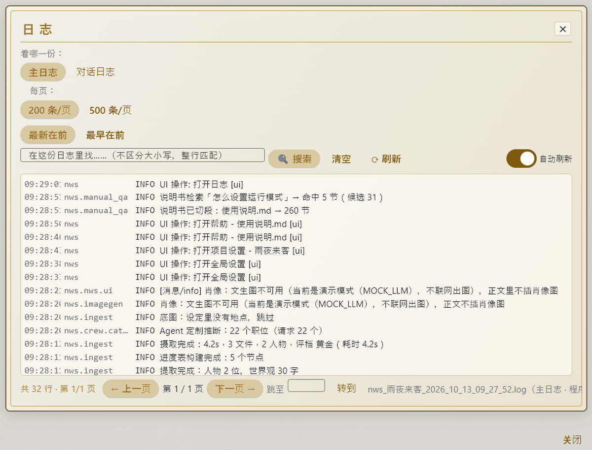

它**直接读 `logs/` 里那份日志文件**（不是内存里那份被截断的界面日志），所以：

| 能力 | 怎么用 |
|---|---|
| **看哪一份** | 左上角两档：**主日志**（程序流水）· **对话日志**（每次 LLM 交换全文） |
| **格式** | 每行拆成四段：**时刻 · 模块 · 级别 · 消息**。级别按色分档（DEBUG 淡墨 / INFO 正文 / WARNING 赭金 / ERROR 朱砂）—— 一眼能扫到出问题那几行 |
| **关键字搜索** | 输入框里打词 → 回车或点「🔍 搜索」。**不区分大小写**，整行匹配；空词 = 全部。旁边那行会写明「命中 N 行 · 共 M 行」 |
| **分页** | **200 条/页** 或 **500 条/页**（默认 200）。翻页按钮到第一页 / 最后一页会**真变灰**，也可以用「跳至 __ 页」直接跳 |
| **排序** | 默认**最新在前**（排障看的是刚发生的事）；想顺着时间读就切「最早在前」 |
| **动态刷新** | 默认**自动开**：日志文件里新写的行会自己冒出来（约 1.2 秒一次），**不会把你正在看的那一页踢回第一页**。关掉这个开关就只在点「⟳ 刷新」时重读 |

> **为什么值得在这里看**：以前要看日志得自己去 `logs/` 找文件、用别的编辑器打开，
> 而日志文件名带时间戳、一次运行一个 —— 找起来很烦。现在点一下就看到了，
> 而且**不用离开程序**（推演还在跑的时候也能盯着看）。

> ⚠ 它读的是**磁盘上那份文件**：所以"程序刚打的这行"要等文件真的写下去才看得到
> （日志是即写即刷的，通常就是几十毫秒）。看不到最新那行时，按一下「⟳ 刷新」。

---

## 13. 故障排除

> 日志相关的都在上一章：**在哪儿、记了什么、怎么读、怎么发给别人**（§12）。

### API 连不上

1. 检查 `LLM_API_KEY` 是否正确
2. 检查网络连接
3. 尝试 `MOCK_LLM=true` 测试

### 编码报错

1. 确保文件为 UTF-8 编码
2. 程序会自动尝试 chardet 探测

### 界面显示异常

1. 确保终端支持 UTF-8
2. 尝试调整终端窗口大小

### OneDrive 锁文件

1. 程序使用临时文件替换写入，防 OneDrive 同步锁
2. 如遇问题，关闭 OneDrive 同步或使用非同步目录

---

## 14. 合规说明

### 14.1 合规 Agent

程序内置独立合规检测 Agent，对输入设定和人物言行进行审查。

### 14.2 三级分类

- **C0 法律禁止生成**：拦截 + 弹窗
- **C1 限制描写**：降尺度重写（写结果不写手法）
- **C2 虚构豁免**：放行

### 14.3 免责声明

- 合规层是辅助过滤，**不是法律意见**
- 最终对外发布内容的合规责任在作者本人
- 用户资料库版权由用户自负

---

## 15. 更新日志

### 2026-10-28 · 多开窗口不再互相掐掉创作服务

**三座创作服务是「全局一组」，不是「每个窗口一组」。**

三个服务都绑固定端口（端口写在同一份 `.env`），所以第二个窗口启动时，服务只会
回一句「已经在运行，不重复启动」—— 全程只有一组在跑。这也是对的：每窗口各起一组
意味着建环境、装依赖、下模型都要付第二遍，内存也占两份。

原来的问题出在**收尸**：只要有一个窗口关掉，服务就跟着停了，**不管另一个窗口
是不是还在用**。典型场景 —— 开了第二个窗口、用完关掉它，回头发现先开的那个窗口
的创作服务已经没了。

现在改成**谁最后关，谁才收**：

- 程序启动时登记自己，退出时撤销；**判空**（确实没有别的窗口在用了）才真的停服务；
- 判的是**进程死活**，不是"有没有好好注销" ⇒ 程序崩溃、被强杀留下的登记自动不算数；
- 三家服务（MuMuAINovel / PlotPilot / PenShot）一视同仁 —— 以前不经启动器直接跑时，
  只有 MuMu 会被收掉，另两家会留在后台。

判据 `tools/verify_svc_users.py` **22/22**，反例法 `developers/mutate_svc_users.py`
**9/9**（把"不问还有没有别人在用""只停 MuMu 一家"等逐条做坏，确认那一条真的会红）。

### 2026-10-28 · 摄取输入框改「Ctrl+Enter 发送」 · AI 往来分页 · 系统面板换行

**摄取输入框：回车是换行，`Ctrl+Enter` 才发送**

用户原话：「开卷的摄取步骤**回车是换行，Ctrl+Enter 是输入信息**」。
原来这个框的回车直接触发了发送 —— 多行文本框里换一次行就发出去一条，
手写一封长的指令基本没法写。现在：

- **回车 = 换行**（摘掉输入框自己的「提交」动作）；
- **`Ctrl+Enter` = 发送**（挂在页面级键盘钩子上 —— `KeyboardListener` 那条路拿不到
  `ctrl` 键位状态，只有页面级钩子分得清「Ctrl+Enter」和「光标那根 Enter」）；
- **焦点不在输入框时不抢**（不然运行界面里按 Ctrl+Enter 会误触发）；
- 这行提示就写在**「发送」和「⏹ 强制停止」两个按钮的下面**（用户指定的位置）：
  「回车换行 · Ctrl+Enter 发送」。

**AI 往来窗口：分页了，打开就在最后一条**

用户原话：「运行界面左下角的状态标签，点开之后应该直接显示最后一个……
我希望有分页，**每页默认 50 个，可以修改**，点开的时候默认**最后一页最后一个**」。

- 现在**每页 50 发**，右下角可以改成 **20 / 50 / 100 / 200**；
- **打开就落在最后一页**，且**最后一条就在眼前**（不是落在最后一页的顶上）；
- **翻页不会被新消息拽走** —— 你在看第 3 页时又来了一条，页码不动、
  只在「跟着最新」开着的时候才自动跳。
- 底栏显示「第 3 / 12 页 · 共 578 发」。

**左下角「系统」面板：去模型行 · 去向量检索 · 加 MOCK 模式 · 加三盏服务灯**

用户原话：「**模型信息去掉**，因为现在都是混用多个模型；**已关闭 向量检索这个也去掉**，
因为上面的**记忆检索**就是这个意思；**加上是不是 MOCK 模式**；
**加上 3 个外部创作服务的状态**（只用名字，然后 `-` 表示未运行 `*` 表示运行）」。

| 面板里的行 | 现在的样子 | 说明 |
|---|---|---|
| ~~模型~~ | **已去掉** | 一次推演混着用好几个模型，写哪一个都是半真 |
| **MOCK 模式** | 「开」/「关」 | 演示模式一眼看得出来（不花钱那一档） |
| **MuMuAINovel** | `*` 或 `-` | `*` = 在跑，`-` = 没跑 |
| **PlotPilot** | `*` 或 `-` | 同上 |
| **PenShot** | `*` 或 `-` | 同上 |
| ~~已关闭：… 向量检索~~ | **已去掉** | 上面「记忆检索」那一行说的是同一件事，说两遍只会让人以为开关有两个 |

探活是**后台线程**里做的（每次 1 秒超时，**3 秒节流**，不堆积）——
健康检查是阻塞 HTTP 塞在界面线程里会让整窗卡住三秒。

判据：`tools/verify_ui_probe_paging.py` **23/23**（分页算式 / 真调键盘钩子 / 灯的语义 /
源码结构位置 + **把源码在内存里改坏再跑一遍证明每条能红**）；i18n 缺译 0 条。
反例法：`developers/mutate_ui_probe_paging.py` **9/9**（8 条变异各只触发它那道闸）。

### 2026-10-28 · **修掉七支「永远不会红」的判据**（内部质量，不影响界面）

这一轮顺手查了一件事：**回归器只看退出码** —— 一支判据哪怕把断言红成一片，
只要退出码是 0，它在回归里就一直是**绿的**（「红灯打出来也没人看得见」）。
⇒ 那条覆盖**从来没被证明过**，而这件事**不会自己暴露**：
判据自己跑是绿的、回归也是绿的、报告上写着「N/N 通过」。

查法只有一个可靠的：**把某条断言故意改坏，再真跑一遍，看退出码是不是真的变了**。
（静态扫源码靠不住 —— `return 0 if report.get('ok') else 1` 静态判断不了它跟失败状态有关。）

**当场抓出 7 支**，其中两支是这一轮自己刚写的：

| 判据 | 原来的形状 | 后果 |
|---|---|---|
| `verify_ui_probe_paging` | `ok_all = True` 而 `ok()` 从不改它 | 恒绿 |
| `verify_style_control` | `main()` 没有 `sys.exit` | 恒绿 |
| `verify_setting_layers` | 同上 | 恒绿 |
| `verify_crew_onduty` | 退出码只交给 `shutdown()`，而它**无头跑** | 恒绿 |
| `verify_chapter_split` | `ok_all` 只在崩溃时置 False | 恒绿 |
| `verify_must_on` | 同上 | 恒绿 |

**修法**：统一走一个出口 `tools/verify_exit.py` 的 `finish()` ——
「红了 ⇒ 退出码非 0」，一处实现，判据里不再各写一份。

**另加一支根治判据** `tools/verify_exit_codes.py`：把每支纯逻辑判据
**改坏一处再真跑一遍**，确认退出码真的会变。

> **实测：121 支纯逻辑判据全部实测会红** —— 恒绿 0 支、跳过 0 支、崩了 0 支。

### 2026-10-12 · 大地图的**几何**修好 + 美术画完**自己审自己修**（Reflection）

用户原话（七件事）：**柜台跑到墙外面** · 图例**有些字在方框外面** · **比例尺把字盖住了**
（**放到左下角**）· 图例**不要带方框**（但**地图别跟图例重合**）· **房子和院子一部分重合**
（**美术要用 Reflection：画完去审核 有问题则修复重新绘制 直到没问题**）·
右上角**2 个关闭按钮**（**留外面的**、**红底的去掉**）·
**建筑名字标记放到墙的旁边 不要放到别的东西的上面**。

**根因只有一个**：房间矩形、院子矩形、家具位置**各算各的**（各有一段自己的坐标换算）。
⇒ 新增 `image_gen/plan_audit.py` 把几何解算抽成**唯一实现** `solve()`，
大地图照着画、美术的 Reflection 照着审、判据照着断言 —— 三处**同一份口径**。

⚠ 顺带修掉一处真错：`solve()` 原来**自己算换算**（按画布宽），绘制按**绘图区宽** ——
同一张图两套坐标（实测：房间框算在 x=412、家具画在 x=380）。现在换算**由调用方传入**。

**六件几何错**逐条修：陈设**落进它所属的房间**（归属优先用 `房间` 字段、没写按几何最近兜底）·
**院子先算、房间再避开它**（顺序调了，还加了"先收缩、缩不动才整体推开"的兜底）·
图例高度**按条目数算**（不再写死 148）· 比例尺**挪到左下角**· 图例**不画框但照旧占位**
（"不重合"是**算出来的**）· 去掉图上叠的那个关闭按钮（**留对话框自带的 ×**）。
**名字贴墙**：房间名贴上墙内侧、建筑名贴房子外框上墙（垫纸色）、院子名贴院墙上沿；
小地图的建筑名也从"框外面"改到"框上沿"（两图共用 `minimap._on_wall`）。

**★★★ 美术的 Reflection 环**（用户点名）：画完 → **布局层审核**（陈设没房间/有井没院/
房子与院子必然相撞）→ **确定性修复**（补房/补院/挪点）→ **再审……直到没问题**（上限 3 轮）
→ 渲染层再保证"画出来对"。⚠ **修复不调模型**（每轮零成本）· **只加不减**（不删任何地点）·
**修不动就停**（不空转）· **出错照原样返回**（增强项不许弄坏主线，判据行为级钉住）。

**两层审核缺一不可**：布局层管"数据自洽"、渲染层管"画得自洽" ——
**前两轮只做了数据层**，用户才会看到"柜台跑到墙外面"（那是绘制层的事）。

**验收**：`verify_plan_geometry` **37/37** · 反例法 `mutate_plan_geometry` **18/18 全红** ·
`verify_minimap` 119/119 · `verify_space_rules` 45/45 · `verify_map_detail` 36/36 · 双语 16/16 ·
i18n 缺译 0。

> ★ 反例法这一轮又抓出**四处"假绿"**：一条判据**共用了会被改的夹具**（前一条判据先把夹具
> 改过，于是"前后一样"恒成立、永远绿）；一条只写 `重叠 <= 1`（院子被整去掉时重叠是 0，
> 照样绿）；一条**只查源码里有没有 `except`**（换成 `raise` 照样绿 ⇒ 改成行为级：
> 让审核真抛一次，地图仍须返回）；还有两条**锚点跨行只取了第一行**
> （替换后留下孤立续行 → `IndentationError`，看起来像"判据崩了"，其实是"变异没做全"）。

### 2026-10-12 · 小地图上**地点不再用点标记**，只有一行小字（用户第三次报红点）

用户原话：

> 「小地图里标记〔那座楼〕和**旁边的红点**还是存在 **去掉它**
>  **如果想要标记地点 用小字标记就行了 不要用点**」

**前两轮去掉的是"整座楼那个红点"与"假地点那个红点"**（室内图改画框、子地点名字对上），
但**地点自己的图形记号**一直还在两处，所以局部图上看下去仍是"名字旁边一个红点"：

| 那两处 | 处理 |
|---|---|
| `_glyph()` 给每个地点画的**字形**（圆/方/三角/坡…） | 小地图**不再调用**（大地图照旧 —— 标准平面图的符号是地图语言的一部分） |
| 当前地点垫的那层**朱砂实心圆**（半径 9px） | **不垫了** —— 改用**朱砂色 + 加粗**的字 |

⇒ 小地图上**一个实心圆都没有**（除了在场人物那几个 2.4px 的小点，那标的是**人**）。
"这是哪儿"由**文字**承担，"我在哪一处"由**字色与字重**承担。

⚠ **不动的两样**：**墙**（外框 / 房间矩形 / 院墙）是**结构**不是地点标记，且是上一轮你点名要画的；
**陈设小方块**（柜台 / 条案 / 灶）是平面图的**家具**画法，标的是物件、颜色是墨色不是朱砂。

★ 顺带修掉一个**既有 bug**：在场人物点原来用 `r`，而 `r` 是**地点循环里最后一次赋的值**
（循环变量泄漏到外面）—— "人物点离地点多远"取决于**最后一个地点**的大小，与本人所在的地点无关。
现在人物点排在**地点名字的上一行**。

**顺带修好的三处判据/反例法问题**（都是"看起来绿、其实空转"）：

1. **`mutate_minimap.py` 里 3 条锚点已失效/不唯一**（其中一条是上一轮改 `sim/loop.py` 时
   被拆成两行造成的）—— `check_anchors()` 一失败，**整个反例法一条都不跑**，
   看起来像"全绿"。已修，并加了 `_lines_around()`（可往前取多行）来对付"同一句逐字重复两遍"。
2. **`C13` 判据太弱**：原来只要求"至少有一处挂了当天的图"，而 `sim/loop.py` 里有**两处**，
   反例法只改一处时另一处照样让它绿 —— 改成"**每一处挂载都不许是 `None`**"。
3. **`D8` 判据太弱**：原来在整个文件里找 `'frame': C['text']`，而文件里有**两处**
   （小地图与大地图对话框）—— 改成**只看 `_draw_minimap` 那个方法体**。

**验收**：`verify_minimap` **119/119** · 反例法 `mutate_minimap` **24/24 全红** ·
空间常识 `verify_space_rules` **45/45** · 反例法 `mutate_space_rules` **33/33 全红** ·
地图细致程度 `verify_map_detail` 36/36 · 反例法 `mutate_map_detail` 20/20。

### 2026-10-12 · 台词要**像活人说的**（会犹豫 · 不必每句都接 · 不轻易吼 · 停顿写在纸上）

用户原话：

> 「正常人对话的时候 很多时候会有**犹豫** 而且对于别人说的话 **不是每一句话都有回应**的
>  而且**说话速度不会太快** 而且**每个人都会根据自己的性格决定自己的说话习惯**
>  但是很多AI 生成的视频 人物说话**没有任何卡顿** **速度很快** 而且**从不犹豫**
>  根本不想真人 而且**很容易吼** 而不是正常说话 所以请在**剧本生成 小说编写 演员表演**
>  的时候对这些方面进行优化 让他们更有真人感觉 而不是AI」

**六个要求，一条一条落地**（新增工艺架条目 · 全在《人物与对话》那一架里）：

| 用户说的 | 落成的手艺条目 | 讲的是什么 |
|---|---|---|
| 会犹豫、有卡顿 | **话不是一条直线** | 找词、重复半个字、改口、说一半自己停下 —— 但**只落在关键处**（句句结巴是另一种假） |
| 不是每句都回应 | **不是每句都得接** | 真人对话里**大段是漏接的**；"他这一次认真接了"才因此有重量 |
| 很容易吼 | **音量是稀缺的** | 默认**平常声量**；吼是动作不是标点，用了要有代价；激动可以**压低声音**、**说得更快** |
| 速度不会太快 | **一次说一件事** | 短句、有断、话里有缝；一口气说完一整段 = 念稿 |
| 停顿留下来 | **停顿要落在纸上** | 该停的地方（省略号/破折号/圆括号里的动作）、轻重、快慢，**各写一个词** |
| 习惯由性格决定 | **对谁说话就换个样子** | "说话习惯"是一套**对着不同人的开关**；落差要在戏里被撞见 |

> ★ 与已有条目「停顿与不答也是台词」的分工：那条讲**有秘密时**的不答（戏剧手段），
> 这六条讲**日常就会漏接、就会卡**（真实质感，没有秘密也照样发生）。

**三条线一起改**（用户点的是"剧本生成 / 小说编写 / 演员表演"）：

- **小说作家 · 剧作者**：各拿一段**硬约束**（`CREW_LIVE_SPEECH` · 默认开），
  和"场景先交代清楚""顺手让它能拍"并列 —— 台词不是在演员那一层才第一次出现的。
- **演员**：拿到的是**行动纪律的形态**（写在提示词的行动协议里，紧挨着台词）：
  「**开口前先定音量**」「**允许带毛边**」两条。
  ⚠ 它有两份文本（外置模板 `prompts/agent_decide_tail.txt` ＋ 内置那份），
  **改一份不够** —— 外置优先，只改内置会被整个盖掉（这一轮差点踩到，判据已钉住）。
- **演员开口前的最后一个念头**也换成了这一条：思维链末尾自问
  「这句话该用什么**声音**说？**平常声够了吗**」—— 位置刻意贴着台词，
  比写在别处的纪律管用。

**审读多查一件**：剧本审读的清单从五件加到**六件**，第⑥件专查"像不像活人在说话"：
句句都严丝合缝接上 · 有人在吼 · 一口气说三件事 · 一处停顿都没有 —— 四条**一眼能看出来的假**。

**去 AI 清单里也加了它**（可机械审计的那一半）：新增「**喊叫滥用**」
（`吼道 / 厉声道 / 咆哮道 / 嘶吼道 …`）。
⚠ 它进的是**软提示**不是硬词表 —— 硬词表会被 `strip_hard()` **真的删掉**，
而"他吼道：…"一删就成了"他：…"（句子残了）。软提示只提醒，不动原文。

**新增配置**：`CREW_LIVE_SPEECH`（剧组群 · 默认开）。关掉 = 三条线一起回到从前。

**验收**：`verify_live_speech` **24/24** · 反例法 `mutate_live_speech` **16/16 全红** ·
工艺架 53/53 · 认知模式 60/60 · 去 AI 48/48 · 通用性 5/5 · 双语 16/16 · i18n 缺译 0。

> ★ 反例法这一轮当场纠正了**我自己的两条假绿判据**：一条拿"被变异的常量"当期望值
> （把 `READ_LIMIT` 改小，判据跟着改，永远绿）；一条查文本时**没有跳过注释行**
> （模板头部的说明里也写着那三个占位符名，正文删掉判据照样绿）。
> 顺带把「额度会不会把点名截断」这件事**实测**清楚了：`craft_block` 收尾是
> `picked[:max(limit, len(prefer))]`，**点名（prefer）是截不掉的** —— 注释已按实测更正。

### 2026-10-12 · 中间那个红点去掉了（两个来源）+ 按细致程度画墙 + 点开大地图 + 地图存本地复用

用户原话：

> 「现在的小地图**中间都有一个红点** 这个**去掉** **看不见其他元素了**
>  另外 **如果是室内地图 则请把墙画出来** …… **室内和室外结合**的地图 …… **比如一个茶馆**
>  …… 则**把室内墙和室外墙都画出来** …… **很大的地图 比如街道图** …… **只需要把建筑标记出来就行**
>  …… 你根据地图的**细致程度**来判断 …… **这个小地图可以点** 我点了之后打开一个**大地图对话框**
>  （**比较大的大小，跟对话列表的部分一样大**）…… 左上角带**地点 时间 图例 比例尺**（**一个方框里**）
>  然后**右上角有关闭按钮** …… **所有的地图保存在本地如果后续场景能够复用的话则直接复用**」

**① 红点去掉了 —— 它有两个来源，都堵住了**

1. **室内标签每次读回来都丢**（真凶）：`Atlas.from_dict()` 读局部/室内层走的是
   `normalize()`，而它**从来没读 `kind`/`frame`** —— 文件里写着 `kind: 室内`，
   读回内存是空串 ⇒ 渲染按"不是室内图"处理 ⇒ 整座楼又画成中间一个点。
   现在 `normalize()` 保留这两个键，并且**老底图**（生成时还没这两个键）按**桶名**
   自动补回来 —— **不用重新开卷**，用户手上那份读回来就是"室内 + 建筑名"。
2. **当前场景是子地点时补一个假的大"楼"摆在正中间**：`临河茶肆·堂屋` 对不上图上的
   `堂屋` ⇒ 旧代码补一个 `楼·大` 在 `(0.5, 0.62)`，渲染再给"当前地点"垫朱砂
   = 正中间一个又大又红的点。现在：**先想办法把名字对上**（完全相等 → 取 `·` 后半截
   → 互相包含），对上了**什么都不用补**，朱砂圈落在那一间上；真对不上才补，
   而且补的是**中号"屋"、靠下**（不是大"楼"）。

**② 按细致程度分四档画**（新增 `minimap.detail_of()`，小图大图**同一个档位**）

| 档位 | 什么时候 | 怎么画 |
|---|---|---|
| `室内` | 只有屋里空间 | **房间画矩形墙**（相邻两间共边 = 共用一堵墙）+ 建筑外框 + 门在框上 |
| `室内外` | 屋里 + 院子同一张图（茶馆） | **室内墙 + 室外墙都画**（院子另画一圈实线院墙） |
| `局部` | 一处地方周边 | 照旧：点 + 字形 |
| `整体` | 街道 / 城镇大图 | **不画室内**，只把建筑标记出来 |

陈设（柜台/条案）画成小方块（家具不是房间）；房间墙有尺寸下限（>50×40），
免得跟"院里那层浅底"混在一起。

**③ 点小地图 → 大地图对话框**（新增 `image_gen/floorplan.py`）

- `1000×700`（**与「日志 / 对话栏」同一档** —— 用户说"跟对话列表的部分一样大"）；
- 小地图外面包了 `GestureDetector` + **手型鼠标**（能点就得让人看得出来）；
- 按**标准平面图 / 普通地图**画：墙双线、门缺口 + **开合弧**、家具带**阴影斜线**、
  院里**铺细点**、水系**波纹**、右下角**指北针**；
- **左上角一个方框**：地点 · 时间 · 图例 · 比例尺（图例的记号**照实画**；
  比例尺是**一段黑白相间的带刻度的尺**，刻度写**格子数**不写米/尺 —— 没有真实尺寸，
  写上去就是编，所以照实标「示意」）；
- **右上角一个「×」**（对话框标题行那个也在）。

**④ 地图存本地、能复用就复用**（新增 `image_gen/mapstore.py`）

- 存**项目**下 `地图/<细致程度>_<地点名>.json`，存的是**地图规格**不是位图
  （位图改个配色就过期；规格永远画得出同一张图）；
- 复用判据是**输入**（细致程度 + 今天涉及的地点 + 人在哪儿），
  且卡在**问模型之前** —— 省的是**整次模型调用**；复用成功时中栏照实写「本地存档复用（没调模型）」；
- 局面变了（换了地点）**不复用**，该重画。

判据：`tools/verify_map_detail.py` **36/36**（A 细致程度 · B 红点两个来源 + 画墙 ·
C `kind`/`frame` 往返 · D 大地图信息框/比例尺/关闭按钮 · E 本地存档与复用）·
反例法 `developers/mutate_map_detail.py` **20/20 全红**。
★ 反例法当场抓出**三处真问题**：一条判据是"自证"（拿被变异的常量比自己）、
一条只测函数没测**渲染真的用了它**、一条 `dir_of()` **先 `getattr(project,'root')`**
—— 而 **`Path` 也有 `.root` 属性（= 盘根）**，存档被写到了 `C:/地图/`
（本项目**第二次**踩这个坑，第一次是 `crew/catalog` 写到 `C:/agents`）。

### 2026-10-12 · 左下角那个 token 数字活起来了 + 「导演 · 未启动」那行去掉

用户原话：

> 「左下角的系统的Token预算左侧的数字要实时更新 然后导演这一样可以先去掉 没有特别的意义」

1. **「Token 预算」那行以前是死的**：写法是 `f"0 / {budget}"` —— 那个 `0` 是**硬编码**的，
   从建出来到关窗口一动不动，于是屏幕上永远写着「0 / 500000」，**哪怕这一轮已经烧掉一半预算**。
   现在左边那个数是**今天已经花掉的 token**，挂在 0.5 秒的秒表上跟（与「时间」「风格控制」
   同一个刷新节拍 —— 数字要**自己走**，只靠"某件事发生时刷一下"的话，两拍之间屏幕是静止的，
   而"静止"和"坏了"长得一样）。
   - **口径与「预算耗尽」判定同源**（读内存账本 `llm.ledger.today_tokens`，`LLM.budget_exceeded()`
     用的就是它）—— 两边各取一处的后果是"屏幕上显示已经超了、程序却照跑"；
     全局台账库（`usage.db`）里有**别的进程**的账（判据、开卷、另开的一轮），不能用在这儿。
   - 只算**今天**：前几天的账不进这个数（它对应的是"每日"预算）。
   - 过 `TOKEN_WARN_AT`（默认 80%）转**赭金**、用满转**朱砂** —— 警告线就用这一个配置项，
     不另立一个数（否则会出现"这里的数字变黄了、日志里却还没到警告线"）。
   - 上限**每次重新读配置**：你在「预算用完了」对话框里把上限翻倍，分母当场跟着变。
   - 拿不到账本（替身 / 导入失败）返回 0 且**不抛** —— 界面不该因为记账问题崩掉。
2. **「导演 · 未启动」那行去掉**：它只在导演开着时出现，而那是**默认状态**；
   它既不说明导演在干什么，也不随推演变化 —— 白占一行。
   ⚠ 导演**关掉**时的「已关闭：导演」**留着**：那是在告诉用户"是你自己关的"，
   和上面那一行不是一回事（判据专门钉了这条，免得以后两行被一起删掉）。

判据：`tools/verify_budget_live.py` **19/19**（A 数据层 · B 接线 AST · C 真机 · D 自检）·
反例法 `developers/mutate_budget_live.py` **12/12 全红**（含"显示串写成固定 0""已用量恒为 0"
"把前几天的账也算进来""用满不转朱砂""警告线自己另立一个数""秒表里不调刷新""刷新函数只是算了算
不写回控件""建界面时不存句柄""那行悄悄回来""顺手把已关闭也删了"）。开关自适应那支
（`tools/verify_main_flags.py`）里对「导演 · 未启动」的断言也跟着改了。

### 2026-10-12 · 屋里屋外分清 + 室内地图框住建筑名 + 六个职位拿到"地图能力"

用户一口气点了四件事（原话在 §4.2.3.5 与下面各条里）：

1. **小地图的室内图**：整座楼原来画成**中间一个红点**当建筑名，**挡住内容**又不合理
   → 改成**一圈框**把内容括起来、**建筑名写在框上**，门画在框的下沿。
2. **严格区分室内室外**：像那座楼有柜台、井、门 —— **井只能在院子里**，
   这种错**不能出现**；**有井就说明有院子，院子必须一起画出来**。
3. **优化小说作家 / 剧作家 / 编剧室 / 导演 / 美术 / 道具**的地图能力，
   要求他们在写的时候**就把环境平面描述清楚**（全景 / 局部街道 / 院子 / 室内，按场景选）。
4. **导演和剧作家设计人物动作时要时时刻刻参考地图**，把地图当**人物移动的依据**；
   有些剧情要靠**地点切换**推进。

**做法（都是可核对的）**
- 新增 `world/spatial.py`：**空间常识本体** —— 名字分成 `室内空间 / 室外空间 /
  半室外 / 室内陈设 / 室外器物 / 边界 / 通路 / 整座建筑`；`audit()` 报违规、
  `repair()` 修（**有井补院**，只加不减）、`route()/adjacency()` 给"怎么走"。
  ⚠ **院墙不算院子**（名字里有"院"字）—— 否则有井也不会被补院子。
- `Layout` 多了 `kind` / `frame`（哪一层 / 整座建筑的名字），**底图与当天的图**
  都过一遍 `apply_space_rules()`（**唯一实现**，`world.atlas` 那处只是转发）。
- 小地图：室内图**画框 + 建筑名在框上 + 门在框上 + 院里的东西垫浅底**；
  摊给模型的底图每条带 `[室内空间]`/`[室外器物]` 标注 + 一段「空间事实」。
- 新货架 `craft/playbooks/场景与空间.yaml`（九个条目，来源是外部开源项目：
  Azgaar / OSMnx / momepy / Edgar / graph-dungeon-generator / DeepFloorplan /
  Streetmix / depthmapX，见 `developers/docs/外部借鉴/07_地图与空间.md`）
  → 进**七个职位**（用户点名的六个 + 场记）的提示词；
  剧作家 `场` 必须是「地点·空间」、`要点` 要写**走位**、`场景介绍` 要把**平面**交代清楚；
  美术两条提示词都要求"名字写具体、里外分清 + 出现井就必须出现院子"；
  道具每件都要"落得住地方"（并带上确定性的「属于」标注）；小说作家的场景卡
  写明"屋里与院里分开写"。
- 演员/导演每一拍多一行「**地图事实**」：这一拍在屋里还是院里、**从上一场怎么走过来**
  （`StagePlan.previous` + `world.spatial.route`，零 LLM）。

判据：`tools/verify_space_rules.py` **44/44**（A 空间常识本体 · B 数据侧 ·
C 职位能力 · D 小地图形状）· 反例法 `developers/mutate_space_rules.py`
**31/31 全红**（含"井不再算屋外""修复不补院子""走动改成一步直达""室内图不画框"
"整座楼又变回一个点""演员拿不到地图事实"等）。

### 2026-10-12 · 起笔的启动守卫：同时只跑一轮 · 点完立刻有反应 · 超时 / 取消

用户报的两件事其实是同一件事的两面：

> 「我连续点了两次起笔，结果就**同时有两个推演过程**在进行，这是不对的，
>   同时应该只有一个。同时，我点了起笔之后，**感觉没反应了一段时间**才开始推演，
>   这也是为什么我会点两次的原因。……引入**超时机制**，如果后台没成功，界面可以
>   主动停止等待。但同时如果已经再次启动了另外一个，结果之前假死的启动成功了，
>   也**必须从中选择一个，停止另外一个**，而不是两个都用。」

病根有两个，都改了：

1. **闸门只看会话**。`self.session` 要等装配完才建出来，而"点完到装配完"这一段
   它一直是 `None` ⇒ 那几秒里连点两次，**两次都过了闸**。现在把"正在装配"
   也算占着（`_launch_phase`），并在**两处**各问一次（点下就问 + 排任务前再问）。
2. **装配期间界面没反应**。`assemble()` 是同步的，在事件循环里直呼会把界面
   连同秒表一起冻住。现在：点完**同步**切到运行页 + 中栏写一行「正在装配」+
   状态条点亮「正在启动 · 已 N 秒」（秒表真在走），装配丢进后台线程。

配套四件事：

- **超时**（新旋钮 `LAUNCH_TIMEOUT_S`，默认 180 秒，在「天机 · 运行 → 起笔启动」）：
  等满就**主动停止等待**，状态条回到「未运行」，可以再点一次「起笔」。
  超时**不硬杀后台**（它多半卡在没有超时的等待上，硬杀杀不掉）——只作废它的**令牌**。
- **只留一个**：每一趟启动领一个令牌，`_start_round` 在**接管界面前**再对一次号；
  对不上（被超时作废 / 被后来者取代）就**一个字都不碰界面**，并且把它刚建的运行
  文件夹搬进「已删除备份」（搬不动就留一张 `已作废.md`）。
- **手动出口**：启动那几秒里「⏹ 停止」变成「⏹ 取消启动」，与超时走**同一个出口**。
- **失败要看得见**：装配失败 / 模型客户端失败 / 建文件夹失败，三条都在**中栏留一条**
  （不再只是闪一下 SnackBar）。

顺手挖出并修掉一个**真问题**：`assemble()` 现在可以接收调用方递进来的数据库连接
—— SQLite 的连接**不许跨线程用**，装配进了后台线程之后，连接必须**在主线程建**
（装配内部只把它转手交给 Agent / 导演，一个新连接都不碰）。不这么做的话第一拍就会
`ProgrammingError`，而它被 `decide()` 吞掉 —— 屏幕上表现为**每个角色都"没动，也没出声"**，
日志里只有一行 WARNING（实测踩到过，整轮白跑）。

判据：`tools/verify_start_guard.py` **62/62**（A 逻辑 26 · B 立刻进状态 10 ·
C 连点两次只有一轮 6 · D 超时/取消 14 · E 失败可见 3，含真机像素与文件系统证据）·
反例法 `developers/mutate_start_guard.py` **22/22 全红**。

### 2026-10-12 · 语言审校：并进「今日总结」+ 下游接到剧作者

用户的疑问：「每天最后的语言审校**为何都是放到一个 md**，而不是输出出来」。
查下来是这样：它每天收工出工一次，正文只落 `语言审校.md`，剧情窗口里只有一句
「（剧组 · 语言审校）今天 2 处 AI 味 —— 细节在「语言审校.md」」——
而全软件**只有"复盘"一份**是以正文上屏的（那是 2026-10-07 你定的规矩：
剧情窗口只放故事、不放拍摄花絮）。

你要了两件事，都做了：

1. **并进「今日总结」**：语言审校那几条（原句 + 怎么改）现在作为一节并进当天那份
   总结 —— 于是它同时出现在**剧情窗口那条「今日总结」**、盘上的 `今日总结.md`、
   台账与日志里（一处合并，四处到位）。它自己那份 `语言审校.md` **照旧在写**。
   零命中时不并（总结里不会多一节空的）。
   中栏那句小消息的指向也跟着变了：复盘开着就写"细节并进了下面的「今日总结」"。
2. **下游接上**：名册里写着它 `feeds="screenwriter"`、文档也写着下游是
   「剧作者（下一天的剧本）」，而**代码里从来没人读回它**（grep 全仓，那份 md
   只有写、没有读）。现在下一天写剧本时，这些意见会作为上游材料递给剧作者。
   ⚠ 只认"**上一天**"那一份（`语言审校.md` 每天覆盖写，靠文件头那行 `> 第 N 天` 认），
   所以同一天重写时读到的是昨天的、回档重演当天时读到的不会是自己刚写的。

顺手修掉两个真问题：`sim/loop.py` **一直在用 `t()` 却从没导入过它**（那条叙事
因此静默没上屏，日志里只有一句 `NameError`；同一个毛病还藏着另一处"回档重演"，
默认关所以从未暴露）；以及判据夹具里一句 `asyncio.get_event_loop()` ——
Python 3.13 下**第二次调用就炸**（A 组是第一次调用所以一直没现形）。

判据：`tools/verify_crew_flow.py` **45/45**（新增 F 组 7 条）·
反例法 `developers/mutate_crew_flow.py` **17/17 全红**（新增 ⑫~⑰，并修好两条
过期老锚点 ②/⑥）· `verify_studio_v2` 65/65（A7 从字符串哨兵改成 AST 判）。

### 2026-10-12 · 听得懂「修复4个问题 / 所有问题不要问我」 · 剧组页签的滚动条 · 起笔建议框

**摄取时那句「修复4个问题」，它现在真的听得懂**

用户原话：「系统给我列出了4个自查问题 我说**修复4个问题** 但是它不知道我什么意思
**而且反复让我修改**；我让它**修复所有自查问题 不要问我** 也不行，
**必须一轮一问**」。两件事都改了，**且都不是靠"求模型配合"**：

- **点名的编号与"整批"由程序算准**。原来把"你指的是哪几条"整件事托给模型，
  而模型数不清"4 个"是哪四条。现在新加的 `polish/intent.py` 拿着**我们手里那份
  列表**（自查问题 / 体检建议的编号）去对：「修复4个问题」「所有问题都改掉」
  → 展开成**逐条编号的任务单**下达；「处理 1 2」「第 2 条」「前两个」→ 只改那几条。
- **"别问我"是硬拦，不是许愿**。识别到「不要问我」之后，模型这一轮要是还想反问，
  **代码直接不把它当终点**（把"作者说了别问、你自己定"喂回去接着跑）；
  说「至少3轮不要问我」就只在 3 轮内免打扰，**到点自动恢复会问** ——
  无限期不问就成了哑巴，那比反复问更糟。想撤销说一句「可以问我了」。
- **它懂不懂你看得见**：识别到这些说法时，对话栏里先出现一句
  「我理解你要的是第 1、2 条」「好，接下来 3 轮我不会问你」。

判据：`tools/verify_polish_intent.py` **33/33**（A 解析 / B 用替身模型验硬拦与下达 /
C **真跑一遍摄取**把这句话打进去看对话栏）；反例法 `developers/mutate_polish_intent.py`
**12/12 全红**（含真机那一条）。

**书斋 · 剧组 Agents：滚动条不再压住列表**

用户报：「右边的滚动条…现在是跟 Agents 列表重合盖住的」。根因与上一轮向导第 4 步
**同一个形状**：`mk_tab_content()` 的列宽是 `SET_W + TAB_GUTTER`(544)，
而列表行里的那一列是 `expand=True` ⇒ **行吃掉整条 544**，右端钻进条底下。
探针实测（`developers/probe_crew_tab_lane.py`）：书斋重叠 **9px**、天机 **13px**；
现在行宽写死 `SET_W`（实测 518px），书斋余量 **16px**、天机 **44px**、**重叠 0**。

**起笔的「您对接下来剧情发展的建议」：提示语改灰、缩短**

用户要求：「下面文本框 **文字应该是偏灰色 表示是系统提示**」「**不要太长
现在东西太多了**」。占位提示改走 `hint_style`（淡墨色，亮度比正文明显浅 ——
一眼看出那是系统的话、不是已经写好的内容），并从 4 句 100 多字压到**两句**：
方向 + 「开关在下面「本轮推演」那一节」。

### 2026-10-11 · 开卷第 4 步"刚好贴着滚动条" · 标题不再跟着滚 · 摄取输入框三行高

**开卷向导第 4 步：宽度从 520 放到 580（刚好贴着滚动条）**

上一版为了"别压住滚动条"把这一步的控件一律钉成 **520**，结果右边**白白余出 68px**——
用户当天第二次报：「你又调整的太窄了 稍微加宽一些 **刚好贴着滚动条**就好了」。
真正的上限不是 520：`DLG_W`(600) 里那 24px 车道**只有 4px 是条**，其余是纸框内边距。
现在内容宽 **580**（实测：行宽 578、内容右边界 612、滚动条 620 ⇒ **余量 8px**），
而这个数是从"条的右偏移 + 条宽 + 6px 呼吸"**算出来**的（`WIZ_W`），
条宽那 4px 与 `mk_scroll_bar` **共用同一个常量**，将来谁改条宽都不会对不上。

**标题不再跟着滚**

用户报：「滚动条动的时候 **标题不能动** 标题下面的动才对」。原来标题和正文躺在
同一个可滚的 `Column` 里，一滚就跑。现在拆两层：钉住的标题 + 吃剩余高度的滚动区
（用 `expand` 拿剩余高度 ⇒ **不用猜标题多高**，字号一改也不会溢出）。
向导**每一步**都这么处理。判据用三种方式钉住它：标题不在会滚的那层里（结构）+
标题整条在滚动条上方（几何）+ **真滚一次看像素**（标题带差分 0、正文带差分 18 万）。

**摄取对话框：聊天输入框三行高、按钮落到中间行**

用户要求：「最下面那个聊天输入的框 我希望可以高度高一些 比如 3 行…右侧的
发送/强制停止的按钮 移动到中间行」。输入框现在 **3 行**（`min_lines`/`max_lines`），
右边两个按钮居中落在中间那一行（实测按钮文字中心与输入框中心差 0.5px）。

> ⚠ 这一条顺手挖出两个 Flet 的坑，都写进注释了：
> ① **`TextField.height` 在本版 Flet 上根本不起作用** —— 写 `height=72` 加三行也只画
> 62px、只写 `height=72` 画 45px（一行 24px）。所以**行数只能靠 `min_lines`/`max_lines`**，
> 留一个不起作用的 `height` 是**谎话**（判据 A17 直接禁止它）。
> ② **`Row.vertical_alignment` 在本版 Flet 上默认就是 `CENTER`**（与 Flutter 的
> `START` 相反）—— 所以"按钮居中"其实**不写也是**；显式写出来只是防将来默认值变，
> 真正的证据是真机那条（量中心距）。

**顺手修的**：`developers/mutate_ingest_rounds.py` 里两条老锚点（⑤/⑦）
在**双语化**给源码插了 `# [EN]` 行之后**再也对不上**了（反例法直接拒绝启动，
报"锚点命中 0 次"）—— 已重新锚定，现在 15/15 全红。

### 2026-10-11 · 开卷第 4 步的版面 · 「每页」下拉只显示数字 · `.env` 第四道保险丝

**开卷向导第 4 步（剧组 Agents）：滚动条不再压住内容**

用户报（附截图）：「右侧滚动条把文字和下面的 Agent 列表的最右边重合了，盖住一部分」。
探针实测：列表行宽 **598**、内容右边界 **632**、滚动条在 **620..623** ⇒ **重叠 13 像素**。
根因是宽度账：`DLG_W`(600) = 控件 **520** + 滚动条车道 24 + 纸框内边距 56，
所以**内容上限是 520**；而这一步里凡是 `expand=True` 或不带宽度的东西
（列表行里的输入框、那段长说明文字、勾选框）都会**撑满 600**，一路顶进车道。
现在这一页每个会自己长宽的元素都显式给了 `width=520`（整行宽 518、余量 68px）。

**「每页多少条」不再只显示一个「每」**

那格下拉的标签原来是**空串**，而空串**并不会**省掉左边那 88px（为了输入框起点对齐，
`_label_box` 仍按 `LABEL_GUTTER_MIN` 留位）—— 下拉本体只剩 72px，装不下
「每页 5 条」就被省略成「每」。现在：**标签写「每页」**（把那 88px 用起来）、
**选项只写数字**（5 / 10 / 20 / 50，用户原话"就直接写个 4 也行 **不要用汉字**"），
下拉本体 72px，两位数加箭头都放得下。顺带把分页那一行改窄（594 → 432px），
它以前本身就超出 520、右端伸在车道里。

**顺手补上 `.env` 的第四道保险丝（这条最要紧）**

修这件事的过程中发现：**手工单跑一支验证脚本会把测试值写进你的真实 `.env`**。
实测踩到 —— 跑 `verify_help_book`（它在真机段会点书斋的「保存」）之后，
你的 `.env` 被改成 `MOCK_LLM=true` + `DEFAULT_PROJECTS_DIR=<某脚本的临时目录>`。
**这两个值已经被我改回原样**（`MOCK_LLM=false`、目录留空，原文件备份在同目录
`.env.bak-before-envfix-*`）。

根因是三道老保险丝各有漏口：`NWS_ENV_SINK` 只有回归器给、`redirect_env_writes()`
得脚本自己记得调、备份/还原单跑时没人还原。现在加了**第四道**：
`config.env_sink_path()` 里"**进程自己认得出是验证脚本**"（脚本名前缀
`verify_` / `probe_` / `mutate_` / `shoot_` / `measure_` / `preview_` / `audit_`），
写盘一律落到临时文件 —— 判据
`tools/verify_env_safety.py`（真起子进程写一次、比对 `.env` 的 md5）钉住它。

### 2026-10-11 · 运行页版面重排 · 点标题直达设置（改完立刻见效）

**版式（都是用户点名要的）**

- **「系统」面板从右栏最底下搬到左栏「风格控制」下面** —— 右栏现在只剩
  在场人物 / 剧情 / 剧组三块，左栏五块（时间 / 小地图 / 运行配置 / 风格控制 / 系统）。
- **「小地图」搬到「运行配置」上面** —— 先看"人在哪儿"，再看"这一卷怎么跑"。

**点标题直达设置**

- 「**运行配置**」「**风格控制**」「**剧组**」三块标题现在是**入口**：文字带
  **下划线**、右边跟一个 `↗`、悬停变手型，鼠标放上去还会写明"这一下会去哪一页"。
- 规则：**推演正在跑 → 书斋（本书设置）对应页；还没起笔 → 天问（程序设置）对应页。**
- 「剧组」的**每一行**也能点：点某个职位 → 直接打开**那个职位**的设置
  （列表铺在下面，编辑框叠在上面，关掉回到列表）。

**改完立刻见效（这一条原来是不成立的）**

查下来发现书斋里的「运行边界」「风格控制」「导演」三块**一个都没接上**：

- 风格控制那 7 根滑杆的值是**写死的默认数**，既不读配置、右边的百分比也不跟着滑；
- 三块控件**一次都没往配置里写过**，而「保存」只写项目文件里那几项 ——
  于是"书斋里改了风格参数"= 什么也没发生（运行页左栏那块「风格控制」读的正好是配置）。
  现在：初值读配置、改动即写配置、右边百分比跟着滑、关掉对话框运行页面板当场刷新。

### 2026-10-11 · 叙事窗口：能翻到最开头 · 每条带时间

报障原话：「我往前拉 有些信息在窗口看不见了 是不是会被吞掉一些东西？我希望要么
这个窗口虽然每个窗口显示的内容如果不能够无限长，则进行分页，我需要查看到此次
推演所有的内容」「我希望有选项可以让对话窗口的每一个条目左上角都带一个很小的
当前日期和时间（真实时间-剧情时间）」。

- ★★ **查下来：确实被吞了，而且是两处**（都在界面这一侧，`_live_lines` 里其实一条不少）：
  - 中栏只渲染**最近 200 条**（`tail = self._live_lines[-200:]`）；
  - 控件数超 400 就 `del col.controls[:100]` —— **把最前面 100 个真的删掉**，
    而且**不与内容对齐**（`_on_narrative` 与 `_push_divider` 各一处）。
- ★★ 改成**分页**：叙事区上方一条翻页条（最早 / 更早 / 第 N/M 页 · 共 K 条 / 更晚 / 最新），
  页边界切在**段落之间**；只有一页时自动隐藏。
  ⇒ **内容一条不丢（`_live_lines` 是唯一事实来源，永不裁剪）、控件数有界**。
  一页多少条 = `NARR_PAGE_ENTRIES`（默认 200）。
- ★★ **翻历史时新内容不把人拽回去**：只记进账 + 翻页条提示「有 N 条新内容」；
  翻到历史页会**关掉自动跟随**（`auto_scroll=False`），回最新页再打开。
- ★★ **每条左上角一行很小的时间**（`NARR_TIMESTAMP`，**默认开**）：
  `真实时间 · 剧情时间`（如 `20:14:03 · 第3天·戌时`）。两个时间都给 ——
  只看剧情时间分不出"一小时前还是昨天生成的"。
  字号比正文小两号（`NARR_FS_STAMP`）。⚠ 只对本轮实时产生的条目有效，
  **落盘读回的历史没有真实时间就留空、不编**。
- 判据 `tools/verify_narr_window.py` **29/29** · 反例法 **15/15 全红**
  （覆盖 `gui/app_flet.py` 与 `config.py`）。

### 2026-10-11 · 场次编排：一场戏接一场戏

报障原话：「这些人很多时候会东一句西一句，有些小的场景没交代清楚，突然大家就跳到
几个新场景了」「场景反复切换却没有任何人物出场、动作、情节 —— 放到电视剧里就是
无意义的场景切换，这是不对的」。

- ★★ **查出来的根因不在文笔，在流程**：剧作家**已经分好了拍**（每一拍写着在哪、
  发生什么、推进什么），但那张表**没有下达**，运行时也**没有「场」这个单位** ——
  - 演员的提示词里只有一段 400 字当天梗概 + 自己分到的事：
    `beats`（拍次表）在 `agent/core.py` 里**一次消费都没有**，
    连这个词都只出现在注释里；
  - 分幕是**事后**按「时段变了 / 地点变了」切的，不是「这一拍演完了」；
  - 换场要等「场上一个人都不剩」，还得目标地点恰好命中地点表。
- ★★ 补上**场次编排**：剧作家的每一拍现在要写 **主题 · 出场 · 要点 · 道具 · 情绪 ·
  推进**，并且**真的下发**到每个演员的决策提示词
  （**只给当前这一拍** + 一句「下一场是什么」—— 给全表他会去抢别人的戏）。
- ★★ **按拍收场**（该出场的都露过面 + 实动作够数）**、按拍换场**
  （换到下一拍写的那个地方，并把这一拍该出场的人**调过去** ——
  不再出现「场景切了却没人」）。收场时那条分隔符上写明**为什么收**。
- ★ 四个开关（`SCENE_BEATS` / `SCENE_BEAT_MIN_TICKS` / `SCENE_BEAT_MAX_TICKS` /
  `SCENE_BEAT_MIN_ACTS`，默认 开 / 3 / 12 / 2），关掉即回到从前。
- ⚠ **没有分拍表时这一层什么都不做** —— 行为与加它之前**逐字相同**。
- 判据 `tools/verify_scene_beat.py` **26/26** · 反例法 **18/18 全红**
  （覆盖全部七个被改的文件）。

### 2026-10-11 · 用量窗口：四栏宽度 · 默认最大化 · 第 4 栏横向滚动条

- ★★ **四栏宽度终于真的不一样了**（用户：「第 1 2 3 列适当收窄 第 4 列放大」）。
  - **改之前那句"四栏不同宽"是假的**：`_pane()` 同时给了 `width=170/250/150/430`
    与 `expand=True`，而 Flet 里 `expand` 会把控件包进 `Expanded`（"强制撑满"）⇒
    **`width` 被完全忽略，四栏等宽**。实测（`developers/probe_usage_widths.py`，
    1920 屏）：四栏都是 **~442px**，跟源码里那四个数字毫无关系 ——
    也就是说"第 4 栏放大"在改之前**根本做不到**，而这一点**屏幕上看得见、
    源码里看不见**，只有量像素才知道。
  - 现在：第 1/2/3 栏**固定** 150 / 200 / 130，第 4 栏 `expand=True`
    **吃掉剩下的全部宽度**（1920 屏上约 1294px）⇒ 明细那八列一次全显示。
- ★ **对话框默认最大化**（用户：「整体 LLM 窗口默认最大化」）：铺满窗口，
  每边只留 12px。
  - ★★ 顺带修了一个**会切内容**的坑：原来按 `page.window.height` 算，
    而它**含标题栏/边框** —— 实测 `page.window.height = 1168` 而**客户区 = 1129**
    （差 39px）。按 1168 算出来的 1144 比可视区还高，底部被切掉，
    而屏幕上看起来只是"内容没了"。现在按**客户区**（`page.width/height`）算。
    这条是 `verify_dialog_heights` 的「高度不超过窗口」当场抓出来的。
- ★★ **第 4 栏放不下时出现横向滚动条**（用户：「尽量保证显示所有信息
  如果不行 第4列加横向滚动条」）。
  - 先尽量显示：第 4 栏吃掉剩余宽度，`DataTable` 保持自己的固有宽度、**不压缩列**。
  - 放不下才滚：外面套一个横向滚动区。实测（`developers/probe_table_scroll.py`，
    380px 视口 + 8 列内容）：`max_scroll_extent = 206.8`、滚到 120 时
    `pixels = 120` ⇒ **溢出是真的、滚动真能用**。
  - **条是自己画的**（4px 细条，压在表下方；放得下不画、放不下**一打开就在**）。
    ⚠ 为什么不用系统那根：**实测两次**（`probe_table_scroll.py` 与本支判据 B4），
    这个界面构建里横向那条**根本画不出来** —— `ADAPTIVE` 与 `HIDDEN`
    切换前后截图**零差异**。而"能滚但看不见条"不算做到用户要的"加横向滚动条"。
    所以沿用本项目的老办法：`HIDDEN` 关掉框架那条、自己画一根。
- 新增判据 `tools/verify_usage_layout.py`（**16 项**，A 组宽窗口量像素、
  B 组把窗口改小再开一次）+ 反例法 `developers/mutate_usage_layout.py`
  （**8/8 全红**）+ 探针三个：`probe_usage_widths.py`（四栏真实宽度）·
  `probe_table_scroll.py`（哪种容器给得出不受约束的宽度）·
  `probe_window_metrics.py`（`window.*` 与客户区差多少）。
- 顺带改判一条旧判据：`verify_usage_filters` 的 **C3** 原来是"三个栏头菜单的
  x 跨度 ≥ 屏宽 15%"—— 那个百分比是按**改之前四栏等宽**的版面标定的；
  第 2/3 栏缩到 200/130 之后跨度变成 285px = 14.8%，**刚好跌破** ⇒ 假红，
  而它想守的"分属两栏、不是挤在一处"其实完全成立。改成量**簇的个数与间距**
  （≥ 2 簇且间距 > 100px），并用一条变异（把三处菜单挤进同一栏）证明
  **新口径照样抓得住真错**。

### 2026-10-22 · 发布改成一个版本一个文件夹（四平台全带）· 脱敏口径

- ★★★ **不再按平台分包**（用户：「修改下发布脚本，**不再区分平台**，而是先到发布目录
  新建一个目标版本文件夹，把整个文件夹的内容复制过去……」）。
  旧流程一个版本打四个包（4 × ~1GB，差别只有根目录那套启动器和 `packages/` 里留哪个
  平台的运行时）；现在 `python tools/make_release.py` 直接产出 `发布版本/<版本号>/`。
  四套启动器全带：根目录放打包机那套，其余三套进 `启动器/其他平台/<平台>/`
  —— 因为 `launchers/` 是**按路径排除**的（构建工具链），只留一套等于"那个平台用不了"。
- ★★ **`.env.example` 清掉密钥与 LLM 配置（值清空、键名与注释保留）**，
  并把本机 `.env` 里 `SPEC` 未登记的键**同步进去**（值带本机路径 / 像凭据的留空）。
- ★★★ **`.env` 不清 LLM 那几项**（这条是**实测出来的**）：`coerce()` 对
  str/path/enum **不回落默认值**（只有 bool 与 int 回落），所以把 `.env` 的
  `LLM_BASE_URL` 清空 ⇒ 发布版指向空地址、没有模型名，用户填了 key 也只看到
  "请求失败"。分工改为：`.env` = 官方默认 + 密钥空（装上就能跑，只差一个 key）；
  `.env.example` = 值全清的"旋钮清单"。两份键集合必须一致，自检同时验。
- ★★★ **包里任何 env 文件都不许有非空凭据**：脱敏扫描从"只扫 `novelservices/`"
  扩大到包里每一个 `.env*`。位置不该成为判据的一部分 —— 服务挪个位置，
  同一个错误就漏过去，而"漏过去"的样子是**自检打勾**。
- ★★ **`*.bak-<后缀>`「`*.old-<后缀>` 一律排除**：自检当场抓到
  `llm_models.json.bak-before-临时指向`（**里面有真 API Key**）—— 而排除表里写的是
  `*.bak`（只认结尾），一个都没命中。形态判据要按**前缀**写。

### 2026-10-11 · 发布包分平台（四个包）· 启动器按平台核对

- ★★ **官方发布包改成按平台分开的四个包**（用户问「start setup 和 uninstall
  为何没有其他平台的版本」）。
  - 真相是**三套都编出来了**（`launchers/dist/`：Windows / Linux / macOS-arm64 /
    macOS-Intel），只是没进包。两条成因：① `launchers/` 整个目录被排除
    （构建工具链）；② 打 0.2.0 时用的是默认参数，而 **`--packages all` 的语义是
    "不换启动器"**（留打包机本平台那套），它**读起来**却像"全平台"。
  - 现在四个包各管一个平台，各自的 `--packages` 取值钉死一套产物：
    `0.2.0-windows` / `0.2.0-macos`（Apple Silicon）/ `0.2.0-macos-intel` /
    `0.2.0-linux`（Ubuntu 20.04/22.04/24.04、Debian 12，**amd64 与 arm64 都带**）。
  - 新增 `--packages macos-intel`：以前 macOS 只有"默认挑 arm64"一条路，
    **Intel Mac 那份永远进不了包**，也没法用参数指定。
- ★★ **打包会读启动器的魔数核对平台**。Linux 与 macOS 的启动器**同名**
  （都叫 `setup`/`start`/`uninstall`），**文件名证明不了任何事**：Windows 判 `MZ`、
  Linux 判 `ELF`、macOS 判 Mach-O 并按 cputype 分 `arm64` / `x86_64`，
  结果写进清单的 `launchers_actual`。把 Windows 包发给 Mac 用户这类错，
  **现在当场量得出来**（判据 `tools/verify_release_platforms.py`，
  反例法里有一条故意把 `.exe` 塞进 macOS 包，确认自检会报）。
- ★ **每个包自动写一份 `平台说明.md`**（并在包内 README 顶上插一行横幅）。
  原因：包内 README 讲的是**三平台各自**怎么启动，而包里只有本平台那一套 ——
  把 Windows 包发给 Mac 用户，他照 README 找 `./start` 找不到。
- ★ `PACKAGE_FILES['linux']` 补上 **arm64** 四种发行版的离线运行时
  （原来只列了 amd64，Linux ARM 用户拿到包也装不上，会退回联网下载）。
- 新增判据 `tools/verify_release_platforms.py`（**33 项**，含"真打四个包再逐个读魔数"）
  + 反例法 `developers/mutate_release_platforms.py`（**8/8 全红**）·
  探针 `developers/probe_launcher_magic.py`（读 12 个产物的平台/架构）。

### 2026-10-14 · 保存后关多层 · 指南扩列 · 时间戳与推演多样性 · 版本 0.3.1

- ★ **保存后关多层**（用户报「Agent 编辑点了保存应该退出当前对话框」+「AI模型配置
  加了新模型点保存后也应该退出」+「别的对话框如果有保存按钮的也都看下」）。
  - 真因：编辑框是**叠**在天问/书斋设置之上的，`pop_dialog()` 每次只弹一层，
    保存后回到设置对话框看起来"没退出"。
  - 现在 `_agent_editor` / `_model_editor` / `_actor_type_editor` / `_casting_editor`
    四处的「保存」都连 pop 对应层数（2 / 2 / 2 / **3**）；取消仍只 pop 一次
    （"我还没改完，回到上一层"语义）。
- ★ **`完整使用流程指南.md` §5.6.2「每个 Agent 推荐」表格扩列**：22 个 Agent 全列，
  每行 2-3 个推荐模型（贵 → 便宜）+ 简短备注，按"写出来的 / 走流程的 / 压缩打分
  后台"三类分组。
- ★ **时间戳格式改成「剧情时间 / 系统时间」**（用户原话：「对话里的时间显示
  剧里时间 真实时间 格式改成 剧情时间: xxx 系统时间:xxx」）。
- ★ **推演内容多样化**：原本大量台词，现在动作 / 环境 / 心声 / 台词 4 类都出
  （`Action.detail` 字段 + `_ambient_tick` 环境节流 + 心声任何 verb 下都产 +
  talk() 收尾自然）。一拍从 1 条 → 4 条（dialogue+aside+action×2）。
- ★ **拾卷「删除整本小说」对话框加高**（330 → **400**），长书名下不再用滚动条
  （用长书名项目重测 `max_scroll_extent == 0`）。
- ★ **拆书「开始拆」按钮移到关闭按钮左侧**（原来在对话框底部）。
- **「婴宁」印章四轮颜色减淡 + 字号缩小**（α 255→215→190→180→**160**；
  字号 0.40→**0.34**；VERM 三轮纯化）。背景图改用 `title_bg_soft.webp` 当主图。
- **25 支失败判据处置**：修 10 支、挖出 5 个真产品 bug（save() 里 base_url/api_key
  引用未定义、_now() 跨作用域、add_log 不在作用域、usage.py 的 _unk() 双重 bug、
  _status_view paused 分支漏判 reason）、标 2 支"非项目"（沙箱守卫、并行不稳）。
- 版本号 → **0.3.1**；据此产出 `发布版本\0.3.1`（四平台包：windows / macos / macos-intel / linux）。
- 新增判据 `tools/verify_save_close.py`（保存后关多层 5 节）+ `tools/verify_story_richness.py`（推演多样性 37 项）+ `tools/verify_confirm_dialog.py`（删除对话框 14 项）+ `tools/verify_booklab_sources.py`（拆书按钮位置）+ `tools/verify_narr_window.py`（叙事窗口）。反例法 `mutate_save_close.py`（5 条）+ `mutate_story_richness.py`（10 条）+ `mutate_confirm_dialog.py`（9 条）+ `mutate_narr_window.py`（17 条）+ `mutate_background_seal.py`（3 条）。

### 2026-10-13 · 背景高清化与外观不透明度滤镜 · 版本 0.3.0
- ★ **初始界面与运行界面的背景不再整体模糊，改由运行时滤镜层控制不透明度**（用户报「在天机·外观里调模糊没起作用」）。
  - 真因：此前是把整张背景图直接模糊化，外观设置改的是那张静态图，所以看不出变化。
  - 现在背景图本身是**高清**的；压暗/模糊改成一个**运行时滤镜层**（`BG_DIM`），不透明度在「天机 · 外观设置」里调，只作用于初始画面与运行画面，**不影响对话框**。
- 版本号 → **0.3.0**；据此产出 `发布版本\0.3.0`（四平台包：windows / macos / macos-intel / linux）。

### 2026-10-11 · 界面字体与字号 · 命令行开关 · 版本 0.2.0
- ★ **默认字体从霞鹜文楷换成思源宋体**（用户报「运行窗口用的字体不太好，
  **有些字比如门的写的跟普通写法不同**」）。
  - 真因：霞鹜文楷的底子是日文教科书体 Klee One，**部分汉字用的是日文字形**；
    「门」的第一笔「点」被写成一条斜长的撇（`developers/probe_glyph_men.py`
    把字形打成字符画就能看出来），而思源宋体 / 系统宋体 / 微软雅黑都是
    「一点 + 竖」的国标写法。
  - 现在随程序附**三套**字体：思源宋体（默认）· 思源黑体 · 霞鹜文楷，
    都是 **SIL OFL 1.1**（可商用、可随程序分发）。
- ★ **「天机 · 全局设置 → 界面外观」加了字体设置与字号设置**：
  - **界面字体**：随附三套 + **本机真的装了**的系统字体
    （微软雅黑 / 宋体 / 黑体 / 楷体 / 等线 / 苹方 / 宋体-简 / 思源黑体 CJK）。
    没装的**不列**（不给"选了不生效"的假选项）。
  - **界面字号**：滑杆整体缩放 80%~150%（默认 100%）。标题、正文、提示、按钮
    **与控件高度一起**缩放 —— 只放大字号会把字顶到边框上。
  - 两者**都不用重启**，保存后界面立刻重建。
- ★ **新增全局开关「关闭命令行」，默认关闭（= 不显示）**（用户原话：
  「加一个全局选项是否关闭命令行，默认值为真，即不显示命令文本框和按钮等功能，
  即运行窗口最下面那一部分」）。默认隐藏后，**命令能力不减**：那一栏本来只有
  `/help`、`/status`、`/settings` 三条，右上角「❓ 帮助」与 F11 照旧。
- 版本号 → **0.2.0**；发布脚本 `tools/make_release.py` 的排除清单补上
  `usage.db` / `*.bak-bilingual` / `.bilingual_done.json` 这三类本机过程产物
  （它们此前会跟着发布包走），并据此产出 `发布版本\0.2.0`。
- 新增判据 `tools/verify_font_settings.py`（37 项）+ 探针
  `developers/probe_glyph_men.py`（字形字符画）· `developers/fetch_font2.py`
  （下载思源宋体/黑体）· `developers/probe_font_settings.py`。

### 2026-10-11
- ★★ **Python SDK + 命令行：用脚本控制完整流程**（含 MuMuAINovel）。
  - **`developers/sdk/nws/`（新）** —— 九个模块：`config`（全局设置，29 组 SPEC）·
    `project`（项目 + 项目设置）· `ingest`（开卷：`plan()` 预览 + `gate=` 同意门）·
    `run`（起笔 / 暂停 / 继续 / 停 / 快照 / 选岔路 / 续跑）· `archive`（存档）·
    `export`（五种产物）· `usage`（用量报表）· `mumu`（MuMuAINovel 全纳入）·
    `aio`（异步外观）。另有 **`python -m nws`** 命令行（同一份实现）。
  - ★ **命门是"常驻事件循环"**：`RunSession.start()` 要 `asyncio.get_running_loop()`，
    而 LLM 客户端是**进程级单例**、`httpx.AsyncClient` 绑在创建它的那个 loop 上 ——
    用 `asyncio.run()` 包一层，第二次调用就 `Event loop is closed`。
    所以 SDK 起一个**后台守护线程跑常驻 loop**：同步 API 把调用提交给它，
    异步调用方用 `nws.aio`。（在事件循环里误用同步 API 会抛 `AlreadyAsync` 提示改法。）
  - **文档与示例**：`developers/sdk/API.md`（完整参考）+ `developers/sdk/samples/`
    （**8 个可直接跑的示例**：全流程 / 只跑推演 / 设置 / 开卷预览与同意门 /
    导出与读报告 / 用量报表 / MuMuAINovel / 异步）。
  - 判据 `tools/verify_sdk.py` **70 项**；反例法 `developers/mutate_sdk.py` **12 条全红**。
  - ★ **两条自证清白的判据**：跑完比对 `.env` 的 sha1（**没动你的配置**）、
    比对真实 `Projects/` 的条目数（**没往里塞测试书**）。
  - **纪律**：SDK **不写你的 `.env`**（要落盘得显式 `save()`）、**不碰引用文件夹**、
    「删除」一律是**搬到「已删除备份」**（可恢复）。
  - 详见 **5.8 用脚本驱动（Python SDK 与命令行）**。
- ★ **全项目源码注释双语化**（中文行 + 紧跟一行 `# [EN]` 英文；docstring 则在中文之后
  追加 `English:` 标记行 + 英文段）：
  - **规模**：**491 个源文件 / 约 33,000 行译文**（注释块 + docstring 都算）。
  - 工具 `tools/bilingualize_comments.py` —— 只碰**注释与 docstring 正文**
    （注释位置用 `tokenize`、docstring 用 `ast`，**代码一个字符不动**）；
    写前 `.bak-bilingual` 备份 + 原子写 + 保住原行尾；支持中断续跑与 `--undo` 还原。
  - **幂等**：注释块认"块尾那行 `# [EN]`"、docstring 认 `English:` 标记 ——
    所以**重复跑不会重复追加**（这一点单独有判据 D4/D6 盯着）。
  - 判据 `tools/verify_bilingual.py` **16 项**（全绿）—— 完成度（每个中文注释块都有译文）·
    译文行本身不含中文 · **AST 指纹**（抹掉 docstring 正文后整棵树逐字相同，
    证明"只加了注释"）· docstring **只被追加没被改写** · 反斜杠转义（`\U` 不会写坏文件）。
  - **不改上游**：`novelservices/MuMuAINovel/backend/`（上游 GPL 检出）**排除在外** ——
    改它的注释会污染它的 git 检出、让 `git pull` 上游新版处处冲突。
    本项目自写的那几个文件（`nws_paths.py` / `mumu_client.py` / `quality/` / 顶层脚本）
    照常处理。
  - 代价：真调模型（`cheap` 档），本机这一趟的台账从 ¥62.72 涨到 **¥112.24**
    （含过程中返工的几轮）。
- **「起笔」多了一节「本轮推演」——六件"这一轮怎么跑"的开关**（用户原话：
  「我想在起笔的时候控制 这次推演要不要发生关联事件还是只是一次日常生活型的推演
  不带关键剧情，大概发生几件事情，没事的时候时间要不要跳过（即用旁白描述一下就
  过去这段时间），你再看下还有别的可以定制吗？而且**这些话可以通过现在起笔里的
  用输入框实现吗**？**如果不行，就加单独的配置项**」）：
  - ★ **答案是"不行"** —— 那个输入框里的字进的是**提示词**（给剧组的一句"往哪走"，
    模型可以不理），而这六件都是**程序行为**：要不要真去调一次挑事的模型（花钱）、
    这一轮总共挑几件、时钟要不要一口气跳过一段、谁算在场。提示词既**数不清数**、
    也**推不动时钟**。所以单开一节放在「运行边界」下面，并在建议框的提示里
    **当面写清**"它管不了这些、开关在下面"。
  - 六项：**这一轮的性质**（正常 / 日常生活型）· **最多几件关键事** ·
    **每天大概写多少字** · **没事就把时间跳过去**（＋连着几拍 / 每次跳多少）·
    **本轮出场人物** · **锁定在一个地点**。
  - 用户拍板的三处口径：日常生活型**「有大事时照推」**（只不主动挑事，
    剧情走到节点照样推进）· 「没事跳过时间」**默认开** · 另加**「本轮出场人物」**
    （另两项可选也一并做了：固定场景 / 篇幅目标）。
  - 实现落在：`director/engine.py` 的 `may_inject()`（**一处判**，
    三条注入路一次拦住）· `world/state.py` 的 `round_cast` + `is_on_stage` ·
    `sim/setup.py` 的装配核对（**名单要跟本书人物表对**：对不上的丢掉并说一句，
    一个都没对上就当没设 —— 否则会出现"没人上场"）· `sim/loop.py` 的
    `_maybe_skip_idle()` / `_track_idle()` · `display/story_render.time_skip_line()` ·
    `crew/agents.py` 的篇幅目标（盖过默认区间）。
  - 判据 `tools/verify_round_controls.py`（**44 项**：配置/装配 10 · 导演闸 6 ·
    时间跳过 5 · 锁场景 2 · 篇幅目标 3 · 真机界面 18）+ 反例法
    `developers/mutate_round_controls.py`（14 条，逐条打红对应判据）。
  - ⚠ 那条跳过旁白**只写时间与声气、不写任何人物动作** —— 跳过不等于"这段时间
    发生了事"，凭空编一件后面谁也接不上（判据 C1c 会抓角色名）。
- **演员的两层：系统层（天机）设什么、项目层设什么**（用户原话：
  「演员Agent在系统层面是没有具体角色的 但是在项目层面是有具体角色的
  演员Agent在系统全局设置（天机）中如何设置和在项目级别如何设置
  你要仔细思考下怎么配置」）：
  - 演员的设置分**四处**，按"换什么它才变"排：**① 系统·职位**（天机 ·
    剧组 Agents 的 `actor.md`：这个工种怎么干活）、**② 系统·类型库**
    （同一页的「**演员类型库**」按钮：24 类演员怎么说话，每类含变奏轴）、
    **③ 项目·剧组**（书斋 · 剧组 Agents 的 `actor.md`：这一部戏的基调）、
    **④ 项目·角色**（同一页演员行右边的 👥「**角色设置**」：张三这个人演成什么样）。
  - **①②管"怎么演"，③④管"演谁"**，冲突时**以角色为准**（写在提示词里的仲裁规则）。
  - ⚠ **具体角色绝不能写进任何一份 `.md`** —— 那些是**全组通读**的，
    写进去等于让每个角色都读到别人的秘密（串台）。所以角色有自己一人一份的位置（④）。
  - 新增两个入口：天机 →「演员类型库」（看着/改/新建，改它**只替换你改的那一型**，
    文件顶上的设计注释与别的类型一个字节都不动）；书斋 → 演员行的 👥 →「角色设置」
    （列这本书全部角色，改 演员类型/变奏/选角细读/打破类型，写回 `设定集/人物.yaml`，
    **行级编辑 + 自动备份 `.bak`**，下一轮生效）。
  - 详见 **4.7.1 的「演员：系统层设什么、项目层设什么」**那一节。
- **修掉一个"改了不生效"的老 bug：`agents/*.md` 的正文从来没被采纳过**。
  `crew/catalog._MUTABLE` 漏了 `'prompt'` —— 它是 md 的**正文**、不属于 frontmatter
  的字段，于是读盘时被静默过滤 ⇒ **在「天机 · 剧组 Agents」里改系统提示词、
  或用记事本改 `agents/xxx.md`，都是白改**（用的一直是内存里那份默认的）。
  现在盘上怎么写就怎么生效（判据 `verify_actor_layers` 的 A7 条立了碑，
  变异 `M20` 会把 bug 种回去验证它真能红）。
- **给作者看的说明不再混进提示词**：`agents/*.md` 正文里那段
  `<!-- … -->`（"这是软件层的设置""具体角色别写在这里"）现在会被
  `prompt_block` 剥掉 —— 它是写给人看的，发给模型只会变成对模型的无效约束。
  要给模型的话写在注释**外面**（演员那一份正文里就有一句"你不是一个固定的人"）。

- **「起笔」对话框多了两块：前情提要 + 「您对接下来剧情发展的建议」**（用户原话：
  「我希望在起笔的时候，可以有一个地方加上用户自己对于故事接下来走向的建议。
  我觉得可以在提笔的前情提要的下面（我不确定现在的提笔对话框带不带前情提要，
  如果没加记得加上，然后在下面加上"您对接下来剧情发展的建议"这个文本框）
  **而且请确保这里的前情提要和后续运行窗口对话显示的时候给的前情提要一样**」）：
  - 前情提要那一块调的是**运行窗口用的同一个函数**（`sim/resume.start_recap`）——
    "这本书没跑过"时取设定集里【剧情参考线】的「起」那一段（与运行窗口同一条路），
    续跑时取「上一回演到 第 N 天 · 时辰（地点），说到：…」。判据是
    **装配一个真的 `RunLoop` 去逐字比**（`verify_author_note` 的 A 组），
    真机那支还会再比一次"对话框里这段字在不在中栏那句里"。
  - 建议那一栏交给剧组**每个人**：接在每人的手艺块**最后**（越靠后越具体、
    越该压过通用手艺），抬头写明**它是"意图"不是"设定"**。落点三处：
    这一轮每个人的提示词、中栏紧跟在前情提要后面的一行、这一轮的 `开场.md`。
  - ⚠ **只对这一轮有效**（不预填、不写配置）—— 上一轮那句要是留到下一轮，
    就是"你没填也照样生效"的静默错误。
  - ⚠ 中栏那一行**不受「每轮开场」开关影响**：关掉开场卡片的人照样看得见自己填过的话。
  - **2026-10-11 当天又按用户反馈改了一版**（原话：「前情提要应该是文本，而不是文本框。
    右侧下拉条跟前情提要盖住了。下面这个文本框应该是更宽，现在的太窄了」）：
    ① 前情提要改成**纯文字**（可选中复制；没有边框/底色/自带滚动条 —— 原来那个
    `height=96` 的框，前情一长就自己长出滚动条压在正文右缘）；
    ② 前情提要这段字**写死 520px 宽**，长前情在 520 处折行，右侧那条
    **24px 滚动条车道**永远是空的；③ 建议框**写死 520px 宽** ——
    不给宽度时 Flutter 只给了它 **300px**（同一页别的控件都是 520，"短了一截"）。
    判据 `verify_author_note_ui` 的 C4/C4b/C4c/C5/C6/C6b 条钉着，变异 M21/M22 种回去验证。
  - 详见 **4.7.2 的「启动故事对话框」**那一节（前情提要 + 建议两张表）。
- **用量报表的筛选从"顶上集中一排"搬到了各栏自己的栏头上**（用户原话：
  「最上面那几个筛选功能，希望是除了最左边列，中间第二个第三个列都有自己的一套筛选，
  且用合适的**上下文菜单**的方式放到**每个列的表头上**，而不是单独放一个地方」）：
  - 第 2 栏栏头 → **划分方式**菜单；第 3 栏栏头 → **时间范围** + **Agent 筛选**
    两个菜单（用户选的"两套都放第 3 栏"）；第 1 / 第 4 栏不加（用户点名）。
  - 菜单里**当前项带勾**，栏头下面那行小字再复述一次"现在筛的是什么"。
  - 栏头**钉在滚动区之外** —— 内容滚起来，筛选还在原处。
  - 详见 **4.17 LLM 用量**。


### 2026-10-08
- **天机多了「常规」页签，排在「LLM 接入」左边**（用户原话：「全局设置里在
  **LLM 接入左边加一个常规 Tab**，里面包含一些常规设置项，比如说**现在就把日志的
  设置项移动到这里**，再新增一个**项目根目录**配置项放到这里（放到开始，
  确认必须重启才起作用）」）：
  - **① 日志那一块整体搬进「常规」**（原来的「日志」页签撤销，不是复制一份 ——
    同一个设置有两个输入框，迟早各说各话）。页签顺序现在是：
    ① 常规 ② **AI模型配置** ③ **外部创作服务** ④ 界面外观 ⑤ 运行 ⑥ 导演与合规 ⑦ 剧组 Agents。
  - **② 新增「项目根目录」**（对应 `.env` 的 `DEFAULT_PROJECTS_DIR`，
    以前**只能在 `.env` 里手改**、界面上没有任何入口），放在这一页**最上面**：
    输入框 + 「浏览…」。它管的是"你的小说存在哪儿（每本一个文件夹）"。
  - **③ 「要不要重启」——实测**：**不用**。`CFG.projects_dir()` 是**每次现读**的
    （`scan_projects` / `Project.create_new` 都现调它），所以改完**回到开始界面**
    书列表就换了。界面上如实写着这句，并且配套做了两件事，否则"看着没生效"：
    保存时**清掉重复检查的缓存**（它是按旧根扫的）+ **重建界面**（书列表是
    构建时算好的，不重建就一直挂着旧目录那几本）。
    ⚠ **没有**给它贴一个"需要重启"的标签 —— 那会**骗人**：用户会以为"现在改了
    没用"，而根目录其实已经切过去了（那种"以为没生效、其实生效了"比"要重启"危险
    得多：他会以为书丢了、或者又去别处改一遍）。这一条是照你说的"确认"过的。
  - **④ 顺手修掉一个"点下去会落错页"的隐患**：`selected_index` 与「还没配 LLM →
    点『去配置』」那一跳**都按页签序号**，而且以前各自写死 `1`。加了「常规」之后
    `1` 就成了「常规」—— 用户想填 Key，看到的却是项目根目录，**不报错、不崩**。
    现在两处都取同一个常量 `TAB_LLM`，判据另有一条**照页签表核**它指得对不对。
  - 另外：「需要重启」的提示不再写死「LLM 配置已改动」（这一页现在还装日志目录，
    说成 LLM 是张冠李戴），改成中性的「配置已改动（…）」。
- **左下角「风格控制」那几条终于会显示数值了**（用户原话：「**左下角的风格控制部分
  每个参数的数值不显示出来** 正常应该是**中间线条显示类似进度条的样式**
  右侧横线是**数值 5/10** 这样的**当值 最大值**的形式」）：
  - **根因一：那几条从来没被填过值。** 建界面时一律 `_style_bar(标签)`、
    **不传 value** → 永远空条 + 「—」，而**全仓没有任何一处**在后来给它填过值 ——
    从进界面到跑完，它就那么空着。这已经是同一天里**第三次**同一个病：
    底部状态条的秒表（函数写了没有调用点）、左上角的时间面板（建出来没人刷）、
    现在是风格控制。所以判据里专门钉了一条：**值必须来自 `CFG`，而且要随秒表自己走**。
  - **根因二：右边写的是百分比。** 以前是 `30%`，用户要的是**当值/最大值** ——
    现在写 `3/10`（10 = 这一档参数的分档数，与「书斋」那些滑块的刻度一致）。
  - **顺手补齐第三个问题：漏了一个参数。** 左栏只列了 6 条，
    **没有「世界观展开」**（`WORLDBUILDING_PACE`），而「书斋 · 风格控制」与
    「起笔」里都是 7 个 —— 你照着左栏核对"这一轮怎么讲"会以为这个参数不存在。
    判据 A1 现在**照配置表逐项核**，以后再加参数忘了补左栏会当场红。
  - 这七条现在会**跟着推演自己刷新**：在「起笔」或「书斋」里改完，左栏随之变
    （以前是"建界面时读一次，之后再也不管"）。与时间面板、自动落盘共用那个
    0.5 秒的秒表，零成本（只读配置，不问模型）。
- **说明书里每个命令都补了「参数表 + 示例」**（用户原话：「使用说明里的**命令**
  把每个命令的**参数也加上** 并且每个命令**加上示例**」）：
  - 覆盖 `start.exe`（`--mock` / `--reinstall`，并写明**只有放在第一个位置才生效**
    —— 写成 `start.exe --mock --reinstall` 会一声不吭地不重装）·
    `setup.*` / `uninstall.*`（`--dry-run` / `--purge` / `--yes` /
    `--dest-root` / `--quiet`）· `main_gui.py`（`--mock`）·
    `make_art.py`（`--bg` / `--icon` / `--from` / `--res` / `--watercolor` /
    `--reproc`）· 三个技能脚本（`jieqi.py` / `travel.py` / `gen_names.py`，
    共 20 个参数，含 `--mountain` `--escort` 这种"源码里按名字动态拼"的）·
    MCP 自检（`--list-tools` / `--call` / `--project-dir`）·
    `verify_mcp_skills.py`（`-v` / `--verbose`）。
  - **每个参数都配了能照着抄的示例**，示例里的输出**取自真实运行**（不是编的）。
    顺带补全两处从来没写过的参数：`--zi` / `--hao`（给人物指定「字」「号」）。
  - 新增判据 `tools/verify_manual_commands.py`，**两个方向都盯**：源码里有的参数，
    说明书必须有一行专门讲它；说明书里写的参数，源码里必须真的有
    （防"文档编参数"）。它当场抓出三处：`--zi`/`--hao` 从没写过、
    `--dest-root`/`--quiet` 也漏了、还有几处"表里写了但示例里从没用过"。
    英文说明书同步更新。
- **左栏「时间」那块终于会走了**（用户报：「**已经开始排练了 为何左上角时间没更新**」）：
  - 查出来是**这一块从来没被更新过** —— 两个文字控件建出来就放着，
    既没存句柄、也没进刷新秒表，**没有任何一处代码碰过它们**，
    所以从进界面到跑完一轮，它永远停在「— / 尚未开始」。
    （与「底部状态条秒表」是同一个病：写了没人调。）
  - 现在显示**故事里的现在**：`第 3 天 · 戌时` + `阴 · 已 27 拍`，
    挂在那个每 0.5 秒的秒表上 —— 排练、开演、换时辰都会跟着变。
  - 顺手：**跑完一轮回到运行界面**也会填一次（以前秒表只在"正在跑"时活着，
    那种情况下这一块会一直空着，明明有世界状态）。
- **楼里的平面图现在真的会进小地图**（用户报：「**如果是就在楼里面的话
  楼里的平面图为何没生成 放到小地图里**」）。两个原因，都修了：
  - **① 取景选错层**：人站在楼里时，`world.scene` 常常是**子地点**
    （`临河茶肆堂内`、`后院`），而底图的键是**地点名**（`临河茶肆`）——
    拿子地点直接查键**永远查不到**，于是取景一路跌到「整体」，
    屏幕上出现的是**整座城的方位图**。现在加了 `resolve_here()`：
    先按地点名双向包含匹配，再按「哪一层里画了这个房间」反查，
    所以"在楼里"就真的给楼里的平面图。
  - **② 这本书根本没有底图**：底图原本只在**开卷**时生成，而「加这个功能之前
    就开好的书」设定集里只有一个空占位 —— 于是取不到任何一层，而界面一切正常
    （不是报错，是"少了一层"，最难查的一类）。现在**起笔时补齐**：
    缺就生成（依据没变则直接沿用，常态零成本），失败也不阻断开跑。
  - 顺带修掉一个**静默失效**：`sim/setup.build_atlas` 里写成了 `Atlas.load(...)`，
    而 `load` 是**模块级函数** —— 一运行就 AttributeError、被 except 吞掉，
    表现成"这本书没有底图"（底图明明生成了却不生效）。
- **拾卷对话框：每本小说右上角多一个「打开文件夹」**（用户要求：
  「每个标签上加一个文件夹，放到删除按钮的**上面**（删除按钮放到第2行，
  文件夹按钮放到第一行最右边，两者稍微有点距离），点了之后打开项目文件夹」）：
  - 卡片改成**两行**：第 1 行 `书名 …… 📁`，第 2 行 `创建时间 …… 🗑`，
    两个按钮分居两行、各自贴右，天然留出纵向距离；
  - **对话框整体加大**（1020×560 → 1160×660），最左那栏也加宽
    （200 → 260）—— 以前「创建 2026-10-08 20:00」会被省略号吃掉，
    只剩「创建 2026-10-0…」，看不出是哪天。
- **主界面右上角多了一个「🧾 日志」按钮**（用户要求：「点了之后可以在一个新的
  对话框（较大）查看整个后台运行过程中的详细日志（动态刷新，基于日志文件且
  尽可能丰富，而且需要有一定的格式，且支持使用关键字搜索）最好分页
  （比如200条1页，500条1页）」）—— 六条逐条落实：
  - **基于日志文件**：直接读 `logs/` 里那份（主日志 / **对话日志**两档可切），
    不是内存里那份被截断的界面日志；
  - **有一定格式**：每行拆成 **时刻 · 模块 · 级别 · 消息**，级别**按色分档**
    （DEBUG 淡墨 / INFO 正文 / WARNING 赭金 / ERROR 朱砂）；
  - **搜索**：不区分大小写、整行匹配，回车即搜，旁边写明「命中 N 行 · 共 M 行」；
  - **分页**：**200 条/页** 或 **500 条/页**，翻页按钮到边界**真变灰**，也能跳页；
  - **动态刷新**：默认开，新行自己冒出来（约 1.2 秒），
    而且**不会把你正在看的那一页踢回第 1 页**（否则一边看一边被拽回去=没法用）；
  - 排序默认**最新在前**（排障看的是刚发生的事），可切「最早在前」。
  - 详见说明书 §12.10。
- **说明书新增一整章「日志（程序记住了什么）」（§12）**：以前关于日志的内容散在
  「故障排除」里两小节，只够回答"在哪儿、怎么看"。现在一次讲透——
  - **三个文件各管一件事**：主日志（程序流水，打码）· 对话日志（每次 LLM 交换全文 +
    界面对话，不打码）· 调用账本 `llm_calls.jsonl`（跨运行累积）；
  - **文件名怎么来的**（两个 `.log` 同时间戳配对、开卷后改名带上书名）；
  - **主日志里有什么**（附一行实测样本；并说明**约八成行是 DEBUG 级的内部细节**）；
  - **对话日志里有什么**：小节结构图 + 请求/响应两侧字段表 +
    **`purpose` 对照表**（24 种用途各自是干什么的，读日志全靠它）+ 失败小节 +
    界面「作者 ↔ AI」与界面日志镜像；
  - **什么打码、什么不打码**（逐项列出；并说清"API Key 不会因为调了一次模型而进日志"
    —— 记的是消息体，`Authorization` 头从不记）；
  - **会自己清理吗**（30 天前的 `nws*.log` 启动时被删 —— **要留档先复制**；
    `llm_calls.jsonl` 不在清理范围会一直涨；超 16MB 轮转 `.1`；怎么手动清空）；
  - **相关设置**（`LOG_DIR` / `DEBUG_MODE` / `SAVE_RAW_LOGS`，见下条）；
  - **两个常见误读**（「一次请求跟两条响应」= 空正文自愈；「响应比请求多」=
    同一件事，差额就是自愈次数）；
  - **怎么发给外部工具**（发同时间戳那一对就够 / 别整目录打包 / 对话日志刻意不脱敏 /
    账本跨累积 / 诊断包工具）。
- **如实标注：`LOG_LEVEL` 目前不生效**。写这一章时查出来的 —— 这一项在
  「天机 · 常规」页上摆着、也会存进 `.env`，但日志器那边**从来没读过它**，
  主日志固定记录 DEBUG 及以上。**没有顺手接上**，是因为"接上"就是一次行为变更：
  `.env` 里现写着 `INFO`，一接线主日志会立刻少掉约八成行数，而排障与不少判据都靠那些行
  —— 要接就该当成一件事做（改默认值 + 跑回归），不该混在"写文档"这一趟里。
  现在**文档与设置页都如实写着它不生效**，等你定。
- **开卷时先定下「这本书长什么样」：三级底图**（用户原话：
  「设定集里是否可以包含某个房屋的地图，另外 是否可以在**开卷的时候**把一些
  **整体地图 局部地图**(房屋附近 房屋内部 以及别的需要的地图)**提前画好**
  需要的时候**基于这些地图让美术加细节**」）：
  - 开卷时按 `地点.yaml` 生成**三层**存进 `设定集/小世界地图.yaml`：
    **整体**（地点之间的方位与通路）· **局部**（一处地点周边）·
    **室内**（房屋内部的房间与院落）。之后各轮复用 —— 与「人物肖像」同一套模式。
  - **为什么要有**：在这之前美术每天**凭空摆位**（没有空间事实），
    同一处地方今天画左上、明天画右下；而且"人在楼里哪一间"**根本没地方安放**。
    现在每天的活变成「**从底图里取景 + 按今天的戏补细节**」，位置是从底图里读的。
  - 取景规则一句话：**今天最细的那一层说了算**（跨了两处 → 整体；只在一处 →
    有室内图就用室内，否则用局部）。
  - **它不会凭空编**：整体层的地名只能来自 `地点.yaml`，室内层只能是房间与器物
    （屋里不许出现地名）。编出来的名字会被丢掉。
  - **它不会白花钱**：依据没变就**沿用上次**；底图里存了依据的**指纹**，
    所以改一句"说明"也会重画（只比名字的话，用户改了说明底图永远不跟上）。
  - **不写也跑**：地点说明里写了"两层，后院有口井"，程序就会推出有院有井。
    想更准，给地点补两个**可选**字段：`方位`（哪一带、挨着什么）与 `内里`
    （房间/院落/器物清单）—— 见《设定写作指导》§3.5 / §3.5b。
  - 天机 · 小地图里两个开关：**三级底图**（默认开，关掉退回每天现摆位）·
    **位图氛围底画**（默认关，打开就真画成画：整体一张 + 每处局部一张，花 token）。
  - **拿不到照跑**：底图不是生死线 —— 失败/关掉/读坏都只是退回每天现摆位，
    日志里明说，**不假装有底图**。
  - 顺带清掉一条**死链路**：`world/map.py` 的 `GameMap` 与 `build_map()` 一直在，
    读的却是设定集里 `{"名称":"待生成","地点":[]}` 这个**空占位**（永远返回 None），
    挂到主循环上的 `game_map` **从头到尾没有任何地方读它**。现在是
    `world/atlas.py` 的 `Atlas`：开卷时真的生成、运行时真的读来取景。
  - 判据 `tools/verify_map_atlas.py` **46/46**；反例法
    `developers/mutate_map_atlas.py` **23/23 全红零弄脏**
    （打桩让模型故意犯错才验得出"拦得住"—— 反例法当场抓出一个真 bug：
    室内层"剔地名"时漏了"它自己那一处的地名"）。
- **点「起　笔」时，会先告诉你这一轮从哪天哪个时辰开始**（用户原话：
  「运行窗口**起笔** 加一个逻辑 点击之后如果检查发现**一天的时间还没结束**
  （之前在一天没结束的时候点的停止）则**提示从某一天某个时间继续**，
  如果一天已经结束了，则**开启新一天**」）：
  - 「启动故事」对话框最上面多了一块 **「从哪儿开始」**，三种情况分得清清楚楚：
    `从头开始 —— 第 1 天` / **`接着上次演 —— 从 第 3 天 · 戌时 起`** /
    `开新的一天 —— 第 4 天`。下面还摊出**依据**（停在哪天、哪个时辰、哪个地点、
    那天跑了几拍），不是让你信一句结论。
  - **不只是提示**：续跑时新一轮的**故事时钟真的从那一刻起**，而且
    **第 3 天的稿子接着写**（上一轮那份半截稿读回来放在新幕前面，
    收工落盘出来的是**完整的这一天** —— 否则 `flush_daily_script` 会整个覆盖它）。
    旧幕里出现过的人名与说过的台词也一并**学回去重护栏**，
    免得续跑第一拍把每个人又"入画"介绍一遍。
  - **怎么知道"一天演完没有"**：收尾那一刻由程序自己记（`<运行文件夹>/停点.json`），
    **不靠猜** —— 停止时收尾会补落当天那份稿子，所以"第 3 天的文件在"
    既可能演完了、也可能只演了一半，从文件反推是推不出来的。
    判据就一条：那一刻**这一天跑过几拍**（>0 = 接着演；0 = 开新的一天）。
- **「自动落盘」那颗胶囊现在有倒计时，也能看出它到底干了没有**（用户原话：
  「自动落盘没有倒计时 也没看到它干没干（如果干了应该给一个提示 在自动落盘
  状态标签里）」）：
  - 平时写 `自动落盘 · 还有 12 秒（上次 18 秒前）`；**刚存完的那 3 秒**
    弹一句 `自动落盘 · ✓ 刚落盘（第 3 次）`；一次都还没到点就写
    `还有 12 秒（还没落过）`。那颗小圆点也分三档（灰 / 青绿 / 青绿大一号）。
  - **顺带修掉一个真 bug**：界面以前**自己**记"上次落盘时刻"，而**定时器落的那
    一次根本不经过界面**（`AutoSaver.run` 里直接落）—— 于是那半句「N 秒前」
    永远不出现，屏幕上只有「每 30 秒」，**看不出它干没干**。
    现在事实来源挪到落盘器身上（`last_at` / `count`），界面只来读。
- **右栏「剧组」面板：正在干活的那一行，第二句不再写「还没轮到」**（用户原话：
  「右边人员都在干活了 跟着他们的状态还是 还没轮到 这个有点奇怪」）：
  上面亮着「出工中 · 已跑 12 秒」、下面写着「还没轮到」，是自相矛盾。
  现在写**它此刻在做的那件事**（该职位的职责）；「未启用」与真正的「还没轮到」
  各有各的说法。
- **小地图：美术把当天的图画好之后，界面立刻会重画一次**（用户原话：
  「小地图一直没画 好像美术一直没参与进来 故事都开始了 美术也没被调用绘制
  小地图」）：
  - 真相是**美术出工了、图也在盘上**，但界面重画只挂在"换场景"上 ——
    一天里始终是同一处时那次通知永远不来，左栏就停在「今天这张图还没出来」。
    现在图画好那一刻主循环主动通知一次（`_push_scene`，**不记成"换场景"**，
    免得往审读台账里塞假数据），秒表另外每半秒比一次"图变了没有"兜底。
- **新增独立职位「剧本审读」：上屏之前那一道闸**（用户原话：「你看是否有
  **独立的Agent** 而不是导演在盯着演员说的每一句话 **没有就做一个** ——
  **在演员真的说出来之前**，把新生成的话放到已经出现的话里过一遍，看是否通顺
  而且这个Agent要**一直记录生成的所有信息**，**所有输出到窗口的东西**包括动作
  场景切换 伏笔激活 导演动作 人物对话 等等 都要让这个Agent记录下来
  任何一个新出现的东西，不管来自哪个Agent或者来源，都需要这个Agent放到已有
  历史里看下是否是一个合理的 正确的好看的故事和剧本 **不是就不要放出来**」）：
  - **它和已有的三位"看戏的人"不是同一件事**：场记与复盘在**一天结束**才看、
    导演盯戏只查"重复"且**不能拦** —— 而用户要的是**上屏那一刻**、逐条过、
    不通过**就不放出来**。
  - **判五件事**：是不是人话 / 像不像这个人（含**称呼**对不对）/
    接不接上文（有人突然冒出来又什么都没做吗）/ 是不是一个主题 / 跟场景搭不搭。
  - **不通过的处理**：能改就**改写**（照原意改）；改不动就**拦下** ——
    拦下的不进正文、也**真的从幕里撤掉**（屏幕与落盘的稿子一致），
    只记进 `剧本审读.md` 与日志。**绝不静默丢弃**。
  - **它同时是一个"一直记录"的台账**：一切上屏的东西按顺序记下来
    （动作 / 对话 / 旁白 / 场景切换 / 伏笔激活 / 导演动作 / 前情提要 /
    今日简介 / 今日任务 / 阶段 / 剧组状态 / 收工总结）→ 落
    `审读台账.jsonl`（流水，追加）与 `剧本审读.md`（小结，一天一份）。
  - **「进了场却没人接话」会提醒**：上场超过 8 拍还没开口、也没人对他说话、
    动作里也没提到他 → 下一拍**每个人**的提示里都会有一句「谁在场谁接住他」。
  - **两层把关，成本差得很远**：规则层**每一条都过、不花钱**（残留的 JSON /
    占位话 / 出戏词 / 标点乱敲 / 半截话）；模型层每拍一次，判语感与上下文。
    ⚠ 规则层**故意只抓形式** —— 用户举的那几句"不是人话"每一句都语法通顺，
    拿规则去抓它们要么写一条只对一个句子生效的正则、要么把好句子也砍了，
    而**误杀的代价比漏一句更糟**。
  - 天机 ·「运行」→「剧本审读」里六个旋钮都能改，**改完不用重启**；
    `SCRIPT_REVIEW=false` = **既不审也不记**，`SCRIPT_REVIEW_STRICT=false` = 只记不拦。
- **定时落盘 + 左下角那颗「自动落盘」小胶囊**（用户原话：「我点暂停的时候以及
  平时也有可能随时关闭软件 所以后台还需要一个定时器实现定时落盘 比如没30秒
  落盘一次（…在对话显示窗口的左下角的状态标签的右边加一个状态条，颜色跟现在的
  状态条稍有区别，使用稍微偏蓝一点的背景，字体颜色用绿色 字体跟现有状态栏相同）
  显示内容就是每隔多久自动落盘 这个时间可以在全局设置里面设置」）：
  - **后台定时器**：每 `AUTOSAVE_SECONDS` 秒（默认 30）把此刻的进度写一份
    **中途稿**到 `<运行文件夹>/自动落盘/进度.md` + `进度.json`
    （**滚动覆盖**同一份，不是每 30 秒攒一个新档）。
    为什么需要：正式产物只在**跨天/收工**时才写，在那之前点暂停或关掉窗口，
    当天演过的大半**只在内存里**，白跑。
  - **另外三个时刻各补一次**：点**暂停**时 / **关窗口**时
    （挂在 `page.on_disconnect`，同步写）/ **收工·停止前**。
  - **落点刻意不在 `每天的生活/`**：那目录是正式产物（一天一个文件、日界写），
    混进去会出现"这一天的文件在了、其实只演了一半" —— 比不落盘更坏。
  - **新胶囊在状态条右边**：浅靛青底 + 青绿字（字号字体与状态条逐项相同），
    写「自动落盘 · 每 30 秒（12 秒前）」；`0` = 关闭，照实写「已关闭」。
  - **天机 ·「运行」→「自动落盘」**里能改间隔，**改完不用重启**（每次现读配置）。
  - 落盘失败只记一行日志，**绝不打断推演**（它是保险，保险坏了不该把车弄停）。
  - ★ 顺带修掉一个**会写错地方**的真 bug：`flush_progress` 原来用
    `Path(getattr(run_folder, 'root', run_folder))` 取根，而 `pathlib.Path`
    **自带 `.root` 属性** —— 传一个 `Path` 进来时，`getattr` 命中的是 pathlib
    自己的 `.root`（盘根），于是**一声不响写到当前盘根目录下**。
    是"写不进去该报失败"那条判据把它抓出来的（它返回了成功，`dir` 居然是盘根）。
- **右栏「剧组」面板：谁在干活，那一行亮起来**（用户原话：「右侧的剧组成员
  谁在干活请高亮显示 **等不干活了再恢复普通样式** 以让用户知道谁在干活」）：
  - **出工中** → 整行**暖金底 + 左侧朱砂竖条 + 名字赭金加粗**，
    状态写成「出工中 · 已跑 N 秒」；底下那句先说「**n 位正在出工**」。
  - **干完活** → 立刻**恢复普通样式**（交活的只留一个绿点）——
    高亮是"此刻在动"的记号，不是"干过活"的勋章。
  - 光高亮不够：**计时是事件推的**（出工开始/结束那一刻就重画），
    不靠界面那 0.5 秒一轮的定时刷新 —— 短出工（演示模式下几十毫秒）
    整个落在两次刷新之间，靠轮询永远看不到有人亮过。
  - 四处细节：出工**开始**在 `await` 之前就报（等跑完再报 = 全程没动静）；
    收工报的是**真实状态**（没成的那一趟落回「待命」，不留"刚交活"的样子）；
    播报**吞掉所有异常**（播报挂掉绝不连累一次真实出工）；
    「已跑 N 秒」让"跑了三分钟"和"刚起步"在屏幕上分得开。
- **小地图只画"当前发生的故事所在的地点"**（用户第二次点名同一个毛病）：
  「小地图上主角所在的那一处旁边，画着一串**世界层级**的名字（各界、各域）；用户说「这些不是真实的地名」 你让美术画图的
  时候**只根据当前发生的故事所在的地点画图** 而不是根据**整本小说设定**画图」。
  查到底，那个毛病是**两层**错叠出来的：
  1. **美术拿到的是一整份 `地点.yaml`**（那本书 7 条里 6 条是**世界层级**的名字，
     只有「临河茶肆」是主角真待着的地方）—— 等于告诉它"画整个世界"。
     现在提示词**只给今天这几处**，并写明"清单以外一个都不许出现、
     也不要在说明/题记里提到它们"。
  2. 进运行界面时，程序自己还会把**这 7 条一次全摆上屏**（"全书总图"），
     而那会儿当天的戏还没开演。**这条链路整段拆掉**（顺带省掉每次开轮的一次
     模型调用）；拿不到当天的图时**只画你所在的这一处**。
  - 另外「今天涉及哪几处」不再直接把分拍的「场」当地名（那是
    "临河茶肆堂内·雨夜·柜台前"这种场景串，长的被丢、短的"侧案旁"又不是地点），
    改成**拿设定里的地名去当天剧本里匹配** —— 「临河茶肆堂内·雨夜·柜台前」命中
    「临河茶肆」，而"檐下""侧案旁"不算地点。**今天只走一个地方，图上就只有一个**。
  - 附带修一处**说反了**的小字：美术画的那张图原来被显示成"简化排布
    （没调用模型）"（它认不出 `source='day'`）—— 正是用户盯着看的那一行。
- **开卷 AI 优化有了「轮数上限」和「⏹ 强制停止」**（用户点名要的两件事：
  「要有轮数上限且有地方配置，而且可以点击某个按钮强制停止」）：
  - `POLISH_MAX_ROUNDS`（默认 10 轮，你每发一条指令算一轮）。到上限就
    **不再收新指令**，输入框变灰并提示去点「完成优化并进入」；
    **收工那个按钮一直是亮的**（上限只关"再聊一轮"，不关"收工"）。
  - **现在有地方配置了**：天机 ·「运行」→「开卷打磨」一节里放着的三个数
    （优化轮数 / 每轮步数 / 工具次数）。这三个数以前**只能手改 `.env`** ——
    向导里那句「想关掉：天机 ·「项目与运行」→ POLISH_AGENT」指的页签
    其实根本不存在（天机是手搭的，不按配置分组自动生成），一并改掉了。
    改完**不用重启**（打磨 Agent 是开卷那一刻建的，每次都现读配置）。
  - **「⏹ 强制停止」**（输入框旁边）：一轮 AI 优化**内部**可能要走好几步工具 +
    一次自查，真模型下几分钟很正常 —— 这期间它是唯一的"停一下"。
    它停的是**这一轮**（已改好的设定保留、还能接着下指令），
    不是整趟摄取（那是「取消摄取」，两个按钮干的是完全不同的两件事）。
    到上限但还想接着聊：把「优化轮数」调大再开卷。
- **拿掉了向导里那句指错路的提示**：它让人去「天机 ·『项目与运行』」找一个
  不存在的页签 —— 界面文案说错地方，比"没写"更坏（用户会照着点，然后卡住）。


### 2026-10-07
- **演员有了"类型库"与选角**（新）：以前每个角色只有人物卡那几行字符串，
  演员**不知道自己这一类人该怎么说话**。现在开卷时按「年龄层 × 气质戏路」
  自动配一个演员类型（`actors/archetypes.yaml`，24 型），落一份《选角表.md》。
  同型多人**靠变奏轴区分**（每型至少 3 条，不是复制粘贴）。
- **演员提示词分成两层，并写明冲突时听谁的**：预设层（这一类演员**怎么演**：
  语速、句长、身体习惯）＋ 定制层（在本子里**演谁**：身份、处境、秘密）。
  仲裁规则只有一句核心：**两层不一致时以角色为准** ——
  唯一例外是定制里写了「打破类型」的那一点。
- **演员开始读"话该怎么说"的手艺**：此前 `SHELVES` 里**根本没有演员这一项** ——
  剧本那侧被反复叮嘱"人物一句话立起来"，真正开口的人手上却一条"台词怎么写"
  的手艺都没有。现在它读《人物与对话》那一架里点名的那六条。
- **剧组按每本书调整**（新）：职位是行当（不变），但"这本要多注意什么"每本不同。
  开卷时从**已有的类型卡与风格卡**生成《本剧组守则.md》，
  接在每个职位的"手艺"之后，并写明"与通用手艺冲突时以这一段为准"。
- **新工艺架《人物与对话》**：从番茄连载作品的**手法拆解**里提炼十二条
  （反差要撞给读者看 · 说话方式就是身份 · 一句台词办四件事 ·
  弱者用对方的逻辑反打 · 群像靠执念分层 · 用旁观者拆解代替作者夸 ·
  称呼一变关系就变 · 停顿与不答也是台词…）。**只写方法，不含任何原文。**
- **排练**（新阶段）：剧本定稿之后、正式开演之前，整班人把这一天**空走一遍** ——
  不产生正文、不上屏，只有一条小消息「▸ 剧组排练 · 3.2s」。它逐拍检查
  「谁做不到 / 谁不在场 / 哪句台词写死了 / 拍与拍接不接得上」，有问题就
  **带意见退回剧作者重写、然后重排**（`CREW_REHEARSAL` · `CREW_REHEARSAL_ROUNDS`）。
  它与"导演验算"是两件事：验算问"故事顺不顺"，排练问"上了场迈不迈得出去"。
- **剧情窗口只留故事**（用户逐条点名）：人物场景介绍 · 前情提要 · 今日故事简介 ·
  旁白 · 人物动作 · 人物台词对话 · 场景切换 · 外部环境变化 · 关键变量 ·
  冲突提示 · 导演工作分配 · 一天停止后的总结 —— **别的都不进剧情窗口**。
  剧组各职位的**产出正文**（美术指导/道具单/造型表/声音设计…）一个字都不上屏，
  照旧进日志与落盘文件。
- **剧组过程改成小消息**：作者写小说 / 剧作者写剧本 / 剧组排练 / 带意见重新修改 /
  开演 / 临时暂停 / 剧组重新修改设定细节 / 一天结束后讨论 / 总结会 / 整理当天这一章
  —— 每条只有**阶段名与用时**，细节进日志。另有**工作状态卡片**
  （`· 美术 已交活 · 1.2s`）。`CREW_SCREEN` 三档管的变成"报多细"。
- **收工之后整理成小说**：小说作家把**今天实际演的**整理成**一章小说**，
  落 `当天故事.md`（**按天累积**）+ 「今日总结.md」里追加一节
  「今天这一章（整理稿）」（`CREW_DAY_NOVEL`）。
- **导出最终改写稿时优先用整理稿**：`最终改写稿_vN.md` 里每一天若有整理稿就用它
  （它本来就是按小说写的），没有才退回"把场记体剃干净"那条路。
- **手动停止之后照样出「今日总结」**（并补了判据钉住它）：按下停止走的是
  "收尾"那条路 —— 当场补落最后一天、场记/宣发/语言审校/复盘照常出工、
  总结会照开、当天这一章照整理。**「一天自动停止」那条路也一并量了。**
- **修了一个会"吞消息"的真 bug**：中栏那条推送原来是"先把消息塞进显示队列、
  再喊界面"，队列那一步一抛（最典型：在协程外按暂停，或哪个夹具路径上
  显示队列没建），后面喊界面那句就**再也执行不到** —— 你点名要显示的
  「开演 / 临时暂停 / 总结会」会**凭空消失**，日志里只留一句警告。
  现在改成**先喊界面、再排队**（队列坏了自己吞，不许连累中栏）。
- **剧组流程全面审计（第二轮）**：把整条链从开卷到收尾重新过了一遍，
  查出三类问题，都修了：
  1. **三位职位的调用那一行根本不存在** —— **造型**的产出没有下游
     （定了穿什么，演员和出图都收不到）、**声音**与**语言审校**
     **一天都没出工过**（开关默认开着、界面上写着职责，台账里却是「待命 0/0」）。
     现在真的在跑：造型进演员的 `[你身上]` 与出图提示词；声音进场景的环境句；
     语言审校在收工那一步读当天样章。
  2. **开卷向导的「悬疑 · 单元剧」找不到工艺库那张类型卡**（卡名是「悬疑灵异」，
     两个名字不共享任何字），于是**整张类型卡失效**：张力曲线、高潮间隔、钩子库、
     题材映射全丢，各职位读到的"手艺"退化成**同一架书里文件顺序的前三条**。
     现在加了「界面题材名 → 库名」的别名表，并且**每个职位点名读哪几条**
     （场记读「一场一转变」、剧作者读「可拍性检查」、声音读「以声写静」……）。
  3. **「导演心里那个大纲」写好了却从没被调用**（`outline_check` 零调用）。
     现在导演盯戏时每两拍刷一次，进日志、进 `[导演提示]`、也进复盘的材料。
- **开卷的「AI 优化」变成了一个真的 Agent**（见 4.5.4）。四件事跟以前不一样：
  ① **它记得整场对话** —— 你说过的、它查过的、它改过的、开卷时那份体检报告，
  全在上下文里，所以「就按你刚才说的第 2 条改」这种话终于接得住了
  （以前每次只发"你这一句 + 当前设定"，它看不到自己上一条说过什么）；
  ② **它会动手**：改设定走**结构化打补丁**（不是把整份设定抄一遍回来 ——
  那样输出越长越容易被长度上限截断，截断了这一轮就白干），还能读你的素材、
  写打磨记录、把结论追加回引用文件夹；
  ③ **内置工具不够用就当场写一个** —— 它能在**沙盒**里现场生成 Python 小工具并
  立刻调用（沙盒：静态审查 + **子进程**执行 + 硬超时 + 只能写打磨暂存区；
  路径带 `..`/盘符一律拒；生成的代码**连追加都不许做**，动你的素材只能走内置的
  「追加回写」，那一条只追加、自动留 `.bak`）；
  ④ **做完自查一遍**：拿"你的原话 + 全过程 + 改完之后那几处长什么样"查
  **漏没漏 / 改坏没有 / 有没有越权 / 有没有编造**，查出问题就带着意见再走一轮。
  **结果写两处、且是同一份文本**：项目里 `<项目>/打磨记录.md`、引用文件夹里
  `AI打磨记录.md`（只追加、留 `.bak`）；它现场写的工具落在 `<项目>/AI工具/`，
  下次开卷会装回来。
  开关：`POLISH_AGENT` / `POLISH_MAX_STEPS` / `POLISH_TOOLS` / `POLISH_REFLECT` /
  `POLISH_REFLECT_ROUNDS` / `POLISH_SANDBOX_TIMEOUT` / `POLISH_WRITE_BACK`。
- **新增两处戏校课上明写、而流程里缺的验收**：
  「**一场一转变**」（麦基／贝克）进了导演验算的自审清单，
  并且**规则层也查一遍**：哪一拍没写出「推进」，日志里点名（只报不删 ——
  删哪一拍是作者的判断）。工艺库补了两条条目：`以声写静`（声音那一行的手艺）、
  `文气`（语言审校要的句式松紧）。
- **运行报告多一节「1.5 剧组档案」**：把这一轮剧组各职位的过程稿列出来
  （哪个文件 · 谁写的 · 头一句）。以前这些产出**没有任何出口**，
  名册上写着 `feeds='export'` 而导出侧一处都没读它 —— 现在它们真的进了报告，
  零成本（只读文件头，不调模型）。
- **今日剧情简介**：正式剧情之前多了一段「今天这一章要讲什么」（30~60 字）。
  顺序按你要的：**前情提要 → 今日剧情简介 → 场景介绍 → 人物开口**。
  由剧作者在同一次调用里写出来，**零额外成本**；拿不到就不显示（不拿前情凑数）。
- **今日总结（复盘）**：一天落盘或手动停止之后，剧组新设的**复盘**职位
  把这一天当一章来读，给三段：**剧情总结 / 存在的问题 / 后续修改意见**，
  问题与意见都指到具体人名或句子。落盘 `今日总结.md`，上屏（哪怕剧组播报
  调成了"只推必要的"）。它**只报不改**；标了「需要重演」时要不要真回档，
  归 `DAY_REVIEW_REPLAY`（默认关）。
- **剧组补了四位，又加了「排练」**（现有十六位）：**复盘**（上面那件事）· **造型**（衣着/随身物/
  仪态，道具管物件、美术管画面，人身上的东西以前两边都不认）·
  **声音**（环境音/静默/声音的转折，进场景的环境句）·
  **语言审校**（读当天样章，点名哪几句 AI 味重、该怎么改）。
- **去 AI 库 + 全链路审计**：新增 `style/deai.py` —— 四类**硬禁词**
  （论述腔/连接腔/情绪直说/空转修饰）+ 十条**软提示**（对仗句/比喻堆叠/
  解释腔/三连排比/标点/总结收尾）。**事前**把清单塞进演员提示词，
  **事后**把演员台词与剧组全部产出逐条审计，命中落盘 `去AI审计.md`。
  台词里偶发的套话词会**删掉**（只删词、不动句式，删了什么记进日志）。
  想加自己的词写 `craft/去AI补充.yaml`，不用改代码。
- **导演盯戏 + 回档**：导演现在每两拍盯一次戏，专查**好几个人各自独立
  重复同一件事**（单人的去重护栏抓不到它 —— 对每个人来说那句都是第一次说）
  以及**连着几拍原地打转**。查到就先在下一拍给一句 `[导演提示]`；
  够严重就**回档**：删掉刚生成的几条戏并重演这一拍。
  **回档是三件事一起做**：剧本删掉 + 屏幕撤掉 + 「场上刚发生」缓冲退回。
  判重的阈值是**量出来的**（正常对话 0.00 / 真重复 0.43 起）。
- **剧组的话不再塞满剧情窗口**：`CREW_SCREEN` 三档（`off` / **`key`（默认）** /
  `full`）。默认只推**必要的**（出错 / 没出活 / 今日总结 / 去 AI 命中）；
  「没出活」在任何档位都推 —— 那是故障信号，不是内容。
- **修「有些功能天天不出活」**（真跑两天推演查出来的）：真模型默认**思考**，
  而思考和正文**共用** `max_tokens` —— 一轮跑出**九处**「正文一个字符都没拿到」，
  连**当天地图**、**每天的摘要**（→ 第二天前情提要）、导演验算、资料员/场记/道具/宣发
  都整块不出活。两道修复：① 结论型用途直接**关掉思考**（含当天地图 —— 它和旧的
  小地图布局是同一种东西，改造时换了用途名、这张表没跟着改）；② 加**自愈**：
  正文为空且确实带思考时，关掉思考重发一次（`LLM_NO_THINK_RETRY`）。
  相关额度也一并调高（`CREW_*_TOKENS`）。新增 `tools/verify_llm_budget.py`。
- **修「同一天样章在屏幕上出现两遍」**：剧组播报推了一遍样章全文，
  「当日剧本」那行又把同一份文本推了一遍。现在后者只留一行"定稿"提示。
- **修「一模一样的话」**（你报的）：去重护栏以前只认字面，分不清"模型偷懒复读"和
  "这句话非说不可"，一律丢 —— 丢掉的代价是**那一拍可能整拍空白**。现在改成：
  先让这个人物**重新想清楚当前情况**、换一句再说；他若**仍然**说原话，
  那就是"非说不可"，放行。这一步**只是他心里的盘算**（你明确要求的）：
  第一遍那句话既不上屏、也不进别人听得见的缓冲 —— 外面只看得见最后那一句。
  口语应答（"嗯""……"）不走这一步（人本来就会重复这些）。开关 `DIALOGUE_RETRY_DUP`。
- **修「所有人都在自说自话」**（你报的）：根因是**人物决策时根本听不见别人说话** ——
  他手上只有"场景 + 在场名单 + 我自己的记忆"，别人那句话从来没进过他的输入，
  所以"针对别人的话回应"在物理上就不可能发生。现在：
  ① 决策材料里多一段 `[刚才]`（这个场面此刻正在发生的事，标出谁对谁说）；
  ② **被点名的人优先答话**（有来有回）；③ **同一拍里，先开口的那个人说完，
  其余人再看得到他刚说的话**（不会各说一句不相干的）。
  台词还允许带一个小动作（`（把账本往中间一推）…`），一次成型。
  开关：`DIALOGUE_CONTEXT`（关掉退回老做法）。
- **新增《设定写作指导》**（程序根目录 `设定写作指导.md`）：专门讲**设定内容怎么写才有用** ——
  理论那一半是程序里真在用的四架工艺书（金圣叹的草蛇灰线、老舍《茶馆》的小道具承住一切、
  麦基的"设定即结构元件"、网文的期待感管理…），技术那一半是"程序到底怎么读你的设定"：
  五层（世界/主线/场景/细节/人物）、每一层的出场时机与额度、**哪些字会被原样带进推演、
  哪些会被压缩掉**、各字段的字数上限、文件名怎么归类、三档评档与缺口清单，
  外加三个"从坏到好"的改写例子和一份 12 条自查清单。
  配一支 `tools/verify_setting_guide.py`（29 项）**防止文档与代码漂移** ——
  文档里每个数字都是从代码里取真值核对的，改错了它会红。
- **设定分层：大的当"气候"，小的管每天**。导进来的设定按**作用范围**分成世界层 /
  主线层 / 场景层 / 细节层 / 人物层五层。大背景**平时只给一句"气候"**，只在开篇第 1 天、
  高潮日、每 3 天、换新地方这些**特定的时候**才展开全文；而**细节层**（器物、习俗、
  小规矩、本地风物）只要场合对得上就**每天都出现** —— 具体每一天的戏，多半是那些
  小东西在推动。以前它们是一坨，大背景排在前面把额度吃光，小细节根本轮不上。
  开卷时现在会**单独把细节提出来**（`细节设定.yaml`），落在运行文件夹里的
  `分层设定.md`（给人翻）与 `分层设定.yaml`（给程序读）。开关：`SETTING_LAYERS`
  （关掉退回老做法，行为与从前一字不差）。详见 §4.2.2.3。
- **新增「编剧室」**：导演 · 小说作家 · 剧作者 三方会审，讨论"为了把接下来这段戏
  演下去，需要补哪些**局部**设定"，补出来的**真的拿去推演**。两条硬规矩由程序强制：
  ① 只能新增**场景层 / 细节层**（世界层与主线层是你的总体设定，连新增都不行）；
  ② 每条**必须有作用范围**（限地点 / 限人 / 限时间至少一样），否则等于改总体设定，
  **当场拒收**（带原因报出来）。收下的只活在 `临时设定.md` 里，与你的设定集
  **物理隔离** —— `世界观.md`、`顶级规则.md`、人物卡一个字都不会被改动。
  开关：`CREW_SETTING_TALK`、`CREW_SETTING_EVERY_DAYS`。
- **修掉一处"群演退场播报整段没跑"**：`_sync_crowd` 引用了一个不存在的变量，
  每拍都会抛异常、被宽 `except` 吞成一行警告 —— 于是"退场播报限流"那套修复
  （用户报的"对话又死循环"）**从来没生效过**。已修，并补了一条**行为判据**看着它。

### 2026-10-06
- **修好开卷「只读一个文件」**：同一本小说第二次开卷时，程序会按上次留下的文件清单
  **跳过"没改过"的文件** —— 于是只改了正文里一章的话，生成出来的设定集里就只剩那一章，
  其余全没了。（第一次开卷、或者一个文件都没改的时候恰好是正常的，所以很难发现。）
  现在**每次开卷都老老实实读整个文件夹，一个文件都不少** —— 文件读取是本机的事、
  不要钱，真正花钱的那几步本来就有硬上限。老版本在你源文件夹里留下的
  `.ingest_cache.json`（隐藏文件）已经用不到了，可以随手删掉。
- **小地图改成矢量绘制，切场景就重画**：不再是一张写死的样图，而是按这本书的设定
  画出来的 —— 地点有小字形（屋/院/亭/门/桥/渡/树/山/塔/台/市）、走得通的连一条线、
  有河画水线、**你在哪**是朱砂点、在场人物是小圆点。摆位由 **AI 读设定**得出
  （「临河茶肆靠着河、城东渡口在东头」这种关系只有读设定才写得出来），**一处地点一回合算一次**；
  每换一个地点重画一次，**重画不花模型调用**。图下那行小字**照实说**是 AI 摆的还是简化排布。
  开关在「天机 · 小地图」。详见 §4.2.3.3。

- **字体可以在界面里换了**（2026-10-11）：默认换成**思源宋体**（Noto Serif SC，
  SIL OFL 1.1 开源协议，**可商用、可随程序分发**）—— 字形按国标，
  不会再出现「门」写成日文斜撇那种情况。程序共随附**三套**字体
  （思源宋体 / 思源黑体 / 霞鹜文楷），外加"本机装了的系统字体"，都在
  「天机 · 全局设置 → 界面外观 → 界面字体」里选；**改完立刻生效**。
  同一页还有**界面字号**（整体缩放 80%~150%）与**关闭命令行**开关。
  等宽字体（运行日志、代码块）仍是 Consolas，不然对不齐。
  字体文件在 `assets/fonts/`；**缺哪一份都不影响启动**
  （会自动退回系统字体，不会崩）。
- **启动即最大化**（铺满工作区，标题栏与任务栏都留着）。
  想连任务栏一起盖住的话按 **F11** 进全屏，再按一次回来；
  从全屏退出会回到最大化，不会掉成小窗。
  万一系统不允许程序自己最大化，日志里会记一条说明（手动点窗口右上角的「□」即可）。
- **凡是"会长"的栏目都补上了常驻滚动条**：帮助「问个问题」的回答区、开卷摄取左右两栏
  （运行日志 / AI 优化对话）、运行界面的中栏输出，以及拾卷三栏与消息列表 ——
  内容一超出一屏，右侧就会**一直显示**那条细滚动条（不只是拖动时才冒出来），
  而且每栏都给条留了车道，不会压在最右边那列字上。
  同样的条也补到了**天机 / 书斋的选项卡**、**开卷向导**、**风格参数说明**
  这几处（它们原来只有"能滚"，看不出还有下半截）。
- **帮助里的搜索结果不再露出 Markdown 原样**：检索结果的标题与「命中处摘录」
  现在会去掉加粗星号、行内反引号、井号标题、图片语法这些标记再显示
  （原来屏幕上会看到一堆星号和反引号）。
- **程序与具体作品彻底解耦**：清掉了说明书插图脚本、产品代码注释、以及两个验证脚本里
  与**某一本具体小说**绑定的内容（其中一个验证脚本原本还要去读用户某次运行的对话日志
  当夹具 —— 那是他的数据，而且日志被清理后判据会静默变哑）。
  新增判据 `tools/verify_generic_project.py`：**代码与文档里不许出现任何具体作品的
  专有名词**，也不许写死"某次运行的日志文件名"，防复发。
- **开卷向导第 2 步的项目名称默认用你选的文件夹名填充**（不对直接改）；
  **你自己改过的名字不会再被覆盖** —— 改完名字回头换文件夹，名字还是你改的那个。
  详见 §4.5.0。
- **修「开卷 · AI 优化」拿不到内容**：有些会先思考的模型把额度花在思考上，正文一个字都不剩，界面上就是**一个空白的 AI 气泡**。现在体检预算从 800 提到 2400、提示词写死了三段结构与 300 字上限，拿不到就**加大上限重试一次**，再拿不到也会留一段兜底说明（明确告诉你「可以直接下指令」）。
- **修「被截断的 JSON 数组救不回来」**：进度表、正文对齐、开局方案产出的是列表，而抢救函数以前**只认 JSON 对象** —— 数组被砍断时它们会**不报错地变成空**（进度表就是 0 个节点）。现在列表也能救，且每一步都显式给了预算、都接上了「重试 → 抢救」这条链（新增公共入口 `llm/replies.py`）。
- **区分「拿到一半被截断」与「一个字都没拿到」**：日志与界面各说各的话，不再用同一句含混的提示。
- **新增「输出语言」（项目级）**：叙事、文档、小结、建议一律用你选的语言写，**原稿是别的语言也没关系**。可选「跟随界面语言 / 中文 / English」，存在 `.nwsproj` 的 `输出语言=`，开卷向导第 2 步与「书斋 · 类型风格」里都能改。专有名词（人名/地名/书名）保留原文写法，不会被音译。详见 §4.5.0。
- **英文界面补齐**：切到英文后，能力校验的备注与说明、省略提示、载入摘要等之前还露中文的地方都翻了（新增判据 `verify_ui_english` 逐屏查控件树）。
- **软件改名**：「小说世界虚拟模拟」→「**小说世界AI模拟**」（界面、窗口标题、安装后的
  快捷方式、全部文档）。⚠ 数据目录**没有跟着改** —— 你的书还在原来的
  `<桌面>/小说世界虚拟模拟/Projects/` 下，升级不会找不到项目。
- **随程序附带示例**：新增 `samples/`，六个题材各一篇**原创**示例（中英各一版），
  见 §6.1。
- **每个对话框都有「×」了**：Windows 在标题行右上角，macOS / Linux 在左上角
  （按各系统的习惯）。
- 修：说明书「目录」那个有序列表从第 10 项起标号会折行（看着像"每行多一个点"）。

### v0.1.0（2026-10-04）
- M1 骨架与摄取：.env 体系、开始界面、项目文件夹、运行文件夹、摄取管线、类型判定、风格卡、故事进度表、开局方案、合规静态扫描、MOCK_LLM 演示模式
- M2 叙事呈现节奏、设置界面、帮助面板
- M3 工艺库内容（6 类型档案 + playbook）
- M4 后台升格、资料库、MCP 考据、审稿 pass
- M5 README + 使用教程

---

**相关文档**：
- [README](README.md) - 产品简介和快速开始
- [配置指南](配置指南.md) - 12 个典型场景的详细配置说明
- [配置分类](配置分类.md) - 配置项存储位置和作用范围说明
- [完整使用流程指南](完整使用流程指南.md) - 从零到导出（含「需要几个模型」实例搭配）
- [设定写作指导](设定写作指导.md) - 设定该怎么写程序才用得上
- [剧本输出格式](剧本输出格式.md) - 叙事输出的格式规范（含「同时」「切至」怎么读）
- [省钱指南](省钱指南.md) - 省钱四招：模型分级 / 前缀缓存 / 同题复用 / 挑空闲时段
- [Configuration Guide](Configuration_Guide.md) - English
- [User Manual](User_Manual.md) - English
- [Configuration Classification](Configuration_Classification.md) - English
- [Complete Use Guide](Complete_Use_Guide.md) - English (with example setups)
- [Settings Writing Guide](Settings_Writing_Guide.md) - English
- [Script Output Format](Script_Output_Format.md) - English
- [Cost Saving Guide](Cost_Saving_Guide.md) - English

**祝你创作愉快！** 📚✨
## 16. 模型配置建议

> 这一节讲「**该给每个 Agent 配什么模型**」。只想知道怎么填 Key，看 [2.4 API Key 获取](#24-api-key-获取)；
> 想知道界面里怎么填，看 [3.4 怎么把 Key 配进来](#34-怎么把-key-配进来程序里怎么填) 和 [9 设置详解](#9-设置详解)。

### 16.1 这个程序怎么决定「谁用哪个模型」

程序从 2026-10-12 起就是**多模型**架构（不再绑死一个 DeepSeek）。每次发请求都按下面顺序挑模型：

1. **Agent 自己点名了** `model:`（在 `agents/<slug>.md` 的 frontmatter）→ 用它，覆盖档位；
2. 该 Agent **所属档位**配了模型（华彩 / 日常 / 摘要三档之一）→ 用它；
3. **默认模型** `LLM_DEFAULT_MODEL` → 用它；
4. **登记表第一条** → 用它；
5. 啥都没有 → 走老路（全局 `LLM_BASE_URL` + 三档模型名）。

四个落点：

| 概念 | 存哪 | 作用 |
|---|---|---|
| 模型登记表（多模型各带自己的 endpoint + key） | `llm_models.json`（程序根目录，与 `.env` 同级） | 加几家国内厂商都行 |
| 三档快速槽 | `.env` 的 `MODEL_FRONT` / `MODEL_DAILY` / `MODEL_CHEAP` | 各填一个**登记表里的 key** |
| 单 Agent 覆盖 | `agents/<slug>.md` 的 frontmatter `model:` | 让某个职位单独用别的 |
| 默认模型 | `.env` 的 `LLM_DEFAULT_MODEL` | 谁都没指定时的兜底 |

> ★ **想同时用多家国内厂商，必须走登记表**（`llm_models.json`）：Qwen / GLM / 豆包 每家 base_url 和 key 都不一样，单端点 `LLM_BASE_URL` 只能接一家。程序已内置识别国内外主流厂商（`llm/capabilities.py`）：国内 `qwen / glm / moonshot / kimi / ernie / hunyuan / doubao / minimax / step- / spark / abab / mimo(小米)`；国外 `openai(gpt / o1 / o3 / o4-mini) / claude / gemini / llama / mistral / cohere(command) / grok / perplexity(sonar)`，启动按模型名自动纠偏能力开关，不用手填。

### 16.2 推荐用的国内模型（按档位分工）

| 档位 | 用途（约占调用量） | 推荐国内模型 | 理由 |
|---|---|---|---|
| **华彩档** `MODEL_FRONT` | 最吃文笔的「写样章 / 改剧本 / 外挂创作服务」 | **通义千问 Qwen-Max**（或智谱 GLM-5-Max） | 中文文学/创意最强、指令遵循好；Qwen 多模态也成熟（若接肖像） |
| **日常档** `MODEL_DAILY` | 导演 / 演员 / 复盘 / 排练 / 开卷摄取 | **智谱 GLM-4.5 / 5-Plus**（或 Qwen3-Plus） | 长链 Agent、指令遵循稳，中文不飘 |
| **摘要档** `MODEL_CHEAP` | 编剧室 / 造型 / 声音 / 语言审校 / 场记 / 剧本审读 / 道具 / 美术 / 宣发 / 资料员 / 记忆 / 进度 / 合规 | **豆包 Seed**（最便宜最快）或 GLM-4-Flash / Qwen3-Turbo | 量大、任务机械，要便宜 + 快 |

> 当前 `tier='front'`（华彩）只有外挂的 `novelservices`（MuMu 创作服务）在用；真正写样章的 `novelist` / `screenwriter` 现在挂在 `daily`。
> **最值得改的是把 `novelist` / `screenwriter` 单独覆盖到华彩模型**（见 16.5），样章质量提升最明显。

#### 16.2b 「角色扮演专用」模型单独覆盖演员（`actor`）

厂商有专门为角色对话训练的模型。它们**不按档位走**，只覆盖 `actor` 一个职位
（在 `agents/actor.md` 的 frontmatter 里写 `model: <登记的 key>`）。

| 模型 | 登记 key | 上下文 / 最大输出 | 价（元/百万 token） | 实测结论 |
|---|---|---|---|---|
| **豆包 Seed Character** `doubao-seed-character-251128` | `doubao-character` | **256K / 32768** | ¥0.8 / ¥2.0 | **技术已通**（见下），但质量**不如 hy3** |
| MiniMax-M2-her | `minimax-m2-her` | 66K / **2048** | ¥2.1 / ¥8.4 | ❌ **MiniMax 官方平台没有这个模型**，只能走 OpenRouter；输出上限 2048 且不支持 `response_format` ⇒ 本项目用不了 |

**豆包 Seed Character 实测（2026-10-18，同用例 `ltxz-01`、同 2 拍、唯一变量是演员）：**

| | 豆包 character | hy3 |
|---|---|---|
| 推演总分 | 37 | **51** |
| `character` 人物成形 | 2 | **3** |
| `plot` / `novelty` | 1 / 1 | **2 / 2** |
| 正文 | 206 字 | **467 字** |
| 单发输出 | **110 token / 2.9s** | 2967 token / 20–48s |
| 总耗时 | **551s** | 610s |

⇒ **它便宜快（单发省 20 倍），但写出来更薄、戏在原地打转**。
适合"只在本地试跑、想省钱"的场合；要出成品仍然用 `hy3` 或华彩档。

> ⚠ **换模型必须至少真跑 1 拍**，单发测试不算验证过。这次切换踩了一个坑：
> `max_tokens` 被发了 819200（豆包上限 32768）⇒ **整发 400 ⇒ 整拍空掉**，
> 而短请求一测就通、完全看不出问题。开通与配置步骤见 **§1.1 B 段「字节豆包」**。

**怎么切（三步，缺一步就跑不起来）：**

**① 加进登记表**（天机 → AI 模型配置 → 模型列表 → 新增，或改 `llm_models.json`）：

```json
{
  "key": "doubao-character",
  "label": "豆包 Seed Character（角色扮演专用）",
  "model": "doubao-seed-character-251128",
  "base_url": "https://ark.cn-beijing.volces.com/api/v3",
  "api_key": "ark-你的Key",
  "provider": "openai_compatible",
  "price_in": 0.8,
  "price_out": 2.0,
  "timeout": 180,
  "retries": 2,
  "caps": { "LLM_CAP_JSON_MODE": false }
}
```

⚠ 那个 `caps` **不能省**。能力表按「豆包」这一族判，会认为它支持
`response_format: {"type":"json_object"}`，而**这个具体模型不支持**（400）。
演员每拍都要 JSON 决策 ⇒ 不关掉就是**每一拍都失败、降级成「不动」，整场戏空掉**。
实测它不加这个参数也能输出干净 JSON。

**② 绑到演员**（天机 → 剧组 Agents → 演员 actor → `model` 填 `doubao-character`），
或直接改 `agents/actor.md`：

```yaml
# agents/actor.md 的 frontmatter（改完要重启程序）
model: doubao-character   # ← 原来可能是 hy3
```

**只改 `actor`。别改 `novelist` / `screenwriter`** —— 角色专用模型是 1v1 陪聊训练的，
输出短、不做长篇整理，最大输出也只有 32768，整章经常撞顶。

**③ 真跑 1 拍验证**（单发测试不算验证过，见上面那个 ⚠）：

```bash
NB_KEEP_PROJECTS=true ./.venv/Scripts/python.exe novel_bench/bench/cli.py run \
    --case hlm-01 --ticks 1 --run-id check-doubao
```

日志里出现 `「某某」决策失败，本轮降级为 wait` 就是没配好，先查：

| 报错 | 原因 | 修法 |
|---|---|---|
| `400 InvalidParameter: max_tokens ... above maximum` | 它的输出上限没登记，退回了全局兜底（可能是给 hy3 设的 819200） | 在 `llm/capabilities.py` 的 `MAX_OUTPUT_TOKENS` 里加一行 `('doubao-seed-character', 32768)` |
| `400 InvalidParameter: json_object is not supported` | `caps` 里没关 `LLM_CAP_JSON_MODE` | 回到第 ① 步补上 |

> 开通模型（火山方舟「开通管理」）的步骤见 §1.1 B 段「字节豆包」。

### 16.3 不建议用的国内模型（避坑）

- **文心一言 ERNIE**：长文档易丢细节（长篇小说连续性是大忌）；要走千帆 Qianfan 的 OpenAI 兼容端点才能接，得多开一套。只适合「书面润色」点缀，不当主力。
- **讯飞星火 Spark**：长文本逻辑一般、图文普通；强项是语音/方言，本程序文本创作用不上。
- **Kimi K3**：长文本第一，但「通用创意一般」且高峰期限流。只适合 `researcher`（资料员）做长文考据，不当样章/剧本主力。
- **阶跃 Step / MiniMax**：中文创意未进第一梯队，可作摘要档备选，不优先。
- **MiniMax-M2-her**：角色扮演榜单第一，但 **MiniMax 官方开放平台没有这个模型**（`platform.minimaxi.com` 的模型枚举与 release notes 里都没有），只能走 OpenRouter；且**最大输出只有 2048**、不支持 `response_format`、可用率约 79% ⇒ **本项目用不了**（演员每拍要输出 JSON 决策）。
- **腾讯混元 Hy3**：多模态（图/3D/视频）强，纯文本创意中等；哪天要用 LLM 出图设定再考虑。
- **DeepSeek V4 本身**：评测里「创意文案氛围感一般」—— 这正是反馈过的痛点。留作摘要档/日常档省钱可以，但样章/剧本别用它。

### 16.4 各个 Agent 配什么（对照表）

| Agent（中文 / key） | 职责 | 当前档 | 建议模型 |
|---|---|---|---|
| 小说作家 / novelist | 写样章（最吃文笔） | daily | **华彩**：Qwen-Max / GLM-5-Max |
| 剧作者 / screenwriter | 改剧本 | daily | **华彩**：Qwen-Max / GLM-5-Max |
| 导演 / director | 总控、派活、盯戏 | daily | 日常：GLM-5-Plus / Qwen3-Plus |
| 演员 / actor | 角色发挥 | daily | 日常；或覆盖 **豆包 Seed Character**（角色专用、便宜快，但实测更薄，见 §16.2b） |
| 复盘 / reviewer | 每日复盘 | daily | 日常 |
| 排练 / rehearsal | 空走一遍 | daily | 日常 |
| 开卷摄取 / ingest | 读资料成设定 | daily | 日常 |
| 编剧室 / settings_room | 补局部设定 | cheap | 豆包 / GLM-4-Flash |
| 造型 / stylist | 衣着随身物 | cheap | 豆包 |
| 声音 / sound | 声音层 | cheap | 豆包 |
| 语言审校 / polisher | 去 AI 味 | cheap | GLM-4-Flash（中文好点） |
| 剧本审读 / script_doctor | 上屏前逐条读 | cheap | GLM-4-Flash |
| 场记 / continuity | 连戏 | cheap | 豆包 |
| 群众演员 / extra | 外部输入 | cheap | 豆包 |
| 道具 / props | 物件 | cheap | 豆包 |
| 美术 / art | 画风配色 | cheap | 豆包 |
| 宣发 / publicity | 卖点预告 | cheap | 豆包 |
| 资料员 / researcher | 考据（长文） | cheap | Kimi-K2（长上下文）或豆包 |
| 记忆摘要 / memory | 跨天压缩 | cheap | 豆包 |
| 进度评估 / progress | 判据满足？ | cheap | 豆包 |
| 合规复核 / compliance | 合规判级 | cheap | 豆包 |
| 创作服务 / novelservices | 外挂 MuMu | front | **华彩**：Qwen-Max / GLM-5-Max |

另有几个**不走档位、单独在 `.env` 配**的：`STORY_DOC_MODEL`（枚举 `MODEL_FRONT`/`MODEL_DAILY`）、`SUMMARY_MODEL`（同上）、`COMPLIANCE_MODEL`（默认空 → 用 compliance 的档）、`IMAGE_AI_MODEL`（出图，非 LLM）、`EMBEDDING_*`（向量）、`MUMU_ANALYSIS_MODEL`（MuMu 分析）。

### 16.5 怎么实际配置

**1. 加模型到登记表**（天机 → 模型与LLM → 模型登记表，或编辑 `llm_models.json`）。每条填：显示名 + provider=`openai_compatible` + base_url + api_key + 模型名。给 Qwen / GLM / 豆包 各加一条，key 用稳定标识（如 `qwen-max`、`glm-45-plus`、`doubao-seed`）。各家端点参考：

| 厂商 | base_url（OpenAI 兼容） |
|---|---|
| 通义千问 DashScope | `https://dashscope.aliyuncs.com/compatible-mode/v1` |
| 智谱 GLM（BigModel） | `https://open.bigmodel.cn/api/paas/v4` |
| 字节豆包 Ark | `https://ark.cn-beijing.volces.com/api/v3` |
| Kimi / Moonshot | `https://api.moonshot.cn/v1` |
| MiniMax | `https://api.minimax.chat/v1` |
| 阶跃 StepFun | `https://api.stepfun.com/v1` |
| 讯飞星火 | `https://spark-api-open.xf-yun.com/v1` |
| 腾讯混元（TokenHub） | 见 capabilities 里记的 TokenHub 网关 |

（具体模型名以各家当前文档为准，如 `qwen-max` / `glm-4.5` / `doubao-seed-2-0-flash`。）

**2. 设三档**：`.env` 里 `MODEL_FRONT=qwen-max`、`MODEL_DAILY=glm-45-plus`、`MODEL_CHEAP=doubao-seed`；`LLM_DEFAULT_MODEL` 留空或填兜底。

**3. 让某个 Agent 单飞**：编辑 `agents/novelist.md`、`agents/screenwriter.md`，frontmatter 加一行 `model: qwen-max`（覆盖档位，样章/剧本直接吃华彩模型）。

**4. 重启**：这些项都标了 `restart=True`，天机会提示「改完重启」，改完重启生效。

**5. 刷新候选**：天机「拉取模型列表」按钮会把各厂 `/models` 写进 `MODEL_LIST_CACHE`，下拉就有新名字。


---

## 17. 完整使用流程（从零到导出）

> 适用版本：**0.3.3**　·　适用对象：第一次用、想知道「每一步点哪里 / 填什么」的人
> 本文覆盖：准备 API Key → 准备 Python 环境（国内源）→ 安装 → 运行 → 全局配置 LLM 模型与各 Agent →
> 配置 NovelService → 开卷 → 起笔 → 拾卷 / 拆书 → 配置当前项目 → 暂停 / 停止 / 导出 → 运行界面 → 查看 LLM 用量。
> 文中截图均为程序实际界面（来自 `assets/images/manual/zh/`）。

---

### 〇、先搞懂三件事（看一眼，后面不懵）

这个程序不是「一个窗口里一排标签」，而是 **两个屏幕 + 一堆对话框**：

| 屏幕 / 对话框 | 干什么 | 怎么进 |
|---|---|---|
| **开始界面** | 8 个入口卡片：开卷 / 拾卷 / 起笔 / 拆书 / 天机 / 书斋 / 回卷 / 归去 | 程序启动就在这 |
| **运行界面** | 实时屏：当前这一章、日志、顶部按钮（起笔/暂停/停止/导出/菜单/帮助/日志） | 点「起笔」「回卷」进入 |
| **天机**（全局设置） | 7 个子页：常规 / AI 模型配置 / 外部创作服务 / 界面外观 / 运行 / 导演与合规 / 剧组 Agents | 开始界面 →「天机」 |
| **书斋**（项目设置） | 5 个子页：类型风格 / 风格控制 / 导演 / 图片 / 剧组 Agents | 开始界面 →「书斋」 |
| **帮助** | 翻说明书（按 `##` 切块）+ 关键词搜索 + 问问题 | 开始界面右上「❓ 帮助」或运行界面「❓ 帮助」（F11） |


开始界面的 8 个入口分别是什么：

| 入口 | 作用 |
|---|---|
| **开卷** | 导入一本新书（设定集 / 素材）→ 走「开卷导入向导」 |
| **拾卷** | 打开以前的书（项目列表） |
| **起笔** | 开始今天的推演（写当天这一章）—— 需先开卷 |
| **拆书** | 把一本你写得好的现成书拆成「写法模块」，变成你自己的本事（见 8.1） |
| **天机** | 全局设置（模型、Agent、运行、服务…） |
| **书斋** | 当前项目的设置（类型、风格、导演、图片、本书专属 Agent） |
| **回卷** | 回到运行界面继续推演（已开卷的书点它接着跑） |
| **归去** | 退出程序（见文末「归去」） |

四个动词别混：

- **开卷** = 导入一本新书（设定集 / 素材）→ 走「开卷导入向导」。
- **起笔** = 开始今天的推演（写当天这一章）→ 运行界面顶部「起笔」。
- **拾卷** = 打开以前的书（项目列表）→ 开始界面「拾卷」。
- **回卷** = 回到运行界面继续推演（已开卷的书点它接着跑）。

---

### 一、准备 API Key

本程序通过 **OpenAI 兼容协议** 调模型，你需要的是：

1. 一个 **Base URL**（写到 `/v1` 这一层，例如 `https://api.deepseek.com/v1`）；
2. 一个 **API Key**；
3. 该服务下**能调用的模型名**（如 `deepseek-v4-pro`、`deepseek-flash`、`hy3`、`mimo`）。

国内常见可一个 Key + 一个 Base URL 切多家厂商的聚合平台（OpenAI 兼容）：

- **硅基流动**（最便宜，但无闭源旗舰）
- **腾讯 TokenHub / 七牛云 AI** 等（更均衡，含各家闭源旗舰）
- 各厂商直连：**DeepSeek**、**阿里云百炼（Qwen）**、**智谱（GLM）**、**MiniMax**、**月之暗面（Kimi）**、**小米（MiMo）**、**腾讯（混元 Hy3）** 等

> 你已有哪些模型，就把对应条目填进「模型登记表」（见第五章）。
> 有多家时建议：**关键场面用强模型、日常循环用中等模型、压缩/打分用便宜模型**（对应三档，见 5.3）。

### 1.1 推荐 LLM 服务目录（注册 / Base URL / 模型 / 在软件里怎么用）

下面把你之前聊到的、以及本程序兼容列表能自动纠偏的主流服务整理成表。
**「在软件里适合做什么」按三档分工**：华彩档 = 关键场面（样章 / 剧本 / 外挂创作）；日常档 = 常规循环（导演 / 演员 / 复盘 / 摄取）；摘要档 = 压缩 / 打分 / 后台。
价格与模型名会变动，以各家控制台「模型广场」实时为准；Base URL 都写到 `/v1` 这一层。

#### A. 聚合网关（一个 Key 接多家，新手首选）

| 服务 | 怎么注册 / 拿 Key | Base URL（OpenAI 兼容） | 推荐 Model（填进 `model` 字段） | 在软件里适合做什么 |
|---|---|---|---|---|
| 硅基流动 SiliconFlow | [cloud.siliconflow.cn](https://cloud.siliconflow.cn) 注册即送体验额度 | `https://api.siliconflow.cn/v1` | `deepseek-ai/DeepSeek-V3.1`、`Qwen/Qwen3-235B-A22B-Instruct`、`THUDM/glm-4-9b-chat`、`moonshotai/Kimi-K2-Instruct`、`BAAI/bge-m3`（embedding） | 日常档 / 摘要档（便宜量大）；embedding 给 `EMBEDDING_*` |
| 七牛云 AI 大模型推理 | 七牛云控制台 → AI 大模型推理 → API Key | 国内 `https://api.qnaigc.com/v1`（海外 `https://api.modelink.ai/v1`） | `qiniu/deepseek-v4-pro`、`qiniu/qwen3-max`、`qiniu/z-ai/glm-5`、`qiniu/moonshotai/kimi-k2.5`、`qiniu/minimax/m3` | 华彩档 / 日常档（含各家闭源旗舰，一个 Key 全接） |
| 腾讯 TokenHub | 腾讯云 TokenHub 控制台开通套餐 | 广州 `https://tokenhub.tencentcloudmaas.com/v1`（新加坡 `https://tokenhub-intl.tencentcloudmaas.com/v1`） | `hy3`、`deepseek-v4-pro`、`glm-5.3`、`kimi-k3`、`minimax-m3`、`mimo-v2.5-pro` | 华彩档 / 日常档（混元 / DeepSeek / GLM / Kimi / MiniMax 统一计费） |
| 小蓝 AI（BlueDoAI） | [bluedoai.com](https://www.bluedoai.com) 控制台建 Key | `https://api.bluedoai.com/v1` | `qwen-max`、`qwen-plus`、`glm-5.2`、`deepseek-v4-pro`、`kimi-k2.6`、`doubao-seed-2-0-pro` | 华彩档 / 日常档 / 摘要档（一个 Key 接国内主流） |

> 聚合网关的好处：只需在「模型登记表」加**一条**（base_url + key），`model` 字段换不同名字就能切不同厂商，不用每家建一条。

##### 获取 API Key 的具体步骤

- **硅基流动 SiliconFlow**
  1. 打开 [cloud.siliconflow.cn](https://cloud.siliconflow.cn)，用手机号 / 微信 / GitHub 注册（注册即送体验额度）。
  2. 右上角头像 →「API 密钥」（或左侧「账户」→「API 密钥」）。
  3. 点「新建 API 密钥」，随便写个名字（如 `novelsim`），生成 `sk-...`。
  4. 立即复制保存（密钥只显示一次，关掉就看不到）。

- **七牛云 AI 大模型推理**
  1. 登录 [qiniu.com](https://www.qiniu.com) 控制台（需完成实名认证）。
  2. 顶部搜索「AI 大模型推理」进入产品页，按提示开通。
  3. 左侧「API 密钥管理」→「创建密钥」，复制 `sk-...`。

- **腾讯 TokenHub**
  1. 登录腾讯云 [console.cloud.tencent.com](https://console.cloud.tencent.com)，搜索「TokenHub」开通服务 / 购买套餐。
  2. 进入 TokenHub 控制台「密钥管理」→ 创建密钥对。
  3. 复制 API Key（部分套餐给的是 SecretId + SecretKey，把 Key 填进「模型登记表」的 `api_key` 即可）。

- **小蓝 AI（BlueDoAI）**
  1. 打开 [bluedoai.com](https://www.bluedoai.com) 注册登录。
  2. 控制台「API 密钥」→「新建」，生成 `sk-...` 并复制。

#### B. 国内厂商直连（想锁定某一家时用）

| 服务 | 怎么注册 / 拿 Key | Base URL（OpenAI 兼容） | 推荐 Model | 在软件里适合做什么 |
|---|---|---|---|---|
| DeepSeek | [platform.deepseek.com](https://platform.deepseek.com) | `https://api.deepseek.com/v1` | `deepseek-v4-pro`（华彩）、`deepseek-v4-flash`（摘要 / 日常省钱） | 华彩档 / 摘要档 |
| 阿里云百炼（通义千问 Qwen） | 阿里云百炼控制台建 Key | `https://dashscope.aliyuncs.com/compatible-mode/v1` | `qwen-max`（华彩）、`qwen-plus` / `qwen3-plus`（日常）、`qwen-turbo`（摘要）、`text-embedding-v4`（向量） | 华彩档首选 / 日常档 / 摘要档 / embedding |
| 智谱 GLM（BigModel） | [open.bigmodel.cn](https://open.bigmodel.cn) | `https://open.bigmodel.cn/api/paas/v4` | `glm-5` / `glm-5.3`（华彩）、`glm-4.5-plus`（日常）、`glm-4-flash`（摘要） | 华彩档 / 日常档 / 摘要档 |
| 月之暗面 Kimi（Moonshot） | [platform.moonshot.cn](https://platform.moonshot.cn) | `https://api.moonshot.cn/v1` | `kimi-k2` / `kimi-k2.6`（长上下文） | 资料员 researcher（考据长文）/ 日常档 |
| MiniMax | [minimax.chat](https://minimax.chat) | `https://api.minimax.chat/v1` | `minimax-m3` / `MiniMax-M2.7` | 日常档 / 摘要档备选 |
| 字节豆包（火山方舟 Ark） | 火山引擎 Ark 控制台 | `https://ark.cn-beijing.volces.com/api/v3` | `doubao-seed-2-1-lite-260915`（对话）、**`doubao-seed-character-251128`（角色扮演专用）**、`doubao-seedream`（出图）、`doubao-embedding`（向量） | 摘要档首选（便宜快）/ **`actor` 可换角色专用模型**（见 §16.2b）/ 出图 `IMAGE_AI_MODEL` |
| 阶跃星辰 StepFun | [platform.stepfun.com](https://platform.stepfun.com) | `https://api.stepfun.com/v1` | `step-3` / `step-3.5` | 摘要档备选 |
| 小米 MiMo | 你已有的服务（填你的 endpoint） | 你的 `https://.../v1` | `mimo` | 日常档 / 摘要档（你已购） |
| 腾讯混元 Hy3 | 腾讯云（或经 TokenHub） | `https://api.hunyuan.cloud.tencent.com/v1` | `hy3`（多模态强，纯文本创意中等） | 摘要档 / 出图设想 |

##### 获取 API Key 的具体步骤

- **DeepSeek**
  1. 打开 [platform.deepseek.com](https://platform.deepseek.com) 注册登录。
  2. 顶部「API Keys」→「创建 API Key」，写个名字。
  3. 复制 `sk-...`（仅显示一次）。首次调用前需先充值（很便宜）。

- **阿里云百炼（通义千问 Qwen）**
  1. 登录阿里云控制台，搜索「百炼」大模型服务平台（或直达 [dashscope.console.aliyun.com](https://dashscope.console.aliyun.com)）。
  2. 开通百炼，进入「API Key 管理」。
  3. 「创建 API Key」，复制 `sk-...`。

- **智谱 GLM（BigModel）**
  1. 打开 [open.bigmodel.cn](https://open.bigmodel.cn) 注册登录。
  2. 右上角「用户中心」→「API Keys」。
  3. 「添加新的 API Key」，复制 `sk-...`。

- **月之暗面 Kimi（Moonshot）**
  1. 打开 [platform.moonshot.cn](https://platform.moonshot.cn) 注册登录。
  2. 「API 密钥」→「创建」，写名字。
  3. 复制 `sk-...`。

- **MiniMax**
  1. 打开 [minimax.chat](https://minimax.chat) 进入控制台。
  2. 「API 密钥」/「密钥管理」→ 创建，复制。

- **字节豆包（火山方舟 Ark）**
  1. 登录火山引擎 [console.volcengine.com](https://console.volcengine.com) 控制台（需实名认证 + 充值）。
  2. 搜索「火山方舟」开通，进入「API Key 管理」→ 创建 Key，复制 `ark-...` 那一串。
  3. **⚠ 还要「开通模型」** —— 这一步最容易漏，见下面专段。
  4. 出图 / 向量等能力：到「在线推理」新建接入点，把接入点 ID 当作 `model` 填。

##### 火山方舟：开通「豆包 Seed Character」（角色扮演专用）

**Key 是全账号通用的，但每个模型要单独开通。** 没开通时调用会返回：

```
404 ModelNotOpen
Your account xxx has not activated the model doubao-seed-character-251128.
Please activate the model service in the Ark Console.
```

⚠ 注意区分两种报错，含义完全不同：

| 报错码 | 含义 | 怎么办 |
|---|---|---|
| `ModelNotOpen` | **模型名对、模型在，你的账号没开通** | 去开通，几秒钟生效 |
| `InvalidEndpointOrModel.NotFound` | **模型名根本不存在** | 别猜名字，去控制台看确切 id |

**开通步骤（约 2 分钟）：**

1. 打开「开通管理」：
   <https://console.volcengine.com/ark/region:ark+cn-beijing/openManagement>
   （region 不是北京就把 `cn-beijing` 换成你的）
2. 在列表里找 **`doubao-seed-character-260628`**（2026-06 版）或
   **`doubao-seed-character-251128`**（2025-11 版）。**两个都开或按你拿到的那个开**。
3. 点「开通」。即时生效、按量计费，不调用不扣钱。
4. 回来验证（30 秒，不用改任何配置）：

```bash
cd 程序目录
.venv/Scripts/python.exe - <<'EOF'
import json, urllib.request
from pathlib import Path
d = json.loads(Path('llm_models.json').read_text(encoding='utf-8'))
e = [m for m in d['models'] if m['key'] == 'doubao-character'][0]
body = json.dumps({"model": e['model'],
                   "messages": [{"role": "user", "content": "只回复两个字：可用"}],
                   "max_tokens": 64}).encode()
req = urllib.request.Request(e['base_url'].rstrip('/') + '/chat/completions', data=body,
    headers={'Content-Type': 'application/json',
             'Authorization': 'Bearer ' + e['api_key']}, method='POST')
r = json.loads(urllib.request.urlopen(req, timeout=60).read().decode())
print('model  :', r.get('model'))
print('usage  :', r.get('usage'))
print('content:', r['choices'][0]['message'].get('content'))
EOF
```

看到 `model: doubao-seed-character-...` 就通了。

**几个实测数字（免得你踩同样的坑）：**

| 项 | 值 |
|---|---|
| 可接受的最大 `max_tokens` | **32768**（65536 起直接 400） |
| `response_format: {"type":"json_object"}` | **不支持**，400。已在登记表里用 `caps` 关掉 |
| 默认是否思考 | **不思考**（`reasoning_tokens = 0`），与 hy3 / doubao-lite 相反 |
| 单次 `agent_decide` 输出 | 105–170 token（hy3 是 2967） |
| 价格 | 输入 ¥0.8 / 输出 ¥2.0（每百万 token） |

- **阶跃星辰 StepFun**
  1. 打开 [platform.stepfun.com](https://platform.stepfun.com) 注册登录。
  2. 「API 密钥」→ 创建，复制。

- **小米 MiMo**
  - 你已购的服务：直接用你拿到的 endpoint 与 Key 填进「模型登记表」。

- **腾讯混元 Hy3**
  1. 腾讯云搜索「混元」大模型，开通后「密钥管理」创建 Key；或直接走 TokenHub（见上方 A 类）。

#### C. 国外厂商直连（需能直连 / 走代理或 OpenRouter）

| 服务 | 怎么注册 / 拿 Key | Base URL（OpenAI 兼容） | 推荐 Model | 在软件里适合做什么 |
|---|---|---|---|---|
| OpenAI | [platform.openai.com](https://platform.openai.com) | `https://api.openai.com/v1` | `gpt-5` / `gpt-5.5`（华彩）、`gpt-4.1`（日常）、`o4-mini`（推理） | 华彩档 / 日常档 |
| Anthropic（Claude） | [console.anthropic.com](https://console.anthropic.com)（本程序走 OpenAI 兼容，建议经 OpenRouter） | OpenRouter `https://openrouter.ai/api/v1` | `claude-opus-4` / `claude-sonnet-4`（华彩） | 华彩档（英文 / 长文强） |
| Google Gemini | [aistudio.google.com](https://aistudio.google.com) | `https://generativelanguage.googleapis.com/v1beta/openai/` | `gemini-2.5-pro`（华彩）、`gemini-2.5-flash`（日常） | 华彩档 / 日常档 |
| xAI（Grok） | [x.ai](https://x.ai) | `https://api.x.ai/v1` | `grok-4` | 华彩档 / 日常档 |
| Mistral | [console.mistral.ai](https://console.mistral.ai) | `https://api.mistral.ai/v1` | `mistral-large` | 日常档 |
| Cohere | [dashboard.cohere.com](https://dashboard.cohere.com) | `https://api.cohere.ai/v2` | `command-r-plus`（含 rerank） | 摘要档 / 检索重排 |
| Meta Llama | 经 Together / OpenRouter 等 | `https://api.together.xyz/v1` | `llama-4-maverick` | 日常档 |
| Perplexity | [perplexity.ai](https://perplexity.ai) | `https://api.perplexity.ai` | `sonar` / `pplx` | 资料员（联网检索）/ 摘要档 |

##### 获取 API Key 的具体步骤（需能直连 / 代理）

> 下面几家服务器在境外，国内直连通常不通；要么本机挂代理，要么统一走 **OpenRouter**（一个 Key 接 Claude / Llama / 等，Base URL 用 `https://openrouter.ai/api/v1`）。

- **OpenAI**
  1. 打开 [platform.openai.com](https://platform.openai.com) 注册（需海外手机号 / 绑定信用卡）。
  2. 左上「API Keys」→「Create new secret key」。
  3. 复制 `sk-...`（仅显示一次）。务必先在「Billing」绑定付款方式才能调用。

- **Anthropic（Claude）**
  1. 打开 [console.anthropic.com](https://console.anthropic.com) 注册。
  2. 「API Keys」→「Create Key」，复制。
  3. 本程序走 OpenAI 兼容，建议改经 OpenRouter（注册 [openrouter.ai](https://openrouter.ai) →「Keys」→ 创建）拿一个 Key 统一接。

- **Google Gemini**
  1. 打开 [aistudio.google.com](https://aistudio.google.com) 登录 Google 账号。
  2. 右上「Get API Key」→「Create API Key」，复制。
  3. 注意 Base URL 走 `generativelanguage.googleapis.com/v1beta/openai/` 这一 OpenAI 兼容层。

- **xAI（Grok）**
  1. 打开 [x.ai](https://x.ai) → 右上「Dashboard」→「API Keys」。
  2. 创建并复制 `xai-...`。

- **Mistral**
  1. 打开 [console.mistral.ai](https://console.mistral.ai) 注册。
  2. 「API Keys」→ 创建，复制。

- **Cohere**
  1. 打开 [dashboard.cohere.com](https://dashboard.cohere.com) 注册。
  2. 「API Keys」创建，复制（含 rerank 能力）。

- **Meta Llama**
  - 经 Together AI（[api.together.xyz](https://api.together.xyz)）或 OpenRouter 注册拿 Key，模型填 `llama-4-maverick`。

- **Perplexity**
  1. 打开 [perplexity.ai](https://perplexity.ai) → 设置里的「API」页。
  2. 创建 Key，复制（联网检索用，适合资料员）。

> 兼容列表已内置自动纠偏（按模型名识别能力开关），国内 `qwen/glm/kimi/ernie/hunyuan/doubao/minimax/step/spark/mimo`、国外 `claude/gemini/llama/mistral/command/grok/sonar` 及 OpenAI 系都能直接接，不用手填能力位。

---

### 二、准备 Python 环境（国内配置国内源）

**前提**：机器装了 **Python 3.10+**（[下载](https://www.python.org/downloads/)）。
Windows 安装时**务必勾选「Add Python to PATH」**。

#### 2.1 给 pip 配置国内源（避免卡死 / 403）

本机依赖清单 `requirements.txt` 已带阿里云镜像：

```
pip install -r requirements.txt -i https://mirrors.aliyun.com/pypi/simple
```

但 pip 全局 `pip.ini` 可能锁了别的源（如清华，偶尔对新包返回 403）。稳妥起见，
**命令行里显式加 `-i 阿里云`** 最可靠；如果还失败，去掉 `-i` 走默认源。

也可以永久写进用户级 `pip.ini`（可选）：

```
## Windows：%APPDATA%\pip\pip.ini
[global]
index-url = https://mirrors.aliyun.com/pypi/simple
```

> 清华源 `mirrors.tuna.tsinghua.edu.cn` 同步慢、新发布的包经常没有 → **优先阿里云**。
> 大文件下载（2GB 级）pip 会静默卡死，这种情况本程序用不到，不必理会。

#### 2.2 建独立虚拟环境（推荐）

把依赖装进工程目录下的 `.venv`，不污染系统：

```bash
cd NovelWorldSimulator
python -m venv .venv
## Windows 激活：
.venv\Scripts\activate
## Linux / macOS 激活：
source .venv/bin/activate
```

---

### 三、安装（两条路）

#### 路线 A：发布包（不用懂 Python，双击就行）

官方发布包按平台分开（windows / macos / macos-intel / linux），每个包里只有本平台的三个启动器：

| 系统 | 启动 | 装到菜单（可选） | 卸载 |
|---|---|---|---|
| Windows | 双击 `start.exe` | 双击 `setup.exe` | 双击 `uninstall.exe` |
| macOS · Apple Silicon | 双击 `start` | 双击 `./setup` | `./uninstall` |
| macOS · Intel | 同上（另一套二进制） | 同上 | 同上 |
| Linux | 终端 `./start` | `./setup` | `./uninstall` |


启动器会自动完成：找 Python → 创建 `.venv` → 装依赖 → 启动程序。
常用参数：

```bash
start.exe --mock        # 演示模式（零成本，不需要 API Key，先看效果）
start.exe --reinstall   # 依赖装坏了？强制重装
```

> ⚠ 启动器是按平台分别编译的，别把 Windows 的 `start.exe` 给 Mac 用户（不会报错，只是没反应）。

想装到桌面 / 开始菜单（可选）：双击 `setup.exe`（Windows）/ `./setup`（macOS/Linux）。


卸载只删快捷方式，**小说项目数据永不删除**：双击 `uninstall.exe` / `./uninstall`。


#### 路线 B：从源码跑（开发者）

```bash
cd NovelWorldSimulator
python -m venv .venv
.venv\Scripts\activate                    # Linux/macOS: source .venv/bin/activate
pip install -r requirements.txt -i https://mirrors.aliyun.com/pypi/simple
python main_gui.py                        # 启动 GUI
## 或 python main_gui.py --mock           # 演示模式
```

> 首次启动会**自动准备 Flet 界面运行时**（联网下载一次）；离线环境可把运行时包放到 `packages/` 目录。

---

### 四、首次运行与 `.env`

第一次启动会读 `.env`（没有就自动生成）。全新用户先复制模板再填 Key：

```bash
cp .env.example .env
## 用任意文本编辑器打开 .env，至少填 LLM_API_KEY / LLM_BASE_URL
```

`.env` 里与模型相关的关键键（**单模型快速起步用这些就够了**；多模型见第五章登记表）：

| 键 | 含义 | 示例 |
|---|---|---|
| `LLM_PROVIDER` | 接入协议，固定 `openai_compatible`（或 `ollama`） | `openai_compatible` |
| `LLM_BASE_URL` | 写到 `/v1` 这一层 | `https://api.deepseek.com/v1` |
| `LLM_API_KEY` | 你的密钥 | `sk-...` |
| `LLM_TIMEOUT_SECONDS` | 请求超时（秒），全局兜底 | `60` |
| `LLM_MAX_RETRIES` | 最大重试次数 | `3` |
| `LLM_DEFAULT_MODEL` | 默认模型（没人指定时用） | 见第五章 |
| `MODEL_FRONT` / `MODEL_DAILY` / `MODEL_CHEAP` | 三档快速配置（模型名） | 见 5.3 |
| `LANGUAGE` | 界面语言 | `zh` / `en` |
| `DEFAULT_PROJECTS_DIR` | 项目默认存放根目录（见 11.1） | 见 11.1 |

> 想先零成本看效果：用 `start.exe --mock` 或 `.env` 里设 `MOCK_LLM=true`，不调真模型。

---

### 五、全局配置：LLM 模型（天机 → AI 模型配置）

进入：**开始界面 →「天机」→ 子页「AI 模型配置」**。
这一页管四件事：**模型登记表（多模型）**、**默认模型**、**三档快速配置**、**按 Agent 推荐模型**。


#### 5.1 模型登记表 `llm_models.json`（一个程序配多个模型）

程序根目录下 `llm_models.json` 是「模型登记表」——每条 = **一个能调用的服务**
（显示名 + 接口地址 + 密钥 + 模型名）。在「AI 模型配置 → 模型列表」里**新增 / 编辑**即可，
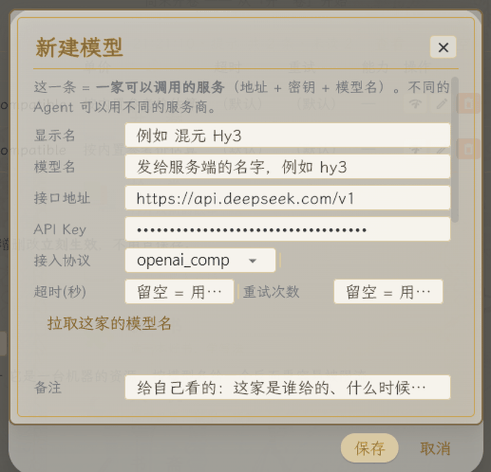

或手写 JSON（与 `.env` 同级）：

```json
{
  "version": 1,
  "models": [
    {
      "key": "deepseek-pro",
      "label": "DeepSeek V4 Pro",
      "model": "deepseek-v4-pro",
      "base_url": "https://api.deepseek.com/v1",
      "api_key": "sk-xxxxxxxx",
      "provider": "openai_compatible",
      "note": "华彩档用，关键场面",
      "price_miss": 2.0,
      "price_out": 8.0,
      "timeout": 120
    },
    {
      "key": "xiaomi-mimo",
      "label": "小米 MiMo",
      "model": "mimo",
      "base_url": "https://xxx.example.com/v1",
      "api_key": "sk-yyyyyyyy",
      "provider": "openai_compatible",
      "note": "日常档",
      "timeout": 60
    },
    {
      "key": "hunyuan-hy3",
      "label": "混元 Hy3",
      "model": "hy3",
      "base_url": "https://xxx.example.com/v1",
      "api_key": "sk-zzzzzzzz",
      "provider": "openai_compatible",
      "note": "摘要档"
    }
  ]
}
```

`ModelEntry` 字段说明（带 `-1` / 留空 = 用全局兜底）：

| 字段 | 说明 |
|---|---|
| `key` | **稳定标识**（存进 `.env` 与各 Agent 绑定的是它，别用 `label` 当键，改名会断绑定） |
| `label` | 显示名（界面那一行） |
| `model` | 发给服务端的模型名（如 `hy3` / `deepseek-v4-pro`） |
| `base_url` | 写到 `/v1` 这一层 |
| `api_key` | 密钥 |
| `provider` | `openai_compatible`（默认）或 `ollama` |
| `note` | 备注（给人看） |
| `price_hit` / `price_miss` / `price_out` | 单价（元 / 百万 token）；没填用内置表兜底 |
| `timeout` / `retries` | 这家专属超时 / 重试；`-1` = 用全局 `LLM_TIMEOUT_SECONDS` / `LLM_MAX_RETRIES` |

> 兼容列表（能自动纠偏能力）已内置国内外主流：国内 qwen/glm/kimi/ernie/hunyuan/doubao/
> minimax/step/spark/mimo 等；国外 claude/gemini/llama/mistral/command/grok/sonar 等；
> 以及 OpenAI 系。具体模型名优先、厂商名兜底、未识别返回「用全局开关」，不会乱猜。

#### 5.2 默认模型

「AI 模型配置 → 默认模型」选一个条目 `key`（对应 `.env` 的 `LLM_DEFAULT_MODEL`）。
谁都没指定模型时用它。默认模型下拉就在「AI 模型配置」这一页（见 5.0 配图）；下图为该页示意，红框处的下拉即「默认模型」。


#### 5.3 三档（华彩 / 日常 / 摘要）

| 档位（.env 键） | 是干什么的 | 大约占调用量 | 该配什么 |
|---|---|---|---|
| `MODEL_FRONT`（华彩档） | 关键场面：重要对话、反思、故事文档、运行小结 | ~15% | 最强 / 最贵的 |
| `MODEL_DAILY`（日常档） | 常规循环：人物决策、台词、导演派活 | ~55% | 中等、稳定的 |
| `MODEL_CHEAP`（摘要档） | 压缩、打分、后台：记忆摘要、进度判断、校对、抽取 | ~30% | 最便宜的 |

在「AI 模型配置 → 三档快速配置」里各选一个 `key`（同一页，见上方配图）。


#### 5.4 模型怎么被选出来（resolve 顺序，速记）

每一发请求按这个顺序定模型：

```
① 这个 Agent 点名了模型（且条目还在）  → 用它
② 该 Agent 所属档位配了模型            → 用它
③ 默认模型                            → 用它
④ 登记表第一条                       → 用它
⑤ 一条都没有                         → 走老路（.env 全局地址 + CFG.model_of）
```

→ **想让某个 Agent 固定用某模型：在第 ⑥ 章给它点名**（覆盖档位）。

#### 5.5 天机其余子页（顺手知道）

「天机」除了「AI 模型配置」，还有 5 个子页，各管一类设置：

- **常规**：项目根目录（`DEFAULT_PROJECTS_DIR`）、日志级别等装机级设置。

  

- **界面外观**：不透明度、界面语言（中英切换）。

  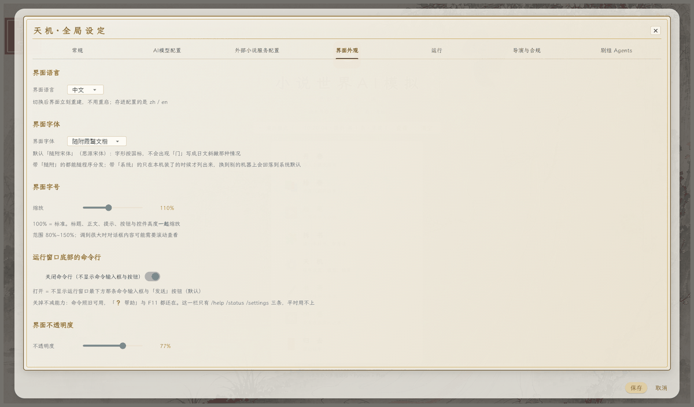

- **运行**：运行模式、时间系统、预算、自动落盘、起笔启动超时、开卷打磨、剧本审读（详见 13.1）。

  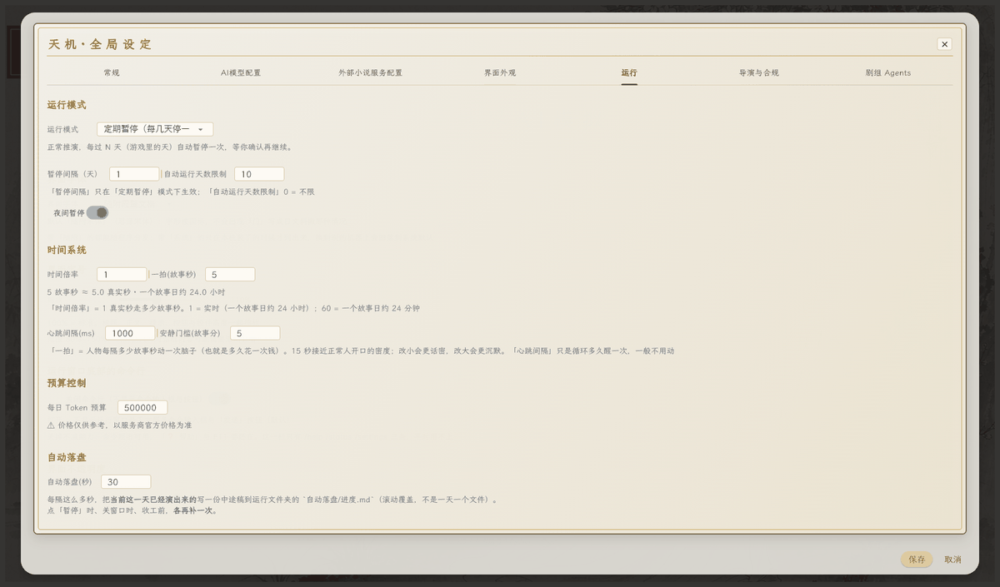

- **导演与合规**：导演力度（排班 / 派活松紧）、内容合规开关。

  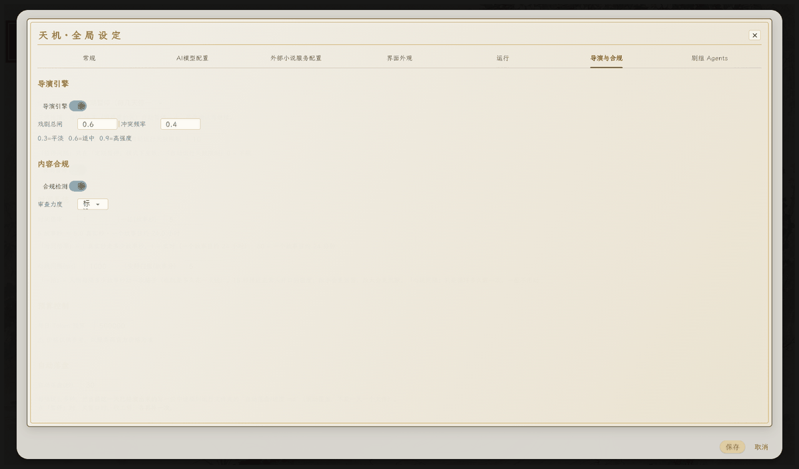

- **剧组 Agents**：软件层职位管理（详见 6.1）。

  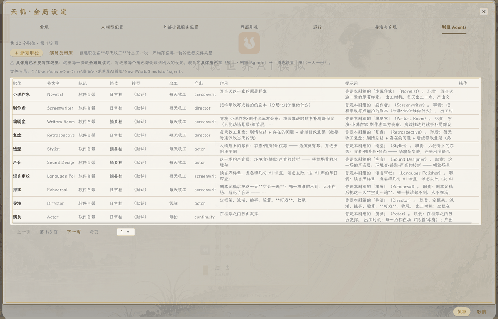

- **外部创作服务**：MuMuAINovel / PlotPilot / PenShot 三座外部服务的开关、起停与参数（详见 4.7.1f，以及「完整使用流程」第七节）。

  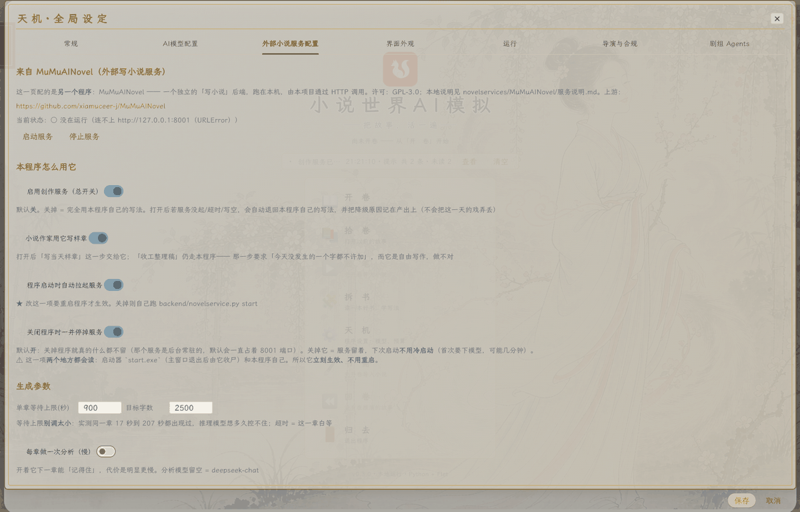

### 5.6 每个 Agent 与 LLM 配置项的推荐 Provider + Model

> 下面只是**推荐，不强制**——登记表里有哪家、就给对应配置项填那家的 `key` 即可。
> 同一配置项给了 1–2 个候选（国内为主，省心；想上国外旗舰见 1.1 的 C 表）。档位含义见 5.3。
> Provider 指厂商（阿里云百炼 / 智谱 / 字节豆包 …），Model 指填进登记表 `model` 字段的名字。

#### 5.6.1 LLM 相关配置项（全局 / `.env`）

| 配置项 | 作用 | 推荐 Provider + Model（1–2 个，非强制） |
|---|---|---|
| `LLM_DEFAULT_MODEL`（默认模型） | 谁都没指定时的兜底 | 智谱 `glm-4.5-plus` / 阿里云百炼 `qwen-plus` |
| `MODEL_FRONT`（华彩档） | 关键场面：样章 / 剧本 / 外挂创作 | 阿里云百炼 `qwen-max` / 智谱 `glm-5` |
| `MODEL_DAILY`（日常档） | 常规循环：人物 / 台词 / 导演派活 | 智谱 `glm-4.5-plus` / 阿里云百炼 `qwen-plus` |
| `MODEL_CHEAP`（摘要档） | 压缩 / 打分 / 后台 | 字节豆包 `doubao-seed` / 智谱 `glm-4-flash` |
| `STORY_DOC_MODEL` | 故事文档 | 同华彩档（`qwen-max` / `glm-5`） |
| `SUMMARY_MODEL` | 跨天摘要 | 同摘要档（`doubao-seed` / `glm-4-flash`） |
| `COMPLIANCE_MODEL` | 合规复核 | 字节豆包 / 智谱 `glm-4-flash` |
| `EMBEDDING_*` | 向量检索 | 硅基流动 `BAAI/bge-m3` 或 `Qwen3-Embedding-8B` / 阿里云 `text-embedding-v4` |
| `IMAGE_AI_MODEL` | 出图（非 LLM） | 字节豆包 `doubao-seedream` / 混元图像 |
| `MUMU_ANALYSIS_MODEL` | MuMu 分析 | DeepSeek `deepseek-v4-flash` / 阿里云百炼 `qwen-turbo` |

#### 5.6.2 每个 Agent 推荐（按档位分工）

| Agent（中文 / key） | 当前档 | 推荐 Provider + Model（1–2 个，非强制） |
|---|---|---|
| 小说作家 / novelist | daily（建议覆盖华彩） | 阿里云百炼 `qwen-max` / 智谱 `glm-5` |
| 剧作者 / screenwriter | daily（建议覆盖华彩） | 阿里云百炼 `qwen-max` / 智谱 `glm-5` |
| 导演 / director | daily | 智谱 `glm-4.5-plus` / 阿里云百炼 `qwen-plus` |
| 演员 / actor | daily（可覆盖华彩） | 智谱 `glm-4.5-plus` / 阿里云百炼 `qwen-max` |
| 复盘 / reviewer | daily | 智谱 `glm-4.5-plus` |
| 排练 / rehearsal | daily | 智谱 `glm-4.5-plus` |
| 开卷摄取 / ingest | daily | 阿里云百炼 `qwen-plus` |
| 编剧室 / settings_room | cheap | 字节豆包 / 智谱 `glm-4-flash` |
| 造型 / stylist | cheap | 字节豆包 |
| 声音 / sound | cheap | 字节豆包 |
| 语言审校 / polisher | cheap | 智谱 `glm-4-flash` |
| 剧本审读 / script_doctor | cheap | 智谱 `glm-4-flash` |
| 场记 / continuity | cheap | 字节豆包 |
| 群众演员 / extra | cheap | 字节豆包 |
| 道具 / props | cheap | 字节豆包 |
| 美术 / art | cheap | 字节豆包 |
| 宣发 / publicity | cheap | 字节豆包 |
| 资料员 / researcher | cheap | 月之暗面 `kimi-k2`（长上下文）/ 字节豆包 |
| 记忆摘要 / memory | cheap | 字节豆包 |
| 进度评估 / progress | cheap | 字节豆包 |
| 合规复核 / compliance | cheap | 字节豆包 |
| 创作服务 / novelservices | front | 阿里云百炼 `qwen-max` / 智谱 `glm-5` |

> 最值得改的一处：把 `novelist` / `screenwriter` 单飞到华彩模型（在 `agents/novelist.md` frontmatter 加 `model: qwen-max`，见 6.3），样章质量提升最明显。

---

### 六、配置各个 Agent 用哪个模型

工程里「Agent」= 剧组职位（`agents/<slug>.md`）。每个职位有 `tier`（归属档位）和可选 `model`（点名覆盖）。

#### 6.1 软件层（换哪本书都生效）—— 天机 → 剧组 Agents

进入：**开始界面 →「天机」→ 子页「剧组 Agents」**。
点开某个职位（如「小说作家 novelist」「剧作者 screenwriter」），可：

- 改它的提示词（正文那段）；
- 在 frontmatter 里给它 `model: <key>` 让它**点名**用某个登记过的模型（覆盖档位）；
- 改 `tier: front/daily/cheap` 换它归属的档位。


等价地，直接用文本编辑器改 `agents/<slug>.md` 的 frontmatter：

```markdown
---
key: novelist
name: 小说作家
tier: daily          # 归属日常档
model: xiaomi-mimo   # 点名：这本/全局都用小米 MiMo（留空=跟着档位走）
feeds: screenwriter
---
```

> 四层优先级（越往下越具体）：① 软件层职位（本文件）→ ② 演员类型库 →
> ③ 项目里同名文件（本书额外要求）→ ④ 具体角色（项目·剧组 Agents→角色设置）。

#### 6.2 项目层（只对这一部戏生效）—— 书斋 → 剧组 Agents

进入：**开始界面 →「书斋」→ 子页「剧组 Agents」**。
在这里的修改只作用于当前项目，不污染软件层默认值。


> **书斋里的「演员」不是一个格子，是"一人一个格子"**：上表里每个**出场人物**
> 各占一行（职位列写着「演员·主角」「演员·阿绣」……），最后**群众演员**单独一行。
> 出场人物从这本书的 `设定集/人物.yaml` 里读；**天机**（软件层）那边不摊开 ——
> 那里没有"这本书"，也就没有出场人物可摊。这些行**只是界面上的显示**，
> 不会写进任何 md（原因见 6.3）。

**tier 分布速查**（来自 `crew/roster.py`）：

- `daily`（常规循环，量最大）：novelist / screenwriter / director / actor / reviewer / rehearsal / ingest 等
- `cheap`（压缩/打分/后台）：约 13 个职位（记忆、进度、校对、抽取等）
- `front`（关键场面，仅 1 个）：**novelservices（外挂 MuMu 写手）**

#### 6.3 角色级覆盖（具体角色）

进**书斋 → 剧组 Agents**，点**某一个人那一行**（「演员·主角」）—— 点**名字**或右边的 👥 按钮都行，
开的就是**那一个人**的角色设置，可以给**某一个具体角色**单独指定模型 / 档位，
不影响其他角色。这是最细的一层（优先级第 ④ 层）。

> ⚠ **为什么角色不写进 md**：一本有 N 个角色，而演员那份 `actor.md` 是**全组通读**的 ——
> 把「张三高冷、李四热情」写进去，所有人都会读到别人的设定（立刻串味）。
> 所以具体角色只存在**一人一份**的 `人物.yaml` 里。

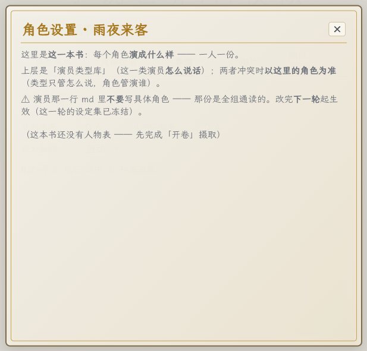

---

### 七、外部创作服务（MuMuAINovel / PlotPilot / PenShot）

三座服务都在 `novelservices/` 下，都是**可选增强**：主程序不依赖它们也能跑；没起只是少一项能力，
不会报错。本项目通过 HTTP 调用它们，**失败会自动退回本程序自己的写法**（并记明原因）。

| 服务 | 干什么 | 谁来用 | 端口写在哪 |
|---|---|---|---|
| **MuMuAINovel** | 写小说正文（样章 / 导出重写） | 小说作家 | `novelservices/MuMuAINovel/backend/.env` 的 `APP_PORT`（默认 8001） |
| **PlotPilot（墨枢）** | 叙事引擎：这一章该发生什么 | 剧作者 / 编剧 | **主程序根** `.env` 的 `PLOTPILOT_PORT`（默认 8005） |
| **PenShot** | 导演 / 分镜引擎：这一场怎么拍 | 导演 / 分镜师 | **主程序根** `.env` 的 `PENSHOT_PORT`（默认 8000） |

#### 7.1 在界面里启用

进入：**开始界面 →「天机」→ 子页「外部创作服务」**。一页里三段（MuMuAINovel / PlotPilot / PenShot），
每段都有同一套东西：

- **总开关**（`*_ENABLED`）：关 = 完全用本程序自己的写法；
- **谁来用**（`MUMU_FOR_NOVELIST` / `PLOTPILOT_FOR_SCREENWRITER` / `PENSHOT_FOR_DIRECTOR`）：
  打开后对应职位才把活交给它；
- **程序启动时自动拉起服务**（`*_AUTOSTART`）：勾上，双击 `start` 时它在**后台**自己起来
  （界面不冻；成败只留一条消息，不弹窗）；
- **关闭程序时一并停掉服务**（`*_FOLLOW_APP`，默认开）—— 三个服务**各自独立**，
  可以"留着编剧、关掉分镜"；
- **启动服务 / 停止服务** 两个按钮 + **实时状态**（"正在运行" / "还没启动（端口 N）"）；
- **连接参数**：服务地址 / 端口 / 「来自 AI模型配置」下拉（选中的模型保存时写进服务自己的 `.env`）。

> ⚠ 三个总开关**出厂都是关**（开箱不启用任何外部服务）。自启开关里只有 MuMu 默认开 ——
> 所以打开某座服务的总开关后，MuMu 会随程序启动自启，PlotPilot / PenShot 还要再打开它自己的自启开关。

#### 7.2 启动与停止

**推荐：随主程序自动起。** 在天机里勾上「程序启动时自动拉起服务」。
启动器 `start` **不负责拉服务**（服务跟着主窗口退出 ⇒ 每次启动都是冷启动；若启动器在前面同步等，
每次双击都要先盯几分钟进度窗），它只在**主窗口退出后**按各自的 `*_FOLLOW_APP` 逐个停掉。

**手动起**（以 MuMu 为例，在 `novelservices/MuMuAINovel/backend/` 下）：

```bash
P=.venv/Scripts/python.exe            # Linux/macOS: .venv/bin/python

$P novelservice.py prepare   # 只准备环境（建 venv + 装依赖 + 建表，首次约几分钟）
$P novelservice.py start     # 后台启动，等健康检查通过才返回
$P novelservice.py status    # 看状态（端口 / pid / 健康）
$P novelservice.py stop      # 停止
```

**PlotPilot / PenShot 走统一控制器**（在程序根目录下）：

```bash
P=.venv/Scripts/python.exe
$P novelservices/service_ctl.py prepare penshot     # 建 venv + 装依赖
$P novelservices/service_ctl.py prepare plotpilot
$P novelservices/service_ctl.py stop penshot         # 停（也可以在天机那一页点按钮）
```

> MuMu 首次启动会**自动从 ModelScope 下载约 470MB 的 embedding 模型**（约 5 分钟），之后就快了。
> 探活：`curl http://127.0.0.1:8001/health` → `{"status":"ok"}`。这条服务只走 REST，没有前端界面。

#### 7.3 端口：setup 会检查并配好（机器上有 Docker 也不撞）

- 三座服务的端口**不在同一处**：MuMu 在它自己的 `backend/.env`（`APP_PORT`），
  两个新服务在**主程序根** `.env`（`PENSHOT_PORT` / `PLOTPILOT_PORT`）。
- **跑一次 setup 就会体检**：绑得上就沿用原端口；绑不上（Docker / 别的程序占着）就从原端口
  往上找一个**能用的**端口，**写回该服务读的那份 `.env`**；如果占着端口的是**服务自己**
  （健康检查通，比如 MuMu 正在 8001 上跑），**不动它**。
- 想知道现在的实际端口：`start.exe --selftest 报告.json`，里面每个服务都有 `port` 与
  `port_busy`（true = 绑不上、被占着）。

#### 7.4 它的模型怎么配

- MuMuAINovel 自己的配置在 `novelservices/MuMuAINovel/backend/.env`（已预填 DeepSeek 接入）。
  本项目经验：**正文与分析都用 `deepseek-chat`（不思考）**，比 `deepseek-v4-pro` 快 5–10 倍、
  不会烧光输出预算导致整章空白。
- PlotPilot / PenShot 也可以在**天机那一页的「来自 AI模型配置」下拉**里选一条已登记的模型，
  保存时自动写成它们各自的 `.env` 键（Anthropic / 火山方舟 / OpenAI 兼容分别对应不同前缀）。
  改完**要重启那个服务**才生效。

---

### 八、开卷（导入一本新书）

进入：**开始界面 →「开　卷」**（或直接点「开卷」卡片）→ 弹出「开卷 · 导入向导」。


向导里填：

- **书名**（之后在书斋里**不能改**，想改名要重开卷）
- **素材文件夹**（可选的原文 / 参考资料）
- **设定集目录**（小说设定，这一步写入；选定后可在书斋里调整类型/风格等）


填完确认，程序开始**摄取（ingest）**：把设定拆成剧组能用的结构。摄取有两种方式：


如果「七、外部创作服务」里打开了「小说作家用它写样章」，开卷后样章可由 MuMuAINovel 写。

#### 8.1 拆书（把一本好书拆成你的写法）

开始界面还有 **「拆　书」** 入口：它读的是**你觉得写得好的那本书**（或其中一部分），
把它拆成**可复用的写法模块**（人物塑造、节奏、悬念…），拼回你自己的故事。
一句话区分：**开卷是「把这本书变成我的世界」，拆书是「把这本书变成我的本事」**。

拆书对话框与开卷类似（同样走摄取管线，见上图），但传入的是「一本成书」而非「你的设定」。
适合：想学某本书的技法、又不想让它干扰自己世界观时。

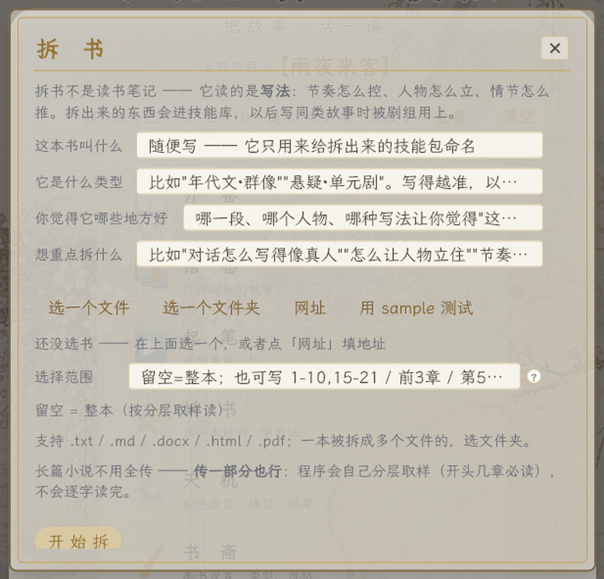

---

### 九、起笔（开始每日推演）

进入：**运行界面 → 顶部「📖 起　笔」**（第一次开卷后，开始界面的「起笔」也可用）。

流程：点「起笔」→ 弹「开始这个故事」确认框 → 确认后真正开始推演当天这一章。


推演会按「小说作家 → 剧作者 → 导演 → 演员…」的流水线每天推进，落盘叙事、生成剧本与小结。

---

### 十、拾卷与回卷（继续以前的故事）

- **拾卷**（打开以前的书）：**开始界面 →「拾　卷」** → 项目列表（三栏）→ 选一个项目打开。
  
  
- **回卷**（回到运行界面续推）：**开始界面 →「回　卷」**（或运行界面顶部「📋 菜单」回到开始界面、
  **不会停跑**，再点「回卷」回去）。回到的是实时推演屏：

  

> 「拾卷」= 选哪本书；「回卷」= 回到正在跑的实时屏。两者分工不同。

---

### 十一、配置当前项目（书斋）

进入：**开始界面 →「书　斋」** → 弹出「本书设置」对话框，5 个子页：


| 子页 | 能改什么 |
|---|---|
| 类型风格 | 书的类型、风格预设 |
| 风格控制 | 文风强度、约束 |
| 导演 | 导演力度（排班 / 派活松紧） |
| 图片 | 背景 / 头像 / 小地图生成开关 |
| 剧组 Agents | **本项目专属**的职位覆盖（提示词 / `model:` / `tier:`），只作用于这一部戏 |

> 书名、设定集目录是**开卷时**定的；书斋改的是类型 / 风格 / 导演 / 图片 / Agent，不含改书名。

#### 11.1 项目存放在哪（DEFAULT_PROJECTS_DIR）

每开一卷，都会在**项目根目录**下建一个以书名命名的项目文件夹（设定、每日叙事、故事文档、快照都在里面）。

- 默认根目录：`<桌面>/小说世界AI模拟/Projects`（老用户若已有 `小说世界虚拟模拟/Projects` 且非空，则继续用旧的，书不丢）。
- 改位置：开始界面 →「天机」→「常规」→「项目根目录」（对应 `.env` 的 `DEFAULT_PROJECTS_DIR`）。


- 打开项目文件夹：开始界面「拾卷」里每个项目都有入口；装到菜单后桌面快捷方式也带「打开项目文件夹」。

---

### 十二、运行中的操作：暂停 / 停止 / 导出

都在 **运行界面顶部按钮栏**（起笔之后出现）：

| 按钮 | 作用 |
|---|---|
| **⏸ 暂停 / ▶ 继续** | 同一按钮，文字在「暂停 ↔ 继续」间切换 |
| **⏹ 停止** | 结束本轮、写运行小结与装订稿，**不接着跑** |
| **📤 导出** | 导出成果 |


**导出**内容（`export/bundle.py` 的 `KINDS`）：

- 原始稿（Markdown 装订稿）
- 最终改写稿（可读稿，通常 docx）
- 原始稿加细节
- 运行报告
- 写作指导

导出目录：写到**本次运行的导出目录**（`run.export_dir`）。中途也能点，只纳入已落盘的完整天。
还有「结束时自动导出」开关。

---

### 十三、运行界面说明

进入：`show_main_screen`（点「起笔」「回卷」进入；运行界面里点「📋 菜单」回到开始界面但不停跑）。


- **顶部按钮栏**：起笔 / 暂停 / 停止 / 导出 / 菜单 / 帮助 / 日志
- **主区**：当前这一章的叙事、剧本、各 Agent 的产出
- **底部状态条**：运行态 + 自动落盘 + 金色「用量」链接（见第十四章）+ 跑的模式 / 真实类型 / 运行边界开关
  - ★ **点最左边那颗「运行状态」胶囊**会弹出「AI 往来」窗口：这一发**发给模型的全部内容**
    和它**返回的全部内容**，一条我发的一条它回的，像聊天窗口。
  - ★ **它现在分页了**（2026-10-28）：**每页默认 50 发**（右下角可以改成 20 / 50 / 100 / 200），
    **打开时落在最后一页、最后一条就在眼前** —— 你想看的就是"刚才那一发"。
    手动翻到别的页以后，新的一发进来**不会**把你从正在读的那页上拽走；
    翻回最后一页就又"贴着最新"了。
- **🧾 日志** 按钮：弹出日志对话框（见 14.1），看实时日志

#### 13.1 运行模式 / 时间系统（天机 → 运行）

推演「多快、多话密、跑几天」在 **天机 → 运行** 里调：

- **运行模式**：`story`（有进度表与终点，走完自动收尾）等；
- **时间系统**：一拍多长、心跳间隔、安静门槛——写作者主要调「一拍」和「对话密度」两个；
- **自动运行天数限制**：`0` = 不限；
- **暂停间隔**：只在「定期暂停」模式下生效；
- 还有起笔启动超时、开卷打磨、剧本审读等开关。

---

### 十四、查看 LLM 用量

进入：**运行界面 → 底部状态条的金色「用量」链接** → 弹出用量对话框（四栏：项目 / 划分卡片 / Agent / 明细）。
数据直接由数据库 `usage.db` 算出，**不调模型、零成本**。

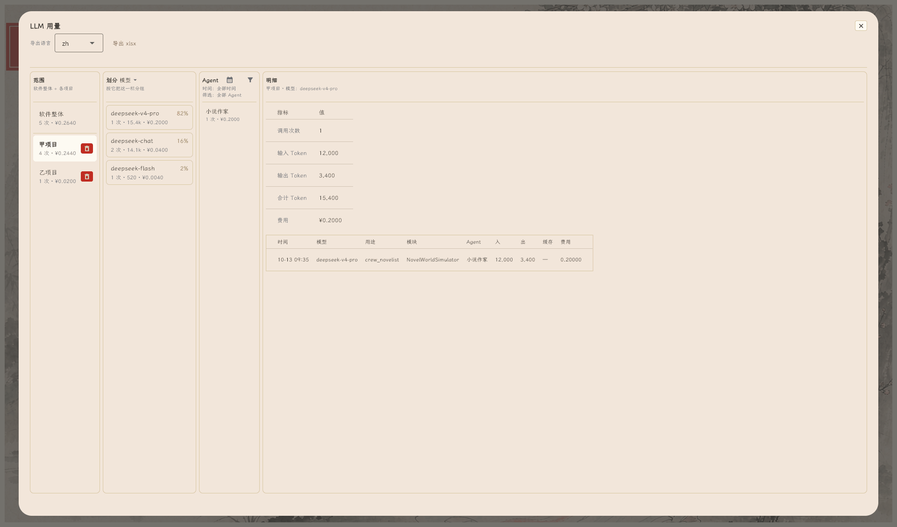

另有一份**调用账本** `logs/llm_calls.jsonl`：一行一次调用，跨运行累积（不受日志清理影响），
可用于原始明细核对与诊断打包。它由 `llm/router.py` 的 `SAVE_RAW_LOGS` 开关控制。

> 想让账单更准：在模型登记表每条里填 `price_miss` / `price_out`（元 / 百万 token），
> 没填的部分用内置价表兜底。

#### 14.1 日志（程序记住了什么）

点运行界面顶部「🧾 日志」，或看 `logs/` 目录下的日志文件，实时追踪每一发调用与每一步推演。


---

### 十五、帮助与天机（随时查）

- **帮助**：开始界面右上「❓ 帮助」或运行界面「❓ 帮助」（快捷键 **F11**）。
  两个子页：「帮助信息」（翻说明书 + 关键词搜索，按 `##` 切块）+「问个问题」（聊天式）。
  
  
- **天机**（全局设置）：开始界面「天机」→ 7 个子页（常规 / AI 模型配置 / 外部创作服务 / 界面外观 / 运行 / 导演与合规 / 剧组 Agents）。

更多按场景的配置，见工程里的 `配置指南.md`（12 个典型场景）与 `配置分类.md`（配置项归属）。

---

### 归去（退出程序）

开始界面点 **「归　去」** 即退出程序。

> ⚠ 主窗口退出时，**外挂的 NovelService 也会跟着退出**（同一道闸），不必手动停。
> 卸载只删快捷方式，小说项目数据永不删除。

---

### 附录：常见问题与排错

1. **API Key 写在 `llm_models.json` / `.env`**，已在 `.gitignore` 忽略，别提交。
2. **改名别动 `key`**：Agent 绑定和 `.env` 三档存的是 `key`，`label` 随便改，`key` 一改绑定全断。
3. **国内源优先阿里云**：清华源对新包常 403；命令行显式 `-i https://mirrors.aliyun.com/pypi/simple`。
4. **NovelService 失败不拦主程序**：起不来只提示，主程序照常启动（它只是增强项）。
5. **MuMuAINovel 用 `deepseek-chat` 别用会思考的模型**：推理模型会把输出预算烧在思考上，最坏整章空白。
6. **启动器按平台编译**：别跨平台给启动器；发布包内 `平台说明.md` 写明适用平台。
7. **演示模式**：`start.exe --mock` 或 `MOCK_LLM=true`，零成本先看全流程。
8. **模型能力自动纠偏**：启动时按模型名识别能力并写回全局开关；界面上「模型能力」四个开关是对它的显式覆盖。

**排错速查**

| 现象 | 先看 / 先试 |
|---|---|
| 开卷后没反应 / 卡住 | 点「🧾 日志」看是否停在等交互或模型 401；确认 `llm_models.json` 的 `base_url` 与 `api_key` 正确 |
| 模型报 401 / 404 | 检查对应条目的 `api_key`、`base_url`（必须含 `/v1`）、`model` 名是否与该服务一致 |
| 用量为空 | 第一次跑完才有数据；用量读 `usage.db`，不是 `llm_calls.jsonl` 才有 |
| NovelService 连不上 | 服务没起：`backend/.venv/Scripts/python.exe novelservice.py status`；确认 8001 在监听 |
| 界面字体/中文乱码 | 天机 → 界面外观 切语言；确认系统有中文黑体 |
| 依赖装坏 | `start.exe --reinstall`（发布包）或删 `.venv` 重 `pip install -r requirements.txt`（源码） |

