# 小说世界 AI 模拟 · 完整使用流程指南（从零到导出）

> 适用版本：**0.3.3**　·　适用对象：第一次用、想知道「每一步点哪里 / 填什么」的人  
> 本文覆盖：准备 API Key → 准备 Python 环境（国内源）→ 安装 → 运行 → 全局配置 LLM 模型与各 Agent →  
> 配置 NovelService → 开卷 → 起笔 → 拾卷 / 拆书 → 配置当前项目 → 暂停 / 停止 / 导出 → 运行界面 → 查看 LLM 用量。  
> 文中截图均为程序实际界面（来自 `assets/images/manual/zh/`）。

---

## 〇、先搞懂三件事（看一眼，后面不懵）

这个程序不是「一个窗口里一排标签」，而是 **两个屏幕 + 一堆对话框**：

| 屏幕 / 对话框     | 干什么                                                           | 怎么进                          |
| ------------ | ------------------------------------------------------------- | ---------------------------- |
| **开始界面**     | 8 个入口卡片：开卷 / 拾卷 / 起笔 / 拆书 / 天机 / 书斋 / 回卷 / 归去                 | 程序启动就在这                      |
| **运行界面**     | 实时屏：当前这一章、日志、顶部按钮（起笔/暂停/停止/导出/菜单/帮助/日志）                       | 点「起笔」「回卷」进入                  |
| **天机**（全局设置） | 7 个子页：常规 / AI 模型配置 / 界面外观 / 运行 / 导演与合规 / 剧组 Agents / 外部小说服务配置 | 开始界面 →「天机」                   |
| **书斋**（项目设置） | 5 个子页：类型风格 / 风格控制 / 导演 / 图片 / 剧组 Agents                       | 开始界面 →「书斋」                   |
| **帮助**       | 翻说明书（按 `##` 切块）+ 关键词搜索 + 问问题                                  | 开始界面右上「❓ 帮助」或运行界面「❓ 帮助」（F11） |


开始界面的 8 个入口分别是什么：

| 入口     | 作用                                  |
| ------ | ----------------------------------- |
| **开卷** | 导入一本新书（设定集 / 素材）→ 走「开卷导入向导」         |
| **拾卷** | 打开以前的书（项目列表）                        |
| **起笔** | 开始今天的推演（写当天这一章）—— 需先开卷              |
| **拆书** | 把一本你写得好的现成书拆成「写法模块」，变成你自己的本事（见 8.1） |
| **天机** | 全局设置（模型、Agent、运行、服务…）               |
| **书斋** | 当前项目的设置（类型、风格、导演、图片、本书专属 Agent）     |
| **回卷** | 回到运行界面继续推演（已开卷的书点它接着跑）              |
| **归去** | 退出程序（见文末「归去」）                       |

四个动词别混：

- **开卷** = 导入一本新书（设定集 / 素材）→ 走「开卷导入向导」。
- **起笔** = 开始今天的推演（写当天这一章）→ 运行界面顶部「起笔」。
- **拾卷** = 打开以前的书（项目列表）→ 开始界面「拾卷」。
- **回卷** = 回到运行界面继续推演（已开卷的书点它接着跑）。

---

## 一、准备 API Key

本程序通过 **OpenAI 兼容协议** 调模型，你需要的是：

1. 一个 **Base URL**（写到 `/v1` 这一层，例如 `https://api.deepseek.com/v1`）；
2. 一个 **API Key**；
3. 该服务下**能调用的模型名**（如 `deepseek-v4-pro`、`deepseek-flash`、`hy3`、`mimo`）。

国内常见可一个 Key + 一个 Base URL 切多家厂商的聚合平台（OpenAI 兼容）：

- **硅基流动**（最便宜，但无闭源旗舰）
- **腾讯 TokenHub / 七牛云 AI** 等（更均衡，含各家闭源旗舰）
- 各厂商直连：**DeepSeek**、**阿里云百炼（Qwen）**、**智谱（GLM）**、**MiniMax**、**月之暗面（Kimi）**、**小米（MiMo）**、**腾讯（混元 Hy3）** 等

> 你已有哪些模型，就把对应条目填进「模型登记表」（见第五章）。  
> 有多家时建议：**关键场面用强模型、日常循环用中等模型、压缩/打分用便宜模型**（对应三档，见 5.3）。

### 1.1 推荐 LLM 服务目录（注册 / Base URL / 模型 / 在软件里怎么用）

下面把你之前聊到的、以及本程序兼容列表能自动纠偏的主流服务整理成表。  
**「在软件里适合做什么」按三档分工**：华彩档 = 关键场面（样章 / 剧本 / 外挂创作）；日常档 = 常规循环（导演 / 演员 / 复盘 / 摄取）；摘要档 = 压缩 / 打分 / 后台。  
价格与模型名会变动，以各家控制台「模型广场」实时为准；Base URL 都写到 `/v1` 这一层。

#### A. 聚合网关（一个 Key 接多家，新手首选）

| 服务               | 怎么注册 / 拿 Key                                                  | Base URL（OpenAI 兼容）                                                                                | 推荐 Model（填进 `model` 字段）                                                                                                                  | 在软件里适合做什么                                            |
| ---------------- | ------------------------------------------------------------- | -------------------------------------------------------------------------------------------------- | ---------------------------------------------------------------------------------------------------------------------------------------- | ---------------------------------------------------- |
| 硅基流动 SiliconFlow | [cloud.siliconflow.cn](https://cloud.siliconflow.cn) 注册即送体验额度 | `https://api.siliconflow.cn/v1`                                                                    | `deepseek-ai/DeepSeek-V3.1`、`Qwen/Qwen3-235B-A22B-Instruct`、`THUDM/glm-4-9b-chat`、`moonshotai/Kimi-K2-Instruct`、`BAAI/bge-m3`（embedding） | 日常档 / 摘要档（便宜量大）；embedding 给 `EMBEDDING_*`            |
| 七牛云 AI 大模型推理     | 七牛云控制台 → AI 大模型推理 → API Key                                   | 国内 `https://api.qnaigc.com/v1`（海外 `https://api.modelink.ai/v1`）                                    | `qiniu/deepseek-v4-pro`、`qiniu/qwen3-max`、`qiniu/z-ai/glm-5`、`qiniu/moonshotai/kimi-k2.5`、`qiniu/minimax/m3`                             | 华彩档 / 日常档（含各家闭源旗舰，一个 Key 全接）                         |
| 腾讯 TokenHub      | 腾讯云 TokenHub 控制台开通套餐                                          | 广州 `https://tokenhub.tencentcloudmaas.com/v1`（新加坡 `https://tokenhub-intl.tencentcloudmaas.com/v1`） | `hy3`、`deepseek-v4-pro`、`glm-5.3`、`kimi-k3`、`minimax-m3`、`mimo-v2.5-pro`                                                                 | 华彩档 / 日常档（混元 / DeepSeek / GLM / Kimi / MiniMax 统一计费） |
| 小蓝 AI（BlueDoAI）  | [bluedoai.com](https://www.bluedoai.com) 控制台建 Key             | `https://api.bluedoai.com/v1`                                                                      | `qwen-max`、`qwen-plus`、`glm-5.2`、`deepseek-v4-pro`、`kimi-k2.6`、`doubao-seed-2-0-pro`                                                     | 华彩档 / 日常档 / 摘要档（一个 Key 接国内主流）                        |

> 聚合网关的好处：只需在「模型登记表」加**一条**（base_url + key），`model` 字段换不同名字就能切不同厂商，不用每家建一条。

#### B. 国内厂商直连（想锁定某一家时用）

| 服务                  | 怎么注册 / 拿 Key                                           | Base URL（OpenAI 兼容）                                 | 推荐 Model                                                                               | 在软件里适合做什么                       |
| ------------------- | ------------------------------------------------------ | --------------------------------------------------- | -------------------------------------------------------------------------------------- | ------------------------------- |
| DeepSeek            | [platform.deepseek.com](https://platform.deepseek.com) | `https://api.deepseek.com/v1`                       | `deepseek-v4-pro`（华彩）、`deepseek-v4-flash`（摘要 / 日常省钱）                                   | 华彩档 / 摘要档                       |
| 阿里云百炼（通义千问 Qwen）    | 阿里云百炼控制台建 Key                                          | `https://dashscope.aliyuncs.com/compatible-mode/v1` | `qwen-max`（华彩）、`qwen-plus` / `qwen3-plus`（日常）、`qwen-turbo`（摘要）、`text-embedding-v4`（向量） | 华彩档首选 / 日常档 / 摘要档 / embedding   |
| 智谱 GLM（BigModel）    | [open.bigmodel.cn](https://open.bigmodel.cn)           | `https://open.bigmodel.cn/api/paas/v4`              | `glm-5` / `glm-5.3`（华彩）、`glm-4.5-plus`（日常）、`glm-4-flash`（摘要）                           | 华彩档 / 日常档 / 摘要档                 |
| 月之暗面 Kimi（Moonshot） | [platform.moonshot.cn](https://platform.moonshot.cn)   | `https://api.moonshot.cn/v1`                        | `kimi-k2` / `kimi-k2.6`（长上下文）                                                          | 资料员 researcher（考据长文）/ 日常档       |
| MiniMax             | [minimax.chat](https://minimax.chat)                   | `https://api.minimax.chat/v1`                       | `minimax-m3` / `MiniMax-M2.7`                                                          | 日常档 / 摘要档备选                     |
| 字节豆包（火山方舟 Ark）      | 火山引擎 Ark 控制台（**Key 通用，但每个模型要单独开通**，见 1.1-D）                 | `https://ark.cn-beijing.volces.com/api/v3`          | `doubao-seed-2-1-lite-260915`（对话）、**`doubao-seed-character-251128`（角色扮演专用，只给演员）**、`doubao-embedding`（向量） | 摘要档首选（便宜快）/ **演员可换角色专用模型**（配置见 5.1-B）/ 出图 `IMAGE_AI_MODEL` |
| 阶跃星辰 StepFun        | [platform.stepfun.com](https://platform.stepfun.com)   | `https://api.stepfun.com/v1`                        | `step-3` / `step-3.5`                                                                  | 摘要档备选                           |
| 小米 MiMo             | 你已有的服务（填你的 endpoint）                                   | 你的 `https://.../v1`                                 | `mimo`                                                                                 | 日常档 / 摘要档（你已购）                  |
| 腾讯混元 Hy3            | 腾讯云（或经 TokenHub）                                       | `https://api.hunyuan.cloud.tencent.com/v1`          | `hy3`（多模态强，纯文本创意中等）                                                                    | 摘要档 / 出图设想                      |

#### C. 国外厂商直连（需能直连 / 走代理或 OpenRouter）

| 服务                | 怎么注册 / 拿 Key                                                                          | Base URL（OpenAI 兼容）                                        | 推荐 Model                                            | 在软件里适合做什么      |
| ----------------- | ------------------------------------------------------------------------------------- | ---------------------------------------------------------- | --------------------------------------------------- | -------------- |
| OpenAI            | [platform.openai.com](https://platform.openai.com)                                    | `https://api.openai.com/v1`                                | `gpt-5` / `gpt-5.5`（华彩）、`gpt-4.1`（日常）、`o4-mini`（推理） | 华彩档 / 日常档      |
| Anthropic（Claude） | [console.anthropic.com](https://console.anthropic.com)（本程序走 OpenAI 兼容，建议经 OpenRouter） | OpenRouter `https://openrouter.ai/api/v1`                  | `claude-opus-4` / `claude-sonnet-4`（华彩）             | 华彩档（英文 / 长文强）  |
| Google Gemini     | [aistudio.google.com](https://aistudio.google.com)                                    | `https://generativelanguage.googleapis.com/v1beta/openai/` | `gemini-2.5-pro`（华彩）、`gemini-2.5-flash`（日常）         | 华彩档 / 日常档      |
| xAI（Grok）         | [x.ai](https://x.ai)                                                                  | `https://api.x.ai/v1`                                      | `grok-4`                                            | 华彩档 / 日常档      |
| Mistral           | [console.mistral.ai](https://console.mistral.ai)                                      | `https://api.mistral.ai/v1`                                | `mistral-large`                                     | 日常档            |
| Cohere            | [dashboard.cohere.com](https://dashboard.cohere.com)                                  | `https://api.cohere.ai/v2`                                 | `command-r-plus`（含 rerank）                          | 摘要档 / 检索重排     |
| Meta Llama        | 经 Together / OpenRouter 等                                                             | `https://api.together.xyz/v1`                              | `llama-4-maverick`                                  | 日常档            |
| Perplexity        | [perplexity.ai](https://perplexity.ai)                                                | `https://api.perplexity.ai`                                | `sonar` / `pplx`                                    | 资料员（联网检索）/ 摘要档 |

> 兼容列表已内置自动纠偏（按模型名识别能力开关），国内 `qwen/glm/kimi/ernie/hunyuan/doubao/minimax/step/spark/mimo`、国外 `claude/gemini/llama/mistral/command/grok/sonar` 及 OpenAI 系都能直接接，不用手填能力位。

#### 1.1-D 具体领取步骤（含火山方舟「开通模型」）

**通用套路**（除火山方舟外都一样）：注册 → 实名 → 控制台「API 密钥」→ 新建 → **立刻复制**（多数只显示一次）→ 充值。

| 服务 | 步骤 |
|---|---|
| **DeepSeek** | [platform.deepseek.com](https://platform.deepseek.com) 注册 → 顶部「API Keys」→「创建」→ 复制 `sk-...` → 首次调用前先充值 |
| **阿里云百炼（Qwen）** | 阿里云控制台搜「百炼」→ 开通 → [dashscope 控制台](https://dashscope.console.aliyun.com) →「API Key 管理」→ 创建 |
| **智谱 GLM** | [open.bigmodel.cn](https://open.bigmodel.cn) 注册 → 右上「用户中心」→「API Keys」→ 添加 |
| **月之暗面 Kimi** | [platform.moonshot.cn](https://platform.moonshot.cn) 注册 →「API 密钥」→ 创建 |
| **MiniMax** | [platform.minimaxi.com](https://platform.minimaxi.com)（**国内站，别进 minimax.io**）→ 手机验证码登录即注册 → 实名 →「账户管理 → 接口密钥」→ 创建。⚠ 选**按量计费 Key**（`eyJhbG...`），不是 Token Plan Key（`sk-cp-...`） |
| **腾讯 TokenHub / 混元** | 腾讯云 [console.cloud.tencent.com](https://console.cloud.tencent.com) → 搜「TokenHub」开通套餐 →「密钥管理」创建 |
| **硅基流动** | [cloud.siliconflow.cn](https://cloud.siliconflow.cn) 注册（送额度）→ 头像 →「API 密钥」→ 新建 |
| **七牛云** | [qiniu.com](https://www.qiniu.com) 控制台（需实名）→ 搜「AI 大模型推理」开通 →「API 密钥管理」→ 创建 |

##### 火山方舟（字节豆包）：Key 通用，但**每个模型要单独开通**

这是最容易卡住的一步：**Key 建好了不等于能用某个模型**，还得去「开通管理」开通它。

调用一个没开通的模型会返回：

```
404 ModelNotOpen
Your account xxx has not activated the model doubao-seed-character-251128.
Please activate the model service in the Ark Console.
```

⚠ 两种报错含义完全相反，别混：

| 报错码 | 含义 | 怎么办 |
|---|---|---|
| `ModelNotOpen` | **模型名对、模型在，你的账号没开通** | 去开通，几秒钟生效 |
| `InvalidEndpointOrModel.NotFound` | **模型名根本不存在** | 别猜名字，去控制台看确切 id |

**开通步骤（约 2 分钟）：**

1. 登录火山引擎 [console.volcengine.com](https://console.volcengine.com)（需实名认证 + 充值）。
2. 搜「火山方舟」开通服务，进「API Key 管理」创建 Key，复制 `ark-...` 那一串。
3. 打开**开通管理**：
   `https://console.volcengine.com/ark/region:ark+cn-beijing/openManagement`
   （region 不是北京就把 `cn-beijing` 换成你的）
4. 在列表里找要用的模型，点「开通」。**即时生效、按量计费，不调用不扣钱。**
5. 回来验证（30 秒，脚本直接读登记表，不用改任何配置）：

```bash
cd 程序目录
.venv/Scripts/python.exe - <<'EOF'
import json, urllib.request
from pathlib import Path
d = json.loads(Path('llm_models.json').read_text(encoding='utf-8'))
e = [m for m in d['models'] if m['key'] == 'doubao-character'][0]
body = json.dumps({"model": e['model'],
                   "messages": [{"role": "user", "content": "只回复两个字：可用"}],
                   "max_tokens": 64}).encode()
req = urllib.request.Request(e['base_url'].rstrip('/') + '/chat/completions', data=body,
    headers={'Content-Type': 'application/json',
             'Authorization': 'Bearer ' + e['api_key']}, method='POST')
r = json.loads(urllib.request.urlopen(req, timeout=60).read().decode())
print('model  :', r.get('model'))
print('usage  :', r.get('usage'))      # reason=0 表示不思考
print('content:', r['choices'][0]['message'].get('content'))
EOF
```

看到 `model: doubao-seed-character-...` 就通了。

**豆包各模型的实测参数（免得你踩同样的坑）：**

| 模型 | 可接受的最大 `max_tokens` | 默认思考 | 适用 |
|---|---|---|---|
| `doubao-seed-2-1-lite-260915` | 131072（262144 起 400） | ✅ 思考（out=41 里 40 是思考） | 摘要档 / 日常对话 |
| **`doubao-seed-character-251128`** | **32768**（65536 起 400） | ❌ **不思考**（`reason=0`） | **只给演员 `actor`** |
| `doubao-seed-character-260628` | 未逐一实测（同族，按 32768 保守） | — | 同上（更新的一版） |

⚠ `doubao-seed-character` 还有一个特殊之处：**不支持 `response_format: {"type":"json_object"}`**（400）。
而演员每拍都要输出 JSON 决策，所以必须在登记表里把它的 `LLM_CAP_JSON_MODE` **显式关掉**
——具体写法见 **5.1-B**。不加这一步，演员的每一拍都会 400、降级成「不动」。

---

### 1.2 实例搭配：为达到最好效果你需要几个模型

> **一句话答案：三档（华彩 / 日常 / 摘要）1:1 = 3 个模型就够用。** 多花心思只会把"哪条 token 走哪个 Key"理顺；对产出质量的边际收益很小。

按本程序 22 个职位 + 1 个外挂创作服务的 `tier` 分布看：

| 档位 | 覆盖职位数 | 占调用量约 | 用途 |
|---|---|---|---|
| **华彩档 `front`** | 1 个（`novelservices` 外挂创作服务）+ 建议手动覆盖 `novelist` / `screenwriter` | ~15% | 样章、剧本 |
| **日常档 `daily`** | 7 个（`novelist` / `screenwriter` / `director` / `actor` / `reviewer` / `rehearsal` / `ingest`） | ~55% | 派活、台词、复盘、开卷 |
| **摘要档 `cheap`** | 14 个（编剧室·造型·声音·语言审校·场记·剧本审读·道具·美术·宣发·资料员·群众演员·记忆·进度·合规） | ~30% | 压缩·打分·后台·检索·连戏 |

「三档 1:1」 = 三个模型各管一档。下面四种范例覆盖 90% 场景——**挑一个贴近你预算的照抄就行**。

---

#### 范例 A：三档 1:1、最省心（首推 · 30 秒上手）

走「**一个聚合网关、一个 Key**」，三档都用同一家不同模型。**TokenHub（腾讯云）** 一个 Base URL 接混元 / DeepSeek / GLM / Kimi / MiniMax，按下面三条加进 `llm_models.json` 即可：

```jsonc
// .env
MODEL_FRONT = tencent-hy3        // 华彩档
MODEL_DAILY = tencent-dsv4-pro   // 日常档
MODEL_CHEAP = tencent-dsv4-flash // 摘要档（快、省）
LLM_DEFAULT_MODEL = tencent-dsv4-pro
```

```jsonc
// llm_models.json（三条，全是同一 base_url / key，仅 model 名不同）
[
  {"key": "tencent-hy3",       "provider": "openai_compatible",
   "base_url": "https://tokenhub.tencentcloudmaas.com/v1",
   "model": "hy3"},
  {"key": "tencent-dsv4-pro",  "provider": "openai_compatible",
   "base_url": "https://tokenhub.tencentcloudmaas.com/v1",
   "model": "deepseek-v4-pro"},
  {"key": "tencent-dsv4-flash","provider": "openai_compatible",
   "base_url": "https://tokenhub.tencentcloudmaas.com/v1",
   "model": "deepseek-v4-flash"}
]
```

效果：样章/剧本吃 hy3、决策/对话吃 deepseek-v4-pro、后台吃 deepseek-v4-flash。

---

#### 范例 B：质量优先（华彩上旗舰）·中文创意直逼头部

**华彩走单家旗舰**，日常 + 摘要走聚合网关省钱（旗舰 token 不便宜，不能洒在后台）

```jsonc
// .env
MODEL_FRONT = qwen-max          // 阿里云百炼旗舰，中文创意顶
MODEL_DAILY = siliconflow-qwen-plus  // 硅基流动 + Qwen3-Plus，日常稳
MODEL_CHEAP = siliconflow-dsv3   // 硅基流动 + DeepSeek-V3.1，便宜快
LLM_DEFAULT_MODEL = siliconflow-qwen-plus
```

华彩旗舰单点 = 样章/剧本直追真人（且单家 API 配额独立，不会被日常高请求挤掉）。

---

#### 范例 C：预算敏感（≤ 范例 A 的 1/3）· 全用便宜 + 国产

```jsonc
// .env
MODEL_FRONT = siliconflow-qwen3   // 硅基流动 + Qwen3-235B（开源旗舰够用）
MODEL_DAILY = siliconflow-glm4-9b // 硅基流动 + GLM-4-9B（开源 9B，便宜到忽略）
MODEL_CHEAP = ark-doubao          // 字节火山方舟 + Doubao-Seed（更便宜）
LLM_DEFAULT_MODEL = siliconflow-qwen3
```

特点：三档全 ≤ 0.6 元 / 百万 token。全书 30 章推下来通常 < 20 元。

---

#### 范例 D：全本地（Ollama 离线 · 零 token 钱 · 慢 · 可选，绝大多数人不需要）

> **这一档要先在机器上装 Ollama 并拉模型，属于进阶玩法。** 不装它、只跑上面 A/B/C 三档
> 完全正常——程序默认就走云端 API，本机不需要任何模型服务。

```bash
# ollama pull 三个模型（注意显存 ≥ 32GB）
ollama pull qwen3:32b         # 华彩
ollama pull qwen3:14b         # 日常
ollama pull smollm2:1.7b      # 摘要
```

```jsonc
// .env
MODEL_FRONT = ollama-qwen3-32b
MODEL_DAILY = ollama-qwen3-14b
MODEL_CHEAP = ollama-smollm2
LLM_DEFAULT_MODEL = ollama-qwen3-14b
```

特点：完全离线 · 零 API 钱。代价是速度慢 5–10 倍、样章中文创意比 Qwen-Max 差一档。

---

#### 怎么选范例

| 你的情况 | 推荐范例 |
|---|---|
| 第一次上手、想马上跑 | **范例 A（三档 1:1）** |
| 写重要作品、想把样章写到顶 | **范例 B（华彩旗舰 + 聚合省钱）** |
| 写爽文灌水、想拼命压预算 | **范例 C（全便宜）** |
| 机器 ≥ 32GB 显存 + 拒 API | **范例 D（全本地）** |

> **再升级（可选）**：以上三档是「文字模型」。如果你要**出图**（`IMAGE_AI_MODEL`）或**向量检索**（`EMBEDDING_*`），那两条**各占一个独立槽位**——和上面三档**互不替代**。
> 其中**向量检索保持默认 `EMBEDDING_PROVIDER=none` 就行**（零依赖、不用装 Ollama）；只有想改用向量召回时才切到 `api` / `local` / `ollama`。

---

#### 把「华彩档」钉到 `novelist` / `screenwriter`（最值的一刀）

> 上面 4 个范例里 `MODEL_FRONT` 只服务 1 个 `novelservices`，**真正吃文笔**的 `novelist` / `screenwriter` 还在「日常档」。  
> **最值得改的一刀**：让 `novelist` / `screenwriter` 单飞华彩模型。

```yaml
# agents/novelist.md（frontmatter 加一行）
---
key: novelist
name: 小说作家
tier: daily         # 留在日常档（决定费用归属）
model: qwen-max     # ★ 单飞华彩：样章直吃旗舰
---
```

```yaml
# agents/screenwriter.md
---
key: screenwriter
name: 剧作者
tier: daily
model: qwen-max
---
```

改完重启，样章/剧本质量立竿见影（这是 22 个职位里对质量**最敏感**的两个）。

---

## 二、准备 Python 环境（国内配置国内源）

**前提**：机器装了 **Python 3.10+**（[下载](https://www.python.org/downloads/)）。  
Windows 安装时**务必勾选「Add Python to PATH」**。

### 2.1 给 pip 配置国内源（避免卡死 / 403）

本机依赖清单 `requirements.txt` 已带阿里云镜像：

```
pip install -r requirements.txt -i https://mirrors.aliyun.com/pypi/simple
```

但 pip 全局 `pip.ini` 可能锁了别的源（如清华，偶尔对新包返回 403）。稳妥起见，  
**命令行里显式加 `-i 阿里云`** 最可靠；如果还失败，去掉 `-i` 走默认源。

也可以永久写进用户级 `pip.ini`（可选）：

```
# Windows：%APPDATA%\pip\pip.ini
[global]
index-url = https://mirrors.aliyun.com/pypi/simple
```

> 清华源 `mirrors.tuna.tsinghua.edu.cn` 同步慢、新发布的包经常没有 → **优先阿里云**。  
> 大文件下载（2GB 级）pip 会静默卡死，这种情况本程序用不到，不必理会。

### 2.2 建独立虚拟环境（推荐）

把依赖装进工程目录下的 `.venv`，不污染系统：

```bash
cd NovelWorldSimulator
python -m venv .venv
# Windows 激活：
.venv\Scripts\activate
# Linux / macOS 激活：
source .venv/bin/activate
```

---

## 三、安装（两条路）

### 路线 A：发布包（不用懂 Python，双击就行）

官方发布包按平台分开（windows / macos / macos-intel / linux），每个包里只有本平台的三个启动器：

| 系统                    | 启动             | 装到菜单（可选）       | 卸载                 |
| --------------------- | -------------- | -------------- | ------------------ |
| Windows               | 双击 `start.exe` | 双击 `setup.exe` | 双击 `uninstall.exe` |
| macOS · Apple Silicon | 双击 `start`     | 双击 `./setup`   | `./uninstall`      |
| macOS · Intel         | 同上（另一套二进制）     | 同上             | 同上                 |
| Linux                 | 终端 `./start`   | `./setup`      | `./uninstall`      |


启动器会自动完成：找 Python → 创建 `.venv` → 装依赖 → 启动程序。  
常用参数：

```bash
start.exe --mock        # 演示模式（零成本，不需要 API Key，先看效果）
start.exe --reinstall   # 依赖装坏了？强制重装
```

> ⚠ 启动器是按平台分别编译的，别把 Windows 的 `start.exe` 给 Mac 用户（不会报错，只是没反应）。

想装到桌面 / 开始菜单（可选）：双击 `setup.exe`（Windows）/ `./setup`（macOS/Linux）。

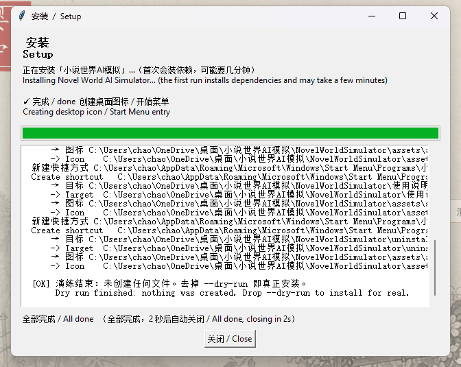

卸载只删快捷方式，**小说项目数据永不删除**：双击 `uninstall.exe` / `./uninstall`。

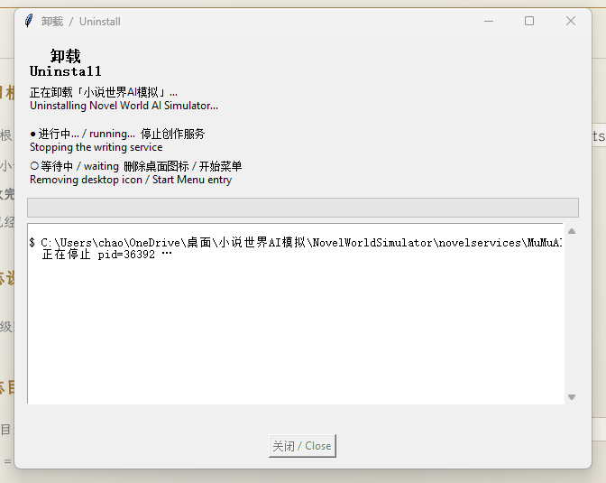

### 路线 B：从源码跑（开发者）

```bash
cd NovelWorldSimulator
python -m venv .venv
.venv\Scripts\activate                    # Linux/macOS: source .venv/bin/activate
pip install -r requirements.txt -i https://mirrors.aliyun.com/pypi/simple
python main_gui.py                        # 启动 GUI
# 或 python main_gui.py --mock           # 演示模式
```

> 首次启动会**自动准备 Flet 界面运行时**（联网下载一次）；离线环境可把运行时包放到 `packages/` 目录。

### 3.3 装完之后第一眼：开始界面（八个入口）

双击启动后先看到一个**中国水墨丹青风**的标题屏，不是直接进编辑器。上面是：

- **Logo**（`assets/images/start_logo.png`）
- 标题「**小 说 世 界 A I 模 拟**」
- 副标题「**── 把 故 事 ， 活 一 遍 ──**」
- **当前项目**：开过卷之后这里显示项目名（描金名条），窗口标题也同步成
  「小说世界AI模拟 — 项目名」；没开过卷时显示「尚未开卷 —— 从「开　卷」开始」
- 底栏：`v0.3.3 · 本地运行 · Python + Flet`

中间是**竖排八项菜单**，每项一个大字标题 + 一行 ≤14 字的小字说明（小字才是给你看的）：

| 顺序 | 菜单 | 小字 | 点下去做什么 | 没项目时 |
|---|---|---|---|---|
| 1 | **开　卷** | 导入小说文件夹 | 四步导入向导，把新小说读进来 | 永远可点 |
| 2 | **拾　卷** | 打开以前的故事 | 项目列表，选一个继续 | **灰掉**（「还没有做过的故事」） |
| 3 | **起　笔** | 开始推演一轮 | 「启动故事」对话框定本轮参数 | **灰掉**（「先开卷导入小说」） |
| 4 | **拆　书** | 读一本好书，学写法 | 把好书的写法拆进技能库 | 永远可点 |
| 5 | **天　机** | 程序设置：模型、预算 | **全局**设置，对所有项目生效 | 永远可点 |
| 6 | **书　斋** | 本书设置：类型、风格 | **只对当前项目**生效 | **灰掉** |
| 7 | **回　卷** | 回到推演界面 | 跳回运行界面 | **灰掉**（「没有在推演的故事」） |
| 8 | **归　去** | 退出程序 | 关掉软件 | 永远可点 |

> **顺序的用意**：**先找书、再动笔** —— 开卷（新书）→ 拾卷（旧书）→ 起笔（开演）。
> **天机 vs 书斋**最容易混：一个管程序（换哪本书都生效），一个管本书。

**键盘操作**：`↑` `↓` 选菜单，`Enter` 确认，`Esc` 回到运行中的故事（如有）。

**灰掉不等于哑掉**：点不了的项，小字会直接告诉你原因和下一步该做什么。

#### 第一次启动会在界面上「报」什么

程序启动时做一次**能力校验**：把 `.env` / 登记表里声明的能力和按模型名识别出的事实对一遍。
不一致时会在开始界面的**消息框**里逐条说明（改了什么、依据是什么、要不要重启）。

- 看到「**需要重启**」就真的重启一次，否则改的模型/能力还没生效。
- 看到「**演示模式**」（`MOCK_LLM=true`）说明现在不调真模型，零成本试跑。
- 这些消息**不是错误**，是它在告诉你它怎么理解你的配置。

> 想先零成本看界面长什么样：`start.exe --mock`，或 `.env` 里 `MOCK_LLM=true`。

---

## 四、首次运行与 `.env`

第一次启动会读 `.env`（没有就自动生成）。全新用户先复制模板再填 Key：

```bash
cp .env.example .env
# 用任意文本编辑器打开 .env，至少填 LLM_API_KEY / LLM_BASE_URL
```

`.env` 里与模型相关的关键键（**单模型快速起步用这些就够了**；多模型见第五章登记表）：

| 键                                             | 含义                                      | 示例                            |
| --------------------------------------------- | --------------------------------------- | ----------------------------- |
| `LLM_PROVIDER`                                | 接入协议，固定 `openai_compatible`（或 `ollama`） | `openai_compatible`           |
| `LLM_BASE_URL`                                | 写到 `/v1` 这一层                            | `https://api.deepseek.com/v1` |
| `LLM_API_KEY`                                 | 你的密钥                                    | `sk-...`                      |
| `LLM_TIMEOUT_SECONDS`                         | 请求超时（秒），全局兜底                            | `60`                          |
| `LLM_MAX_RETRIES`                             | 最大重试次数                                  | `3`                           |
| `LLM_DEFAULT_MODEL`                           | 默认模型（没人指定时用）                            | 见第五章                          |
| `MODEL_FRONT` / `MODEL_DAILY` / `MODEL_CHEAP` | 三档快速配置（模型名）                             | 见 5.3                         |
| `LANGUAGE`                                    | 界面语言                                    | `zh` / `en`                   |
| `DEFAULT_PROJECTS_DIR`                        | 项目默认存放根目录（见 11.1）                       | 见 11.1                        |


> 想先零成本看效果：用 `start.exe --mock` 或 `.env` 里设 `MOCK_LLM=true`，不调真模型。

---

## 五、全局配置：LLM 模型（天机 → AI 模型配置）

进入：**开始界面 →「天机」→ 子页「AI 模型配置」**。  
这一页管四件事：**模型登记表（多模型）**、**默认模型**、**三档快速配置**、**按 Agent 推荐模型**。

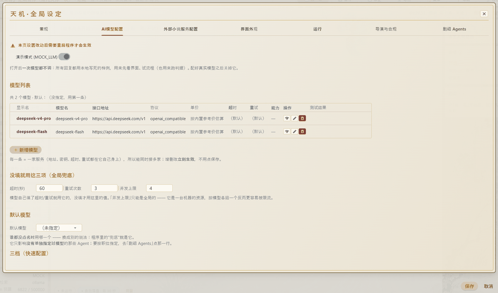

### 5.1 模型登记表 `llm_models.json`（一个程序配多个模型）

程序根目录下 `llm_models.json` 是「模型登记表」——每条 = **一个能调用的服务**  
（显示名 + 接口地址 + 密钥 + 模型名）。在「AI 模型配置 → 模型列表」里**新增 / 编辑**即可，  
或手写 JSON（与 `.env` 同级）：

```json
{
  "version": 1,
  "models": [
    {
      "key": "deepseek-pro",
      "label": "DeepSeek V4 Pro",
      "model": "deepseek-v4-pro",
      "base_url": "https://api.deepseek.com/v1",
      "api_key": "sk-xxxxxxxx",
      "provider": "openai_compatible",
      "note": "华彩档用，关键场面",
      "price_miss": 2.0,
      "price_out": 8.0,
      "timeout": 120
    },
    {
      "key": "xiaomi-mimo",
      "label": "小米 MiMo",
      "model": "mimo",
      "base_url": "https://xxx.example.com/v1",
      "api_key": "sk-yyyyyyyy",
      "provider": "openai_compatible",
      "note": "日常档",
      "timeout": 60
    },
    {
      "key": "hunyuan-hy3",
      "label": "混元 Hy3",
      "model": "hy3",
      "base_url": "https://xxx.example.com/v1",
      "api_key": "sk-zzzzzzzz",
      "provider": "openai_compatible",
      "note": "摘要档"
    }
  ]
}
```

`ModelEntry` 字段说明（带 `-1` / 留空 = 用全局兜底）：

| 字段                                       | 说明                                                               |
| ---------------------------------------- | ---------------------------------------------------------------- |
| `key`                                    | **稳定标识**（存进 `.env` 与各 Agent 绑定的是它，别用 `label` 当键，改名会断绑定）          |
| `label`                                  | 显示名（界面那一行）                                                       |
| `model`                                  | 发给服务端的模型名（如 `hy3` / `deepseek-v4-pro`）                           |
| `base_url`                               | 写到 `/v1` 这一层                                                     |
| `api_key`                                | 密钥                                                               |
| `provider`                               | `openai_compatible`（默认）或 `ollama`                                |
| `note`                                   | 备注（给人看）                                                          |
| `price_hit` / `price_miss` / `price_out` | 单价（元 / 百万 token）；没填用内置表兜底                                        |
| `timeout` / `retries`                    | 这家专属超时 / 重试；`-1` = 用全局 `LLM_TIMEOUT_SECONDS` / `LLM_MAX_RETRIES` |

> 兼容列表（能自动纠偏能力）已内置国内外主流：国内 qwen/glm/kimi/ernie/hunyuan/doubao/  
> minimax/step/spark/mimo 等；国外 claude/gemini/llama/mistral/command/grok/sonar 等；  
> 以及 OpenAI 系。具体模型名优先、厂商名兜底、未识别返回「用全局开关」，不会乱猜。

`caps` 还有一个容易忽略的用法：**条目里写的值会覆盖「按模型名猜出来的事实」**。
有些模型同一族里能力并不一致（豆包就是典型），这时必须显式写，见下面 5.1-B。

### 5.1-B 完整示例：把「豆包 Seed Character」配成演员

把这条路走完，你就掌握了「加一个模型 + 按模型改能力 + 绑到某个职位」的全套动作。
**三步，缺一步就跑不起来。**

#### 第 1 步：加进登记表

界面：**天机 → AI 模型配置 → 模型列表 → 新增**。或直接改 `llm_models.json`：

```json
{
  "key": "doubao-character",
  "label": "豆包 Seed Character（角色扮演专用）",
  "model": "doubao-seed-character-251128",
  "base_url": "https://ark.cn-beijing.volces.com/api/v3",
  "api_key": "ark-你的Key",
  "provider": "openai_compatible",
  "note": "只给 actor 用；不思考、输出短",
  "price_in": 0.8,
  "price_out": 2.0,
  "timeout": 180,
  "retries": 2
}
```

⚠ `model` 必须与火山方舟控制台里的**确切 id** 一致（`doubao-seed-character-251128`
或 `-260628`）。写错会得到 `InvalidEndpointOrModel.NotFound`，不是 `ModelNotOpen`。

#### 第 2 步：按模型覆盖能力（**这一步最容易漏**）

```json
  "caps": { "LLM_CAP_JSON_MODE": false }
```

为什么必须写：

| 事实 | 后果 |
|---|---|
| 能力表按「豆包」这一族判 ⇒ `LLM_CAP_JSON_MODE = true` | 程序会给它发 `response_format: {"type":"json_object"}` |
| 但这个具体模型**不支持**该参数 | **每一发 400** |
| 演员每拍都要 JSON 决策 | **每一拍都失败 ⇒ 降级成「不动」，整场戏空掉** |

而它**不加这个参数也能输出干净 JSON**（`{"动作":"speak","台词":"…"}`，无围栏），
所以正确做法就是关掉，靠提示词约束。

`caps` 能写哪些键（都可以按模型覆盖）：

| 键 | 含义 | 关掉会怎样 |
|---|---|---|
| `LLM_CAP_JSON_MODE` | 支持 `response_format` | 不发该参数，靠提示词要 JSON |
| `LLM_CAP_REASONING` | 是推理模型（不接受 `temperature`） | 改发 `temperature` |
| `LLM_CAP_THINKING` | 支持 `thinking:{type:disabled}` | 不发关闭思考的参数 |
| `LLM_CAP_IMAGE` | 能出图 | 文生图功能直接拦下 |
| `LLM_CAP_SYSTEM_ROLE` | 认 `system` 角色 | 系统提示并进首条 `user` |

#### 第 3 步：绑到演员

界面：**天机 → 剧组 Agents → 演员 actor → `model` 填 `doubao-character`**。
或直接改 `agents/actor.md` 的 frontmatter：

```markdown
---
key: actor
name: 演员
tier: daily
model: doubao-character     # ← 这一行；留空 = 跟着每日档走
---
```

> **只改 `actor`。** 角色专用模型是 1v1 陪聊训练的：输出短（100–170 token / 次），
> 不做长篇整理。给 `novelist`（写整章）或 `screenwriter`（写剧本）会明显吃力。
> 另外它的最大输出只有 32768，整章经常撞顶。

⚠ **改完要重启程序** —— `model:` 属于「重启才生效」那类配置。

#### 第 4 步（重要）：真跑一拍验证，别只看单发测试

```bash
# 只跑 1 拍，最省
NB_KEEP_PROJECTS=true ./.venv/Scripts/python.exe novel_bench/bench/cli.py run     --case hlm-01 --ticks 1 --run-id check-doubao
grep -E "决策失败|400" logs/nws_*.log | tail -3
```

**为什么必须真跑**：上面那些坑（`max_tokens` 超限、`response_format` 被拒）
**短请求一测就通**，只有真跑才炸；而炸的样子是「人物不出声」，看起来不像报错。

如果出现 `「祥子」决策失败，本轮降级为 wait`，先查两件事：

| 症状 | 查这里 |
|---|---|
| `400` + `InvalidParameter: max_tokens ... above maximum` | 模型的输出上限表里没有它，退回全局兜底（可能是给别的模型设的大值）⇒ 见 5.1-C |
| `400` + `InvalidParameter: json_object is not supported` | `caps` 里没关 `LLM_CAP_JSON_MODE` ⇒ 回到第 2 步 |

#### 5.1-C 输出上限：为什么有些模型会被「喂」一个太大的 `max_tokens`

程序发请求时的输出上限**按模型查表**（`llm/capabilities.py` 的 `MAX_OUTPUT_TOKENS`），
查不到就退回全局兜底 `LLM_MAX_TOKENS_FALLBACK`。

> **真实事故**（2026-10-18）：换豆包当演员后，1 拍推演整拍空掉。
> 原因是表里没有豆包条目 ⇒ 退回兜底 `819200`（那是给 `hy3` 设的，`hy3` 实测确实收），
> 而豆包上限只有 32768 ⇒ 每一发都被 400 拒掉。
> **表现不是「写得短」，是「人物不出声」。**

遇到这类情况，正确做法是**给那个模型登记它自己的上限**，而不是把全局兜底调小
（调小会把 `hy3` 之类本来能吃大额度的模型一起压死，那是另一种事故：写一半被砍）。

### 5.2 默认模型

「AI 模型配置 → 默认模型」选一个条目 `key`（对应 `.env` 的 `LLM_DEFAULT_MODEL`）。  
谁都没指定模型时用它。默认模型下拉就在「AI 模型配置」这一页（见 5.0 配图）；下图为该页示意，红框处的下拉即「默认模型」。


### 5.3 三档（华彩 / 日常 / 摘要）

| 档位（.env 键）         | 是干什么的                    | 大约占调用量 | 该配什么     |
| ------------------ | ------------------------ | ------ | -------- |
| `MODEL_FRONT`（华彩档） | 关键场面：重要对话、反思、故事文档、运行小结   | ~15%   | 最强 / 最贵的 |
| `MODEL_DAILY`（日常档） | 常规循环：人物决策、台词、导演派活        | ~55%   | 中等、稳定的   |
| `MODEL_CHEAP`（摘要档） | 压缩、打分、后台：记忆摘要、进度判断、校对、抽取 | ~30%   | 最便宜的     |

在「AI 模型配置 → 三档快速配置」里各选一个 `key`（同一页，见上方配图）。


### 5.4 模型怎么被选出来（resolve 顺序，速记）

每一发请求按这个顺序定模型：

```
① 这个 Agent 点名了模型（且条目还在）  → 用它
② 该 Agent 所属档位配了模型            → 用它
③ 默认模型                            → 用它
④ 登记表第一条                       → 用它
⑤ 一条都没有                         → 走老路（.env 全局地址 + CFG.model_of）
```

→ **想让某个 Agent 固定用某模型：在第 ⑥ 章给它点名**（覆盖档位）。

### 5.5 天机其余子页（顺手知道）

「天机」除了「AI 模型配置」，还有 5 个子页，各管一类设置：

- **常规**：项目根目录（`DEFAULT_PROJECTS_DIR`）、日志级别等装机级设置。

  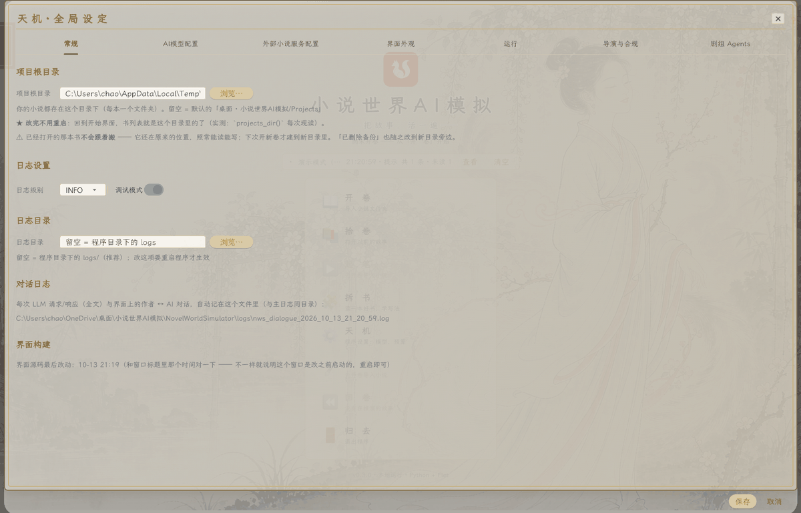
- **界面外观**：不透明度、界面语言（中英切换）。

  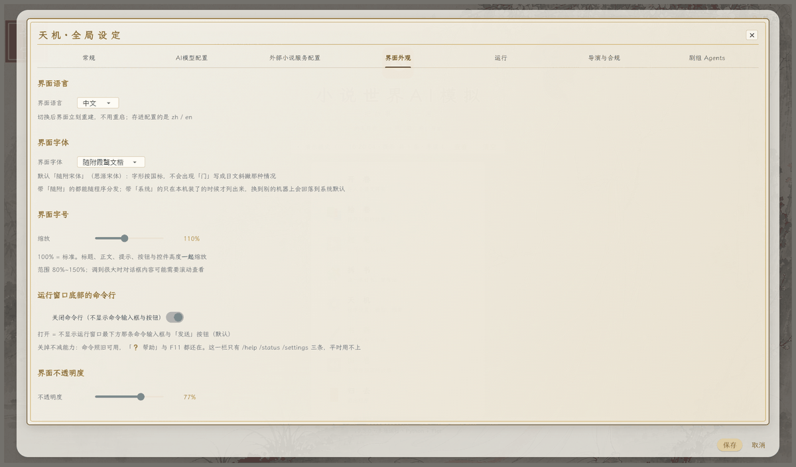
- **运行**：运行模式、时间系统、预算、自动落盘、起笔启动超时、开卷打磨、剧本审读（详见 13.1）。

  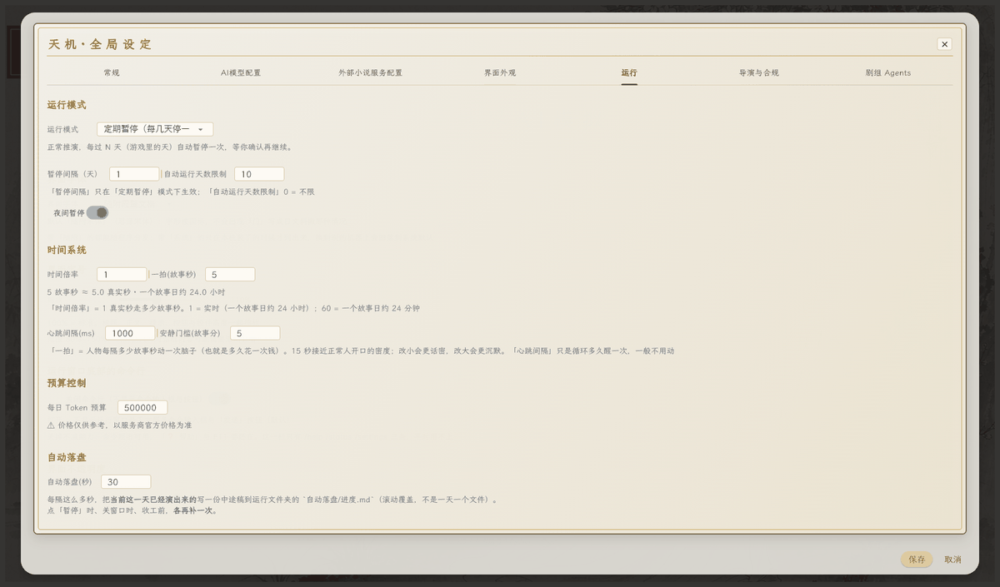
- **导演与合规**：导演力度（排班 / 派活松紧）、内容合规开关。

  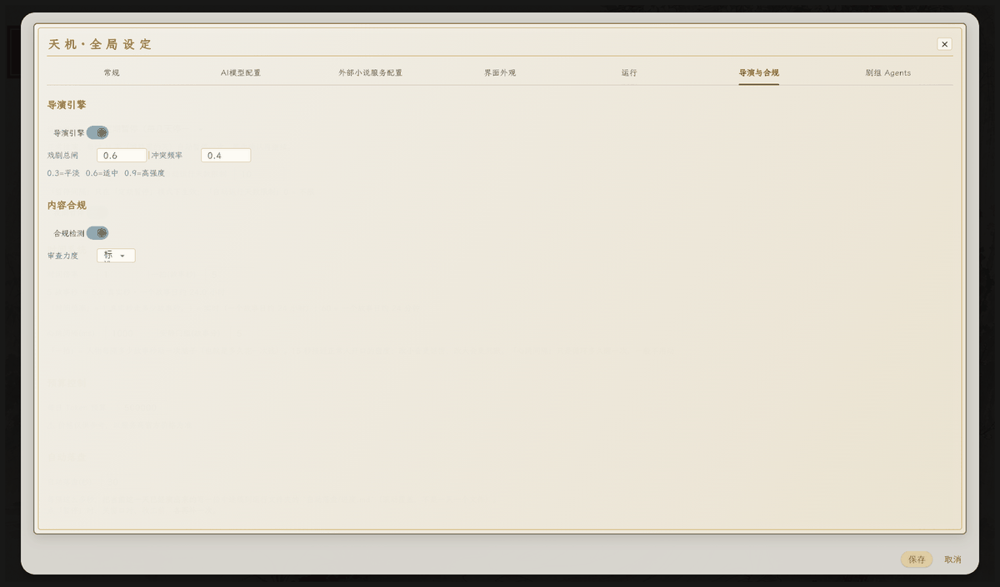
- **剧组 Agents**：软件层职位管理（详见 6.1）。

  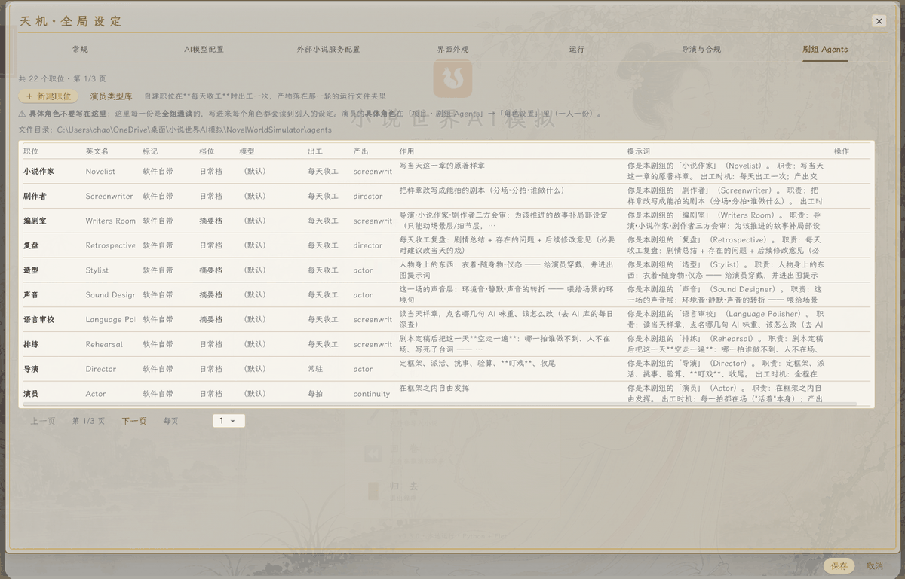
- **外部小说服务配置**：NovelService（详见第七章）。

  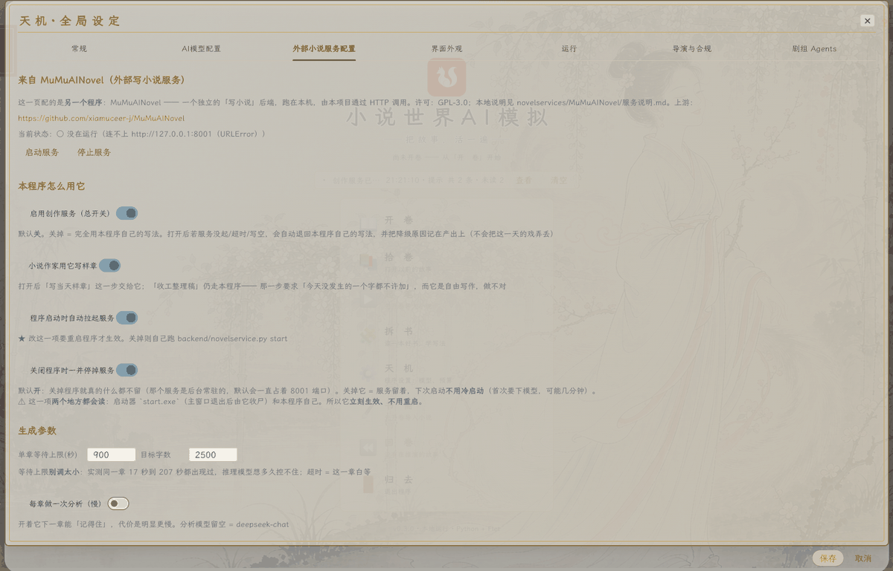

### 5.6 每个 Agent 与 LLM 配置项的推荐 Provider + Model

> 下面只是**推荐，不强制**——登记表里有哪家、就给对应配置项填那家的 `key` 即可。  
> 同一配置项给了 1–2 个候选（国内为主，省心；想上国外旗舰见 1.1 的 C 表）。档位含义见 5.3。  
> Provider 指厂商（阿里云百炼 / 智谱 / 字节豆包 …），Model 指填进登记表 `model` 字段的名字。

#### 5.6.1 LLM 相关配置项（全局 / `.env`）

| 配置项                       | 作用                  | 推荐 Provider + Model（1–2 个，非强制）                                      |
| ------------------------- | ------------------- | ------------------------------------------------------------------- |
| `LLM_DEFAULT_MODEL`（默认模型） | 谁都没指定时的兜底           | 智谱 `glm-4.5-plus` / 阿里云百炼 `qwen-plus`                               |
| `MODEL_FRONT`（华彩档）        | 关键场面：样章 / 剧本 / 外挂创作 | 阿里云百炼 `qwen-max` / 智谱 `glm-5`                                       |
| `MODEL_DAILY`（日常档）        | 常规循环：人物 / 台词 / 导演派活 | 智谱 `glm-4.5-plus` / 阿里云百炼 `qwen-plus`                               |
| `MODEL_CHEAP`（摘要档）        | 压缩 / 打分 / 后台        | 字节豆包 `doubao-seed` / 智谱 `glm-4-flash`                               |
| `STORY_DOC_MODEL`         | 故事文档                | 同华彩档（`qwen-max` / `glm-5`）                                          |
| `SUMMARY_MODEL`           | 跨天摘要                | 同摘要档（`doubao-seed` / `glm-4-flash`）                                 |
| `COMPLIANCE_MODEL`        | 合规复核                | 字节豆包 / 智谱 `glm-4-flash`                                             |
| `EMBEDDING_*`             | 向量检索                | 硅基流动 `BAAI/bge-m3` 或 `Qwen3-Embedding-8B` / 阿里云 `text-embedding-v4` |
| `IMAGE_AI_MODEL`          | 出图（非 LLM）           | 字节豆包 `doubao-seedream` / 混元图像                                       |
| `MUMU_ANALYSIS_MODEL`     | MuMu 分析             | DeepSeek `deepseek-v4-flash` / 阿里云百炼 `qwen-turbo`                   |

#### 5.6.2 每个 Agent 推荐（按档位分工 · 22 个职位全列）

**天机 → 剧组 Agents 列表里的 22 个职位**（`agents/*.md`）全在下表。每行给出 **2–3 个推荐模型**（按价格档排：贵的在前），照抄就行；具体选哪个看你预算。

**档位映射**：`front`（华彩）→ 写出来的；`daily`（日常）→ 走流程的；`cheap`（摘要）→ 压缩/打分/后台。

| Agent（中文 / key） | 当前档 | 推荐 Provider + Model（贵 → 便宜） | 备注 |
|--------------------|--------|-----------------------------------|------|
| **写出来的（5 个 · 质量最敏感）** | | | |
| 小说作家 / novelist | daily（建议覆盖华彩） | 阿里云百炼 `qwen-max` / 智谱 `glm-5` / 七牛云 `qiniu/qwen3-max` | 当天样章，直吃旗舰 |
| 剧作者 / screenwriter | daily（建议覆盖华彩） | 阿里云百炼 `qwen-max` / 智谱 `glm-5` / 七牛云 `qiniu/qwen3-max` | 样章→剧本，质量第二敏感 |
| 创作服务 / novelservices | front | 阿里云百炼 `qwen-max` / 智谱 `glm-5` / 七牛云 `qiniu/qwen3-max` | 外挂写作后端 MuMuAINovel，开卷后写样章 |
| 演员 / actor | daily（可覆盖华彩 / 角色专用） | 阿里云百炼 `qwen-max` / 智谱 `glm-5` / **火山方舟 `doubao-seed-character-251128`**（角色专用，最便宜快，但实测更薄） | 每拍台词；有预算就上旗舰。角色专用模型的实测对比见 `使用说明.md` §16.2b「角色扮演专用模型」 |
| 导演 / director | daily | 智谱 `glm-4.5-plus` / 阿里云百炼 `qwen-plus` / 小米 `mimo` | 派活+验算+盯戏，节奏大脑 |
| **走流程的（5 个 · 中等质量）** | | | |
| 复盘 / reviewer | daily | 智谱 `glm-4.5-plus` / 阿里云百炼 `qwen-plus` / 小米 `mimo` | 每天收工总结+问题+建议 |
| 排练 / rehearsal | daily | 智谱 `glm-4.5-plus` / 阿里云百炼 `qwen-plus` / 小米 `mimo` | 空走一遍，挑出做不到的 |
| 开卷摄取 / ingest | daily | 阿里云百炼 `qwen-plus` / 智谱 `glm-4.5-plus` / 月之暗面 `kimi-k2`（长文） | 读资料、提设定 |
| 进度评估 / progress | cheap | 字节豆包 `doubao-seed-2-0-pro` / 智谱 `glm-4-flash` / 小米 `mimo` | 每拍判断节点满足没 |
| 合规复核 / compliance | cheap | 字节豆包 / 智谱 `glm-4-flash` / 小米 `mimo` | 判级+提示，独立于创作 |
| **压缩/打分/后台（12 个 · 便宜快）** | | | |
| 编剧室 / settings_room | cheap | 字节豆包 / 智谱 `glm-4-flash` / 小米 `mimo` | 三方会审补局部设定 |
| 造型 / stylist | cheap | 字节豆包 / 智谱 `glm-4-flash` / 小米 `mimo` | 衣着·随身物·仪态 |
| 声音 / sound | cheap | 字节豆包 / 智谱 `glm-4-flash` / 小米 `mimo` | 这一场的声音层 |
| 语言审校 / polisher | cheap | 智谱 `glm-4-flash` / 字节豆包 / 小米 `mimo` | 点名哪几句 AI 味重 |
| 剧本审读 / script_doctor | cheap | 智谱 `glm-4-flash` / 字节豆包 / 小米 `mimo` | 上屏前逐条读一遍 |
| 场记 / continuity | cheap | 字节豆包 / 智谱 `glm-4-flash` / 小米 `mimo` | 连戏检查 |
| 群众演员 / extra | cheap | 字节豆包 / 智谱 `glm-4-flash` / 小米 `mimo` | 门外的人与事 |
| 道具 / props | cheap | 字节豆包 / 智谱 `glm-4-flash` / 小米 `mimo` | 这一场的物件 |
| 美术 / art | cheap | 字节豆包 / 智谱 `glm-4-flash` / 小米 `mimo` | 画风与配色 |
| 宣发 / publicity | cheap | 字节豆包 / 智谱 `glm-4-flash` / 小米 `mimo` | 一句话卖点/预告 |
| 记忆摘要 / memory | cheap | 字节豆包 / 智谱 `glm-4-flash` / 小米 `mimo` | 跨天压缩 |
| 资料员 / researcher | cheap | 月之暗面 `kimi-k2`（长上下文）/ 字节豆包 / 智谱 `glm-4-flash` | 考据，长文强 |

**最值得改的一处**：把 `novelist` / `screenwriter` 单飞到华彩模型（在 `agents/novelist.md` frontmatter 加 `model: qwen-max`，见 6.3），样章质量提升最明显。这是 22 个职位里对质量**最敏感**的两个。

---

## 六、配置各个 Agent 用哪个模型

工程里「Agent」= 剧组职位（`agents/<slug>.md`）。每个职位有 `tier`（归属档位）和可选 `model`（点名覆盖）。

### 6.1 软件层（换哪本书都生效）—— 天机 → 剧组 Agents

进入：**开始界面 →「天机」→ 子页「剧组 Agents」**。  
点开某个职位（如「小说作家 novelist」「剧作者 screenwriter」），可：

- 改它的提示词（正文那段）；
- 在 frontmatter 里给它 `model: <key>` 让它**点名**用某个登记过的模型（覆盖档位）；
- 改 `tier: front/daily/cheap` 换它归属的档位。


等价地，直接用文本编辑器改 `agents/<slug>.md` 的 frontmatter：

```markdown
---
key: novelist
name: 小说作家
tier: daily          # 归属日常档
model: xiaomi-mimo   # 点名：这本/全局都用小米 MiMo（留空=跟着档位走）
feeds: screenwriter
---
```

> 四层优先级（越往下越具体）：① 软件层职位（本文件）→ ② 演员类型库 →  
> ③ 项目里同名文件（本书额外要求）→ ④ 具体角色（项目·剧组 Agents→角色设置）。

### 6.2 项目层（只对这一部戏生效）—— 书斋 → 剧组 Agents

进入：**开始界面 →「书斋」→ 子页「剧组 Agents」**。  
在这里的修改只作用于当前项目，不污染软件层默认值。

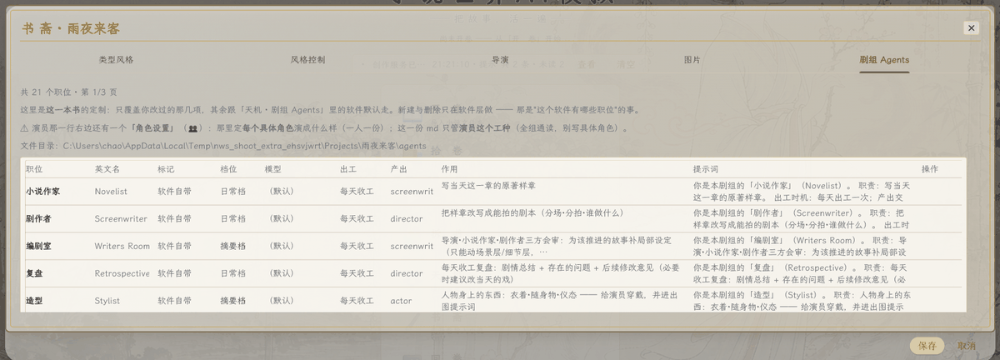

**tier 分布速查**（来自 `crew/roster.py`）：

- `daily`（常规循环，量最大）：novelist / screenwriter / director / actor / reviewer / rehearsal / ingest 等
- `cheap`（压缩/打分/后台）：约 13 个职位（记忆、进度、校对、抽取等）
- `front`（关键场面，仅 1 个）：**novelservices（外挂 MuMu 写手）**

### 6.3 角色级覆盖（具体角色）

进**书斋 → 剧组 Agents → 角色设置**（演员那一行右边的 👥 按钮），可以给**某一个具体角色**单独指定模型 / 档位，  
不影响其他角色。这是最细的一层（优先级第 ④ 层）。

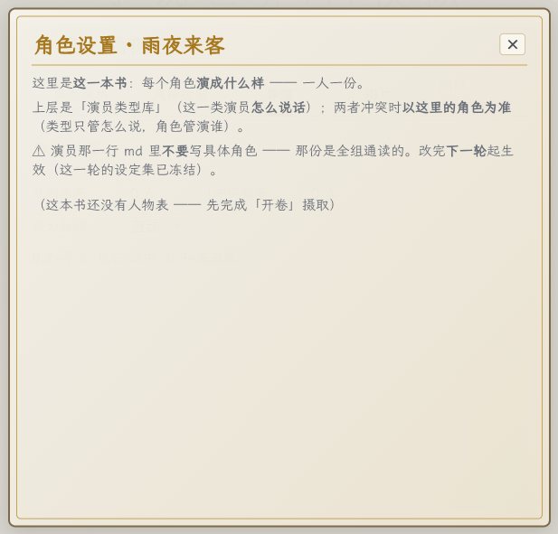

---

## 七、配置 NovelService（外挂写作后端 MuMuAINovel）

NovelService 是**可选增强**：主程序不依赖它也能跑；没起它只是少一项能力，不会报错。

它由 `novelservices/MuMuAINovel/`（开源 MuMuAINovel + 本项目接入层）提供，开卷后可由它写样章。

### 7.1 在界面里启用

进入：**开始界面 →「天机」→ 子页「外部小说服务配置」**，填：

- 服务地址（默认 `http://127.0.0.1:8001`）
- 用户名 / 密码（见 `novelservices/MuMuAINovel/凭据.txt`，默认 `mumu_service` / `xHEMxsEzy1M4j47ivxMhsNpy`）


### 7.2 启动服务

**方式一：随主程序自动起**（推荐）  
发布包 / 启动器在「启动程序」之前会自动拉起服务：

```bash
# 安装阶段准备环境（建 venv / 装依赖 / 建表），只做一次：
setup.bat          # Windows；macOS/Linux: ./setup
# 之后每次 start 会自动先起服务再起主程序
start.exe
# 不想准备服务：setup.bat --skip-service
```

**方式二：手动起（在 `novelservices/MuMuAINovel/backend/` 下）**

```bash
cd novelservices/MuMuAINovel/backend
P=.venv/Scripts/python.exe            # Linux/macOS: .venv/bin/python

$P novelservice.py prepare   # 只准备环境（建 venv + 装依赖 + 建表，首次约几分钟）
$P novelservice.py start     # 后台启动，等健康检查通过才返回
$P novelservice.py status    # 看状态（端口 / pid / 健康）
$P novelservice.py stop      # 停止
$P novelservice.py start --fg # 前台跑（调试，Ctrl+C 退出）
```

> 首次启动会**自动从 ModelScope 下载约 470MB 的 embedding 模型**（约 5 分钟），之后就快了。  
> 探活：`curl http://127.0.0.1:8001/health` → `{"status":"ok"}`  
> 这条服务**只走 REST，没有前端界面**。

### 7.3 它的模型怎么配

MuMuAINovel 自己的配置在 `novelservices/MuMuAINovel/backend/.env`（已预填 DeepSeek 接入）。  
本项目经验：**正文与分析都用 `deepseek-chat`（不思考）**，比 `deepseek-v4-pro` 快 5–10 倍、  
不会烧光输出预算导致整章空白。

---

## 八、开卷（导入一本新书）

进入：**开始界面 →「开　卷」**（或直接点「开卷」卡片）→ 弹出「开卷 · 导入向导」。

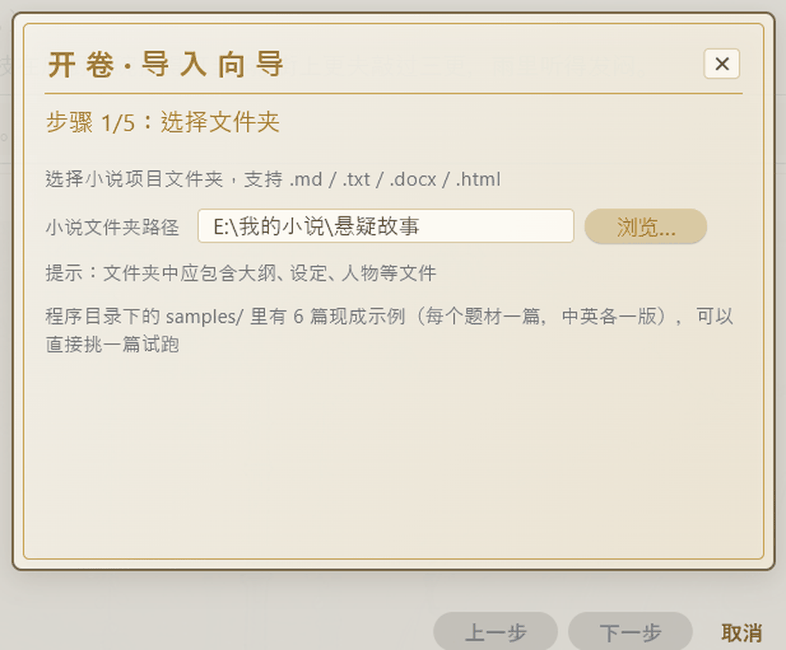

向导里填：

- **书名**（之后在书斋里**不能改**，想改名要重开卷）
- **素材文件夹**（可选的原文 / 参考资料）
- **设定集目录**（小说设定，这一步写入；选定后可在书斋里调整类型/风格等）

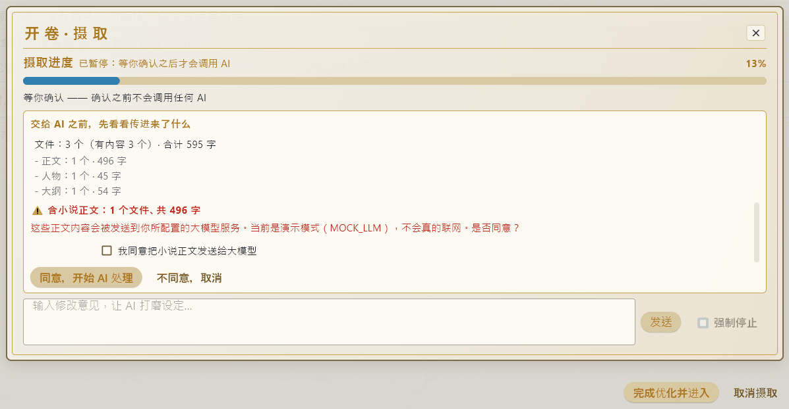

填完确认，程序开始**摄取（ingest）**：把设定拆成剧组能用的结构。摄取有两种方式：

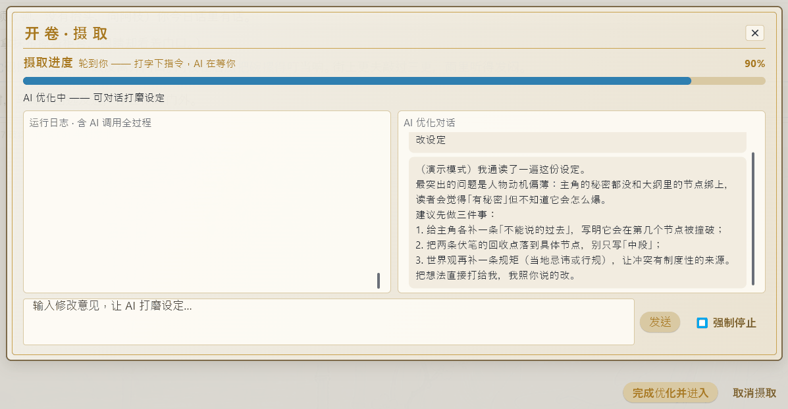


如果 7.x 配了 NovelService，开卷后样章可由外挂后端写。

### 8.1 拆书（把一本好书拆成你的写法）

开始界面还有 **「拆　书」** 入口：它读的是**你觉得写得好的那本书**（或其中一部分），  
把它拆成**可复用的写法模块**（人物塑造、节奏、悬念…），拼回你自己的故事。  
一句话区分：**开卷是「把这本书变成我的世界」，拆书是「把这本书变成我的本事」**。


拆书对话框与开卷类似（同样走摄取管线，见上图），但传入的是「一本成书」而非「你的设定」。  
适合：想学某本书的技法、又不想让它干扰自己世界观时。

**小说和专业书都能拆**（2026-10-27 起）：对话框里多问一句「这是本什么书」——
**小说** 拆成**写法模块**（情节 / 节奏 / 人设 / 文风 / 结构）；
**专业书 / 资料书**（比如《中国古代建筑史》）拆成**素材条目**
（术语 / 事实 / 规矩 / 案例 / 边界条件），每条都带**出处**、能怎么用、什么情况下不成立。
专业书按**信息密度**挑章 —— 前言 / 序 / 索引 / 参考文献这些"字不少但没料"的章节直接跳过，不白花一次额度。

**支持的格式**：`.txt` `.md` `.docx` `.html` `.pdf`；电子书 `.epub` `.mobi` `.azw3` `.azw`
`.rtf` `.odt`；老式 `.doc` `.wps` `.et` `.dps`（走本机装着的 Word / WPS 转出，没装就硬抽回退）；
以及**图片** `.jpg` `.png` `.webp` `.bmp` `.tif`。
**扫描版 PDF 会自动走 OCR**（`pip install rapidocr-onnxruntime pypdfium2`，**离线跑**、不上传），
一页一页报进度，中途停下也会把已认出来的页交出来。

---

## 九、起笔（开始每日推演）

进入：**运行界面 → 顶部「📖 起　笔」**（第一次开卷后，开始界面的「起笔」也可用）。

流程：点「起笔」→ 弹「开始这个故事」确认框 → 确认后真正开始推演当天这一章。

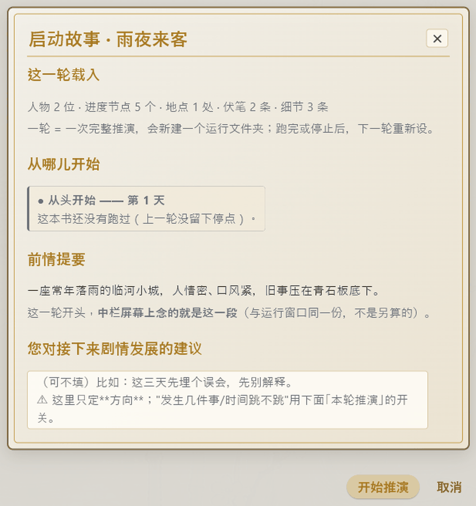


推演会按「小说作家 → 剧作者 → 导演 → 演员…」的流水线每天推进，落盘叙事、生成剧本与小结。

---

## 十、拾卷与回卷（继续以前的故事）

- **拾卷**（打开以前的书）：**开始界面 →「拾　卷」** → 项目列表（三栏）→ 选一个项目打开。

  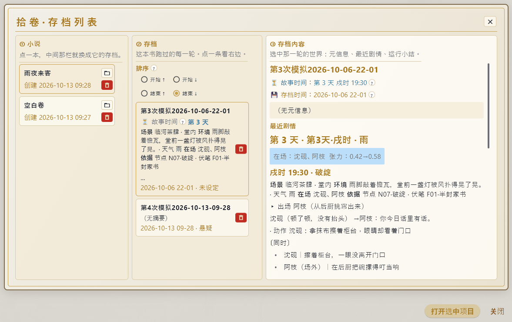

  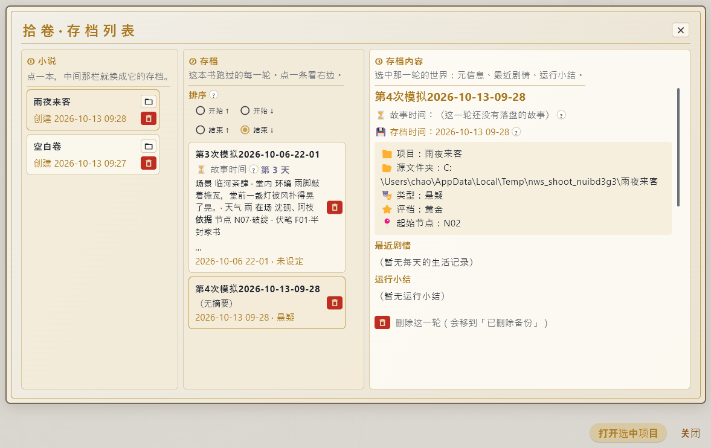
- **回卷**（回到运行界面续推）：**开始界面 →「回　卷」**（或运行界面顶部「📋 菜单」回到开始界面、  
  **不会停跑**，再点「回卷」回去）。回到的是实时推演屏：

  

> 「拾卷」= 选哪本书；「回卷」= 回到正在跑的实时屏。两者分工不同。

---

## 十一、配置当前项目（书斋）

进入：**开始界面 →「书　斋」** → 弹出「本书设置」对话框，5 个子页：

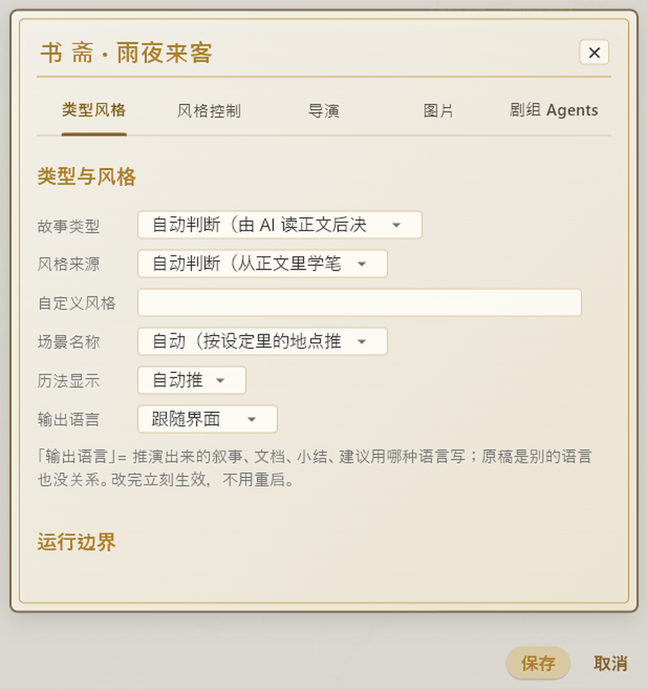

| 子页        | 能改什么                                              |
| --------- | ------------------------------------------------- |
| 类型风格      | 书的类型、风格预设                                         |
| 风格控制      | 文风强度、约束                                           |
| 导演        | 导演力度（排班 / 派活松紧）                                   |
| 图片        | 背景 / 头像 / 小地图生成开关                                 |
| 剧组 Agents | **本项目专属**的职位覆盖（提示词 / `model:` / `tier:`），只作用于这一部戏 |

> 书名、设定集目录是**开卷时**定的；书斋改的是类型 / 风格 / 导演 / 图片 / Agent，不含改书名。

### 11.1 项目存放在哪（DEFAULT_PROJECTS_DIR）

每开一卷，都会在**项目根目录**下建一个以书名命名的项目文件夹（设定、每日叙事、故事文档、快照都在里面）。

- 默认根目录：`<桌面>/小说世界AI模拟/Projects`（老用户若已有 `小说世界虚拟模拟/Projects` 且非空，则继续用旧的，书不丢）。
- 改位置：开始界面 →「天机」→「常规」→「项目根目录」（对应 `.env` 的 `DEFAULT_PROJECTS_DIR`）。
- 打开项目文件夹：开始界面「拾卷」里每个项目都有入口；装到菜单后桌面快捷方式也带「打开项目文件夹」。

---

## 十二、运行中的操作：暂停 / 停止 / 导出

都在 **运行界面顶部按钮栏**（起笔之后出现）：

| 按钮              | 作用                      |
| --------------- | ----------------------- |
| **⏸ 暂停 / ▶ 继续** | 同一按钮，文字在「暂停 ↔ 继续」间切换    |
| **⏹ 停止**        | 结束本轮、写运行小结与装订稿，**不接着跑** |
| **📤 导出**       | 导出成果                    |

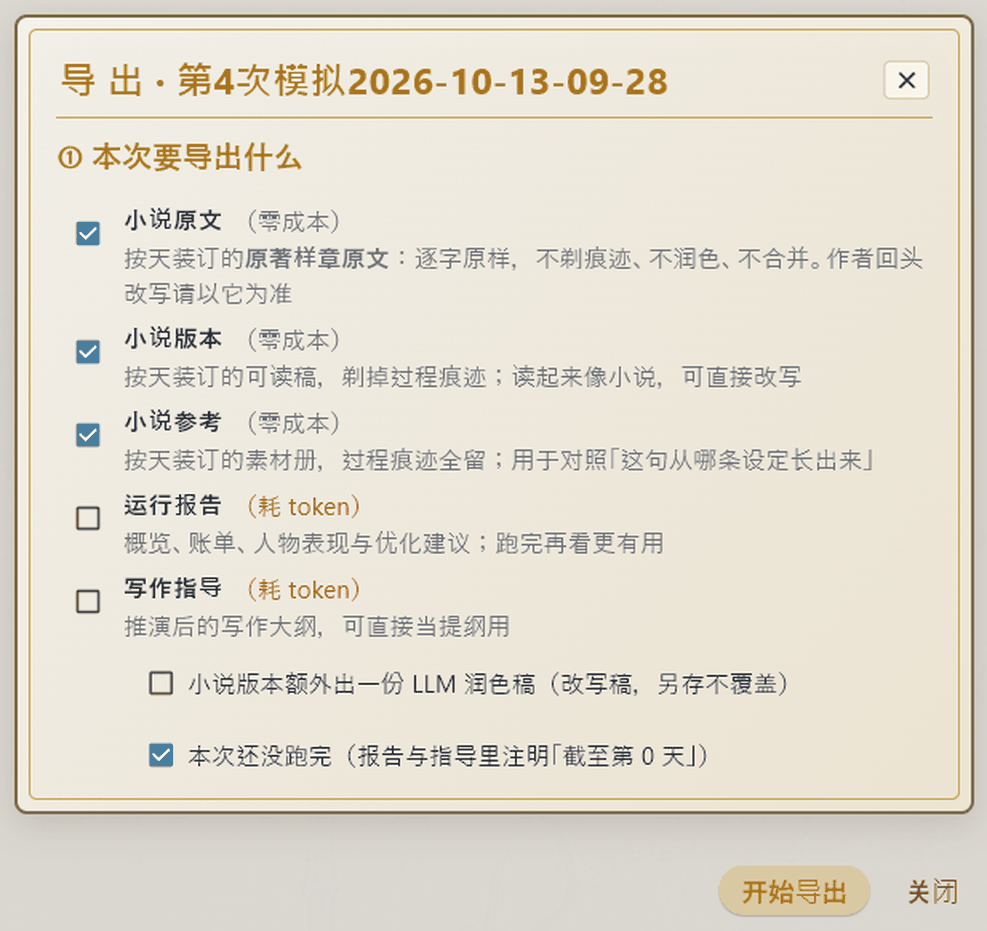

**导出**内容（`export/bundle.py` 的 `KINDS`）：

- 原始稿（Markdown 装订稿）
- 最终改写稿（可读稿，通常 docx）
- 原始稿加细节
- 运行报告
- 写作指导

导出目录：写到**本次运行的导出目录**（`run.export_dir`）。中途也能点，只纳入已落盘的完整天。  
还有「结束时自动导出」开关。

---

## 十三、运行界面说明

进入：`show_main_screen`（点「起笔」「回卷」进入；运行界面里点「📋 菜单」回到开始界面但不停跑）。


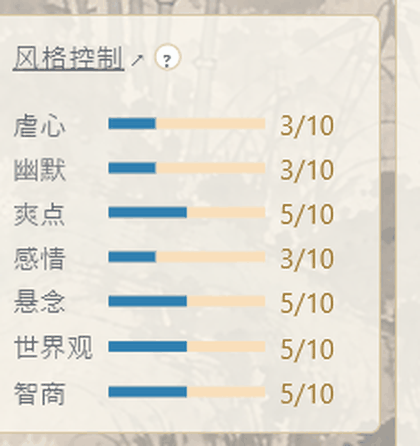


- **顶部按钮栏**：起笔 / 暂停 / 停止 / 导出 / 菜单 / 帮助 / 日志
- **主区**：当前这一章的叙事、剧本、各 Agent 的产出
- **底部状态条**：运行态 + 自动落盘 + 金色「用量」链接（见第十四章）+ 跑的模式 / 真实类型 / 运行边界开关
- **🧾 日志** 按钮：弹出日志对话框（见 14.1），看实时日志

### 13.1 运行模式 / 时间系统（天机 → 运行）

推演「多快、多话密、跑几天」在 **天机 → 运行** 里调：

- **运行模式**：`story`（有进度表与终点，走完自动收尾）等；
- **时间系统**：一拍多长、心跳间隔、安静门槛——写作者主要调「一拍」和「对话密度」两个；
- **自动运行天数限制**：`0` = 不限；
- **暂停间隔**：只在「定期暂停」模式下生效；
- 还有起笔启动超时、开卷打磨、剧本审读等开关。

---

## 十四、查看 LLM 用量

进入：**运行界面 → 底部状态条的金色「用量」链接** → 弹出用量对话框（四栏：项目 / 划分卡片 / Agent / 明细）。  
数据直接由数据库 `usage.db` 算出，**不调模型、零成本**。

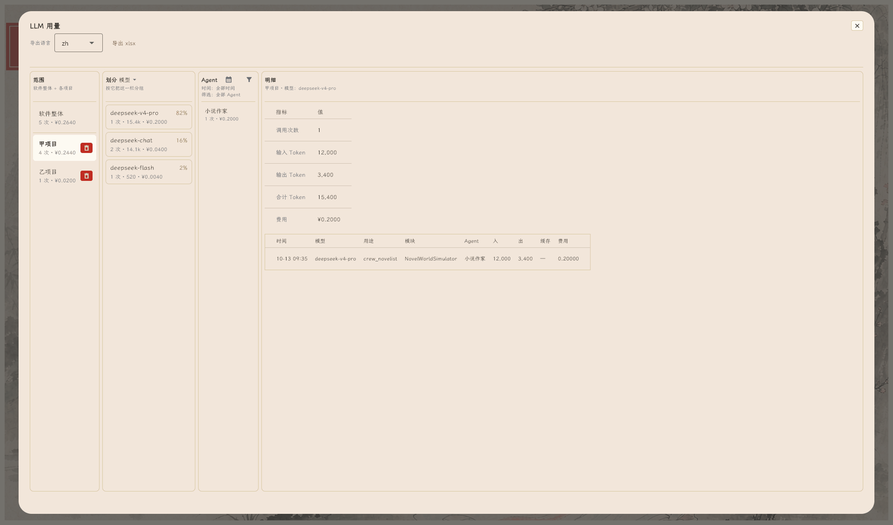

另有一份**调用账本** `logs/llm_calls.jsonl`：一行一次调用，跨运行累积（不受日志清理影响），  
可用于原始明细核对与诊断打包。它由 `llm/router.py` 的 `SAVE_RAW_LOGS` 开关控制。

> 想让账单更准：在模型登记表每条里填 `price_miss` / `price_out`（元 / 百万 token），  
> 没填的部分用内置价表兜底。

### 14.1 日志（程序记住了什么）

点运行界面顶部「🧾 日志」，或看 `logs/` 目录下的日志文件，实时追踪每一发调用与每一步推演。

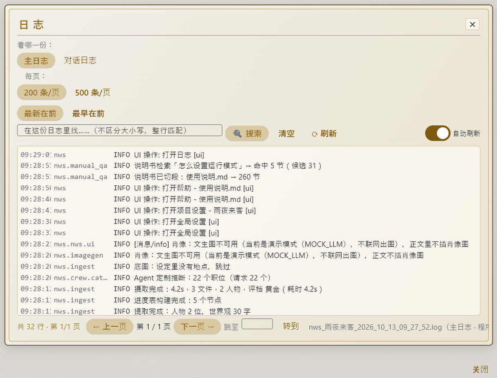

---

## 十五、帮助与天机（随时查）

- **帮助**：开始界面右上「❓ 帮助」或运行界面「❓ 帮助」（快捷键 **F11**）。  
  两个子页：「帮助信息」（翻说明书 + 关键词搜索，按 `##` 切块）+「问个问题」（聊天式）。

  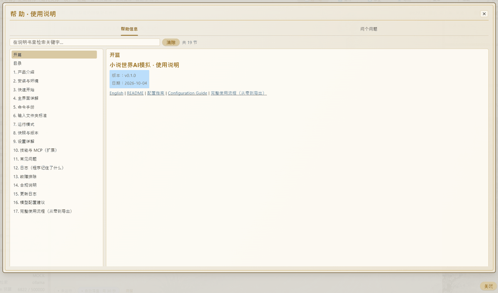

  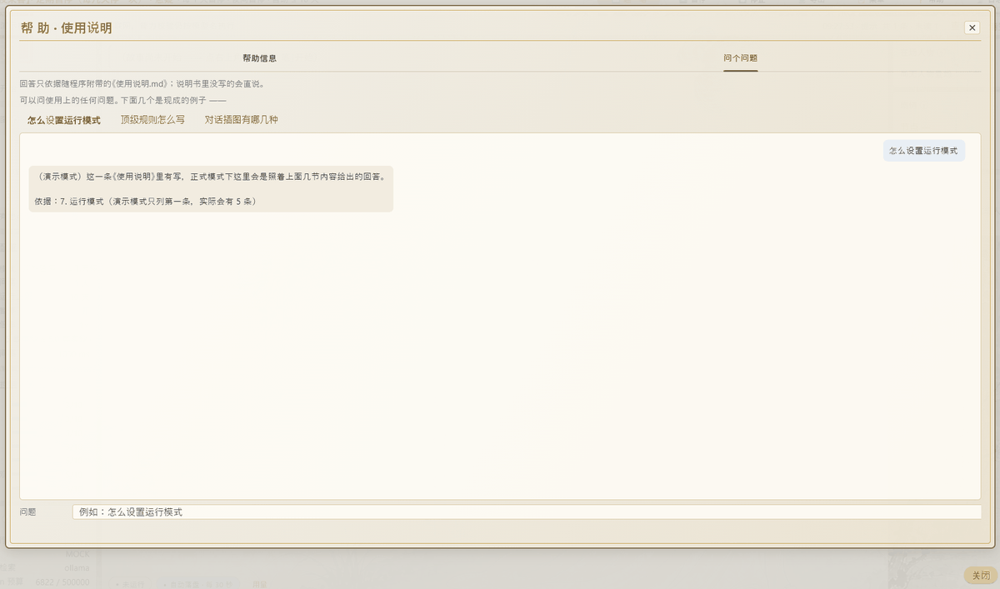
- **天机**（全局设置）：开始界面「天机」→ 7 个子页（常规 / AI 模型配置 / 界面外观 / 运行 / 导演与合规 / 剧组 Agents / 外部小说服务配置）。

更多按场景的配置，见工程里的 `配置指南.md`（12 个典型场景）与 `配置分类.md`（配置项归属）。

---

## 归去（退出程序）

开始界面点 **「归　去」** 即退出程序。

> ⚠ 主窗口退出时，**外挂的 NovelService 也会跟着退出**（同一道闸），不必手动停。  
> 卸载只删快捷方式，小说项目数据永不删除。

---

## 附录：常见问题与排错

1. **API Key 写在 `llm_models.json` / `.env`**，已在 `.gitignore` 忽略，别提交。
2. **改名别动 `key`**：Agent 绑定和 `.env` 三档存的是 `key`，`label` 随便改，`key` 一改绑定全断。
3. **国内源优先阿里云**：清华源对新包常 403；命令行显式 `-i https://mirrors.aliyun.com/pypi/simple`。
4. **NovelService 失败不拦主程序**：起不来只提示，主程序照常启动（它只是增强项）。
5. **MuMuAINovel 用 `deepseek-chat` 别用会思考的模型**：推理模型会把输出预算烧在思考上，最坏整章空白。
6. **启动器按平台编译**：别跨平台给启动器；发布包内 `平台说明.md` 写明适用平台。
7. **演示模式**：`start.exe --mock` 或 `MOCK_LLM=true`，零成本先看全流程。
8. **模型能力自动纠偏**：启动时按模型名识别能力并写回全局开关；界面上「模型能力」四个开关是对它的显式覆盖。

**排错速查**

| 现象               | 先看 / 先试                                                                        |
| ---------------- | ------------------------------------------------------------------------------ |
| 开卷后没反应 / 卡住      | 点「🧾 日志」看是否停在等交互或模型 401；确认 `llm_models.json` 的 `base_url` 与 `api_key` 正确       |
| 模型报 401 / 404    | 检查对应条目的 `api_key`、`base_url`（必须含 `/v1`）、`model` 名是否与该服务一致                      |
| 用量为空             | 第一次跑完才有数据；用量读 `usage.db`，不是 `llm_calls.jsonl` 才有                               |
| NovelService 连不上 | 服务没起：`backend/.venv/Scripts/python.exe novelservice.py status`；确认 8001 在监听     |
| 界面字体/中文乱码        | 天机 → 界面外观 切语言；确认系统有中文黑体                                                        |
| 依赖装坏             | `start.exe --reinstall`（发布包）或删 `.venv` 重 `pip install -r requirements.txt`（源码） |
