# 小说世界虚拟模拟（NovelWorldSimulator）· 系统架构与核心流程图

> 本文档**按代码实地核对过**（核对日期与口径见下表），不是"设计时画的图"。
> 所有图均为 **Mermaid** 图，放在 Markdown 里即可在支持 Mermaid 的预览器（GitHub / VS Code / Typora / 本软件预览面板）中直接渲染成图。
> 代码标识符保留英文原名，便于直接跳转源文件；`(:行号)` 是**核对当时的行号**，重构后会漂，以标识符为准。

| 口径 | 值 | 怎么数的 |
|---|---|---|
| 核对版本 | `config.VERSION = 0.3.3` | `config.py` |
| 生产代码（不含 `tools` / `developers` / `novelservices`） | **169,717 行 / 859 个 py** | `find … \| xargs cat \| wc -l` |
| 判据脚本 | **201 个 `verify_*.py`**（其中 200 支登记进分组，`verify_ui_common` 是公共库） | `tools/run_all_verifications.py --groups` |
| 反例法脚本 | **148 个 `mutate_*.py`** | `ls developers/mutate_*.py` |
| 配置键 | **357 个**（`SPEC`） | `len(config.SPEC)` |

**目录**

| § | 讲什么 | 什么时候读它 |
|---|---|---|
| [0](#0-一句话总览) · [1](#1-总体系统架构分层--模块) · [2](#2-模块职责速查表) | 全局与模块速查 | 第一次读，或找"某个东西在哪个文件" |
| [3](#3-启动序列流程图) | 启动序列 | 改入口 / 开卷 |
| [4](#4-一轮推演runloop流程图) · [4.5](#45--故事时间与日界2026-10-26-重构最容易读错的一节) · [4.6](#46--一天的收工顺序_end_day顺序错了就丢内容) · [4.7](#47-收尾_finish--_finish_steps点了停止之后发生什么) | **推演主循环 / 故事时间 / 日界 / 收尾** | 改 `sim/loop.py`；或"一天太长 / 时序乱了 / 停止慢" |
| [5](#5-agentdecide-决策流含协调引擎注入点) · [6](#6-craft_block-剧组拼装流含协调引擎注入点) · [6.5](#65--整理稿按情节单元写不再按-6000-字切块每块都写完整) · [7](#7--总体协调引擎-coordinator-流程图运行窗口-ai-输入框) | 提示词分层 / 注入点 / 写作层 | 改提示词；或"话不像人 / 整理稿太厚或太薄" |
| [8](#8-配置三层系统) · [9](#9-llm-调用层) | 配置三层 / LLM 管线 / 欠费停止 | 加配置键；或"改了没生效 / 没钱了还在跑" |
| [10](#10-ui-层主区域) · [10.5](#105--剧情总览右侧剧情面板的主入口) · [10.6](#106--地图锚定同一处地方每次画得不一样) | UI / 剧情总览 / 地图锚定 | 改界面；或"点了没反应 / 地图每次不一样" |
| [11](#11-外部创作服务与启动器三服务生命周期) | 三服务与启动器 | 改 `novelservices/` 或 `launchers/` |
| [12](#12-验证框架反例法闭环) | 判据与反例法 | **改任何东西之前先看这一节** |
| [13](#13-关键数据流总图一图串起全部) · [14](#14-导出五档--三条装订纪律) | 数据流总图 / 导出 | 改导出；或"导出的稿子不对" |
| [附录](#附录本软件几条贯穿性设计纪律来自项目记忆) | 15 条贯穿性纪律 | 提 PR 前过一遍 |

**这份文档自己怎么验**（别靠肉眼）

```bash
./.venv/Scripts/python.exe developers/check_arch_doc.py            # 21 块 Mermaid：引号/括号/箭头配平
./.venv/Scripts/python.exe developers/check_arch_doc.py --selftest # 9 条反例，证明上面那条真会红
```

---

## 0. 一句话总览

一个用 **Flet** 做的桌面应用：把"写一部长篇小说"模拟成**一个剧组拍戏**——幕后 **19 个注册职位**（导演/小说作家/剧作者/场记/造型/声音/美术/道具…，`crew/roster.ROSTER`）负责结构与手艺，另有 **4 个服务岗**（`SERVICE_ROLES`：摄取/记忆/进度/合规）与 **1 个对外服务岗**（`novelservices`），合计 **24 份系统提示**（`catalog._builtin_specs()`）；台前若干**在场人物**负责产出正文。

由 `RunLoop`（推演主循环）一拍一拍地驱动，每拍由 `DirectorEngine`（导演）盯戏、挑在场人物、让 `Agent.decide` 产出动作与台词，经 `SceneBuilder` 落进中栏叙事区。

**★ 时间不是匀速的**（2026-10-26 起，这块是全文最容易被读错的一节，见 §4.5）：故事时间由**这一站的情节跨度 ÷ 拍数**决定 —— `一场+详` 一拍约 2 分钟，`数月+带过` 一拍 30 分钟、站末再跳 89 天。**日界**也由此改为"这一站的拍预算演完"（跨 24 点只做兜底）。`TIME_RATIO` 从此**只控观看速度**，与故事时间无关。

运行窗口底部的**AI 对话输入框** 是"总体协调引擎 `Coordinator`"的入口：作者用自然语言下指令，引擎解析后写入三类实时指令（全局 / 剧组职位 / 在场人物），下一拍经两个注入点即时生效。

项目旁还挂着**三座外部创作服务**——MuMuAINovel（写小说）/ PenShot（分镜）/ PlotPilot（编剧），都住在 `novelservices/`。**从 0.3.2 起它们已经是产品的一部分**（用户要求"所有相关服务都复制过去"，发布包**带**整个 `novelservices/`）；出厂总开关仍是关的，缺席是**被支持的常态**。主程序在启动时按开关自启、窗口退出时按开关收起。工程根目录另有三件**原生启动器**（`setup` / `start` / `uninstall`，源码在 `launchers/`），负责在**装 / 启 / 卸**三个时刻照看它们——详见 **§11**。

---

## 1. 总体系统架构（分层 + 模块）

这一节有两张图：**§1.1 是骨架**（8 个框，一屏看完，知道"这软件怎么转起来"），
**§1.2 是全景**（35 个框 / 7 个分区，找"某个东西在哪个文件"时看它）。
先看骨架再看全景，比直接啃全景省力得多。

### 1.1 先看这张：一次推演是怎么转起来的


**三句话读完这张图**

- **左边是"人"，右边是"稿子"**：作者只在两头出现 —— 开演前授权（开卷/起笔）、开演后插话（AI 输入框）。
  中间那一长串没有一个环节需要人盯着，这是"跑一个世界"而不是"帮 AI 写一章"的分界线。
- **每一次循环只办一件事**：导演挑出该谁上、那个人给一个动作、这个动作落成一段文本。
  ★ **一拍只推一个动作是刻意的**，把十件事塞进一拍会立刻退化成"概述"。
- **落盘是唯一的分岔口**：剧情总览、地图、导出都**读盘重算**，不是推演时顺手攒的。
  这样"停下来以后再补看"和"边跑边看"永远一致（代价是它们必须能只靠 json 还原，见 §13）。
- **虚线只有两条**：`LLM` 那条是"问一句、答一句"的往返（一拍一次，不并发）；
  `AI 输入框` 那条是**横切**——它不改主循环，只往三张指令表里写字，下一拍经
  注入点⑥（剧组拼装末）与⑧（人物决策末）自然读到。图上只画了⑧那一头，因为**人物那一拍看得见效果**。

这张图**故意省掉了**三样东西，别当成不存在：外部创作服务（`novelservices/`，缺席是常态）、
三个原生启动器（装/启/卸时才出场）、验证层（`tools` + `developers`，不在运行期）。
它们都在下面这张全景图里。

### 1.2 完整分层图（模块 + 分区）

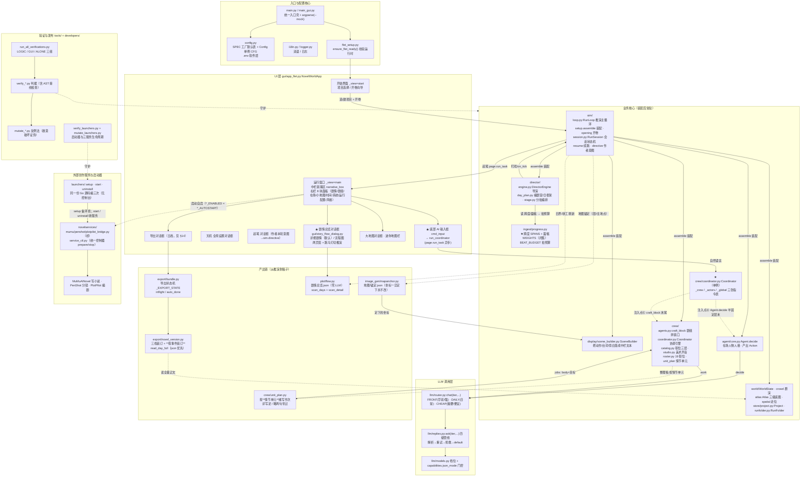

**怎么读这张全景图**

- **实线 = 调用或数据流**（谁调谁、谁给谁东西）；**虚线 = 注入 / 守护 / 异步**（不改被指向那一方的代码）。
  虚线是这张图最要紧的记号：`Coordinator`（注入点⑥⑧）、地图锚定、导出读正文、验证层守护，**全靠虚线**。
  一条实线变虚线、或虚线变实线，通常就意味着"耦合方式被改了"，值得停下来看一眼。
- **七个分区一句话**：`ENTRY` 装起来之前的东西（入口 / 配置 / 语言 / Flet 校验）；
  `APP` 装配之后常驻的业务核心（推演 / 导演 / 落屏 / 世界 / 剧组 / 人物 / 协调 / 时间）；
  `LLM` 所有模型调用的唯一出口；`UI` 两个主视图 + 五个对话框（天机 / 起笔 / 剧情总览 / 大地图 / 导出）；
  `PRODLINE` 从推演长出稿子的那条链；`SVC` 可选的增强层；`VERIFY` 只在跑回归时存在。
- **主干只有一条**：`MAIN → FLET → START →(开卷) SIM →(装配) {DIR, DISP, WORLD, CREW, AGT}`，
  之后每拍是 `DIR`（挑人）→ `AGT`（决策）→ `ROUTER`（问模型）三拍一循环，**落屏则由 `SIM` 调 `DISP`**
  ——`AGT` 不直接碰 `DISP`，它只交出 `Action`（这是"人物不许自己写旁白"的结构保证）。
  其余箭头都是从这条主干上岔出去的读数或注入 —— **读不懂某个模块时，先找它挂在这条主干的哪一段上**。
- **`APP` 是唯一"活着"的分区**：其余六个要么是它前面的（ENTRY）、要么是它的工具（LLM）、
  要么是它的外皮（UI）、要么是它的产物链（PRODLINE）、要么是可插拔的（SVC / VERIFY）。
  所以"改这里会不会影响推演"这个问题，答案几乎总是"看它有没有进 `APP` 的那条装配线"。

**分层解读**
- 越往下的层越"纯逻辑、可单测"：`crew` / `agent` / `sim` / `llm` / `plot` 都不依赖 Flet 窗口。
  `plot/flow.py` 与 `gui/story_flow_dialog.py` 是**刻意分开**的：前者纯读盘出数据，后者只做排版 ——
  这样 58 条剧情判据可以在无窗口环境下裸调（见 §15）。
- `Coordinator` 是横切单例：UI 写、剧组与人物读，靠两个惰性注入点把"对话式总调度"缝进推演，而不改写主循环。
- **`ingest/progress.py` 是"故事时间"的唯一事实来源**（跨度档 + 篇幅档 + 拍预算）。
  `director/day_plan` 只读它、`sim/loop` 只按它推钟 —— 三处各写一份是这块最大的历史坑（§4.5）。
- **`PRODLINE` 那一簇全是"零 LLM 或低成本"的产出链**：剧情总览、地图锚定、导出装订都不调模型
  （整理稿除外，它本来就要写）。用户点开看一眼永远不扣额度。
- **外部创作服务（`novelservices/`）与三个启动器（`launchers/`）是"增强层"**：服务缺席是**被支持的常态**，
  主程序与启动器都不许因它报错。**0.3.2 起服务本身随包发布**（见 §11 的修订说明）。
- 验证层（`tools` / `developers`）独立存在，专门守护业务核心与启动器不被回归破坏（见 §12）。

---

## 2. 模块职责速查表

> 行号是**核对当时**的，重构后会漂；以标识符为准。

| 目录 / 文件 | 关键类 / 函数 | 职责 |
|---|---|---|
| `main.py` `main_gui.py` | `main()`(:29) | 统一入口；`--mock` 切 Mock LLM；初始化日志/语言/Flet 运行时 |
| `config.py` | `SPEC`(357 键) `Config`/`CFG` `VERSION` | 全局配置中枢；`b/s/i/f/set/raw` 类型化读写；`.env` 软件层 |
| `gui/app_flet.py` | `NovelWorldApp`(:7440) `start_gui`(:35061) | Flet 主应用（35,116 行）；开始/运行界面；`_maybe_autostart_service`(:8610) 自启三服务 |
| `gui/story_flow_dialog.py` | `build_flow_controls` `build_detail_controls` `FlowStyle` | **只排版**：剧情总览的两个页签（详细剧情 / 流程图）。不 import `app_flet`，判据可裸调 |
| `sim/loop.py` | `RunLoop`(:400) `run`(:2050) `_tick`(:3440) `_open_day`(:2370) `_end_day`(:7102) | 推演主循环（天→拍→动作→落屏），10,724 行 |
| `sim/session.py` | `RunSession` `wait`(:334) `stop` `pause` | 会话状态机：running/paused/stopping；`wait` 等收尾跑完 |
| `sim/setup.py` | `assemble`(:1027) `load_settings`(:256) `_resolve_node_spans`(:216) | 装配 WorldState / RunLoop / DirectorEngine / Studio；**把 yaml 的跨度/篇幅搬进内存** |
| `sim/resume.py` `sim/directive.py` | 停点判定 / `block(world)` | 续跑的下一天从哪儿起；作者本轮意图 |
| `ingest/progress.py` | `SPANS` `WEIGHTS` `BEAT_BUDGET` `beat_budget` `beat_minutes` `span_minutes` | **★ 故事时间的唯一事实来源**：跨度档 / 篇幅档 / 拍预算 / 一拍推几分钟 |
| `director/engine.py` | `DirectorEngine`(:203 `DirectorEvent`) | 导演：盯戏、介入、张力曲线、事件注入（`on_tick`） |
| `director/day_plan.py` | `DayScript`(:122) `compose` `_beat_budget_cached`(:891) `span_minutes_for`(:917) `_clamp_beats` | 编剧室：写当天故事→剧本→分拍；**拍预算硬闸** |
| `director/stage.py` | `StagePlan` | 把分拍表变成"现在第几拍 / 这场演完没"的状态 |
| `display/scene_builder.py` | `SceneBuilder`(:261) | 把 Action 落成中栏可读文本；`flush()` 出结构化幕 |
| `display/script_render.py` | `time_skip_line` `time_pass_line` `to_markdown` | 时间流逝旁白（**两种语义不许共用一句**）；剧本渲染 |
| `crew/agents.py` | `craft_block`(:2405) `Novelist`(:2846) `_transcribe_jobs`(:2784) | **全剧组唯一拼装口**；小说作家（整理稿按情节单元） |
| `crew/unit_plan.py` | `plan_units`(:284) `target_of` `density_block`(:454) `trim_light` | **按情节单元摊写作次**：详写足 / 中正常 / 略·带过两句带过；轻档超长按句末剪 |
| `crew/coordinator.py` | `Coordinator`(:81) `handle`(:166) | **总体协调引擎**：解析自然语言→写三张指令表 |
| `crew/catalog.py` | `_builtin_specs`(:491) `bind_project` `prompt_block` `effective` | 剧组职位设置三层（软件默认→项目定制→合并），**24 份 spec** |
| `crew/roster.py` | `ROSTER`(19) `SERVICE_ROLES`(4) `SPECIAL_ROLES`(1) | 职位注册：19 个剧组岗 + 4 个服务岗 + 1 个对外服务岗 |
| `agent/core.py` | `Agent`(:172) `decide`(:216) `_compact_if_needed`(:1818) | 在场人物每拍决策，产出 `Action` |
| `llm/router.py` `llm/replies.py` | `chat` / `ask`(:174) / `Reply`(:140) | 三档模型路由；四级容错管线（解析→重试→抢救→兜底） |
| `llm/credit.py` | `CREDIT.on_block` `first()` | **"没钱了"的独立停止条件**（模块级登记表 + 异常两件套） |
| `store/project.py` | `Project`(:71) `list_run_dirs`(:27) `list_runs` | 项目元数据（`.nwsproj`，INI）；**推演目录按序号排**（字符串序会把"第10次"排到"第2次"前） |
| `store/runfolder.py` | `RunFolder`(:293) `flush_daily_script` `flush_day_story` `story_span_of` | 一次推演的落盘：`每天的生活/第NNN天.(md\|json)`、停点、原文样章 |
| `export/novel_version.py` | `render_manuscript`(:984) `read_day_full`(:191) `group_days_by_event`(:294) `write_manuscript`(:1657) | 三档装订；**按事件装订**；json 优先读全量 |
| `export/bundle.py` | `KINDS` `_EXPORT_STATE` `auto_done` `inflight` `manual_kinds_to_run` | 五档导出；**并发状态机**（拦重复导出） |
| `plot/flow.py` | `build_flow`(:681) `ensure_flow`(:891) `scan_detail`(:504) `set_pick` | 剧情总览：`剧情总览.json`（情节节点 + 详细剧情 + 转折点），**零 LLM** |
| `image_gen/mapanchor.py` | `apply`(:200) `fill`(:284) `slot_of` `load/save` | **地图锚定**：`<项目>/地图/锚定.json`，坐标一旦定下永不改 |
| `image_gen/mapstore.py` | `basis_of`(:171) `reuse` `dir_of`(:93) | 每日地图存档与复用（指纹收窄成 `层//主地点`） |
| `world/atlas.py` `world/spatial.py` `world/crowd.py` | `Atlas` / `route` / 群演池 | 三级底图、走位、门外群演 |
| `launchers/` | `main.go`(mode 注入) `services.go`(服务表 + 端口体检) | `setup` / `start` / `uninstall` 三个**原生启动器**（Go）；三服务生命周期的唯一真相 |
| `novelservices/` | `*_bridge.py` `service_ctl.py` | 三座外部创作服务的**桥**（`start/stop/status`）与**统一控制器** |
| `tools/run_all_verifications.py` | `LOGIC`(105) `GUI`(87) `ALONE`(8) | 验收总入口；白名单分组并行 |

---

## 3. 启动序列流程图

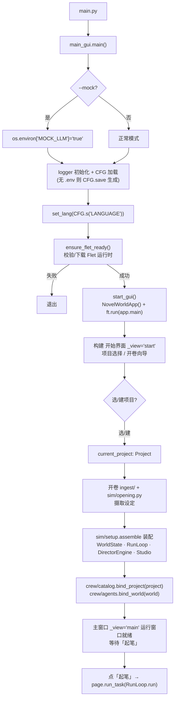

---

## 4. 一轮推演（RunLoop）流程图

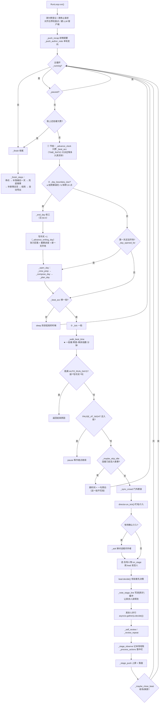

**关键不变量**
- 领说者先 `decide` 并写 `[刚才]` 缓冲，其余人后 `decide`，保证"同一拍里后说话的人知道先说话的人说了什么"。
- 每个 `decide` 都经过导演提示与协调引擎指令（注入点⑧），所以运行窗口的指令下一拍即生效。
- **每一拍开头先推故事时间**（`_walk_beat_time`），且**在 `_ticks_today += 1` 之后** —— 它要读"剩余拍数"，而这一拍本身算进去。
- 停止请求**每一步都问一次**（`self.stopping`）：`_open_day` 的三个子步、`_tick` 的每个花钱步骤、整理稿的段循环都问。

---

## 4.5 ★ 故事时间与日界（2026-10-26 重构，最容易读错的一节）

### 旧口径（已作废，别再拿它推算）

```
故事时间 = 真实流逝 × TIME_RATIO
一拍 = BEAT_SECONDS(60) 故事秒 = 1 故事分钟
一天 = 必须填满 24 小时 ⇒ 实测 133 幕 / 21.3 万字
```

后果有三条，都是用户点名的：**一场审讯和三个月赶路占用一样长的故事时间**；
**每天都得填满 24 小时**（唯一的跳时间机制要求"连 6 拍没人做事"才跳 30 分钟，
跳过 3 天要连跳 144 次 ⇒ 不可能）；**节点没有"体量"**（不知道哪站该详）。

### 新口径（用户选 A：日界 = 拍预算用完）

| 层 | 在哪 | 是什么 |
|---|---|---|
| **跨度档** `SPANS` | `ingest/progress.py` | `一场`(2 小时) / `当日`(12 小时) / `数日`(3 天) / `一旬`(10 天) / `数月`(90 天) —— **闭集** |
| **篇幅档** `WEIGHTS` | 同上 | `详`(40~60 拍) / `中`(15~25) / `略`(3~8) / `带过`(1) —— **闭集，没有"不限"** |
| **一拍推多久** | `beat_minutes()` | `跨度分钟 ÷ 拍数`，下限 1 分钟、上限 `BEAT_MAX_MINUTES`(30) |
| **动态余量** | `RunLoop._beat_minutes_now()`(:2606) | `这一站剩余时间 ÷ 剩余拍数`；跳过的时间计进 `_walked_min`，所以站末不超支也不欠支 |
| **站末补时间** | `RunLoop._flush_station_gap()`(:2726) | 一拍最多 30 分钟，而"数月+带过"是 90 天 ⇒ 站演完后**一次跳掉余量**并推一句旁白 |
| **日界** | `RunLoop._day_boundary_due()`(:2675) | a) 拍预算演完（新）**或** b) 钟跨 24 点（兜底） |
| **跨天续演** | `RunLoop._carry_unplayed_beats()`(:8218) | 跨度∈{数日,一旬,数月} 且有剩拍 ⇒ 带**剩余**拍进下一天，`_compose_day` 接着演、不重规划 |

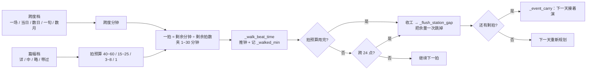

**两个"天"必须分开**（这条错了会产出"第 3 天的稿子写着三个月后的事"）：

| | 谁 | 什么时候 +1 | 用在哪 |
|---|---|---|---|
| **故事天** | `world.game_day` | 故事钟跨 24 点 / 一次跳几十天 | 幕头时辰、张力曲线、导出里的"第 N 天"字样 |
| **写作天** | `RunLoop._current_day` | `_advance_writing_day()`(:2807)，**每次日界 +1** | 文件名 `第NNN天.md`、导出标题、`AUTO_RUN_DAYS` 判定 |

> ⚠ **`AUTO_RUN_DAYS` 按写作天判**：用户填"跑 3 天"想的是"出 3 天的稿"。
> 用 `game_day` 判时，第 2 天一拍跳完三个月就当场触发限制 ⇒ 只出 2 天稿而界面写着"已跑 91 天"。
> ⚠ 开关 `DAY_ENDS_ON_BEAT_BUDGET=false` ⇒ **逐字回到旧行为**（`_advance_clock_legacy` + 只按跨天收工）。
> `verify_beat_time` 44 条钉着"两条路径都还在"。

**这块踩过的坑（每条都对应代码里一处注释）**
1. **`beat_budget` 只认 `ProgressNode`，而两个调用方传的是 `{'篇幅':…}` dict** ⇒ `getattr` 永远空
   ⇒ 篇幅档对拍数**从来没生效过**。已改成同时认 dict / str / 对象。
2. **`sim/setup.load_settings` 漏搬 `跨度`/`篇幅`** ⇒ yaml 写了、内存里没有 ⇒ 跨天携带从来没生效。
3. **`time_skip_line` 最长档是"大半日"** ⇒ 站末跳 90 天也写"大半日就这么过去"，量级说错比不写更糟。
4. **站末补时间与"空闲跳过"共用一句旁白** ⇒ `verify_round_controls` 靠"'就这么过去'出现 0 次"
   证明"空闲跳过关掉了"，于是误红。已开 `time_pass_line()`，两句**不许共享任何短语**。
5. **`MOCK_LLM=true` 管不到外部创作服务**：`.env` 里 `MUMU_ENABLED=true` 时
   `verify_day_plan` 从 8 秒变 528 秒、7 条判据连锁红。判据里显式关掉。

---

## 4.6 ★ 一天的收工顺序（`_end_day`，顺序错了就丢内容）

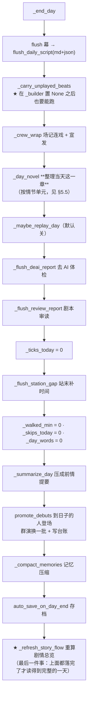

> ⚠ **`_carry_unplayed_beats` 必须在 `_builder = None` 之后仍能工作** —— 它读 `_day_script` 与
> `_ticks_today`，与 builder 无关；放在落盘之后是为了"先保住这一天的内容，再决定要不要续"。
> ⚠ **`_flush_station_gap` 在 `_ticks_today = 0` 之后**：它靠 `_event_carry` 判"站演完没有"。
> ⚠ **`_refresh_story_flow` 排在最后**：它要读到"已经落完盘的那一天"。

---

## 4.7 收尾（`_finish` → `_finish_steps`，点了「停止」之后发生什么）

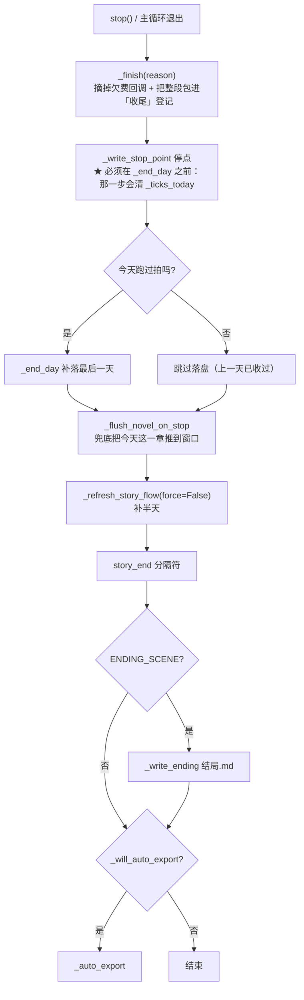

> ⚠ **`_finish` 拆成两步不是为好看**：`_finish` 外面多了 `try/finally`（保证"收尾"这条登记
> 一定弹栈，否则状态条永远写着"收尾"），整个函数体再缩进一层会动 100 多行。
> ⚠ **收尾一开始就摘掉欠费回调**："没钱了"只在推演**进行中**有意义；收尾撞上欠费时暂停会把
> "正在停止"顶成"等你点继续"，而用户什么都没点。
> ⚠ **停止时的兜底不许花 LLM**：兜底只**搬运现成稿**，整理只在收工跑一次。

---

## 5. Agent.decide 决策流（含协调引擎注入点⑧）

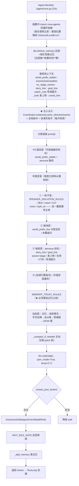

> 注入点⑧位置固定：**半固定层最末、记忆规则之前**，紧跟导演提示⑦。这样"作者刚说的关于这个角色的话"优先级高于泛泛记忆，但低于当拍现场上下文。
>
> ⚠ **`SPEAKER_ISOLATION_RULES` 只出现一次**（在规则区）。留一份在半固定层末尾就是"同一段两次"：
> 白烧 token，而且模型会当成两条独立要求（判据 E3 抓到过）。
> ⚠ **`MEMORY_TRUST_RULES` 不许挪**：它必须**紧贴在被包住的那段记忆前面**才起作用；
> 放到提示词末尾（离记忆很远），模型会当它是一句泛泛的提醒。
> ⚠ 半固定层的顺序是**按"变化频率"排**的，不是按重要性 —— 前缀缓存只认"从头开始连续相同"，
> 把稳定内容放在后面 = 缓存命中率归零（实测 1.1%，而正常路径能到 17%）。

---

## 6. craft_block 剧组拼装流（含协调引擎注入点⑥）

`craft_block`（crew/agents.py:2405）是**全剧组唯一拼装口**——24 份职位 spec（`catalog._builtin_specs()`）、演员 `_actor_craft`、导演 `_verify` 都从这里取系统提示。越靠后越具体、越压前。

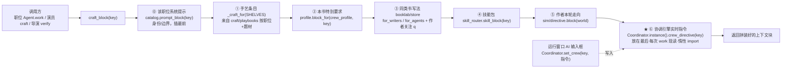

> 注入点⑥位置固定：**整块最后**。意义——导演/编剧等职位收到的"作者对话指令"压在所有手艺与设定之上，下一拍 `work()` 即生效。

---

## 6.5 ★ 整理稿：按**情节单元**写（不再"按 6000 字切块、每块都写完整"）

**病根**：`Novelist._transcribe` 原来按 `CREW_DAY_NOVEL_CHUNK`（6000 字）切块，
每块都要求"写成完整一章"，于是实测 **12.9 万字**的"逐块转录剧本" ——
`略` 的站和 `详` 的站写得一样厚，等于没有详略。

**修法**：新包 `crew/unit_plan.py`（纯函数，不调模型），把一天的材料按**幕头里的站名**切成情节单元，
再按**篇幅档**给每一片一个**可数的写作目标**。

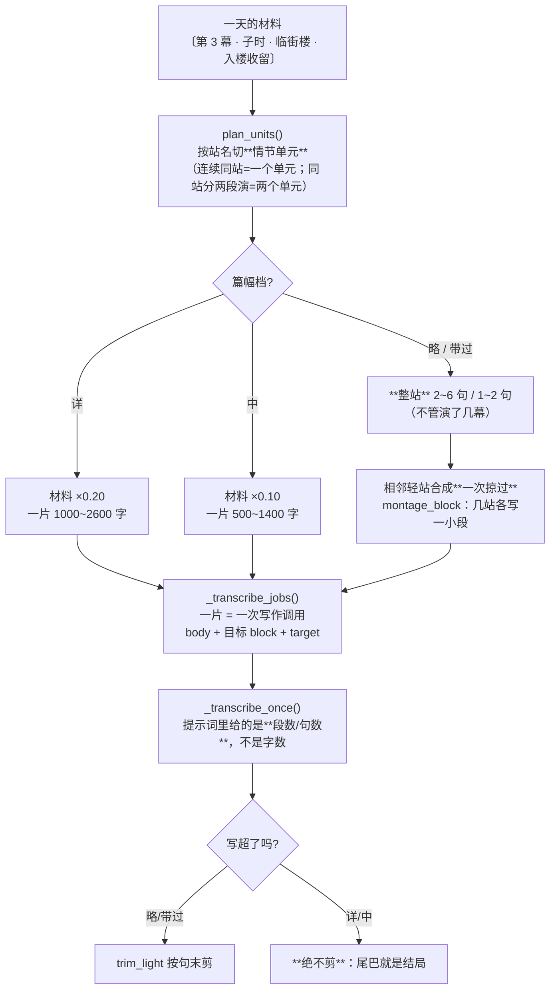

**几条设计纪律**
- **给模型的是"几句/几段"，不是字数** —— 这个项目实测过：模型不数字数。
- **"一处都不许漏"和"只留结果"不能同时出现在一份提示词里**，否则模型随机挑一条。
  所以第 2/5/9 条改成**按档二选一**（`_rule5` 那种）。
- **相邻的轻站合成一次"掠过"**：三站各一句话，这正是"几站之间隔了几个月"的写法。
  分成三次写，每站都会各自起个场面，反而变厚。
- **轻档超长按句末剪，重档绝不剪**（重档要求事件一处都不许漏，尾巴就是结局）。
- **两个新参数缺省时旧行为逐字不变** —— 探针 / 判据 / 外部调用点都靠这条。

**顺带挖出三处"静默失效"（都有真数据实证）**
1. **幕头站名一直是空的**：`display/scene_builder` 读 `node_info.get('name')`，而进度表的键是中文 `名称`
   ⇒ 某本真数据 `第001天.json` 里 **133 幕全空**。不修的话这条新路根本不会启动。
2. **`sim/setup.load_settings` 漏搬 `跨度`/`篇幅`** ⇒ `beat_budget_for` 一直现推、
   `_carry_unplayed_beats` 的跨度永远空 —— **跨天携带从来没生效过**。已补 `_resolve_node_spans()`（只在内存补，不写回用户的 yaml）。
3. **`〔切至 …〕`/`〔事件 …〕` 被当成幕头** ⇒ 真数据 **133 幕炸成 211 个单元 / 25.7 万字目标**。
   幕头必须**第一字段是 `第 N 幕`**。

**实测**：真数据第 1 天（133 幕 / 19.2 万字材料）→ **1 个单元 → 32 次写作 → 目标上限 4.2 万字**（改前 12.9 万字）。
正常一天现在被拍预算限在 40~60 拍，会更短。

---

## 7. ★ 总体协调引擎 Coordinator 流程图（运行窗口 AI 输入框）

这是"对话式总调度"入口。完整闭环：**输入 → 解析 → 写指令 → 下一拍经注入点生效**。

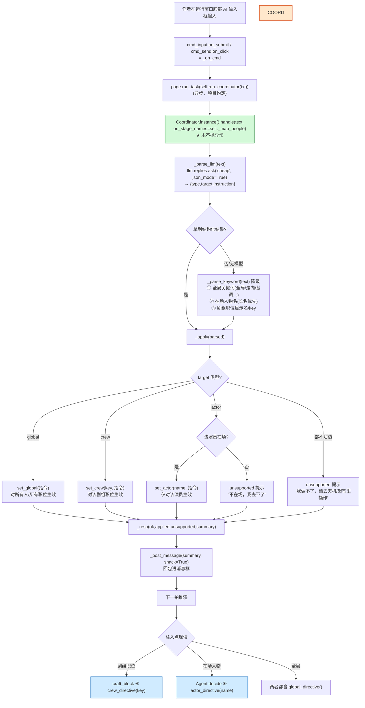

**三张指令表（Coordinator 单例属性）**
- `_crew: dict[str,str]` — 职位 key → 指令（如 `director` / `writer`）
- `_actors: dict[str,str]` — 演员名 → 指令（如 `王二`）
- `_global: str` — 全局故事走向，对所有人/职位生效

**读取接口（注入点每次现读，惰性 import 不缓存）**
- `crew_directive(key)` = 全局 + 该职位
- `actor_directive(name)` = 全局 + 该演员
- `global_directive()` = 全局

**设计纪律（本项目铁律）**
- `handle()` 永不抛异常：任何一步出错都转成"做不了"回包，不卡崩推演线程。
- 解析优先 LLM（`cheap` 档、`json_mode`），失败或无模型时降级纯关键词匹配，保证本机没配模型也能用。

---

## 8. 配置三层系统

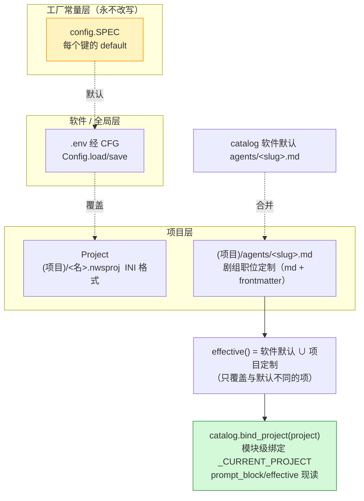

> 注意两处"项目存储"实现不同：**项目元数据**在 `.nwsproj`（INI，见 `store/project.py`）；**剧组职位系统提示/属性**才是 `agents/<slug>.md`（md + frontmatter，键见 `crew/catalog.FIELD_KEYS`）。
> 合并只覆盖"与软件默认不同的项"——升级软件后未被项目覆盖的部分自动跟随新默认。

---

## 9. LLM 调用层

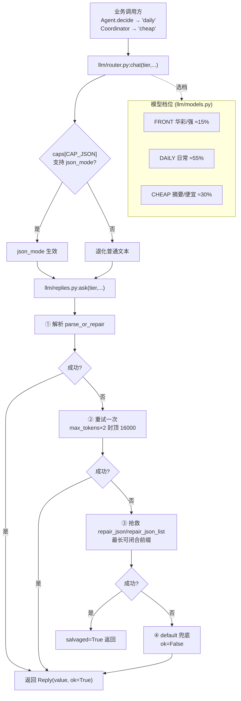

**"没钱了"是一条独立的停止条件（`llm/credit.py`，2026-10-25）**

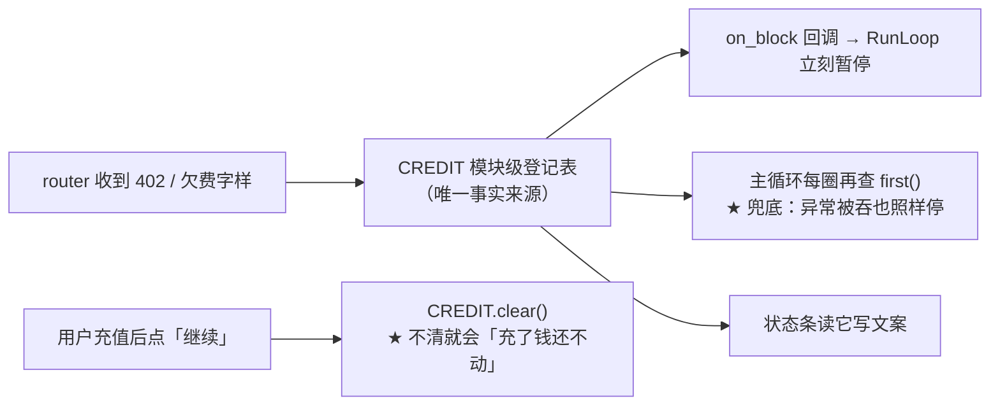

> 口径：**402 一律算；429/403/400 只认欠费字样** —— 误把限流当欠费会让用户去充不该充的钱。
> 同一家 fail-fast 不发网络。
> ⚠ 为什么"回调 + 登记表"两件套都要：回调是"顺手通知"，它自己抛了、或某个替身主循环没接，
> 异常又刚好被 `except Exception` 吞掉 —— 那就没有任何人会停，而钱确实已经没了。
> 所以主循环按**账**再判一次，与"谁吞了异常"无关。

---

## 10. UI 层主区域

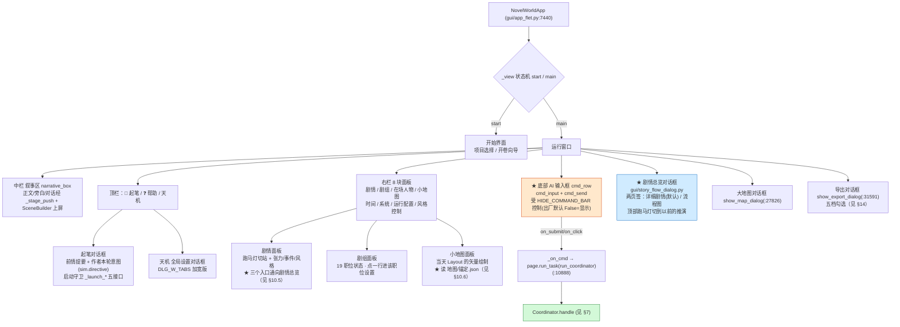

> **面板与对话框的一处纪律**：面板上每个"能点的地方"都必须是**真的能点**，
> 且点完要跳到**对的地方**（`verify_run_panel_nav` 21 条 / `verify_run_side_panels` 83 条守着）。
> "点了没反应"是这块报得最多的一类问题，排查顺序见 `MEMORY-ui.md`。

---

## 10.5 ★ 剧情总览（右侧「剧情」面板的主入口）

**用户 2026-10-26**：
> 「剧情Panel的按钮可以点击 → 对话框里有本次推演从开始到现在的故事线（每个情节少量文字总结），
> 从开头到结尾一张**从上往下**的流程图；中间涉及用户选择的地方给多选，并从选中的那条继续；
> 对话框最上面加**跑马灯**左右切到以前的推演；这次把已有推演的数据也生成一下，后续由软件自动生成。」
> 之后又追一句：「剧情总览太简略了，我要**细节剧情**，详细到剧作家写小段剧情的程度，
> 要包含**关键剧情和转折点**。」

### 数据层 `plot/flow.py`（零 LLM，纯读盘）

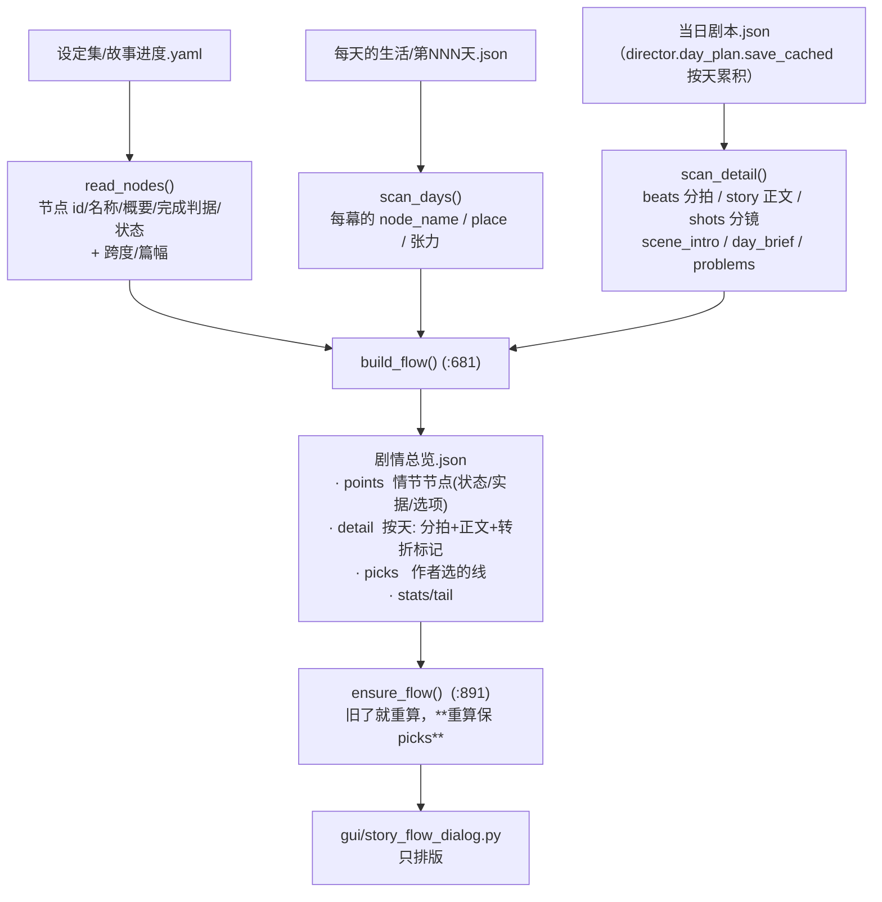

**转折点四条判据（可数、可解释、分级）**

| 判据 | 等级 | 为什么 |
|---|---|---|
| `event` 条目（`caption` 闭集：外部刺激/人物冲突/巧合/秘密泄露/伏笔激活/导演自救） | **转折** | 不是"演出来的"，是**有人按下去的** —— 它出现就意味着方向变了 |
| `node_name` 变化（情节站切换） | **转折** | 故事从这一站走到了下一站 |
| 张力跳 ≥ `TURN_TENSION`(0.15) | 关键 | 火候变了，但方向没变 |
| 幕级 `place` 变化（换场） | 关键 | 舞台换了 |

**三条设计纪律**
1. **一条故事线只有一个事实来源**：情节 = 进度表的节点，「演到哪儿了」= 每天剧本里的 `node_name`。
   界面里那句"正在演"和导出里那章叫什么，必须同源。
2. **不花 LLM**：这张图是**读出来的**，不是"让模型总结一遍"。停止/刷新路径上花钱，
   用户点一次「停止」就可能被扣一笔，而它要的是"我演过什么"。
3. **推断必须标注**：选项（"三条路"）多半是**从概要里读出来**的 ⇒ 照实写 `inferred: True`，
   界面显示「这几条是从概要里读出来的」，作者才知道去补 `选项:` 字段。

### 界面层 `gui/story_flow_dialog.py`（只排版，不 import `app_flet`）

```
剧情总览 · 从头到尾            第3次模拟2026-10-26-14-19         1 / 1
  详细剧情  |  流程图
──────────────────────────────────────────────────────────
关键剧情与转折点（共 2 个转折 · 1 个关键）      ← 结论先行
▌转折 · 导演自救   第2天 戌时 20:30 · <作品名>
   ……（这里接那一拍的正文摘要，取 80 字上下）
──────────────────────────────────────────────────────────
按天详细                                       ← 折叠，默认展开最近 2 天
▾ 第 2 天   戌时 → 亥时 · 2 幕 · 6 拍 · 正文 1899 字 · 入楼收留
  当天梗概  <主角>进<房间>换纸，发现箱底嵌着<某件东西>…
  ── 剧作家的分拍（6 小段）──
  ① <这一拍的主题>  〔<地点>〕 <人物A>、<人物B> · <情绪>
     <这一拍发生的事，一两句>
     · <要点：谁做了什么>
     推进：从"<旧状态>"变成"<新状态>" · 目标：… · 难题：…
  ── 正文（剧作家写的 48 段）──
  <这一天的正文，第一段原样铺在这里>…
  ── 分镜（16 镜）──
  #1 · 中景 · <机位看到的画面>。   台词：<这一镜的那句词>。
```

**量级与上限**（一天实测约 100 个控件，30 天全展开就是 3000 个 ⇒ 对话框会卡到不能用）

| 常量 | 值 | 干什么 |
|---|---|---|
| `MAX_DETAIL_DAYS` | 30 | 更早的天只留梗概 + 转折点 |
| `MAX_BEATS_DAY` | 40 | 分拍上限，超出在 `notes` 里写"另有 N 拍未收录" |
| `MAX_SHOTS_DAY` | 80 | 分镜上限 |
| `MAX_STORY_PARAS` | 200 | 正文段数上限 |

> ⚠ **折叠要用"重建"不要用 `visible=False`**：后者在 3000 个控件时照样先渲染一遍，等于没省。
> ⚠ **截断说明必须"先记原数再截断"**：`paras = paras[:MAX]` 之后再算 `len(paras) - MAX` 恒为 0，
> 会报出"正文另有 0 段未收录"——**注释在撒谎，而看起来完全正常**。
> ⚠ **数据里不许冻语言**：`换场/站切换/张力` 只存代码 + 参数（`{why:'place', a, b}`），排版归界面拼。
> 唯一例外是 `event` 的 `text` —— 那是导演写的原文（素材），原样显示不翻译。
> ⚠ **不许按"在场名单"判"新人物登场"**：`cast` 是"这一刻的在场名单"，开场那一幕全员都在
> ⇒ 第一天的"关键剧情"变成 7 条「<某人> 第一次登场」，把真转折全淹了。这条判据已删。

### 什么时候刷新

| 时机 | 谁 | 花钱吗 |
|---|---|---|
| 每演完一天 | `_end_day` 最后一件事 → `_refresh_story_flow()` | 否 |
| 点「停止」收尾 | `_finish_steps` → `_refresh_story_flow(force=False)`（补最后那半天） | 否 |
| 打开对话框 | `PF.ensure_flow()`（旧了才重算，重算保 picks） | 否 |
| 回填历史 | `tools/build_story_flow.py [--force]` | 否 |

---

## 10.6 ★ 地图锚定（"同一处地方每次画得不一样"）

**用户 2026-10-26**：「小地图和大地图 每次生成的感觉都有一些区别 有办法在整个小说推演过程中
维持相同场景地图的一致性吗」

**三个病根（都量过）**

| # | 病根 | 后果 |
|---|---|---|
| ① | 复用判据里塞了"**今天的地点集合**"（`整体//井/柜台/<主地点>//<主地点>`） | 今天多演一处灶房，整串就变 ⇒ 整张图作废重问模型。而"一天演几处"是常态 ⇒ **几乎天天重画** |
| ② | 没有"位置已定"这回事 | 重画时模型想放哪放哪。茶肆昨天在左上、今天在右下 |
| ③ | 档位与内容不同源（存档名取底图层、`Layout.kind` 按内容推） | 真数据里 `整体_<主地点>.json` 而 `kind=室内` |

**修法：`<项目>/地图/锚定.json`（`image_gen/mapanchor.py`）**

> 同一 `(层, 主地点)` 下，每个地点名一旦有了坐标，**此后每天都用它**；今天的布局只负责补进没见过的。

| 情形 | 怎么办 |
|---|---|
| 这一处定过位置 | 坐标 / 形状 / 大小 / 图上简称 / 归哪间房 / 小注 —— **一律用定下来的**，模型这次给的不算 |
| 今天新出现一处 | 用它的位置，并**记下来**（从此也不动） |
| 新来的撞到老的 | **挪新来的**，老的一处都不动 |
| 模型**漏画**了昨天有的一处 | 补回来，落在**它原来的位置**（`fill()`） |

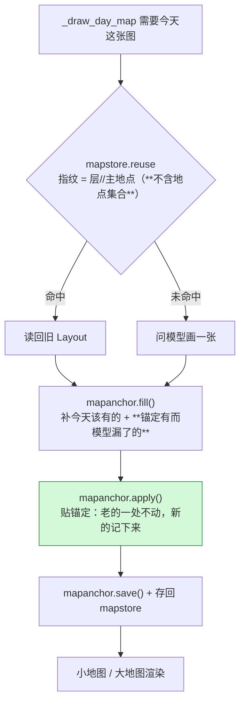

> ⚠ **必须先 `fill` 后 `apply`**：反了会让补进来的点绕过锚定检查、压在别人身上。
> ⚠ **"复用命中"不等于"图对"**：命中只是底子，还得补地点 + 贴位置。只做复用 ⇒ 每天图缺东西；
> 只做锚定 ⇒ 每天还在问模型。**三件事都要**。
> ⚠ **"东西今天有明天没"也是不一致**：模型明天忘了画灶房，图上就凭空少一样。所以 `fill` 的
> `also` 参数（锚点里已有但模型没给的名字）不是锦上添花，是同一件事的另一半。
> ⚠ 开关 `MAP_ANCHOR`（默认 **true**）关掉 = 逐字回到旧行为。
> **想整体重排**（设定集大改过）：删掉 `<项目>/地图/锚定.json` 这一个文件即可。

---

## 11. 外部创作服务与启动器（三服务生命周期）

项目旁挂着**三座外部创作服务**——它们都是**增强项**：不在也不该让主程序或启动器报错。

> **★ 这一节在 2026-10-21 改了口径，别再看旧说法**：
> 旧文档写的是"发布包**整目录排除** `novelservices/`"，**那已经不成立了** ——
> 用户 0.3.2 起要求「所有相关服务都复制过去」，服务随包发布（实测 `发布版本/0.3.3/novelservices` 存在），
> `developers/check_release.py` 的 `MUST_ABSENT` 里也已把 `novelservices` 删掉。
> 仍然成立的是：**出厂总开关 `*_ENABLED` 全关** ⇒ 开箱行为与老版一致；
> 以及**服务缺席必须是常态**（用户可能自己删掉那个目录）。

| 服务 | 干什么 | 怎么跟它打交道 | 端口读哪 | 跟随退出键 |
|---|---|---|---|---|
| **MuMuAINovel** | 写小说正文 | 启动器**直跑**它自己的 `backend/novelservice.py` | `APP_PORT`（**服务自己**的 `.env`） | `MUMU_FOLLOW_APP` |
| **PenShot** | 分镜 / 镜头 | 走**统一控制器** `service_ctl.py` | `PENSHOT_PORT`（**主程序根** `.env`） | `PENSHOT_FOLLOW_APP` |
| **PlotPilot** | 编剧 / 剧本 | 走**统一控制器** | `PLOTPILOT_PORT`（主程序根 `.env`） | `PLOTPILOT_FOLLOW_APP` |

**出厂默认**（`config.py` 的 SPEC，2026-10-26 核对）：

| 键 | 出厂默认 | 本机 `.env` 实际 |
|---|---|---|
| `MUMU_ENABLED` / `PENSHOT_ENABLED` / `PLOTPILOT_ENABLED` | **False / False / False** | true（用户自己开的） |
| `MUMU_AUTOSTART` / `PENSHOT_AUTOSTART` / `PLOTPILOT_AUTOSTART` | **True / False / False** | true |
| `*_FOLLOW_APP`（三座） | **True** | true |
| `MUMU_FOR_NOVELIST` / `PLOTPILOT_FOR_SCREENWRITER` / `PENSHOT_FOR_DIRECTOR` | True | true |
| `MUMU_FOR_EXPORT` | **False** | true |

> ⚠ **"改默认值"和"改实际值"是两件事**：`SPEC` 的 `default` 只影响**新装**用户；
> 老用户 `.env` 里已写死的值不会被覆盖。所以上表两列必须分开看 —— 判据验出厂默认要查
> `SPEC[...]['default']`，**不能查 `CFG.b()`**（它读 `.env`，同一份代码在不同机器上结果不同）。

每座服务都有一层**桥**（`novelservices/{mumu,penshot,plotpilot}_bridge.py`），对外只暴露
`service_status` / `start_service` / `stop_service`（+ 2026-10-17 加的 `on_line` 回调）——
pid 文件、健康检查、能力探测全在桥里。主程序与 GUI 只跟桥打交道，不直接碰服务进程。

> ⚠ **唯一的 vendored 补丁在这里（2026-10-17）**：PlotPilot 启动时会"清理残留进程"，
> 而原实现按**关键字**（含 `uvicorn`）匹配 —— 于是它会把**同时在跑的 PenShot 一起杀掉**
> （实测连杀三个），表现为"两个服务只能活一个"，而且不报错。
> 补法两处：① 只认**它自己的目录**；② 支持 `PLOTPILOT_SKIP_ORPHAN_CLEANUP=1` 整段跳过
> （桥启动时带上它 —— 生命周期归桥管）。**升级上游要重新打**，与另外三处 vendored 补丁同规矩。
>
> 另外 PlotPilot 的 `start_service` 原来用**前台** `subprocess.run(uvicorn …)`：成功时
> 函数**永不返回**（等到超时报"启动超过 N 秒"），失败时只看 stdout 拿不到 uvicorn 的报错。
> 现已改成与 PenShot 同一套：`Popen`（DETACHED + NO_WINDOW + BREAKAWAY_FROM_JOB）+ 轮询健康检查。

### 为什么 MuMu 不并进统一控制器

`novelservice.py` 自己挑解释器、自己建 venv、自己有"版本牢笼"。让启动器改走控制器，
就要在 Go 或控制器里**第二份**实现"挑哪个解释器"——而"同一件事两处实现"正是这个项目
反复吃的亏。所以：**MuMu 保持直跑自己的脚本**（既有的夹具钩子语义一个字不动），
两个新服务走控制器。

### 三个启动器与三服务（唯一真相：`launchers/services.go` 的服务表）

一张表（`var services = []extSvc{…}`）记着每个服务的"启动器需要知道的一切"：
目录 / 是否走控制器（`ctl`）/ `followKey` / `portKey` / 健康检查路径 / 各自的测试钩子。
`setup` / `start` / `uninstall` **同一份逻辑**（`main.go` 里 `var mode` 编译期注入），全靠这张表驱动。

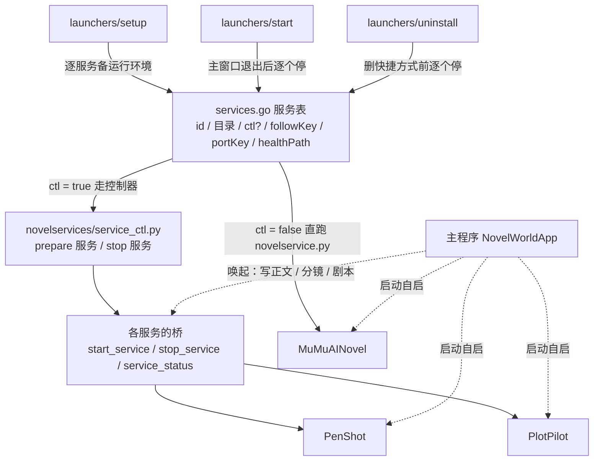

**三处照看（对应三条硬要求）**

1. **配置（`setup`）** —— `servicePrepareSteps` 逐服务备运行环境（建 venv、装依赖），
   幂等；`--skip-service` 一步都没有。放在**安装期**是为了让**第一次启动**不必卡几分钟建环境。
   服务缺席 ⇒ 那一步自动消失（发布包就是这一路）。
2. **随主窗口退出（`start`）** —— 主程序退出后**逐个**服务判 `followFor`：
   **逐服务测试钩子 → 全局测试钩子 → `.env` 的 `*_FOLLOW_APP`**，默认 **true**。
   三个服务**各自独立**（"留着编剧、关掉分镜"表达得出来），停失败**不改变**主程序退出码。
   ⚠ 启动器**不负责拉起**服务——那交给主程序启动时的 `_maybe_autostart_service`（见下）。
3. **卸载前清理（`uninstall`）** —— 删快捷方式**之前**逐个停（它们是常驻进程，不停会一直占端口）。
   确认框由**启动器**问，问完才带 `--yes` 调子进程（无终端下 `input()` 必 EOF，见 `launchers/README.md`）。

### 端口：`setup` 检查并配好（Docker 友好，2026-10-17）

用户机器上常跑着 Docker / 别的服务，默认端口（8001 / 8005 / 8000）可能正被占着。
`setup` 在**备环境之前**先过一遍 `ensureAllServicePorts`，每个在场服务按这个顺序判：

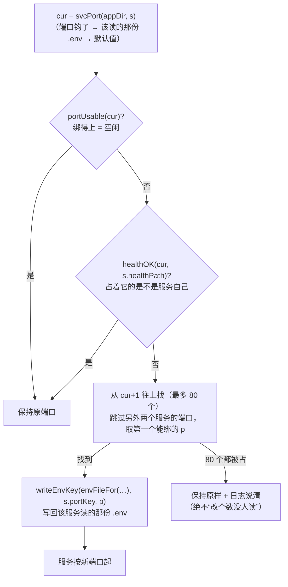

- `portUsable` 用 **Listen**（绑得上才算空闲），不是 Dial —— Docker / Hyper-V 占着的端口
  "连得上/连不上"都不确定，但**绑不上**是确定的。
- `envFileFor` 决定写哪一份：MuMu 写它自己的 `backend/.env`（`APP_PORT`），
  两个新服务写**主程序根** `.env`（`PENSHOT_PORT` / `PLOTPILOT_PORT`）—— 与桥的 `_config()` 同一个来源。
  **写错文件 = 改了等于没改，而且不报错**（F7c 专守这一条）。
- `writeEnvKey` **就地替换**那一行，保留其它行与 CRLF 风格 —— 不整份重写，不冲掉用户手写的注释。
- `--selftest` 的报告里每个服务多一个 `port_busy`（true = 绑不上），判据靠它验"探测本身是准的"（D9）。

### 服务在推演里做什么（谁用它、失败了怎么办）

| 服务 | 哪个职位用 | 产出 | 失败/超时/写空时 |
|---|---|---|---|
| MuMuAINovel | 小说作家（`MUMU_FOR_NOVELIST`）/ 导出重写（`MUMU_FOR_EXPORT`） | 样章正文 | 退回本程序自己的写法，降级原因记在产出上 |
| PlotPilot | 剧作者（`PLOTPILOT_FOR_SCREENWRITER`） | 本章方案 | 同上（不丢戏） |
| PenShot | 导演 / 分镜师（`PENSHOT_FOR_DIRECTOR`） | 分镜方案 | 同上（导演自己排） |

三座都**不参与**排班与推演主循环：它们是"这一步要不要交给外挂"的**分支**，
调用点在 `crew/agents.py` 的四个接线函数（`_plotpilot_enabled_for` / `_plotpilot_plan` /
`_penshot_enabled_for` / `_penshot_storyboard`），由 `tools/verify_external_services.py` 守。

### 主程序自启（"启动时自动拉起这些服务"）

`gui/app_flet.py:_maybe_autostart_service`（启动时 `page.run_task`）按
**`*_ENABLED` × `*_AUTOSTART`** 两家开关，三家**并行** `asyncio.to_thread(BR.start_service)`：
界面不冻、成败各留一条消息、**不弹窗**。踩过的坑：`to_thread` 里不能直接碰界面
（`_post_message` 必须回事件循环再发）。三座服务的 `*_ENABLED` / `*_AUTOSTART` / `*_FOLLOW_APP`
都在 `config.py` 的 SPEC 里（见 §8）。

### 起停按钮：弹窗显示**全套命令行输出**（2026-10-17）

用户报「有启动/停止按钮，点了没任何反应」。两个成因都在旧实现里：① 桥**没加载上**时
`_BR is None` ⇒ **静默 return**，一个字都不说；② 消息发到**对话框背后那个「消息」框**，
被天机盖住 ⇒ 永远看不到。

现在点下去**立刻**弹小窗（`_svc_output_dialog`），里面是这次操作的全套输出：

- 第一行 = **实际执行的命令行**（`$ <venv python> -m uvicorn …` / `$ taskkill …`）；
- 中间 = stdout/stderr **实时**刷（MuMu 用 `Popen` 逐行读；PenShot / PlotPilot 是
  detached 子进程写日志文件 ⇒ 桥**边等健康检查边 tail** 那个文件）；
- 最后一行 = `✔ 完成` / `✘ 失败：<原因>`；失败时**报错原文就在窗口里**，不用翻日志。

桥的公开接口因此多了一个 `on_line: Callable[[str], None] | None = None`
（`start_service` / `stop_service` 三座统一，缺省不传 = 老行为不变）。

### 启动窗口（splash，2026-10-17）

`start` 会先起一块**无边框、置顶的"书封"**（`tools/launcher_splash.py`，tkinter）：

- 视觉：**整张背景图铺底**，Logo / 名字 / 「把故事，活一遍」/ 消息条 / 底栏都**直接压在图上**
  （没有色块卡片、也没有描边框 —— 三轮迭代的落点：加边框 → 去掉底色 → **边框也去掉**）；
  展开的命令行输出区只有 **7 行**、**浅纸底**；
  标题与标语用 **Pillow 按字体文件**渲染成图片再贴上来 —— 用的是 `ui_fonts.ui_font_file()`，
  也就是**开始界面当前那一份**（白色描边 + 合成粗体 = 开始界面 `ink_text(stroke=N, BOLD)` 的同款做法）；
  底栏 `v0.3.3 · 本地运行 · Python + Flet`（与开始界面同一格式，版本号读 `config.py` 的 `VERSION`）；
  右上角 **✕** 随时可关。
- **消息从哪来**：`start` 把自己的日志（`logs/launcher.log`）写进 spec，窗口从**末尾** tail；
  步骤输出用 `runStepsAll` **整段**落日志（最多 200 行）⇒ 展开后看到的就是命令行原样输出；
- **什么时候关**：主程序画完开始界面后写 `NWS_SPLASH_READY` 指向的文件
  （`NovelWorldApp._tell_splash_ready`）⇒ 窗口自关。**由界面说了算**，不靠启动器掐秒；
- **失败**：`failSplash` 写 `fail` 文件 ⇒ 红字 + 消息条变红，**不自动展开**（默认收起），
  点「详情」看全文；启动器 `waitSplash` 等用户关（最多 180 秒）后退出；
- **退出码 0 不算失败**：主程序正常退出但没写 ready，多半是用户自己关了窗口 —— 只记一行日志。

#### 标题字体：按**文件**加载，不按族名（2026-10-17）

用户：「启动界面的标题的字体不对 要跟开始界面的标题字体一样」。

★ 根因不是"选错了字体"，而是**两边找字体的方式不同**：

| | 怎么拿字体 | 实际落到哪 |
|---|---|---|
| 开始界面 | Flet 用 `page.fonts` **按文件**注册随附字体 | 随附的 Regular（+ 合成粗体） |
| 启动窗口（旧） | tkinter 只能按**族名**到系统里找 | 本机装了思源宋体整族 ⇒ `bold` 挑到 **Black** |

⇒ 同一个族名、不同的脸。修法：启动窗口也**按文件**加载
（`ui_fonts.ui_font_file()` → `assets/fonts/<当前那份>`，Pillow 渲染成图片贴上 canvas）。
★ `ui_fonts.py`（纯标准库）是这块的**唯一真相**：`gui/app_flet.py` 与 `tools/launcher_splash.py`
共用它，用户在「天机 · 界面外观」里换了字体，两边一起变。
⚠ Pillow / 字体文件不在 ⇒ 退回按族名（窗口照常出现，不该因为缺字体就开不了窗）。

#### 底图：从母版裁一块「淡而不花」的（2026-10-17）

用户：「启动界面背景图你看是否可以从完整背景图里截取一部分颜色较淡的部分，现在好像有点花」。
★ 旧版是**把整张 3840×2160 缩到 860px** —— 全图的笔墨全挤进一张小图，看着就是"花"。
现在由 `tools/make_splash_bg.py` 在母版上**滑动窗口打分**裁一块：

| 指标 | 想要 | 旧版（整图缩略） | 现在（裁一块） |
|---|---|---|---|
| 灰度均值 | 高（淡） | 186.5 | **210.7** |
| 灰度标准差 | 低（平） | 30.7 | **5.2** |
| 边缘能量 | 低（干净） | 29.9 | **4.2** |

- 打分四轴：`亮度均值`(高) / `标准差`(低) / `饱和度`(低) / **Sobel 边缘能量**(低)；
- **朱红印章**（母版左上角那枚）占比超 0.30‰ 的窗口**直接弃用** —— 印章是视觉焦点，
  进了 860px 的小窗会跟 Logo / 名字抢眼；
- 收起态取**同一块的上半** ⇒ 点「详情 ▾」时画面只是往下"长"一截，不会跳成另一张图
  （实测两张上部 480 行平均像素差 0.106）；
- 成品必须是 **PNG**（tkinter 的 `PhotoImage` 吃不下 WebP）。

### 判据怎么守它（真机 + 夹具，不真起服务）

- `tools/verify_launchers.py`（**61 项 / 六组**）：A 产物格式/子系统 · B 真机无控制台 · **C 服务跟随退出** ·
  D `--selftest` 决策 · E 进度窗 · **F 卸载**。C/D 两组靠 `tests/launchers/fixture_ctl/`
  （**假统一控制器** + 两个**诱饵** `.env`）+ `stub_app.py`（假主程序）+ `fixture_service/`，
  摆布"停没停 / 停够没有 / 端口读哪一份 / 写在 `.env` 里算不算数"；
  **D8/D9** 专钉"用户机上没有钩子时怎么办"（自制 `.env`、自己占端口）；
  **F7/F7b/F7c** 真跑一次 setup 证明"被占的端口会改、没占的不许动、且写到对的那份 `.env`"；
  **E5/E5b** 真建一次启动窗口，读它交出的摘要（背景/Logo/底栏/展开后的输出区）；
  **E5d** 标题是"**按哪份字体文件**"画的，且必须与按 `UI_FONT` 解析出的那份一致
  （期望值由判据自己从 `config` + `ui_fonts` 推一遍，不是抄被测代码；用户选什么字体都能绿）；
  **E5e / E5e-2** 消息条与底栏"**一个矩形都没有**"（连金边都不画）＋ 成对"**字还在**"
  （只判前一半的话，把消息条连字一起删掉也照样绿）；
  **E5c / E5c-2 … E5c-6** 量底图本身：整张的"亮/平/干净"、**文字带单独再量一遍**
  （Logo/名字/标语/消息条都压在那一段，整图均值会把"字压在花的地方"糊过去）、
  **行为对照**（当场把母版整张缩略一遍，现底图必须比它淡得多 ⇒ "淡"不是拍脑袋的数）、
  **成对**（也必须不是白板，否则纯色图三条全绿）、**没有印章**、两张底图**同源**。
- `developers/mutate_launchers.py`（**27 组**）：逐条把守护点做坏（改 Go 源码 → 重编 → 跑 → 还原），
  要求**那一条**真的变红；"编不出来"与"构建自检拦下了坏事"分开判（`build_hard_error()`）。
  ★ 重编**只在"文件被占用"时重试 3 次**：C 组判据真起子进程，上一个还没退干净时覆盖
  `start.exe` 会 `PermissionError` ⇒ 根目录仍是上一版 exe ⇒ "该红的那条"纹丝不动，
  看着像判据没本事（2026-10-17 实测 ⑦/⑧ 这样挂过一次，单独重跑又是好的）。
  ⑳ 组改的是**资源图**（不用重编）：其中 **⑳b**（换成纯色纸）"淡"的三条照绿、只有成对的
  E5c-4 抓得住；**⑳d**（只有文字带那一截变花，且先把亮度平移到跟淡区一样 ⇒ 整图判据仍绿）
  只有 E5c-2 抓得住 —— 两条都是"**另一条必须仍然绿**"，用来证明判据不是摆设。
- 两个新服务的**配置**那半另有 `tools/verify_external_services.py` + `developers/mutate_external_services.py`
  （天机里的「外部创作服务」页签、`*_FOR_SCREENWRITER` / `*_FOR_DIRECTOR` 接管开关）。

---

## 12. 验证框架（反例法闭环）

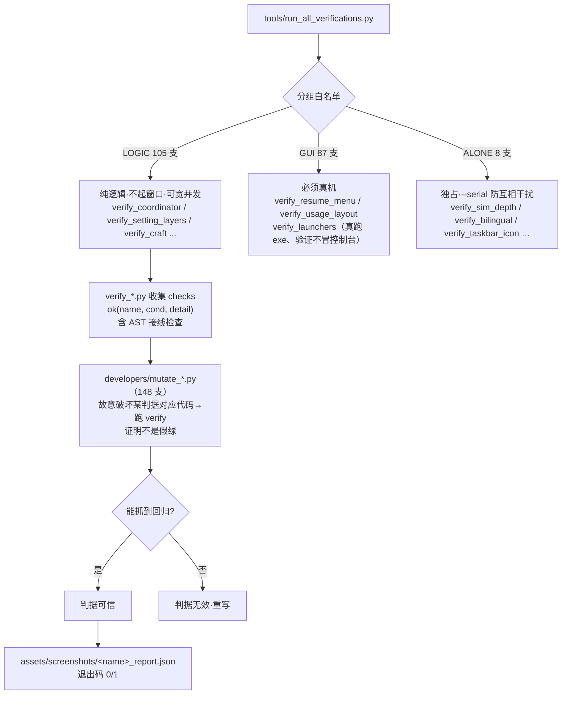

**先跑 `--groups`，别直接跑全量**

```
./.venv/Scripts/python.exe tools/run_all_verifications.py --groups
```

白名单**自己会坏**：磁盘上有、但没登记分组的脚本，会让整轮回归**一启动就报错退出** ——
"以为很久没跑"其实"早就跑不起来"（2026-10-25 一次 11 支）。

**三条铁律**

1. **判据必须配反例法变异**证明"它真的会红"；没被判据看过的 = 没做。
2. **判据红了先分辨哪一类**：口径过期 / 漏了一条 / 太严 / **设计被用户推翻**。
   最后一类要改口径（不是删判据）—— `verify_map_detail` 的 E3 就是被"要多复用"这条需求推翻的。
3. **空跑不算绿**；**反例法与回归都必须单飞**（并行时会互相改被测文件）。

**几支判据的规模（核对当时）**

| 判据 | 条数 | 守什么 |
|---|---|---|
| `verify_minimap` | 119 | 小地图矢量绘制（像素级） |
| `verify_export` | 118 | 三档装订 + 按事件装订 + 润色链 |
| `verify_run_side_panels` | 83 | 右栏面板（尺寸、可点、跳转） |
| `verify_autosave` | 83 | 定时落盘 / 续跑 / 停点 |
| `verify_plot_overview` | **58** | 剧情总览（A 选项 / B 生成 / C 存取 / D 控件 / E 接线 / F·H 反例 / G 详细剧情） |
| `verify_progress_split` | 52 | 进度表拆分 + 跨度/篇幅 + 装配 |
| `verify_beat_time` | **44** | 故事时间与日界（含 5 条反例，刻意**不真跑**） |
| `verify_map_detail` / `verify_map_anchor` | 47 / **26** | 地图存档复用 / 锚定一致性 |
| `verify_writer_units` | **35** | 写作层按情节单元（含 3 条就地反例） |
| `verify_ui_english` | 36 | 英文界面 0 处未翻译 |
| `verify_mutation_anchors` | 14 | 反例法自己的锚点还找得到吗（**锚点也会过期**） |

> ⚠ **`verify_beat_time` 刻意不真跑**：真跑一轮 mock 下也 4.5 秒/拍，而这组验的是判定函数
> （`_beat_minutes_now` / `_day_boundary_due`），假 world 毫秒级就够。
> ⚠ **判据里要显式关掉外部服务**：`MOCK_LLM=true` **管不到** MuMu/PenShot/PlotPilot，
> `.env` 里 `MUMU_ENABLED=true` 时 `verify_day_plan` 从 8 秒变 **528 秒**、7 条判据连锁红。
> ⚠ **锚点会随重构搬家**：`verify_mutation_anchors` 就是扫这个的（曾一次 8 条失效）。
> 修法是**缩短到"只含定义该行为的最小真实片段"**，不是删前缀 —— 删完就命中 0 次。

**启动器这一路的特别之处**（见 §11）：`verify_launchers.py` 守护的是**编出来的可执行文件**，
所以它的反例法要"改 Go 源码 → **重新交叉编译** → 覆盖根目录三个 exe → 跑判据 → **源码与产物都还原**"，
别处改一个 `.py` 就够。三条铁律：①"判据自己崩了"不算"判据变红"（必须有 `✗` 开头且含预期名字的行）；
②`build.py` 报错**不等于**"变异没打上"（它自检会拦下坏事，并已把坏产物写进 `dist/`）；
③还原必须彻底（`dist/` 里 12 个产物同样被污染）。另有一条**双语注释**判据
`verify_script_bilingual.py`，扫 `launchers/*.go` 的 `notify` / `confirm` / `bi` 调用点。

---

## 13. 关键数据流总图（一图串起全部）

```mermaid
flowchart TD
    main["main.py → start_gui → NovelWorldApp.main（开始界面）"] -->|选/建项目 + 开卷| assemble["sim/setup.assemble"]
    assemble --> bind["catalog.bind_project + agents.bind_world<br/>+ _resolve_node_spans（跨度/篇幅进内存）"]
    bind --> qibi["点「起笔」→ page.run_task(RunLoop.run)"]

    qibi --> openday["每天: _open_day<br/>_crew_prep → _compose_day(编剧室) → _plan_day"]
    openday --> budget["day_plan 读 progress.py<br/>跨度 + 篇幅 → 拍预算 40~60 / 15~25 / 3~8 / 1"]
    budget --> tick["每拍: _tick"]
    tick --> walk["_walk_beat_time<br/>推 跨度÷剩余拍数 分钟"]
    tick --> director["director.on_tick 盯戏/介入"]
    tick --> decide["选在场人物 → Agent.decide"]
    decide --> semi["半固定层 {… ⑦导演提示 → ⑧协调引擎 actor_directive<br/>→ MEMORY_TRUST_RULES}"]
    semi --> chat["llm.chat('daily', json_mode) → Action"]
    decide --> craft["剧组职位 work → craft_block<br/>⑥ 协调引擎 crew_directive"]
    chat --> process["_process_actions → SceneBuilder → 中栏叙事区"]
    process --> screen["_stage_push 上屏 + 落盘"]

    screen --> endday["_end_day 收工"]
    endday --> carry{"还有剩拍?"}
    carry -->|是| carrybt["_carry_unplayed_beats<br/>明天接着演这一站"]
    carry -->|否| gap["_flush_station_gap<br/>把余量一次跳掉 + 旁白"]

    endday --> novel["_day_novel 整理稿<br/>crew/unit_plan 按情节单元"]
    novel --> save["每天的生活/第NNN天.(md|json)<br/>+ 当日剧本.json（分拍/正文/分镜）"]
    save --> flow["plot/flow.build_flow<br/>剧情总览.json（零 LLM）"]
    save --> expo["export/novel_version<br/>三档装订 + 按事件装订"]
    flow --> flowui["gui/story_flow_dialog<br/>详细剧情 / 流程图"]
    expo --> out["输出到 导出/ 目录"]

    aibox["★ 运行窗口底部 AI 输入框"] -->|自然语言| coord["Coordinator.handle<br/>（⑥/⑧ 当拍生效）"]
    coord -.现读.-> craft
    coord -.现读.-> semi

    style aibox fill:#ffe8cc,stroke:#d9480f
    style coord fill:#d3f9d8,stroke:#2b8a3e
    style craft fill:#d0ebff,stroke:#1971c2
    style semi fill:#d0ebff,stroke:#1971c2
    style walk fill:#fff3bf,stroke:#f08c00
    style flow fill:#e5dbff,stroke:#6741d9
```

---

## 14. 导出（五档 + 三条装订纪律）

**五档**（`export/bundle.KINDS`，顺序 = 界面显示顺序 = 导出顺序）

| 档 | 标签 | 花钱 | 是什么 |
|---|---|---|---|
| `raw_novel` | **原始稿** | 否 | 按天装订，一个字都不动，不剃细节、不润色、不合并。**当初到底写了什么，以它为准** |
| `novel` | **最终改写稿** | 否（除非开 `MUMU_FOR_EXPORT`） | 剃掉过程细节，读起来像小说。⚠ 开着重写开关时正文会被重写，要"一字不改"请看原始稿 |
| `reference` | **原始稿加细节** | 否 | 正文一字不改，另外留着过程细节，用来对照"这句是从哪条设定长出来的" |
| `report` | 运行报告 | 是 | 概览、账单、人物表现、优化建议 |
| `guide` | 写作指导 | 是 | 推演后的写作大纲 |

**三条装订纪律（每一条都是踩出来的）**

1. **文件名 `{档名}_v{N}_第A-B天[_润色].md`，`_vN` 必须在最前面**
   —— `next_version()` 靠 `glob(f'{stem}_v*.md')` 找下一个号，把 `_vN` 挪到中间就退回 v1 重号。
2. **按事件装订，不按天**（``group_days_by_event``(:294)）：**前一天只演一个站**、且**今天从这个站开始**
   ⇒ 同一事件跨天，合成一章 `## 第 3-4 天 · 入楼收留`，章内每天一行粗体 `**第 3 天 · 时辰**`。
   判据很保守，因为「章名与内容不符比不合并更糟」（前一天演两站时不合并）。
   **不跨天时输出逐字等于旧结构** —— 五十多条既有判据按旧结构断言，破坏它就是全盘误红。
3. **`read_day_full()`(:191)：`.json` 优先、退回 `.md`，用同一个渲染器**
   —— 这是内容级事故的修法，见下面那条教训。

**事故与教训（"原始稿和最终成稿完全不是一个故事"）**

| 层 | 病 | 修 |
|---|---|---|
| ① 落盘 | `flush_daily_script` 写 md+json，`flush_daily`（纯文本）**只写 md**，两者**共用同一文件名** ⇒ 收工后 `_builder=None` 掉进纯文本分支，用残稿盖掉整天的剧本（实测 json 133 幕/21.3 万字 → md 只剩 **381 字**） | `flush_daily` 见 `.json` 边车就**拒绝覆盖**；`_script_mode` 且 `_builder is None` 时**正文一个字不动** |
| ② 读取 | `read_day` 只读 `.md`，而续跑用 `read_daily_script()` 优先读 json | 全部改走 `read_day_full()` |
| ③ 姊妹面 | `list_days` 只扫 `*.md` ⇒ **某天 md 丢了那天会整个消失且不报错** | 改 md ∪ json 并集 |

**导出并发（"我只导了一次"经常是错觉）**

点「停止」= 收工自动导出，**再加**手动导出就出 v1/v2，两份正文可以完全不同。
2026-10-26 起四个 `EXPORT_ON_END_*` 出厂默认**全关**，导出回到"你点了才发生"。
`export/bundle._EXPORT_STATE` 是进程内状态机：

| 字段 | 干什么 |
|---|---|
| `inflight` | 谁在跑（`auto` / `manual` / 空）—— **必须先记"正在跑"**，只记"已导出"拦不住并发 |
| `auto_done` | 哪些档自动导出过了 ⇒ 手动默认跳过它们 |

> ⚠ 忙时必须**明说**（返回 `busy=True`），否则界面显示"完成 0/0 项"，看起来像成功。
> ⚠ 开关全关还要想"空状态怎么办"：界面原来按 `auto` 算默认勾选 ⇒ **导出框一片空白、点导出报"至少选一样"**，
> 把"默认关闭"变成"默认不能用"。兜底要**只勾零成本档**（全勾会把要花 token 的也默认勾上）。

---

## 15. 已知偏差与待修清单（2026-10-26 审核发现）

> 这一节是**审核结论**，不是设计意图。每条都标了"这是文档过期 / 判据过期 / 代码真问题"，
> 免得下一个人拿着红判据去改没坏的东西。

### 15.1 代码真问题（会咬人，但本轮未改）

| # | 位置 | 问题 | 后果 |
|---|---|---|---|
| 1 | `booklab/store.py` | **有两个 `_overlap`**（:280 旧的"互相包含"版、:334 新的"公共片段"版） | 后者**静默覆盖**前者，旧的是死代码。这正是"同名定义静默覆盖"那个坑 —— 改 :280 那份**一点效果都没有** |
| 2 | `config.py` `WRAP_WAIT_SECONDS` | 357 个键里**唯一一个产品源码零读取**的（只有 `tools/` 读它当超时） | 就是"挂着拧不动的旋钮"。要么接上（界面等待用它），要么从 `SPEC` 删掉 |
| 3 | `plot/flow.is_stale` | 在 `__all__` 里，但**没有任何调用方**（`ensure_flow` 自己判旧，不走它） | 公开 API 空转。留着无害，但别以为它在用 |
| 4 | `llm/embedding.py` | **死模块**：运行时 `sys.modules` 里从未加载，`EMBEDDING_PROVIDER` 只影响界面显示 | 界面已隐藏（`EMBEDDING_BOX_VISIBLE=False`）、文档已降级为"可选"。要么接进 `db.retrieve_memory`，要么删 |
| 5 | 工程内 **517 个 `*.bak*`** | 发布包的 `EXCLUDE_FILE_GLOBS` 已覆盖 `*.bak*`，**不会进包** | 但工程内很脏；且 2026-10-22 曾有一个 `llm_models.json.bak-*` **带真 API Key** 被漏掉、靠发布前自检抓出来 |

### 15.2 判据过期（红的原因是判据，不是功能）

| # | 判据 | 红的原因 | 该怎么办 |
|---|---|---|---|
| 1 | `verify_config_sweep` **C4 ×2** | `_finish` 被拆成 `_finish` + `_finish_steps`，`_write_ending` 的调用点搬到了后者，而判据仍在查 `_finish` 的源码 | 判据改查 `_finish_steps`（功能是好的） |
| 2 | `verify_config_sweep` **D1** | 就是 15.1 第 2 条那个零读取键 | 接上或删键，不是放宽判据 |
| 3 | `verify_resume_manage` 56/60 | 备份还原法确认**与 2026-10-26 的导出改动无关**（把 `novel_version.py` 还原成改前版本后仍然崩） | 单独查 `cdlgs[-1]` IndexError |
| 4 | `verify_bilingual` 13/16 | 拼进来的 `novelservices/` 第三方源码里本来就有中文/英文混排 | 白名单里加 `novelservices/`，或判据只扫本工程 |

### 15.3 文档本次修正了什么（供对照）

| 旧说法 | 现在 | 依据 |
|---|---|---|
| 幕后 **14 个职位** | **19 个注册职位 + 4 服务岗 + 1 对外服务岗 = 24 份 spec** | `roster.ROSTER` / `catalog._builtin_specs()` |
| `craft_block(:1437)` `NovelWorldApp(:6359)` `start_gui(:27708)` `RunLoop(:253)` `Agent.decide(:180)` `Project(:38)` | 2405 / 7440 / 35061 / 400 / 216 / 71 | 逐个 grep 核对 |
| 一拍 `_advance_clock` 真实流逝×TIME_RATIO；日界=跨 24 点 | **`_walk_beat_time` 按跨度÷拍数推；日界=拍预算用完**（旧路径保留在 `_advance_clock_legacy`） | §4.5 |
| 发布包**整目录排除** `novelservices/` | **0.3.2 起随包发布**（实测 `发布版本/0.3.3/novelservices` 存在） | `check_release.MUST_ABSENT` 已删该项 |
| §12 只说"LOGIC/GUI/ALONE 三组" | **105 / 87 / 8 = 200 支**；磁盘 201 个 `verify_*.py`（`verify_ui_common` 是公共库） | `--groups` |
| 无 | 新增 §4.5/4.6/4.7（时间·日界·收工·收尾）、§6.5（写作层按情节单元）、§10.5（剧情总览）、§10.6（地图锚定）、§14（导出五档） | 2026-10-26 三块改动 |

---

## 附录：本软件几条贯穿性设计纪律（来自项目记忆）

1. **协调引擎注入点纪律**：剧组唯一注入口 `craft_block` 末尾⑥；演员唯一半固定层 `Agent.decide` 第⑧段（在 `MEMORY_TRUST_RULES` 之前）；均惰性 import、每拍现读、不缓存单例指令。
2. **判据必须配反例法**：判据不看"源码含字符串"，用行为判/AST 判；期望值用绝对数；计数不许去重；锚点须恰好命中一次。
3. **异步约定**：UI 事件里跑协程一律 `page.run_task(coro)`，不裸 `asyncio.run`。
4. **安全默认值取"不生效"侧**：如 AI 输入框默认显示但不强制；`handle()` 永不抛异常。
5. **状态两来源都要报界面**：状态有两个来源时两边都要上屏，这类 bug 不抛异常。
6. **外部服务只当增强项**：三座服务（§11）缺席是**被支持的常态**；任何一步（备环境 / 停服务）失败都**不许**改变主程序退出码、启动时**不弹窗**拦人。
7. **"同一件事两处实现"是万恶之源**：能交给一份真相就别写第二份（"怎么跟服务打交道"只有一张 `services.go` 的表；MuMu 因此不并进统一控制器）。
8. **真实用户路径必须单独有判据**：测试钩子摆布得了的路径 ≠ 用户机上的路径。`.env` 这类"用户机上唯一的来源"要**自己拷一份 exe + 自制 `.env`** 来钉，否则钩子全失效也照常绿（反例法实测踩过：`followFor` 的 `.env` 分支整段坏掉，C 组一条没红）。
9. **★★★ "可数槽必须闭集"**：指标一吃自由文本，模型换个说法就归零（同义词是字面判据的漏报后门）。
   跨度 `SPANS`、篇幅 `WEIGHTS`、转折 `caption`、导出档 `KINDS` 全是闭集，理由都是这一条。
10. **★★★ 数据里不许冻语言**：盘上的 `.json` 只存**代码 + 参数**（`{why:'place', a, b}`），
    排版交界面按当前语言拼。把拼好的中文句子写进 JSON ⇒ 切英文那几行还是中文，
    而 `t()` **不报错**。唯一例外是"用户/模型写的原文"（如 `event.text`、站名）。
11. **★★★ 推断必须标注**：凡是程序推出来的（跨度、篇幅、年龄层、选项），
    要么写"推断：…（程序推的，可改）"，要么给一个显式字段让人钉死。**作者写的一个字都不动。**
12. **★★★ "改默认值" ≠ "改实际值"**：`SPEC.default` 只影响新装用户；老用户 `.env` 里已写死的值不会被覆盖。
    改默认值必须**同时**改 `.env`，否则"新装关了、现用的没变"。判据验出厂默认要查 `SPEC[...]['default']`，
    **不能查 `CFG.b()`**。
13. **★★★ 停止要传到写稿那一侧**：凡是"分段的循环"（整理稿的段循环、MuMu 逐天重写），**每段开头问一次**；
    停下时**用手上已有的交**（标"失败" ⇒ 下游一个字都不落盘 ⇒ 已花的钱全扔）。
14. **★★★ "零成本"是产品承诺**：剧情总览、地图锚定、导出前两档都**不调模型**。
    在刷新/打开路径上花钱，用户点一次就可能被扣一笔 —— 这类功能一律走"读盘 + 纯函数"。
15. **★★★ 兜底路径不许花 LLM**：停止时的兜底只**搬运现成稿**；整理只在收工跑一次。
